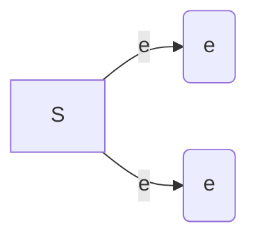

# 第三章 多维随机变量及其分布

原始 PDF 第 76–105 页。

## 第三章 多维随机变量及其分布

## § 1 二维随机变量

以上我们只限于讨论一个随机变量的情况,但在实际问题中,对于某些随机试验的结果需要同时用两个或两个以上的随机变量来描述.例如,为了研究某一地区学龄前儿童的发育情况,对这一地区的儿童进行抽查.对于每个儿童都能观察到他的身高 H 和体重 W.在这里,样本空间  $S=\{e\}=\{$  某地区的全部学龄前儿童 $\}$ ,而  $H(e)$  和  $W(e)$  是定义在 S 上的两个随机变量.又如炮弹弹着点的位置需要由它的横坐标和纵坐标来确定,而横坐标和纵坐标是定义在同一个样本空间的两个随机变量.

一般，设 $E$ 是一个随机试验，它的样本空间是 $S = \{e\}$，设 $X = X(e)$ 和 $Y = Y(e)$ 是定义在 $S$ 上的随机变量，由它们构成的一个向量 $(X, Y)$，叫做二维随机向量或二维随机变量（如图3-1). 第二章讨论的随机变量也叫一维随机变量.

flowchart

图3-1

二维随机变量 $(X,Y)$ 的性质不仅与 $X$ 及 $Y$

有关, 而且还依赖于这两个随机变量的相互关系. 因此, 逐个地来研究 $X$ 或 $Y$ 的性质是不够的, 还需将 $(X, Y)$ 作为一个整体来进行研究.

和一维的情况类似,我们也借助“分布函数”来研究二维随机变量.

定义 设 $(X,Y)$ 是二维随机变量, 对于任意实数 $x, y$, 二元函数:

$$
F (x, y) = P \{(X \leqslant x) \cap (Y \leqslant y) \} {\stackrel {\text {记成}} {=}} P \{X \leqslant x, Y \leqslant y \}
$$

称为二维随机变量 $(X,Y)$ 的分布函数,或称为随机变量X和Y的联合分布函数.

如果将二维随机变量 $(X,Y)$ 看成平面上随机点的坐标,那么,分布函数 $F(x,y)$ 在 $(x,y)$ 处的函数值就是随机点 $(X,Y)$ 落在如图3-2所示的,以点 $(x,y)$ 为顶点而位于该点左下方的无穷矩形域内的概率.

依照上述解释,借助于图3-3容易算出随机点 $(X,Y)$ 落在矩形域 $\{(x,y)\mid x_{1}<x\leqslant x_{2},y_{1}<y\leqslant y_{2}\}$ 的概率为

---

· 62 ·

第三章 多维随机变量及其分布

$$
\begin{array}{l} P \{x _ {1} <   X \leqslant x _ {2}, y _ {1} <   Y \leqslant y _ {2} \} \\ = F (x _ {2}, y _ {2}) - F (x _ {2}, y _ {1}) + F (x _ {1}, y _ {1}) - F (x _ {1}, y _ {2}). \tag {1.1} \\ \end{array}
$$

text_image

y
(x,y)
O
x

图3-2

text_image

y
y₂
y₁
O x₁ x₂ x

图3-3

分布函数 $F(x,y)$ 具有以下的基本性质:

$1^{\circ}F(x,y)$ 是变量 $x$ 和 $y$ 的不减函数，即对于任意固定的 $y$ ，当 $x_{2} > x_{1}$ 时$F(x_{2},y)\geqslant F(x_{1},y)$ ；对于任意固定的 $x$ ，当 $y_{2} > y_{1}$ 时 $F(x,y_2)\geqslant F(x,y_1)$

$2^{\circ}0\leqslant F(x,y)\leqslant 1$ ，且

对于任意固定的 $y, F(-\infty, y) = 0$

对于任意固定的 $x, F(x, -\infty) = 0$

$$
F (- \infty , - \infty) = 0, F (\infty , \infty) = 1.
$$

上面四个式子可以从几何上加以说明.例如，在图3-2中将无穷矩形的右面边界向左无限平移(即 $x\to -\infty$ )，则“随机点 $(X,Y)$ 落在这个矩形内”这一事件趋于不可能事件，故其概率趋于0，即有 $F(-\infty ,y) = 0$ ；又如当 $x\to \infty ,y\to \infty$ 时图3-2中的无穷矩形扩展到全平面，随机点 $(X,Y)$ 落在其中这一事件趋于必然事件，故其概率趋于1，即 $F(\infty ,\infty) = 1$

$3^{\circ}F(x + 0,y) = F(x,y),F(x,y + 0) = F(x,y)$ ，即 $F(x,y)$ 关于 $x$ 右连续，关于 $y$ 也右连续.

$4^{\circ}$ 对于任意 $(x_{1},y_{1}),(x_{2},y_{2}),x_{1}<x_{2},y_{1}<y_{2}$ ，下述不等式成立:

$$
F (x _ {2}, y _ {2}) - F (x _ {2}, y _ {1}) + F (x _ {1}, y _ {1}) - F (x _ {1}, y _ {2}) \geqslant 0.
$$

这一性质由(1.1)式及概率的非负性即可得.

如果二维随机变量 $(X,Y)$ 全部可能取到的值是有限对或可列无限多对，则称 $(X,Y)$ 是二维离散型随机变量.

设二维离散型随机变量 $(X,Y)$ 所有可能取的值为 $(x_{i},y_{j}),i,j=1,2,\cdots$ ，记 $P\{X=x_{i},Y=y_{j}\}=p_{ij},i,j=1,2,\cdots$ ，则由概率的定义有

$$
p _ {i j} \geqslant 0, \quad \sum_ {i = 1} ^ {\infty} \sum_ {j = 1} ^ {\infty} p _ {i j} = 1.
$$

---

§ 1 二维随机变量

· 63 ·

我们称  $P\{X=x_{i},Y=y_{j}\}=p_{ij}, i,j=1,2,\cdots$  为二维离散型随机变量  $(X,Y)$  的分布律，或称为随机变量 X 和 Y 的联合分布律.

我们也能用表格来表示 X 和 Y 的联合分布律, 如下表所示①.

| Y\\X | $x_{1}$ | $x_{2}$ | ... | $x_{i}$ | ... |
| --- | --- | --- | --- | --- | --- |
| $y_{1}$ | $p_{11}$ | $p_{21}$ | ... | $p_{i1}$ | ... |
| $y_{2}$ | $p_{12}$ | $p_{22}$ | ... | $p_{i2}$ | ... |
| $\vdots$ | $\vdots$ | $\vdots$ |  | $\vdots$ |  |
| $y_{j}$ | $p_{1j}$ | $p_{2j}$ | ... | $p_{ij}$ | ... |
| $\vdots$ | $\vdots$ | $\vdots$ |  | $\vdots$ |  |

例1 设随机变量 $X$ 在 $1,2,3,4$ 四个整数中等可能地取一个值，另一个随机变量 $Y$ 在 $1 \sim X$ 中等可能地取一整数值. 试求 $(X,Y)$ 的分布律.

解 由乘法公式容易求得 $(X,Y)$ 的分布律. 易知 $\{X = i, Y = j\}$ 的取值情况是: $i = 1,2,3,4,j$ 取不大于 $i$ 的正整数, 且

$$
P \{X = i, Y = j \} = P \{Y = j \mid X = i \} P \{X = i \} = \frac {1}{i} \cdot \frac {1}{4}, \quad i = 1, 2, 3, 4, j \leqslant i.
$$

于是 $(X,Y)$ 的分布律为

| Y\\X | 1 | 2 | 3 | 4 |
| --- | --- | --- | --- | --- |
| 1 | $\frac{1}{4}$ | $\frac{1}{8}$ | $\frac{1}{12}$ | $\frac{1}{16}$ |
| 2 | 0 | $\frac{1}{8}$ | $\frac{1}{12}$ | $\frac{1}{16}$ |
| 3 | 0 | 0 | $\frac{1}{12}$ | $\frac{1}{16}$ |
| 4 | 0 | 0 | 0 | $\frac{1}{16}$ |

将 $(X,Y)$ 看成一个随机点的坐标，由图3-2知道离散型随机变量 $X$ 和 $Y$ 的联合分布函数为

$$
F (x, y) = \sum_ {x _ {i} \leqslant x} \sum_ {y _ {j} \leqslant y} p _ {i j}, \tag {1.2}
$$

其中和式是对一切满足 $x_{i} \leqslant x, y_{j} \leqslant y$ 的 $i, j$ 来求和的.

<small>① 考虑到读者的阅读习惯,本书表格形式与第四版一致.</small>

---

· 64 ·

第三章 多维随机变量及其分布

与一维随机变量相似,对于二维随机变量 $(X,Y)$ 的分布函数 $F(x,y)$ ,如果存在非负可积函数 $f(x,y)$ 使对于任意x,y有

$$
F (x, y) = \int_ {- \infty} ^ {y} \int_ {- \infty} ^ {x} f (u, v) \mathrm{d} u \mathrm{d} v,
$$

则称 $(X,Y)$ 是二维连续型随机变量，函数 $f(x,y)$ 称为二维连续型随机变量$(X,Y)$ 的概率密度，或称为随机变量 $X$ 和 $Y$ 的联合概率密度.

按定义,概率密度  $f(x,y)$  具有以下性质:

$1^{\circ}f(x,y)\geqslant 0.$

$2^{\circ}\int_{-\infty}^{\infty}\int_{-\infty}^{\infty}f(x,y)\mathrm{d}x\mathrm{d}y = F(\infty ,\infty) = 1.$

$3^{\circ}$ 设 $G$ 是 $xOy$ 平面上的区域，点 $(X,Y)$ 落在 $G$ 内的概率为

$$
P \{(X, Y) \in G \} = \iint_ {G} f (x, y) \mathrm{d} x \mathrm{d} y. \tag {1.3}
$$

$4^{\circ}$ 若 $f(x,y)$ 在点 $(x,y)$ 连续，则有

$$
\frac {\partial^ {2} F (x , y)}{\partial x \partial y} = f (x, y).
$$

由性质 $4^{\circ}$, 在 $f(x, y)$ 的连续点处有

$$
\begin{array}{l} \lim_{\substack{\Delta x\to 0^{+}\\ \Delta y\to 0^{+}}}\frac{P\{x <   X\leqslant x + \Delta x,y <   Y\leqslant y + \Delta y\}}{\Delta x\Delta y} \\ \xlongequal {\text {由(1.1)}} \lim_ {\substack {\Delta x \rightarrow 0 ^ {+}\\\Delta y \rightarrow 0 ^ {+}}} \frac {1}{\Delta x \Delta y} [ F (x + \Delta x, y + \Delta y) - F (x + \Delta x, y) - F (x, y + \Delta y) + F (x, y) ] \\ = \frac {\partial^ {2} F (x , y)}{\partial x \partial y} = f (x, y). \\ \end{array}
$$

这表示若 $f(x,y)$ 在点 $(x,y)$ 处连续，则当 $\Delta x,\Delta y$ 很小时

$$
P \{x <   X \leqslant x + \Delta x, y <   Y \leqslant y + \Delta y \} \approx f (x, y) \Delta x \Delta y,
$$

也就是点 $(X,Y)$ 落在小矩形 $(x,x + \Delta x]\times (y,y + \Delta y]$ 内的概率近似地等于$f(x,y)\Delta x\Delta y.$

在几何上 $z = f(x, y)$ 表示空间的一个曲面. 由性质 $2^{\circ}$ 知, 介于它和 $xOy$ 平面的空间区域的体积为1. 由性质 $3^{\circ}, P\{(X, Y) \in G\}$ 的值等于以 $G$ 为底, 以曲面 $z = f(x, y)$ 为顶面的柱体体积.

例 2 设二维随机变量 $(X,Y)$ 具有概率密度

$$
f (x, y) = \left\{ \begin{array}{l l} 2 \mathrm{e} ^ {- (2 x + y)}, & x > 0, y > 0, \\ 0, & \text {其他}. \end{array} \right.
$$

(1) 求分布函数  $F(x, y)$ . (2) 求概率  $P\{Y \leqslant X\}$ .

解 (1) $F(x,y) = \int_{-\infty}^{y}\int_{-\infty}^{x}f(x,y)\mathrm{d}x\mathrm{d}y$

---

§ 2 边缘分布

· 65 ·

$$
= \left\{ \begin{array}{l l} \int_ {0} ^ {y} \int_ {0} ^ {x} 2 \mathrm{e} ^ {- (2 x + y)} \mathrm{d} x \mathrm{d} y, & x > 0, y > 0, \\ 0, & \text {其他.} \end{array} \right.
$$

即有 $F(x,y) = \left\{ \begin{array}{ll}(1 - \mathrm{e}^{-2x})(1 - \mathrm{e}^{-y}), & x > 0,y > 0,\\ 0, & \text{其他.} \end{array} \right.$

(2) 将  $(X,Y)$  看作平面上随机点的坐标. 即有

$$
\{Y \leqslant X \} = \{(X, Y) \in G \},
$$

其中 G 为 xOy 平面上直线 y = x 及其下方的部分, 如图 3-4. 于是

$$
\begin{array}{l} P \{Y \leqslant X \} = P \{(X, Y) \in G \} = \iint_ {G} f (x, y) \mathrm{d} x \mathrm{d} y \\ = \int_ {0} ^ {\infty} \int_ {y} ^ {\infty} 2 \mathrm{e} ^ {- (2 x + y)} \mathrm{d} x \mathrm{d} y = \frac {1}{3}. \\ \end{array}
$$

以上关于二维随机变量的讨论,不难推广到 $n(n>2)$ 维随机变量的情况.一般,设E是一个随机试验,它的样本空间是 $S=\{e\}$ ,设 $X_{1}=X_{1}(e)$ , $X_{2}=X_{2}(e),\cdots,X_{n}=X_{n}(e)$ 是定义在S上的随机

text_image

y
O
x
G

图3-4

变量,由它们构成的一个 n 维向量 $(X_{1},X_{2},\cdots,X_{n})$ 称为 n 维随机向量或 n 维随机变量.

对于任意 n 个实数  $x_{1}, x_{2}, \cdots, x_{n}, n$  元函数

$$
F (x _ {1}, x _ {2}, \dots , x _ {n}) = P \{X _ {1} \leqslant x _ {1}, X _ {2} \leqslant x _ {2}, \dots , X _ {n} \leqslant x _ {n} \}
$$

称为 n 维随机变量  $(X_{1}, X_{2}, \cdots, X_{n})$  的分布函数或随机变量  $X_{1}, X_{2}, \cdots, X_{n}$  的联合分布函数. 它具有类似于二维随机变量的分布函数的性质.

## § 2 边缘分布

二维随机变量 $(X,Y)$ 作为一个整体，具有分布函数 $F(x,y)$. 而 $X$ 和 $Y$ 都是随机变量，各自也有分布函数，将它们分别记为 $F_{X}(x), F_{Y}(y)$，依次称为二维随机变量 $(X,Y)$ 关于 $X$ 和关于 $Y$ 的边缘分布函数. 边缘分布函数可以由 $(X,Y)$ 的分布函数 $F(x,y)$ 所确定，事实上，

$$
F _ {X} (x) = P \{X \leqslant x \} = P \{X \leqslant x, Y <   \infty \} = F (x, \infty),
$$

即 $F_{X}(x) = F(x,\infty).$ (2.1)

就是说, 只要在函数  $F(x, y)$  中令  $y \to \infty$  就能得到  $F_{X}(x)$ . 同理

$$
F _ {Y} (y) = F (\infty , y). \tag {2.2}
$$

对于离散型随机变量,由(1.2),(2.1)式可得

---

· 66 ·

第三章 多维随机变量及其分布

$$
F _ {X} (x) = F (x, \infty) = \sum_ {x _ {i} \leqslant x} \sum_ {j = 1} ^ {\infty} p _ {i j}.
$$

与第二章(3.2)式比较,知道X的分布律为

$$
P \{X = x _ {i} \} = \sum_ {j = 1} ^ {\infty} p _ {i j}, \quad i = 1, 2, \dots .
$$

同样， $Y$ 的分布律为

$$
P \{Y = y _ {j} \} = \sum_ {i = 1} ^ {\infty} p _ {i j}, \quad j = 1, 2, \dots .
$$

记 $p_{i\cdot} = \sum_{j=1}^{\infty} p_{ij} = P\{X = x_i\}, \quad i = 1,2,\cdots,$

$$
p _ {. j} = \sum_ {i = 1} ^ {\infty} p _ {i j} = P \{Y = y _ {j} \}, \quad j = 1, 2, \dots ,
$$

分别称 $p_i$. $(i = 1,2,\dots)$ 和 $p_{.j}(j = 1,2,\dots)$ 为 $(X,Y)$ 关于 $X$ 和关于 $Y$ 的边缘分布律（注意，记号 $p_i$ 中的“·”表示 $p_i$ 是由 $p_{ij}$ 关于 $j$ 求和后得到的；同样，$p_{.j}$ 是由 $p_{ij}$ 关于 $i$ 求和后得到的）.

对于连续型随机变量 $(X,Y)$ ，设它的概率密度为 $f(x,y)$ ，由于

$$
F _ {X} (x) = F (x, \infty) = \int_ {- \infty} ^ {x} \left[ \int_ {- \infty} ^ {\infty} f (x, y) \mathrm{d} y \right] \mathrm{d} x,
$$

由第二章(4.1)式知道， $X$ 是一个连续型随机变量，且其概率密度为

$$
f _ {X} (x) = \int_ {- \infty} ^ {\infty} f (x, y) \mathrm{d} y. \tag {2.3}
$$

同样， $Y$ 也是一个连续型随机变量，其概率密度为

$$
f _ {Y} (y) = \int_ {- \infty} ^ {\infty} f (x, y) \mathrm{d} x. \tag {2.4}
$$

分别称 $f_{X}(x), f_{Y}(y)$ 为 $(X, Y)$ 关于 $X$ 和关于 $Y$ 的边缘概率密度.

例 1 一整数 N 等可能地在  $1,2,3,\cdots,10$  十个值中取一个值. 设  $D=D(N)$  是能整除 N 的正整数的个数,  $F=F(N)$  是能整除 N 的素数的个数 (注意 1 不是素数). 试写出 D 和 F 的联合分布律, 并求边缘分布律.

解 先将试验的样本空间及 $D, F$ 取值的情况列出如下:

| 样本点 | 1 | 2 | 3 | 4 | 5 | 6 | 7 | 8 | 9 | 10 |
| --- | --- | --- | --- | --- | --- | --- | --- | --- | --- | --- |
| D | 1 | 2 | 2 | 3 | 2 | 4 | 2 | 4 | 3 | 4 |
| F | 0 | 1 | 1 | 1 | 1 | 2 | 1 | 1 | 1 | 2 |

---

§ 2 边缘分布

· 67 ·

$D$ 所有可能取的值为 $1,2,3,4;F$ 所有可能取的值为 $0,1,2$. 容易得到 $(D,F)$ 取 $(i,j),i = 1,2,3,4,j = 0,1,2$ 的概率，例如

$$
P \{D = 1, F = 0 \} = \frac {1}{1 0}, \quad P \{D = 2, F = 1 \} = \frac {4}{1 0},
$$

可得 $D$ 和 $F$ 的联合分布律及边缘分布律如下表所示:

| $F\ \ D$ | 1 | 2 | 3 | 4 | $P\{F=j\}$ |
| --- | --- | --- | --- | --- | --- |
| 0 | $\frac{1}{10}$ | 0 | 0 | 0 | $\frac{1}{10}$ |
| 1 | 0 | $\frac{4}{10}$ | $\frac{2}{10}$ | $\frac{1}{10}$ | $\frac{7}{10}$ |
| 2 | 0 | 0 | 0 | $\frac{2}{10}$ | $\frac{2}{10}$ |
| $P\{D=i\}$ | $\frac{1}{10}$ | $\frac{4}{10}$ | $\frac{2}{10}$ | $\frac{3}{10}$ | 1 |

即有边缘分布律

| D | 1 | 2 | 3 | 4 |
| --- | --- | --- | --- | --- |
| $p_k$ | $\frac{1}{10}$ | $\frac{4}{10}$ | $\frac{2}{10}$ | $\frac{3}{10}$ |

| F | 0 | 1 | 2 |
| --- | --- | --- | --- |
| $p_k$ | $\frac{1}{10}$ | $\frac{7}{10}$ | $\frac{2}{10}$ |

我们常常将边缘分布律写在联合分布律表格的边缘上,如上表所示.这就是“边缘分布律”这个名词的来源.

例 2 设随机变量 X 和 Y 具有联合概率密度 (图 3-5)

$$
f (x, y) = \left\{ \begin{array}{l l} 6, & x ^ {2} \leqslant y \leqslant x, \\ 0, & \text {其他}. \end{array} \right.
$$

求边缘概率密度 $f_{X}(x), f_{Y}(y)$.

text_image

y
y=x
y=x²
O
x

图3-5

解

$$
f _ {X} (x) = \int_ {- \infty} ^ {\infty} f (x, y) \mathrm{d} y = \left\{ \begin{array}{l l}  \int_ {x ^ {2}} ^ {x} 6 \mathrm{d} y = 6 (x - x ^ {2})  , & 0 \leqslant x \leqslant 1  , \\ 0  , & \text {其他}. \end{array} \right.
$$

$$
f _ {Y} (y) = \int_ {- \infty} ^ {\infty} f (x, y) \mathrm{d} x = \left\{ \begin{array}{l l}  \int_ {y} ^ {\sqrt {y}} 6 \mathrm{d} x = 6 (\sqrt {y} - y), & 0 \leqslant y \leqslant 1, \\ 0, & \text {其他}. \end{array} \right.
$$

其他.

□

---

· 68 ·

第三章 多维随机变量及其分布

例3 设二维随机变量 $(X,Y)$ 的概率密度为

$$
\begin{array}{l} f (x, y) = \frac {1}{2 \pi \sigma_ {1} \sigma_ {2} \sqrt {1 - \rho^ {2}}} \exp \left\{\frac {- 1}{2 (1 - \rho^ {2})} \left[ \frac {(x - \mu_ {1}) ^ {2}}{\sigma_ {1} ^ {2}} \right. \right. \\ \left. - 2 \rho \frac {\left(x - \mu_ {1}\right) \left(y - \mu_ {2}\right)}{\sigma_ {1} \sigma_ {2}} + \frac {\left(y - \mu_ {2}\right) ^ {2}}{\sigma_ {2} ^ {2}} \right] \Bigg \}, \\ \end{array}
$$

其中 $\mu_1, \mu_2, \sigma_1, \sigma_2, \rho$ 都是常数，且 $\sigma_1 > 0, \sigma_2 > 0, -1 < \rho < 1$. 我们称 $(X, Y)$ 为服从参数为 $\mu_1, \mu_2, \sigma_1, \sigma_2, \rho$ 的二维正态分布（这五个参数的意义将在下一章说明），记为 $(X, Y) \sim N(\mu_1, \mu_2, \sigma_1^2, \sigma_2^2, \rho)$. 试求二维正态随机变量的边缘概率密度.

解 $f_{X}(x) = \int_{-\infty}^{\infty}f(x,y)\mathrm{d}y$ ，由于

$$
\begin{array}{l} \frac {(y - \mu_ {2}) ^ {2}}{\sigma_ {2} ^ {2}} - 2 \rho \frac {(x - \mu_ {1}) (y - \mu_ {2})}{\sigma_ {1} \sigma_ {2}} \\ = \left(\frac {y - \mu_ {2}}{\sigma_ {2}} - \rho \frac {x - \mu_ {1}}{\sigma_ {1}}\right) ^ {2} - \rho^ {2} \frac {(x - \mu_ {1}) ^ {2}}{\sigma_ {1} ^ {2}}, \\ \end{array}
$$

于是

$$
f _ {X} (x) = \frac {1}{2 \pi \sigma_ {1} \sigma_ {2} \sqrt {1 - \rho^ {2}}} \mathrm{e} ^ {- \frac {(x - \mu_ {1}) ^ {2}}{2 \sigma_ {1} ^ {2}}} \int_ {- \infty} ^ {\infty} \mathrm{e} ^ {- \frac {1}{2 (1 - \rho^ {2})} \left(\frac {y - \mu_ {2}}{\sigma_ {2}} - \rho \frac {x - \mu_ {1}}{\sigma_ {1}}\right) ^ {2}} \mathrm{d} y.
$$

令

$$
t = \frac {1}{\sqrt {1 - \rho^ {2}}} \Big (\frac {y - \mu_ {2}}{\sigma_ {2}} - \rho \frac {x - \mu_ {1}}{\sigma_ {1}} \Big),
$$

则有

$$
f _ {X} (x) = \frac {1}{2 \pi \sigma_ {1}} \mathrm{e} ^ {- \frac {(x - \mu_ {1}) ^ {2}}{2 \sigma_ {1} ^ {2}}} \int_ {- \infty} ^ {\infty} \mathrm{e} ^ {- t ^ {2 / 2}} \mathrm{d} t,
$$

即 $f_{X}(x) = \frac{1}{\sqrt{2\pi}\sigma_{1}}\mathrm{e}^{-\frac{(x - \mu_{1})^{2}}{2\sigma_{1}^{2}}},\quad -\infty < x < \infty .$

同理

$$
f _ {Y} (y) = \frac {1}{\sqrt {2 \pi} \sigma_ {2}} \mathrm{e} ^ {- \frac {(y - \mu_ {2}) ^ {2}}{2 \sigma_ {2} ^ {2}}}, \quad - \infty <   y <   \infty .
$$

我们看到二维正态分布的两个边缘分布都是一维正态分布，并且都不依赖于参数 $\rho$ ，亦即对于给定的 $\mu_1, \mu_2, \sigma_1, \sigma_2$ ，不同的 $\rho$ 对应不同的二维正态分布，它们的边缘分布却都是一样的。这一事实表明，单由关于 $X$ 和关于 $Y$ 的边缘分布，一般来说是不能确定随机变量 $X$ 和 $Y$ 的联合分布的。

---

§ 3 条件分布

· 69 ·

## § 3 条件分布

我们由条件概率很自然地引出条件概率分布的概念.

设 $(X,Y)$ 是二维离散型随机变量,其分布律为

$$
P \{X = x _ {i}, Y = y _ {j} \} = p _ {i j}, \quad i, j = 1, 2, \dots .
$$

$(X,Y)$ 关于 $X$ 和关于 $Y$ 的边缘分布律分别为

$$
P \{X = x _ {i} \} = p _ {i.} = \sum_ {j = 1} ^ {\infty} p _ {i j}, \quad i = 1, 2, \dots ,
$$

$$
P \{Y = y _ {j} \} = p _ {. j} = \sum_ {i = 1} ^ {\infty} p _ {i j}, \quad j = 1, 2, \dots .
$$

设 $p_{.j} > 0$ ，我们来考虑在事件 $\{Y = y_j\}$ 已发生的条件下事件 $\{X = x_i\}$ 发生的概率，也就是来求事件

$$
\{X = x _ {i} \mid Y = y _ {j} \}, \quad i = 1, 2, \dots
$$

的概率.由条件概率公式,可得

$$
P \{X = x _ {i} \mid Y = y _ {j} \} = \frac {P \{X = x _ {i} , Y = y _ {j} \}}{P \{Y = y _ {j} \}} = \frac {p _ {i j}}{p _ {\cdot j}}, \quad i = 1, 2, \dots .
$$

易知上述条件概率具有分布律的性质:

$$
1 ^ {\circ} P \{X = x _ {i} | Y = y _ {j} \} \geqslant 0.
$$

$$
2 ^ {\circ} \sum_ {i = 1} ^ {\infty} P \{X = x _ {i} \mid Y = y _ {j} \} = \sum_ {i = 1} ^ {\infty} \frac {p _ {i j}}{p _ {\cdot j}} = \frac {1}{p _ {\cdot j}} \sum_ {i = 1} ^ {\infty} p _ {i j} = \frac {p _ {\cdot j}}{p _ {\cdot j}} = 1.
$$

于是我们引入以下的定义.

定义 设 $(X, Y)$ 是二维离散型随机变量，对于固定的 $j$，若 $P\{Y = y_j\} > 0$ 则称

$$
P \{X = x _ {i}   |   Y = y _ {j} \} = \frac {P \{X = x _ {i} , Y = y _ {j} \}}{P \{Y = y _ {j} \}} = \frac {p _ {i j}}{p _ {\cdot j}}, \quad i = 1, 2, \dots \tag {3.1}
$$

为在 $Y = y_{j}$ 条件下随机变量 $X$ 的条件分布律.

同样，对于固定的 $i$ ，若 $P\{X = x_i\} >0$ ，则称

$$
P \{Y = y _ {j} \mid X = x _ {i} \} = \frac {P \{X = x _ {i} , Y = y _ {j} \}}{P \{X = x _ {i} \}} = \frac {p _ {i j}}{p _ {i}}  , \quad j = 1, 2, \dots \tag {3.2}
$$

为在 $X = x_{i}$ 条件下随机变量 $Y$ 的条件分布律.

例1 在一汽车工厂中，一辆汽车有两道工序是由机器人完成的。其一是紧固3只螺栓，其二是焊接2处焊点。以 $X$ 表示由机器人紧固的螺栓中紧固得不良的数目，以 $Y$ 表示由机器人焊接的不良焊点的数目。据积累的资料知 $(X, Y)$ 具有分布律:

---

· 70 ·

第三章 多维随机变量及其分布

| Y\\X | 0 | 1 | 2 | 3 | P{Y=j} |
| --- | --- | --- | --- | --- | --- |
| 0 | 0.840 | 0.030 | 0.020 | 0.010 | 0.900 |
| 1 | 0.060 | 0.010 | 0.008 | 0.002 | 0.080 |
| 2 | 0.010 | 0.005 | 0.004 | 0.001 | 0.020 |
| P{X=i} | 0.910 | 0.045 | 0.032 | 0.013 | 1.000 |

（1）求在 $X = 1$ 的条件下，$Y$ 的条件分布律。（2）求在 $Y = 0$ 的条件下，$X$ 的条件分布律。

解 边缘分布律已经求出列在上表中.

(1) 在 $X = 1$ 的条件下, $Y$ 的条件分布律为

$$
P \{Y = 0 \mid X = 1 \} = \frac {P \{X = 1 , Y = 0 \}}{P \{X = 1 \}} = \frac {0 . 0 3 0}{0 . 0 4 5},
$$

$$
P \{Y = 1 \mid X = 1 \} = \frac {P \{X = 1 , Y = 1 \}}{P \{X = 1 \}} = \frac {0 . 0 1 0}{0 . 0 4 5},
$$

$$
P \{Y = 2 \mid X = 1 \} = \frac {P \{X = 1 , Y = 2 \}}{P \{X = 1 \}} = \frac {0 . 0 0 5}{0 . 0 4 5},
$$

或写成

| Y=k | 0 | 1 | 2 |
| --- | --- | --- | --- |
| P{Y=k\|X=1} | $\frac{6}{9}$ | $\frac{2}{9}$ | $\frac{1}{9}$ |

(2) 同样可得在 Y=0 的条件下 X 的条件分布律为

| X=k | 0 | 1 | 2 | 3 |
| --- | --- | --- | --- | --- |
| P{X=k\|Y=0} | $\frac{84}{90}$ | $\frac{3}{90}$ | $\frac{2}{90}$ | $\frac{1}{90}$ |

例2 一射手进行射击，击中目标的概率为 $p(0 < p < 1)$，射击直至击中目标两次为止。设以 $X$ 表示首次击中目标所进行的射击次数，以 $Y$ 表示总共进行的射击次数，试求 $X$ 和 $Y$ 的联合分布律及条件分布律。

解 按题意 Y=n 就表示在第 n 次射击时击中目标, 且在第 1 次, 第 2 次, …, 第 n-1 次射击中恰有一次击中目标. 已知各次射击是相互独立的, 于是

---

§ 3 条件分布

· 71 ·

不管 $m(m < n)$ 是多少，概率 $P\{X = m, Y = n\}$ 都应等于

$$
p \cdot p \cdot \underbrace {q \cdot q \cdot \cdots \cdot q} _ {n - 2 \text {个}} = p ^ {2} q ^ {n - 2} \quad (\text {这里} q = 1 - p).
$$

即得 $X$ 和 $Y$ 的联合分布律为

$$
P \{X = m, Y = n \} = p ^ {2} q ^ {n - 2}, \quad n = 2, 3, \dots ; m = 1, 2, \dots , n - 1.
$$

$$
\begin{array}{l} = p ^ {2} \sum_ {n = m + 1} ^ {\infty} q ^ {n - 2} = \frac {p ^ {2} q ^ {m - 1}}{1 - q} = p q ^ {m - 1}, \quad m = 1, 2, \dots , \\ P \{Y = n \} = \sum_ {m = 1} ^ {n - 1} P \{X = m, Y = n \} \\ = \sum_ {m = 1} ^ {n - 1} p ^ {2} q ^ {n - 2} = (n - 1) p ^ {2} q ^ {n - 2}, \quad n = 2, 3, \dots . \\ \end{array}
$$

又 $P\{X = m\} = \sum_{n = m + 1}^{\infty}P\{X = m,Y = n\} = \sum_{n = m + 1}^{\infty}p^{2}q^{n - 2}$

$$
\begin{array}{l} P \{Y = n \} = \sum_ {m = 1} ^ {n - 1} P \{X = m, Y = n \} \\ = \sum_ {m = 1} ^ {n - 1} p ^ {2} q ^ {n - 2} = (n - 1) p ^ {2} q ^ {n - 2}, \quad n = 2, 3, \dots . \\ \end{array}
$$

于是由(3.1)，(3.2)式得到所求的条件分布律为

当  $n=2,3,\cdots$  时，

$$
P \{X = m | Y = n \} = \frac {p ^ {2} q ^ {n - 2}}{(n - 1) p ^ {2} q ^ {n - 2}} = \frac {1}{n - 1}, \quad m = 1, 2, \dots , n - 1;
$$

当  $m=1,2,\cdots$  时，

$$
P \{Y = n \mid X = m \} = \frac {p ^ {2} q ^ {n - 2}}{p q ^ {m - 1}} = p q ^ {n - m - 1}, \quad n = m + 1, m + 2, \dots .
$$

例如， $P\{X=m|Y=3\}=\frac{1}{2},\quad m=1,2;$

$$
P \{Y = n \mid X = 3 \} = p q ^ {n - 4}, \quad n = 4, 5, \dots .
$$

现设 $(X,Y)$ 是二维连续型随机变量，这时由于对任意 $x,y$ 有 $P\{X = x\} = 0$ $P\{Y = y\} = 0$ ，因此就不能直接用条件概率公式引入“条件分布函数”了.

设 $(X,Y)$ 的概率密度为 $f(x,y),(X,Y)$ 关于 $Y$ 的边缘概率密度为 $f_{Y}(y)$. 给定 $y$, 对于任意固定的 $\varepsilon > 0$, 对于任意 $x$, 考虑条件概率

$$
P \{X \leqslant x \mid y <   Y \leqslant y + \varepsilon \},
$$

设 $P\{y < Y \leqslant y + \varepsilon\} > 0$，则有

$$
\begin{array}{l} P \{X \leqslant x \mid y <   Y \leqslant y + \varepsilon \} = \frac {P \{X \leqslant x , y <   Y \leqslant y + \varepsilon \}}{P \{y <   Y \leqslant y + \varepsilon \}} \\ = \frac {\int_ {- \infty} ^ {x} \left[ \int_ {y} ^ {y + \epsilon} f (x , y) \mathrm{d} y \right] \mathrm{d} x}{\int_ {y} ^ {y + \epsilon} f _ {Y} (y) \mathrm{d} y}. \\ \end{array}
$$

---

· 72 ·

第三章 多维随机变量及其分布

在某些条件下，当 $\varepsilon$ 很小时，上式右端分子、分母分别近似于 $\varepsilon \int_{-\infty}^{x} f(x, y) \mathrm{d}x$ 和 $\varepsilon f_{Y}(y)$，于是当 $\varepsilon$ 很小时，有

$$
P \{X \leqslant x \mid y <   Y \leqslant y + \varepsilon \} \approx \frac {\varepsilon \int_ {- \infty} ^ {x} f (x , y) \mathrm{d} x}{\varepsilon f _ {Y} (y)} = \int_ {- \infty} ^ {x} \frac {f (x , y)}{f _ {Y} (y)} \mathrm{d} x. \tag {3.3}
$$

与一维随机变量概率密度的定义式第二章(4.1)式比较,我们给出以下的定义.

定义 设二维随机变量 $(X,Y)$ 的概率密度为 $f(x,y),(X,Y)$ 关于Y的边缘概率密度为 $f_{Y}(y)$ . 若对于固定的 $y,f_{Y}(y)>0$ , 则称 $\frac{f(x,y)}{f_{Y}(y)}$ 为在Y=y的条件下X的条件概率密度, 记为①

$$
f _ {X | Y} (x \mid y) = \frac {f (x , y)}{f _ {Y} (y)}. \tag {3.4}
$$

称 $\int_{-\infty}^{x}f_{X|Y}(x\mid y)\mathrm{d}x = \int_{-\infty}^{x}\frac{f(x,y)}{f_Y(y)}\mathrm{d}x$ 为在 $Y = y$ 的条件下 $X$ 的条件分布函数，记为 $P\{X\leqslant x\mid Y = y\}$ 或 $F_{X|Y}(x\mid y)$，即

$$
F _ {X | Y} (x \mid y) = P \{X \leqslant x \mid Y = y \} = \int_ {- \infty} ^ {x} \frac {f (x , y)}{f _ {Y} (y)} \mathrm{d} x. \tag {3.5}
$$

类似地，可以定义 $f_{Y|X}(y\mid x) = \frac{f(x,y)}{f_X(x)}$ 和 $F_{Y|X}(y\mid x) = \int_{-\infty}^{y}\frac{f(x,y)}{f_X(x)}\mathrm{d}y.$

由(3.3)式知道,当  $\varepsilon$  很小时,有

$$
P \{X \leqslant x \mid y <   Y \leqslant y + \varepsilon \} \approx \int_ {- \infty} ^ {x} f _ {X | Y} (x \mid y) \mathrm{d} x = F _ {X | Y} (x \mid y),
$$

上式说明了条件密度和条件分布函数的含义.

例3设 $G$ 是平面上的有界区域，其面积为 $A$ .若二维随机变量 $(X,Y)$ 具有概率密度

$$
f (x, y) = \left\{ \begin{array}{l l}  \frac {1}{A}, & (x, y) \in G, \\ 0, & \text {其他}, \end{array} \right.
$$

则称 $(X,Y)$ 在 $G$ 上服从均匀分布. 现设二维随机变量 $(X,Y)$ 在圆域 $x^{2} + y^{2}\leqslant 1$ 上服从均匀分布，求条件概率密度 $f_{X|Y}(x|y)$.

解 由假设,随机变量 $(X,Y)$ 具有概率密度

<small>① 条件概率密度满足条件: $f_{X|Y}(x \mid y) = \frac{f(x, y)}{f_Y(y)} \geqslant 0;$</small>

<small>$\int_{-\infty}^{\infty}f_{X|Y}(x \mid y)\mathrm{d}x = \int_{-\infty}^{\infty}\frac{f(x,y)}{f_Y(y)}\mathrm{d}x = \frac{1}{f_Y(y)}\int_{-\infty}^{\infty}f(x,y)\mathrm{d}x = 1.$</small>

---

§ 3 条件分布

· 73 ·

$$
f (x, y) = \left\{ \begin{array}{l l} { \frac {1}{\pi},} & {x ^ {2} + y ^ {2} \leqslant 1,} \\ {0,} & {\text {其他},} \end{array} \right.
$$

且有边缘概率密度

$$
\begin{array}{l} f _ {Y} (y) = \int_ {- \infty} ^ {\infty} f (x, y) \mathrm{d} x \\ = \left\{ \begin{array}{l l} { \frac {1}{\pi} \int_ {- \sqrt {1 - y ^ {2}}} ^ {\sqrt {1 - y ^ {2}}} \mathrm{d} x = \frac {2}{\pi}   \sqrt {1 - y ^ {2}}  ,} & {- 1 \leqslant y \leqslant 1  ,} \\ {0  ,} & {\text {其他}.} \end{array} \right. \\ \end{array}
$$

于是当 $-1 < y < 1$ 时有

$$
f _ {X \mid Y} (x \mid y) = \left\{ \begin{array}{l l}  \frac {\frac {1}{\pi}}{\frac {2}{\pi} \sqrt {1 - y ^ {2}}} = \frac {1}{2 \sqrt {1 - y ^ {2}}}, & - \sqrt {1 - y ^ {2}} \leqslant x \leqslant \sqrt {1 - y ^ {2}}, \\ 0, & \text {其他}. \end{array} \right.
$$

当 $y = 0$ 和 $y = \frac{1}{2}$ 时 $f_{X|Y}(x|y)$ 的图形分别如图3-6，图3-7所示.

contour

| -1 | 0.5 |
| --- | --- |
| 1 | 0.5 |

图3-6

contour

| -0.866 | 0.577 |
| --- | --- |
| 0.866 | 0.577 |

图3-7

例 4 设数 X 在区间  $(0,1)$  上随机地取值，当观察到  $X = x (0 < x < 1)$  时，数 Y 在区间  $(x,1)$  上随机地取值。求 Y 的概率密度  $f_{Y}(y)$ 。

解 按题意 $X$ 具有概率密度

$$
f _ {X} (x) = \left\{ \begin{array}{l l} 1, & 0 <   x <   1, \\ 0, & \text {其他}. \end{array} \right.
$$

对于任意给定的值 $x(0 < x < 1)$，在 $X = x$ 的条件下 $Y$ 的条件概率密度为

$$
f _ {Y \mid X} (y \mid x) = \left\{ \begin{array}{l l} \frac {1}{1 - x}, & x <   y <   1, \\ 0, & \text {其他}. \end{array} \right.
$$

由(3.4)式得 $X$ 和 $Y$ 的联合概率密度为

---

· 74 ·

第三章 多维随机变量及其分布

$$
f (x, y) = f _ {Y \mid X} (y \mid x) f _ {X} (x) = \left\{ \begin{array}{l l} \frac {1}{1 - x}, & 0 <   x <   y <   1, \\ 0, & \text {其他.} \end{array} \right.
$$

于是得关于 $Y$ 的边缘概率密度为

$$
\begin{array}{l} f _ {Y} (y) = \int_ {- \infty} ^ {\infty} f (x, y) \mathrm{d} x \\ = \left\{ \begin{array}{l l} \int_ {0} ^ {y} \frac {1}{1 - x} \mathrm{d} x = - \ln (1 - y), & 0 <   y <   1, \\ 0, & \text {其他.} \end{array} \right. \\ \end{array}
$$

其他.

## § 4 相互独立的随机变量

本节我们将利用两个事件相互独立的概念引出两个随机变量相互独立的概念,这是一个十分重要的概念.

定义 设 $F(x, y)$ 及 $F_{X}(x), F_{Y}(y)$ 分别是二维随机变量 $(X, Y)$ 的分布函数及边缘分布函数. 若对于所有 $x, y$ 有

$$
P \{X \leqslant x, Y \leqslant y \} = P \{X \leqslant x \} P \{Y \leqslant y \}, \tag {4.1}
$$

即 $F(x,y) = F_{X}(x)F_{Y}(y),$ (4.2)

则称随机变量 X 和 Y 是相互独立的.

设 $(X,Y)$ 是连续型随机变量, $f(x,y)$ , $f_{X}(x)$ , $f_{Y}(y)$ 分别为 $(X,Y)$ 的概率密度和边缘概率密度,则X和Y相互独立的条件(4.2)式等价于:等式

$$
f (x, y) = f _ {X} (x) f _ {Y} (y) \tag {4.3}
$$

在平面上几乎处处①成立.

当 $(X,Y)$ 是离散型随机变量时,X和Y相互独立的条件(4.2)式等价于:对于 $(X,Y)$ 的所有可能取的值 $(x_{i},y_{j})$ 有

$$
P \{X = x _ {i}, Y = y _ {j} \} = P \{X = x _ {i} \} P \{Y = y _ {j} \}. \tag {4.4}
$$

在实际中使用(4.3)式或(4.4)式要比使用(4.2)式方便.

例如 §1 例 2 中的随机变量 X 和 Y, 由于

$$
f _ {X} (x) = \left\{ \begin{array}{l l} 2 \mathrm{e} ^ {- 2 x}, & x > 0, \\ 0, & \text {其他}, \end{array} \quad f _ {Y} (y) = \left\{ \begin{array}{l l} \mathrm{e} ^ {- y}, & y > 0, \\ 0, & \text {其他}, \end{array} \right. \right.
$$

故有 $f(x,y) = f_{X}(x)f_{Y}(y)$，因而 $X,Y$ 是相互独立的。

又如, 若 X, Y 具有联合分布律

<small>① 此处“几乎处处成立”的含义是:在平面上除去“面积”为零的集合以外,处处成立.</small>

---

§ 4 相互独立的随机变量

· 75 ·

| Y\\X | 0 | 1 | P{Y=j} |
| --- | --- | --- | --- |
| 1 | 1/6 | 2/6 | 1/2 |
| 2 | 1/6 | 2/6 | 1/2 |
| P{X=i} | 1/3 | 2/3 | 1 |

则有 $P\{X = 0,Y = 1\} = 1 / 6 = P\{X = 0\} P\{Y = 1\}$

$$
P \{X = 0, Y = 2 \} = 1 / 6 = P \{X = 0 \} P \{Y = 2 \},
$$

$$
P \{X = 1, Y = 1 \} = 2 / 6 = P \{X = 1 \} P \{Y = 1 \},
$$

$$
P \{X = 1, Y = 2 \} = 2 / 6 = P \{X = 1 \} P \{Y = 2 \},
$$

因而 $X, Y$ 是相互独立的.

再如 §2 例 1 中的随机变量 $F$ 和 $D$, 由于 $P\{D=1, F=0\}=1/10 \neq P\{D=1\} \times P\{F=0\}$, 因而 $F$ 和 $D$ 不是相互独立的.

下面考察二维正态随机变量 $(X,Y)$ ，它的概率密度为

$$
\begin{array}{l} f (x, y) = \frac {1}{2 \pi \sigma_ {1} \sigma_ {2} \sqrt {1 - \rho^ {2}}} \exp \left\{\frac {- 1}{2 (1 - \rho^ {2})} \left[ \frac {(x - \mu_ {1}) ^ {2}}{\sigma_ {1} ^ {2}} \right. \right. \\ \left. - 2 \rho \frac {(x - \mu_ {1}) (y - \mu_ {2})}{\sigma_ {1} \sigma_ {2}} + \frac {(y - \mu_ {2}) ^ {2}}{\sigma_ {2} ^ {2}} \right] \Bigg \}. \\ \end{array}
$$

由 §2 中例 3 知道, 其边缘概率密度 $f_{X}(x), f_{Y}(y)$ 的乘积为

$$
f _ {X} (x) f _ {Y} (y) = \frac {1}{2 \pi \sigma_ {1} \sigma_ {2}} \exp \left\{- \frac {1}{2} \left[ \frac {(x - \mu_ {1}) ^ {2}}{\sigma_ {1} ^ {2}} + \frac {(y - \mu_ {2}) ^ {2}}{\sigma_ {2} ^ {2}} \right] \right\}.
$$

因此，如果 $\rho = 0$ ，则对于所有 $x, y$ 有 $f(x, y) = f_X(x)f_Y(y)$，即 $X$ 和 $Y$ 相互独立。反之，如果 $X$ 和 $Y$ 相互独立，由于 $f(x, y), f_X(x), f_Y(y)$ 都是连续函数，故对于所有的 $x, y$ 有 $f(x, y) = f_X(x)f_Y(y)$。特别，令 $x = \mu_1, y = \mu_2$，自这一等式得到

$$
\frac {1}{2 \pi \sigma_ {1} \sigma_ {2} \sqrt {1 - \rho^ {2}}} = \frac {1}{2 \pi \sigma_ {1} \sigma_ {2}},
$$

从而  $\rho=0$ . 综上所述, 得到以下的结论:

对于二维正态随机变量 $(X,Y)$ ，X和Y相互独立的充要条件是参数 $\rho=0$ .

例 一负责人到达办公室的时间均匀分布在8～12时，他的秘书到达办公室的时间均匀分布在7～9时，设他们两人到达的时间相互独立，求他们到达办公室的时间相差不超过5 min(1/12 h)的概率.

解 设 $X$ 和 $Y$ 分别是负责人和他的秘书到达办公室的时间, 由假设 $X$ 和 $Y$ 的概率密度分别为

---

· 76 ·

第三章 多维随机变量及其分布

$$
f _ {X} (x) = \left\{ \begin{array}{l l} \frac {1}{4}, & 8 <   x <   1 2, \\ 0, & \text {其他}, \end{array} \right. \quad f _ {Y} (y) = \left\{ \begin{array}{l l} \frac {1}{2}, & 7 <   y <   9, \\ 0, & \text {其他}, \end{array} \right.
$$

因为 $X, Y$ 相互独立, 故 $(X, Y)$ 的概率密度为

$$
f (x, y) = f _ {X} (x) f _ {Y} (y) = \left\{ \begin{array}{l l} \frac {1}{8}, & 8 <   x <   1 2, 7 <   y <   9, \\ 0, & \text {其他.} \end{array} \right.
$$

按题意需要求概率 $P\{|X - Y| \leqslant 1 / 12\}$. 画出区域: $|x - y| \leqslant 1 / 12$, 以及长方形 $[8 < x < 12; 7 < y < 9]$, 它们的公共部分是四边形 $BCC'B'$, 记为 $G$ (如图3-8). 显然仅当 $(X, Y)$ 取值于 $G$ 内, 他们两人到达的时间相差才不超过 $1 / 12\mathrm{h}$. 因此, 所求的概率为

$$
\begin{array}{l} P \left\{\mid X - Y \mid \leqslant \frac {1}{1 2} \right\} = \iint_ {G} f (x, y) \mathrm{d} x \mathrm{d} y \\ = \frac {1}{8} \times (G \text {的面积}). \\ \end{array}
$$

而 $G$ 的面积 $=$ 三角形 $ABC$ 的面积一三角形 $AB'C'$ 的面积

$$
= \frac {1}{2} \left(\frac {1 3}{1 2}\right) ^ {2} - \frac {1}{2} \left(\frac {1 1}{1 2}\right) ^ {2} = \frac {1}{6}.
$$

于是 $P\left\{|X - Y|\leqslant \frac{1}{12}\right\} = \frac{1}{48}.$

即负责人和他的秘书到达办公室的时间相差不超过 5 min 的概率为 1/48. □

以上所述关于二维随机变量的一些概念,容易推广到 n 维随机变量的情况.

上面说过，n 维随机变量 $(X_{1}, X_{2}, \cdots, X_{n})$ 的分布函数定义为

$$
F (x _ {1}, x _ {2}, \dots , x _ {n}) = P \{X _ {1} \leqslant x _ {1}, X _ {2} \leqslant x _ {2}, \dots , X _ {n} \leqslant x _ {n} \},
$$

其中  $x_{1}, x_{2}, \cdots, x_{n}$  为任意实数.

若存在非负可积函数  $f(x_{1}, x_{2}, \cdots, x_{n})$ ，使对于任意实数  $x_{1}, x_{2}, \cdots, x_{n}$  有

$$
F (x _ {1}, x _ {2}, \dots , x _ {n}) = \int_ {- \infty} ^ {x _ {n}} \int_ {- \infty} ^ {x _ {n - 1}} \dots \int_ {- \infty} ^ {x _ {1}} f (x _ {1}, x _ {2}, \dots , x _ {n}) \mathrm{d} x _ {1} \mathrm{d} x _ {2} \dots \mathrm{d} x _ {n},
$$

则称  $f(x_{1},x_{2},\cdots,x_{n})$  为  $(X_{1},X_{2},\cdots,X_{n})$  的概率密度函数.

设 $(X_{1},X_{2},\cdots,X_{n})$ 的分布函数 $F(x_{1},x_{2},\cdots,x_{n})$ 为已知，则 $(X_{1},X_{2},\cdots,X_{n})$ 的 $k(1\leqslant k<n)$ 维边缘分布函数就随之确定.例如 $(X_{1},X_{2},\cdots,X_{n})$ 关于 $X_{1}$ 、关于 $(X_{1},X_{2})$ 的边缘分布函数分别为

$$
F _ {X _ {1}} (x _ {1}) = F (x _ {1}, \infty , \infty , \dots , \infty),
$$

text_image

y
9
A C' C
B' G
B
7
O 8 10 12 x

图3-8

---

§ 5 两个随机变量的函数的分布

· 77 ·

$$
F _ {X _ {1}, X _ {2}} (x _ {1}, x _ {2}) = F (x _ {1}, x _ {2}, \infty , \infty , \dots , \infty).
$$

又若  $f(x_{1}, x_{2}, \cdots, x_{n})$  是  $(X_{1}, X_{2}, \cdots, X_{n})$  的概率密度，则  $(X_{1}, X_{2}, \cdots, X_{n})$  关于  $X_{1}$ 、关于  $(X_{1}, X_{2})$  的边缘概率密度分别为

$$
\begin{array}{l} f _ {X _ {1}} (x _ {1}) = \int_ {- \infty} ^ {\infty} \int_ {- \infty} ^ {\infty} \dots \int_ {- \infty} ^ {\infty} f (x _ {1}, x _ {2}, \dots , x _ {n}) \mathrm{d} x _ {2} \mathrm{d} x _ {3} \dots \mathrm{d} x _ {n}, \\ f _ {X _ {1}, X _ {2}} (x _ {1}, x _ {2}) = \int_ {- \infty} ^ {\infty} \int_ {- \infty} ^ {\infty} \dots \int_ {- \infty} ^ {\infty} f (x _ {1}, x _ {2}, \dots , x _ {n}) \mathrm{d} x _ {3} \mathrm{d} x _ {4} \dots \mathrm{d} x _ {n}. \\ \end{array}
$$

若对于所有的  $x_{1}, x_{2}, \cdots, x_{n}$  有

$$
F (x _ {1}, x _ {2}, \dots , x _ {n}) = F _ {X _ {1}} (x _ {1}) F _ {X _ {2}} (x _ {2}) \dots F _ {X _ {n}} (x _ {n}),
$$

则称  $X_{1}, X_{2}, \cdots, X_{n}$  是相互独立的.

若对于所有的  $x_{1}, x_{2}, \cdots, x_{m}; y_{1}, y_{2}, \cdots, y_{n}$  有

$$
F (x _ {1}, x _ {2}, \dots , x _ {m}, y _ {1}, y _ {2}, \dots , y _ {n}) = F _ {1} (x _ {1}, x _ {2}, \dots , x _ {m}) F _ {2} (y _ {1}, y _ {2}, \dots , y _ {n}),
$$

其中  $F_{1}, F_{2}, F$  依次为随机变量  $(X_{1}, X_{2}, \cdots, X_{m}), (Y_{1}, Y_{2}, \cdots, Y_{n})$  和  $(X_{1}, X_{2}, \cdots, X_{m}, Y_{1}, Y_{2}, \cdots, Y_{n})$  的分布函数，则称随机变量  $(X_{1}, X_{2}, \cdots, X_{m})$  和  $(Y_{1}, Y_{2}, \cdots, Y_{n})$  是相互独立的.

我们有以下的定理,它在数理统计中是很有用的.

定理 设 $(X_{1},X_{2},\cdots,X_{m})$ 和 $(Y_{1},Y_{2},\cdots,Y_{n})$ 相互独立，则 $X_{i}(i=1,2,\cdots,m)$ 和 $Y_{j}(j=1,2,\cdots,n)$ 相互独立。又若h,g是连续函数，则 $h(X_{1},X_{2},\cdots,X_{m})$ 和 $g(Y_{1},Y_{2},\cdots,Y_{n})$ 相互独立。

(证明略.)

## § 5 两个随机变量的函数的分布

上一章 §5 中已经讨论过一个随机变量的函数的分布, 本节讨论两个随机变量的函数的分布. 我们只就下面几个具体的函数来讨论.

## (一) $Z = X + Y$ 的分布

设 $(X,Y)$ 是二维连续型随机变量，它具有概率密度 $f(x,y)$. 则 $Z = X + Y$ 仍为连续型随机变量，其概率密度为

$$
f _ {X + Y} (z) = \int_ {- \infty} ^ {\infty} f (z - y, y) \mathrm{d} y, \tag {5.1}
$$

或 $f_{X + Y}(z) = \int_{-\infty}^{\infty}f(x,z - x)\mathrm{d}x.$ (5.2)

又若 $X$ 和 $Y$ 相互独立，设 $(X,Y)$ 关于 $X,Y$ 的边缘概率密度分别为 $f_{X}(x)$，$f_{Y}(y)$，则(5.1)，(5.2)式分别化为

---

· 78 ·

第三章 多维随机变量及其分布

$$
f _ {X + Y} (z) = \int_ {- \infty} ^ {\infty} f _ {X} (z - y) f _ {Y} (y) \mathrm{d} y \tag {5.3}
$$

和

$$
f _ {X + Y} (z) = \int_ {- \infty} ^ {\infty} f _ {X} (x) f _ {Y} (z - x) \mathrm{d} x. \tag {5.4}
$$

这两个公式称为 $f_{X}$ 和 $f_{Y}$ 的卷积公式，记为 $f_{X} * f_{Y}$，即

$$
f _ {X} * f _ {Y} = \int_ {- \infty} ^ {\infty} f _ {X} (z - y) f _ {Y} (y) \mathrm{d} y = \int_ {- \infty} ^ {\infty} f _ {X} (x) f _ {Y} (z - x) \mathrm{d} x.
$$

证 先来求 $Z = X + Y$ 的分布函数 $F_{Z}(z)$，即有

$$
F _ {Z} (z) = P \{Z \leqslant z \} = \iint_ {x + y \leqslant z} f (x, y) \mathrm{d} x \mathrm{d} y,
$$

这里积分区域 $G: x + y \leqslant z$ 是直线 $x + y = z$ 及其左下方的半平面(如图3-9). 将二重积分化成累次积分, 得

$$
F _ {z} (z) = \int_ {- \infty} ^ {\infty} \left[ \int_ {- \infty} ^ {z - y} f (x, y) \mathrm{d} x \right] \mathrm{d} y.
$$

固定 $z$ 和 $y$ 对积分 $\int_{-\infty}^{z - y}f(x,y)\mathrm{d}x$ 作变量变换，令$x = u - y$ ，得

$$
\int_ {- \infty} ^ {z - y} f (x, y) \mathrm{d} x = \int_ {- \infty} ^ {z} f (u - y, y) \mathrm{d} u.
$$

text_image

y
x+y=z
O
x

图3-9

于是

$$
F _ {Z} (z) = \int_ {- \infty} ^ {\infty} \left[ \int_ {- \infty} ^ {z} f (u - y, y) \mathrm{d} u \right] \mathrm{d} y = \int_ {- \infty} ^ {z} \left[ \int_ {- \infty} ^ {\infty} f (u - y, y) \mathrm{d} y \right] \mathrm{d} u.
$$

由概率密度的定义即得(5.1)式. 类似可证得(5.2)式.

例1 设 $X$ 和 $Y$ 是两个相互独立的随机变量. 它们都服从 $N(0,1)$ 分布, 其概率密度为

$$
f _ {X} (x) = \frac {1}{\sqrt {2 \pi}} \mathrm{e} ^ {- x ^ {2} / 2}, \quad - \infty <   x <   \infty ,
$$

$$
f _ {Y} (y) = \frac {1}{\sqrt {2 \pi}} \mathrm{e} ^ {- y ^ {2} / 2}, \quad - \infty <   y <   \infty .
$$

求  $Z=X+Y$  的概率密度.

解 由(5.4)式

$$
\begin{array}{l} f _ {Z} (z) = \int_ {- \infty} ^ {\infty} f _ {X} (x) f _ {Y} (z - x) \mathrm{d} x \\ = \frac {1}{2 \pi} \int_ {- \infty} ^ {\infty} \mathrm{e} ^ {- \frac {x ^ {2}}{2}} \cdot \mathrm{e} ^ {- \frac {(z - x) ^ {2}}{2}} \mathrm{d} x = \frac {1}{2 \pi} \mathrm{e} ^ {- \frac {z ^ {2}}{4}} \int_ {- \infty} ^ {\infty} \mathrm{e} ^ {- \left(x - \frac {z}{2}\right) ^ {2}} \mathrm{d} x, \\ \end{array}
$$

令 $t = x - \frac{z}{2}$ 得

---

§ 5 两个随机变量的函数的分布

· 79 ·

$$
f _ {Z} (z) = \frac {1}{2 \pi} \mathrm{e} ^ {- \frac {z ^ {2}}{4}} \int_ {- \infty} ^ {\infty} \mathrm{e} ^ {- t ^ {2}} \mathrm{d} t = \frac {1}{2 \pi} \mathrm{e} ^ {- \frac {z ^ {2}}{4}} \sqrt {\pi} = \frac {1}{2 \sqrt {\pi}} \mathrm{e} ^ {- \frac {z ^ {2}}{4}}.
$$

即 $Z$ 服从 $N(0,2)$ 分布.

一般，设 X, Y 相互独立且  $X \sim N(\mu_{1}, \sigma_{1}^{2})$ ,  $Y \sim N(\mu_{2}, \sigma_{2}^{2})$ . 由 (5.4) 式经过计算知  $Z = X + Y$  仍然服从正态分布，且有  $Z \sim N(\mu_{1} + \mu_{2}, \sigma_{1}^{2} + \sigma_{2}^{2})$ . 这个结论还能推广到 n 个独立正态随机变量之和的情况. 即若  $X_{i} \sim N(\mu_{i}, \sigma_{i}^{2})$  ( $i = 1, 2, \cdots, n$ ), 且它们相互独立，则它们的和  $Z = X_{1} + X_{2} + \cdots + X_{n}$  仍然服从正态分布，且有  $Z \sim N(\mu_{1} + \mu_{2} + \cdots + \mu_{n}, \sigma_{1}^{2} + \sigma_{2}^{2} + \cdots + \sigma_{n}^{2})$ .

更一般地,可以证明有限个相互独立的正态随机变量的线性组合仍然服从正态分布.

例2 在一简单电路中，两电阻 $R_{1}$ 和 $R_{2}$ 串联连接，设 $R_{1}, R_{2}$ 相互独立，它们的概率密度均为

$$
f (x) = \left\{ \begin{array}{l l} { \frac {1 0 - x}{5 0},} & {0 \leqslant x \leqslant 1 0,} \\ {0,} & {\text {其他}.} \end{array} \right.
$$

求总电阻 $R = R_{1} + R_{2}$ 的概率密度.

解 由(5.4)式,R 的概率密度为

$$
f _ {R} (z) = \int_ {- \infty} ^ {\infty} f (x) f (z - x) \mathrm{d} x.
$$

易知仅当

$$
\left\{ \begin{array}{l l} 0 <   x <   1 0, \\ 0 <   z - x <   1 0, \end{array} \right. \text {即} \left\{ \begin{array}{l l} 0 <   x <   1 0, \\ z - 1 0 <   x <   z \end{array} \right.
$$

时上述积分的被积函数不等于零. 参考图 3-10, 即得

$$
f _ {R} (z) = \left\{ \begin{array}{l l}  \int_ {0} ^ {z} f (x) f (z - x) \mathrm{d} x, & 0 \leqslant z <   1 0, \\  \int_ {z - 1 0} ^ {1 0} f (x) f (z - x) \mathrm{d} x, & 1 0 \leqslant z \leqslant 2 0, \\ 0, & \text {其他}. \end{array} \right.
$$

line

| z | x=z | x=z-10 |
| --- | --- | --- |
| 0 | 0 | — |
| 10 | 10 | 10 |
| 20 | — | 10 |

图3-10

将 $f(x)$ 的表达式代入上式得

$$
f _ {R} (z) = \left\{ \begin{array}{l l}  \frac {1}{1 5 0 0 0} (6 0 0 z - 6 0 z ^ {2} + z ^ {3}), & 0 \leqslant z <   1 0, \\  \frac {1}{1 5 0 0 0} (2 0 - z) ^ {3}, & 1 0 \leqslant z <   2 0, \\ 0, & \text {其他}. \end{array} \right.
$$

---

· 80 ·

第三章 多维随机变量及其分布

例3 设随机变量 $X, Y$ 相互独立，且分别服从参数为 $\alpha, \theta; \beta, \theta$ 的 $\Gamma$ 分布（分别记成 $X \sim \Gamma(\alpha, \theta), Y \sim \Gamma(\beta, \theta)$. $X, Y$ 的概率密度分别为

$$
f _ {X} (x) = \left\{ \begin{array}{l l} {{ \frac {1}{\theta^ {\alpha} \Gamma (\alpha)} x ^ {\alpha - 1} \mathrm{e} ^ {- x / \theta},}} & {{x > 0,}} \\ {{0,}} & {{\text {其他},}} \end{array} \right. \quad \alpha > 0, \theta > 0.
$$

$$
f _ {Y} (y) = \left\{ \begin{array}{l l} \frac {1}{\theta^ {\beta} \Gamma (\beta)} y ^ {\beta - 1} \mathrm{e} ^ {- y / \theta}, & y > 0, \\ 0, & \text {其他}, \end{array} \right. \quad \beta > 0, \theta > 0.
$$

试证明 $Z = X + Y$ 服从参数为 $\alpha +\beta ,\theta$ 的 $\Gamma$ 分布，即 $X + Y\sim \Gamma (\alpha +\beta ,\theta)$

证 由(5.4)式 $Z = X + Y$ 的概率密度为

$$
f _ {Z} (z) = \int_ {- \infty} ^ {\infty} f _ {X} (x) f _ {Y} (z - x) \mathrm{d} x.
$$

易知仅当

$$
\left\{ \begin{array}{l l} x > 0, \\ z - x > 0, \end{array} \right. \quad \text {亦即} \quad \left\{ \begin{array}{l l} x > 0, \\ x <   z \end{array} \right.
$$

时上述积分的被积函数不等于零,于是(参见图3-11)知当z<0时 $f_{Z}(z)=0$ ,而当z>0时有

$$
\begin{array}{l} f _ {Z} (z) = \int_ {0} ^ {z} \frac {1}{\theta^ {\alpha} \Gamma (\alpha)} x ^ {\alpha - 1} \mathrm{e} ^ {- x / \theta} \frac {1}{\theta^ {\beta} \Gamma (\beta)} (z - x) ^ {\beta - 1} \mathrm{e} ^ {- (z - x) / \theta} \mathrm{d} x \\ = \frac {\mathrm{e} ^ {- z / \theta}}{\theta^ {\alpha + \beta} \Gamma (\alpha) \Gamma (\beta)} \int_ {0} ^ {z} x ^ {\alpha - 1} (z - x) ^ {\beta - 1} \mathrm{d} x (\text {令} x = z t) \\ = \frac {z ^ {\alpha + \beta - 1} \mathrm{e} ^ {- z / \theta}}{\theta^ {\alpha + \beta} \Gamma (\alpha) \Gamma (\beta)} \int_ {0} ^ {1} t ^ {\alpha - 1} (1 - t) ^ {\beta - 1} \mathrm{d} t \\ \stackrel {\text {记成}} {=} A z ^ {\alpha + \beta - 1} \mathrm{e} ^ {- z / \theta}, \\ \end{array}
$$

其中 $A = \frac{1}{\theta^{\alpha + \beta}\Gamma(\alpha)\Gamma(\beta)}\int_{0}^{1}t^{\alpha -1}(1 - t)^{\beta -1}\mathrm{d}t.$ (5.5)①

现在来计算 A. 由概率密度的性质得到

$$
\begin{array}{l} 1 = \int_ {- \infty} ^ {\infty} f _ {Z} (z) \mathrm{d} z = \int_ {0} ^ {\infty} A z ^ {\alpha + \beta - 1} \mathrm{e} ^ {- z / \theta} \mathrm{d} z \\ = A \theta^ {\alpha + \beta} \int_ {0} ^ {\infty} (z / \theta) ^ {\alpha + \beta - 1} \mathrm{e} ^ {- z / \theta} \mathrm{d} (z / \theta) = A \theta^ {\alpha + \beta} \Gamma (\alpha + \beta), \\ \end{array}
$$

text_image

x
O
z

图3-11

① (5.5)式中的积分

$$
\int_ {0} ^ {1} t ^ {\alpha - 1} (1 - t) ^ {\beta - 1} \mathrm{d} t \stackrel {\text {记成}} {=} \mathrm{B} (\alpha , \beta), \qquad \alpha , \beta > 0,
$$

称为 Beta 函数. 由(5.5), (5.6)式知 Beta 函数与  $\Gamma$  函数有如下关系:

$$
\mathrm{B} (\alpha , \beta) = \frac {\Gamma (\alpha) \Gamma (\beta)}{\Gamma (\alpha + \beta)}.
$$

---

§ 5 两个随机变量的函数的分布

· 81 ·

即有 $A = \frac{1}{\theta^{\alpha + \beta}\Gamma(\alpha + \beta)}.$ (5.6)

于是 $f_{Z}(z) = \left\{ \begin{array}{ll} \frac{1}{\theta^{\alpha + \beta}\Gamma(\alpha + \beta)} z^{\alpha + \beta - 1}\mathrm{e}^{-z / \theta}, & z > 0,\\ 0, & \text{其他.} \end{array} \right.$

即 $X + Y\sim \Gamma (\alpha +\beta ,\theta)$

上述结论还能推广到 n 个相互独立的  $\Gamma$  分布变量之和的情况. 即若  $X_{1}, X_{2}, \cdots, X_{n}$  相互独立, 且  $X_{i}$  服从参数为  $\alpha_{i}, \beta (i = 1, 2, \cdots, n)$  的  $\Gamma$  分布, 则  $\sum_{i=1}^{n} X_{i}$  服从参数为  $\sum_{i=1}^{n} \alpha_{i}, \beta$  的  $\Gamma$  分布. 这一性质称为  $\Gamma$  分布的可加性.

## （二） $Z = \frac{Y}{X}$ 的分布、 $Z = XY$ 的分布

设 $(X,Y)$ 是二维连续型随机变量，它具有概率密度 $f(x,y)$，则 $Z = \frac{Y}{X}$，$Z = XY$ 仍为连续型随机变量，其概率密度分别为

$$
f _ {Y / X} (z) = \int_ {- \infty} ^ {\infty} | x | f (x, x z) \mathrm{d} x, \tag {5.7}
$$

$$
f _ {X Y} (z) = \int_ {- \infty} ^ {\infty} \frac {1}{| x |} f \Big (x, \frac {z}{x} \Big) \mathrm{d} x. \tag {5.8}
$$

又若 $X$ 和 $Y$ 相互独立. 设 $(X, Y)$ 关于 $X, Y$ 的边缘概率密度分别为 $f_{X}(x), f_{Y}(y)$, 则(5.7)式化为

$$
f _ {Y / X} (z) = \int_ {- \infty} ^ {\infty} | x | f _ {X} (x) f _ {Y} (x z) \mathrm{d} x. \tag {5.9}
$$

而(5.8)式化为

$$
f _ {X Y} (z) = \int_ {- \infty} ^ {\infty} \frac {1}{| x |} f _ {X} (x) f _ {Y} \Big (\frac {z}{x} \Big) \mathrm{d} x. \tag {5.10}
$$

证 $Z = Y / X$ 的分布函数为(如图3-12)

$$
\begin{array}{l} F _ {Y / X} (z) = P \{Y / X \leqslant z \} = \iint_ {G _ {1} \cup G _ {2}} f (x, y) \mathrm{d} x \mathrm{d} y \\ = \iint_ {y / x \leqslant z, x <   0} f (x, y) \mathrm{d} y \mathrm{d} x + \iint_ {y / x \leqslant z, x > 0} f (x, y) \mathrm{d} y \mathrm{d} x \\ = \int_ {- \infty} ^ {0} \left[ \int_ {z x} ^ {\infty} f (x, y) \mathrm{d} y \right] \mathrm{d} x + \int_ {0} ^ {\infty} \left[ \int_ {- \infty} ^ {z x} f (x, y) \mathrm{d} y \right] \mathrm{d} x \\ \xlongequal {\text {令} y = x u} \int_ {- \infty} ^ {0} \left[ \int_ {z} ^ {- \infty} x f (x, x u) \mathrm{d} u \right] \mathrm{d} x + \int_ {0} ^ {\infty} \left[ \int_ {- \infty} ^ {z} x f (x, x u) \mathrm{d} u \right] \mathrm{d} x \\ \end{array}
$$

---

· 82 ·

第三章 多维随机变量及其分布

图3-12

$$
\begin{array}{l} = \int_ {- \infty} ^ {0} \left[ \int_ {- \infty} ^ {z} (- x) f (x, x u) \mathrm{d} u \right] \mathrm{d} x + \int_ {0} ^ {\infty} \left[ \int_ {- \infty} ^ {z} x f (x, x u) \mathrm{d} u \right] \mathrm{d} x \\ = \int_ {- \infty} ^ {\infty} \left[ \int_ {- \infty} ^ {z} | x | f (x, x u) \mathrm{d} u \right] \mathrm{d} x \\ = \int_ {- \infty} ^ {z} \left[ \int_ {- \infty} ^ {\infty} | x | f (x, x u) \mathrm{d} x \right] \mathrm{d} u, \\ \end{array}
$$

由概率密度的定义即得(5.7)式.

类似地,可求出  $f_{XY}(z)$  的概率密度为(5.8)式.

例 4 某公司提供一种地震保险,保险费 Y 的概率密度为

$$
f (y) = \left\{ \begin{array}{l l} \frac {y}{2 5} \mathrm{e} ^ {- y / 5}, & y > 0, \\ 0, & \text {其他}. \end{array} \right.
$$

保险赔付 $X$ 的概率密度为

$$
g (x) = \left\{ \begin{array}{l l} \frac {1}{5} \mathrm{e} ^ {- x / 5}, & x > 0, \\ 0, & \text {其他.} \end{array} \right.
$$

设 X 与 Y 相互独立, 求 Z = Y / X 的概率密度.

解 由(5.9)式知, 当 z<0 时,  $f_{Z}(z)=0$ ; 当 z>0 时, Z 的概率密度为

$$
\begin{array}{l} f _ {Z} (z) = \int_ {0} ^ {\infty} x \cdot \frac {1}{5} \mathrm{e} ^ {- x / 5} \cdot \frac {x z}{2 5} \mathrm{e} ^ {- x z / 5} \mathrm{d} x = \frac {z}{1 2 5} \int_ {0} ^ {\infty} x ^ {2} \mathrm{e} ^ {- x \cdot \frac {1 + z}{5}} \mathrm{d} x \\ = \frac {z}{1 2 5} \frac {\Gamma (3)}{\left[ (1 + z) / 5 \right] ^ {3}} = \frac {2 z}{(1 + z) ^ {3}}. \\ \end{array}
$$

## （三） $M = \max \{X,Y\}$ 及 $N = \min \{X,Y\}$ 的分布

设 $X, Y$ 是两个相互独立的随机变量，它们的分布函数分别为 $F_{X}(x)$ 和

---

§ 5 两个随机变量的函数的分布

· 83 ·

$F_{Y}(y)$. 现在来求 $M = \max \{X, Y\}$ 及 $N = \min \{X, Y\}$ 的分布函数.

由于 $M = \max \{X,Y\}$ 不大于 $z$ 等价于 $X$ 和 $Y$ 都不大于 $z$ ，故有

$$
P \{M \leqslant z \} = P \{X \leqslant z, Y \leqslant z \}.
$$

又由于 $X$ 和 $Y$ 相互独立，得到 $M = \max \{X, Y\}$ 的分布函数为

$$
F _ {\max} (z) = P \{M \leqslant z \} = P \{X \leqslant z, Y \leqslant z \} = P \{X \leqslant z \} P \{Y \leqslant z \}.
$$

即有 $F_{\mathrm{max}}(z) = F_X(z)F_Y(z)$. (5.11)

类似地, 可得  $N = \min\{X, Y\}$  的分布函数为

$$
\begin{array}{l} F _ {\min} (z) = P \{N \leqslant z \} = 1 - P \{N > z \} \\ = 1 - P \{X > z, Y > z \} = 1 - P \{X > z \} P \{Y > z \}. \\ \end{array}
$$

即 $F_{\mathrm{min}}(z) = 1 - [1 - F_X(z)][1 - F_Y(z)].$ (5.12)

以上结果容易推广到 n 个相互独立的随机变量的情况. 设  $X_{1}, X_{2}, \cdots, X_{n}$  是 n 个相互独立的随机变量. 它们的分布函数分别为  $F_{X_{i}}(x_{i}) (i=1,2,\cdots,n)$ ，则  $M=\max\{X_{1}, X_{2}, \cdots, X_{n}\}$  及  $N=\min\{X_{1}, X_{2}, \cdots, X_{n}\}$  的分布函数分别为

$$
F _ {\max} (z) = F _ {X _ {1}} (z) F _ {X _ {2}} (z) \dots F _ {X _ {n}} (z), \tag {5.13}
$$

$$
F _ {\min} (z) = 1 - [ 1 - F _ {X _ {1}} (z) ] [ 1 - F _ {X _ {2}} (z) ] \dots [ 1 - F _ {X _ {n}} (z) ]. \tag {5.14}
$$

特别，当  $X_{1}, X_{2}, \cdots, X_{n}$  相互独立且具有相同分布函数  $F(x)$  时有

$$
F _ {\max} (z) = \left[ F (z) \right] ^ {n}, \tag {5.15}
$$

$$
F _ {\min} (z) = 1 - \left[ 1 - F (z) \right] ^ {n}. \tag {5.16}
$$

例5 设系统 $L$ 由两个相互独立的子系统 $L_{1}, L_{2}$ 连接而成，连接的方式分别为(i)串联，(ii)并联，(iii)备用（当系统 $L_{1}$ 损坏时，系统 $L_{2}$ 开始工作），如图3-13所示.设 $L_{1}, L_{2}$ 的寿命分别为 $X, Y$ ，已知它们的概率密度分别为

$$
f _ {X} (x) = \left\{ \begin{array}{l l} \alpha \mathrm{e} ^ {- \alpha x}, & x > 0, \\ 0, & x \leqslant 0, \end{array} \right. \tag {5.17}
$$

$$
f _ {Y} (y) = \left\{ \begin{array}{l l} \beta \mathrm{e} ^ {- \beta y}, & y > 0, \\ 0, & y \leqslant 0, \end{array} \right. \tag {5.18}
$$

其中 $\alpha > 0, \beta > 0$ 且 $\alpha \neq \beta$. 试分别就以上三种连接方式写出 $L$ 的寿命 $Z$ 的概率密度.

解 (i) 串联的情况.

图3-13

---

· 84 ·

第三章 多维随机变量及其分布

由于当 $L_{1}, L_{2}$ 中有一个损坏时，系统 $L$ 就停止工作，所以这时 $L$ 的寿命为

$$
Z = \min \{X, Y \}.
$$

由(5.17)，(5.18)式 $X,Y$ 的分布函数分别为

$$
F _ {X} (x) = \left\{ \begin{array}{l l} 1 - \mathrm{e} ^ {- \alpha x}, & x > 0, \\ 0, & x \leqslant 0, \end{array} \right. F _ {Y} (y) = \left\{ \begin{array}{l l} 1 - \mathrm{e} ^ {- \beta y}, & y > 0, \\ 0, & y \leqslant 0. \end{array} \right.
$$

由(5.12)式得 $Z = \min \{X,Y\}$ 的分布函数为

$$
F _ {\min} (z) = \left\{ \begin{array}{l l} 1 - \mathrm{e} ^ {- (\alpha + \beta) z}, & z > 0, \\ 0, & z \leqslant 0. \end{array} \right.
$$

于是 $Z = \min \{X,Y\}$ 的概率密度为

$$
f _ {\min} (z) = \left\{ \begin{array}{l l} (\alpha + \beta) \mathrm{e} ^ {- (\alpha + \beta) z}, & z > 0, \\ 0, & z \leqslant 0. \end{array} \right.
$$

## (ii) 并联的情况.

由于当且仅当 $L_{1}, L_{2}$ 都损坏时，系统 $L$ 才停止工作，所以这时 $L$ 的寿命 $Z$ 为

$$
Z = \max \{X, Y \}.
$$

按(5.11)式得 $Z = \max \{X,Y\}$ 的分布函数为

$$
F _ {\max} (z) = F _ {X} (z) F _ {Y} (z) = \left\{ \begin{array}{l l} (1 - \mathrm{e} ^ {- \alpha z}) (1 - \mathrm{e} ^ {- \beta z}), & z > 0, \\ 0, & z \leqslant 0. \end{array} \right.
$$

于是 $Z = \max \{X,Y\}$ 的概率密度为

$$
f _ {\max} (z) = \left\{ \begin{array}{l l} \alpha \mathrm{e} ^ {- \alpha z} + \beta \mathrm{e} ^ {- \beta z} - (\alpha + \beta) \mathrm{e} ^ {- (\alpha + \beta) z}, & z > 0, \\ 0, & z \leqslant 0. \end{array} \right.
$$

## (iii) 备用的情况.

由于这时当系统 $L_{1}$ 损坏时系统 $L_{2}$ 才开始工作，因此整个系统 $L$ 的寿命 $Z$ 是 $L_{1}, L_{2}$ 两者寿命之和，即

$$
Z = X + Y.
$$

按(5.3)式, 当 z > 0 时  $Z = X + Y$  的概率密度为

$$
\begin{array}{l} f (z) = \int_ {- \infty} ^ {\infty} f _ {X} (z - y) f _ {Y} (y) \mathrm{d} y = \int_ {0} ^ {z} \alpha \mathrm{e} ^ {- \alpha (z - y)} \beta \mathrm{e} ^ {- \beta y} \mathrm{d} y \\ = \alpha \beta \mathrm{e} ^ {- \alpha z} \int_ {0} ^ {z} \mathrm{e} ^ {- (\beta - \alpha) y} \mathrm{d} y = \frac {\alpha \beta}{\beta - \alpha} (\mathrm{e} ^ {- \alpha z} - \mathrm{e} ^ {- \beta z}). \\ \end{array}
$$

当 $z \leqslant 0$ 时，$f(z) = 0$，于是 $Z = X + Y$ 的概率密度为

$$
f (z) = \left\{ \begin{array}{l l} \frac {\alpha \beta}{\beta - \alpha} (\mathrm{e} ^ {- \alpha z} - \mathrm{e} ^ {- \beta z}), & z > 0, \\ 0, & z \leqslant 0. \end{array} \right.
$$

□

---

小结

· 85 ·

## 小结

将一维随机变量的概念加以扩充, 就得到多维随机变量. 我们着重讨论了二维随机变量. 和一维随机变量一样, 我们定义二维随机变量  $(X,Y)$  的分布函数

$$
F (x, y) = P \{X \leqslant x, Y \leqslant y \}, - \infty <   x <   \infty , - \infty <   y <   \infty .
$$

对于离散型随机变量 $(X,Y)$ 定义了分布律

$$
P \{X = x _ {i}, Y = y _ {j} \} = p _ {i j}, i = 1, 2, \dots , j = 1, 2, \dots \Big (p _ {i j} \geqslant 0, \sum_ {i = 1} ^ {\infty} \sum_ {j = 1} ^ {\infty} p _ {i j} = 1 \Big).
$$

对于连续型随机变量 $(X,Y)$ 定义了概率密度 $f(x,y)(f(x,y)\geqslant 0)$，且有

$$
F (x, y) = \int_ {- \infty} ^ {y} \int_ {- \infty} ^ {x} f (x, y) \mathrm{d} x \mathrm{d} y, \quad \text {对于任意} x, y.
$$

二维随机变量的分布律与概率密度的性质与一维的类似.特别，对于二维连续型随机变量，有公式

$$
P \{(X, Y) \in G \} = \iint_ {G} f (x, y) \mathrm{d} x \mathrm{d} y,
$$

其中， $G$ 是平面上的某区域（它是一维连续型随机变量的公式 $P\{a < X \leqslant b\} = \int_{a}^{b} f(x) \, \mathrm{d}x$ 的扩充).这一公式常用来求随机变量的不等式成立的概率，例如

$$
P \{Y \leqslant X \} = P \{(X, Y) \in G \} = \iint_ {G} f (x, y) \mathrm{d} x \mathrm{d} y,
$$

其中， $G$ 为半平面 $y\leqslant x$

在研究二维随机变量 $(X,Y)$ 时，除了讨论上述与一维随机变量类似的内容外，还要讨论以下的新内容:边缘分布、条件分布、随机变量的独立性等.

注意到,对于 $(X,Y)$ 而言,由 $(X,Y)$ 的分布可以确定关于X、关于Y的边缘分布.反之,由关于X和关于Y的边缘分布一般是不能确定 $(X,Y)$ 的分布的.只有当X,Y相互独立时,由两边缘分布能确定 $(X,Y)$ 的分布.

随机变量的独立性是随机事件独立性的扩充.我们也常利用问题的实际意义去判断两个随机变量的独立性.例如，若 $X,Y$ 分别表示两个工厂生产的显像管的寿命，我们可以认为$X,Y$ 是相互独立的.

我们还讨论了 $Z = X + Y, Z = Y / X, Z = XY, M = \max \{X, Y\}, N = \min \{X, Y\}$ 的分布的求法（设 $(X, Y)$ 的分布已知）.

本章在进行各种问题的计算时，要用到二重积分或用到二元函数固定其中一个变量对另一个变量的积分.此时千万要搞清楚积分变量的变化范围.题目做错，往往是由于在进行积分运算时，将有关的积分区间或积分区域搞错了.在做题时，画出有关函数的定义域的图形，对于正确确定积分上下限肯定是有帮助的.另外，所求得的边缘概率密度、条件概率密度或 $Z=X+Y$ 的概率密度等，往往是分段函数，正确写出分段函数的表达式当然是必需的.

## ■重要术语及主题

二维随机变量 $(X,Y)$ （ $X,Y$ )的分布函数 离散型随机变量 $(X,Y)$ 的分布律 连续型

---

· 86 ·

第三章 多维随机变量及其分布

随机变量 $(X,Y)$ 的概率密度 离散型随机变量 $(X,Y)$ 的边缘分布律 连续型随机变量 $(X,Y)$ 的边缘概率密度 条件分布函数 条件分布律 条件概率密度 两个随机变量 $X,Y$ 的独立性 $Z = X + Y, Z = Y / X, Z = XY$ 的概率密度 $M = \max \{X,Y\}, N = \min \{X,Y\}$ 的概率密度

## 习题

1. 在一箱子中装有 12 只开关, 其中 2 只是次品, 在其中取两次, 每次任取一只, 考虑两种试验: (1) 放回抽样; (2) 不放回抽样. 我们定义随机变量 $X, Y$ 如下:

$$
X = \left\{ \begin{array}{l l} 0, & \text {若第一次取出的是正品,} \\ 1, & \text {若第一次取出的是次品;} \end{array} \right.
$$

$$
Y = \left\{ \begin{array}{l l} 0, & \text {若第二次取出的是正品,} \\ 1, & \text {若第二次取出的是次品.} \end{array} \right.
$$

试分别就(1)、(2)两种情况,写出X和Y的联合分布律.

2.（1）盒子里装有3只黑球、2只红球、2只白球，在其中任取4只球.以 $X$ 表示取到黑球的只数，以 $Y$ 表示取到红球的只数.求 $X$ 和 $Y$ 的联合分布律.

(2) 在(1)中求  $P\{X > Y\}$ ,  $P\{Y = 2X\}$ ,  $P\{X + Y = 3\}$ ,  $P\{X < 3 - Y\}$ .

3. 设随机变量 $(X, Y)$ 的概率密度为

$$
f (x, y) = \left\{ \begin{array}{l l} k (6 - x - y), & 0 <   x <   2, 2 <   y <   4, \\ 0, & \text {其他.} \end{array} \right.
$$

(1) 确定常数 k.
(2) 求  $P\{X<1,Y<3\}$ .
(3) 求  $P\{X<1.5\}$ .
(4) 求  $P\{X+Y \leqslant 4\}$ .

4. 设 X, Y 都是非负的连续型随机变量, 它们相互独立.

(1) 证明 $P\{X < Y\} = \int_{0}^{\infty} F_X(x) f_Y(x) \, \mathrm{d}x,$

其中  $F_{X}(x)$  是 X 的分布函数,  $f_{Y}(y)$  是 Y 的概率密度.

(2) 设 X, Y 相互独立, 其概率密度分别为

$$
f _ {X} (x) = \left\{ \begin{array}{l l} \lambda_ {1} \mathrm{e} ^ {- \lambda_ {1} x}, & x > 0, \\ 0, & \text {其他}, \end{array} \quad f _ {Y} (y) = \left\{ \begin{array}{l l} \lambda_ {2} \mathrm{e} ^ {- \lambda_ {2} y}, & y > 0, \\ 0, & \text {其他}, \end{array} \right. \right.
$$

求 $P\{X < Y\}$ .

5. 设随机变量 $(X, Y)$ 具有分布函数

$$
F (x, y) = \left\{ \begin{array}{l l} 1 - \mathrm{e} ^ {- x} - \mathrm{e} ^ {- y} + \mathrm{e} ^ {- x - y}, & x > 0, y > 0, \\ 0, & \text {其他.} \end{array} \right.
$$

求边缘分布函数.

6. 将一枚硬币掷 3 次, 以 $X$ 表示前 2 次中出现 $H$ 的次数, 以 $Y$ 表示 3 次中出现 $H$ 的次数. 求 $X, Y$ 的联合分布律以及 $(X, Y)$ 的边缘分布律.

---

习题

· 87 ·

7. 设二维随机变量 $(X, Y)$ 的概率密度为

$$
f (x, y) = \left\{ \begin{array}{l l} 4. 8 y (2 - x), & 0 \leqslant x \leqslant 1, 0 \leqslant y \leqslant x, \\ 0, & \text {其他}. \end{array} \right.
$$

求边缘概率密度.

8. 设二维随机变量 $(X, Y)$ 的概率密度为

$$
f (x, y) = \left\{ \begin{array}{l l} \mathrm{e} ^ {- y}, & 0 <   x <   y, \\ 0, & \text {其他}. \end{array} \right.
$$

求边缘概率密度.

9. 设二维随机变量 $(X, Y)$ 的概率密度为

$$
f (x, y) = \left\{ \begin{array}{l l} c x ^ {2} y, & x ^ {2} \leqslant y \leqslant 1, \\ 0, & \text {其他}. \end{array} \right.
$$

(1) 确定常数 c.

(2) 求边缘概率密度.

10. 将某医药公司8月份和9月份收到的青霉素针剂的订货单数分别记为 $X$ 和 $Y$. 据以往积累的资料知 $X$ 和 $Y$ 的联合分布律为

| Y\\X | 51 | 52 | 53 | 54 | 55 |
| --- | --- | --- | --- | --- | --- |
| 51 | 0.06 | 0.05 | 0.05 | 0.01 | 0.01 |
| 52 | 0.07 | 0.05 | 0.01 | 0.01 | 0.01 |
| 53 | 0.05 | 0.10 | 0.10 | 0.05 | 0.05 |
| 54 | 0.05 | 0.02 | 0.01 | 0.01 | 0.03 |
| 55 | 0.05 | 0.06 | 0.05 | 0.01 | 0.03 |

(1) 求边缘分布律.
(2) 求 8 月份的订单数为 51 时, 9 月份订单数的条件分布律.

11. 以 $X$ 记某医院一天出生的婴儿的个数, $Y$ 记其中男婴的个数, 设 $X$ 和 $Y$ 的联合分布律为

$$
P \{X = n, Y = m \} = \frac {\mathrm{e} ^ {- 1 4} \times 7 . 1 4 ^ {m} \times 6 . 8 6 ^ {n - m}}{m ! (n - m) !},
$$

$$
m = 0, 1, 2, \dots , n; \quad n = 0, 1, 2, \dots .
$$

(1) 求边缘分布律.
(2) 求条件分布律.
(3) 特别, 写出当 X=20 时, Y 的条件分布律.

12. 求 §1 例 1 中的条件分布律: $P\{Y = k \mid X = i\}$.

13. 在第 9 题中:

(1) 求条件概率密度  $f_{X|Y}(x|y)$ ，特别，写出当  $Y=\frac{1}{2}$  时 X 的条件概率密度.
(2) 求条件概率密度  $f_{Y|X}(y|x)$ ，特别，分别写出当  $X=\frac{1}{3}$ ， $X=\frac{1}{2}$  时 Y 的条件概率密度.

---

· 88 ·

第三章 多维随机变量及其分布

(3) 求条件概率

$$
P \left\{Y \geqslant \frac {1}{4}   \Big |   X = \frac {1}{2} \right\}, \quad P \left\{Y \geqslant \frac {3}{4}   \Big |   X = \frac {1}{2} \right\}.
$$

14. 设随机变量 $(X, Y)$ 的概率密度为

$$
f (x, y) = \left\{ \begin{array}{l l} 1, & | y | <   x, 0 <   x <   1, \\ 0, & \text {其他}. \end{array} \right.
$$

求条件概率密度 $f_{Y|X}(y|x), f_{X|Y}(x|y)$.

15. 设随机变量 $X \sim U(0,1)$，当给定 $X = x$ 时，随机变量 $Y$ 的条件概率密度为

$$
f _ {Y \mid X} (y \mid x) = \left\{ \begin{array}{l l} x, & 0 <   y <   \frac {1}{x}, \\ 0, & \text {其他}. \end{array} \right.
$$

(1) 求 X 和 Y 的联合概率密度  $f(x, y)$ .
(2) 求边缘概率密度  $f_{Y}(y)$ ，并画出它的图形.
(3) 求  $P\{X > Y\}$ .

16.（1）问第1题中的随机变量 $X$ 和 $Y$ 是否相互独立？

(2) 问第 14 题中的随机变量 X 和 Y 是否相互独立(需说明理由)?

17.（1）设随机变量 $(X,Y)$ 具有分布函数

$$
F (x, y) = \left\{ \begin{array}{l l} (1 - \mathrm{e} ^ {- \alpha x}) y, & x \geqslant 0, 0 \leqslant y \leqslant 1, \\ 1 - \mathrm{e} ^ {- \alpha x}, & x \geqslant 0, y > 1, \\ 0, & \text {其他.} \end{array} \quad \alpha > 0, \right.
$$

证明 X, Y 相互独立.

(2) 设随机变量 $(X,Y)$ 具有分布律

$$
P \{X = x, Y = y \} = p ^ {2} (1 - p) ^ {x + y - 2}, \quad 0 <   p <   1, x, y \text {均为正整数，}
$$

问 X, Y 是否相互独立？

18. 设 $X$ 和 $Y$ 是两个相互独立的随机变量, $X$ 在区间 $(0,1)$ 上服从均匀分布, $Y$ 的概率密度为

$$
f _ {Y} (y) = \left\{ \begin{array}{l l} \frac {1}{2} \mathrm{e} ^ {- y / 2}, & y > 0, \\ 0, & y \leqslant 0. \end{array} \right.
$$

(1) 求 X 和 Y 的联合概率密度.
(2) 设含有 a 的二次方程为  $a^{2} + 2Xa + Y = 0$ ，试求 a 有实根的概率.

19. 进行打靶, 设弹着点 $A(X, Y)$ 的坐标 $X$ 和 $Y$ 相互独立, 且都服从 $N(0, 1)$ 分布, 规定

点 A 落在区域  $D_{1}=\{(x,y)\mid x^{2}+y^{2}\leqslant1\}$  得 2 分；

点 A 落在  $D_{2} = \{(x, y) \mid 1 < x^{2} + y^{2} \leqslant 4\}$  得 1 分；

点 A 落在  $D_{3} = \{(x, y) \mid x^{2} + y^{2} > 4\}$  得 0 分.

以 $Z$ 记打靶的得分. 写出 $X, Y$ 的联合概率密度, 并求 $Z$ 的分布律.

20. 设 $X$ 和 $Y$ 是相互独立的随机变量, 其概率密度分别为

$$
f _ {X} (x) = \left\{ \begin{array}{l l} \lambda \mathrm{e} ^ {- \lambda x}, & x > 0, \\ 0, & x \leqslant 0, \end{array} \right. f _ {Y} (y) = \left\{ \begin{array}{l l} \mu \mathrm{e} ^ {- \mu y}, & y > 0, \\ 0, & y \leqslant 0, \end{array} \right.
$$

---

习题

· 89 ·

其中 $\lambda > 0, \mu > 0$ 是常数. 引入随机变量

$$
Z = \left\{ \begin{array}{l l} 1, & \text {当} X \leqslant Y, \\ 0, & \text {当} X > Y. \end{array} \right.
$$

(1) 求条件概率密度  $f_{X|Y}(x|y)$ .
(2) 求 Z 的分布律和分布函数.

21. 设随机变量 $(X, Y)$ 的概率密度为

$$
f (x, y) = \left\{ \begin{array}{l l} x + y, & 0 <   x <   1, 0 <   y <   1, \\ 0, & \text {其他.} \end{array} \right.
$$

分别求(1) $Z=X+Y$ ,(2)Z=XY的概率密度.

22. 设 $X$ 和 $Y$ 是两个相互独立的随机变量, 其概率密度分别为

$$
f _ {X} (x) = \left\{ \begin{array}{l l} 1, & 0 \leqslant x \leqslant 1, \\ 0, & \text {其他}, \end{array} \quad f _ {Y} (y) = \left\{ \begin{array}{l l} \mathrm{e} ^ {- y}, & y > 0, \\ 0, & \text {其他}. \end{array} \right. \right.
$$

求随机变量 $Z = X + Y$ 的概率密度.

23. 某种商品一周的需求量是一个随机变量,其概率密度为

$$
f (t) = \left\{ \begin{array}{l l} t \mathrm{e} ^ {- t}, & t > 0, \\ 0, & t \leqslant 0. \end{array} \right.
$$

设各周的需求量是相互独立的. 求(1) 两周,(2) 三周的需求量的概率密度.

24. 设随机变量 $(X, Y)$ 的概率密度为

$$
f (x, y) = \left\{ \begin{array}{l l} \frac {1}{2} (x + y) \mathrm{e} ^ {- (x + y)}, & x > 0, y > 0, \\ 0, & \text {其他.} \end{array} \right.
$$

(1) 问 X 和 Y 是否相互独立?
(2) 求  $Z = X + Y$  的概率密度.

25. 设随机变量 $X, Y$ 相互独立，且具有相同的分布，它们的概率密度均为

$$
f (x) = \left\{ \begin{array}{l l} \mathrm{e} ^ {1 - x}, & x > 1, \\ 0, & \text {其他}. \end{array} \right.
$$

求 $Z = X + Y$ 的概率密度.

26. 设随机变量 $X, Y$ 相互独立，它们的概率密度均为

$$
f (x) = \left\{ \begin{array}{l l} {\mathrm{e} ^ {- x},} & {x > 0,} \\ {0,} & {\text {其他}.} \end{array} \right.
$$

求 $Z = Y / X$ 的概率密度.

27. 设随机变量 $X, Y$ 相互独立，它们都在区间 $(0,1)$ 上服从均匀分布。$A$ 是以 $X, Y$ 为边长的矩形的面积，求 $A$ 的概率密度。
28. 设 $X, Y$ 是相互独立的随机变量，它们都服从正态分布 $N(0, \sigma^2)$. 试验证随机变量 $Z = \sqrt{X^2 + Y^2}$ 的概率密度为

$$
f _ {Z} (z) = \left\{ \begin{array}{l l} \frac {z}{\sigma^ {2}} \mathrm{e} ^ {- z ^ {2} / (2 \sigma^ {2})}, & z > 0, \\ 0, & \text {其他.} \end{array} \right.
$$

---

· 90 ·

第三章 多维随机变量及其分布

我们称 $Z$ 服从参数为 $\sigma (\sigma >0)$ 的瑞利(Rayleigh)分布.

29. 设随机变量 $(X, Y)$ 的概率密度为

$$
f (x, y) = \left\{ \begin{array}{l l} b \mathrm{e} ^ {- (x + y)}, & 0 <   x <   1, 0 <   y <   \infty , \\ 0, & \text {其他}. \end{array} \right.
$$

(1) 试确定常数 b.

(2) 求边缘概率密度  $f_{X}(x)$ ,  $f_{Y}(y)$ .

(3) 求函数  $U = \max\{X, Y\}$  的分布函数.

30. 设某种型号的电子元件的寿命(以 h 计)近似地服从正态分布  $N(160,20^{2})$ ，随机地选取 4 只，求其中没有一只寿命小于 180 的概率.

31. 对某种电子装置的输出测量了 5 次, 得到结果为 $X_{1}, X_{2}, X_{3}, X_{4}, X_{5}$. 设它们是相互独立的随机变量且都服从参数 $\sigma = 2$ 的瑞利分布.

(1) 求  $Z=\max\{X_{1}, X_{2}, X_{3}, X_{4}, X_{5}\}$  的分布函数.

(2) 求  $P\{Z>4\}$ .

32. 设随机变量 $X, Y$ 相互独立，且服从同一分布，试证明

$$
P \{a <   \min \{X, Y \} \leqslant b \} = (P \{X > a \}) ^ {2} - (P \{X > b \}) ^ {2} \quad (a \leqslant b).
$$

33. 设 $X, Y$ 是相互独立的随机变量, 其分布律分别为

$$
P \{X = k \} = p (k), \quad k = 0, 1, 2, \dots ,
$$

$$
P \{Y = r \} = q (r), \quad r = 0, 1, 2, \dots .
$$

证明随机变量 $Z = X + Y$ 的分布律为

$$
P \{Z = i \} = \sum_ {k = 0} ^ {i} p (k) q (i - k), \quad i = 0, 1, 2, \dots .
$$

34. 设 $X, Y$ 是相互独立的随机变量，$X \sim \pi(\lambda_1), Y \sim \pi(\lambda_2)$. 证明 $Z = X + Y \sim \pi(\lambda_1 + \lambda_2)$.

35. 设 $X, Y$ 是相互独立的随机变量，$X \sim b(n_1, p), Y \sim b(n_2, p)$. 证明

$$
Z = X + Y \sim b (n _ {1} + n _ {2}, p).
$$

36. 设随机变量 $(X, Y)$ 的分布律为

| Y\\X | 0 | 1 | 2 | 3 | 4 | 5 |
| --- | --- | --- | --- | --- | --- | --- |
| 0 | 0.00 | 0.01 | 0.03 | 0.05 | 0.07 | 0.09 |
| 1 | 0.01 | 0.02 | 0.04 | 0.05 | 0.06 | 0.08 |
| 2 | 0.01 | 0.03 | 0.05 | 0.05 | 0.05 | 0.06 |
| 3 | 0.01 | 0.02 | 0.04 | 0.06 | 0.06 | 0.05 |

(1) 求  $P\{X=2 \mid Y=2\}$ ,  $P\{Y=3 \mid X=0\}$ .
(2) 求  $V = \max\{X, Y\}$  的分布律.
(3) 求  $U = \min\{X, Y\}$  的分布律.
(4) 求  $W = X + Y$  的分布律.
