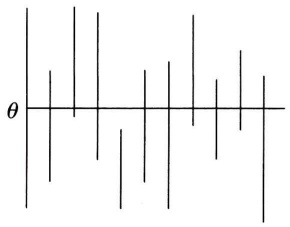
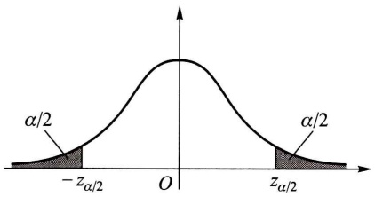
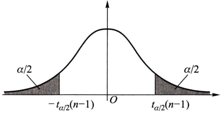
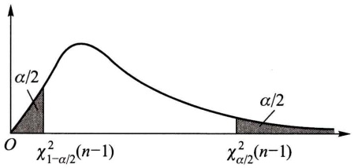
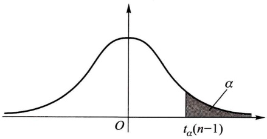
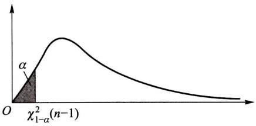

# 第七章 参数估计

原始 PDF 第 166–195 页。

## 第七章 参数估计

统计推断的基本问题可以分为两大类,一类是估计问题,另一类是假设检验问题.本章讨论总体参数的点估计和区间估计.

## §1 点 估 计

设总体 $X$ 的分布函数的形式已知，但它的一个或多个参数未知，借助于总体 $X$ 的一个样本来估计总体未知参数的值的问题称为参数的点估计问题.

例1 在某炸药制造厂, 一天中发生着火现象的次数 $X$ 是一个随机变量, 假设它服从以 $\lambda > 0$ 为参数的泊松分布, 参数 $\lambda$ 为未知. 现有以下的样本值, 试估计参数 $\lambda$.

| 着火次数k | 0 | 1 | 2 | 3 | 4 | 5 | 6 | ≥7 |  |
| --- | --- | --- | --- | --- | --- | --- | --- | --- | --- |
| 发生k次着火的天数$n_k$ | 75 | 90 | 54 | 22 | 6 | 2 | 1 | 0 | Σ=250 |

解 由于 $X \sim \pi(\lambda)$, 故有 $\lambda = E(X)$. 我们自然想到用样本均值来估计总体的均值 $E(X)$. 现由已知数据计算得到

$$
\bar {x} = \frac {\sum_ {k = 0} ^ {6} k n _ {k}}{\sum_ {k = 0} ^ {6} n _ {k}} = \frac {1}{2 5 0} (0 \times 7 5 + 1 \times 9 0 + 2 \times 5 4 + 3 \times 2 2 + 4 \times 6 + 5 \times 2 + 6 \times 1) = 1. 2 2,
$$

即 $E(X) = \lambda$ 的估计为1.22.

点估计问题的一般提法如下: 设总体 X 的分布函数  $F(x; \theta)^{①}$  的形式为已知,  $\theta$  是待估参数.  $X_{1}, X_{2}, \cdots, X_{n}$  是 X 的一个样本,  $x_{1}, x_{2}, \cdots, x_{n}$  是相应的一个样本值. 点估计问题就是要构造一个适当的统计量  $\hat{\theta}(X_{1}, X_{2}, \cdots, X_{n})$ , 用它的观察值  $\hat{\theta}(x_{1}, x_{2}, \cdots, x_{n})$  作为未知参数  $\theta$  的近似值. 我们称  $\hat{\theta}(X_{1}, X_{2}, \cdots, X_{n})$  为  $\theta$  的估

<small>① 多于一个未知参数时,可同样讨论.</small>

---

· 152 ·

第七章 参数估计

计量,称  $\hat{\theta}(x_{1},x_{2},\cdots,x_{n})$  为  $\theta$  的估计值. 在不致混淆的情况下统称估计量和估计值为估计,并都简记为  $\hat{\theta}$ . 由于估计量是样本的函数. 因此对于不同的样本值,  $\theta$  的估计值一般是不相同的.

例如在例 1 中, 我们用样本均值来估计总体均值. 即有估计量

$$
\hat {\lambda} = \widehat {E (X)} = \frac {1}{n} \sum_ {k = 1} ^ {n} X _ {k}, \quad n = 2 5 0,
$$

估计值 $\hat{\lambda} = E(\widehat{X}) = \frac{1}{n}\sum_{k = 1}^{n}x_{k} = 1.22.$

下面介绍两种常用的构造估计量的方法: 矩估计法和最大似然估计法.

## (一) 矩估计法

设 X 为连续型随机变量, 其概率密度为  $f(x; \theta_{1}, \theta_{2}, \cdots, \theta_{k})$ , 或 X 为离散型随机变量, 其分布律为  $P\{X = x\} = p(x; \theta_{1}, \theta_{2}, \cdots, \theta_{k})$ , 其中  $\theta_{1}, \theta_{2}, \cdots, \theta_{k}$  为待估参数,  $X_{1}, X_{2}, \cdots, X_{n}$  是来自 X 的样本. 假设总体 X 的前 k 阶矩

$$
\mu_ {l} = E (X ^ {l}) = \int_ {- \infty} ^ {\infty} x ^ {l} f (x; \theta_ {1}, \theta_ {2}, \dots , \theta_ {k}) \mathrm{d} x \quad (X \text {为连续型})
$$

或 $\mu_{l} = E(X^{l}) = \sum_{x\in R_{X}}x^{l}p(x;\theta_{1},\theta_{2},\dots ,\theta_{k})$ （ $X$ 为离散型）

(其中  $R_{X}$  是 X 可能取值的范围) 存在,  $l=1,2,\cdots,k$ . 一般来说, 它们是  $\theta_{1}, \theta_{2},\cdots,\theta_{k}$  的函数. 基于样本矩

$$
A _ {l} = \frac {1}{n} \sum_ {i = 1} ^ {n} X _ {i} ^ {l}
$$

依概率收敛于相应的总体矩  $\mu_{l}(l=1,2,\cdots,k)$ ，样本矩的连续函数依概率收敛于相应的总体矩的连续函数（见第六章 §3），我们就用样本矩作为相应的总体矩的估计量，而以样本矩的连续函数作为相应的总体矩的连续函数的估计量。这种估计方法称为矩估计法。矩估计法的具体做法如下:设

$$
\left\{ \begin{array}{l} \mu_ {1} = \mu_ {1} (\theta_ {1}, \theta_ {2}, \dots , \theta_ {k}), \\ \mu_ {2} = \mu_ {2} (\theta_ {1}, \theta_ {2}, \dots , \theta_ {k}), \\ \dots \dots \\ \mu_ {k} = \mu_ {k} (\theta_ {1}, \theta_ {2}, \dots , \theta_ {k}). \end{array} \right.
$$

这是一个包含 k 个未知参数  $\theta_{1}, \theta_{2}, \cdots, \theta_{k}$  的联立方程组. 一般来说, 可以从中解出  $\theta_{1}, \theta_{2}, \cdots, \theta_{k}$ , 得到

---

§ 1 点 估 计

· 153 ·

$$
\left\{ \begin{array}{l} \theta_ {1} = \theta_ {1} (\mu_ {1}, \mu_ {2}, \dots , \mu_ {k}), \\ \theta_ {2} = \theta_ {2} (\mu_ {1}, \mu_ {2}, \dots , \mu_ {k}), \\ \dots \dots \\ \theta_ {k} = \theta_ {k} (\mu_ {1}, \mu_ {2}, \dots , \mu_ {k}). \end{array} \right.
$$

以  $A_{i}$  分别代替上式中的  $\mu_{i}, i=1,2,\cdots,k$ ，就以

$$
\hat {\theta} _ {i} = \theta_ {i} (A _ {1}, A _ {2}, \dots , A _ {k}), \quad i = 1, 2, \dots , k
$$

分别作为  $\theta_{i}, i=1,2,\cdots,k$  的估计量，这种估计量称为矩估计量.矩估计量的观察值称为矩估计值.

例 2 设总体 X 在  $[a, b]$  上服从均匀分布, a, b 未知.  $X_{1}, X_{2}, \cdots, X_{n}$  是来自 X 的样本, 试求 a, b 的矩估计量.

解 $\mu_{1} = E(X) = (a + b) / 2,$

$$
\mu_ {2} = E (X ^ {2}) = D (X) + [ E (X) ] ^ {2} = (b - a) ^ {2} / 1 2 + (a + b) ^ {2} / 4.
$$

即 $\left\{ \begin{array}{l}a + b = 2\mu_1,\\ b - a = \sqrt{12(\mu_2 - \mu_1^2)}. \end{array} \right.$

解这一方程组得

$$
a = \mu_ {1} - \sqrt {3 (\mu_ {2} - \mu_ {1} ^ {2})}, b = \mu_ {1} + \sqrt {3 (\mu_ {2} - \mu_ {1} ^ {2})}.
$$

分别以 $A_{1}, A_{2}$ 代替 $\mu_{1}, \mu_{2}$, 得到 $a, b$ 的矩估计量分别为（注意到 $\frac{1}{n} \sum_{i=1}^{n} X_{i}^{2} - \overline{X}^{2} = \frac{1}{n} \sum_{i=1}^{n} (X_{i} - \overline{X})^{2}$）:

$$
\hat {a} = A _ {1} - \sqrt {3 (A _ {2} - A _ {1} ^ {2})} = \overline {{X}} - \sqrt {\frac {3}{n} \sum_ {i = 1} ^ {n} (X _ {i} - \overline {{X}}) ^ {2}},
$$

$$
\hat {b} = A _ {1} + \sqrt {3 (A _ {2} - A _ {1} ^ {2})} = \overline {{X}} + \sqrt {\frac {3}{n} \sum_ {i = 1} ^ {n} (X _ {i} - \overline {{X}}) ^ {2}}.
$$

例 3 设总体 X 的均值  $\mu$  及方差  $\sigma^{2}$  都存在，且有  $\sigma^{2}>0$ 。但  $\mu,\sigma^{2}$  均为未知。又设  $X_{1},X_{2},\cdots,X_{n}$  是来自 X 的样本。试求  $\mu,\sigma^{2}$  的矩估计量。

解

$$
\left\{ \begin{array}{l} \mu_ {1} = E (X) = \mu , \\ \mu_ {2} = E (X ^ {2}) = D (X) + [ E (X) ] ^ {2} = \sigma^ {2} + \mu^ {2}. \end{array} \right.
$$

解得 $\left\{ \begin{array}{l}\mu = \mu_1,\\ \sigma^2 = \mu_2 - \mu_1^2. \end{array} \right.$

分别以 $A_{1}, A_{2}$ 代替 $\mu_{1}, \mu_{2}$, 得 $\mu$ 和 $\sigma^{2}$ 的矩估计量分别为

$$
\hat {\mu} = A _ {1} = \overline {{X}},
$$

---

· 154 ·

第七章 参数估计

$$
\hat {\sigma} ^ {2} = A _ {2} - \dot {A} _ {1} ^ {2} = \frac {1}{n} \sum_ {i = 1} ^ {n} X _ {i} ^ {2} - \overline {{{{X}}}} ^ {2} = \frac {1}{n} \sum_ {i = 1} ^ {n} (X _ {i} - \overline {{{{X}}}}) ^ {2}.
$$

所得结果表明,总体均值与方差的矩估计量的表达式不因不同的总体分布而异.

例如， $X\sim N(\mu ,\sigma^2),\mu ,\sigma^2$ 未知，即得 $\mu ,\sigma^2$ 的矩估计量为

$$
\hat {\mu} = \overline {{X}}, \quad \hat {\sigma} ^ {2} = \frac {1}{n} \sum_ {i = 1} ^ {n} (X _ {i} - \overline {{X}}) ^ {2}.
$$

## (二) 最大似然估计法

若总体 X 属离散型, 其分布律  $P\{X=x\}=p(x;\theta), \theta\in\Theta$  的形式为已知,  $\theta$  为待估参数,  $\Theta$  是  $\theta$  可能取值的范围. 设  $X_{1}, X_{2}, \cdots, X_{n}$  是来自 X 的样本, 则  $X_{1}, X_{2}, \cdots, X_{n}$  的联合分布律为

$$
\prod_ {i = 1} ^ {n} p (x _ {i}; \theta).
$$

又设  $x_{1}, x_{2}, \cdots, x_{n}$  是相应于样本  $X_{1}, X_{2}, \cdots, X_{n}$  的一个样本值. 易知样本  $X_{1}, X_{2}, \cdots, X_{n}$  取到观察值  $x_{1}, x_{2}, \cdots, x_{n}$  的概率, 亦即事件  $\{X_{1} = x_{1}, X_{2} = x_{2}, \cdots, X_{n} = x_{n}\}$  发生的概率为

$$
L (\theta) = L (x _ {1}, x _ {2}, \dots , x _ {n}; \theta) = \prod_ {i = 1} ^ {n} p (x _ {i}; \theta), \quad \theta \in \Theta . \tag {1.1}
$$

这一概率随  $\theta$  的取值而变化, 它是  $\theta$  的函数,  $L(\theta)$  称为样本的似然函数(注意, 这里  $x_{1}, x_{2}, \cdots, x_{n}$  是已知的样本值, 它们都是常数).

关于最大似然估计法,我们有以下的直观想法:现在已经取到样本值  $x_{1}, x_{2}, \cdots, x_{n}$  了,这表明取到这一样本值的概率  $L(\theta)$  比较大. 我们当然不会考虑那些不能使样本  $x_{1}, x_{2}, \cdots, x_{n}$  出现的  $\theta \in \Theta$  作为  $\theta$  的估计,再者,如果已知当  $\theta = \theta_{0} \in \Theta$  时使  $L(\theta)$  取很大的值,而  $\Theta$  中其他  $\theta$  的值使  $L(\theta)$  取很小的值,我们自然认为取  $\theta_{0}$  作为未知参数  $\theta$  的估计值,较为合理. 由费希尔引进的最大似然估计法,就是固定样本观察值  $x_{1}, x_{2}, \cdots, x_{n}$ ,在  $\theta$  取值的可能范围  $\Theta$  内挑选使似然函数  $L(x_{1}, x_{2}, \cdots, x_{n}; \theta)$  达到最大的参数值  $\hat{\theta}$ ,作为参数  $\theta$  的估计值. 即取  $\hat{\theta}$  使

$$
L (x _ {1}, x _ {2}, \dots , x _ {n}; \hat {\theta}) = \max _ {\theta \in \Theta} L (x _ {1}, x _ {2}, \dots , x _ {n}; \theta). \tag {1.2}
$$

这样得到的 $\hat{\theta}$ 与样本值 $x_{1},x_{2},\cdots,x_{n}$ 有关，常记为 $\hat{\theta}(x_{1},x_{2},\cdots,x_{n})$ ，称为参数 $\theta$ 的最大似然估计值，而相应的统计量 $\hat{\theta}(X_{1},X_{2},\cdots,X_{n})$ 称为参数 $\theta$ 的最大似然估计量.

若总体 X 属连续型, 其概率密度  $f(x; \theta)$ ,  $\theta \in \Theta$  的形式已知,  $\theta$  为待估参数,  $\Theta$  是  $\theta$  可能取值的范围. 设  $X_{1}, X_{2}, \cdots, X_{n}$  是来自 X 的样本, 则  $X_{1}, X_{2}, \cdots, X_{n}$  的联合

---

§ 1 点 估 计

· 155 ·

概率密度为

$$
\prod_ {i = 1} ^ {n} f (x _ {i}; \theta).
$$

设 $x_{1}, x_{2}, \cdots, x_{n}$ 是相应于样本 $X_{1}, X_{2}, \cdots, X_{n}$ 的一个样本值，则随机点 $(X_{1}, X_{2}, \cdots, X_{n})$ 落在点 $(x_{1}, x_{2}, \cdots, x_{n})$ 的邻域（边长分别为 $\mathrm{dx}_1, \mathrm{dx}_2, \cdots, \mathrm{dx}_n$ 的 $n$ 维立方体）内的概率近似地为

$$
\prod_ {i = 1} ^ {n} f (x _ {i}; \theta) \mathrm{d} x _ {i}, \tag {1.3}
$$

其值随 $\theta$ 的取值而变化.与离散型的情况一样，我们取 $\theta$ 的估计值 $\hat{\theta}$ 使概率(1.3)式取到最大值，但因子 $\prod_{i=1}^{n} \mathrm{d}x_i$ 不随 $\theta$ 而变，故只需考虑函数

$$
L (\theta) = L (x _ {1}, x _ {2}, \dots , x _ {n}; \theta) = \prod_ {i = 1} ^ {n} f (x _ {i}; \theta) \tag {1.4}
$$

的最大值. 这里 $L(\theta)$ 称为样本的似然函数. 若

$$
L (x _ {1}, x _ {2}, \dots , x _ {n}; \hat {\theta}) = \max _ {\theta \in \Theta} L (x _ {1}, x _ {2}, \dots , x _ {n}; \theta),
$$

则称 $\hat{\theta}(x_{1},x_{2},\cdots,x_{n})$ 为 $\theta$ 的最大似然估计值，称 $\hat{\theta}(X_{1},X_{2},\cdots,X_{n})$ 为 $\theta$ 的最大似然估计量.

这样,确定最大似然估计量的问题就归结为微分学中的求最大值的问题了.

在很多情形下， $p(x;\theta)$ 和 $f(x;\theta)$ 关于 $\theta$ 可微，这时 $\hat{\theta}$ 常可从方程

$$
\frac {\mathrm{d}}{\mathrm{d} \theta} L (\theta) = 0 \tag {1.5}
$$

解得①. 又因 $L(\theta)$ 与 $\ln L(\theta)$ 在同一 $\theta$ 处取到极值, 因此, $\theta$ 的最大似然估计 $\hat{\theta}$ 也可以从方程

$$
\frac {\mathrm{d}}{\mathrm{d} \theta} \ln L (\theta) = 0 \tag {1.6}
$$

求得,而从后一方程求解往往比较方便.(1.6)式称为对数似然方程.

例 4 设  $X \sim b(1, p)$ .  $X_{1}, X_{2}, \cdots, X_{n}$  是来自 X 的一个样本, 试求参数 p 的最大似然估计量.

解 设  $x_{1}, x_{2}, \cdots, x_{n}$  是相应于样本  $X_{1}, X_{2}, \cdots, X_{n}$  的一个样本值. X 的分布律为

<small>① 这里没有提到 $L(\theta)$ 取最大值的充分条件，但对于具体的函数是容易讨论的.</small>

---

· 156 ·

第七章 参数估计

$$
P \{X = x \} = p ^ {x} (1 - p) ^ {1 - x}, \quad x = 0, 1.
$$

故似然函数为

$$
L (p) = \prod_ {i = 1} ^ {n} p ^ {x _ {i}} (1 - p) ^ {1 - x _ {i}} = p \sum_ {i = 1} ^ {n} x _ {i} (1 - p) ^ {n - \sum_ {i = 1} ^ {n} x _ {i}},
$$

而 $\ln L(p) = \left(\sum_{i=1}^{n} x_i\right) \ln p + \left(n - \sum_{i=1}^{n} x_i\right) \ln (1 - p)$,

令 $\frac{\mathrm{d}}{\mathrm{d}p}\ln L(p) = \frac{\sum_{i=1}^{n}x_i}{p} -\frac{n - \sum_{i=1}^{n}x_i}{1 - p} = 0,$

解得 $p$ 的最大似然估计值

$$
\hat {p} = \frac {1}{n} \sum_ {i = 1} ^ {n} x _ {i} = \bar {x}.
$$

$p$ 的最大似然估计量为

$$
\hat {p} = \frac {1}{n} \sum_ {i = 1} ^ {n} X _ {i} = \overline {{X}}.
$$

我们看到这一估计量与相应的矩估计量是相同的.

最大似然估计法也适用于分布中含多个未知参数  $\theta_{1}, \theta_{2}, \cdots, \theta_{k}$  的情况. 这时, 似然函数 L 是这些未知参数的函数. 分别令

$$
\frac {\partial}{\partial \theta_ {i}} L = 0, i = 1, 2, \dots , k
$$

或令  $\frac{\partial}{\partial\theta_{i}}\ln L=0, i=1,2,\cdots,k.$  (1.7)

解上述由 k 个方程组成的方程组, 即可得到各未知参数  $\theta_{i}(i=1,2,\cdots,k)$  的最大似然估计值  $\hat{\theta}_{i}$ . (1.7) 式称为对数似然方程组.

例 5 设总体  $X \sim N(\mu, \sigma^{2})$ ,  $\mu, \sigma^{2}$  为未知参数,  $x_{1}, x_{2}, \cdots, x_{n}$  是来自 X 的一个样本值. 求  $\mu, \sigma^{2}$  的最大似然估计量.

解 $X$ 的概率密度为

$$
f (x; \mu , \sigma^ {2}) = \frac {1}{\sqrt {2 \pi} \sigma} \exp \left\{- \frac {1}{2 \sigma^ {2}} (x - \mu) ^ {2} \right\},
$$

似然函数为

$$
\begin{array}{l} L (\mu , \sigma^ {2}) = \prod_ {i = 1} ^ {n} \frac {1}{\sqrt {2 \pi} \sigma} \exp \left\{- \frac {1}{2 \sigma^ {2}} (x _ {i} - \mu) ^ {2} \right\} \\ = (2 \pi) ^ {- n / 2} (\sigma^ {2}) ^ {- n / 2} \exp \left\{- \frac {1}{2 \sigma^ {2}} \sum_ {i = 1} ^ {n} (x _ {i} - \mu) ^ {2} \right\}. \\ \end{array}
$$

---

§ 1 点 估 计

· 157 ·

而 $\ln L = -\frac{n}{2}\ln (2\pi) - \frac{n}{2}\ln \sigma^2 -\frac{1}{2\sigma^2}\sum_{i = 1}^{n}(x_i - \mu)^2.$

令 $\left\{ \begin{array}{l} \frac{\partial}{\partial \mu} \ln L = \frac{1}{\sigma^2} \left( \sum_{i=1}^{n} x_i - n\mu \right) = 0, \\ \frac{\partial}{\partial \sigma^2} \ln L = -\frac{n}{2\sigma^2} + \frac{1}{2(\sigma^2)^2} \sum_{i=1}^{n} (x_i - \mu)^2 = 0. \end{array} \right.$

由前一式解得 $\hat{\mu} = \frac{1}{n}\sum_{i = 1}^{n}x_{i} = \bar{x}$ ，代入后一式得 $\hat{\sigma}^2 = \frac{1}{n}\sum_{i = 1}^{n}(x_i - \bar{x})^2$ 因此得 $\mu$ 和 $\sigma^2$ 的最大似然估计量分别为

$$
\hat {\mu} = \overline {{X}}, \quad \hat {\sigma} ^ {2} = \frac {1}{n} \sum_ {i = 1} ^ {n} (X _ {i} - \overline {{X}}) ^ {2}.
$$

它们与相应的矩估计量相同.

例 6 设总体 X 在  $[a, b]$  上服从均匀分布，a, b 未知， $x_{1}, x_{2}, \cdots, x_{n}$  是一个样本值。试求 a, b 的最大似然估计量。

解 记  $x_{(1)}=\min\{x_{1},x_{2},\cdots,x_{n}\},x_{(n)}=\max\{x_{1},x_{2},\cdots,x_{n}\}.X$  的概率密度是

$$
f (x; a, b) = \left\{ \begin{array}{l l} { \frac {1}{b - a},} & {a \leqslant x \leqslant b,} \\ {0,} & {\text {其他}.} \end{array} \right.
$$

似然函数为

$$
L (a, b) = \left\{ \begin{array}{l l} { \frac {1}{(b - a) ^ {n}},} & {a \leqslant x _ {1}, x _ {2}, \dots , x _ {n} \leqslant b,} \\ {0,} & {\text {其他}.} \end{array} \right.
$$

由于  $a \leqslant x_{1}, x_{2}, \cdots, x_{n} \leqslant b$ ，等价于  $a \leqslant x_{(1)}, x_{(n)} \leqslant b$ 。似然函数可写成

$$
L (a, b) = \left\{ \begin{array}{l l} \frac {1}{(b - a) ^ {n}}, & a \leqslant x _ {(1)}, b \geqslant x _ {(n)}, \\ 0, & \text {其他.} \end{array} \right.
$$

于是对于满足条件 $a \leqslant x_{(1)}, b \geqslant x_{(n)}$ 的任意 $a, b$ 有

$$
L (a, b) = \frac {1}{(b - a) ^ {n}} \leqslant \frac {1}{[ x _ {(n)} - x _ {(1)} ] ^ {n}}.
$$

即 $L(a, b)$ 在 $a = x_{(1)}$, $b = x_{(n)}$ 时取到最大值 $\left[x_{(n)} - x_{(1)}\right]^{-n}$. 故 $a, b$ 的最大似然估计值为

$$
\hat {a} = x _ {(1)} = \min _ {1 \leqslant i \leqslant n} x _ {i}, \quad \hat {b} = x _ {(n)} = \max _ {1 \leqslant i \leqslant n} x _ {i}.
$$

$a, b$ 的最大似然估计量为

---

· 158 ·

第七章 参数估计

$$
\hat {a} = \min _ {1 \leqslant i \leqslant n} X _ {i}, \quad \hat {b} = \max _ {1 \leqslant i \leqslant n} X _ {i}.
$$

此外,最大似然估计具有下述性质:设  $\theta$  的函数  $u=u(\theta),\theta\in\Theta$  具有单值反函数  $\theta=\theta(u),u\in\mathcal{U}$ . 又假设  $\hat{\theta}$  是 X 的概率分布中参数  $\theta$  的最大似然估计,则  $\hat{u}=u(\hat{\theta})$  是  $u(\theta)$  的最大似然估计. 这一性质称为最大似然估计的不变性.

事实上，因为 $\hat{\theta}$ 是 $\theta$ 的最大似然估计，于是有

$$
L (x _ {1}, x _ {2}, \dots , x _ {n}; \hat {\theta}) = \max _ {\theta \in \Theta} L (x _ {1}, x _ {2}, \dots , x _ {n}; \theta),
$$

其中  $x_{1}, x_{2}, \cdots, x_{n}$  是 X 的一个样本值，考虑到  $\hat{u} = u(\hat{\theta})$ ，且有  $\hat{\theta} = \theta(\hat{u})$ ，上式可写成

$$
L (x _ {1}, x _ {2}, \dots , x _ {n}; \theta (\hat {u})) = \max _ {u \in \mathcal {U}} L (x _ {1}, x _ {2}, \dots , x _ {n}; \theta (u)).
$$

这就证明了 $\hat{u} = u(\hat{\theta})$ 是 $u(\theta)$ 的最大似然估计.

当总体分布中含有多个未知参数时,也具有上述性质.例如,在例5中已得到 $\sigma^{2}$ 的最大似然估计为

$$
\hat {\sigma} ^ {2} = \frac {1}{n} \sum_ {i = 1} ^ {n} (X _ {i} - \overline {{X}}) ^ {2}.
$$

函数 $u = u(\sigma^2) = \sqrt{\sigma^2}$ 有单值反函数 $\sigma^2 = u^2 (u\geqslant 0)$ ，根据上述性质，得到标准差 $\sigma$ 的最大似然估计为

$$
\hat {\sigma} = \sqrt {\hat {\sigma} ^ {2}} = \sqrt {\frac {1}{n} \sum_ {i = 1} ^ {n} (X _ {i} - \overline {{X}}) ^ {2}}.
$$

我们还要提到的是,对数似然方程(1.6)或对数似然方程组(1.7)除了一些简单的情况外,往往没有有限函数形式的解,这就需要用数值方法求近似解.常用的算法是牛顿-拉弗森(Newton-Raphson)算法,对于(1.7)式有时也用拟牛顿算法,它们都是迭代算法,读者可参考有关的书籍.

## \* § 2 基于截尾样本的最大似然估计

在研究产品的可靠性时,需要研究产品寿命 T 的各种特征. 产品寿命 T 是一个随机变量,它的分布称为寿命分布. 为了对寿命分布进行统计推断,就需要通过产品的寿命试验,以取得寿命数据.

一种典型的寿命试验是，将随机抽取的 $n$ 个产品在时间 $t = 0$ 时，同时投入试验，直到每个产品都失效。记录每一个产品的失效时间，这样得到的样本（即由所有产品的失效时间 $0 \leqslant t_1 \leqslant t_2 \leqslant \dots \leqslant t_n$ 所组成的样本）称为完全样本。然而

---

\* § 2 基于截尾样本的最大似然估计

· 159 ·

产品的寿命往往较长，由于时间和财力的限制，我们不可能得到完全样本，于是就考虑截尾寿命试验。截尾寿命试验常用的有两种:一种是定时截尾寿命试验。假设将随机抽取的 $n$ 个产品在时间 $t = 0$ 时同时投入试验，试验进行到事先规定的截尾时间 $t_0$ 停止。如试验截止时共有 $m$ 个产品失效，它们的失效时间分别为

$$
0 \leqslant t _ {1} \leqslant t _ {2} \leqslant \dots \leqslant t _ {m} \leqslant t _ {0},
$$

此时 m 是一个随机变量, 所得的样本  $t_{1}, t_{2}, \cdots, t_{m}$  称为定时截尾样本. 另一种是定数截尾寿命试验. 假设将随机抽取的 n 个产品在时间 t = 0 时同时投入试验, 试验进行到有 m 个 (m 是事先规定的, m < n) 产品失效时停止. m 个失效产品的失效时间分别为

$$
0 \leqslant t _ {1} \leqslant t _ {2} \leqslant \dots \leqslant t _ {m},
$$

这里  $t_{m}$  是第 m 个产品的失效时间， $t_{m}$  是随机变量.所得的样本  $t_{1}, t_{2}, \cdots, t_{m}$  称为定数截尾样本.用截尾样本来进行统计推断是可靠性研究中常见的问题.

设产品的寿命分布是指数分布,其概率密度为

$$
f (t) = \left\{ \begin{array}{l l} \frac {1}{\theta} \mathrm{e} ^ {- t / \theta}, & t > 0, \\ 0, & t \leqslant 0, \end{array} \right.
$$

$\theta > 0$ 未知.假设有 $n$ 个产品投入定数截尾试验，截尾数为 $m$ ，得到定数截尾样本 $0 \leqslant t_1 \leqslant t_2 \leqslant \dots \leqslant t_m$ ，现在要利用这一样本来估计未知参数 $\theta$ （即产品的平均寿命）. 在时间区间 $[0, t_m]$ 有 $m$ 个产品失效，而有 $n - m$ 个产品在 $t_m$ 时尚未失效，即有 $n - m$ 个产品的寿命超过 $t_m$ . 我们用最大似然估计法来估计 $\theta$ ，为了确定似然函数，需要知道上述观察结果出现的概率.我们知道一个产品在 $(t_i, t_i + \mathrm{d}t_i]$ 失效的概率近似地为 $f(t_i) \mathrm{d}t_i = \frac{1}{\theta} \mathrm{e}^{-t_i / \theta} \mathrm{d}t_i, i = 1,2,\dots,m$ ，其余 $n - m$ 个产品寿命超过 $t_m$ 的概率为 $\left(\int_{t_m}^{\infty} \frac{1}{\theta} \mathrm{e}^{-t / \theta} \mathrm{d}t\right)^{n - m} = (\mathrm{e}^{-t_m / \theta})^{n - m}$，故上述观察结果出现的概率近似地为

$$
\begin{array}{l} \binom {n} {m} \left(\frac {1}{\theta} \mathrm{e} ^ {- t _ {1} / \theta} \mathrm{d} t _ {1}\right) \left(\frac {1}{\theta} \mathrm{e} ^ {- t _ {2} / \theta} \mathrm{d} t _ {2}\right) \dots \left(\frac {1}{\theta} \mathrm{e} ^ {- t _ {m} / \theta} \mathrm{d} t _ {m}\right) \left(\mathrm{e} ^ {- t _ {m} / \theta}\right) ^ {n - m} \\ = \binom {n} {m} \frac {1}{\theta^ {m}} \mathrm{e} ^ {- \frac {1}{\theta} \left[ t _ {1} + t _ {2} + \dots + t _ {m} + (n - m) t _ {m} \right]} \mathrm{d} t _ {1} \mathrm{d} t _ {2} \dots \mathrm{d} t _ {m}, \\ \end{array}
$$

其中  $dt_{1}, dt_{2}, \cdots, dt_{m}$  为常数.因忽略一个常数因子不影响  $\theta$  的最大似然估计，故可取似然函数为

$$
L (\theta) = \frac {1}{\theta^ {m}} \mathrm{e} ^ {- \frac {1}{\theta} [ t _ {1} + t _ {2} + \dots + t _ {m} + (n - m) t _ {m} ]}.
$$

对数似然函数为

$$
\ln L (\theta) = - m \ln \theta - \frac {1}{\theta} [ t _ {1} + t _ {2} + \dots + t _ {m} + (n - m) t _ {m} ].
$$

---

· 160 ·

第七章 参数估计

令 $\frac{\mathrm{d}}{\mathrm{d}\theta}\ln L(\theta) = -\frac{m}{\theta} +\frac{1}{\theta^2}\big[t_1 + t_2 + \dots +t_m + (n - m)t_m\big] = 0.$

于是得到 $\theta$ 的最大似然估计为

$$
\hat {\theta} = \frac {s (t _ {m})}{m}.
$$

其中  $s(t_{m})=t_{1}+t_{2}+\cdots+t_{m}+(n-m)t_{m}$  称为总试验时间，它表示直至时刻  $t_{m}$  为止 n 个产品的试验时间的总和。

对于定时截尾样本

$$
0 \leqslant t _ {1} \leqslant t _ {2} \leqslant \dots \leqslant t _ {m} \leqslant t _ {0}
$$

(其中  $t_{0}$  是截尾时间)，与上面的讨论类似，可得似然函数为

$$
L (\theta) = \frac {1}{\theta^ {m}} \mathrm{e} ^ {- \frac {1}{\theta} [ t _ {1} + t _ {2} + \dots + t _ {m} + (n - m) t _ {0} ]},
$$

$\theta$ 的最大似然估计为

$$
\hat {\theta} = \frac {s (t _ {0})}{m},
$$

其中  $s(t_{0})=t_{1}+t_{2}+\cdots+t_{m}+(n-m)t_{0}$  称为总试验时间，它表示直至时刻  $t_{0}$  为止 n 个产品的试验时间的总和。

例 设电池的寿命服从指数分布,其概率密度为

$$
f (t) = \left\{ \begin{array}{l l} \frac {1}{\theta} \mathrm{e} ^ {- t / \theta}, & t > 0, \\ 0, & t \leqslant 0, \end{array} \right.
$$

$\theta > 0$ 未知.随机地取50只电池投入寿命试验，规定试验进行到其中有15只失效时结束试验，测得失效时间（以h计）为

$$
\begin{array}{l l l l l l l l} 1 1 5 & 1 1 9 & 1 3 1 & 1 3 8 & 1 4 2 & 1 4 7 & 1 4 8 & 1 5 5 \\ 1 5 8 & 1 5 9 & 1 6 3 & 1 6 6 & 1 6 7 & 1 7 0 & 1 7 2 \end{array}
$$

试求电池的平均寿命 $\theta$ 的最大似然估计.

解 $n = 50, m = 15, s(t_{15}) = 115 + 119 + \cdots + 170 + 172 + (50 - 15) \times 172 = 8270$，得 $\theta$ 的最大似然估计为

$$
\hat {\theta} = \frac {8 2 7 0}{1 5} = 5 5 1. 3 3 (\mathrm{h}).
$$

## § 3 估计量的评选标准

自前一节可以看到,对于同一参数,用不同的估计方法求出的估计量可能不相同,如§1的例2和例6.而且,很明显,原则上任何统计量都可以作为未知参数的估计量.我们自然会问,采用哪一个估计量为好呢?这就涉及用什么样的标

---

§ 3 估计量的评选标准

· 161 ·

准来评价估计量的问题. 下面介绍几个常用的标准.

## (一) 无偏性

设  $X_{1}, X_{2}, \cdots, X_{n}$  是总体 X 的一个样本， $\theta \in \Theta$  是包含在总体 X 的分布中的待估参数，这里  $\Theta$  是  $\theta$  的取值范围.

无偏性 若估计量 $\hat{\theta}=\hat{\theta}(X_{1},X_{2},\cdots,X_{n})$ 的数学期望 $E(\hat{\theta})$ 存在，且对于任意 $\theta\in\Theta$ 有

$$
E (\hat {\theta}) = \theta , \tag {3.1}
$$

则称 $\hat{\theta}$ 是 $\theta$ 的无偏估计量.

估计量的无偏性是说对于某些样本值,由这一估计量得到的估计值相对于真值来说偏大,有些则偏小.反复将这一估计量使用多次,就“平均”来说其偏差为零.在科学技术中  $E(\hat{\theta})-\theta$  称为以  $\hat{\theta}$  作为  $\theta$  的估计的系统误差.无偏估计的实际意义就是无系统误差.

例如，设总体 $X$ 的均值 $\mu$ ，方差 $\sigma^2 > 0$ 均未知，由第六章(3.19)，(3.20)式知

$$
E (\overline {{X}}) = \mu , E (S ^ {2}) = \sigma^ {2}.
$$

即不论总体服从什么分布,样本均值  $\overline{X}$  是总体均值  $\mu$  的无偏估计;样本方差  $S^{2}=\frac{1}{n-1}\sum_{i=1}^{n}(X_{i}-\overline{X})^{2}$  是总体方差的无偏估计.而估计量  $\frac{1}{n}\sum_{i=1}^{n}(X_{i}-\overline{X})^{2}$  却不是  $\sigma^{2}$  的无偏估计,因此我们一般取  $S^{2}$  作为  $\sigma^{2}$  的估计量.

例 1 设总体 X 的 k 阶矩  $\mu_{k}=E(X^{k})\quad(k\geqslant1)$  存在，又设  $X_{1},X_{2},\cdots,X_{n}$  是 X 的一个样本。试证明不论总体服从什么分布，样本 k 阶矩  $A_{k}=\frac{1}{n}\sum_{i=1}^{n}X_{i}^{k}$  是总体 k 阶矩  $\mu_{k}$  的无偏估计量。

证  $X_{1}, X_{2}, \cdots, X_{n}$  与 X 同分布，故有

$$
E (X _ {i} ^ {k}) = E (X ^ {k}) = \mu_ {k}, \quad i = 1, 2, \dots , n.
$$

即有 $E(A_{k}) = \frac{1}{n}\sum_{i = 1}^{n}E(X_{i}^{k}) = \mu_{k}. \tag{3.2}$ □

例 2 设总体 X 服从指数分布, 其概率密度为

$$
f (x; \theta) = \left\{ \begin{array}{l l} \frac {1}{\theta} \mathrm{e} ^ {- x / \theta}, & x > 0, \\ 0, & \text {其他}, \end{array} \right.
$$

其中参数  $\theta>0$  为未知，又设  $X_{1}, X_{2}, \cdots, X_{n}$  是来自 X 的样本，试证  $\overline{X}$  和  $nZ=n(\min\{X_{1}, X_{2}, \cdots, X_{n}\})$  都是  $\theta$  的无偏估计量.

---

· 162 ·

第七章 参数估计

证 因为  $E(\overline{X})=E(X)=\theta$ ，所以  $\overline{X}$  是  $\theta$  的无偏估计量。而  $Z=\min\{X_{1}, X_{2}, \cdots, X_{n}\}$  具有概率密度

$$
f _ {\min} (x; \theta) = \left\{ \begin{array}{l l} { \frac {n}{\theta} \mathrm{e} ^ {- n x / \theta},} & {x > 0,} \\ {0,} & {\text {其他}.} \end{array} \right.
$$

故知 $E(Z) = \frac{\theta}{n},$

$$
E (n Z) = \theta .
$$

即 $nZ$ 也是参数 $\theta$ 的无偏估计量.

由此可见一个未知参数可以有不同的无偏估计量. 事实上, 在本例中 $X_{1}, X_{2}, \cdots, X_{n}$ 中的每一个都可以作为 $\theta$ 的无偏估计量.

## (二) 有效性

现在来比较参数 $\theta$ 的两个无偏估计量 $\hat{\theta}_1$ 和 $\hat{\theta}_2$，如果在样本容量 $n$ 相同的情况下，$\hat{\theta}_1$ 的观察值较 $\hat{\theta}_2$ 在真值 $\theta$ 的附近更密集，我们就认为 $\hat{\theta}_1$ 较 $\hat{\theta}_2$ 更为理想。由于方差是随机变量取值与其数学期望（此时数学期望 $E(\hat{\theta}_1) = E(\hat{\theta}_2) = \theta$）的偏离程度的度量，所以无偏估计以方差小者为好。这就引出了估计量的有效性这一概念。

有效性 设  $\hat{\theta}_{1}=\hat{\theta}_{1}(X_{1},X_{2},\cdots,X_{n})$  与  $\hat{\theta}_{2}=\hat{\theta}_{2}(X_{1},X_{2},\cdots,X_{n})$  都是  $\theta$  的无偏估计量，若对于任意  $\theta\in\Theta$ ，有

$$
D (\hat {\theta} _ {1}) \leqslant D (\hat {\theta} _ {2}),
$$

且至少对于某一个 $\theta \in \Theta$ 上式中的不等号成立，则称 $\hat{\theta}_1$ 较 $\hat{\theta}_2$ 有效.

例3(续例2) 试证当 $n > 1$ 时，$\theta$ 的无偏估计量 $\overline{X}$ 较 $\theta$ 的无偏估计量 $nZ$ 有效.

证 由于 $D(X) = \theta^2$ ，故有 $D(\overline{X}) = \theta^2 / n.$ 再者，由于 $D(Z) = \theta^2 / n^2$ ，故有 $D(nZ) = \theta^2.$ 当 $n > 1$ 时 $D(nZ) > D(\overline{X})$ ，故 $\overline{X}$ 较 $nZ$ 有效. □

## (三) 相合性

前面讲的无偏性与有效性都是在样本容量 $n$ 固定的前提下提出的. 我们自然希望随着样本容量的增大, 一个估计量的值稳定于待估参数的真值. 这样, 对估计量又有下述相合性的要求.

相合性 设  $\hat{\theta}(X_{1}, X_{2}, \cdots, X_{n})$  为参数  $\theta$  的估计量，若对于任意  $\theta \in \Theta$ ，当  $n \to \infty$

---

§ 4 区间估计

· 163 ·

时  $\hat{\theta}(X_{1},X_{2},\cdots,X_{n})$  依概率收敛于  $\theta$ ，则称  $\hat{\theta}$  为  $\theta$  的相合估计量.

即,若对于任意  $\theta\in\Theta$  都满足:对于任意  $\varepsilon>0$ ,有

$$
\lim _ {n \to \infty} P \{| \hat {\theta} - \theta | <   \varepsilon \} = 1,
$$

则称 $\hat{\theta}$ 是 $\theta$ 的相合估计量.

例如由第六章§3知,样本 $k(k\geqslant 1)$ 阶矩是总体 $X$ 的 $k$ 阶矩 $\mu_{k} = E(X^{k})$ 的相合估计量,进而若待估参数 $\theta = g(\mu_1,\mu_2,\dots ,\mu_k)$,其中 $g$ 为连续函数,则 $\theta$ 的矩估计量 $\hat{\theta} = g(\hat{\mu}_1,\hat{\mu}_2,\dots ,\hat{\mu}_k) = g(A_1,A_2,\dots ,A_k)$ 是 $\theta$ 的相合估计量.

由最大似然估计法得到的估计量,在一定条件下也具有相合性.其详细讨论已超出本书范围,从略.

相合性是对一个估计量的基本要求,若估计量不具有相合性,那么不论将样本容量 n 取得多么大,都不能将  $\theta$  估计得足够准确,这样的估计量是不可取的.

上述无偏性、有效性、相合性是评价估计量的一些基本标准,其他的标准这里就不讲了.

## § 4 区间估计

对于一个未知量,人们在测量或计算时,常不以得到近似值为满足,还需估计误差,即要求知道近似值的精确程度(亦即所求真值所在的范围).类似地,对于未知参数 $\theta$ ,除了求出它的点估计 $\hat{\theta}$ 外,我们还希望估计出一个范围,并希望知道这个范围包含参数 $\theta$ 真值的可信程度.这样的范围通常以区间的形式给出,同时还给出此区间包含参数 $\theta$ 真值的可信程度.这种形式的估计称为区间估计,这样的区间即所谓置信区间.现在我们引入置信区间的定义.

置信区间 设总体 X 的分布函数  $F(x;\theta)$  含有一个未知参数  $\theta,\theta\in\Theta$  ( $\Theta$  是  $\theta$  可能取值的范围)，对于给定值  $\alpha(0<\alpha<1)$ ，若由来自 X 的样本  $X_{1},X_{2},\cdots,X_{n}$  确定的两个统计量  $\underline{\theta}=\underline{\theta}(X_{1},X_{2},\cdots,X_{n})$  和  $\bar{\theta}=\bar{\theta}(X_{1},X_{2},\cdots,X_{n})(\underline{\theta}<\bar{\theta})$ ，对于任意  $\theta\in\Theta$  满足

$$
P \{\underline {{\theta}} (X _ {1}, X _ {2}, \dots , X _ {n}) <   \theta <   \bar {\theta} (X _ {1}, X _ {2}, \dots , X _ {n}) \} \geqslant 1 - \alpha , \tag {4.1}
$$

则称随机区间 $(\underline{\theta},\bar{\theta})$ 是 $\theta$ 的置信水平为 $1 - \alpha$ 的置信区间，$\underline{\theta}$ 和 $\bar{\theta}$ 分别称为置信水平为 $1 - \alpha$ 的双侧置信区间的置信下限和置信上限，$1 - \alpha$ 称为置信水平.

当 $X$ 是连续型随机变量时，对于给定的 $\alpha$ ，我们总是按要求 $P\{\underline{\theta} < \theta <\overline{\theta}\} = 1 - \alpha$ 求出置信区间.而当 $X$ 是离散型随机变量时，对于给定的 $\alpha$ ，常找不到区间 $(\underline{\theta},\overline{\theta})$

---

· 164 ·

第七章 参数估计

使得 $P\{\underline{\theta} < \theta < \overline{\theta}\}$ 恰为 $1 - \alpha$. 此时我们去找区间 $(\underline{\theta}, \overline{\theta})$ 使得 $P\{\underline{\theta} < \theta < \overline{\theta}\}$ 至少为 $1 - \alpha$, 且尽可能地接近 $1 - \alpha$.

(4.1)式的含义如下:若反复抽样多次(各次得到的样本的容量相等,都是n).每个样本值确定一个区间 $(\underline{\theta},\bar{\theta})$ ,每个这样的区间要么包含 $\theta$ 的真值,要么不包含 $\theta$ 的真值(参见图7-1).按伯努利大数定律,在这么多的区间中,包含 $\theta$ 真值的约占 $100(1-\alpha)\%$ ,不包含 $\theta$ 真值的约仅占 $100\alpha\%$ .例如,若 $\alpha=0.01$ ,反复抽样1000次,则得到的1000个区间中不包含 $\theta$ 真值的约仅为10个.

例 设总体  $X \sim N(\mu, \sigma^{2})$ ,  $\sigma^{2}$  为已知,  $\mu$  为未知, 设  $X_{1}, X_{2}, \cdots, X_{n}$  是来自 X 的样本, 求  $\mu$  的置信水平为  $1 - \alpha$  的置信区间.

解 我们知道  $\overline{X}$  是  $\mu$  的无偏估计, 且有

$$
\frac {\overline {{X}} - \mu}{\sigma / \sqrt {n}} \sim N (0, 1). \tag {4.2}
$$

$\frac{\overline{X} - \mu}{\sigma / \sqrt{n}}$ 所服从的分布 $N(0,1)$ 不依赖于任何未知参数. 按标准正态分布的上 $\alpha$ 分位数的定义, 有 (参见图7-2)

$$
P \left\{\left| \frac {\overline {{X}} - \mu}{\sigma / \sqrt {n}} \right| <   z _ {\alpha / 2} \right\} = 1 - \alpha , \tag {4.3}
$$

即 $P\left\{\overline{X} -\frac{\sigma}{\sqrt{n}} z_{\alpha /2} <   \mu <  \overline{X} +\frac{\sigma}{\sqrt{n}} z_{\alpha /2}\right\} = 1 - \alpha .$ (4.4)

这样,我们就得到了  $\mu$  的一个置信水平为  $1-\alpha$  的置信区间

$$
\left(\overline {{X}} - \frac {\sigma}{\sqrt {n}} z _ {\alpha / 2}, \quad \overline {{X}} + \frac {\sigma}{\sqrt {n}} z _ {\alpha / 2}\right). \tag {4.5}
$$

这样的置信区间常写成

$$
\left(\overline {{X}} \pm \frac {\sigma}{\sqrt {n}} z _ {\alpha / 2}\right). \tag {4.6}
$$

text_image

θ

图7-1

contour

| Region | Description |
| --- | --- |
| Left Tail | \(\alpha/2\) |
| Shaded Area 1 | \(-z_\alpha/2\) |
| Center | O |
| Shaded Area 2 | \(\alpha/2\) |
| Shaded Area 3 | \(z_\alpha/2\) |

图7-2

---

§ 4 区间估计

· 165 ·

如果取 $1 - \alpha = 0.95$ ，即 $\alpha = 0.05$ ，又若 $\sigma = 1, n = 16$ ，查表得 $z_{\alpha / 2} = z_{0.025} = 1.96.$ 于是我们得到一个置信水平为0.95的置信区间

$$
\left(\overline {{X}} \pm \frac {1}{\sqrt {1 6}} \times 1. 9 6\right), \quad \text {即} (\overline {{X}} \pm 0. 4 9). \tag {4.7}
$$

再者,若由一个样本值算得样本均值的观察值  $\bar{x}=5.20$ , 则得到一个区间  $(5.20\pm0.49)$ , 即  $(4.71,5.69)$ .

注意,这已经不是随机区间了.但我们仍称它为  $\theta$  的置信水平为 0.95 的置信区间.其含义是:若反复抽样多次,每个样本值(n=16)按(4.7)式确定一个区间,按上面的解释,在这么多的区间中,包含  $\mu$  的约占 95%,不包含  $\mu$  的约仅占 5%.现在抽样得到区间(4.71,5.69),则该区间属于那些包含  $\mu$  的区间的可信程度为 95%,或“该区间包含  $\mu$ ”这一陈述的可信程度为 95%.

置信水平为 $1 - \alpha$ 的置信区间并不是唯一的. 以上例来说, 若给定 $\alpha = 0.05$, 则又有

$$
P \left\{- z _ {0. 0 4} <   \frac {\overline {{X}} - \mu}{\sigma / \sqrt {n}} <   z _ {0. 0 1} \right\} = 0. 9 5,
$$

即 $P\left\{\overline{X} - \frac{\sigma}{\sqrt{n}} z_{0.01} < \mu < \overline{X} + \frac{\sigma}{\sqrt{n}} z_{0.04}\right\} = 0.95.$

故 $\left(\overline{X} -\frac{\sigma}{\sqrt{n}} z_{0.01},\quad \overline{X} +\frac{\sigma}{\sqrt{n}} z_{0.04}\right)$ (4.8)

也是 $\mu$ 的置信水平为0.95的置信区间.我们将它与(4.5)式中令 $\alpha = 0.05$ 所得的置信水平为0.95的置信区间相比较，可知由(4.5)式所确定的区间的长度为$2\times \frac{\sigma}{\sqrt{n}} z_{0.025} = 3.92\times \frac{\sigma}{\sqrt{n}}$ ，这一长度要比区间(4.8)式的长度 $\frac{\sigma}{\sqrt{n}} (z_{0.04} + z_{0.01}) =$ $4.08\times \frac{\sigma}{\sqrt{n}}$ 短.置信区间短表示估计的精度高.故由(4.5)式给出的区间较(4.8)式为优.易知，像 $N(0,1)$ 分布那样其概率密度的图形是单峰且对称的情况，当 $n$ 固定时，以形如(4.5)式那样的区间其长度为最短，我们自然选用它

参考上例可得寻求未知参数 $\theta$ 的置信区间的具体做法如下.

$1^{\circ}$ 寻求一个样本 $X_{1}, X_{2}, \cdots, X_{n}$ 和 $\theta$ 的函数 $W = W(X_{1}, X_{2}, \cdots, X_{n}; \theta)$，使得 $W$ 的分布不依赖于 $\theta$ 以及其他未知参数，称具有这种性质的函数 $W$ 为枢轴量.

$2^{\circ}$ 对于给定的置信水平 $1 - \alpha$ ，定出两个常数 $a, b$ 使得

$$
P \{a <   W (X _ {1}, X _ {2}, \dots , X _ {n}; \theta) <   b \} = 1 - \alpha .
$$

若能从  $a < W(X_{1}, X_{2}, \cdots, X_{n}; \theta) < b$  得到与之等价的  $\theta$  的不等式  $\underline{\theta} < \theta < \overline{\theta}$ ，其中

---

· 166 ·

第七章 参数估计

$\underline{\theta}=\underline{\theta}(X_{1},X_{2},\cdots,X_{n}),\bar{\theta}=\bar{\theta}(X_{1},X_{2},\cdots,X_{n})$ 都是统计量，那么 $(\underline{\theta},\bar{\theta})$ 就是 $\theta$ 的一个置信水平为 $1-\alpha$ 的置信区间.

枢轴量  $W(X_{1}, X_{2}, \cdots, X_{n}; \theta)$  的构造，通常可以从  $\theta$  的点估计着手考虑。常用的正态总体的参数的置信区间可以用上述步骤推得。

## § 5 正态总体均值与方差的区间估计

## （一）单个总体  $N(\mu, \sigma^{2})$  的情况

设已给定置信水平为  $1-\alpha$ ，并设  $X_{1}, X_{2}, \cdots, X_{n}$  为总体  $N(\mu, \sigma^{2})$  的样本。 $\overline{X}$ ， $S^{2}$  分别是样本均值和样本方差。

1. 均值 $\mu$ 的置信区间

(1) $\sigma^2$ 为已知, 此时由 §4 例 1 采用 (4.2) 式中的枢轴量 $\frac{\overline{X} - \mu}{\sigma / \sqrt{n}}$, 已得到 $\mu$ 的一个置信水平为 $1 - \alpha$ 的置信区间为

$$
\left(\overline {{X}} \pm \frac {\sigma}{\sqrt {n}} z _ {\alpha / 2}\right). \tag {5.1}
$$

(2) $\sigma^2$ 为未知, 此时不能使用 (5.1) 式给出的区间, 因其中含未知参数 $\sigma$. 考虑到 $S^2$ 是 $\sigma^2$ 的无偏估计, 将 (4.2) 式中的 $\sigma$ 换成 $S = \sqrt{S^2}$, 由第六章 §3 定理 4, 知

$$
\frac {\overline {{X}} - \mu}{S / \sqrt {n}} \sim t (n - 1), \tag {5.2}
$$

并且右边的分布 $t(n - 1)$ 不依赖于任何未知参数. 使用 $\frac{\overline{X} - \mu}{S / \sqrt{n}}$ 作为枢轴量可得（参见图7-3）

area

| Interval | Value |
| --- | --- |
| Left Tail | \(\alpha/2\) |
| Left to center | \(-t_{\alpha/2}(n-1)\) |
| Center | O |
| Right Tail | \(\alpha/2\) |
| Right to center | \(t_{\alpha/2}(n-1)\) |

图7-3

$$
P \Biggl \{- t _ {\alpha / 2} (n - 1) <   \frac {\overline {{X}} - \mu}{S / \sqrt {n}} <   t _ {\alpha / 2} (n - 1) \Biggr \} = 1 - \alpha , \tag {5.3}
$$

即

$$
P \Bigg \{\overline {{X}} - \frac {S}{\sqrt {n}} t _ {\alpha / 2} (n - 1) <   \mu <   \overline {{X}} + \frac {S}{\sqrt {n}} t _ {\alpha / 2} (n - 1) \Bigg \} = 1 - \alpha .
$$

于是得 $\mu$ 的一个置信水平为 $1 - \alpha$ 的置信区间

$$
\left(\overline {{X}} \pm \frac {S}{\sqrt {n}} t _ {\alpha / 2} (n - 1)\right). \tag {5.4}
$$

---

§ 5 正态总体均值与方差的区间估计

· 167 ·

例 1 有一大批糖果. 现从中随机地取 16 袋, 称得质量(以 g 计)如下:

| 506 | 508 | 499 | 503 | 504 | 510 | 497 | 512 |
| --- | --- | --- | --- | --- | --- | --- | --- |
| 514 | 505 | 493 | 496 | 506 | 502 | 509 | 496 |

设袋装糖果的质量近似地服从正态分布,试求总体均值  $\mu$  的置信水平为 0.95 的置信区间.

解 这里 $1 - \alpha = 0.95, \alpha / 2 = 0.025, n - 1 = 15, t_{0.025}(15) = 2.1315$，由给出的数据算得 $\bar{x} = 503.75, s = 6.2022$。由(5.4)式得均值 $\mu$ 的一个置信水平为0.95的置信区间为

$$
\left(5 0 3. 7 5 \pm \frac {6 . 2 0 2 2}{\sqrt {1 6}} \times 2. 1 3 1 5\right),
$$

即 (500.4, 507.1).

这就是说估计袋装糖果质量的均值在 $500.4\mathrm{g}$ 与 $507.1\mathrm{g}$ 之间，这个估计的可信程度为 $95\%$ .若以此区间内任一值作为 $\mu$ 的近似值，其误差不大于 $\frac{6.2022}{\sqrt{16}}\times$ $2.1315\times 2 = 6.61(\mathrm{g})$ ，这个误差估计的可信程度为 $95\%$ □

在实际问题中,总体方差  $\sigma^{2}$  未知的情况居多,故区间(5.4)式较区间(5.1)式有更大的实用价值.

## 2. 方差 $\sigma^2$ 的置信区间

此处,根据实际问题的需要,只介绍  $\mu$  未知的情况.

$\sigma^{2}$  的无偏估计为  $S^{2}$ ，由第六章 §3

定理3知

$$
\frac {(n - 1) S ^ {2}}{\sigma^ {2}} \sim \chi^ {2} (n - 1), \quad (5. 5)
$$

并且上式右端的分布不依赖于任何未知参数, 取  $\frac{(n-1)S^{2}}{\sigma^{2}}$  作为枢轴量, 即得 (参见图7-4)

area

| Interval | Description |
| --- | --- |
| Left | \(\alpha/2\) |
| Right | \(\alpha/2\) |

图7-4

$$
P \Bigg \{\chi_ {1 - \alpha / 2} ^ {2} (n - 1) <   \frac {(n - 1) S ^ {2}}{\sigma^ {2}} <   \chi_ {\alpha / 2} ^ {2} (n - 1) \Bigg \} = 1 - \alpha , \tag {5.6}
$$

即 $P\left\{\frac{(n - 1)S^2}{\chi_{\alpha /2}^2(n - 1)} < \sigma^2 < \frac{(n - 1)S^2}{\chi_{1 - \alpha /2}^2(n - 1)}\right\} = 1 - \alpha .$ (5.6)'

这就得到方差 $\sigma^2$ 的一个置信水平为 $1 - \alpha$ 的置信区间

$$
\Big (\frac {(n - 1) S ^ {2}}{\chi_ {\alpha / 2} ^ {2} (n - 1)}, \frac {(n - 1) S ^ {2}}{\chi_ {1 - \alpha / 2} ^ {2} (n - 1)} \Big). \tag {5.7}
$$

由 $(5.6)^{\prime}$ 式,还可得到标准差 $\sigma$ 的一个置信水平为 $1-\alpha$ 的置信区间

---

· 168 ·

第七章 参数估计

$$
\left(\frac {\sqrt {n - 1} S}{\sqrt {\chi_ {\alpha / 2} ^ {2} (n - 1)}}, \frac {\sqrt {n - 1} S}{\sqrt {\chi_ {1 - \alpha / 2} ^ {2} (n - 1)}}\right). \tag {5.8}
$$

注意，在概率密度函数不对称时，如 $\chi^2$ 分布和 $F$ 分布，习惯上仍是取对称的分位数（如图7-4中的上分位数 $\chi_{1 - \alpha /2}^2 (n - 1)$ 与 $\chi_{\alpha /2}^2 (n - 1)$ )来确定置信区间的.

例 2 求例 1 中总体标准差  $\sigma$  的置信水平为 0.95 的置信区间.

解 现在 $\alpha / 2 = 0.025, 1 - \alpha / 2 = 0.975, n - 1 = 15$，查表得 $\chi_{0.025}^{2}(15) = 27.488, \chi_{0.975}^{2}(15) = 6.262$，又 $s = 6.2022$，由(5.8)式得所求的标准差 $\sigma$ 的一个置信水平为0.95的置信区间为

$$
(4. 5 8, 9. 6 0).
$$

## （二）两个总体  $N(\mu_{1},\sigma_{1}^{2})$ ,  $N(\mu_{2},\sigma_{2}^{2})$  的情况

在实际中常遇到下面的问题:已知产品的某一质量指标服从正态分布,但由于原料、设备条件、操作人员不同,或工艺过程的改变等因素,引起总体均值、总体方差有所改变.我们需要知道这些变化有多大,这就需要考虑两个正态总体均值差或方差比的估计问题.

设已给定置信水平为 $1 - \alpha$，并设 $X_{1}, X_{2}, \cdots, X_{n_{1}}$ 是来自第一个总体的样本；$Y_{1}, Y_{2}, \cdots, Y_{n_{2}}$ 是来自第二个总体的样本，这两个样本相互独立。且设 $\overline{X}, \overline{Y}$ 分别为第一、第二个总体的样本均值，$S_{1}^{2}, S_{2}^{2}$ 分别是第一、第二个总体的样本方差。

1. 两个总体均值差 $\mu_{1} - \mu_{2}$ 的置信区间

(1) $\sigma_1^2, \sigma_2^2$ 均为已知. 因 $\overline{X}, \overline{Y}$ 分别为 $\mu_1, \mu_2$ 的无偏估计, 故 $\overline{X} - \overline{Y}$ 是 $\mu_1 - \mu_2$ 的无偏估计. 由 $\overline{X}, \overline{Y}$ 的独立性以及 $\overline{X} \sim N(\mu_1, \sigma_1^2 / n_1), \overline{Y} \sim N(\mu_2, \sigma_2^2 / n_2)$ 得

$$
\overline {{X}} - \overline {{Y}} \sim N \Big (\mu_ {1} - \mu_ {2}, \frac {\sigma_ {1} ^ {2}}{n _ {1}} + \frac {\sigma_ {2} ^ {2}}{n _ {2}} \Big)
$$

或

$$
\frac {(\overline {{X}} - \overline {{Y}}) - (\mu_ {1} - \mu_ {2})}{\sqrt {\frac {\sigma_ {1} ^ {2}}{n _ {1}} + \frac {\sigma_ {2} ^ {2}}{n _ {2}}}} \sim N (0, 1), \tag {5.9}
$$

取(5.9)式左边的函数为枢轴量,即得  $\mu_{1}-\mu_{2}$  的一个置信水平为  $1-\alpha$  的置信区间

$$
\left(\overline {{X}} - \overline {{Y}} \pm z _ {\alpha / 2} \sqrt {\frac {\sigma_ {1} ^ {2}}{n _ {1}} + \frac {\sigma_ {2} ^ {2}}{n _ {2}}}\right). \tag {5.10}
$$

(2) $\sigma_1^2 = \sigma_2^2 = \sigma^2$，但 $\sigma^2$ 为未知。此时，由第六章 §3 定理 5

$$
\frac {(\overline {{X}} - \overline {{Y}}) - (\mu_ {1} - \mu_ {2})}{S _ {\mathrm{w}} \sqrt {\frac {1}{n _ {1}} + \frac {1}{n _ {2}}}} \sim t (n _ {1} + n _ {2} - 2). \tag {5.11}
$$

---

§ 5 正态总体均值与方差的区间估计

· 169 ·

取(5.11)式左边的函数为枢轴量,可得  $\mu_{1}-\mu_{2}$  的一个置信水平为  $1-\alpha$  的置信区间为

$$
\left(\overline {{X}} - \overline {{Y}} \pm t _ {\alpha / 2} (n _ {1} + n _ {2} - 2) S _ {W} \sqrt {\frac {1}{n _ {1}} + \frac {1}{n _ {2}}}\right). \tag {5.12}
$$

此处 $S_W^2 = \frac{(n_1 - 1)S_1^2 + (n_2 - 1)S_2^2}{n_1 + n_2 - 2},\quad S_W = \sqrt{S_W^2}.$ (5.13)

例3 为比较I，Ⅱ两种型号步枪子弹的枪口速度，随机地取I型子弹10发，得到枪口速度的平均值为 $\bar{x}_1 = 500\mathrm{m / s}$，标准差 $s_1 = 1.10\mathrm{m / s}$，随机地取Ⅱ型子弹20发，得到枪口速度的平均值为 $\bar{x}_2 = 496\mathrm{m / s}$，标准差 $s_2 = 1.20\mathrm{m / s}$。假设两总体都可认为近似地服从正态分布，且由生产过程可认为方差相等。求两总体均值差 $\mu_{1} - \mu_{2}$ 的一个置信水平为0.95的置信区间。

解 按实际情况, 可认为分别来自两个总体的样本是相互独立的. 又因假设两总体的方差相等, 但数值未知, 故可用(5.12)式求均值差的置信区间. 由于 $1 - \alpha = 0.95, \alpha / 2 = 0.025, n_1 = 10, n_2 = 20, n_1 + n_2 - 2 = 28, t_{0.025}(28) = 2.0484.$ $s_w^2 = (9 \times 1.10^2 + 19 \times 1.20^2) / 28, s_w = \sqrt{s_w^2} = 1.1688$, 故所求的两总体均值差 $\mu_1 - \mu_2$ 的一个置信水平为0.95的置信区间是

$$
\left(\bar {x} _ {1} - \bar {x} _ {2} \pm s _ {w} \times t _ {0. 0 2 5} (2 8) \sqrt {\frac {1}{1 0} + \frac {1}{2 0}}\right) = (4 \pm 0. 9 3),
$$

即
(3.07, 4.93).

本题中得到的置信区间的下限大于零,在实际中我们就认为  $\mu_{1}$  比  $\mu_{2}$  大. □

例 4 为提高某一化学生产过程的得率,试图采用一种新的催化剂.为慎重起见,在实验工厂先进行试验.设采用原来的催化剂进行了 $n_1 = 8$ 次试验,得到得率的平均值 $\bar{x}_1 = 91.73$,样本方差 $s_1^2 = 3.89$;又采用新的催化剂进行了 $n_2 = 8$ 次试验,得到得率的平均值 $\bar{x}_2 = 93.75$,样本方差 $s_2^2 = 4.02$.假设两总体都可认为服从正态分布,且方差相等,两样本独立.试求两总体均值差 $\mu_1 - \mu_2$ 的置信水平为 0.95 的置信区间.

解 现在

$$
s _ {w} ^ {2} = \frac {(n _ {1} - 1) s _ {1} ^ {2} + (n _ {2} - 1) s _ {2} ^ {2}}{n _ {1} + n _ {2} - 2} = 3. 9 6, \quad s _ {w} = \sqrt {3 . 9 6}.
$$

由(5.12)式得所求的置信区间为

$$
\left(\bar {x} _ {1} - \bar {x} _ {2} \pm t _ {0. 0 2 5} (1 4) s _ {w} \sqrt {\frac {1}{8} + \frac {1}{8}}\right) = (- 2. 0 2 \pm 2. 1 3),
$$

即 $(-4.15, 0.11)$.

由于所得置信区间包含零,在实际中我们就认为采用这两种催化剂所得的得率的均值没有显著差别. □

---

· 170 ·

第七章 参数估计

## 2. 两个总体方差比 $\sigma_1^2 / \sigma_2^2$ 的置信区间

我们仅讨论总体均值  $\mu_{1}, \mu_{2}$  均为未知的情况，由第六章 §3 定理 5

$$
\frac {S _ {1} ^ {2} / S _ {2} ^ {2}}{\sigma_ {1} ^ {2} / \sigma_ {2} ^ {2}} \sim F (n _ {1} - 1, n _ {2} - 1), \tag {5.14}
$$

并且分布 $F(n_{1} - 1, n_{2} - 1)$ 不依赖任何未知参数. 取 $\frac{S_1^2 / S_2^2}{\sigma_1^2 / \sigma_2^2}$ 为枢轴量得

$$
P \left\{F _ {1 - \alpha / 2} (n _ {1} - 1, n _ {2} - 1) <   \frac {S _ {1} ^ {2} / S _ {2} ^ {2}}{\sigma_ {1} ^ {2} / \sigma_ {2} ^ {2}} <   F _ {\alpha / 2} (n _ {1} - 1, n _ {2} - 1) \right\} = 1 - \alpha , \tag {5.15}
$$

即

$$
P \left\{\frac {S _ {1} ^ {2}}{S _ {2} ^ {2}} \frac {1}{F _ {\alpha / 2} (n _ {1} - 1 , n _ {2} - 1)} <   \frac {\sigma_ {1} ^ {2}}{\sigma_ {2} ^ {2}} <   \frac {S _ {1} ^ {2}}{S _ {2} ^ {2}} \frac {1}{F _ {1 - \alpha / 2} (n _ {1} - 1 , n _ {2} - 1)} \right\} = 1 - \alpha . \tag {5.15}
$$

于是得 $\sigma_1^2 /\sigma_2^2$ 的一个置信水平为 $1 - \alpha$ 的置信区间为

$$
\Big (\frac {S _ {1} ^ {2}}{S _ {2} ^ {2}} \frac {1}{F _ {\alpha / 2} (n _ {1} - 1 , n _ {2} - 1)}, \quad \frac {S _ {1} ^ {2}}{S _ {2} ^ {2}} \frac {1}{F _ {1 - \alpha / 2} (n _ {1} - 1 , n _ {2} - 1)} \Big). \tag {5.16}
$$

例 5 研究由机器 A 和机器 B 生产的钢管的内径(以 mm 计)，随机抽取机器 A 生产的管子 18 只，测得样本方差  $s_{1}^{2}=0.34$ ；抽取机器 B 生产的管子 13 只，测得样本方差  $s_{2}^{2}=0.29$ 。设两样本相互独立，且设由机器 A，机器 B 生产的管子的内径分别服从正态分布  $N(\mu_{1},\sigma_{1}^{2}), N(\mu_{2},\sigma_{2}^{2})$ ，这里  $\mu_{i}, \sigma_{i}^{2} (i=1,2)$  均未知。试求方差比  $\sigma_{1}^{2}/\sigma_{2}^{2}$  的置信水平为 0.90 的置信区间。

解 现在 $n_1 = 18, s_1^2 = 0.34, n_2 = 13, s_2^2 = 0.29, \alpha = 0.10, F_{\alpha/2}(n_1 - 1, n_2 - 1) = F_{0.05}(17, 12) = 2.59, F_{1-\alpha/2}(17, 12) = F_{0.95}(17, 12) = \frac{1}{F_{0.05}(12, 17)} = \frac{1}{2.38}$, 于是由 (5.16) 式得 $\sigma_1^2 / \sigma_2^2$ 的一个置信水平为 0.90 的置信区间为

$$
\left(\frac {0 . 3 4}{0 . 2 9} \times \frac {1}{2 . 5 9}, \quad \frac {0 . 3 4}{0 . 2 9} \times 2. 3 8\right),
$$

即
(0.45, 2.79).

由于 $\sigma_1^2 /\sigma_2^2$ 的置信区间包含1，在实际中我们就认为 $\sigma_1^2,\sigma_2^2$ 两者没有显著差别. □

## § 6 (0-1)分布参数的区间估计

设有一容量 $n > 50$ 的大样本，它来自(0-1)分布的总体 $X, X$ 的分布律为

$$
f (x; p) = p ^ {x} (1 - p) ^ {1 - x}, \quad x = 0, 1, \tag {6.1}
$$

---

§ 7 单侧置信区间

· 171 ·

其中 $p$ 为未知参数. 现在来求 $p$ 的置信水平为 $1 - \alpha$ 的置信区间.

已知(0-1)分布的均值和方差分别为

$$
\mu = p, \quad \sigma^ {2} = p (1 - p). \tag {6.2}
$$

设  $X_{1}, X_{2}, \cdots, X_{n}$  是一个样本. 因样本容量 n 较大, 由中心极限定理, 知

$$
\frac {\sum_ {i = 1} ^ {n} X _ {i} - n p}{\sqrt {n p (1 - p)}} = \frac {n \overline {{X}} - n p}{\sqrt {n p (1 - p)}} \tag {6.3}
$$

近似地服从  $N(0,1)$  分布,于是有

$$
P \left\{- z _ {\alpha / 2} <   \frac {n \overline {{X}} - n p}{\sqrt {n p (1 - p)}} <   z _ {\alpha / 2} \right\} \approx 1 - \alpha . \tag {6.4}
$$

而不等式 $-z_{\alpha /2} < \frac{n\overline{X} - np}{\sqrt{np(1 - p)}} < z_{\alpha /2}$ (6.5)

等价于

$$
(n + z _ {\alpha / 2} ^ {2}) p ^ {2} - (2 n \overline {{X}} + z _ {\alpha / 2} ^ {2}) p + n \overline {{X}} ^ {2} <   0. \tag {6.6}
$$

记 $p_1 = \frac{1}{2a} (-b - \sqrt{b^2 - 4ac})$ ， (6.7)

$$
p _ {2} = \frac {1}{2 a} (- b + \sqrt {b ^ {2} - 4 a c}), \tag {6.8}
$$

此处 $a = n + z_{\alpha /2}^2, b = -(2n\overline{X} + z_{\alpha /2}^2), c = n\overline{X}^2$。于是由(6.5)式得 $p$ 的一个近似的置信水平为 $1 - \alpha$ 的置信区间为

$$
(p _ {1}, p _ {2}).
$$

例 设自一大批产品的 100 个样品中, 得一级品 60 个, 求这批产品的一级品率 $p$ 的置信水平为 0.95 的置信区间.

解 一级品率 p 是(0-1)分布的参数, 此处 n=100,  $\bar{x}=60/100=0.6, 1-\alpha=0.95, \alpha/2=0.025, z_{\alpha/2}=1.96$ , 按(6.7), (6.8)式来求 p 的置信区间, 其中

$$
a = n + z _ {\alpha / 2} ^ {2} = 1 0 3. 8 4, \quad b = - (2 n \bar {x} + z _ {\alpha / 2} ^ {2}) = - 1 2 3. 8 4, \quad c = n \bar {x} ^ {2} = 3 6.
$$

于是  $p_{1}=0.50,\quad p_{2}=0.69.$

故得 $p$ 的一个置信水平为0.95的近似置信区间为

$$
(0. 5 0, 0. 6 9).
$$

## § 7 单侧置信区间

在上述讨论中,对于未知参数  $\theta$ , 我们给出两个统计量  $\underline{\theta}, \bar{\theta}$ , 得到  $\theta$  的双侧置信区间  $(\underline{\theta}, \bar{\theta})$ . 但在某些实际问题中, 例如, 对于设备、元件的寿命来说, 平均寿命长是我们所希望的, 我们关心的是平均寿命  $\theta$  的“下限”; 与之相反, 在考虑化学药品中杂

---

· 172 ·

第七章 参数估计

质含量的均值 $\mu$ 时，我们常关心参数 $\mu$ 的“上限”.这就引出了单侧置信区间的概念.

对于给定值  $\alpha(0<\alpha<1)$ ，若由样本  $X_{1}, X_{2}, \cdots, X_{n}$  确定的统计量  $\underline{\theta}=\underline{\theta}(X_{1}, X_{2}, \cdots, X_{n})$ ，对于任意  $\theta\in\Theta$  满足

$$
P \{\theta > \underline {{\theta}} \} \geqslant 1 - \alpha , \tag {7.1}
$$

称随机区间 $(\underline{\theta},\infty)$ 是 $\theta$ 的置信水平为 $1 - \alpha$ 的单侧置信区间，$\underline{\theta}$ 称为 $\theta$ 的置信水平为 $1 - \alpha$ 的单侧置信下限.

又若统计量  $\bar{\theta}=\bar{\theta}(X_{1},X_{2},\cdots,X_{n})$ ，对于任意  $\theta\in\Theta$  满足

$$
P \{\theta <   \overline {{\theta}} \} \geqslant 1 - \alpha , \tag {7.2}
$$

称随机区间 $(-∞, \bar{θ})$ 是 $\theta$ 的置信水平为 $1-α$ 的单侧置信区间，$\bar{\theta}$ 称为 $\theta$ 的置信水平为 $1-α$ 的单侧置信上限.

例如对于正态总体 X，若均值  $\mu$ ，方差  $\sigma^{2}$  均为未知，设  $X_{1}, X_{2}, \cdots, X_{n}$  是一个样本，由

$$
\frac {\overline {{X}} - \mu}{S / \sqrt {n}} \sim t (n - 1)
$$

有(见图 7-5)

$$
P \left\{\frac {\overline {{X}} - \mu}{S / \sqrt {n}} <   t _ {\alpha} (n - 1) \right\} = 1 - \alpha ,
$$

即 $P\left\{\mu >\overline{X} -\frac{S}{\sqrt{n}} t_{\alpha}(n - 1)\right\} = 1 - \alpha .$

text_image

O
tₐ(n-1)
α

图7-5

于是得到 $\mu$ 的置信水平为 $1 - \alpha$ 的单侧置信区间

$$
\left(\overline {{X}} - \frac {S}{\sqrt {n}} t _ {\alpha} (n - 1), \quad \infty\right). \tag {7.3}
$$

$\mu$ 的置信水平为 $1 - \alpha$ 的单侧置信下限为

$$
\underline {{\mu}} = \overline {{X}} - \frac {S}{\sqrt {n}} t _ {\alpha} (n - 1). \tag {7.4}
$$

又由

$$
\frac {(n - 1) S ^ {2}}{\sigma^ {2}} \sim \chi^ {2} (n - 1),
$$

---

小结

· 173 ·

有(见图 7-6)

$$
P \Bigg \{\frac {(n - 1) S ^ {2}}{\sigma^ {2}} > \chi_ {1 - \alpha} ^ {2} (n - 1) \Bigg \} = 1 - \alpha ,
$$

即 $P\left\{\sigma^2 < \frac{(n - 1)S^2}{\chi_{1 - \alpha}^2(n - 1)}\right\} = 1 - \alpha .$

area

| X-axis | Y-axis |
| --- | --- |
| O | 0 |
| \(\chi^{2}_{1-\alpha}(n-1)\) | — |

图7-6

于是得 $\sigma^2$ 的置信水平为 $1 - \alpha$ 的单侧置信区间

$$
\left(0, \frac {(n - 1) S ^ {2}}{\chi_ {1 - \alpha} ^ {2} (n - 1)}\right). \tag {7.5}
$$

$\sigma^2$ 的置信水平为 $1 - \alpha$ 的单侧置信上限为

$$
\overline {{\sigma^ {2}}} = \frac {(n - 1) S ^ {2}}{\chi_ {1 - \alpha} ^ {2} (n - 1)}. \tag {7.6}
$$

例 从一批灯泡中随机地取 5 只作寿命试验, 测得寿命(以 h 计)为

$$
1 0 5 0 \quad 1 1 0 0 \quad 1 1 2 0 \quad 1 2 5 0 \quad 1 2 8 0
$$

设灯泡寿命服从正态分布. 求灯泡寿命均值的置信水平为 0.95 的单侧置信下限.

解 $1 - \alpha = 0.95, n = 5, t_{\alpha}(n - 1) = t_{0.05}(4) = 2.1318, \bar{x} = 1160, s^2 = 9950.$ 由(7.4)式得所求单侧置信下限为

$$
\underline {{\mu}} = \overline {{x}} - \frac {s}{\sqrt {n}} t _ {\alpha} (n - 1) = 1 0 6 5.
$$

小结

参数估计问题分为点估计和区间估计.点估计是适当地选择一个统计量作为未知参数的估计(称为估计量)，若已取得一样本，将样本值代入估计量，得到估计量的值，以估计量的值作为未知参数的近似值(称为估计值).

本章介绍了两种求点估计的方法:矩估计法和最大似然估计法.

矩估计法的做法是,以样本矩作为总体矩的估计量,而以样本矩的连续函数作为相应的总体矩的连续函数的估计量,从而得到总体未知参数的估计.

最大似然估计法的基本想法是，若已观察到样本 $(X_{1},X_{2},\cdots,X_{n})$ 的样本值 $(x_{1},x_{2},\cdots,$

---

· 174 ·

第七章 参数估计

$x_{n}$ ，而取到这一样本值的概率为 p（在离散型的情况），或  $(X_{1}, X_{2}, \cdots, X_{n})$  落在这一样本值  $(x_{1}, x_{2}, \cdots, x_{n})$  的邻域内的概率为 p（在连续型的情况），而 p 与未知参数有关，我们就取  $\theta$  的估计值使概率 p 取到最大.

对于一个未知参数可以提出不同的估计量,因此自然提出比较估计量的好坏的问题,这就需要给出评定估计量好坏的标准.估计量是一个随机变量,对于不同的样本值,一般给出参数的不同估计值.因而在考虑估计量的好坏时,应从某种整体性能去衡量,而不能看它在个别样本之下表现如何.本章介绍了三个标准:无偏性、有效性和相合性.相合性是对估计量的一个基本要求,不具备相合性的估计量,我们一般是不考虑的.

点估计不能反映估计的精度,我们引入了区间估计.置信区间是一个随机区间 $(\underline{\theta},\overline{\theta})$ ,它覆盖未知参数具有预先给定的高概率(置信水平),即对于任意 $\theta\in\Theta$ ,有

$$
P \{\underline {{\theta}} <   \theta <   \overline {{\theta}} \} \geqslant 1 - \alpha .
$$

例如，对于正态分布 $N(\mu, \sigma^2), \sigma^2$ 未知，可得 $\mu$ 的一个置信水平为 $1 - \alpha$ 的置信区间为

$$
\left(\overline {{X}} - t _ {\alpha / 2} (n - 1) \frac {S}{\sqrt {n}}, \quad \overline {{X}} + t _ {\alpha / 2} (n - 1) \frac {S}{\sqrt {n}}\right), \tag {5.4}
$$

就是说这一随机区间覆盖  $\mu$  的概率  $\geqslant 1 - \alpha$ . 一旦有了一个样本值  $x_{1}, x_{2}, \cdots, x_{n}$ ，将它代入 (5.4) 式，得到一个数字区间

$$
\Big (\bar {x} - t _ {\alpha / 2} (n - 1) \frac {s}{\sqrt {n}}, \quad \bar {x} + t _ {\alpha / 2} (n - 1) \frac {s}{\sqrt {n}} \Big) \stackrel {\text {记成}} {=} (- c, c),
$$

$(-c, c)$ 也称为 $\mu$ 的置信水平为 $1 - \alpha$ 的置信区间，意指“$(-c, c)$ 包含 $\mu$”这一陈述的可信程度为 $1 - \alpha$。如果将这事实写成 $P\{-c < \mu < c\} = 1 - \alpha$ 是错误的，因为 $(-c, c)$ 是一个数字区间，要么有 $\mu \in (-c, c)$，此时 $P\{-c < \mu < c\} = 1$；要么有 $\mu \notin (-c, c)$，此时 $P\{-c < \mu < c\} = 0$。

本章还介绍了单侧置信区间，例如，对于正态分布 $N(\mu, \sigma^2), \sigma^2$ 未知，可得 $\mu$ 的置信水平为 $1 - \alpha$ 的单侧置信区间为

(i) $\left(-\infty,\quad\overline{X}+t_{\alpha}(n-1)\frac{S}{\sqrt{n}}\right)$ ，单侧置信上限为 $\overline{\mu}=\overline{X}+t_{\alpha}(n-1)\frac{S}{\sqrt{n}}$ .

(ii) $\left(\overline{X} - t_{\alpha}(n - 1)\frac{S}{\sqrt{n}}, \quad \infty\right)$, 单侧置信下限为 $\underline{\mu} = \overline{X} - t_{\alpha}(n - 1)\frac{S}{\sqrt{n}}$.

在形式上, 只需将置信区间(5.4)式的上下限中的“ $\alpha/2$ ”改成“ $\alpha$ ”, 就得到相应的单侧置信上下限了.

## ■ 重要术语及主题

矩估计量 最大似然估计量

估计量的评选标准:无偏性、有效性、相合性

参数  $\theta$  的置信水平为  $1-\alpha$  的置信区间 枢轴量

参数 $\theta$ 的单侧置信上限和单侧置信下限

单个正态总体均值、方差的置信区间、单侧置信上限与单侧置信下限(见表7-1)

两个正态总体均值差、方差比的置信区间、单侧置信上限与单侧置信下限(见表7-1)

---

小结

· 175 ·

表 7-1 正态总体均值、方差的置信区间与单侧置信限 (置信水平为 $1 - \alpha$ )

<table><tr><td></td><td>待估参数</td><td>其他参数</td><td>枢轴量的分布</td><td>置信区间</td><td>单侧置信限</td></tr><tr><td rowspan="3">单个正态总体</td><td>μ</td><td> $\sigma^2$ 已知</td><td> $Z = \frac{\overline{X} - \mu}{\sigma / \sqrt{n}} \sim N(0,1)$ </td><td> $\left( \overline{X} \pm \frac{\sigma}{\sqrt{n}} z_{\alpha/2} \right)$ </td><td> $\bar{\mu} = \overline{X} + \frac{\sigma}{\sqrt{n}} z_\alpha \quad \underline{\mu} = \overline{X} - \frac{\sigma}{\sqrt{n}} z_\alpha$ </td></tr><tr><td>μ</td><td> $\sigma^2$ 未知</td><td> $t = \frac{\overline{X} - \mu}{S / \sqrt{n}} \sim t(n-1)$ </td><td> $\left( \overline{X} \pm \frac{S}{\sqrt{n}} t_{\alpha/2}(n-1) \right)$ </td><td> $\bar{\mu} = \overline{X} + \frac{S}{\sqrt{n}} t_\alpha(n-1) \quad \underline{\mu} = \overline{X} - \frac{S}{\sqrt{n}} t_\alpha(n-1)$ </td></tr><tr><td> $\sigma^2$ </td><td>μ未知</td><td> $\chi^2 = \frac{(n-1) S^2}{\sigma^2} \sim \chi^2(n-1)$ </td><td> $\left( \frac{(n-1) S^2}{\chi_{\alpha/2}^2(n-1)}, \frac{(n-1) S^2}{\chi_{1-\alpha/2}^2(n-1)} \right)$ </td><td> $\overline{\sigma^2} = \frac{(n-1) S^2}{\chi_{1-\alpha}^2(n-1)} \quad \underline{\sigma^2} = \frac{(n-1) S^2}{\chi_{\alpha}^2(n-1)}$ </td></tr><tr><td rowspan="3">两个正态总体</td><td> $\mu_1 - \mu_2$ </td><td> $\sigma_1^2, \sigma_2^2$ 已知</td><td> $Z = \frac{(\overline{X} - \overline{Y}) - (\mu_1 - \mu_2)}{\sqrt{\frac{\sigma_1^2}{n_1} + \frac{\sigma_2^2}{n_2}}} \sim N(0,1)$ </td><td> $\left( \overline{X} - \overline{Y} \pm z_{\alpha/2} \sqrt{\frac{\sigma_1^2}{n_1} + \frac{\sigma_2^2}{n_2}} \right)$ </td><td> $\overline{\mu_1 - \mu_2} = \overline{X} - \overline{Y} + z_\alpha \sqrt{\frac{\sigma_1^2}{n_1} + \frac{\sigma_2^2}{n_2}}$  $\underline{\mu_1 - \mu_2} = \overline{X} - \overline{Y} - z_\alpha \sqrt{\frac{\sigma_1^2}{n_1} + \frac{\sigma_2^2}{n_2}}$ </td></tr><tr><td> $\mu_1 - \mu_2$ </td><td> $\sigma_1^2 = \sigma_2^2 = \sigma^2$ 未知</td><td> $t = \frac{(\overline{X} - \overline{Y}) - (\mu_1 - \mu_2)}{S_W \sqrt{\frac{1}{n_1} + \frac{1}{n_2}}} \sim t(n_1 + n_2 - 2)$  $S_W^2 = \frac{(n_1 - 1) S_1^2 + (n_2 - 1) S_2^2}{n_1 + n_2 - 2}$ </td><td> $\left( \overline{X} - \overline{Y} \pm t_{\alpha/2}(n_1 + n_2 - 2) \times S_W \sqrt{\frac{1}{n_1} + \frac{1}{n_2}} \right)$ </td><td> $\overline{\mu_1 - \mu_2} = \overline{X} - \overline{Y} + t_\alpha(n_1 + n_2 - 2) S_W \sqrt{\frac{1}{n_1} + \frac{1}{n_2}}$  $\underline{\mu_1 - \mu_2} = \overline{X} - \overline{Y} - t_\alpha(n_1 + n_2 - 2) S_W \sqrt{\frac{1}{n_1} + \frac{1}{n_2}}$ </td></tr><tr><td> $\frac{\sigma_1^2}{\sigma_2^2}$ </td><td> $\mu_1, \mu_2$ 未知</td><td> $F = \frac{S_1^2 / S_2^2}{\sigma_1^2 / \sigma_2^2} \sim F(n_1 - 1, n_2 - 1)$ </td><td> $\left( \frac{S_1^2}{S_2^2} \frac{1}{F_{\alpha/2}(n_1 - 1, n_2 - 1)}, \frac{S_1^2}{S_2^2} \frac{1}{F_{1-\alpha/2}(n_1 - 1, n_2 - 1)} \right)$ </td><td> $\left( \frac{\overline{\sigma_1^2}}{\sigma_2^2} \right) = \frac{S_1^2}{S_2^2} \frac{1}{F_{1-\alpha}(n_1 - 1, n_2 - 1)}$  $\left( \frac{\sigma_1^2}{\sigma_2^2} \right) = \frac{S_1^2}{S_2^2} \frac{1}{F_\alpha(n_1 - 1, n_2 - 1)}$ </td></tr></table>

---

· 176 ·

第七章 参数估计

## 习题

1. 随机地取 8 只活塞环, 测得它们的直径为 (以 mm 计)

$$
\begin{array}{l} 7 4. 0 0 1 \quad 7 4. 0 0 5 \quad 7 4. 0 0 3 \quad 7 4. 0 0 1 \\ 7 4. 0 0 0 \quad 7 3. 9 9 8 \quad 7 4. 0 0 6 \quad 7 4. 0 0 2 \\ \end{array}
$$

试求总体均值  $\mu$  及方差  $\sigma^{2}$  的矩估计值，并求样本方差  $s^{2}$ .

2. 设  $X_{1}, X_{2}, \cdots, X_{n}$  为总体的一个样本， $x_{1}, x_{2}, \cdots, x_{n}$  为一相应的样本值。求下列各总体的概率密度或分布律中的未知参数的矩估计量和矩估计值。

(1) $f(x)=\left\{\begin{aligned}&\theta c^{\theta}x^{-(\theta+1)},&x>c,\\ &0,&\text{其他},\end{aligned}\right.$ 其中c>0为已知， $\theta>1,\theta$ 为未知参数.
(2) $f(x)=\begin{cases}\sqrt{\theta}x^{\sqrt{\theta}-1},&0\leqslant x\leqslant1,\\0,&\text{其他},\end{cases}$ 其中 $\theta>0,\theta$ 为未知参数.
(3) $P\{X=x\}=\binom{m}{x}p^{x}(1-p)^{m-x}, x=0,1,2,\cdots,m$, 其中 0<p<1, p 为未知参数.

3. 求上题中各未知参数的最大似然估计值和估计量.

4.（1）设总体 X 具有分布律

| X | 1 | 2 | 3 |
| --- | --- | --- | --- |
| $p_k$ | $\theta^2$ | $2\theta(1-\theta)$ | $(1-\theta)^2$ |

其中 $\theta (0 < \theta < 1)$ 为未知参数. 已知取得了样本值 $x_{1} = 1, x_{2} = 2, x_{3} = 1$. 试求 $\theta$ 的矩估计值和最大似然估计值.

(2) 设  $X_{1}, X_{2}, \cdots, X_{n}$  是来自参数为  $\lambda$  的泊松分布总体的一个样本，试求  $\lambda$  的最大似然估计量及矩估计量.
(3) 设随机变量 X 服从以 r, p 为参数的负二项分布, 其分布律为

$$
P \{X = x _ {k} \} = \binom {x _ {k} - 1} {r - 1} p ^ {r} (1 - p) ^ {x _ {k} - r}, \quad x _ {k} = r, r + 1, \dots ,
$$

其中 r 已知, p 未知. 设有样本值  $x_{1}, x_{2}, \cdots, x_{n}$ , 试求 p 的最大似然估计值.

5. 设某种电子器件的寿命(以 h 计) T 服从双参数的指数分布, 其概率密度为

$$
f (t) = \left\{ \begin{array}{l l}  \frac {1}{\theta} \mathrm{e} ^ {- (t - c) / \theta}, & t \geqslant c, \\ 0, & \text {其他}, \end{array} \right.
$$

其中  $c, \theta (c, \theta > 0)$  为未知参数. 自一批这种器件中随机地取 n 件进行寿命试验. 设它们的失效时间依次为  $x_{1} \leqslant x_{2} \leqslant \cdots \leqslant x_{n}$ .

(1) 求 c 与  $\theta$  的最大似然估计值.
(2) 求 c 与  $\theta$  的矩估计量.

6. 一地质学家为研究密歇根湖湖滩地区的岩石成分,随机地自该地区取100个样品,每个样品有10块石子,记录了每个样品中属石灰石的石子数.假设这100次观察相互独立,并

---

习题

· 177 ·

且由过去经验知, 它们都服从参数为 $m = 10, p$ 的二项分布, $p$ 是这地区一块石子是石灰石的概率. 求 $p$ 的最大似然估计值. 该地质学家所得的数据如下:

| 样品中属石灰石的石子数i | 0 | 1 | 2 | 3 | 4 | 5 | 6 | 7 | 8 | 9 | 10 |
| --- | --- | --- | --- | --- | --- | --- | --- | --- | --- | --- | --- |
| 观察到i块石灰石的样品个数 | 0 | 1 | 6 | 7 | 23 | 26 | 21 | 12 | 3 | 1 | 0 |

7.（1）设 $X_{1}, X_{2}, \cdots, X_{n}$ 是来自总体 $X$ 的一个样本，且 $X \sim \pi(\lambda)$，求 $P\{X = 0\}$ 的最大似然估计值.

（2）某铁路局证实一个扳道员在五年内所引起的严重事故的次数服从泊松分布. 求一个扳道员在五年内未引起严重事故的概率 $p$ 的最大似然估计值. 使用下面122个观察值. 下表中, $r$ 表示一扳道员五年中引起严重事故的次数, $s$ 表示观察到的扳道员人数.

| r | 0 | 1 | 2 | 3 | 4 | 5 |
| --- | --- | --- | --- | --- | --- | --- |
| s | 44 | 42 | 21 | 9 | 4 | 2 |

8.（1）设 $X_{1}, X_{2}, \dots, X_{n}$ 是来自概率密度为

$$
f (x; \theta) = \left\{ \begin{array}{l l} \theta x ^ {\theta - 1}, & 0 <   x <   1, \\ 0, & \text {其他} \end{array} \right.
$$

的总体的样本, $\theta$ 未知,求 $U=e^{-1/\theta}$ 的最大似然估计值.

(2) 设  $X_{1}, X_{2}, \cdots, X_{n}$  是来自正态总体  $N(\mu, 1)$  的样本,  $\mu$  未知, 求  $\theta = P\{X > 2\}$  的最大似然估计值.

（3）设  $x_{1}, x_{2}, \cdots, x_{n}$  是来自总体  $b(m, \theta)$  的样本值，又  $\theta = \frac{1}{3}(1 + \beta)$ ，求  $\beta$  的最大似然估计值.

9.（1）验证教材第六章§3定理5中的统计量

$$
S _ {W} ^ {2} = \frac {n _ {1} - 1}{n _ {1} + n _ {2} - 2} S _ {1} ^ {2} + \frac {n _ {2} - 1}{n _ {1} + n _ {2} - 2} S _ {2} ^ {2} = \frac {(n _ {1} - 1) S _ {1} ^ {2} + (n _ {2} - 1) S _ {2} ^ {2}}{n _ {1} + n _ {2} - 2}
$$

是两总体公共方差 $\sigma^2$ 的无偏估计量（$S_W^2$ 称为 $\sigma^2$ 的合并估计）.

（2）设总体 X 的数学期望为  $\mu, X_{1}, X_{2}, \cdots, X_{n}$  是来自 X 的样本， $a_{1}, a_{2}, \cdots, a_{n}$  是任意常数，验证  $\left(\sum_{i=1}^{n} a_{i} X_{i}\right) / \sum_{i=1}^{n} a_{i}$  （其中  $\sum_{i=1}^{n} a_{i} \neq 0$ ）是  $\mu$  的无偏估计量.

10. 设  $X_{1}, X_{2}, \cdots, X_{n}$  是来自总体 X 的一个样本，设  $E(X) = \mu, D(X) = \sigma^{2}$ .

(1) 确定常数 $c$, 使 $c \sum_{i=1}^{n-1} (X_{i+1} - X_i)^2$ 为 $\sigma^2$ 的无偏估计.

(2) 确定常数 c，使  $\overline{X}^{2}-cS^{2}$  是  $\mu^{2}$  的无偏估计 ( $\overline{X}, S^{2}$  是样本均值和样本方差).

11. 设总体 $X$ 的概率密度为

$$
f (x; \theta) = \left\{ \begin{array}{l l} { \frac {1}{\theta} x ^ {(1 - \theta) / \theta},} & {0 <   x <   1,} \\ {0,} & {\text {其他}.} \end{array} \right. \quad 0 <   \theta <   \infty ,
$$

$X_{1}, X_{2}, \cdots, X_{n}$ 是来自总体 X 的样本.

---

· 178 ·

第七章 参数估计

(1) 验证  $\theta$  的最大似然估计量是  $\hat{\theta} = -\frac{1}{n} \sum_{i=1}^{n} \ln X_{i}$ .

(2) 证明 $\hat{\theta}$ 是 $\theta$ 的无偏估计量.

12. 设 $X_{1}, X_{2}, X_{3}, X_{4}$ 是来自均值为 $\theta$ 的指数分布总体的样本，其中 $\theta$ 未知. 设有估计量

$$
T _ {1} = \frac {1}{6} (X _ {1} + X _ {2}) + \frac {1}{3} (X _ {3} + X _ {4}),
$$

$$
T _ {2} = \frac {1}{5} (X _ {1} + 2 X _ {2} + 3 X _ {3} + 4 X _ {4}),
$$

$$
T _ {3} = \frac {1}{4} (X _ {1} + X _ {2} + X _ {3} + X _ {4}).
$$

(1) 指出  $T_{1}, T_{2}, T_{3}$  中哪几个是  $\theta$  的无偏估计量.
(2) 在上述  $\theta$  的无偏估计中指出哪一个较为有效.

13.（1）设 $\hat{\theta}$ 是参数 $\theta$ 的无偏估计，且有 $D(\hat{\theta}) > 0$ ，试证 $\hat{\theta}^2 = (\hat{\theta})^2$ 不是 $\theta^2$ 的无偏估计量.

(2) 试证明均匀分布

$$
f (x) = \left\{ \begin{array}{l l} { \frac {1}{\theta},} & {0 <   x \leqslant \theta ,} \\ {0,} & {\text {其他}} \end{array} \right.
$$

中未知参数  $\theta$  的最大似然估计量不是无偏的.

14. 设从均值为 $\mu$，方差为 $\sigma^2 > 0$ 的总体中分别抽取容量为 $n_1, n_2$ 的两独立样本。$\overline{X}_1$ 和 $\overline{X}_2$ 分别是两样本的均值。试证:对于任意常数 $a, b (a + b = 1), Y = a \overline{X}_1 + b \overline{X}_2$ 都是 $\mu$ 的无偏估计，并确定常数 $a, b$ 使 $D(Y)$ 达到最小。
15. 设有 k 台仪器, 已知用第 i 台仪器测量时, 测定值总体的标准差为  $\sigma_{i}(i=1,2,\cdots,k)$ . 用这些仪器独立地对某一物理量  $\theta$  各观察一次, 分别得到  $X_{1}, X_{2}, \cdots, X_{k}$ . 设仪器都没有系统误差, 即  $E(X_{i})=\theta (i=1,2,\cdots,k)$ . 问  $a_{1}, a_{2}, \cdots, a_{k}$  取何值, 方能使使用  $\hat{\theta}=\sum_{i=1}^{k}a_{i}X_{i}$  估计  $\theta$  时,  $\hat{\theta}$  是无偏的, 并且  $D(\hat{\theta})$  最小?
16. 设某种清漆的 9 个样品, 其干燥时间 (以 h 计) 分别为

$$
6. 0 \quad 5. 7 \quad 5. 8 \quad 6. 5 \quad 7. 0 \quad 6. 3 \quad 5. 6 \quad 6. 1 \quad 5. 0
$$

设干燥时间总体服从正态分布 $N(\mu, \sigma^2)$. 在下述情况下，求 $\mu$ 的置信水平为 0.95 的置信区间.

(1) 若由以往经验知  $\sigma=0.6(h)$ .
(2) 若  $\sigma$  为未知.

17. 分别使用金球和铂球测定引力常数(以  $10^{-11}m^{3}\cdot kg^{-1}\cdot s^{-2}$  计).

(1) 用金球测定观察值为

$$
6. 6 8 3 \quad 6. 6 8 1 \quad 6. 6 7 6 \quad 6. 6 7 8 \quad 6. 6 7 9 \quad 6. 6 7 2
$$

(2) 用铂球测定观察值为

$$
6. 6 6 1 \quad 6. 6 6 1 \quad 6. 6 6 7 \quad 6. 6 6 7 \quad 6. 6 6 4
$$

---

习题

· 179 ·

设测定值总体为 $N(\mu, \sigma^2)$, $\mu, \sigma^2$ 均为未知. 试就(1), (2)两种情况分别求 $\mu$ 的置信水平为0.9的置信区间，并求 $\sigma^2$ 的置信水平为0.9的置信区间.

18. 随机地取某种炮弹9发做试验，得炮口速度的样本标准差 $s = 11 \, \mathrm{m/s}$. 设炮口速度服从正态分布. 求这种炮弹的炮口速度的标准差 $\sigma$ 的置信水平为0.95的置信区间.

19. 设  $X_{1}, X_{2}, \cdots, X_{n}$  是来自分布  $N(\mu, \sigma^{2})$  的样本， $\mu$  已知， $\sigma$  未知.

（1）验证 $\sum_{i=1}^{n}(X_i - \mu)^2 / \sigma^2 \sim \chi^2(n)$. 利用这一结果构造 $\sigma^2$ 的置信水平为 $1 - \alpha$ 的置信区间.

（2）设 $\mu = 6.5$ ，且有样本值7.5，2.0，12.1，8.8，9.4，7.3，1.9，2.8，7.0，7.3.试求 $\sigma$ 的置信水平为0.95的置信区间.

20. 在第 17 题中, 设用金球和用铂球测定时测定值总体的方差相等. 求两个测定值总体均值差的置信水平为 0.90 的置信区间.

21. 随机地从 A 批导线中抽 4 根, 又从 B 批导线中抽 5 根, 测得电阻(以  $\Omega$  计)为

A 批导线:0.143 0.142 0.143 0.137

B 批导线:0.140 0.142 0.136 0.138 0.140

设测定数据分别来自分布 $N(\mu_1,\sigma^2),N(\mu_2,\sigma^2)$ ，且两样本相互独立.又 $\mu_{1},\mu_{2},\sigma^{2}$ 均为未知.试求 $\mu_{1} - \mu_{2}$ 的置信水平为0.95的置信区间.

22. 研究两种固体燃料火箭推进器的燃烧率. 设两者都服从正态分布, 并且已知燃烧率的标准差均近似地为 $0.05 \mathrm{~cm} / \mathrm{s}$, 取样本容量为 $n_1 = n_2 = 20$. 得燃烧率的样本均值分别为 $\bar{x}_1 = 18 \mathrm{~cm} / \mathrm{s}, \bar{x}_2 = 24 \mathrm{~cm} / \mathrm{s}$, 设两样本独立. 求两燃烧率总体均值差 $\mu_1 - \mu_2$ 的置信水平为 0.99 的置信区间.

23. 设两位化验员 $A, B$ 独立地对某种聚合物含氯量用相同的方法各做10次测定，其测定值的样本方差依次为 $s_A^2 = 0.5419, s_B^2 = 0.6065$. 设 $\sigma_A^2, \sigma_B^2$ 分别为 $A, B$ 所测定的测定值总体的方差. 设总体均为正态的，且两样本独立. 求方差比 $\sigma_A^2 / \sigma_B^2$ 的置信水平为0.95的置信区间.

24. 在一批货物的容量为 100 的样本中, 经检验发现有 16 只次品, 试求这批货物次品率的置信水平为 0.95 的置信区间.

25.（1）求第16题中 $\mu$ 的置信水平为0.95的单侧置信上限.

(2) 求第 21 题中  $\mu_{1}-\mu_{2}$  的置信水平为 0.95 的单侧置信下限.

(3) 求第 23 题中方差比  $\sigma_{A}^{2}/\sigma_{B}^{2}$  的置信水平为 0.95 的单侧置信上限.

26. 为研究某种汽车轮胎的磨损特性,随机地选择 16 只轮胎,每只轮胎行驶到磨坏为止,记录所行驶的路程(以 km 计)如下:

| 41 250 | 40 187 | 43 175 | 41 010 | 39 265 | 41 872 | 42 654 | 41 287 |
| --- | --- | --- | --- | --- | --- | --- | --- |
| 38 970 | 40 200 | 42 550 | 41 095 | 40 680 | 43 500 | 39 775 | 40 400 |

假设这些数据来自正态总体 $N(\mu, \sigma^2)$，其中 $\mu, \sigma^2$ 未知，试求 $\mu$ 的置信水平为0.95的单侧置信下限.

27. 科学上的重大发现往往是由年轻人做出的. 下面列出了自 16 世纪初期至 20 世纪早

---

· 180 ·

第七章 参数估计

期的十二项重大发现的发现者和他们发现时的年龄:

| 发现内容 | 发现者 | 发现时间 | 年龄 |
| --- | --- | --- | --- |
| 1. 地球绕太阳运转 | 哥白尼(Copernicus) | 1513 | 40 |
| 2. 望远镜、天文学的基本定律 | 伽利略(Galileo) | 1600 | 36 |
| 3. 运动原理、重力、微积分 | 牛顿(Newton) | 1665 | 22 |
| 4. 电的本质 | 富兰克林(Franklin) | 1746 | 40 |
| 5. 燃烧是与氧气联系着的 | 拉瓦锡(Lavoisier) | 1774 | 31 |
| 6. 地球是在渐进过程中演化成的 | 莱尔(Lyell) | 1830 | 33 |
| 7. 自然选择控制演化的证据 | 达尔文(Darwin) | 1858 | 49 |
| 8. 光的场方程 | 麦克斯韦(Maxwell) | 1864 | 33 |
| 9. 放射性 | 居里夫人(Marie Curie) | 1898 | 31 |
| 10. 量子论 | 普朗克(Planck) | 1901 | 43 |
| 11. 狭义相对论, $E = m{c}^{2}$ | 爱因斯坦(Einstein) | 1905 | 26 |
| 12. 量子论的数学基础 | 薛定谔(Schrödinger) | 1926 | 39 |

设样本来自正态总体,试求发现者的平均年龄  $\mu$  的置信水平为 0.95 的单侧置信上限.
