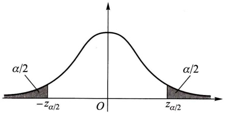
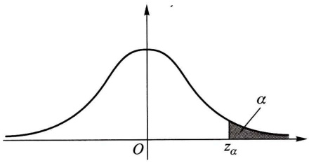
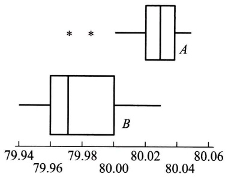
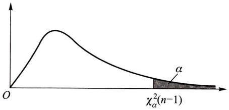
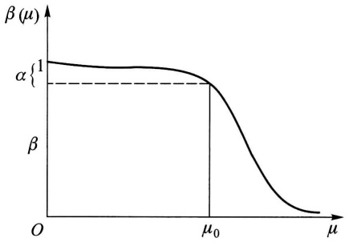
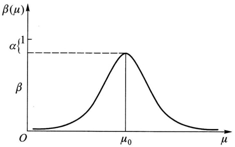

# 第八章 假设检验

原始 PDF 第 196–235 页。

## 第八章 假设检验

## § 1 假设检验

统计推断的另一类重要问题是假设检验问题. 在总体的分布函数完全未知或只知其形式、但不知其参数的情况, 为了推断总体的某些未知特性, 提出某些关于总体的假设. 例如, 提出总体服从泊松分布的假设, 又如, 对于正态总体提出数学期望等于 $\mu_0$ 的假设等. 我们要根据样本对所提出的假设作出是接受, 还是拒绝的决策. 假设检验是作出这一决策的过程. 这里, 先结合例子来说明假设检验的基本思想和做法.

例1 某车间用一台包装机包装葡萄糖. 袋装糖的净重是一个随机变量, 它服从正态分布. 当机器正常时, 其均值为 $0.5 \mathrm{~kg}$, 标准差为 $0.015 \mathrm{~kg}$. 某日开工后为检验包装机是否正常, 随机地抽取它所包装的糖9袋, 称得净重为 (以 $\mathrm{kg}$ 计)

$$
0. 4 9 7 \quad 0. 5 0 6 \quad 0. 5 1 8 \quad 0. 5 2 4 \quad 0. 4 9 8 \quad 0. 5 1 1 \quad 0. 5 2 0 \quad 0. 5 1 5 \quad 0. 5 1 2
$$

问机器是否正常？

以 $\mu, \sigma$ 分别表示这一天袋装糖的净重总体 $X$ 的均值和标准差. 由于长期实践表明标准差比较稳定, 我们就设 $\sigma = 0.015$. 于是 $X \sim N(\mu, 0.015^2)$, 这里 $\mu$ 未知. 问题是根据样本值来判断 $\mu = 0.5$ 还是 $\mu \neq 0.5$. 为此, 我们提出两个相互对立的假设

$$
H _ {0}: \mu = \mu_ {0} = 0. 5
$$

和

$$
H _ {1}: \mu \neq \mu_ {0}.
$$

然后，我们给出一个合理的法则，根据这一法则，利用已知样本作出决策是接受假设 $H_0$ （即拒绝假设 $H_{1}$ )，还是拒绝假设 $H_0$ （即接受假设 $H_{1}$ ).如果作出的决策是接受 $H_0$ ，则认为 $\mu = \mu_0$ ，即认为机器工作是正常的，否则，认为是不正常的.

由于要检验的假设涉及总体均值 $\mu$ ，故首先想到是否可借助样本均值 $\overline{X}$ 这一统计量来进行判断.我们知道， $\overline{X}$ 是 $\mu$ 的无偏估计， $\overline{X}$ 的观察值 $\bar{x}$ 的大小在一定程度上反映 $\mu$ 的大小.因此，如果假设 $H_0$ 为真，则观察值 $\bar{x}$ 与 $\mu_0$ 的偏差 $|\bar{x} -\mu_0|$ 一般不应太大.若 $|\bar{x} -\mu_0|$ 过分大，我们就怀疑假设 $H_{0}$ 的正确性而拒绝 $H_{0}$

---

· 182 ·

第八章 假设检验

并考虑到当 $H_0$ 为真时 $\frac{\overline{X} - \mu_0}{\sigma / \sqrt{n}} \sim N(0,1)$. 而衡量 $|\overline{x} - \mu_0|$ 的大小可归结为衡量 $\frac{|\overline{x} - \mu_0|}{\sigma / \sqrt{n}}$ 的大小. 基于上面的想法, 我们可适当选定一正数 $k$, 使当观察值 $\overline{x}$ 满足 $\frac{|\overline{x} - \mu_0|}{\sigma / \sqrt{n}} \geqslant k$ 时就拒绝假设 $H_0$, 反之, 若 $\frac{|\overline{x} - \mu_0|}{\sigma / \sqrt{n}} < k$, 则接受假设 $H_0$.

然而，由于作出决策的依据是一个样本，当实际上 $H_0$ 为真时仍可能作出拒绝 $H_0$ 的决策（这种可能性是无法消除的），这是一种错误，犯这种错误的概率记为

$P\{\text{当} H_0 \text{为真时拒绝} H_0\}$ 或 $P_{\mu_0}\{\text{拒绝} H_0\}$ 或 $P_{\mu \in H_0}\{\text{拒绝} H_0\}$. 记号 $P_{\mu_0}\{\cdot\}$ 表示参数 $\mu$ 取 $\mu_0$ 时事件 $\{\cdot\}$ 的概率, $P_{\mu \in H_0}\{\cdot\}$ 表示 $\mu$ 取 $H_0$ 规定的值时事件 $\{\cdot\}$ 的概率. 我们无法排除犯这类错误的可能性, 因此自然希望将犯这类错误的概率控制在一定限度之内, 即给出一个较小的数 $\alpha (0 < \alpha < 1)$, 使犯这类错误的概率不超过 $\alpha$, 即使得

$$
P \{\text {当} H _ {0} \text {为真时拒绝} H _ {0} \} \leqslant \alpha . \tag {1.1}
$$

为了确定常数 $k$ ，我们考虑统计量 $\frac{\overline{X} - \mu_0}{\sigma / \sqrt{n}}$ 由于只允许犯这类错误的概率最大为 $\alpha$ ，令(1.1)式右端取等号，即令

$$
P \{\text {当} H _ {0} \text {为真时拒绝} H _ {0} \} = P _ {\mu_ {0}} \Bigg \{\left| \frac {\overline {{X}} - \mu_ {0}}{\sigma / \sqrt {n}} \right| \geqslant k \Bigg \} = \alpha ,
$$

由于当 $H_0$ 为真时，$Z = \frac{\overline{X} - \mu_0}{\sigma / \sqrt{n}} \sim N(0,1)$，由标准正态分布分位数的定义得（如图8-1）

$$
k = z _ {\alpha / 2}.
$$

因而,若 Z 的观察值满足

$$
| z | = \left| \frac {\overline {{x}} - \mu_ {0}}{\sigma / \sqrt {n}} \right| \geqslant k = z _ {\alpha / 2},
$$

则拒绝 $H_0$ ，而若

$$
| z | = \left| \frac {\overline {{x}} - \mu_ {0}}{\sigma / \sqrt {n}} \right| <   k = z _ {\alpha / 2},
$$

area

| Region | Description |
| --- | --- |
| Left Area | \(\alpha/2\) |
| Shaded Area | \(-z_\alpha/2\) to \(z_\alpha/2\) |
| Right Area | \(\alpha/2\) |

图8-1

则接受 $H_0$

例如，在本例中取 $\alpha = 0.05$ ，则有 $k = z_{0.05 / 2} = z_{0.025} = 1.96$ ，又已知 $n = 9, \sigma = 0.015$ ，再由样本算得 $\bar{x} = 0.511$ ，即有

---

§ 1 假设检验

· 183 ·

$$
\left| \frac {\overline {{x}} - \mu_ {0}}{\sigma / \sqrt {n}} \right| = 2. 2 > 1. 9 6,
$$

于是拒绝 $H_0$ ，认为这天包装机工作不正常.

上例中所采用的检验法则是符合实际推断原理的. 因通常 $\alpha$ 总是取得较小, 一般取 $\alpha = 0.01, 0.05$. 因而若 $H_0$ 为真, 即当 $\mu = \mu_0$ 时, $\left\{\left|\frac{\overline{X} - \mu_0}{\sigma / \sqrt{n}}\right| \geqslant z_{\alpha/2}\right\}$ 是一个小概率事件, 根据实际推断原理, 就可以认为, 如果 $H_0$ 为真, 则由一次试验得到的观察值 $\overline{x}$, 满足不等式 $\left|\frac{\overline{x} - \mu_0}{\sigma / \sqrt{n}}\right| \geqslant z_{\alpha/2}$ 几乎是不会发生的. 现在在一次观察中竟然出现了满足 $\left|\frac{\overline{x} - \mu_0}{\sigma / \sqrt{n}}\right| \geqslant z_{\alpha/2}$ 的 $\overline{x}$, 则我们有理由怀疑原来的假设 $H_0$ 的正确性, 因而拒绝 $H_0$. 若出现的观察值 $\overline{x}$ 满足 $\left|\frac{\overline{x} - \mu_0}{\sigma / \sqrt{n}}\right| < z_{\alpha/2}$, 此时没有理由拒绝假设 $H_0$, 因此只能接受假设 $H_0$.

在上例的做法中,我们看到当样本容量固定时,选定  $\alpha$  后,数 k 就可以确定,然后按照统计量  $Z=\frac{\overline{X}-\mu_{0}}{\sigma/\sqrt{n}}$  的观察值的绝对值  $|z|$  大于等于 k 还是小于 k 来作出决策. 数 k 是检验上述假设的一个门槛值. 如果  $|z|=\left|\frac{\overline{x}-\mu_{0}}{\sigma/\sqrt{n}}\right|\geqslant k$ , 则称  $\overline{x}$  与  $\mu_{0}$  的差异是显著的, 这时拒绝  $H_{0}$ ; 反之, 如果  $|z|=\left|\frac{\overline{x}-\mu_{0}}{\sigma/\sqrt{n}}\right|<k$ , 则称  $\overline{x}$  与  $\mu_{0}$  的差异是不显著的, 这时接受  $H_{0}$ . 数  $\alpha$  称为显著性水平, 上面关于  $\overline{x}$  与  $\mu_{0}$  有无显著差异的判断是在显著性水平  $\alpha$  之下作出的.

统计量  $Z=\frac{\overline{X}-\mu_{0}}{\sigma/\sqrt{n}}$  称为检验统计量.

前面的检验问题通常叙述成:在显著性水平  $\alpha$  下,检验假设

$$
H _ {0}: \mu = \mu_ {0}, \quad H _ {1}: \mu \neq \mu_ {0}. \tag {1.2}
$$

也常说成“在显著性水平 $\alpha$ 下，针对 $H_{1}$ 检验 $H_0$”. $H_0$ 称为原假设或零假设，$H_{1}$ 称为备择假设（意指在原假设被拒绝后可供选择的假设). 我们要进行的工作是，根据样本，按上述检验方法作出决策在 $H_0$ 与 $H_{1}$ 两者之间接受其一.

当检验统计量取某个区域 $C$ 中的值时，我们拒绝原假设 $H_0$ ，则称区域 $C$ 为拒绝域，拒绝域的边界点称为临界点.如在上例中拒绝域为 $\mid z\mid \geqslant z_{\alpha /2}$ ，而 $z = -z_{\alpha /2},z = z_{\alpha /2}$ 为临界点.

由于检验法则是根据样本作出的,总有可能作出错误的决策.如上面所说的

---

· 184 ·

第八章 假设检验

那样，在假设 $H_0$ 实际上为真时，我们可能犯拒绝 $H_0$ 的错误，称这类“弃真”的错误为第I类错误。又当 $H_0$ 实际上不真时，我们也有可能接受 $H_0$。称这类“取伪”的错误为第Ⅱ类错误。犯第Ⅱ类错误的概率记为

$$
P \{\text {当} H _ {0} \text {不真时接受} H _ {0} \} \quad \text {或} \quad P _ {\mu \in H _ {1}} \{\text {接受} H _ {0} \}.
$$

为此，在确定检验法则时，我们应尽可能使犯两类错误的概率都较小。但是，进一步讨论可知，一般来说，当样本容量固定时，若减小犯一类错误的概率，则犯另一类错误的概率往往增大。若要使犯两类错误的概率都减小，除非增加样本容量。在给定样本容量的情况下，一般来说，我们总是控制犯第Ⅰ类错误的概率，使它不大于 $\alpha.\alpha$ 的大小视具体情况而定，通常 $\alpha$ 取0.1,0.05,0.01,0.005等值。这种只对犯第Ⅰ类错误的概率加以控制，而不考虑犯第Ⅱ类错误的概率的检验，称为显著性检验。

形如(1.2)式中的备择假设 $H_{1}$，表示 $\mu$ 可能大于 $\mu_0$，也可能小于 $\mu_0$，称为双边备择假设，而称形如(1.2)的假设检验为双边假设检验。

有时,我们只关心总体均值是否增大,例如,试验新工艺以提高材料的强度.这时,所考虑的总体的均值应该越大越好.如果我们能判断在新工艺下总体均值较以往正常生产的大,则可考虑采用新工艺.此时,我们需要检验假设

$$
H _ {0}: \mu \leqslant \mu_ {0}, \quad H _ {1}: \mu > \mu_ {0}. \tag {1.3}
$$

形如(1.3)的假设检验,称为右边检验.类似地,有时我们需要检验假设

$$
H _ {0}: \mu \geqslant \mu_ {0}, \quad H _ {1}: \mu <   \mu_ {0}. \tag {1.4}
$$

形如(1.4)的假设检验,称为左边检验.右边检验和左边检验统称为单边检验.

下面来讨论单边检验的拒绝域.

设总体  $X \sim N(\mu, \sigma^{2})$ ,  $\mu$  未知、 $\sigma$  为已知， $X_{1}, X_{2}, \cdots, X_{n}$  是来自 X 的样本. 给定显著性水平  $\alpha$ . 我们来求检验问题(1.3)

$$
H _ {0}: \mu \leqslant \mu_ {0}, \quad H _ {1}: \mu > \mu_ {0}
$$

的拒绝域.

因 $H_0$ 中的全部 $\mu$ 都比 $H_{1}$ 中的 $\mu$ 要小，当 $H_{1}$ 为真时，观察值 $\overline{x}$ 往往偏大，因此，拒绝域的形式为

$$
\overline {{x}} \geqslant k \quad (k \text {是某一正常数}).
$$

下面来确定常数 $k$ ，其做法与例1中的做法类似.

$$
\begin{array}{l} P \{\text {当} H _ {0} \text {为真时拒绝} H _ {0} \} = P _ {\mu \in H _ {0}} \{\overline {{{{X}}}} \geqslant k \} \\ = P _ {\mu \leqslant \mu_ {0}} \left\{\frac {\overline {{X}} - \mu_ {0}}{\sigma / \sqrt {n}} \geqslant \frac {k - \mu_ {0}}{\sigma / \sqrt {n}} \right\} \\ \leqslant P _ {\mu \leqslant \mu_ {0}} \left\{\frac {\overline {{X}} - \mu}{\sigma / \sqrt {n}} \geqslant \frac {k - \mu_ {0}}{\sigma / \sqrt {n}} \right\} \\ \end{array}
$$

---

§ 1 假设检验

· 185 ·

$\left\{\text{上式不等号成立是由于} \mu \leqslant \mu_0, \frac{\overline{X} - \mu}{\sigma / \sqrt{n}} \geqslant \frac{\overline{X} - \mu_0}{\sigma / \sqrt{n}}, \text{事件}\left\{\frac{\overline{X} - \mu_0}{\sigma / \sqrt{n}} \geqslant \frac{k - \mu_0}{\sigma / \sqrt{n}}\right\} \subset \left\{\frac{\overline{X} - \mu}{\sigma / \sqrt{n}} \geqslant \frac{k - \mu_0}{\sigma / \sqrt{n}}\right\} \right.$ 要控制 $P\{\text{当 } H_0$ 为真时拒绝 $H_0\} \leqslant \alpha$，只需令

$$
P _ {\mu \leqslant \mu_ {0}} \left\{\frac {\overline {{X}} - \mu}{\sigma / \sqrt {n}} \geqslant \frac {k - \mu_ {0}}{\sigma / \sqrt {n}} \right\} = \alpha . \tag {1.5}
$$

由于 $\frac{\overline{X} - \mu}{\sigma / \sqrt{n}} \sim N(0,1)$，由（1.5）得到 $\frac{k - \mu_0}{\sigma / \sqrt{n}} = z_\alpha$ （如图8-2），$k = \mu_0 + \frac{\sigma}{\sqrt{n}} z_\alpha$，即得检验问题(1.3)的拒绝域为

$$
\overline {{x}} \geqslant \mu_ {0} + \frac {\sigma}{\sqrt {n}} z _ {\alpha},
$$

即 $z = \frac{\overline{x} - \mu_0}{\sigma / \sqrt{n}} \geqslant z_{\alpha}$. (1.6)

text_image

O
zₐ
α

图8-2

类似地,可得左边检验问题(1.4)

$$
H _ {0}: \mu \geqslant \mu_ {0}, H _ {1}: \mu <   \mu_ {0}
$$

的拒绝域为

$$
z = \frac {\overline {{x}} - \mu_ {0}}{\sigma / \sqrt {n}} \leqslant - z _ {a}. \tag {1.7}
$$

例 2 公司从生产商购买牛奶. 公司怀疑生产商在牛奶中掺水以牟利. 通过测定牛奶的冰点, 可以检验出牛奶是否掺水. 天然牛奶的冰点温度近似服从正态分布, 均值  $\mu_{0} = -0.545^{\circ}C$ , 标准差  $\sigma = 0.008^{\circ}C$ . 牛奶掺水可使冰点温度升高而接近于水的冰点温度 ( $0^{\circ}C$ ). 测得生产商提交的 5 批牛奶的冰点温度, 其均值为  $\overline{x} = -0.535^{\circ}C$ , 问是否可以认为生产商在牛奶中掺了水? 取  $\alpha = 0.05$ .

解 按题意需检验假设

$$
H _ {0}: \mu \leqslant \mu_ {0} = - 0. 5 4 5 (\text {即设牛奶未掺水}),
$$

$$
H _ {1}: \mu > \mu_ {0} (\text {即设牛奶已掺水}).
$$

这是右边检验问题,其拒绝域如(1.6)式所示,即为

$$
z = \frac {\overline {{x}} - \mu_ {0}}{\sigma / \sqrt {n}} \geqslant z _ {0. 0 5} = 1. 6 4 5.
$$

现在 $z = \frac{-0.535 - (-0.545)}{0.008 / \sqrt{5}} = 2.7951 > 1.645, z$ 的值落在拒绝域中，所以我们在显著性水平 $\alpha = 0.05$ 下拒绝 $H_0$ ，即认为生产商在牛奶中掺了水. □

---

· 186 ·

第八章 假设检验

综上所述,可得处理参数的假设检验问题的步骤如下:

$1^{\circ}$ 根据实际问题的要求，提出原假设 $H_{0}$ 及备择假设 $H_{1}$.
$2^{\circ}$ 给定显著性水平 $\alpha$ 以及样本容量 $n$.
$3^{\circ}$ 确定检验统计量以及拒绝域的形式.
$4^{\circ}$ 按 $P\{\text{当} H_0$ 为真时拒绝 $H_0\} \leqslant \alpha$ 求出拒绝域.
$5^{\circ}$ 取样,根据样本观察值作出决策,是接受 $H_{0}$ 还是拒绝 $H_{0}$.

下面我们只讨论正态总体参数的假设检验问题.

## § 2 正态总体均值的假设检验

## (一) 单个总体 $N(\mu, \sigma^2)$ 均值 $\mu$ 的检验

1.  $\sigma^{2}$  已知, 关于  $\mu$  的检验 (Z 检验)

在 §1 中已讨论过正态总体 $N(\mu, \sigma^2)$ 当 $\sigma^2$ 已知时关于 $\mu$ 的检验问题 (1.2), (1.3), (1.4). 在这些检验问题中, 我们都是利用统计量 $Z = \frac{\overline{X} - \mu_0}{\sigma / \sqrt{n}}$ 来确定拒绝域的. 这种检验法常称为 $Z$ 检验法.

2.  $\sigma^{2}$  未知, 关于  $\mu$  的检验 (t 检验)

设总体  $X \sim N(\mu, \sigma^{2})$ ，其中  $\mu, \sigma^{2}$  未知，我们来求检验问题

$$
H _ {0}: \mu = \mu_ {0}, \quad H _ {1}: \mu \neq \mu_ {0}
$$

的拒绝域(显著性水平为  $\alpha$ ).

设  $X_{1}, X_{2}, \cdots, X_{n}$  是来自总体 X 的样本. 由于  $\sigma^{2}$  未知, 现在不能利用  $\frac{\overline{X}-\mu_{0}}{\sigma/\sqrt{n}}$  来确定拒绝域了. 注意到  $S^{2}$  是  $\sigma^{2}$  的无偏估计, 我们用 S 来代替  $\sigma$ , 采用

$$
t = \frac {\overline {{X}} - \mu_ {0}}{S / \sqrt {n}}
$$

作为检验统计量. 当观察值  $\left|t\right|=\left|\frac{\overline{x}-\mu_{0}}{s/\sqrt{n}}\right|$  过分大时就拒绝  $H_{0}$ ，拒绝域的形式为

$$
| t | = \left| \frac {\overline {{x}} - \mu_ {0}}{s / \sqrt {n}} \right| \geqslant k.
$$

由第六章 §3 定理 4 知, 当 $H_0$ 为真时, $\frac{\overline{X} - \mu_0}{S / \sqrt{n}} \sim t(n-1)$, 故由

$P\{\text{当} H_0 \text{为真时拒绝} H_0\} = P_{\mu_0} \left\{ \left| \frac{\overline{X} - \mu_0}{S/\sqrt{n}} \right| \geqslant k \right\} = \alpha$

---

§ 2 正态总体均值的假设检验

· 187 ·

得 $k = t_{\alpha /2}(n - 1)$ ，即得拒绝域为

$$
| t | = \left| \frac {\overline {{x}} - \mu_ {0}}{s / \sqrt {n}} \right| \geqslant t _ {\alpha / 2} (n - 1). \tag {2.1}
$$

对于正态总体 $N(\mu, \sigma^2)$，当 $\sigma^2$ 未知时，关于 $\mu$ 的单边检验的拒绝域在表8-1中给出.

上述利用 $t$ 统计量得出的检验法称为 $t$ 检验法.

在实际中,正态总体的方差常为未知,所以我们常用 t 检验法来检验关于正态总体均值的检验问题.

例1 某种元件的寿命 $X$ (以h计)服从正态分布 $N(\mu, \sigma^2), \mu, \sigma^2$ 均未知. 现测得16只元件的寿命如下:

$$
\begin{array}{l} 1 5 9 \quad 2 8 0 \quad 1 0 1 \quad 2 1 2 \quad 2 2 4 \quad 3 7 9 \quad 1 7 9 \quad 2 6 4 \\ 2 2 2 \quad 3 6 2 \quad 1 6 8 \quad 2 5 0 \quad 1 4 9 \quad 2 6 0 \quad 4 8 5 \quad 1 7 0 \\ \end{array}
$$

问是否有理由认为元件的平均寿命大于 $225\mathrm{h}$?

解 按题意需检验

$$
H _ {0}: \mu \leqslant \mu_ {0} = 2 2 5, \quad H _ {1}: \mu > 2 2 5.
$$

取 $\alpha = 0.05$ .由表8-1知此检验问题的拒绝域为

$$
t = \frac {\overline {{x}} - \mu_ {0}}{s / \sqrt {n}} \geqslant t _ {\alpha} (n - 1).
$$

现在 $n = 16, t_{0.05}(15) = 1.7531$. 又算得 $\overline{x} = 241.5, s = 98.7259$，即有

$$
t = \frac {\overline {{x}} - \mu_ {0}}{s / \sqrt {n}} = 0. 6 6 8 5 <   1. 7 5 3 1.
$$

$t$ 没有落在拒绝域中，故接受 $H_0$ ，即认为元件的平均寿命不大于 $225\mathrm{h}$

## (二) 两个正态总体均值差的检验 (t 检验)

我们还可以用 t 检验法检验具有相同方差的两正态总体均值差的假设. 设  $X_{1}, X_{2}, \cdots, X_{n_{1}}$  是来自正态总体  $N(\mu_{1}, \sigma^{2})$  的样本,  $Y_{1}, Y_{2}, \cdots, Y_{n_{2}}$  是来自正态总体  $N(\mu_{2}, \sigma^{2})$  的样本, 且设两样本独立. 又分别记它们的样本均值为  $\overline{X}, \overline{Y}$ , 记样本方差为  $S_{1}^{2}, S_{2}^{2}$ . 设  $\mu_{1}, \mu_{2}, \sigma^{2}$  均为未知, 要特别引起注意的是, 在这里假设两总体的方差是相等的. 现在来求检验问题:

$$
H _ {0}: \mu_ {1} - \mu_ {2} = \delta , \quad H _ {1}: \mu_ {1} - \mu_ {2} \neq \delta
$$

(δ为已知常数)的拒绝域.取显著性水平为α.

引用下述 t 统计量作为检验统计量:

$$
t = \frac {(\overline {{X}} - \overline {{Y}}) - \delta}{S _ {\mathrm{w}} \sqrt {\frac {1}{n _ {1}} + \frac {1}{n _ {2}}}},
$$

---

· 188 ·

第八章 假设检验

其中 $S_{\mathrm{W}}^{2} = \frac{(n_{1} - 1)S_{1}^{2} + (n_{2} - 1)S_{2}^{2}}{n_{1} + n_{2} - 2},\quad S_{\mathrm{W}} = \sqrt{S_{\mathrm{W}}^{2}}.$

当 $H_0$ 为真时，由第六章 §3 定理5知 $t \sim t(n_1 + n_2 - 2)$. 与单个总体的 $t$ 检验法相仿，其拒绝域的形式为

$$
\left| \frac {(\overline {{x}} - \overline {{y}}) - \delta}{s _ {w} \sqrt {\frac {1}{n _ {1}} + \frac {1}{n _ {2}}}} \right| \geqslant k.
$$

由

$P\{\text{当} H_0 \text{为真时拒绝} H_0\} = P_{\mu_1 - \mu_2 = \delta}\left\{\left|\frac{(\overline{X} - \overline{Y}) - \delta}{S_W \sqrt{\frac{1}{n_1} + \frac{1}{n_2}}}\right| \geqslant k\right\} = \alpha$

可得 $k = t_{\alpha /2}(n_1 + n_2 - 2)$ .于是得拒绝域为

$$
| t | = \frac {| (\overline {{x}} - \overline {{y}}) - \delta |}{s _ {w} \sqrt {\frac {1}{n _ {1}} + \frac {1}{n _ {2}}}} \geqslant t _ {\alpha / 2} (n _ {1} + n _ {2} - 2). \tag {2.2}
$$

关于均值差的两个单边检验问题的拒绝域在表 8-1 中给出. 常用的是 $\delta = 0$ 的情况.

当两个正态总体的方差均为已知(不一定相等)时,我们可用 Z 检验法来检验两正态总体均值差的假设问题,见表 8-1.

例 2 用两种方法(A 和 B)测定冰自 -0.72 ℃ 转变为 0 ℃ 的水的融化热(以 cal/g 计). 测得以下的数据:

方法 A: 79.98 80.04 80.02 80.04 80.03 80.03

80.04 79.97 80.05 80.03 80.02 80.00 80.02

方法 B: 80.02 79.94 79.98 79.97 79.97 80.03 79.95 79.97

设这两个样本相互独立，且分别来自正态总体 $N(\mu_1,\sigma^2)$ 和 $N(\mu_2,\sigma^2),\mu_1,\mu_2,\sigma^2$ 均未知.试检验假设(取显著性水平 $\alpha = 0.05$ )

$$
H _ {0}: \mu_ {1} - \mu_ {2} \leqslant 0, H _ {1}: \mu_ {1} - \mu_ {2} > 0.
$$

解 分别画出对应于方法 A 和方法 B 的数据的箱线图, 如图 8-3. 这两种方法所得的结果是有明显差异的, 现在来检验上述假设.

$$
n _ {1} = 1 3, \overline {{x}} _ {A} = 8 0. 0 2, s _ {A} ^ {2} = 0. 0 2 4 ^ {2},
$$

$$
n _ {2} = 8, \overline {{x}} _ {B} = 7 9. 9 8, s _ {B} ^ {2} = 0. 0 3 1 ^ {2},
$$

$$
s _ {w} ^ {2} = \frac {1 2 \times s _ {A} ^ {2} + 7 \times s _ {B} ^ {2}}{1 9} = 0. 0 0 0 7 1 7 8.
$$

boxplot

| Category | Q1 | Q2 (Median) | Q3 |
| --- | --- | --- | --- |
| A | ~80.015 | ~80.025 | ~80.035 |
| B | ~79.965 | ~79.975 | ~80.000 |

图8-3

---

§ 2 正态总体均值的假设检验

· 189 ·

$$
t = \frac {\overline {{x}} _ {A} - \overline {{x}} _ {B}}{s _ {w} \sqrt {1 / 1 3 + 1 / 8}} = 3. 3 2 3 > t _ {0. 0 5} (1 3 + 8 - 2) = 1. 7 2 9 1.
$$

故拒绝 $H_0$ ，认为方法 $A$ 比方法 $B$ 测得的融化热要大.

## (三) 基于成对数据的检验 (t 检验)

有时为了比较两种产品、两种仪器、两种方法等的差异,我们常在相同的条件下做对比试验,得到一批成对的观察值.然后分析观察数据作出推断.这种方法常称为逐对比较法.

例3 有两台光谱仪 $I_{x}, I_{y}$, 用来测量材料中某种金属的含量, 为鉴定它们的测量结果有无显著的差异, 制备了9件试块 (它们的成分、金属含量、均匀性等各不相同), 现在分别用这两台仪器对每一试块测量一次, 得到9对观察值如下.

| x(%) | 0.20 | 0.30 | 0.40 | 0.50 | 0.60 | 0.70 | 0.80 | 0.90 | 1.00 |
| --- | --- | --- | --- | --- | --- | --- | --- | --- | --- |
| y(%) | 0.10 | 0.21 | 0.52 | 0.32 | 0.78 | 0.59 | 0.68 | 0.77 | 0.89 |
| d=x-y(%) | 0.10 | 0.09 | -0.12 | 0.18 | -0.18 | 0.11 | 0.12 | 0.13 | 0.11 |

问能否认为这两台仪器的测量结果有显著的差异(取  $\alpha=0.01$ )?

解 本题中的数据是成对的, 即对同一试块测出一对数据. 我们看到一对与另一对之间的差异是由各种因素, 如材料成分、金属含量、均匀性等因素引起的. 由于各试块的特性有广泛的差别, 就不能将仪器 $I_{x}$ 对 9 个试块的测量结果 (即表中第一行) 看成是同分布随机变量的观察值. 因而表中第一行不能看成是一个样本的样本值. 同样, 表中第二行也不能看成是一个样本的样本值. 再者, 对于每一对数据而言, 它们是同一试块用不同仪器 $I_{x}, I_{y}$ 测得的结果, 因此, 它们不是两个独立的随机变量的观察值. 综上所述, 我们不能用表 8-1 中第 4 栏的检验法来作检验. 而同一对中两个数据的差异则可看成是仅由这两台仪器性能的差异所引起的, 这样, 局限于各对中两个数据来比较就能排除种种其他因素, 而只考虑单独由仪器的性能所产生的影响. 从而能比较这两台仪器的测量结果是否有显著的差异.

一般，设有 n 对相互独立的观察结果: $(X_{1},Y_{1}),(X_{2},Y_{2}),\cdots,(X_{n},Y_{n})$ ，令  $D_{1}=X_{1}-Y_{1},D_{2}=X_{2}-Y_{2},\cdots,D_{n}=X_{n}-Y_{n}$ ，则  $D_{1},D_{2},\cdots,D_{n}$  相互独立。又由于  $D_{1},D_{2},\cdots,D_{n}$  是由同一因素所引起的，可认为它们服从同一分布。今假设  $D_{i}\sim N(\mu_{D},\sigma_{D}^{2}), i=1,2,\cdots,n$ 。这就是说  $D_{1},D_{2},\cdots,D_{n}$  构成正态总体  $N(\mu_{D},\sigma_{D}^{2})$  的一个

---

· 190 ·

第八章 假设检验

样本,其中  $\mu_{D},\sigma_{D}^{2}$  未知.我们需要基于这一样本检验假设:

(1)  $H_{0}:\mu_{D}=0,\quad H_{1}:\mu_{D}\neq0.$

(2) $H_0: \mu_D \leqslant 0, H_1: \mu_D > 0.$

(3)  $H_{0}:\mu_{D}\geqslant0,\quad H_{1}:\mu_{D}<0.$

分别记  $D_{1}, D_{2}, \cdots, D_{n}$  的样本均值和样本方差的观察值为  $\overline{d}, s_{d}^{2}$ ，按表 8-1 第 2 栏中关于单个正态总体均值的 t 检验，知检验问题(1)，(2)，(3)的拒绝域分别为（显著性水平为  $\alpha$ ）

$$
| t | = \left| \frac {\overline {{d}}}{s _ {d} / \sqrt {n}} \right| \geqslant t _ {\alpha / 2} (n - 1),
$$

$$
t = \frac {\overline {{d}}}{s _ {d} / \sqrt {n}} \geqslant t _ {\alpha} (n - 1),
$$

$$
t = \frac {\overline {{d}}}{s _ {d} / \sqrt {n}} \leqslant - t _ {\alpha} (n - 1).
$$

现在回过来讨论本例的检验问题.先作出同一试块分别由仪器 $I_{x}, I_{y}$ 测得的结果之差，列于上表的第三行.按题意需检验假设

$$
H _ {0}: \mu_ {D} = 0, H _ {1}: \mu_ {D} \neq 0.
$$

现在 $n = 9, t_{\alpha /2}(8) = t_{0.005}(8) = 3.3554$ ，即知拒绝域为

$$
| t | = \left| \frac {\overline {{d}}}{s _ {d} / \sqrt {n}} \right| \geqslant 3. 3 5 5 4.
$$

由观察值得 $\overline{d} = 0.06, s_d = 0.1227, |t| = \frac{0.06}{0.1227 / \sqrt{9}} = 1.467 < 3.3554.$ 现 $|t|$ 的值不落在拒绝域内，故接受 $H_0$ ，认为两台仪器的测量结果并无显著差异.

例 4 做以下的实验以比较人对红光或绿光的反应时间(以 s 计). 实验在点亮红光或绿光的同时, 启动计时器, 要求受试者见到红光或绿光点亮时, 就按下按钮, 切断计时器, 这就能测得反应时间. 测量的结果如下表:

| 红光(x) | 0.30 | 0.23 | 0.41 | 0.53 | 0.24 | 0.36 | 0.38 | 0.51 |
| --- | --- | --- | --- | --- | --- | --- | --- | --- |
| 绿光(y) | 0.43 | 0.32 | 0.58 | 0.46 | 0.27 | 0.41 | 0.38 | 0.61 |
| d=x-y | -0.13 | -0.09 | -0.17 | 0.07 | -0.03 | -0.05 | 0.00 | -0.10 |

设  $D_{i}=X_{i}-Y_{i}(i=1,2,\cdots,8)$  是来自正态总体  $N(\mu_{D},\sigma_{D}^{2})$  的样本， $\mu_{D},\sigma_{D}^{2}$  均未知. 试检验假设(取显著性水平  $\alpha=0.05$ )

---

§ 3 正态总体方差的假设检验

· 191 ·

$$
H _ {0}: \mu_ {D} \geqslant 0, \quad H _ {1}: \mu_ {D} <   0.
$$

解 现在 $n = 8, \overline{d} = -0.0625, s_d = 0.0765$，而

$$
\frac {\overline {{d}}}{s _ {d} / \sqrt {8}} = - 2. 3 1 1 <   - t _ {0. 0 5} (7) = - 1. 8 9 4 6,
$$

故拒绝 $H_0$ ，认为 $\mu_{D} < 0$ ，即认为人对红光的反应时间小于对绿光的反应时间，也就是人对红光的反应要比绿光快. □

## § 3 正态总体方差的假设检验

现在来讨论有关正态总体方差的假设检验问题. 以下分单个总体和两个总体的情况来讨论.

## (一) 单个总体的情况

设总体  $X \sim N(\mu, \sigma^{2}), \mu, \sigma^{2}$  均未知， $X_{1}, X_{2}, \cdots, X_{n}$  是来自 X 的样本. 要求检验假设(显著性水平为  $\alpha$ )

$$
H _ {0}: \sigma^ {2} = \sigma_ {0} ^ {2}, \quad H _ {1}: \sigma^ {2} \neq \sigma_ {0} ^ {2},
$$

$\sigma_{0}^{2}$  为已知常数.

由于 $S^2$ 是 $\sigma^2$ 的无偏估计，当 $H_0$ 为真时，观察值 $s^2$ 与 $\sigma_0^2$ 的比值 $\frac{s^2}{\sigma_0^2}$ 一般来说应在1附近摆动，而不应过分大于1或过分小于1.由第六章 §3 定理3知当 $H_0$ 为真时

$$
\frac {(n - 1) S ^ {2}}{\sigma_ {0} ^ {2}} \sim \chi^ {2} (n - 1),
$$

我们取

$$
\chi^ {2} = \frac {(n - 1) S ^ {2}}{\sigma_ {0} ^ {2}}
$$

作为检验统计量,如上所说知道上述检验问题的拒绝域具有以下的形式:

$$
\frac {(n - 1) s ^ {2}}{\sigma_ {0} ^ {2}} \leqslant k _ {1} \quad \text {或} \quad \frac {(n - 1) s ^ {2}}{\sigma_ {0} ^ {2}} \geqslant k _ {2},
$$

此处  $k_{1}, k_{2}$  的值由下式确定:

$P\{\text{当} H_{0}\text{为真时拒绝} H_{0}\} = P_{\sigma_{0}^{2}}\left\{\left(\frac{(n - 1)S^{2}}{\sigma_{0}^{2}} \leqslant k_{1}\right) \cup \left(\frac{(n - 1)S^{2}}{\sigma_{0}^{2}} \geqslant k_{2}\right)\right\} = \alpha.$

为计算方便起见,习惯上取

$$
P _ {\sigma_ {0} ^ {2}} \left\{\frac {(n - 1) S ^ {2}}{\sigma_ {0} ^ {2}} \leqslant k _ {1} \right\} = \frac {\alpha}{2}, \quad P _ {\sigma_ {0} ^ {2}} \left\{\frac {(n - 1) S ^ {2}}{\sigma_ {0} ^ {2}} \geqslant k _ {2} \right\} = \frac {\alpha}{2},
$$

故得 $k_{1} = \chi_{1 - \alpha /2}^{2}(n - 1),k_{2} = \chi_{\alpha /2}^{2}(n - 1)$ .于是得拒绝域为

---

· 192 ·

第八章 假设检验

$$
\frac {(n - 1) s ^ {2}}{\sigma_ {0} ^ {2}} \leqslant \chi_ {1 - \alpha / 2} ^ {2} (n - 1) \quad \text {或} \quad \frac {(n - 1) s ^ {2}}{\sigma_ {0} ^ {2}} \geqslant \chi_ {\alpha / 2} ^ {2} (n - 1) ①. \tag {3.1}
$$

下面来求单边检验问题(显著性水平为  $\alpha$ )

$$
H _ {0}: \sigma^ {2} \leqslant \sigma_ {0} ^ {2}, H _ {1}: \sigma^ {2} > \sigma_ {0} ^ {2} \tag {3.2}
$$

的拒绝域.因 $H_0$ 中的全部 $\sigma^2$ 都比 $H_{1}$ 中的 $\sigma^2$ 要小，当 $H_{1}$ 为真时，$S^2$ 的观察值 $s^2$ 往往偏大，因此拒绝域的形式为

$$
s ^ {2} \geqslant k.
$$

下面来确定常数 k.

$P\{\text{当} H_{0}\text{为真时拒绝} H_{0}\}=P_{\sigma^{2}\leqslant\sigma_{0}^{2}}\{S^{2}\geqslant k\}$

$$
= P _ {\sigma^ {2} \leqslant \sigma_ {0} ^ {2}} \left\{\frac {(n - 1) S ^ {2}}{\sigma_ {0} ^ {2}} \geqslant \frac {(n - 1) k}{\sigma_ {0} ^ {2}} \right\}
$$

$\leqslant P_{\sigma^2 \leqslant \sigma_0^2} \left\{\frac{(n-1)S^2}{\sigma^2} \geqslant \frac{(n-1)k}{\sigma_0^2}\right\}$ （因为 $\sigma^2 \leqslant \sigma_0^2$）.

要控制  $P\{当 H_{0} 为真时拒绝 H_{0}\} \leqslant \alpha$ ，只需令

$$
P _ {\sigma^ {2} \leqslant \sigma_ {0} ^ {2}} \left\{\frac {(n - 1) S ^ {2}}{\sigma^ {2}} \geqslant \frac {(n - 1) k}{\sigma_ {0} ^ {2}} \right\} = \alpha . \tag {3.3}
$$

因 $\frac{(n-1)S^{2}}{\sigma^{2}}\sim\chi^{2}(n-1)$ ，由(3.3)式得
 $\frac{(n-1)k}{\sigma_{0}^{2}}=\chi_{\alpha}^{2}(n-1)$ （见图8-4）。于是 $k=\frac{\sigma_{0}^{2}}{n-1}\chi_{\alpha}^{2}(n-1)$ ，得检验问题
(3.2)的拒绝域为

area

| X-axis | Y-axis |
| --- | --- |
| O | 0 |
| \(\chi_\alpha^2(n-1)\) | Area under \(\alpha\) |

图8-4

$$
s ^ {2} \geqslant \frac {\sigma_ {0} ^ {2}}{n - 1} \chi_ {\alpha} ^ {2} (n - 1),
$$

即

$$
\chi^ {2} = \frac {(n - 1) s ^ {2}}{\sigma_ {0} ^ {2}} \geqslant \chi_ {\alpha} ^ {2} (n - 1). \tag {3.4}
$$

类似地,可得左边检验问题

$$
H _ {0}: \sigma^ {2} \geqslant \sigma_ {0} ^ {2}, \quad H _ {1}: \sigma^ {2} <   \sigma_ {0} ^ {2}
$$

的拒绝域为

$$
\chi^ {2} = \frac {(n - 1) s ^ {2}}{\sigma_ {0} ^ {2}} \leqslant \chi_ {1 - \alpha} ^ {2} (n - 1). \tag {3.5}
$$

以上检验法称为 $\chi^2$ 检验法.

<small>① 这里指的是 $\frac{(n - 1)s^2}{\sigma_0^2} \leqslant \chi_{1 - \alpha / 2}^2 (n - 1)$ 与 $\frac{(n - 1)s^2}{\sigma_0^2} \geqslant \chi_{\alpha / 2}^2 (n - 1)$ 的并集.</small>

---

§ 3 正态总体方差的假设检验

· 193 ·

表 8-1 正态总体均值、方差的检验法(显著性水平为 $\alpha$ )

|  | 原假设$H_0$ | 检验统计量 | 备择假设$H_1$ | 拒绝域 |
| --- | --- | --- | --- | --- |
| 1 | $\mu \leqslant \mu_0$$\mu \geqslant \mu_0$$\mu = \mu_0$($\sigma^2$已知) | $Z = \frac{\overline{X} - \mu_0}{\sigma / \sqrt{n}}$ | $\mu > \mu_0$$\mu < \mu_0$$\mu \neq \mu_0$ | $z \geqslant z_a$$z \leqslant -z_a$$\|z\| \geqslant z_{a/2}$ |
| 2 | $\mu \leqslant \mu_0$$\mu \geqslant \mu_0$$\mu = \mu_0$($\sigma^2$未知) | $t = \frac{\overline{X} - \mu_0}{S / \sqrt{n}}$ | $\mu > \mu_0$$\mu < \mu_0$$\mu \neq \mu_0$ | $t \geqslant t_a(n-1)$$t \leqslant -t_a(n-1)$$\|t\| \geqslant t_{a/2}(n-1)$ |
| 3 | $\mu_1 - \mu_2 \leqslant \delta$$\mu_1 - \mu_2 \geqslant \delta$$\mu_1 - \mu_2 = \delta$($\sigma_1^2, \sigma_2^2$已知) | $Z = \frac{\overline{X} - \overline{Y} - \delta}{\sqrt{\frac{\sigma_1^2}{n_1} + \frac{\sigma_2^2}{n_2}}}$ | $\mu_1 - \mu_2 > \delta$$\mu_1 - \mu_2 < \delta$$\mu_1 - \mu_2 \neq \delta$ | $z \geqslant z_a$$z \leqslant -z_a$$\|z\| \geqslant z_{a/2}$ |
| 4 | $\mu_1 - \mu_2 \leqslant \delta$$\mu_1 - \mu_2 \geqslant \delta$$\mu_1 - \mu_2 = \delta$($\sigma_1^2 = \sigma_2^2 = \sigma^2$未知) | $t = \frac{\overline{X} - \overline{Y} - \delta}{S_W \sqrt{\frac{1}{n_1} + \frac{1}{n_2}}}S_W^2 = \frac{(n_1 - 1)S_1^2 + (n_2 - 1)S_2^2}{n_1 + n_2 - 2}$ | $\mu_1 - \mu_2 > \delta$$\mu_1 - \mu_2 < \delta$$\mu_1 - \mu_2 \neq \delta$ | $t \geqslant t_a(n_1 + n_2 - 2)$$t \leqslant -t_a(n_1 + n_2 - 2)$$\|t\| \geqslant t_{a/2}(n_1 + n_2 - 2)$ |
| 5 | $\sigma^2 \leqslant \sigma_0^2$$\sigma^2 \geqslant \sigma_0^2$$\sigma^2 = \sigma_0^2$($\mu$未知) | $\chi^2 = \frac{(n-1)S^2}{\sigma_0^2}$ | $\sigma^2 > \sigma_0^2$$\sigma^2 < \sigma_0^2$$\sigma^2 \neq \sigma_0^2$ | $\chi^2 \geqslant \chi_a^2(n-1)$$\chi^2 \leqslant \chi_{1-a}^2(n-1)$$\chi^2 \geqslant \chi_{a/2}^2(n-1)$或$\chi^2 \leqslant \chi_{1-a/2}^2(n-1)$ |
| 6 | $\sigma_1^2 \leqslant \sigma_2^2$$\sigma_1^2 \geqslant \sigma_2^2$$\sigma_1^2 = \sigma_2^2$($\mu_1, \mu_2$未知) | $F = \frac{S_1^2}{S_2^2}$ | $\sigma_1^2 > \sigma_2^2$$\sigma_1^2 < \sigma_2^2$$\sigma_1^2 \neq \sigma_2^2$ | $F \geqslant F_a(n_1 - 1, n_2 - 1)$$F \leqslant F_{1-a}(n_1 - 1, n_2 - 1)$$F \geqslant F_{a/2}(n_1 - 1, n_2 - 1)$或$F \leqslant F_{1-a/2}(n_1 - 1, n_2 - 1)$ |
| 7 | $\mu_D \leqslant 0$$\mu_D \geqslant 0$$\mu_D = 0$(成对数据) | $t = \frac{\overline{D} - 0}{S_D / \sqrt{n}}$ | $\mu_D > 0$$\mu_D < 0$$\mu_D \neq 0$ | $t \geqslant t_a(n-1)$$t \leqslant -t_a(n-1)$$\|t\| \geqslant t_{a/2}(n-1)$ |

---

· 194 ·

第八章 假设检验

例1 某厂生产的某种型号的电池，其寿命（以h计）长期以来服从方差$\sigma^2 = 5000$ 的正态分布，现有一批这种电池，从它的生产情况来看，寿命的波动性有所改变.现随机取26只电池，测出其寿命的样本方差 $s^2 = 9200$ .问根据这一数据能否推断这批电池的寿命的波动性较以往的有显著的变化(取 $\alpha = 0.02$ )？

解 本题要求在显著性水平 $\alpha = 0.02$ 下检验假设

$$
H _ {0}: \sigma^ {2} = 5 0 0 0, \quad H _ {1}: \sigma^ {2} \neq 5 0 0 0.
$$

现在 $n = 26, \chi_{\alpha /2}^2 (n - 1) = \chi_{0.01}^2 (25) = 44.314, \chi_{1 - \alpha /2}^2 (25) = \chi_{0.99}^2 (25) = 11.524.\sigma_0^2 = 5000$ ，由(3.1)式拒绝域为

$$
\frac {(n - 1) s ^ {2}}{\sigma_ {0} ^ {2}} \geqslant 4 4. 3 1 4 \quad \text {或} \quad \frac {(n - 1) s ^ {2}}{\sigma_ {0} ^ {2}} \leqslant 1 1. 5 2 4.
$$

由观察值 $s^2 = 9200$ 得 $\frac{(n - 1)s^2}{\sigma_0^2} = 46 > 44.314$ ，所以拒绝 $H_0$ ，认为这批电池寿命的波动性较以往的有显著的变化. □

## (二) 两个总体的情况

设 $X_{1}, X_{2}, \cdots, X_{n_{1}}$ 是来自总体 $N(\mu_{1}, \sigma_{1}^{2})$ 的样本，$Y_{1}, Y_{2}, \cdots, Y_{n_{2}}$ 是来自总体 $N(\mu_{2}, \sigma_{2}^{2})$ 的样本，且两样本独立。其样本方差分别为 $S_{1}^{2}, S_{2}^{2}$。且设 $\mu_{1}, \mu_{2}, \sigma_{1}^{2}, \sigma_{2}^{2}$ 均为未知。现在需要检验假设（显著性水平为 $\alpha$）

$$
H _ {0}: \sigma_ {1} ^ {2} \leqslant \sigma_ {2} ^ {2}, \quad H _ {1}: \sigma_ {1} ^ {2} > \sigma_ {2} ^ {2}. \tag {3.6}
$$

当 $H_0$ 为真时，$E(S_1^2) = \sigma_1^2 \leqslant \sigma_2^2 = E(S_2^2)$，当 $H_1$ 为真时，$E(S_1^2) = \sigma_1^2 > \sigma_2^2 = E(S_2^2)$. 当 $H_1$ 为真时，观察值 $\frac{S_1^2}{S_2^2}$ 有偏大的趋势，故拒绝域具有形式

$$
\frac {s _ {1} ^ {2}}{s _ {2} ^ {2}} \geqslant k,
$$

常数 $k$ 确定如下:

$P\{\text{当} H_{0}\text{为真时拒绝} H_{0}\}=P_{\sigma_{1}^{2}\leqslant\sigma_{2}^{2}}\left\{\frac{S_{1}^{2}}{S_{2}^{2}}\geqslant k\right\}$

$\leqslant P_{\sigma_1^2 \leqslant \sigma_2^2} \left\{\frac{S_1^2 / S_2^2}{\sigma_1^2 / \sigma_2^2} \geqslant k \right\}$ （因为 $\sigma_1^2 / \sigma_2^2 \leqslant 1$）.

要控制 $P\{\text{当} H_0$ 为真时拒绝 $H_0\} \leqslant \alpha$ ，只需令

$$
P _ {\sigma_ {1} ^ {2} \leqslant \sigma_ {2} ^ {2}} \left\{\frac {S _ {1} ^ {2} / S _ {2} ^ {2}}{\sigma_ {1} ^ {2} / \sigma_ {2} ^ {2}} \geqslant k \right\} = \alpha . \tag {3.7}
$$

由第六章 §3 定理 5 知 $\frac{S_1^2 / S_2^2}{\sigma_1^2 / \sigma_2^2} \sim F(n_1 - 1, n_2 - 1)$, 由 (3.7) 式得 $k = F_{\alpha}(n_1 - 1,$

---

\* § 4 置信区间与假设检验之间的关系

· 195 ·

$n_2 - 1)$. 即得检验问题(3.6)的拒绝域为

$$
F = \frac {s _ {1} ^ {2}}{s _ {2} ^ {2}} \geqslant F _ {\alpha} (n _ {1} - 1, n _ {2} - 1). \tag {3.8}
$$

上述检验法称为 $F$ 检验法. 关于 $\sigma_1^2, \sigma_2^2$ 的另外两个检验问题的拒绝域在表8-1中给出.

例2设§2例2中的两个样本分别来自总体 $N(\mu_A,\sigma_A^2),N(\mu_B,\sigma_B^2)$ ，且两样本独立.试检验 $H_0:\sigma_A^2 = \sigma_B^2,H_1:\sigma_A^2\neq \sigma_B^2$ ，以说明我们假设 $\sigma_A^2 = \sigma_B^2$ 是合理的（取显著性水平 $\alpha = 0.01$ ).

解此处 $n_1 = 13, n_2 = 8, \alpha = 0.01$ ，拒绝域为

$$
\frac {s _ {A} ^ {2}}{s _ {B} ^ {2}} \geqslant F _ {0. 0 0 5} (1 2, 7) = 8. 1 8,
$$

或 $\frac{s_A^2}{s_B^2} \leqslant F_{0.995}(12,7) = \frac{1}{F_{0.005}(7,12)} = \frac{1}{5.52} = 0.18.$

现在 $s_A^2 = 0.024^2, s_B^2 = 0.031^2, s_A^2 / s_B^2 = 0.60,$

$$
0. 1 8 <   0. 6 0 <   8. 1 8,
$$

故接受 $H_0$ ，认为两总体方差相等.两总体方差相等也称两总体具有方差齐性，这也表明 §2 例2中假设两总体方差相等是合理的. □

## \* § 4 置信区间与假设检验之间的关系

置信区间与假设检验之间有明显的联系,先考察置信区间与双边检验之间的对应关系.设 $X_{1},X_{2},\cdots,X_{n}$ 是一个来自总体的样本, $x_{1},x_{2},\cdots,x_{n}$ 是相应的样本值, $\Theta$ 是参数 $\theta$ 的可能取值范围.

设 $(\underline{\theta}(X_{1},X_{2},\cdots,X_{n}),\overline{\theta}(X_{1},X_{2},\cdots,X_{n}))$ 是参数 $\theta$ 的一个置信水平为 $1-\alpha$ 的置信区间，则对于任意 $\theta\in\Theta$ ，有

$$
P _ {\theta} \{\underline {{\theta}} (X _ {1}, X _ {2}, \dots , X _ {n}) <   \theta <   \overline {{\theta}} (X _ {1}, X _ {2}, \dots , X _ {n}) \} \geqslant 1 - \alpha , \tag {4.1}
$$

考虑显著性水平为 $\alpha$ 的双边检验

$$
H _ {0}: \theta = \theta_ {0}, H _ {1}: \theta \neq \theta_ {0}. \tag {4.2}
$$

由(4.1)式

$$
P _ {\theta_ {0}} \{\underline {{\theta}} (X _ {1}, X _ {2}, \dots , X _ {n}) <   \theta_ {0} <   \overline {{\theta}} (X _ {1}, X _ {2}, \dots , X _ {n}) \} \geqslant 1 - \alpha ,
$$

即有

$$
P _ {\theta_ {0}} \{(\theta_ {0} \leqslant \underline {{\theta}} (X _ {1}, X _ {2}, \dots , X _ {n})) \cup (\theta_ {0} \geqslant \overline {{\theta}} (X _ {1}, X _ {2}, \dots , X _ {n})) \} \leqslant \alpha .
$$

按显著性水平为 $\alpha$ 的假设检验的拒绝域的定义，检验(4.2)的拒绝域为

$$
\theta_ {0} \leqslant \underline {{\theta}} (x _ {1}, x _ {2}, \dots , x _ {n}) \quad \text {或} \quad \theta_ {0} \geqslant \overline {{{{\theta}}}} (x _ {1}, x _ {2}, \dots , x _ {n});
$$

---

· 196 ·

第八章 假设检验

接受域为

$$
\underline {{\theta}} (x _ {1}, x _ {2}, \dots , x _ {n}) <   \theta_ {0} <   \overline {{\theta}} (x _ {1}, x _ {2}, \dots , x _ {n}).
$$

这就是说, 当我们要检验假设(4.2)时, 先求出  $\theta$  的置信水平为  $1-\alpha$  的置信区间  $(\underline{\theta},\bar{\theta})$ , 然后考察区间  $(\underline{\theta},\bar{\theta})$  是否包含  $\theta_{0}$ , 若  $\theta_{0}\in(\underline{\theta},\bar{\theta})$ , 则接受  $H_{0}$ , 若  $\theta_{0}\notin(\underline{\theta},\bar{\theta})$ , 则拒绝  $H_{0}$ .

反之，对于任意 $\theta_0\in \Theta$ ，考虑显著性水平为 $\alpha$ 的假设检验问题

$$
H _ {0}: \theta = \theta_ {0}, H _ {1}: \theta \neq \theta_ {0},
$$

假设它的接受域为

$$
\underline {{\theta}} (x _ {1}, x _ {2}, \dots , x _ {n}) <   \theta_ {0} <   \overline {{\theta}} (x _ {1}, x _ {2}, \dots , x _ {n}),
$$

即有

$$
P _ {\theta_ {0}} \{\underline {{\theta}} (X _ {1}, X _ {2}, \dots , X _ {n}) <   \theta_ {0} <   \overline {{\theta}} (X _ {1}, X _ {2}, \dots , X _ {n}) \} \geqslant 1 - \alpha .
$$

由 $\theta_0$ 的任意性，由上式知对于任意 $\theta \in \Theta$ ，有

$$
P _ {\theta} \{\underline {{\theta}} (X _ {1}, X _ {2}, \dots , X _ {n}) <   \theta <   \overline {{\theta}} (X _ {1}, X _ {2}, \dots , X _ {n}) \} \geqslant 1 - \alpha .
$$

因此 $(\underline{\theta}(X_{1},X_{2},\cdots,X_{n}),\bar{\theta}(X_{1},X_{2},\cdots,X_{n}))$ 是参数 $\theta$ 的一个置信水平为 $1-\alpha$ 的置信区间.

这就是说，为求出参数  $\theta$  的置信水平为  $1-\alpha$  的置信区间，我们先求出显著性水平为  $\alpha$  的假设检验问题: $H_{0}:\theta=\theta_{0},H_{1}:\theta\neq\theta_{0}$  的接受域  $\underline{\theta}(x_{1},x_{2},\cdots,x_{n})<\theta_{0}<\bar{\theta}(x_{1},x_{2},\cdots,x_{n})$ ，那么， $(\underline{\theta}(X_{1},X_{2},\cdots,X_{n}),\bar{\theta}(X_{1},X_{2},\cdots,X_{n}))$  就是  $\theta$  的置信水平为  $1-\alpha$  的置信区间。

还可验证，置信水平为 $1 - \alpha$ 的单侧置信区间 $(-\infty, \bar{\theta}(X_1, X_2, \cdots, X_n))$ 与显著性水平为 $\alpha$ 的左边检验问题 $H_0: \theta \geqslant \theta_0, H_1: \theta < \theta_0$ 有类似的对应关系。即若已求得单侧置信区间 $(-\infty, \bar{\theta}(X_1, X_2, \cdots, X_n))$，则当 $\theta_0 \in (-\infty, \bar{\theta}(x_1, x_2, \cdots, x_n))$ 时接受 $H_0$，当 $\theta_0 \notin (-\infty, \bar{\theta}(x_1, x_2, \cdots, x_n))$ 时拒绝 $H_0$。反之，若已求得检验问题 $H_0: \theta \geqslant \theta_0, H_1: \theta < \theta_0$ 的接受域为 $-\infty < \theta_0 \leqslant \bar{\theta}(x_1, x_2, \cdots, x_n)$，则可得 $\theta$ 的一个单侧置信区间 $(- \infty, \bar{\theta}(X_1, X_2, \cdots, X_n))$。

置信水平为 $1 - \alpha$ 的单侧置信区间 $(\underline{\theta}(X_1, X_2, \dots, X_n), \infty)$ 与显著性水平为 $\alpha$ 的右边检验问题 $H_0: \theta \leqslant \theta_0, H_1: \theta > \theta_0$ 也有类似的对应关系。即若已求得单侧置信区间 $(\underline{\theta}(X_1, X_2, \dots, X_n), \infty)$，则当 $\theta_0 \in (\underline{\theta}(x_1, x_2, \dots, x_n), \infty)$ 时接受 $H_0$，当 $\theta_0 \notin (\underline{\theta}(x_1, x_2, \dots, x_n), \infty)$ 时拒绝 $H_0$。反之，若已求得检验问题 $H_0: \theta \leqslant \theta_0, H_1: \theta > \theta_0$ 的接受域为 $\underline{\theta}(x_1, x_2, \dots, x_n) \leqslant \theta_0 < \infty$，则可得 $\theta$ 的一个单侧置信区间 $(\underline{\theta}(X_1, X_2, \dots, X_n), \infty)$。

例1设 $X\sim N(\mu ,1),\mu$ 未知， $\alpha = 0.05,n = 16$ ，且由一样本算得 $\overline{x} = 5.20$ ，于是得到参数 $\mu$ 的一个置信水平为0.95的置信区间

---

\* § 5 样本容量的选取

· 197 ·

$$
\left(\overline {{x}} - \frac {1}{\sqrt {1 6}} z _ {0. 0 2 5}, \overline {{x}} + \frac {1}{\sqrt {1 6}} z _ {0. 0 2 5}\right) = (5. 2 0 - 0. 4 9, 5. 2 0 + 0. 4 9) = (4. 7 1, 5. 6 9).
$$

现在考虑检验问题 $H_0: \mu = 5.5, H_1: \mu \neq 5.5$. 由于 $5.5 \in (4.71, 5.69)$, 故接受 $H_0$.

例2 数据如上例.试求右边检验问题 $H_0: \mu \leqslant \mu_0, H_1: \mu > \mu_0$ 的接受域，并求 $\mu$ 的单侧置信下限 ($\alpha = 0.05$).

解 检验问题的拒绝域为 $z = \frac{\overline{x} - \mu_0}{1 / \sqrt{16}} \geqslant z_{0.05}$, 或即 $\mu_0 \leqslant 4.79$. 于是检验问题的接受域为 $\mu_0 > 4.79$. 这样就得到 $\mu$ 的单侧置信区间 $(4.79, \infty)$, 单侧置信下限 $\underline{\mu} = 4.79$.

## \* § 5 样本容量的选取

以上我们在进行假设检验时,总是根据问题的要求,预先给出显著性水平以控制犯第Ⅰ类错误的概率,而犯第Ⅱ类错误的概率则依赖于样本容量的选择.在一些实际问题中,我们除了希望控制犯第Ⅰ类错误的概率外,往往还希望控制犯第Ⅱ类错误的概率.在这一节,我们将阐明如何选取样本的容量使得犯第Ⅱ类错误的概率控制在预先给定的限度之内.为此,我们引入施行特征函数.

定义 若 $C$ 是参数 $\theta$ 的某检验问题的一个检验法，

$$
\beta (\theta) = P _ {\theta} (\text {接受} H _ {0}) \tag {5.1}
$$

称为检验法 C 的施行特征函数或 OC 函数, 其图形称为 OC 曲线.

由定义知，若此检验法的显著性水平为 $\alpha$ ，那么当真值 $\theta \in H_0$ 时，$\beta (\theta)$ 就是作出正确判断（即 $H_{0}$ 为真时接受 $H_0$ )的概率，故此时 $\beta (\theta)\geqslant 1 - \alpha$；而当 $\theta \in H_1$ 时，则 $\beta (\theta)$ 就是犯第Ⅱ类错误的概率，而 $1 - \beta (\theta)$ 是作出正确判断（即 $H_0$ 为不真时拒绝 $H_0$ )的概率.函数 $1 - \beta (\theta)$ 称为检验法 $C$ 的功效函数.当 $\theta^{*}\in H_{1}$ 时，值$1 - \beta (\theta^{*})$ 称为检验法 $C$ 在点 $\theta^{*}$ 的功效.它表示当参数 $\theta$ 的真值为 $\theta^{*}$ 时，检验法$C$ 作出正确判断的概率.

本书只介绍正态总体均值的检验法的 OC 函数及其图形.

## 1. $Z$ 检验法的 $OC$ 函数

右边检验问题 $H_0: \mu \leqslant \mu_0, H_1: \mu > \mu_0$ 的 $OC$ 函数是

$$
\begin{array}{l} \beta (\mu) = P _ {\mu} (\text {接受} H _ {0}) = P _ {\mu} \Biggl \{\frac {\overline {{X}} - \mu_ {0}}{\sigma / \sqrt {n}} <   z _ {\alpha} \Biggr \} \\ = P _ {\mu} \left\{\frac {\overline {{X}} - \mu}{\sigma / \sqrt {n}} <   z _ {\alpha} - \frac {\mu - \mu_ {0}}{\sigma / \sqrt {n}} \right\} = \Phi (z _ {\alpha} - \lambda), \tag {5.2} \\ \end{array}
$$

---

· 198 ·

第八章 假设检验

其中 $\lambda = \frac{\mu - \mu_0}{\sigma / \sqrt{n}}$。其图形如图8-5所示。此 $OC$ 函数 $\beta(\mu)$ 有如下性质:

（1）它是 $\lambda = \frac{\mu - \mu_0}{\sigma / \sqrt{n}}$ 的单调递减连续函数.

(2) $\lim_{\mu \to \mu_1^+} \beta(\mu) = 1 - \alpha, \quad \lim_{\mu \to \infty} \beta(\mu) = 0.$

由  $\beta(\mu)$  的连续性可知, 当参数的真

line

| \(\mu\) | \(\beta(\mu)\) |
| --- | --- |
| 0 | \(\alpha\) |
| \(\mu_{0}\) | \(\alpha\) |

图8-5

值 $\mu (\mu >\mu_0)$ 在 $\mu_0$ 附近时，检验法的功效很低，即 $\beta (\mu)$ 的值很大，亦即犯第Ⅱ类错误的概率很大.因为 $\alpha$ 通常取得比较小，而不管 $\sigma$ 多么小， $n$ 多么大，只要 $n$ 给定，总存在 $\mu_0$ 附近的点 $\mu (\mu >\mu_0)$ 使 $\beta (\mu)$ 几乎等于 $1 - \alpha$

这表明,无论样本容量 n 多么大,要想对所有  $\mu\in H_{1}$ , 即真值为  $H_{1}$  所规定的任一点时, 控制犯第Ⅱ类错误的概率都很小是不可能的. 但是我们可以使用 OC 函数  $\beta(\mu)$  以确定样本容量 n, 使当真值  $\mu\geqslant\mu_{0}+\delta(\delta>0$  为取定的值)时, 犯第Ⅱ类错误的概率不超过给定的  $\beta$ . 这是由于  $\beta(\mu)$  是  $\mu$  的递减函数, 故当  $\mu\geqslant\mu_{0}+\delta$  时有

$$
\beta (\mu_ {0} + \delta) \geqslant \beta (\mu).
$$

于是只要 $\beta (\mu_0 + \delta) = \Phi (z_{\alpha} - \sqrt{n}\delta /\sigma)\leqslant \beta$ ，亦即只要 $n$ 满足

$$
z _ {\alpha} - \sqrt {n} \delta / \sigma \leqslant - z _ {\beta}
$$

即可. 这就是说, 只要

$$
\sqrt {n} \geqslant \frac {(z _ {\alpha} + z _ {\beta}) \sigma}{\delta}, \tag {5.3}
$$

就能使当 $\mu \in H_1$ 且 $\mu \geqslant \mu_0 + \delta$ 时（即真值 $\mu \geqslant \mu_0 + \delta$ 时）犯第Ⅱ类错误的概率不超过 $\beta$.

类似地，可得左边检验问题 $H_0:\mu \geqslant \mu_0,H_1:\mu <  \mu_0$ 的 $OC$ 函数为

$$
\beta (\mu) = \Phi (z _ {\alpha} + \lambda), \quad \lambda = \frac {\mu - \mu_ {0}}{\sigma / \sqrt {n}}. \tag {5.4}
$$

当真值 $\mu \geqslant \mu_0$ 时 $\beta (\mu)$ 为作出正确判断的概率；当真值 $\mu < \mu_0$ 时，$\beta (\mu)$ 给出犯第Ⅱ类错误的概率.只要样本容量 $n$ 满足

$$
\sqrt {n} \geqslant \frac {(z _ {\alpha} + z _ {\beta}) \sigma}{\delta}, \tag {5.5}
$$

就能使当 $\mu \in H_1$ 且 $\mu \leqslant \mu_0 - \delta (\delta > 0$，为取定的值)时，犯第Ⅱ类错误的概率不超过给定的值 $\beta$.

双边检验问题 $H_0: \mu = \mu_0$，$H_1: \mu \neq \mu_0$ 的 $OC$ 函数是

---

\* § 5 样本容量的选取

· 199 ·

$$
\begin{array}{l} \beta (\mu) = P _ {\mu} (\text {接受} H _ {0}) = P _ {\mu} \left\{- z _ {a / 2} <   \frac {\overline {{X}} - \mu_ {0}}{\sigma / \sqrt {n}} <   z _ {a / 2} \right\} \\ = P _ {\mu} \left\{- \lambda - z _ {\alpha / 2} <   \frac {\bar {X} - \mu}{\sigma / \sqrt {n}} <   - \lambda + z _ {\alpha / 2} \right\} = \Phi \left(z _ {\alpha / 2} - \lambda\right) - \Phi \left(- z _ {\alpha / 2} - \lambda\right) \\ = \Phi (z _ {\alpha / 2} - \lambda) + \Phi (z _ {\alpha / 2} + \lambda) - 1, \quad \lambda = \frac {\mu - \mu_ {0}}{\sigma / \sqrt {n}}. \tag {5.6} \\ \end{array}
$$

OC 曲线如图 8-6 所示. 注意 $\beta(\mu)$ 是 $|\lambda|$ 的严格单调下降函数.

在双边检验问题中,若要求对  $H_{1}$  中满足  $\left|\mu-\mu_{0}\right|\geqslant\delta>0$  的  $\mu$  处的函数值  $\beta(\mu)\leqslant\beta$ , 则需解超越方程

$$
\begin{array}{l} \beta = \Phi (z _ {\alpha / 2} - \sqrt {n} \delta / \sigma) \\ + \Phi (z _ {\alpha / 2} + \sqrt {n} \delta / \sigma) - 1 \\ \end{array}
$$

才能确定 n. 通常因 n 较大, 故总可以

line

| \(\mu\) | \(\beta(\mu)\) |
| --- | --- |
| 0 | ~0.05 |
| \(\mu_{0}\) | \(\alpha{1}\) |

图8-6

认为 $z_{\alpha /2} + \sqrt{n}\delta /\sigma \geqslant 4$ ，于是 $\Phi (z_{\alpha /2} + \sqrt{n}\delta /\sigma)\approx 1$ ，故近似地有

$$
\beta \approx \Phi (z _ {\alpha / 2} - \sqrt {n} \delta / \sigma).
$$

由此知只要样本容量 $n$ 满足

$$
z _ {\alpha / 2} - \sqrt {n} \delta / \sigma \leqslant - z _ {\beta},
$$

即只要 $n$ 满足

$$
\sqrt {n} \geqslant (z _ {\alpha / 2} + z _ {\beta}) \frac {\sigma}{\delta}, \tag {5.7}
$$

就能使当 $\mu \in H_1$ 且 $|\mu -\mu_0|\geqslant \delta (\delta >0$ ，为取定的值)时，犯第Ⅱ类错误的概率不超过给定的值 $\beta$

例1（工业产品质量抽验方案）设有一大批产品，产品质量指标 $X \sim N(\mu, \sigma^2)$. 以 $\mu$ 小者为佳，厂方要求所确定的验收方案对高质量的产品 $(\mu \leqslant \mu_0)$ 能以高概率 $1 - \alpha$ 为买方所接受. 买方则要求低质产品 $(\mu \geqslant \mu_0 + \delta, \delta > 0)$ 能以高概率 $1 - \beta$ 被拒绝. $\alpha, \beta$ 由厂方与买方协商给出. 并采取一次抽样以确定该批产品是否为买方所接受. 问应怎样安排抽样方案？已知 $\mu_0 = 120, \delta = 20$ ，且由工厂长期经验知 $\sigma^2 = 900$. 又经商定 $\alpha, \beta$ 均取为0.05.

解 检验问题可表达为

$$
H _ {0}: \mu \leqslant \mu_ {0}, \quad H _ {1}: \mu > \mu_ {0}, \tag {5.8}
$$

且要求当 $\mu \geqslant \mu_0 + \delta$ 时能以 $1 - \beta = 0.95$ 的概率拒绝 $H_0$. 由 $Z$ 检验，拒绝域为

---

· 200 ·

第八章 假设检验

$$
\frac {\overline {{x}} - \mu_ {0}}{\sigma / \sqrt {n}} \geqslant z _ {\alpha},
$$

故 $OC$ 函数为

$$
\begin{array}{l} \beta (\mu) = P _ {\mu} \left\{\frac {\overline {{X}} - \mu_ {0}}{\sigma / \sqrt {n}} <   z _ {\alpha} \right\} = P _ {\mu} \left\{\frac {\overline {{X}} - \mu}{\sigma / \sqrt {n}} <   z _ {\alpha} - \frac {\mu - \mu_ {0}}{\sigma / \sqrt {n}} \right\} \\ = \Phi \bigg (z _ {\alpha} - \frac {\mu - \mu_ {0}}{\sigma / \sqrt {n}} \bigg). \tag {5.9} \\ \end{array}
$$

现要求当 $\mu \geqslant \mu_0 + \delta$ 时 $\beta (\mu)\leqslant \beta .$ 因 $\beta (\mu)$ 是 $\mu$ 的递减函数，故只需 $\beta (\mu_0 + \delta) = \beta$ 即可.此时，由(5.9)式可得

$$
\sqrt {n} \geqslant \frac {(z _ {\alpha} + z _ {\beta}) \sigma}{\delta}.
$$

按给定的数据算得 $n \geqslant 24.35$，故取 $n = 25$。且当 $\bar{x}$ 满足 $\frac{\bar{x} - \mu_0}{\sigma / \sqrt{n}} \geqslant z_\alpha = z_{0.05} = 1.645$ 时，即当 $\bar{x} \geqslant 129.87$ 时，买方就拒绝这批产品，而当 $\bar{x} < 129.87$ 时，买方接受这批产品。$\square$

## 2. $t$ 检验法的 $OC$ 函数

右边检验问题 $H_0: \mu \leqslant \mu_0, H_1: \mu > \mu_0$ 的 $t$ 检验法的 $OC$ 函数是

$$
\beta (\mu) = P _ {\mu} (\text {接受} H _ {0}) = P _ {\mu} \biggl \{\frac {\overline {{X}} - \mu_ {0}}{S / \sqrt {n}} <   t _ {\alpha} (n - 1) \biggr \}, \tag {5.10}
$$

其中变量

$$
\frac {\overline {{X}} - \mu_ {0}}{S / \sqrt {n}} = \left(\frac {\overline {{X}} - \mu}{\sigma / \sqrt {n}} + \lambda\right) / \left(\frac {S}{\sigma}\right), \lambda = \frac {\mu - \mu_ {0}}{\sigma / \sqrt {n}}. \tag {5.11}
$$

我们称变量 $\frac{\overline{X} - \mu_0}{S / \sqrt{n}}$ 服从非中心参数为 $\lambda$ 、自由度为 $n - 1$ 的非中心 $t$ 分布. 在 $\lambda = 0$ 时, 它是通常的 $t(n - 1)$ 变量.

若给定 $\alpha, \beta$ 以及 $\delta > 0$，则可从书末附表7查得所需容量 $n$，使得当 $\mu \in H_1$ 且 $\frac{\mu - \mu_0}{\sigma} \geqslant \delta$ 时犯第Ⅱ类错误的概率不超过 $\beta$.

若给定 $\alpha, \beta$ 以及 $\delta > 0$，对于左边检验问题 $H_0: \mu \geqslant \mu_0, H_1: \mu < \mu_0$ 的 $t$ 检验法，也可从附表7查得所需容量 $n$，使得当 $\mu \in H_1$ 且 $\frac{\mu - \mu_0}{\sigma} \leqslant -\delta$ 时犯第Ⅱ类错误的概率不超过 $\beta$. 对于双边检验问题 $H_0: \mu = \mu_0, H_1: \mu \neq \mu_0$ 的 $t$ 检验法也可从附表7查得所需容量 $n$，使得当 $\mu \in H_1$，且 $\frac{|\mu - \mu_0|}{\sigma} \geqslant \delta$ 时犯第Ⅱ类错误的概率不超过 $\beta$.

例2 考虑在显著性水平 $\alpha = 0.05$ 下进行 $t$ 检验

$$
H _ {0}: \mu \leqslant 6 8, \quad H _ {1}: \mu > 6 8.
$$

---

\* § 5 样本容量的选取

· 201 ·

（1）要求在 $H_{1}$ 中 $\mu \geqslant \mu_{1} = 68 + \sigma$ 时犯第Ⅱ类错误的概率不超过 $\beta = 0.05$. 求所需的样本容量.
（2）若样本容量为 $n = 30$ ，问在 $H_{1}$ 中 $\mu = \mu_{1} = 68 + 0.75\sigma$ 时犯第Ⅱ类错误的概率是多少？

解（1）此处 $\alpha = \beta = 0.05, \mu_0 = 68, \delta = \frac{\mu_1 - \mu_0}{\sigma} = \frac{(68 + \sigma) - 68}{\sigma} = 1$，查附表7得 $n = 13$.

（2）现在 $\alpha = 0.05, n = 30, \delta = \frac{\mu_1 - \mu_0}{\sigma} = \frac{(68 + 0.75\sigma) - 68}{\sigma} = 0.75$ ，查附表7，得 $\beta = 0.01.$

例 3 考虑在显著性水平  $\alpha=0.05$  下进行 t 检验

$$
H _ {0}: \mu = 1 4, \quad H _ {1}: \mu \neq 1 4.
$$

要求在 $H_{1}$ 中 $\frac{|\mu - 14|}{\sigma} \geqslant 0.4$ 时犯第Ⅱ类错误的概率不超过 $\beta = 0.1$ ，求所需样本容量.

解 此处  $\alpha=0.05,\beta=0.1,\delta=0.4$  , 查附表 7 得 n=68.

在实际问题中,有时只给出  $\alpha,\beta$  及  $\left|\mu_{1}-\mu_{0}\right|$  的值,而需要确定所需的样本容量 n. 这时由于  $\sigma$  未知,不能确定  $\delta=\left|\mu_{1}-\mu_{0}\right|/\sigma$  的值,因而不能直接查表以确定样本容量. 此时可采用下述近似方法. 先适当取一值  $n_{1}$ , 抽取容量为  $n_{1}$  的样本,根据这一样本计算  $s^{2}$  的值,以  $s^{2}$  作为  $\sigma^{2}$  的估计,算出  $\delta$  的近似值. 由  $\alpha,\beta,\delta$  的值查附表 7 定出样本的容量,记为  $n_{2}$ . 若  $n_{1}\geqslant n_{2}$ , 则取  $n_{1}$  作为所求的容量,即取  $n=n_{1}$ . 否则,再抽  $n_{2}-n_{1}$  个独立观察值与原来抽得的观察值合并,重新计算  $\delta$  的近似值. 然后用  $\delta$  的新近似值和  $\alpha,\beta$  查附表 7,再次定出样本容量. 记为  $n_{3}$ . 若  $n_{2}\geqslant n_{3}$ , 则取  $n=n_{2}$ , 否则再按上法重复进行. 一般,只需试少数几次就可得到所求的样本容量 n.

下面考虑两个正态总体均值差的 t 检验.

若两个正态总体 $N(\mu_1, \sigma_1^2), N(\mu_2, \sigma_2^2)$ 中 $\sigma_1^2 = \sigma_2^2 = \sigma^2$ 而 $\sigma^2$ 未知. 在均值差 $\mu_1 - \mu_2$ 的检验问题 $H_0: \mu_1 - \mu_2 = 0, H_1: \mu_1 - \mu_2 \neq 0$ （或 $H_0: \mu_1 - \mu_2 \leqslant 0, H_1: \mu_1 - \mu_2 > 0$ 或 $H_0: \mu_1 - \mu_2 \geqslant 0, H_1: \mu_1 - \mu_2 < 0$）的 $t$ 检验法中，当分别自两个总体取得的相互独立的样本其容量 $n_1 = n_2 = n$ 时，给定 $\alpha, \beta$ 以及 $\delta = |\mu_1 - \mu_2| / \sigma$ 的值后可以查附表8得到所需样本容量，使当 $|\mu_1 - \mu_2| / \sigma \geqslant \delta$ 时犯第Ⅱ类错误的概率小于或等于 $\beta$. 当仅给出 $\alpha, \beta$ 以及 $|\mu_1 - \mu_2|$ 的值时，可按类似于上面所说的方法处理.

例 4 需要比较两种汽车用的燃料的辛烷值, 得数据:

---

· 202 ·

第八章 假设检验

| 燃料A | 81 | 84 | 79 | 76 | 82 | 83 | 84 | 80 | 79 | 82 | 81 | 79 |
| --- | --- | --- | --- | --- | --- | --- | --- | --- | --- | --- | --- | --- |
| 燃料B | 76 | 74 | 78 | 79 | 80 | 79 | 82 | 76 | 81 | 79 | 82 | 78 |

燃料的辛烷值越高，燃料质量越好.因燃料 $B$ 较燃料 $A$ 价格便宜，因此，若两者辛烷值相同，则使用燃料 $B$；但若含量的均值差 $\mu_{A} - \mu_{B} \geqslant 5$，则使用燃料 $A$.设两总体的分布均可认为是正态的，而两个样本相互独立.问应采用哪种燃料（取 $\alpha = 0.01, \beta = 0.01$）？

解 按题意需要在显著性水平 $\alpha = 0.01$ 下检验假设

$$
H _ {0}: \mu_ {A} - \mu_ {B} \leqslant 0, \quad H _ {1}: \mu_ {A} - \mu_ {B} > 0,
$$

并要求在 $\mu_A - \mu_B \geqslant 5$ 时，犯第Ⅱ类错误的概率不超过 $\beta = 0.01$.

所取的样本容量为 $n_A = n_B = 12$ ，且有 $\overline{x}_A = 80.83, \overline{x}_B = 78.67, s_A^2 = 5.61, s_B^2 = 6.06.$ 经显著性水平为0.1的 $F$ 检验知，可认为两总体的方差相等，即有 $\sigma_A^2 = \sigma_B^2$ ，记为 $\sigma^2$ .因 $n_A = n_B$ ，取 $\hat{\sigma}^2 = (s_A^2 + s_B^2) / 2 = 5.835$ 作为 $\sigma^2$ 的点估计，取$\hat{\sigma} = \sqrt{\hat{\sigma}^2}$ ，于是 $\delta = 5 / \hat{\sigma} = 2.07$ ，查附表8，当 $\alpha = 0.01,\beta = 0.01,\delta = 2.07$ 时 $n\geqslant 12.$ 现 $n = 12$ ，故已近似地满足要求.而右边检验的拒绝域为

$$
t = \frac {\overline {{x}} _ {A} - \overline {{x}} _ {B}}{s _ {w} \sqrt {1 / n _ {A} + 1 / n _ {B}}} \geqslant t _ {0. 0 1} (n _ {A} + n _ {B} - 2) = 2. 5 0 8 3.
$$

由样本观察值算得  $t=2.19<2.5083$ ，故接受  $H_{0}$ ，即采用燃料 B.

## § 6 分布拟合检验

上面介绍的各种检验法都是在总体分布形式为已知的前提下进行讨论的。但在实际问题中，有时不能知道总体服从什么类型的分布，这时就需要根据样本来检验关于分布的假设。本节介绍 $\chi^2$ 拟合检验法。它可以用来检验总体是否具有某一个指定的分布或属于某一个分布族。

## (一) 单个分布的 ${\chi }^{2}$ 拟合检验法

设总体 X 的分布未知, $x_{1},x_{2},\cdots,x_{n}$ 是来自 X 的样本值.我们来检验假设

$$
H _ {0}: \text {总体} X \text {的分布函数为} F (x), \tag {6.1}
$$

$$
H _ {1}: \text {总体} X \text {的分布函数不是} F (x), ①
$$

其中设 $F(x)$ 不含未知参数.（也常以分布律或概率密度代替 $F(x)$.）

<small>① 在这里备择假设 $H_{1}$ 可以不必写出.</small>

---

§ 6 分布拟合检验

· 203 ·

下面来定义检验统计量. 将在  $H_{0}$  下 X 可能取值的全体  $\Omega$  分成互不相交的子集  $A_{1}, A_{2}, \cdots, A_{k}$ ，以  $f_{i} (i=1,2,\cdots,k)$  记样本观察值  $x_{1}, x_{2}, \cdots, x_{n}$  中落在  $A_{i}$  的个数，这表示事件  $A_{i}=\{X$  的值落在子集  $A_{i}$  内\} 在 n 次独立试验中发生  $f_{i}$  次，于是在这 n 次试验中事件  $A_{i}$  发生的频率为  $f_{i}/n$ . 另一方面，当  $H_{0}$  为真时，我们可以根据  $H_{0}$  中所假设的 X 的分布函数来计算事件  $A_{i}$  的概率，得到  $p_{i}=P(A_{i}), i=1,2,\cdots,k$ . 频率  $f_{i}/n$  与概率  $p_{i}$  会有差异，但一般来说，当  $H_{0}$  为真，且试验的次数又甚多时，这种差异不应太大，因此  $\left(\frac{f_{i}}{n}-p_{i}\right)^{2}$  不应太大. 我们采用形如

$$
\sum_ {i = 1} ^ {k} C _ {i} \left(\frac {f _ {i}}{n} - p _ {i}\right) ^ {2} \tag {6.2}
$$

的统计量来度量样本与  $H_{0}$  中所假设的分布的吻合程度, 其中  $C_{i}(i=1,2,\cdots,k)$  ①为给定的常数. 皮尔逊证明, 如果选取

$$
C _ {i} = n / p _ {i} (i = 1, 2, \dots , k),
$$

则由(6.2)定义的统计量具有下述定理中所述的简单性质.于是我们就采用

$$
\chi^ {2} = \sum_ {i = 1} ^ {k} \frac {n}{p _ {i}} \left(\frac {f _ {i}}{n} - p _ {i}\right) ^ {2} = \sum_ {i = 1} ^ {k} \frac {f _ {i} ^ {2}}{n p _ {i}} - n \tag {6.3}
$$

作为检验统计量.

定理 若 $n$ 充分大 $(n\geqslant 50)$ ，则当 $H_0$ 为真时统计量(6.3)近似服从 $\chi^2 (k - 1)$ 分布.(证略.)

据以上的讨论, 当  $H_{0}$  为真时, (6.3) 式中的  $\chi^{2}$  不应太大, 如  $\chi^{2}$  过分大就拒绝  $H_{0}$ , 拒绝域的形式为

$$
\chi^ {2} \geqslant G \quad (G \text {为正常数}).
$$

对于给定的显著性水平 $\alpha$ ，确定 $G$ 使

$$
P \{\text {当} H _ {0} \text {为真时拒绝} H _ {0} \} = P _ {H _ {0}} \{\chi^ {2} \geqslant G \} = \alpha .
$$

由上述定理得 $G = \chi_{\alpha}^{2}(k - 1)$ .即当样本观察值使(6.3)式中的 $\chi^2$ 的值有

$$
\chi^ {2} \geqslant \chi_ {\alpha} ^ {2} (k - 1),
$$

则在显著性水平 $\alpha$ 下拒绝 $H_0$; 否则就接受 $H_0$. 这就是单个分布的 $\chi^2$ 拟合检验法.

$\chi^{2}$  拟合检验法是基于上述定理得到的, 所以使用时必须注意 n 不能小于 50. 另外  $np_{i}$  不能太小, 应有  $np_{i} \geqslant 5$ , 否则应适当合并  $A_{i}$ , 以满足这个要求(见下例).

例1 下表列出了某一地区在夏季的一个月中由100个气象站报告的雷暴雨的次数.

<small>① 在每一项前乘 $C_i$ ，是为了能够适当选择 $C_i$ ，使得统计量(6.2)有一个理想的极限分布.</small>

---

· 204 ·

第八章 假设检验

| i | 0 | 1 | 2 | 3 | 4 | 5 | $\geqslant 6$ |
| --- | --- | --- | --- | --- | --- | --- | --- |
| $f_{i}$ | 22 | 37 | 20 | 13 | 6 | 2 | 0 |
| $A_{i}$ | $A_{0}$ | $A_{1}$ | $A_{2}$ | $A_{3}$ | $A_{4}$ | $A_{5}$ | $A_{6}$ |

其中 $f_{i}$ 是报告雷暴雨次数为 $i$ 的气象站数. 试用 $\chi^2$ 拟合检验法检验雷暴雨的次数 $X$ 是否服从均值 $\lambda = 1$ 的泊松分布（取显著性水平 $\alpha = 0.05$）.

解 按题意需检验假设

$$
H _ {0}: \quad P \{X = i \} = \frac {\lambda^ {i} \mathrm{e} ^ {- \lambda}}{i !} = \frac {\mathrm{e} ^ {- 1}}{i !}, \quad i = 0, 1, \dots .
$$

在  $H_{0}$  下 X 所有可能取的值为  $\Omega=\{0,1,2,\cdots\}$ ，将  $\Omega$  分成如表 8-2 所示的两两不相交的子集  $A_{0}, A_{1}, \cdots, A_{6}$ ，则有  $P\{X=i\}$  为

$$
p _ {i} = P \{X = i \} = \frac {\mathrm{e} ^ {- 1}}{i !}, \quad i = 0, 1, \dots , 5.
$$

例如 $p_0 = P\{X = 0\} = \mathrm{e}^{-1} = 0.36788,$

$$
\begin{array}{l} p _ {3} = P \{X = 3 \} = \frac {\mathrm{e} ^ {- 1}}{3 !} = 0. 0 6 1 3 1, \\ p _ {6} = P \{X \geqslant 6 \} = 1 - \sum_ {i = 0} ^ {5} p _ {i} = 0. 0 0 0 5 9. \\ n = 1 0 0. \\ \end{array}
$$

表 8-2 例 1 的 ${\chi }^{2}$ 拟合检验计算表

<table><tr><td> $A_i$ </td><td> $f_i$ </td><td> $p_i$ </td><td> $np_i$ </td><td> $f_i^2 / (np_i)$ </td></tr><tr><td> $A_0 : \{X=0\}$ </td><td>22</td><td> $e^{-1}$ </td><td>36.788</td><td>13.16</td></tr><tr><td> $A_1 : \{X=1\}$ </td><td>37</td><td> $e^{-1}$ </td><td>36.788</td><td>37.21</td></tr><tr><td> $A_2 : \{X=2\}$ </td><td>20</td><td> $e^{-1}/2$ </td><td>18.394</td><td>21.75</td></tr><tr><td> $A_3 : \{X=3\}$ </td><td>13</td><td> $e^{-1}/6$ </td><td>6.131</td><td rowspan="4">8.03</td></tr><tr><td> $A_4 : \{X=4\}$ </td><td>6</td><td> $e^{-1}/24$ </td><td>1.533</td></tr><tr><td> $A_5 : \{X=5\}$ </td><td>2</td><td> $e^{-1}/120$ </td><td>0.307</td></tr><tr><td> $A_6 : \{X\geqslant 6\}$ </td><td>0</td><td> $1-\sum_{i=0}^{5}p_i$ </td><td>0.059</td></tr></table>

$$
\Sigma = 1 2 7. 0 4
$$

计算结果如表8-2所示，其中有些 $np_{i}<5$ 的组予以适当合并，使得每组均有 $np_{i}\geqslant5$，如表中第4列花括号所示。并组后k=4， $\chi^{2}$ 的自由度为k-1=4-1=3。 $\chi^{2}_{0.05}(k-1)=\chi^{2}_{0.05}(3)=7.815$ 。现在 $\chi^{2}=127.04-100=27.04>7.815$，故在显著性水平0.05下拒绝 $H_{0}$，认为样本不是来自均值 $\lambda=1$ 的泊松分布。

例2 在研究牛的毛色与牛角的有无，这样两对性状分离现象时，用黑色无角牛与红色有角牛杂交，子二代出现黑色无角牛192头，黑色有角牛78头，红色

---

§ 6 分布拟合检验

· 205 ·

无角牛 72 头, 红色有角牛 18 头, 共 360 头, 问这两对性状是否符合孟德尔遗传规律中 9:3:3:1 的遗传比例?

解 现将题中的数据列表如下:

| 序号 | 1 | 2 | 3 | 4 |
| --- | --- | --- | --- | --- |
| 种类 | 黑色无角 | 黑色有角 | 红色无角 | 红色有角 |
| 数量 | 192 | 78 | 72 | 18 |
| $A_i$ | $A_1$ | $A_2$ | $A_3$ | $A_4$ |

以 $X$ 记各种牛的序号，按题意需检验各类牛的头数符合比例 $9:3:3:1$ ，即$(9 / 16):(3 / 16):(3 / 16):(1 / 16)$ .需检验假设: $H_0:X$ 的分布律为

| X | 1 | 2 | 3 | 4 |
| --- | --- | --- | --- | --- |
| $p_k$ | 9/16 | 3/16 | 3/16 | 1/16 |

取显著性水平为 0.1. 所需计算列在表 8-3 中 (n=360).

表 8-3 例 2 的 ${\chi }^{2}$ 拟合检验计算表

| $A_i$ | $f_i$ | $p_i$ | $np_i$ | $f_i^2/(np_i)$ |
| --- | --- | --- | --- | --- |
| $A_1$ | 192 | 9/16 | 360×9/16=202.5 | 1922/202.5=182.04 |
| $A_2$ | 78 | 3/16 | 360×3/16=67.5 | 782/67.5=90.13 |
| $A_3$ | 72 | 3/16 | 360×3/16=67.5 | 722/67.5=76.8 |
| $A_4$ | 18 | 1/16 | 360×1/16=22.5 | 182/22.5=14.4 |

$$
\Sigma = 3 6 3. 3 7
$$

现在 $\chi^{2}=363.37-360=3.37,k=4,\chi_{0.1}^{2}(4-1)=6.251>3.37$ ，故接受 $H_{0}$ ，认为两对性状符合孟德尔遗传规律中9:3:3:1的遗传比例。

## (二) 分布族的 $\chi^{2}$ 拟合检验

在(一)中要检验的原假设是 $H_0$ :总体 $X$ 的分布函数是 $F(x)$ ，其中 $F(x)$ 是已知的，这种情况是不多的.我们经常遇到的所需检验的原假设是

$$
H _ {0}: \text {总体} X \text {的分布函数是} F (x; \theta_ {1}, \theta_ {2}, \dots , \theta_ {r}), \tag {6.4}
$$

其中 F 的形式已知，而  $\boldsymbol{\theta}=(\theta_{1},\theta_{2},\cdots,\theta_{r})$  是未知参数，它们在某一个范围取值。在  $F(x;\theta_{1},\theta_{2},\cdots,\theta_{r})$  中当参数  $\theta_{1},\theta_{2},\cdots,\theta_{r}$  取不同的值时，就得到不同的分布，因而  $F(x;\theta_{1},\theta_{2},\cdots,\theta_{r})$  代表一族分布。(6.4) 中的  $H_{0}$  表示总体 X 的分布属于分

---

· 206 ·

第八章 假设检验

布族  $F(x;\theta_{1},\theta_{2},\cdots,\theta_{r})$ . 采用类似(一)中的方法来定义检验统计量，将在  $H_{0}$  下 X 可能取值的全体  $\Omega$  分成  $k(k>r+1)$  个互不相交的子集  $A_{1}, A_{2}, \cdots, A_{k}$ ，以  $f_{i}(i=1,2,\cdots,k)$  记样本观察值  $x_{1}, x_{2}, \cdots, x_{n}$  落在  $A_{i}$  的个数，则事件  $A_{i}=\{X$  的值落在  $A_{i}$  内  $\}$  的频率为  $f_{i}/n$ . 另一方面，当  $H_{0}$  为真时，由  $H_{0}$  所假设的分布函数来计算  $P(A_{i})$ ，得到  $P(A_{i})=p_{i}(\theta_{1},\theta_{2},\cdots,\theta_{r})=p_{i}(\boldsymbol{\theta})=p_{i}$ . 此时，需先利用样本求出未知参数的最大似然估计（在  $H_{0}$  下），以估计值作为参数值，求出  $p_{i}$  的估计值  $\hat{p}_{i}=\hat{p}(A_{i})$ ，在 (6.3) 式中以  $\hat{p}_{i}$  代替  $p_{i}$ ，取

$$
\chi^ {2} = \sum_ {i = 1} ^ {k} \frac {f _ {i} ^ {2}}{n \hat {p} _ {i}} - n \tag {6.5}
$$

作为检验假设 $H_0$ 的统计量. 可以证明, 在某些条件下, 在 $H_0$ 为真时近似地有

$$
\chi^ {2} = \sum_ {i = 1} ^ {k} \frac {f _ {i} ^ {2}}{n \hat {p} _ {i}} - n \sim \chi^ {2} (k - r - 1)
$$

与在(一)中一样可得假设检验问题(6.4)的拒绝域为

$$
\chi^ {2} \geqslant \chi_ {\alpha} ^ {2} (k - r - 1), \tag {6.6}
$$

$\alpha$ 为显著性水平.以上就是用来检验分布族的 $\chi^2$ 拟合检验法

例3 在一实验中,每隔一定时间观察一次由某种铀所放射的到达计数器上的 $\alpha$ 粒子数 $X$, 共观察了 100 次, 得结果如表 8-4 所示:

表 8-4 铀放射的到达计数器上的 $\alpha$ 粒子数的实验记录

| i | 0 | 1 | 2 | 3 | 4 | 5 | 6 | 7 | 8 | 9 | 10 | 11 | $\geqslant 12$ |
| --- | --- | --- | --- | --- | --- | --- | --- | --- | --- | --- | --- | --- | --- |
| $f_i$ | 1 | 5 | 16 | 17 | 26 | 11 | 9 | 9 | 2 | 1 | 2 | 1 | 0 |
| $A_i$ | $A_0$ | $A_1$ | $A_2$ | $A_3$ | $A_4$ | $A_5$ | $A_6$ | $A_7$ | $A_8$ | $A_9$ | $A_{10}$ | $A_{11}$ | $A_{12}$ |

其中 $f_{i}$ 是观察到有 $i$ 个 $\alpha$ 粒子的次数.从理论上考虑知 $X$ 应服从泊松分布

$$
P \{X = i \} = \frac {\lambda^ {i} \mathrm{e} ^ {- \lambda}}{i !}, \quad i = 0, 1, 2, \dots . \tag {6.7}
$$

问(6.7)式是否符合实际(取 $\alpha = 0.05$ )？即在显著性水平0.05下检验假设

$H_{0}$: 总体 $X$ 服从泊松分布 $P\{X = i\} = \frac{\lambda^{i} \mathrm{e}^{-\lambda}}{i!}, \quad i = 0,1,2,\dots$.

解 因在 $H_0$ 中参数 $\lambda$ 未具体给出，所以先估计 $\lambda$. 由最大似然估计法得 $\hat{\lambda} = \overline{x} = 4.2$. 在 $H_0$ 假设下，即在 $X$ 服从泊松分布的假设下，$X$ 所有可能取的值为 $\Omega = \{0,1,2,\dots\}$，将 $\Omega$ 分成如表8-4所示的两两不相交的子集 $A_0, A_1, \dots, A_{12}$. 则 $P\{X = i\}$ 有估计

---

§ 6 分布拟合检验

· 207 ·

$$
\hat {p} _ {i} = \hat {P} \{X = i \} = \frac {4 . 2 ^ {i} \mathrm{e} ^ {- 4 . 2}}{i !}, \quad i = 0, 1, \dots .
$$

例如 $\hat{p}_0 = \hat{P}\{X = 0\} = \mathrm{e}^{-4.2} = 0.015,$

$$
\begin{array}{l} \hat {p} _ {3} = \hat {P} \{X = 3 \} = \frac {4 . 2 ^ {3} \mathrm{e} ^ {- 4 . 2}}{3 !} = 0. 1 8 5, \\ \hat {p} _ {1 2} = \hat {P} \{X \geqslant 1 2 \} = 1 - \sum_ {i = 0} ^ {1 1} \hat {p} _ {i} = 0. 0 0 2. \\ \end{array}
$$

表 8-5 例 3 的 ${\chi }^{2}$ 拟合检验计算表

<table><tr><td> $A_i$ </td><td> $f_i$ </td><td> $\hat{p}_i$ </td><td> $n\hat{p}_i$ </td><td> $f_i^2/n\hat{p}_i$ </td></tr><tr><td> $A_0$ </td><td rowspan="2"> $\begin{array}{c}1 \\5\end{array}\ }6$ </td><td rowspan="2"> $\begin{array}{c}0.015 \\0.063\end{array}\ }0.078$ </td><td rowspan="2"> $\begin{array}{c}1.5 \\6.3\end{array}\ }7.8$ </td><td rowspan="2">4.615</td></tr><tr><td> $A_1$ </td></tr><tr><td> $A_2$ </td><td>16</td><td>0.132</td><td>13.2</td><td>19.394</td></tr><tr><td> $A_3$ </td><td>17</td><td>0.185</td><td>18.5</td><td>15.622</td></tr><tr><td> $A_4$ </td><td>26</td><td>0.194</td><td>19.4</td><td>34.845</td></tr><tr><td> $A_5$ </td><td>11</td><td>0.163</td><td>16.3</td><td>7.423</td></tr><tr><td> $A_6$ </td><td>9</td><td>0.114</td><td>11.4</td><td>7.105</td></tr><tr><td> $A_7$ </td><td>9</td><td>0.069</td><td>6.9</td><td>11.739</td></tr><tr><td> $A_8$ </td><td rowspan="3"> $\begin{array}{c}2 \\1\end{array}\ }6$ </td><td rowspan="3"> $\begin{array}{c}0.036 \\0.017\end{array}\ }0.065$ </td><td rowspan="3"> $\begin{array}{c}3.6 \\1.7\end{array}\ }6.5$ </td><td rowspan="5">5.538</td></tr><tr><td> $A_9$ </td></tr><tr><td> $A_{10}$ </td></tr><tr><td> $A_{11}$ </td><td rowspan="2"> $\begin{array}{c}1 \\0\end{array}$ </td><td rowspan="2"> $\begin{array}{c}0.003 \\0.002\end{array}$ </td><td rowspan="2"> $\begin{array}{c}0.3 \\0.2\end{array}$ </td></tr><tr><td> $A_{12}$ </td></tr></table>

$$
\Sigma = 1 0 6. 2 8 1
$$

计算结果如表8-5所示，其中有些 $n\hat{p}_i < 5$ 的组予以适当合并，使得每组均有$n\hat{p}_i\geqslant 5$ ，如表中第四列花括号所示.此处，并组后 $k = 8$ ，但因在计算概率时，估计了一个参数 $\lambda$ ，故 $r = 1,\chi^2$ 的自由度为 $8 - 1 - 1 = 6.\chi_{0.05}^{2}(k - r - 1) = \chi_{0.05}^{2}(6) = 12.592$ 现在 $\chi^2 = 106.281 - 100 = 6.281 <   12.592$ ，故在显著性水平0.05下接受 $H_0$ .即认为样本来自泊松分布总体.也就是说认为理论上的结论是符合实际的. □

注意,本题答案是“接受  $H_{0}$ , 认为总体 X 的分布属于泊松分布族, 即认为  $X \sim \pi(\lambda)$ ”, 亦即“认为必有某一个参数  $\lambda_{0}, X \sim \pi(\lambda_{0})$ ”, 而不能将答案误写成“X 服从以  $\lambda = 4.2$  为参数的泊松分布”.

例4自1965年1月1日至1971年2月9日共2231天中，全世界记录到里氏震级4级和4级以上地震计162次，统计如下:

---

· 208 ·

第八章 假设检验

| 相继两次地震间隔天数x | 0~4 | 5~9 | 10~14 | 15~19 | 20~24 | 25~29 | 30~34 | 35~39 | ≥40 |
| --- | --- | --- | --- | --- | --- | --- | --- | --- | --- |
| 出现的频数 | 50 | 31 | 26 | 17 | 10 | 8 | 6 | 6 | 81 |

试检验相继两次地震间隔的天数 X 服从指数分布( $\alpha=0.05$ ).

解 按题意需检验假设

$H_{0}:X$  的概率密度为

$$
f (x) = \left\{ \begin{array}{l l} \frac {1}{\theta} \mathrm{e} ^ {- x / \theta}, & x > 0, \\ 0, & x \leqslant 0. \end{array} \right. \tag {6.8}
$$

在这里， $H_{0}$ 中的参数 $\theta$ 未给出，先由最大似然估计法求得 $\theta$ 的估计为

$$
\hat {\theta} = \overline {{x}} = \frac {2 2 3 1}{1 6 2} = 1 3. 7 7.
$$

在 $H_0$ 下，$X$ 可能取值的全体 $\Omega$ 为区间 $[0, \infty)$. 将区间 $[0, \infty)$ 分为 $k = 9$ 个互不重叠的小区间:

$$
A _ {1} = [ 0, 4. 5 ], \quad A _ {2} = (4. 5, 9. 5 ], \quad \dots , \quad A _ {9} = (3 9. 5, \infty),
$$

如表 8-6 第一列所示. 若 $H_{0}$ 为真, $X$ 的分布函数的估计为

$$
\hat {F} (x) = \left\{ \begin{array}{l l} 1 - \mathrm{e} ^ {- x / 1 3. 7 7}, & x > 0, \\ 0, & x \leqslant 0. \end{array} \right.
$$

由上式可得概率  $p_{i}=P(A_{i})$  的估计:

$$
\hat {p} _ {i} = \hat {P} (A _ {i}) = \hat {P} \{a _ {i} <   X \leqslant a _ {i + 1} \} = \hat {F} (a _ {i + 1}) - \hat {F} (a _ {i}).
$$

例如

$$
\hat {p} _ {2} = \hat {P} (A _ {2}) = \hat {P} \{4. 5 <   X \leqslant 9. 5 \} = \hat {F} (9. 5) - \hat {F} (4. 5) = 0. 2 1 9 6,
$$

而

$$
\hat {p} _ {9} = \hat {P} (A _ {9}) = 1 - \sum_ {i = 1} ^ {8} \hat {P} (A _ {i}) = 0. 0 5 6 8.
$$

将计算结果列表如下:

<small>① 这里 8 个数值是 40,43,44,49,58,60,81,109.</small>

---

§ 6 分布拟合检验

· 209 ·

表 8-6 例 4 的 ${\chi }^{2}$ 拟合检验计算表

| $A_i$ | $f_i$ | $\hat{p}_i$ | $n\hat{p}_i$ | $f_i^2/(n\hat{p}_i)$ |  |
| --- | --- | --- | --- | --- | --- |
| $A_1:0≤x≤4.5$ | 50 | 0.278 8 | 45.165 6 | 55.351 9 |  |
| $A_2:4.5310.219 635.575 227.013 2$ | 31 | 0.219 6 | 35.575 2 | 27.013 2 |  |
| \\( A_3:9.5260.152 724.737 427.327 0 | 26 | 0.152 7 | 24.737 4 | 27.327 0 |  |
| \\( A_4:14.5170.106 217.204 416.798 0 | 17 | 0.106 2 | 17.204 4 | 16.798 0 |  |
| \\( A_5:19.5100.073 911.971 88.353 0 | 10 | 0.073 9 | 11.971 8 | 8.353 0 |  |
| \\( A_6:24.580.051 48.326 87.686 0 | 8 | 0.051 4 | 8.326 8 | 7.686 0 |  |
| \\( A_7:29.560.035 85.799 66.207 3 | 6 | 0.035 8 | 5.799 6 | 6.207 3 |  |
| \\( A_8:34.5\\left.\\begin{array}{l}6\\\\8\\end{array}\\right\\} \\left.\\begin{array}{l}0.024 8\\\\0.056 8\\end{array}\\right\\} \\left.\\begin{array}{l}4.017 6\\\\9.201 6\\end{array}\\right\\} 13.219 214.826 9 | $\left.\begin{array}{l}6\\8\end{array}\right\}$ | $\left.\begin{array}{l}0.024 8\\0.056 8\end{array}\right\}$ | $\left.\begin{array}{l}4.017 6\\9.201 6\end{array}\right\}$ | 13.219 2 | 14.826 9 |

$$
\Sigma = 1 6 3. 5 6 3 3
$$

现在 $\chi^2 = 163.5633 - 162 = 1.5633, \chi_{0.05}^2 (k - r - 1) = \chi_{0.05}^2 (8 - 1 - 1) = \chi_{0.05}^2 (6) = 12.592 > 1.5633$，故在显著性水平0.05下接受 $H_0$，认为 $X$ 服从指数分布。

例5 对于第六章 §2 例1中的数据,试检验它们是否来自正态总体 $X$ (取显著性水平 $\alpha = 0.1$).

解 需检验假设: $H_{0}:X$ 的概率密度为

$$
f (x) = \frac {1}{\sqrt {2 \pi} \sigma} \mathrm{e} ^ {- \frac {(x - \mu) ^ {2}}{2 \sigma^ {2}}}, - \infty <   x <   \infty .
$$

因在 $H_0$ 中未给出 $\mu, \sigma^2$ 的数值. 需先估计 $\mu, \sigma^2$. 由最大似然估计法得 $\mu, \sigma^2$ 的估计值为 $\hat{\mu} = 143.8, \hat{\sigma^2} = 6.0^2$. 我们将在 $H_0$ 下 $X$ 可能取值的区间 $(-\infty, \infty)$ 分为7个小区间，并取事件 $A_i$ 如表8-7中第一列所示. 若 $H_0$ 为真，$X$ 的概率密度的估计为

$$
\hat {f} (x) = \frac {1}{\sqrt {2 \pi} \times 6 . 0} \mathrm{e} ^ {- \frac {(x - 1 4 3 . 8) ^ {2}}{2 \times 6 . 0 ^ {2}}}, \quad - \infty <   x <   \infty .
$$

按上式并查标准正态分布的分布函数表即可得概率 $P(A_{i})$ 的估计.例如

$$
\hat {p} _ {2} = \hat {P} (A _ {2}) = \hat {P} \{1 2 9. 5 <   X \leqslant 1 3 4. 5 \} = \Phi \Big (\frac {1 3 4 . 5 - 1 4 3 . 8}{6 . 0} \Big) - \Phi \Big (\frac {1 2 9 . 5 - 1 4 3 . 8}{6 . 0} \Big)
$$

$$
= \Phi (- 1. 5 5) - \Phi (- 2. 3 8) = 0. 0 5 1 9.
$$

将计算结果列表如下:

---

· 210 ·

第八章 假设检验

表 8-7 例 5 的 ${\chi }^{2}$ 拟合检验计算表

<table><tr><td> $A_i$ </td><td> $f_i$ </td><td> $\hat{p}_i$ </td><td> $n\hat{p}_i$ </td><td> $f_i^2/(n\hat{p}_i)$ </td></tr><tr><td> $A_1: x \leqslant 129.5$ </td><td rowspan="2"> $\left.\begin{array}{l}1 \\4\end{array}\right\}_{5}$ </td><td rowspan="2"> $\left.\begin{array}{l}0.0087 \\0.0519\end{array}\right\}$ </td><td rowspan="2"> $\left.\begin{array}{l}0.73 \\4.36\end{array}\right\}_{5.09}$ </td><td rowspan="2">4.91</td></tr><tr><td> $A_2: 129.5 < x \leqslant 134.5$ </td></tr><tr><td> $A_3: 134.5 < x \leqslant 139.5$ </td><td>10</td><td>0.1752</td><td>14.72</td><td>6.79</td></tr><tr><td> $A_4: 139.5 < x \leqslant 144.5$ </td><td>33</td><td>0.3120</td><td>26.21</td><td>41.55</td></tr><tr><td> $A_5: 144.5 < x \leqslant 149.5$ </td><td>24</td><td>0.2811</td><td>23.61</td><td>24.40</td></tr><tr><td> $A_6: 149.5 < x \leqslant 154.5$ </td><td rowspan="2"> $\left.\begin{array}{l}9 \\3\end{array}\right\}_{12}$ </td><td rowspan="2"> $\left.\begin{array}{l}0.1336 \\0.0375\end{array}\right\}$ </td><td rowspan="2"> $\left.\begin{array}{l}11.22 \\3.15\end{array}\right\}_{14.37}$ </td><td rowspan="2">10.02</td></tr><tr><td> $A_7: 154.5 < x < \infty$ </td></tr></table>

$$
\Sigma = 8 7. 6 7
$$

现在 $\chi^2 = 87.67 - 84 = 3.67$ ，因为 $\chi_{0.1}^{2}(k - r - 1) = \chi_{0.1}^{2}(5 - 2 - 1) = \chi_{0.1}^{2}(2) = 4.605 > 3.67$ ，故在水平0.1下接受 $H_0$ ，即认为数据来自正态分布总体. □

## § 7 假设检验问题的 p 值法

以上讨论的假设检验方法称为临界值法. 本节介绍另一种被称为 $p$ 值法的检验方法. 先从一个例题讲起.

例 1 设总体  $X \sim N(\mu, \sigma^{2})$ ,  $\mu$  未知,  $\sigma^{2} = 100$ , 现有样本  $x_{1}, x_{2}, \cdots, x_{52}$ , 算得  $\overline{x} = 62.75$ . 现在来检验假设

$$
H _ {0}: \mu \leqslant \mu_ {0} = 6 0, \quad H _ {1}: \mu > 6 0.
$$

采用 Z 检验法,检验统计量为

$$
Z = \frac {\overline {{X}} - \mu_ {0}}{\sigma / \sqrt {n}}.
$$

以数据代入, 得 Z 的观察值为

$$
z _ {0} = \frac {6 2 . 7 5 - 6 0}{1 0 / \sqrt {5 2}} = 1. 9 8 3.
$$

概率

$$
P \{Z \geqslant z _ {0} \} = P \{Z \geqslant 1. 9 8 3 \} = 1 - \Phi (1. 9 8 3) = 0. 0 2 3 8.
$$

此即为图8-7中标准正态曲线下位于 $z_0$ 右边的尾部面积.

此概率称为 $Z$ 检验法的右边检验的 $p$ 值. 记为

$$
P \{Z \geqslant z _ {0} \} = p \text {值} (= 0. 0 2 3 8).
$$

若显著性水平 $\alpha \geqslant p = 0.0238$ ，则对应的临界值 $z_{\alpha} \leqslant 1.983$ ，这表示观察值 $z_0 = 1.983$ 落在拒绝域内（图8-7(1)），因而拒绝 $H_0$ ；又若显著性水平 $\alpha < p = 0.0238$ ，则对应的临界值 $z_{\alpha} > 1.983$ ，这表示观察值 $z_0 = 1.983$ 不落在拒绝域内（图8-7(2)），因而接受 $H_0$

---

§ 7 假设检验问题的 p 值法

· 211 ·

area

| Metric | Value |
| --- | --- |
| Curve Type | Normal Distribution |
| Peak (z) | 0 |
| Lower Bound (z₀) | 1.983 |
| Upper Bound \((\alpha)\) | \(\ge 0.0238\) |

(1)

area

| Metric | Value |
| --- | --- |
| Peak (Z~N(0,1)) | 1 |
| Lower Bound (z₀) | 1.983 |
| Upper Bound (α) | <0.0238 |

(2)

图8-7

据此，$p$ 值 $= P\{Z \geqslant z_0\} = 0.0238$ 是原假设 $H_0$ 可被拒绝的最小显著性水平.

一般地，p 值的定义是:

定义 假设检验问题的 p 值(probability value)是由检验统计量的样本观察值得出的原假设可被拒绝的最小显著性水平.

常用的检验问题的 $p$ 值可以根据检验统计量的样本观察值以及检验统计量在 $H_0$ 下一个特定的参数值（一般是 $H_0$ 与 $H_1$ 所规定的参数的分界点）对应的分布求出。例如在正态总体 $N(\mu, \sigma^2)$ 均值的检验中，当 $\sigma$ 未知时，可采用检验统计量 $t = \frac{\overline{X} - \mu_0}{S / \sqrt{n}}$，在以下三个检验问题中，当 $\mu = \mu_0$ 时 $t \sim t(n-1)$。如果由样本求得统计量 $t$ 的观察值为 $t_0$，那么在检验问题

$H_{0}:\mu \leqslant \mu_{0},H_{1}:\mu >\mu_{0}$ 中，

p 值  $= P_{\mu_{0}} \{ t \geqslant t_{0} \} = t_{0}$  右侧尾部面积(如图 8-8(1));

$H_{0}:\mu\geqslant\mu_{0},H_{1}:\mu<\mu_{0}$ 中，

$p$ 值 $= P_{\mu_0}\{t\leqslant t_0\} = t_0$ 左侧尾部面积(如图8-8(2)).

text_image

O
t₀
p值

(1)

area

| X-axis | Y-axis |
| --- | --- |
| t0 | p值 (Area under Curve) |

(2)

图8-8

---

· 212 ·

第八章 假设检验

$H_0: \mu = \mu_0, H_1: \mu \neq \mu_0$ 中，

(i) 当 $t_0 > 0$ 时，

$$
\begin{array}{l} p \mathrm{值} = P _ {\mu_ {0}} \{| t | \geqslant t _ {0} \} = P _ {\mu_ {0}} \{(t \leqslant - t _ {0}) \cup (t \geqslant t _ {0}) \} \\ = 2 \times (t _ {0} \text {右侧尾部面积}) (\text {如图} 8 - 9 (1)). \\ \end{array}
$$

(ii) 当  $t_{0}<0$  时，

$$
\begin{array}{l} p \text {值} = P _ {\mu_ {0}} \{\mid t \mid \geqslant - t _ {0} \} = P _ {\mu_ {0}} \{(t \leqslant t _ {0}) \bigcup (t \geqslant - t _ {0}) \} \\ = 2 \times (t _ {0} \text {左侧尾部面积}) (\text {如图} 8 - 9 (2)). \\ \end{array}
$$

综合(i)(ii), p 值=2×(由  $t_{0}$  界定的尾部面积).

area

| Variable | Value |
| --- | --- |
| Peak (t0) | 0 |
| Area at t0 | 1/2 p value |

(1)

text_image

1/2 p值
t₀
O
t₀<0

(2)

图8-9

图8-8和图8-9中的曲线均为 $t(n - 1)$ 分布的概率密度曲线.

在现代计算机统计软件中,一般都给出检验问题的 p 值.

按 p 值的定义, 对于任意指定的显著性水平  $\alpha$ , 就有

(1) 若 p 值  $\leqslant \alpha$ ，则在显著性水平  $\alpha$  下拒绝  $H_{0}$ .
(2) 若 p 值  $>\alpha$ ，则在显著性水平  $\alpha$  下接受  $H_{0}$ .

有了这两条结论就能方便地确定是否拒绝 $H_0$. 这种利用 $p$ 值来确定是否拒绝 $H_0$ 的方法, 称为 $p$ 值法.

用临界值法来确定 $H_0$ 的拒绝域时，例如当取 $\alpha = 0.05$ 时知道要拒绝 $H_0$ 再取 $\alpha = 0.01$ 也要拒绝 $H_0$ ，但不能知道将 $\alpha$ 再降低一些是否也要拒绝 $H_0$ .而 $p$ 值法给出了拒绝 $H_0$ 的最小显著性水平.因此 $p$ 值法比临界值法给出了有关拒绝域的更多的信息.

例 2 用 p 值法检验本章 §1 例 2 的检验问题

$$
H _ {0}: \mu \leqslant \mu_ {0} = - 0. 5 4 5, \quad H _ {1}: \mu > \mu_ {0}, \quad \alpha = 0. 0 5.
$$

解 用 $Z$ 检验法, 现在检验统计量 $Z = \frac{\overline{X} - \mu_0}{\sigma / \sqrt{n}}$ 的观察值为

$$
z _ {0} = \frac {- 0 . 5 3 5 - (- 0 . 5 4 5)}{0 . 0 0 8 / \sqrt {5}} = 2. 7 9 5 1,
$$

---

§ 7 假设检验问题的 p 值法

· 213 ·

$$
\begin{array}{l} p \text {值} = P _ {\mu_ {0}} \{Z \geqslant 2. 7 9 5 1 \} \\ = 1 - \Phi (2. 7 9 5 1) = 0. 0 0 2 6, \\ \end{array}
$$

p 值 $<\alpha=0.05$ , 故拒绝  $H_{0}$ .

例 3 用 p 值法检验本章 §2 例 1 的检验问题

$$
H _ {0}: \mu \leqslant \mu_ {0} = 2 2 5, \quad H _ {1}: \mu > 2 2 5, \quad \alpha = 0. 0 5.
$$

解 用 t 检验法, 现在检验统计量  $t=\frac{\overline{X}-\mu_{0}}{S/\sqrt{n}}$  的观察值为

$$
t _ {0} = \frac {2 4 1 . 5 - 2 2 5}{9 8 . 7 2 5 9 / \sqrt {1 6}} = 0. 6 6 8 5,
$$

由计算机算得

$$
p \text {值} = P _ {\mu_ {0}} \{t \geqslant 0. 6 6 8 5 \} = 0. 2 5 7 0,
$$

p 值 $>\alpha=0.05$ , 故接受  $H_{0}$ .

例 4 用 p 值法检验本章 §3 例 1 中检验问题

$$
H _ {0}: \sigma^ {2} = \sigma_ {0} ^ {2} = 5 0 0 0, \quad H _ {1}: \sigma^ {2} \neq 5 0 0 0, \quad \alpha = 0. 0 2.
$$

解 用 $\chi^{2}$ 检验法. 现在检验统计量 $\chi^{2}=\frac{(n-1)S^{2}}{\sigma_{0}^{2}}$ 的观察值为

$$
\chi_ {0} ^ {2} = \frac {2 5 \times 9 2 0 0}{5 0 0 0} = 4 6,
$$

由计算机得

$$
p \text {值} = 2 \times P _ {\sigma_ {0} ^ {2}} \{\chi^ {2} \geqslant 4 6 \} = 0. 0 1 2 8,
$$

p 值 $<\alpha=0.02$ , 故拒绝  $H_{0}$ .

p 值表示反对原假设  $H_{0}$  的依据的强度, p 值越小, 反对  $H_{0}$  的依据越强、越充分(譬如对于某个检验问题的检验统计量的观察值的 p 值 = 0.0009, p 值如此地小, 以至于几乎不可能在  $H_{0}$  为真时出现目前的观察值, 这说明拒绝  $H_{0}$  的理由很强, 我们就拒绝  $H_{0}$ ).

一般，若 $p$ 值 $\leqslant 0.01$ ，称推断拒绝 $H_0$ 的依据很强或称检验是高度显著的；若 $0.01 < p$ 值 $\leqslant 0.05$ ，称推断拒绝 $H_0$ 的依据是强的或称检验是显著的；若 $0.05 < p$ 值 $\leqslant 0.1$ ，称推断拒绝 $H_0$ 的理由是弱的，检验是不显著的；若 $p$ 值 $>0.1$ ，一般来说没有理由拒绝 $H_0$ .基于 $p$ 值，研究者可以使用任意希望的显著性水平来作计算.在杂志上或在一些技术报告中，许多研究者在讲述假设检验的结果时，常不明显地论及显著性水平以及临界值，代之以简单地引用假设检验的 $p$ 值，利用或让读者利用它来评价反对原假设的依据的强度，作出推断.

---

· 214 ·

第八章 假设检验

## 小结

统计推断就是由样本来推断总体,它包括两个基本问题:统计估计和假设检验.上一章讲述了参数估计,本章讨论假设检验问题.有关总体分布的未知参数或未知分布形式的种种论断叫统计假设,人们要根据样本所提供的信息对所考虑的假设作出接受或拒绝的决策.假设检验就是作出这一决策的过程.

一般，人们总是对原假设 $H_0$ 作出接受或拒绝的决策。由于作出判断原假设 $H_0$ 是否为真的依据是一个样本，又由于样本的随机性，当 $H_0$ 为真时，检验统计量的观察值也会落入拒绝域，致使我们作出拒绝 $H_0$ 的错误决策；而当 $H_0$ 为不真时，检验统计量的观察值也会未落入拒绝域，致使我们作出接受 $H_0$ 的错误决策。

假设检验的两类错误

<table><tr><td rowspan="2">真实情况(未知)</td><td colspan="2">所作决策</td></tr><tr><td>接受 $H_0$ </td><td>拒绝 $H_0$ </td></tr><tr><td> $H_0$ 为真</td><td>正确</td><td>犯第I类错误</td></tr><tr><td> $H_0$ 不真</td><td>犯第II类错误</td><td>正确</td></tr></table>

我们使用“接受假设”或“拒绝假设”这样的术语.接受一个假设并不意味着确信它是真的，它只意味着决定采取某种行动（例如 $A$ ）；拒绝一个假设也不意味着它是假的，这也仅仅是作出采取另一种不同的行动（例如 $B$ ）.不论哪种情况，都存在作出错误选择的可能性.

当样本容量 $n$ 固定时，减小犯第I类错误的概率，就会增大犯第Ⅱ类错误的概率，反之亦然.我们的做法是控制犯第I类错误的概率，使

$$
P \{\text {当} H _ {0} \text {为真时拒绝} H _ {0} \} \leqslant \alpha ,
$$

其中 $0 < \alpha < 1$ 是给定的小的数。$\alpha$ 称为检验的显著性水平。这种只对犯第I类错误的概率加以控制而不考虑犯第II类错误的概率的检验称为显著性检验。

在进行显著性检验时，犯第Ⅰ类错误的概率是由我们控制的. $\alpha$ 取得小，则概率 $P\{当H_{0}为真时拒绝H_{0}\}$ 就小，这保证了当 $H_{0}$ 为真时错误地拒绝 $H_{0}$ 的可能性很小.这意味着 $H_{0}$ 是受到保护的，也表明 $H_{0},H_{1}$ 的地位不是对等的.于是，在一对对立假设中，选哪一个作为 $H_{0}$ 需要小心.例如，考虑某种药品是否为真，这里可能犯两种错误:(1)将假药误作为真药，则冒着伤害患者的健康甚至生命的风险.(2)将真药误作为假药，则冒着造成经济损失的风险.显然，犯错误(1)比犯错误(2)的后果严重，因此，我们选取“ $H_{0}$ :药品为假， $H_{1}$ :药品为真”，即是使得犯第Ⅰ类错误“当药品为假时错判药品为真”的概率 $\leqslant\alpha$ .就是说，选择 $H_{0},H_{1}$ 使得两类错误中后果严重的错误成为第Ⅰ类错误.这是选择 $H_{0},H_{1}$ 的一个原则.

如果在两类错误中，没有一类错误的后果严重更需要避免时，常常取 $H_0$ 为维持现状，即取 $H_0$ 为“无效益”“无改进”“无价值”，等等.例如，取

$$
H _ {0}: \text {新技术未提高效益}, \quad H _ {1}: \text {新技术提高效益}.
$$

---

习题

· 215 ·

实际上，我们感兴趣的是 $H_{1}$ “提高效益”，但对采用新技术应持慎重态度.选取 $H_0$ 为“新技术未提高效益”，一旦 $H_0$ 被拒绝了，表示有较强的理由去采用新技术.

在实际问题中,情况比较复杂,如何选取  $H_{0}$ 、 $H_{1}$  只能在实践中积累经验,根据实际情况去判断了.

注意,拒绝域的形式是由  $H_{1}$  确定的.

我们还介绍了置信区间与假设检验的关系.知道了置信区间就能容易判明是否接受原假设；反之，知道了检验的接受域就得到了相应的置信区间.

## ■ 重要术语及主题

原假设 备择假设 检验统计量 单边检验 双边检验 显著性水平 拒绝域 显著性检验 一个正态总体的参数的检验 两个正态总体均值差、方差比的检验 成对数据的检验 $\chi^2$ 分布拟合检验 假设检验问题的 $p$ 值法

## 习题

1. 某批矿砂的 5 个样品中的镍含量(以%计), 经测定为

$$
3. 2 5 \cdot 3. 2 7 \quad 3. 2 4 \quad 3. 2 6 \quad 3. 2 4
$$

设测定值总体服从正态分布,但参数均未知,问在  $\alpha=0.01$  下能否接受假设:这批矿砂的镍含量的均值为 3.25?

2. 如果一个矩形的宽度 $w$ 与长度 $l$ 的比 $w / l = \frac{1}{2} (\sqrt{5} - 1) \approx 0.618$，这样的矩形称为黄金矩形。这种尺寸的矩形使人们看上去有良好的感觉。现代的建筑构件（如窗架）、工艺品（如图片镜框），甚至司机的执照、商业的信用卡等常常都是采用黄金矩形。下面列出某工艺品工厂随机取的20个矩形的宽度与长度的比值:

$$
0. 6 9 3 \quad 0. 7 4 9 \quad 0. 6 5 4 \quad 0. 6 7 0 \quad 0. 6 6 2 \quad 0. 6 7 2 \quad 0. 6 1 5 \quad 0. 6 0 6 \quad 0. 6 9 0 \quad 0. 6 2 8
$$

$$
0. 6 6 8 \quad 0. 6 1 1 \quad 0. 6 0 6 \quad 0. 6 0 9 \quad 0. 6 0 1 \quad 0. 5 5 3 \quad 0. 5 7 0 \quad 0. 8 4 4 \quad 0. 5 7 6 \quad 0. 9 3 3
$$

设这一工厂生产的矩形的宽度与长度的比值总体服从正态分布，其均值为 $\mu$ ，方差为 $\sigma^2, \mu, \sigma^2$ 均未知. 试检验假设（取 $\alpha = 0.05$）

$$
H _ {0}: \mu = 0. 6 1 8, \quad H _ {1}: \mu \neq 0. 6 1 8.
$$

3. 要求一种元件平均使用寿命不得低于 $1000\mathrm{h}$，生产者从一批这种元件中随机抽取25件，测得其寿命的平均值为 $950\mathrm{h}$. 已知该种元件寿命服从标准差为 $\sigma = 100\mathrm{h}$ 的正态分布. 试在显著性水平 $\alpha = 0.05$ 下判断这批元件是否合格？设总体均值为 $\mu, \mu$ 未知. 即需检验假设 $H_0: \mu \geqslant 1000, H_1: \mu < 1000$.

4. 下面列出的是某工厂随机选取的 20 只部件的装配时间(以 min 计):

$$
\begin{array}{c c c c c c c c c c} 9. 8 & 1 0. 4 & 1 0. 6 & 9. 6 & 9. 7 & 9. 9 & 1 0. 9 & 1 1. 1 & 9. 6 & 1 0. 2 \\ 1 0. 3 & 9. 6 & 9. 9 & 1 1. 2 & 1 0. 6 & 9. 8 & 1 0. 5 & 1 0. 1 & 1 0. 5 & 9. 7 \end{array}
$$

设装配时间的总体服从正态分布 $N(\mu, \sigma^2), \mu, \sigma^2$ 均未知. 是否可以认为装配时间的均值 $\mu$ 显著大于10（取 $\alpha = 0.05$）?

5. 按规定，100 g 罐头番茄汁中的平均维生素 C 含量不得少于 21 mg/g。现从工厂的产

---

· 216 ·

第八章 假设检验

品中抽取17个罐头，其 $100\mathrm{g}$ 番茄汁中，测得维生素C含量（以 $\mathrm{mg / g}$ 计）记录如下:

$$
1 6 \quad 2 5 \quad 2 1 \quad 2 0 \quad 2 3 \quad 2 1 \quad 1 9 \quad 1 5 \quad 1 3 \quad 2 3 \quad 1 7 \quad 2 0 \quad 2 9 \quad 1 8 \quad 2 2 \quad 1 6 \quad 2 2
$$

设维生素C含量服从正态分布 $N(\mu, \sigma^2), \mu, \sigma^2$ 均未知，问这批罐头是否符合要求（取显著性水平 $\alpha = 0.05$）？

6. 下表分别给出两位文学家马克·吐温(Mark Twain)的8篇小品文以及斯诺特格拉斯(Snodgrass)的10篇小品文中由3个字母组成的单词的比例:

| 马克·吐温 | 0.225 | 0.262 | 0.217 | 0.240 | 0.230 | 0.229 | 0.235 | 0.217 |  |  |
| --- | --- | --- | --- | --- | --- | --- | --- | --- | --- | --- |
| 斯诺特格拉斯 | 0.209 | 0.205 | 0.196 | 0.210 | 0.202 | 0.207 | 0.224 | 0.223 | 0.220 | 0.201 |

设两组数据分别来自正态总体,且两总体方差相等,但参数均未知.两样本相互独立.问两位作家所写的小品文中包含由3个字母组成的单词的比例是否有显著的差异(取 $\alpha=0.05$ )?

7. 在20世纪70年代后期人们发现，在酿造啤酒时，麦芽在干燥过程中形成致癌物质N-亚硝基二甲胺(NDMA). 到了20世纪80年代初期开发了一种新的麦芽干燥过程. 下面分别给出新老两种过程中形成的NDMA含量（以10亿份中的份数计）:

| 老过程 | 6 | 4 | 5 | 5 | 6 | 5 | 5 | 6 | 4 | 6 | 7 | 4 |
| --- | --- | --- | --- | --- | --- | --- | --- | --- | --- | --- | --- | --- |
| 新过程 | 2 | 1 | 2 | 2 | 1 | 0 | 3 | 2 | 1 | 0 | 1 | 3 |

设两样本分别来自正态总体，且两总体的方差相等，但参数均未知。两样本独立。分别以 $\mu_{1}$ ，$\mu_{2}$ 记对应于老、新过程的总体的均值，试检验假设 $(\alpha = 0.05)$

$$
H _ {0}: \mu_ {1} - \mu_ {2} \leqslant 2, \quad H _ {1}: \mu_ {1} - \mu_ {2} > 2.
$$

8. 随机地选了 8 个人, 分别测量了他们在早晨起床时和晚上就寝时的身高(以 cm 计), 得到以下的数据:

| 序号 | 1 | 2 | 3 | 4 | 5 | 6 | 7 | 8 |
| --- | --- | --- | --- | --- | --- | --- | --- | --- |
| 早上($x_i$) | 172 | 168 | 180 | 181 | 160 | 163 | 165 | 177 |
| 晚上($y_i$) | 172 | 167 | 177 | 179 | 159 | 161 | 166 | 175 |

设各对数据的差  $D_{i}=X_{i}-Y_{i}(i=1,2,\cdots,8)$  是来自正态总体  $N(\mu_{D},\sigma_{D}^{2})$  的样本， $\mu_{D},\sigma_{D}^{2}$  均未知. 问是否可以认为早晨的身高比晚上的身高要高（取  $\alpha=0.05$ ）?

9. 为了比较用来做鞋子后跟的两种材料的质量,选取了15名男子(他们的生活条件各不相同),每人穿一双新鞋,其中一只是以材料A做后跟,另一只以材料B做后跟,其厚度均为10 mm.过了一个月再测量厚度,得到数据(以mm计)如下:

| 男子 | 1 | 2 | 3 | 4 | 5 | 6 | 7 | 8 | 9 | 10 | 11 | 12 | 13 | 14 | 15 |
| --- | --- | --- | --- | --- | --- | --- | --- | --- | --- | --- | --- | --- | --- | --- | --- |
| 材料$A(x_i)$ | 6.6 | 7.0 | 8.3 | 8.2 | 5.2 | 9.3 | 7.9 | 8.5 | 7.8 | 7.5 | 6.1 | 8.9 | 6.1 | 9.4 | 9.1 |
| 材料$B(y_i)$ | 7.4 | 5.4 | 8.8 | 8.0 | 6.8 | 9.1 | 6.3 | 7.5 | 7.0 | 6.5 | 4.4 | 7.7 | 4.2 | 9.4 | 9.1 |

---

习题

· 217 ·

设  $D_{i}=X_{i}-Y_{i}(i=1,2,\cdots,15)$  是来自正态总体  $N(\mu_{D},\sigma_{D}^{2})$  的样本， $\mu_{D},\sigma_{D}^{2}$  均未知。问是否可以认为以材料 A 制成的后跟比材料 B 的耐穿（取  $\alpha=0.05$ ）？

10. 为了试验两种不同的某谷物的种子的优劣,选取了10块土质不同的土地,并将每块土地分为面积相同的两部分,分别种植这两种种子.设在每块土地的两部分人工管理等条件完全一样.下面给出各块土地上的单位面积产量:

| 土地编号i | 1 | 2 | 3 | 4 | 5 | 6 | 7 | 8 | 9 | 10 |
| --- | --- | --- | --- | --- | --- | --- | --- | --- | --- | --- |
| 种子A($x_i$) | 23 | 35 | 29 | 42 | 39 | 29 | 37 | 34 | 35 | 28 |
| 种子B($y_i$) | 26 | 39 | 35 | 40 | 38 | 24 | 36 | 27 | 41 | 27 |

设  $D_{i}=X_{i}-Y_{i}(i=1,2,\cdots,10)$  是来自正态总体  $N(\mu_{D},\sigma_{D}^{2})$  的样本， $\mu_{D},\sigma_{D}^{2}$  均未知。问以这两种种子种植的谷物的产量是否有显著的差异（取  $\alpha=0.05$ ）？

11. 一种混杂的小麦品种, 株高的标准差为 $\sigma_0 = 14 \mathrm{~cm}$, 经提纯后随机抽取 10 株, 它们的株高 (以 $\mathrm{cm}$ 计) 为

$$
9 0 \quad 1 0 5 \quad 1 0 1 \quad 9 5 \quad 1 0 0 \quad 1 0 0 \quad 1 0 1 \quad 1 0 5 \quad 9 3 \quad 9 7
$$

考察提纯后的群体是否比原群体整齐？取显著性水平 $\alpha = 0.01$ ，并设小麦株高服从 $N(\mu, \sigma^2)$

12. 某种导线, 要求其电阻的标准差不得超过 $0.005 \Omega$, 今在生产的一批导线中取样品 9 根, 测得 $s = 0.007 \Omega$, 设总体为正态分布, 参数均未知. 问在显著性水平 $\alpha = 0.05$ 下能否认为这批导线的标准差显著地偏大?

13. 在第 2 题中记总体的标准差为  $\sigma$ ，试检验假设(取  $\alpha=0.05$ )

$$
H _ {0}: \sigma^ {2} = 0. 1 1 ^ {2}, \quad H _ {1}: \sigma^ {2} \neq 0. 1 1 ^ {2}.
$$

14. 测定某种溶液中的水分, 它的 10 个测定值给出 $s = 0.037\%$, 设测定值总体为正态分布, $\sigma^2$ 为总体方差, $\sigma^2$ 未知. 试在显著性水平 $\alpha = 0.05$ 下检验假设

$$
H _ {0}: \sigma \geqslant 0.04\%, \quad H _ {1}: \sigma <   0.04\%.
$$

15. 在第6题中分别记两个总体的方差为 $\sigma_1^2$ 和 $\sigma_2^2$. 试检验假设(取 $\alpha = 0.05$)

$$
H _ {0}: \sigma_ {1} ^ {2} = \sigma_ {2} ^ {2}, \quad H _ {1}: \sigma_ {1} ^ {2} \neq \sigma_ {2} ^ {2},
$$

以说明在第6题中我们假设 $\sigma_1^2 = \sigma_2^2$ 是合理的.

16. 在第 7 题中分别记两个总体的方差为 $\sigma_{1}^{2}$ 和 $\sigma_{2}^{2}$. 试检验假设 (取 $\alpha = 0.05$)

$$
H _ {0}: \sigma_ {1} ^ {2} = \sigma_ {2} ^ {2}, \quad H _ {1}: \sigma_ {1} ^ {2} \neq \sigma_ {2} ^ {2},
$$

以说明在第7题中我们假设 $\sigma_1^2 = \sigma_2^2$ 是合理的.

17. 两种小麦品种从播种到抽穗所需的天数如下:

| x | 101 | 100 | 99 | 99 | 98 | 100 | 98 | 99 | 99 | 99 |
| --- | --- | --- | --- | --- | --- | --- | --- | --- | --- | --- |
| y | 100 | 98 | 100 | 99 | 98 | 99 | 98 | 98 | 99 | 100 |

---

· 218 ·

第八章 假设检验

设两样本依次来自正态总体 $N(\mu_1,\sigma_1^2),N(\mu_2,\sigma_2^2),\mu_i,\sigma_i (i = 1,2)$ 均未知，两样本相互独立.

(1) 试检验假设  $H_{0}:\sigma_{1}^{2}=\sigma_{2}^{2}, H_{1}:\sigma_{1}^{2}\neq\sigma_{2}^{2}$  （取  $\alpha=0.05$ ）.
(2) 若能接受  $H_{0}$ ，接着检验假设  $H_{0}^{\prime}:\mu_{1}=\mu_{2}, H_{1}^{\prime}:\mu_{1}\neq\mu_{2}$  （取  $\alpha=0.05$ ）.

18. 用一种叫“混乱指标”的尺度去衡量工程师的英语文章的可理解性, 对混乱指标的打分越低表示可理解性越高. 分别随机选取 13 篇刊载在工程杂志上的论文, 以及 10 篇未出版的学术报告, 对它们的打分列于下表:

| 工程杂志上的论文(数据I) | 未出版的学术报告(数据II) |
| --- | --- |
| 1.79 1.75 1.67 1.65 | 2.39 2.51 2.86 |
| 1.87 1.74 1.94 | 2.56 2.29 2.49 |
| 1.62 2.06 1.33 | 2.36 2.58 |
| 1.96 1.69 1.70 | 2.62 2.41 |

设数据Ⅰ，Ⅱ分别来自正态总体 $N(\mu_1,\sigma_1^2),N(\mu_2,\sigma_2^2),\mu_1,\mu_2,\sigma_1^2,\sigma_2^2$ 均未知，两样本相互独立.

(1) 试检验假设  $H_{0}:\sigma_{1}^{2}=\sigma_{2}^{2}, H_{1}:\sigma_{1}^{2}\neq\sigma_{2}^{2}$  （取  $\alpha=0.1$ ）.
(2) 若能接受  $H_{0}$ ，接着检验假设  $H_{0}^{\prime}:\mu_{1}=\mu_{2}, H_{1}^{\prime}:\mu_{1}\neq\mu_{2}$ （取  $\alpha=0.1$ ）.

19. 有两台机器生产金属部件. 分别在两台机器所生产的部件中各取一容量 $n_1 = 60$, $n_2 = 40$ 的样本, 测得部件质量 (以 $\mathrm{kg}$ 计) 的样本方差分别为 $s_1^2 = 15.46, s_2^2 = 9.66$. 设两样本相互独立. 两总体分别服从 $N(\mu_1, \sigma_1^2)$, $N(\mu_2, \sigma_2^2)$ 分布 $\mu_i, \sigma_i^2 (i = 1, 2)$ 均未知. 试在显著性水平 $\alpha = 0.05$ 下检验假设

$$
H _ {0}: \sigma_ {1} ^ {2} \leqslant \sigma_ {2} ^ {2}, \quad H _ {1}: \sigma_ {1} ^ {2} > \sigma_ {2} ^ {2}.
$$

20. 设需要对某一正态总体的均值进行假设检验

$$
H _ {0}: \mu \geqslant 1 5, \quad H _ {1}: \mu <   1 5.
$$

已知 $\sigma^2 = 2.5$. 取 $\alpha = 0.05$. 若要求当 $H_{1}$ 中的 $\mu \leqslant 13$ 时犯第Ⅱ类错误的概率不超过 $\beta = 0.05$，求所需的样本容量.

21. 电池在货架上滞留的时间不能太长. 下面给出某商店随机选取的 8 只电池的货架滞留时间(以天计):

$$
1 0 8 \quad 1 2 4 \quad 1 2 4 \quad 1 0 6 \quad 1 3 8 \quad 1 6 3 \quad 1 5 9 \quad 1 3 4
$$

设数据来自正态总体 $N(\mu, \sigma^2), \mu, \sigma^2$ 未知.

(1) 试检验假设  $H_{0}:\mu\leqslant125,H_{1}:\mu>125$  , 取  $\alpha=0.05$
（2）若要求在上述 $H_{1}$ 中 $(\mu - 125) / \sigma \geqslant 1.4$ 时，犯第Ⅱ类错误的概率不超过 $\beta = 0.1$ ，求所需的样本容量.
22. 一药厂生产一种新的止痛片，厂方希望验证服用新药片后至开始起作用的时间间隔较原有止痛片至少缩短一半，因此厂方提出需检验假设

$$
H _ {0}: \mu_ {1} \leqslant 2 \mu_ {2}, \quad H _ {1}: \mu_ {1} > 2 \mu_ {2}.
$$

此处 $\mu_1, \mu_2$ 分别是服用原有止痛片和服用新止痛片后至起作用的时间间隔的总体的均值. 设

---

习题

· 219 ·

两总体均为正态且方差分别为已知值  $\sigma_{1}^{2}, \sigma_{2}^{2}$ . 现分别在两总体中取一样本  $X_{1}, X_{2}, \cdots, X_{n_{1}}$  和  $Y_{1}, Y_{2}, \cdots, Y_{n_{2}}$ , 设两个样本独立. 试给出上述假设  $H_{0}$  的拒绝域, 取显著性水平为  $\alpha$ .

23. 检查了一本书的100页，记录各页中印刷错误的个数，其结果为

| 错误个数 $f_{i}$ | 0 | 1 | 2 | 3 | 4 | 5 | 6 | $\geqslant 7$ |
| --- | --- | --- | --- | --- | --- | --- | --- | --- |
| 含 $f_{i}$ 个错误的页数 | 36 | 40 | 19 | 2 | 0 | 2 | 1 | 0 |

问能否认为一页的印刷错误的个数服从泊松分布(取 $\alpha = 0.05$)?

24. 在一批灯泡中抽取 300 只做寿命试验, 其结果如下:

| 寿命 t(h) | 0≤t≤100 | 100200t>300 | 200t>300 | t>300 |
| --- | --- | --- | --- | --- |
| 灯泡数 | 121 | 78 | 43 | 58 |

取 $\alpha = 0.05$ ，试检验假设

$H_0$ :灯泡寿命服从指数分布

$$
f (t) = \left\{ \begin{array}{l l} 0. 0 0 5 \mathrm{e} ^ {- 0. 0 0 5 t}, & t \geqslant 0, \\ 0, & t <   0. \end{array} \right.
$$

25. 下面给出了随机选取的某大学一年级学生(200名)一次数学考试的成绩.

(1) 画出数据的直方图.
(2) 试取  $\alpha=0.1$  检验数据来自正态总体  $N(60,15^{2})$ .

| 分数x | 20≤x≤30 | 304050 | 4050 | 50 |
| --- | --- | --- | --- | --- |
| 学生数 | 5 | 15 | 30 | 51 |
| 分数x | 60708090 | 708090 | 8090 | 90 |
| 学生数 | 60 | 23 | 10 | 6 |

26. 袋中装有 8 只球, 其中红球数未知. 在其中任取 3 只, 记录红球的只数 $X$, 然后放回, 再任取 3 只, 记录红球的只数, 然后放回. 如此重复进行了 112 次, 其结果如下:

| X | 0 | 1 | 2 | 3 |
| --- | --- | --- | --- | --- |
| 次数 | 1 | 31 | 55 | 25 |

试取 $\alpha = 0.05$ 检验假设

$H_0: X$ 服从超几何分布

$$
P \{X = k \} = \binom {5} {k} \binom {3} {3 - k} / \binom {8} {3}, \quad k = 0, 1, 2, 3.
$$

即检验假设 $H_0$ : 红球的只数为5.

---

· 220 ·

第八章 假设检验

27. 一农场10年前在一鱼塘中按比例 $20:15:40:25$ 投放了四种鱼:鲑鱼、鲈鱼、竹夹鱼和鲇鱼的鱼苗，现在在鱼塘里获得一样本如下:

| 序号 | 1 | 2 | 3 | 4 |  |
| --- | --- | --- | --- | --- | --- |
| 种类 | 鲑鱼 | 鲈鱼 | 竹夹鱼 | 鲇鱼 |  |
| 数量(条) | 132 | 100 | 200 | 168 | Σ=600 |

试取 $\alpha = 0.05$ ，检验各类鱼数量的比例较10年前是否有显著的改变

28. 某种鸟在起飞前, 双足齐跳的次数 X 服从几何分布, 其分布律为

$$
P \{X = x \} = p ^ {x - 1} (1 - p), \quad x = 1, 2, \dots .
$$

今获得一样本如下:

| x | 1 | 2 | 3 | 4 | 5 | 6 | 7 | 8 | 9 | 10 | 11 | 12 | $\geqslant 13$ |
| --- | --- | --- | --- | --- | --- | --- | --- | --- | --- | --- | --- | --- | --- |
| 观察到x的次数 | 48 | 31 | 20 | 9 | 6 | 5 | 4 | 2 | 1 | 1 | 2 | 1 | 0 |

(1) 求 p 的最大似然估计值.

(2) 取  $\alpha=0.05$ ，检验假设  $H_{0}$ :数据来自总体  $P\{X=x\}=p^{x-1}(1-p), x=1,2,\cdots$ .

29.（1）设总体服从  $N(\mu,100)$ ， $\mu$  未知，现有样本 n=16,  $\bar{x}=13.5$ ，试检验假设  $H_{0}:\mu\leqslant10, H_{1}:\mu>10$ ，(i) 取  $\alpha=0.05$ ，(ii) 取  $\alpha=0.10$ ，(iii) 求  $H_{0}$  可被拒绝的最小显著性水平.

(2) 考察生长在老鼠身上的肿块的大小. 以 $X$ 表示在老鼠身上生长了 15 天的肿块的直径 (以 $\mathrm{mm}$ 计), 设 $X \sim N(\mu, \sigma^2), \mu, \sigma^2$ 均未知. 今随机地取 9 只老鼠 (在它们身上的肿块都长了 15 天), 测得 $\bar{x} = 4.3, s = 1.2$, 试取 $\alpha = 0.05$, 用 $p$ 值法检验假设 $H_0: \mu = 4.0, H_1: \mu \neq 4.0$, 求出 $p$ 值.

(3) 用 p 值法检验 §2 例 4 的检验问题.
(4) 用 p 值法检验第 27 题中的检验问题.
