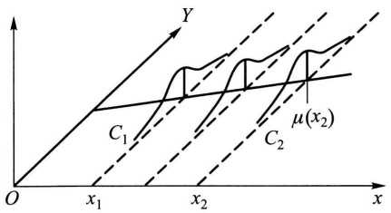
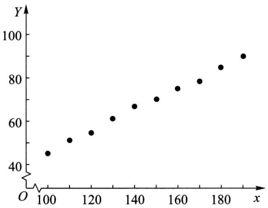
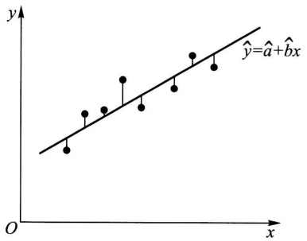
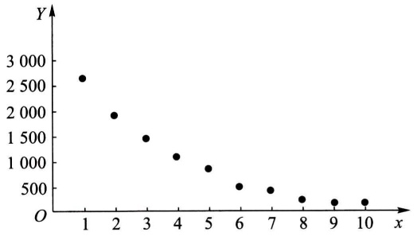

# 第九章 方差分析及回归分析

原始 PDF 第 236–281 页。

## 第九章 方差分析及回归分析

方差分析和回归分析都是数理统计中具有广泛应用的内容. 本章对它们的最基本部分作一介绍.

## § 1 单因素试验的方差分析

## (一) 单因素试验

在科学试验和生产实践中,影响一事物的因素往往是很多的.例如,在化工生产中,有原料成分、原料剂量、催化剂、反应温度、压力、溶液浓度、反应时间、机器设备及操作人员的水平等因素.每一因素的改变都有可能影响产品的数量和质量.有些因素影响较大,有些较小.为了使生产过程得以稳定,保证优质、高产,就有必要找出对产品质量有显著影响的那些因素.为此,我们需进行试验.方差分析就是根据试验的结果进行分析,鉴别各个有关因素对试验结果影响的有效方法.

在试验中,我们将要考察的指标称为试验指标.影响试验指标的条件称为因素.因素可分为两类,一类是人们可以控制的(可控因素);一类是人们不能控制的.例如,反应温度、原料剂量、溶液浓度等是可以控制的,而测量误差、气象条件等一般是难以控制的.以下我们所说的因素都是指可控因素.因素所处的状态,称为该因素的水平(见下述各例).如果在一项试验的过程中只有一个因素在改变则称为单因素试验,如果多于一个因素在改变则称为多因素试验.

例 1 设有三台机器,用来生产规格相同的铝合金薄板.取样,测量薄板的厚度精确至千分之一厘米.得结果如表 9-1 所示.

表 9-1 铝合金薄板的厚度

| 机器I | 机器II | 机器III |
| --- | --- | --- |
| 0.236 | 0.257 | 0.258 |
| 0.238 | 0.253 | 0.264 |
| 0.248 | 0.255 | 0.259 |
| 0.245 | 0.254 | 0.267 |
| 0.243 | 0.261 | 0.262 |

---

· 222 ·

第九章 方差分析及回归分析

这里，试验指标是薄板的厚度。机器为因素，不同的三台机器就是这个因素的三个不同的水平。我们假定除机器这一因素外，材料的规格、操作人员的水平等其他条件都相同。这是单因素试验。试验的目的是为了考察各台机器所生产的薄板的厚度有无显著的差异，即考察机器这一因素对薄板厚度有无显著的影响。如果厚度有显著差异，就表明机器这一因素对薄板厚度的影响是显著的。

例 2 表 9-2 列出了随机选取的、用于计算器的四种类型的电路的响应时间(以 ms 计).

表 9-2 电路的响应时间

| 类型I | 类型II | 类型III | 类型IV |
| --- | --- | --- | --- |
| 19 15 | 20 40 | 16 17 | 18 |
| 22 | 21 | 15 | 22 |
| 20 | 33 | 18 | 19 |
| 18 | 27 | 26 |  |

这里,试验指标是电路的响应时间.电路类型为因素,这一因素有4个水平.这是一个单因素试验.试验的目的是为了考察各种类型电路的响应时间有无显著差异,即考察电路类型这一因素对响应时间有无显著的影响. □

例 3 一火箭使用四种燃料、三种推进器作射程试验. 每种燃料与每种推进器的组合各发射火箭两次, 得射程如表 9-3(以 n mile 计):

表 9-3 火箭的射程

<table><tr><td colspan="2">推进器(B)</td><td> $B_1$ </td><td> $B_2$ </td><td> $B_3$ </td></tr><tr><td rowspan="8">燃料(A)</td><td rowspan="2"> $A_1$ </td><td>58.2</td><td>56.2</td><td>65.3</td></tr><tr><td>52.6</td><td>41.2</td><td>60.8</td></tr><tr><td rowspan="2"> $A_2$ </td><td>49.1</td><td>54.1</td><td>51.6</td></tr><tr><td>42.8</td><td>50.5</td><td>48.4</td></tr><tr><td rowspan="2"> $A_3$ </td><td>60.1</td><td>70.9</td><td>39.2</td></tr><tr><td>58.3</td><td>73.2</td><td>40.7</td></tr><tr><td rowspan="2"> $A_4$ </td><td>75.8</td><td>58.2</td><td>48.7</td></tr><tr><td>71.5</td><td>51.0</td><td>41.4</td></tr></table>

---

§ 1 单因素试验的方差分析

· 223 ·

这里试验指标是射程. 推进器和燃料是因素, 它们分别有 3 个、4 个水平. 这是一个双因素试验. 试验的目的在于考察在各种因素的各个水平下射程有无显著的差异, 即考察推进器和燃料这两个因素对射程是否有显著的影响. □

本节限于讨论单因素试验. 我们就例1来讨论. 在例1中, 我们在因素的每一个水平下进行独立试验, 其结果是一个样本. 表中数据可看成来自三个不同总体(每个水平对应一个总体)的样本值. 将各个总体的均值依次记为 $\mu_{1}, \mu_{2}, \mu_{3}$. 按题意需检验假设

$$
H _ {0}: \mu_ {1} = \mu_ {2} = \mu_ {3},
$$

$H_{1}:\mu_{1},\mu_{2},\mu_{3}$  不全相等.

现在进而假设各总体均为正态变量,且各总体的方差相等,但参数均未知.那么这是一个检验同方差的多个正态总体均值是否相等的问题.下面所要讨论的方差分析法,就是解决这类问题的一种统计方法.

现在开始讨论单因素试验的方差分析. 设因素 A 有 s 个水平  $A_{1}, A_{2}, \cdots, A_{s}$ ，在水平  $A_{j} (j=1,2,\cdots,s)$  下，进行  $n_{j}(n_{j} \geqslant 2)$  次独立试验，得到如表 9-4 的结果.

表9-4

<table><tr><td>水平</td><td> $A_{1}$ </td><td> $A_{2}$ </td><td>...</td><td> $A_{s}$ </td></tr><tr><td rowspan="4">观察结果</td><td> $X_{11}$ </td><td> $X_{12}$ </td><td>...</td><td> $X_{1s}$ </td></tr><tr><td> $X_{21}$ </td><td> $X_{22}$ </td><td>...</td><td> $X_{2s}$ </td></tr><tr><td> $\vdots$ </td><td> $\vdots$ </td><td></td><td> $\vdots$ </td></tr><tr><td> $X_{n_{1}1}$ </td><td> $X_{n_{2}2}$ </td><td>...</td><td> $X_{n_{s}s}$ </td></tr><tr><td>样本总和</td><td> $T_{.1}$ </td><td> $T_{.2}$ </td><td>...</td><td> $T_{.s}$ </td></tr><tr><td>样本均值</td><td> $\overline{X}_{.1}$ </td><td> $\overline{X}_{.2}$ </td><td>...</td><td> $\overline{X}_{.s}$ </td></tr><tr><td>总体均值</td><td> $\mu_{1}$ </td><td> $\mu_{2}$ </td><td>...</td><td> $\mu_{s}$ </td></tr></table>

我们假定:各个水平  $A_{j}(j=1,2,\cdots,s)$  下的样本  $X_{1j}, X_{2j}, \cdots, X_{n_{j}j}$  来自具有相同方差  $\sigma^{2}$ ，均值分别为  $\mu_{j}(j=1,2,\cdots,s)$  的正态总体  $N(\mu_{j}, \sigma^{2}), \mu_{j}$  与  $\sigma^{2}$  未知。且设不同水平  $A_{j}$  下的样本之间相互独立。

由于 $X_{ij} \sim N(\mu_j, \sigma^2)$，即有 $X_{ij} - \mu_j \sim N(0, \sigma^2)$，故 $X_{ij} - \mu_j$ 可看成是随机误差。记 $X_{ij} - \mu_j = \varepsilon_{ij}$，则 $X_{ij}$ 可写成

$$
\left. \begin{array}{l} {{X _ {i j} = \mu_ {j} + \varepsilon_ {i j},}} \\ {{\varepsilon_ {i j} \sim N (0, \sigma^ {2}), \text {各} \varepsilon_ {i j} \text {独立},}} \\ {{i = 1, 2, \dots , n _ {j}, j = 1, 2, \dots , s,}} \end{array} \right\} \tag {1.1}
$$

其中 $\mu_{j}$ 与 $\sigma^2$ 均为未知参数.(1.1)式称为单因素试验方差分析的数学模型.这

---

· 224 ·

第九章 方差分析及回归分析

是本节的研究对象.

方差分析的任务是对于模型(1.1)，

$1^{\circ}$ 检验 $s$ 个总体 $N(\mu_1,\sigma^2),\dots ,N(\mu_s,\sigma^2)$ 的均值是否相等，即检验假设

$$
H _ {0}: \mu_ {1} = \mu_ {2} = \dots = \mu_ {s}, \tag {1.2}
$$

$H_{1}:\mu_{1},\mu_{2},\cdots,\mu_{s}$  不全相等.

$2^{\circ}$ 作出未知参数 $\mu_1, \mu_2, \dots, \mu_s, \sigma^2$ 的估计.

为了将问题(1.2)写成便于讨论的形式,我们将  $\mu_{1},\mu_{2},\cdots,\mu_{s}$  的加权平均值  $\frac{1}{n}\sum_{j=1}^{s}n_{j}\mu_{j}$  记为  $\mu$ , 即

$$
\mu = \frac {1}{n} \sum_ {j = 1} ^ {s} n _ {j} \mu_ {j}, \tag {1.3}
$$

其中 $n = \sum_{j=1}^{s} n_j, \mu$ 称为总平均. 再引入

$$
\delta_ {j} = \mu_ {j} - \mu , \quad j = 1, 2, \dots , s, \tag {1.4}
$$

此时有  $n_{1}\delta_{1}+n_{2}\delta_{2}+\cdots+n_{s}\delta_{s}=0,\delta_{j}$  表示水平  $A_{j}$  下的总体均值与总平均的差异，习惯上将  $\delta_{j}$  称为水平  $A_{j}$  的效应.

利用这些记号,模型(1.1)可改写成

$$
\left. \begin{array}{l} X _ {i j} = \mu + \delta_ {j} + \varepsilon_ {i j}, \\ \varepsilon_ {i j} \sim N (0, \sigma^ {2}), \text {各} \varepsilon_ {i j} \text {独立}, \\ i = 1, 2, \dots , n _ {j}, j = 1, 2, \dots , s, \\ \sum_ {j = 1} ^ {s} n _ {j} \delta_ {j} = 0. \end{array} \right\} \tag {1.1} ^ {\prime}
$$

而假设(1.2)等价于假设

$$
H _ {0}: \delta_ {1} = \delta_ {2} = \dots = \delta_ {s} = 0, \tag {1.2}
$$

$H_{1}:\delta_{1},\delta_{2},\cdots,\delta_{s}$  不全为零.

这是因为当且仅当  $\mu_{1} = \mu_{2} = \cdots = \mu_{s}$  时  $\mu_{j} = \mu$ ，即  $\delta_{j} = 0, j = 1, 2, \cdots, s.$

## (二) 平方和的分解

下面我们从平方和的分解着手,导出假设检验问题(1.2) $^{'}$ 的检验统计量.

引入总偏差平方和

$$
S _ {T} = \sum_ {j = 1} ^ {s} \sum_ {i = 1} ^ {n _ {j}} (X _ {i j} - \overline {{X}}) ^ {2}, \tag {1.5}
$$

其中 $\overline{X} = \frac{1}{n}\sum_{j = 1}^{s}\sum_{i = 1}^{n_j}X_{ij}$ (1.6)

---

§ 1 单因素试验的方差分析

· 225 ·

是数据的总平均. $S_{T}$ 能反映全部试验数据之间的差异, 因此 $S_{T}$ 又称为总变差.又记水平 $A_{j}$ 下的样本均值为 $\overline{X}_{\cdot j}$, 即

$$
\overline {{X}} _ {. j} = \frac {1}{n _ {j}} \sum_ {i = 1} ^ {n _ {j}} X _ {i j}. \tag {1.7}
$$

我们将 $S_{T}$ 写成

$$
\begin{array}{l} S _ {T} = \sum_ {j = 1} ^ {s} \sum_ {i = 1} ^ {n _ {j}} [ (X _ {i j} - \overline {{X}} _ {. j}) + (\overline {{X}} _ {. j} - \overline {{X}}) ] ^ {2} \\ = \sum_ {j = 1} ^ {s} \sum_ {i = 1} ^ {n _ {j}} (X _ {i j} - \overline {{X}} _ {. j}) ^ {2} + \sum_ {j = 1} ^ {s} \sum_ {i = 1} ^ {n _ {j}} (\overline {{X}} _ {. j} - \overline {{X}}) ^ {2} + 2 \sum_ {j = 1} ^ {s} \sum_ {i = 1} ^ {n _ {j}} (X _ {i j} - \overline {{X}} _ {. j}) (\overline {{X}} _ {. j} - \overline {{X}}). \\ \end{array}
$$

注意到上式第三项(即交叉项)

$$
\begin{array}{l} 2 \sum_ {j = 1} ^ {s} \sum_ {i = 1} ^ {n _ {j}} (X _ {i j} - \overline {{X}} _ {. j}) (\overline {{X}} _ {. j} - \overline {{X}}) \\ = 2 \sum_ {j = 1} ^ {s} (\overline {{X}} _ {. j} - \overline {{X}}) \left[ \sum_ {i = 1} ^ {n _ {j}} (X _ {i j} - \overline {{X}} _ {. j}) \right] = 2 \sum_ {j = 1} ^ {s} (\overline {{X}} _ {. j} - \overline {{X}}) \left(\sum_ {i = 1} ^ {n _ {j}} X _ {i j} - n _ {j} \overline {{X}} _ {. j}\right) = 0. \\ \end{array}
$$

于是我们就将 $S_{T}$ 分解成为

$$
S _ {T} = S _ {E} + S _ {A}, \tag {1.8}
$$

其中 $S_{E} = \sum_{j = 1}^{s}\sum_{i = 1}^{n_{j}}(X_{ij} - \overline{X}_{.j})^{2},$ (1.9)

$$
S _ {A} = \sum_ {j = 1} ^ {s} \sum_ {i = 1} ^ {n _ {j}} (\overline {{X}} _ {. j} - \overline {{X}}) ^ {2} = \sum_ {j = 1} ^ {s} n _ {j} (\overline {{X}} _ {. j} - \overline {{X}}) ^ {2} = \sum_ {j = 1} ^ {s} n _ {j} \overline {{X}} _ {. j} ^ {2} - n \overline {{X}} ^ {2}. \tag {1.10}
$$

上述 $S_{E}$ 的各项 $(X_{ij} - \overline{X}_{.j})^{2}$ 表示在水平 $A_{j}$ 下，样本观察值与样本均值的差异，这是由随机误差所引起的。$S_{E}$ 叫做误差平方和。$S_{A}$ 的各项 $n_j(\overline{X}_{.j} - \overline{X})^2$ 表示 $A_{j}$ 水平下的样本均值与数据总平均的差异，这是由水平 $A_{j}$ 的效应的差异以及随机误差引起的。$S_{A}$ 叫做因素 $A$ 的效应平方和。(1.8)式就是我们所需要的平方和分解式。

## （三） $S_{E}, S_{A}$ 的统计特性

为了引出检验问题(1.2) $^{\prime}$ 的检验统计量,我们依次来讨论 $S_{E},S_{A}$ 的一些统计特性.先将 $S_{E}$ 写成

$$
S _ {E} = \sum_ {i = 1} ^ {n _ {1}} (X _ {i 1} - \overline {{X}} _ {. 1}) ^ {2} + \dots + \sum_ {i = 1} ^ {n _ {s}} (X _ {i s} - \overline {{X}} _ {. s}) ^ {2}. \tag {1.11}
$$

注意到 $\sum_{i=1}^{n_j}(X_{ij}-\overline{X}_{.j})^2$ 是总体 $N(\mu_j,\sigma^2)$ 的样本方差的 $n_j - 1$ 倍，于是有

---

· 226 ·

第九章 方差分析及回归分析

$$
\frac {\sum_ {i = 1} ^ {n _ {j}} (X _ {i j} - \overline {{X}} _ {. j}) ^ {2}}{\sigma^ {2}} \sim \chi^ {2} (n _ {j} - 1).
$$

因各 $X_{ij}$ 相互独立，故(1.11)式中各平方和相互独立.由 $\chi^2$ 分布的可加性知

$$
\frac {S _ {E}}{\sigma^ {2}} \sim \chi^ {2} \Big (\sum_ {j = 1} ^ {s} (n _ {j} - 1) \Big),
$$

即 $\frac{S_E}{\sigma^2} \sim \chi^2 (n - s),$ (1.12)

这里 $n = \sum_{j=1}^{s} n_j$. 由(1.12)式还可知, $S_E$ 的自由度为 $n - s$, 且有

$$
E (S _ {E}) = (n - s) \sigma^ {2}. \tag {1.13}
$$

下面讨论  $S_{A}$  的统计特性, 我们看到  $S_{A}$  是 s 个变量  $\sqrt{n_{j}}(\overline{X}_{.j}-\overline{X})$  (j=1,  $2,\cdots,s$ ) 的平方和, 它们之间仅有一个线性约束条件

$$
\sum_ {j = 1} ^ {s} \sqrt {n _ {j}} \big [ \sqrt {n _ {j}} (\overline {{X}} _ {. j} - \overline {{X}}) \big ] = \sum_ {j = 1} ^ {s} n _ {j} (\overline {{X}} _ {. j} - \overline {{X}}) = \sum_ {j = 1} ^ {s} \sum_ {i = 1} ^ {n _ {j}} X _ {i j} - n \overline {{X}} = 0,
$$

故知  $S_{A}$  的自由度是 s-1.

再由(1.3)，(1.6)式及 $X_{ij}$ 的独立性，知

$$
\overline {{X}} \sim N \Big (\mu , \frac {\sigma^ {2}}{n} \Big). \tag {1.14}
$$

即得

$$
\begin{array}{l} E (S _ {A}) = E \left[ \sum_ {j = 1} ^ {s} n _ {j} \overline {{X}} _ {. j} ^ {2} - n \overline {{X}} ^ {2} \right] = \sum_ {j = 1} ^ {s} n _ {j} E (\overline {{X}} _ {. j} ^ {2}) - n E (\overline {{X}} ^ {2}) \\ = \sum_ {j = 1} ^ {s} n _ {j} \left[ \frac {\sigma^ {2}}{n _ {j}} + (\mu + \delta_ {j}) ^ {2} \right] - n \left(\frac {\sigma^ {2}}{n} + \mu^ {2}\right) \\ = (s - 1) \sigma^ {2} + 2 \mu \sum_ {j = 1} ^ {s} n _ {j} \delta_ {j} + n \mu^ {2} + \sum_ {j = 1} ^ {s} n _ {j} \delta_ {j} ^ {2} - n \mu^ {2}. \\ \end{array}
$$

由(1.1) $^{\prime}$ 式 $\sum_{j=1}^{s}n_{j}\delta_{j}=0$ ，故有

$$
E (S _ {A}) = (s - 1) \sigma^ {2} + \sum_ {j = 1} ^ {s} n _ {j} \delta_ {j} ^ {2}. \tag {1.15}
$$

进一步还可以证明 $S_A$ 与 $S_E$ 独立，且当 $H_0$ 为真时

$$
\frac {S _ {A}}{\sigma^ {2}} \sim \chi^ {2} (s - 1). \tag {1.16}
$$

(证略.)

---

§ 1 单因素试验的方差分析

· 227 ·

## （四）假设检验问题的拒绝域

现在我们可以来确定假设检验问题(1.2)'的拒绝域了.

由(1.15)式知, 当  $H_{0}$  为真时

$$
E \left(\frac {S _ {A}}{s - 1}\right) = \sigma^ {2}, \tag {1.17}
$$

即 $\frac{S_A}{s - 1}$ 是 $\sigma^2$ 的无偏估计. 而当 $H_{1}$ 为真时, $\sum_{j=1}^{s} n_j \delta_j^2 > 0$, 此时

$$
E \left(\frac {S _ {A}}{s - 1}\right) = \sigma^ {2} + \frac {1}{s - 1} \sum_ {j = 1} ^ {s} n _ {j} \delta_ {j} ^ {2} > \sigma^ {2}. \tag {1.18}
$$

又由(1.13)知，

$$
E \left(\frac {S _ {E}}{n - s}\right) = \sigma^ {2}, \tag {1.19}
$$

即不管 $H_0$ 是否为真，$\frac{S_E}{n - s}$ 都是 $\sigma^2$ 的无偏估计.

综上所述，分式 $F = \frac{S_A / (s - 1)}{S_E / (n - s)}$ 的分子与分母独立，分母 $\frac{S_E}{n - s}$ 不论 $H_0$ 是否为真，其数学期望总是 $\sigma^2$。当 $H_0$ 为真时，分子的数学期望为 $\sigma^2$，当 $H_0$ 不真时，由(1.18)式分子的取值有偏大的趋势。故知检验问题(1.2)'的拒绝域具有形式

$$
F = \frac {S _ {A} / (s - 1)}{S _ {E} / (n - s)} \geqslant k,
$$

其中 $k$ 由预先给定的显著性水平 $\alpha$ 确定. 由(1.12)，(1.16)式及 $S_{E}$ 与 $S_{A}$ 的独立性知，当 $H_0$ 为真时，

$$
\frac {S _ {A} / (s - 1)}{S _ {E} / (n - s)} = \frac {S _ {A} / \sigma^ {2}}{s - 1} \Big / \frac {S _ {E} / \sigma^ {2}}{n - s} \sim F (s - 1, n - s).
$$

由此得检验问题(1.2) $^{'}$ 的拒绝域为

$$
F = \frac {S _ {A} / (s - 1)}{S _ {E} / (n - s)} \geqslant F _ {\alpha} (s - 1, n - s). \tag {1.20}
$$

上述分析的结果可排成表 9-5 的形式, 称为方差分析表.

表 9-5 单因素试验的方差分析表

| 方差来源 | 平方和 | 自由度 | 均方 | F比 |
| --- | --- | --- | --- | --- |
| 因素A | $S_A$ | s-1 | $\overline{S}_A = \frac{S_A}{s-1}$ | $F = \frac{\overline{S}_A}{\overline{S}_E}$ |
| 误差 | $S_E$ | n-s | $\overline{S}_E = \frac{S_E}{n-s}$ |  |
| 总和 | $S_T$ | n-1 |  |  |

---

· 228 ·

第九章 方差分析及回归分析

表中 $\overline{S}_A = S_A / (s - 1),\overline{S}_E = S_E / (n - s)$ 分别称为 $S_{A},S_{E}$ 的均方.另外，因在$S_{T}$ 中 $n$ 个变量 $X_{ij} - \overline{X}$ 之间仅满足一个约束条件(1.6)，故 $S_{T}$ 的自由度为 $n - 1$

在实际中,我们可以按以下较简便的公式来计算  $S_{T}, S_{A}$  和  $S_{E}$ .

记 $T_{.j} = \sum_{i=1}^{n_j} X_{ij}, j = 1,2,\cdots,s,\quad T_{..} = \sum_{j=1}^{s} \sum_{i=1}^{n_j} X_{ij},$

即有

$$
\begin{array}{l} S _ {T} = \sum_ {j = 1} ^ {s} \sum_ {i = 1} ^ {n _ {j}} X _ {i j} ^ {2} - n \overline {{X}} ^ {2} = \sum_ {j = 1} ^ {s} \sum_ {i = 1} ^ {n _ {j}} X _ {i j} ^ {2} - \frac {T _ {\cdot \cdot} ^ {2}}{n}, \\ S _ {A} = \sum_ {j = 1} ^ {s} n _ {j} \overline {{X}} _ {\cdot j} ^ {2} - n \overline {{X}} ^ {2} = \sum_ {j = 1} ^ {s} \frac {T _ {\cdot j} ^ {2}}{n _ {j}} - \frac {T _ {\cdot \cdot} ^ {2}}{n}, \\ S _ {E} = S _ {T} - S _ {A}. \end{array} \tag {1.21}
$$

例 4 设在例 1 中符合模型(1.1) 条件, 检验假设( $\alpha = 0.05$ ):

$$
H _ {0}: \mu_ {1} = \mu_ {2} = \mu_ {3},
$$

$H_{1}:\mu_{1},\mu_{2},\mu_{3}$ 不全相等.

解 现在 $s = 3, n_1 = n_2 = n_3 = 5, n = 15,$

$$
\begin{array}{l} S _ {T} = \sum_ {j = 1} ^ {3} \sum_ {i = 1} ^ {5} X _ {i j} ^ {2} - \frac {T _ {. .} ^ {2}}{1 5} = 0. 9 6 3 9 1 2 - \frac {3 . 8 ^ {2}}{1 5} = 0. 0 0 1 2 4 5 3 3, \\ S _ {A} = \sum_ {j = 1} ^ {3} \frac {T _ {. j} ^ {2}}{n _ {j}} - \frac {T _ {. .} ^ {2}}{n} = \frac {1}{5} (1. 2 1 ^ {2} + 1. 2 8 ^ {2} + 1. 3 1 ^ {2}) - \frac {3 . 8 ^ {2}}{1 5} \\ = 0. 0 0 1 0 5 3 3 3, \\ S _ {E} ^ {\cdot} = S _ {T} - S _ {A} = 0. 0 0 0 1 9 2. \\ \end{array}
$$

$S_{T}, S_{A}, S_{E}$ 的自由度依次为 $n - 1 = 14, s - 1 = 2, n - s = 12$，得方差分析表如表9-6所示:

表 9-6 例 4 的方差分析表

| 方差来源 | 平方和 | 自由度 | 均方 | F比 |
| --- | --- | --- | --- | --- |
| 因素 | 0.001 053 33 | 2 | 0.000 526 67 | 32.92 |
| 误差 | 0.000 192 | 12 | 0.000 016 |  |
| 总和 | 0.001 245 33 | 14 |  |  |

因 $F_{0.05}(2,12) = 3.89 < 32.92$ ，故在显著性水平0.05下拒绝 $H_0$ ，认为各台机器生产的薄板厚度有显著的差异. □

---

§ 1 单因素试验的方差分析

· 229 ·

## (五) 未知参数的估计

上面已讲到过,不管  $H_{0}$  是否为真,

$$
\hat {\sigma} ^ {2} = \frac {S _ {E}}{n - s}
$$

是  $\sigma^{2}$  的无偏估计.

又由(1.14)，(1.7)式知

$$
E (\overline {{X}}) = \mu ,   E (\overline {{X}} _ {. j}) = \frac {1}{n _ {j}} \sum_ {i = 1} ^ {n _ {j}} E (X _ {i j}) = \mu_ {j}, \quad j = 1, 2, \dots , s.
$$

故 $\hat{\mu} = \overline{X}$, $\hat{\mu}_j = \overline{X}_{.j}$ 分别是 $\mu, \mu_j$ 的无偏估计.

又若拒绝  $H_{0}$ ，这意味着效应  $\delta_{1}, \delta_{2}, \cdots, \delta_{s}$  不全为零。由于

$$
\delta_ {j} = \mu_ {j} - \mu , \quad j = 1, 2, \dots , s,
$$

知 $\hat{\delta}_j = \overline{X}_{.j} - \overline{X}$ 是 $\delta_j$ 的无偏估计.此时还有关系式

$$
\sum_ {j = 1} ^ {s} n _ {j} \hat {\delta} _ {j} = \sum_ {j = 1} ^ {s} n _ {j} \overline {{X}} _ {. j} - n \overline {{X}} = 0.
$$

当拒绝 $H_0$ 时，常需要作出两总体 $N(\mu_j, \sigma^2)$ 和 $N(\mu_k, \sigma^2), j \neq k$ 的均值差 $\mu_j - \mu_k = \delta_j - \delta_k$ 的区间估计. 其做法如下.

由于 $E(\overline{X}_{.j} - \overline{X}_{.k}) = \mu_j - \mu_k,$

$$
D (\overline {{X}} _ {. j} - \overline {{X}} _ {. k}) = \sigma^ {2} \left(\frac {1}{n _ {j}} + \frac {1}{n _ {k}}\right),
$$

由第六章末所附“§3定理3的证明及其推广”知 $\overline{X}_{.j}-\overline{X}_{.k}$ 与 $\hat{\sigma}^{2}=S_{E}/(n-s)$ 独立.于是

$$
\begin{array}{l} \frac {(\overline {{X}} _ {. j} - \overline {{X}} _ {. k}) - (\mu_ {j} - \mu_ {k})}{\sqrt {\overline {{S}} _ {E} \left(\frac {1}{n _ {j}} + \frac {1}{n _ {k}}\right)}} \\ = \frac {(\overline {{X}} _ {. j} - \overline {{X}} _ {. k}) - (\mu_ {j} - \mu_ {k})}{\sigma \sqrt {1 / n _ {j} + 1 / n _ {k}}} \left| \sqrt {\frac {S _ {E}}{\sigma^ {2}}} \right| (n - s) \sim t (n - s). \\ \end{array}
$$

据此得均值差 $\mu_{j} - \mu_{k} = \delta_{j} - \delta_{k}$ 的置信水平为 $1 - \alpha$ 的置信区间为

$$
\left(\overline {{X}} _ {. j} - \overline {{X}} _ {. k} \pm t _ {\alpha / 2} (n - s) \sqrt {\overline {{S}} _ {E} \left(\frac {1}{n _ {j}} + \frac {1}{n _ {k}}\right)}\right). \tag {1.22}
$$

例5 求例4中的未知参数 $\sigma^2, \mu_j, \delta_j (j = 1,2,3)$ 的点估计及均值差的置信水平为0.95的置信区间.

---

· 230 ·

第九章 方差分析及回归分析

解 $\hat{\sigma}^2 = S_E / (n - s) = 0.000016,$

$$
\hat {\mu} _ {1} = \overline {{x}} _ {. 1} = 0. 2 4 2, \hat {\mu} _ {2} = \overline {{x}} _ {. 2} = 0. 2 5 6, \hat {\mu} _ {3} = \overline {{x}} _ {. 3} = 0. 2 6 2, \hat {\mu} = \overline {{x}} = 0. 2 5 3,
$$

$$
\hat {\delta} _ {1} = \overline {{x}} _ {. 1} - \overline {{x}} = - 0. 0 1 1, \hat {\delta} _ {2} = \overline {{x}} _ {. 2} - \overline {{x}} = 0. 0 0 3, \hat {\delta} _ {3} = \overline {{x}} _ {. 3} - \overline {{x}} = 0. 0 0 9.
$$

均值差的区间估计如下:

由 $t_{0.025}(n - s) = t_{0.025}(12) = 2.1788$ 得

$$
t _ {0. 0 2 5} (1 2) \sqrt {\overline {{S}} _ {E} \left(\frac {1}{n _ {j}} + \frac {1}{n _ {k}}\right)} = 2. 1 7 8 8 \sqrt {1 6 \times 1 0 ^ {- 6} \times \frac {2}{5}} = 0. 0 0 6,
$$

故 $\mu_{1} - \mu_{2},\mu_{1} - \mu_{3}$ 及 $\mu_{2} - \mu_{3}$ 的置信水平为0.95的置信区间分别为

$$
\begin{array}{l} (0. 2 4 2 - 0. 2 5 6 \pm 0. 0 0 6) = (- 0. 0 2 0, - 0. 0 0 8), \\ (0. 2 4 2 - 0. 2 6 2 \pm 0. 0 0 6) = (- 0. 0 2 6, - 0. 0 1 4), \\ (0. 2 5 6 - 0. 2 6 2 \pm 0. 0 0 6) = (- 0. 0 1 2, 0). \\ \end{array}
$$

例6 设在例2中的四种类型电路的响应时间的总体均为正态, 且各总体的方差相同, 但参数均未知. 又设各样本相互独立. 试取显著性水平 $\alpha = 0.05$ 检验各类型电路的响应时间是否有显著差异.

解 分别以  $\mu_{1}, \mu_{2}, \mu_{3}, \mu_{4}$  记类型 I, II, III, IV 四种电路响应时间总体的均值. 我们需检验假设 ( $\alpha = 0.05$ )

$$
H _ {0}: \mu_ {1} = \mu_ {2} = \mu_ {3} = \mu_ {4},
$$

$H_{1}:\mu_{1},\mu_{2},\mu_{3},\mu_{4}$  不全相等.

现在 $n = 18, s = 4, n_1 = n_2 = n_3 = 5, n_4 = 3,$

$$
S _ {T} = \sum_ {j = 1} ^ {4} \sum_ {i = 1} ^ {n _ {j}} x _ {i j} ^ {2} - \frac {T _ {\cdot \cdot} ^ {2}}{1 8} = 8 9 9 2 - 3 8 6 ^ {2} / 1 8 = 7 1 4. 4 4,
$$

$$
\begin{array}{l} S _ {A} = \sum_ {j = 1} ^ {4} \frac {T _ {. j} ^ {2}}{n _ {j}} - \frac {T _ {. .} ^ {2}}{1 8} \\ = \left[ \frac {1}{5} (9 4 ^ {2} + 1 4 1 ^ {2} + 9 2 ^ {2}) + \frac {5 9 ^ {2}}{3} \right] - \frac {3 8 6 ^ {2}}{1 8} = 3 1 8. 9 8, \\ \end{array}
$$

$$
\begin{array}{l} S _ {A} = \sum_ {j = 1} ^ {4} \frac {T _ {. j} ^ {2}}{n _ {j}} - \frac {T _ {. .} ^ {2}}{1 8} \\ = \left[ \frac {1}{5} (9 4 ^ {2} + 1 4 1 ^ {2} + 9 2 ^ {2}) + \frac {5 9 ^ {2}}{3} \right] - \frac {3 8 6 ^ {2}}{1 8} = 3 1 8. 9 8, \\ S _ {E} = S _ {T} - S _ {A} = 3 9 5. 4 6. \\ \end{array}
$$

$S_{T}, S_{A}, S_{E}$  的自由度依次为 17, 3, 14, 结果载于表 9-7.

表 9-7 例 6 的方差分析表

| 方差来源 | 平方和 | 自由度 | 均方 | F比 |
| --- | --- | --- | --- | --- |
| 因素 | 318.98 | 3 | 106.33 | 3.76 |
| 误差 | 395.46 | 14 | 28.25 |  |
| 总和 | 714.44 | 17 |  |  |

---

§ 2 双因素试验的方差分析

· 231 ·

因 $F_{0.05}(3,14) = 3.34 < 3.76$ ，故在显著性水平0.05下拒绝 $H_0$ ，认为各类型电路的响应时间有显著差异. □

## § 2 双因素试验的方差分析

本节介绍双因素试验的方差分析.

## (一) 双因素等重复试验的方差分析

设有两个因素 A, B 作用于试验指标. 因素 A 有 r 个水平  $A_{1}, A_{2}, \cdots, A_{r}$ ，因素 B 有 s 个水平  $B_{1}, B_{2}, \cdots, B_{s}$ . 现对因素 A, B 的水平的每对组合  $(A_{i}, B_{j}), i = 1, 2, \cdots, r; j = 1, 2, \cdots, s$  都作  $t (t \geqslant 2)$  次试验（称为等重复试验），得到如表 9-8 的结果:

表9-8

| 因素A\\因素B | $B_1$ | $B_2$ | ... | $B_s$ |
| --- | --- | --- | --- | --- |
| $A_1$ | $X_{111},X_{112},$$\cdots,X_{11t}$ | $X_{121},X_{122},$$\cdots,X_{12t}$ | ... | $X_{1s1},X_{1s2},$$\cdots,X_{1st}$ |
| $A_2$ | $X_{211},X_{212},$$\cdots,X_{21t}$ | $X_{221},X_{222},$$\cdots,X_{22t}$ | ... | $X_{2s1},X_{2s2},$$\cdots,X_{2st}$ |
| ⋮ | ⋮ | ⋮ |  | ⋮ |
| $A_r$ | $X_{r11},X_{r12},$$\cdots,X_{r1t}$ | $X_{r21},X_{r22},$$\cdots,X_{r2t}$ | ... | $X_{rs1},X_{rs2},$$\cdots,X_{rst}$ |

并设

$$
X _ {i j k} \sim N (\mu_ {i j}, \sigma^ {2}), \quad i = 1, 2, \dots , r; j = 1, 2, \dots , s; k = 1, 2, \dots , t,
$$

各 $X_{ijk}$ 独立.这里， $\mu_{ij},\sigma^2$ 均为未知参数.或写成

$$
\left. \begin{array}{l} {{X _ {i j k} = \mu_ {i j} + \varepsilon_ {i j k},}} \\ {{\varepsilon_ {i j k} \sim N (0, \sigma^ {2}), \text {各} \varepsilon_ {i j k} \text {独立},}} \\ {{i = 1, 2, \dots , r; j = 1, 2, \dots , s;}} \\ {{k = 1, 2, \dots , t.}} \end{array} \right\} \tag {2.1}
$$

引入记号

---

· 232 ·

第九章 方差分析及回归分析

$$
\begin{array}{l} \mu = \frac {1}{r s} \sum_ {i = 1} ^ {r} \sum_ {j = 1} ^ {s} \mu_ {i j}, \\ \mu_ {i.} = \frac {1}{s} \sum_ {j = 1} ^ {s} \mu_ {i j}, \quad i = 1, 2, \dots , r, \\ \mu_ {. j} = \frac {1}{r} \sum_ {i = 1} ^ {r} \mu_ {i j}, \quad j = 1, 2, \dots , s, \\ \alpha_ {i} = \mu_ {i}. - \mu , \quad i = 1, 2, \dots , r, \\ \beta_ {j} = \mu_ {\cdot j} - \mu , \quad j = 1, 2, \dots , s. \\ \end{array}
$$

易见

$$
\sum_ {i = 1} ^ {r} \alpha_ {i} = 0, \quad \sum_ {j = 1} ^ {s} \beta_ {j} = 0.
$$

称 $\mu$ 为总平均，称 $\alpha_{i}$ 为水平 $A_{i}$ 的效应，称 $\beta_{j}$ 为水平 $B_{j}$ 的效应.这样可将 $\mu_{ij}$ 表示成

$$
\mu_ {i j} = \mu + \alpha_ {i} + \beta_ {j} + (\mu_ {i j} - \mu_ {i}. - \mu_ {. j} + \mu), \tag {2.2}
$$

$$
i = 1, 2, \dots , r; \quad j = 1, 2, \dots , s.
$$

记  $\gamma_{ij}=\mu_{ij}-\mu_{i\cdot}-\mu_{\cdot j}+\mu,\quad i=1,2,\cdots,r;\quad j=1,2,\cdots,s,$  (2.3)

此时

$$
\mu_ {i j} = \mu + \alpha_ {i} + \beta_ {j} + \gamma_ {i j}. \tag {2.4}
$$

$\gamma_{ij}$  称为水平  $A_{i}$  和水平  $B_{j}$  的交互效应, 这是由  $A_{i}, B_{j}$  搭配起来联合起作用而引起的. 易见

$$
\begin{array}{l} \sum_ {i = 1} ^ {r} \gamma_ {i j} = 0, \quad j = 1, 2, \dots , s, \\ \sum_ {j = 1} ^ {s} \gamma_ {i j} = 0, \quad i = 1, 2, \dots , r. \\ \end{array}
$$

这样，(2.1) 可写成

$$
\left. \begin{array}{l} X _ {i j k} = \mu + \alpha_ {i} + \beta_ {j} + \gamma_ {i j} + \varepsilon_ {i j k}, \\ \varepsilon_ {i j k} \sim N (0, \sigma^ {2}), \text {各} \varepsilon_ {i j k} \text {独立}, \\ i = 1, 2, \dots , r; j = 1, 2, \dots , s; k = 1, 2, \dots , t, \\ \sum_ {i = 1} ^ {r} \alpha_ {i} = 0, \sum_ {j = 1} ^ {s} \beta_ {j} = 0, \sum_ {i = 1} ^ {r} \gamma_ {i j} = 0, \sum_ {j = 1} ^ {s} \gamma_ {i j} = 0, \end{array} \right\} \tag {2.5}
$$

其中  $\mu,\alpha_{i},\beta_{j},\gamma_{ij}$  及  $\sigma^{2}$  都是未知参数.

(2.5) 式就是我们所要研究的双因素试验方差分析的数学模型. 对于这一模型我们要检验以下三个假设:

---

§ 2 双因素试验的方差分析

· 233 ·

$$
\left\{ \begin{array}{l l} H _ {0 1}: & \alpha_ {1} = \alpha_ {2} = \dots = \alpha_ {r} = 0, \\ H _ {1 1}: & \alpha_ {1}, \alpha_ {2}, \dots , \alpha_ {r} \text {不全为零}, \end{array} \right. \tag {2.6}
$$

$$
\left\{ \begin{array}{l l} H _ {0 2}: & \beta_ {1} = \beta_ {2} = \dots = \beta_ {s} = 0, \\ H _ {1 2}: & \beta_ {1}, \beta_ {2}, \dots , \beta_ {s} \text {不全为零}, \end{array} \right. \tag {2.7}
$$

$$
\left\{ \begin{array}{l l} H _ {0 3}: & \gamma_ {1 1} = \gamma_ {1 2} = \dots = \gamma_ {r s} = 0, \\ H _ {1 3}: & \gamma_ {1 1}, \gamma_ {1 2}, \dots , \gamma_ {r s} \text {不全为零}. \end{array} \right. \tag {2.8}
$$

与单因素情况类似,对这些问题的检验方法也是建立在平方和的分解上的.先引入以下的记号:

$$
\overline {{X}} = \frac {1}{r s t} \sum_ {i = 1} ^ {r} \sum_ {j = 1} ^ {s} \sum_ {k = 1} ^ {t} X _ {i j k},
$$

$$
\overline {{X}} _ {i j.} = \frac {1}{t} \sum_ {k = 1} ^ {t} X _ {i j k}, \quad i = 1, 2, \dots , r; j = 1, 2, \dots , s,
$$

$$
\overline {{X}} _ {i..} = \frac {1}{s t} \sum_ {j = 1} ^ {s} \sum_ {k = 1} ^ {t} X _ {i j k}, \quad i = 1, 2, \dots , r,
$$

$$
\overline {{X}} _ {. j.} = \frac {1}{r t} \sum_ {i = 1} ^ {r} \sum_ {k = 1} ^ {t} X _ {i j k}, \quad j = 1, 2, \dots , s.
$$

再引入总偏差平方和(称为总变差)

$$
S _ {T} = \sum_ {i = 1} ^ {r} \sum_ {j = 1} ^ {s} \sum_ {k = 1} ^ {t} (X _ {i j k} - \overline {{X}}) ^ {2}.
$$

我们可将 $S_{T}$ 写成

$$
\begin{array}{l} S _ {T} = \sum_ {i = 1} ^ {r} \sum_ {j = 1} ^ {s} \sum_ {k = 1} ^ {t} (X _ {i j k} - \overline {{X}}) ^ {2} \\ = \sum_ {i = 1} ^ {r} \sum_ {j = 1} ^ {s} \sum_ {k = 1} ^ {t} \left[ (X _ {i j k} - \overline {{X}} _ {i j.}) + (\overline {{X}} _ {i..} - \overline {{X}}) + (\overline {{X}} _ {. j.} - \overline {{X}}) \right. \\ \left. + (\overline {{X}} _ {i j}. - \overline {{X}} _ {i..} - \overline {{X}} _ {. j.} + \overline {{X}}) \right] ^ {2} \\ = \sum_ {i = 1} ^ {r} \sum_ {j = 1} ^ {s} \sum_ {k = 1} ^ {t} (X _ {i j k} - \overline {{X}} _ {i j.}) ^ {2} + s t \sum_ {i = 1} ^ {r} (\overline {{X}} _ {i..} - \overline {{X}}) ^ {2} \\ + r t \sum_ {j = 1} ^ {s} (\overline {{X}} _ {. j.} - \overline {{X}}) ^ {2} + t \sum_ {i = 1} ^ {r} \sum_ {j = 1} ^ {s} (\overline {{X}} _ {i j.} - \overline {{X}} _ {i..} - \overline {{X}} _ {. j.} + \overline {{X}}) ^ {2}, \\ \end{array}
$$

即得平方和的分解式

$$
S _ {T} = S _ {E} + S _ {A} + S _ {B} + S _ {A \times B}, \tag {2.9}
$$

其中 $S_{E} = \sum_{i=1}^{r}\sum_{j=1}^{s}\sum_{k=1}^{t}(X_{ijk}-\overline{X}_{ij.})^{2},$ (2.10)

---

· 234 ·

第九章 方差分析及回归分析

$$
S _ {A} = s t \sum_ {i = 1} ^ {r} (\overline {{X}} _ {i..} - \overline {{X}}) ^ {2}, \tag {2.11}
$$

$$
S _ {B} = r t \sum_ {j = 1} ^ {s} (\overline {{X}} _ {. j.} - \overline {{X}}) ^ {2}, \tag {2.12}
$$

$$
S _ {A \times B} = t \sum_ {i = 1} ^ {r} \sum_ {j = 1} ^ {s} (\overline {{X}} _ {i j.} - \overline {{X}} _ {i..} - \overline {{X}} _ {. j.} + \overline {{X}}) ^ {2}. \tag {2.13}
$$

$S_{E}$ 称为误差平方和， $S_{A}, S_{B}$ 分别称为因素 $A$ 、因素 $B$ 的效应平方和， $S_{A \times B}$ 称为 $A, B$ 交互效应平方和.

可以证明 $S_{T}, S_{E}, S_{A}, S_{B}, S_{A \times B}$ 的自由度依次为 $rst - 1, rs(t - 1), r - 1, s - 1, (r - 1)(s - 1)$，且有

$$
E \left(\frac {S _ {E}}{r s (t - 1)}\right) = \sigma^ {2}, \tag {2.14}
$$

$$
E \Big (\frac {S _ {A}}{r - 1} \Big) = \sigma^ {2} + \frac {s t \sum_ {i = 1} ^ {r} \alpha_ {i} ^ {2}}{r - 1}, \tag {2.15}
$$

$$
E \Big (\frac {S _ {B}}{s - 1} \Big) = \sigma^ {2} + \frac {r t \sum_ {j = 1} ^ {s} \beta_ {j} ^ {2}}{s - 1}, \tag {2.16}
$$

$$
E \Big (\frac {S _ {A \times B}}{(r - 1) (s - 1)} \Big) = \sigma^ {2} + \frac {t \sum_ {i = 1} ^ {r} \sum_ {j = 1} ^ {s} \gamma_ {i j} ^ {2}}{(r - 1) (s - 1)}. \tag {2.17}
$$

当 $H_{01}:\alpha_1 = \alpha_2 = \dots = \alpha_r = 0$ 为真时，可以证明

$$
F _ {A} = \frac {S _ {A} / (r - 1)}{S _ {E} / [ r s (t - 1) ]} \sim F (r - 1, r s (t - 1)). \tag {2.18}
$$

取显著性水平为 $\alpha$ ，得假设 $H_{01}$ 的拒绝域为

$$
F _ {A} = \frac {S _ {A} / (r - 1)}{S _ {E} / [ r s (t - 1) ]} \geqslant F _ {a} (r - 1, r s (t - 1)). \tag {2.19}
$$

类似地，在显著性水平  $\alpha$  下，假设  $H_{02}$  的拒绝域为

$$
F _ {B} = \frac {S _ {B} / (s - 1)}{S _ {E} / [ r s (t - 1) ]} \geqslant F _ {\alpha} (s - 1, r s (t - 1)). \tag {2.20}
$$

在显著性水平  $\alpha$  下, 假设  $H_{03}$  的拒绝域为

$$
\begin{array}{l} F _ {A \times B} = \frac {S _ {A \times B} / [ (r - 1) (s - 1) ]}{S _ {E} / [ r s (t - 1) ]} \\ \geqslant F _ {\alpha} ((r - 1) (s - 1), r s (t - 1)). \tag {2.21} \\ \end{array}
$$

上述结果可汇总成下列的方差分析表(表9-9):

---

§ 2 双因素试验的方差分析

· 235 ·

表 9-9 双因素试验的方差分析表

| 方差来源 | 平方和 | 自由度 | 均方 | F比 |
| --- | --- | --- | --- | --- |
| 因素A | $S_A$ | r-1 | $\overline{S}_A = \frac{S_A}{r-1}$ | $F_A = \frac{\overline{S}_A}{\overline{S}_E}$ |
| 因素B | $S_B$ | s-1 | $\overline{S}_B = \frac{S_B}{s-1}$ | $F_B = \frac{\overline{S}_B}{\overline{S}_E}$ |
| 交互作用 | $S_{A \times B}$ | (r-1)(s-1) | $\overline{S}_{A \times B} = \frac{S_{A \times B}}{(r-1)(s-1)}$ | $F_{A \times B} = \frac{\overline{S}_{A \times B}}{\overline{S}_E}$ |
| 误差 | $S_E$ | rs(t-1) | $\overline{S}_E = \frac{S_E}{rs(t-1)}$ |  |
| 总和 | $S_T$ | rst-1 |  |  |

记 $T\ldots = \sum_{i=1}^{r}\sum_{j=1}^{s}\sum_{k=1}^{t}X_{ijk},$

$$
T _ {i j.} = \sum_ {k = 1} ^ {t} X _ {i j k}, \quad i = 1, 2, \dots , r; j = 1, 2, \dots , s,
$$

$$
T _ {i..} = \sum_ {j = 1} ^ {s} \sum_ {k = 1} ^ {t} X _ {i j k}, \quad i = 1, 2, \dots , r,
$$

$$
T _ {. j.} = \sum_ {i = 1} ^ {r} \sum_ {k = 1} ^ {t} X _ {i j k}, \quad j = 1, 2, \dots , s.
$$

我们可以按照下述(2.22)式来计算上表中的各个平方和.

$$
\left. \begin{array}{l} S _ {T} = \sum_ {i = 1} ^ {r} \sum_ {j = 1} ^ {s} \sum_ {k = 1} ^ {t} X _ {i j k} ^ {2} - \frac {T _ {\cdots} ^ {2}}{r s t}, \\ S _ {A} = \frac {1}{s t} \sum_ {i = 1} ^ {r} T _ {i..} ^ {2} - \frac {T _ {\cdots} ^ {2}}{r s t}, \\ S _ {B} = \frac {1}{r t} \sum_ {j = 1} ^ {s} T _ {. j.} ^ {2}. - \frac {T _ {\cdots} ^ {2}}{r s t}, \\ S _ {A \times B} = \left(\frac {1}{t} \sum_ {i = 1} ^ {r} \sum_ {j = 1} ^ {s} T _ {i j.} ^ {2}. - \frac {T _ {\cdots} ^ {2}}{r s t}\right) - S _ {A} - S _ {B}, \\ S _ {E} = S _ {T} - S _ {A} - S _ {B} - S _ {A \times B}. \end{array} \right\} \tag {2.22}
$$

例 1 在上一节例 3 中, 假设符合双因素方差分析模型所需的条件. 试在显著性水平  $\alpha = 0.05$  下, 检验不同燃料(因素 A)、不同推进器(因素 B)下的射程是否有显著差异? 交互作用是否显著?

解 需检验假设 $H_{01}, H_{02}, H_{03}$ （见(2.6)—(2.8)). $T\ldots, T_{ij}$, $T_{i\ldots}, T_{j\cdot}$ 的计算如表9-10.

---

· 236 ·

第九章 方差分析及回归分析

表9-10

| A\\B | $B_1$ | $B_2$ | $B_3$ | $T_{i..}$ |
| --- | --- | --- | --- | --- |
| $A_1$ | 58.2(110.8)52.6 | 56.2(97.4)41.2 | 65.3(126.1)60.8 | 334.3 |
| $A_2$ | 49.1(91.9)42.8 | 54.1(104.6)50.5 | 51.6(100)48.4 | 296.5 |
| $A_3$ | 60.1(118.4)58.3 | 70.9(144.1)73.2 | 39.2(79.9)40.7 | 342.4 |
| $A_4$ | 75.8(147.3)71.5 | 58.2(109.2)51.0 | 48.7(90.1)41.4 | 346.6 |
| T.j. | 468.4 | 455.3 | 396.1 | 1 319.8 |

表中括弧内的数是 $T_{ij}$ ..现在 $r = 4,s = 3,t = 2$ ，故有

$$
S _ {T} = (5 8. 2 ^ {2} + 5 2. 6 ^ {2} + \dots + 4 1. 4 ^ {2}) - \frac {1 3 1 9 . 8 ^ {2}}{2 4} = 2 6 3 8. 2 9 8 3 3,
$$

$$
S _ {A} = \frac {1}{6} (3 3 4. 3 ^ {2} + 2 9 6. 5 ^ {2} + 3 4 2. 4 ^ {2} + 3 4 6. 6 ^ {2}) - \frac {1 3 1 9 . 8 ^ {2}}{2 4} = 2 6 1. 6 7 5 0 0,
$$

$$
S _ {B} = \frac {1}{8} (4 6 8. 4 ^ {2} + 4 5 5. 3 ^ {2} + 3 9 6. 1 ^ {2}) - \frac {1 3 1 9 . 8 ^ {2}}{2 4} = 3 7 0. 9 8 0 8 3,
$$

$$
S _ {A \times B} = \frac {1}{2} (1 1 0. 8 ^ {2} + 9 1. 9 ^ {2} + \dots + 9 0. 1 ^ {2}) - \frac {1 3 1 9 . 8 ^ {2}}{2 4} - S _ {A} - S _ {B} = 1 7 6 8. 6 9 2 5 0,
$$

$$
S _ {E} = S _ {T} - S _ {A} - S _ {B} - S _ {A \times B} = 2 3 6. 9 5 0 0 0.
$$

得方差分析表如表 9-11 所示:

表 9-11 例 1 的方差分析表

| 方差来源 | 平方和 | 自由度 | 均方 | F比 |
| --- | --- | --- | --- | --- |
| 因素A(燃料) | 261.675 00 | 3 | 87.225 0 | $F_A = 4.42$ |
| 因素B(推进器) | 370.980 83 | 2 | 185.490 4 | $F_B = 9.39$ |
| 交互作用A×B | 1 768.692 50 | 6 | 294.782 1 | $F_{A \times B} = 14.9$ |
| 误差 | 236.950 00 | 12 | 19.745 8 |  |
| 总和 | 2 638.298 33 | 23 |  |  |

---

§ 2 双因素试验的方差分析

· 237 ·

由于 $F_{0.05}(3,12) = 3.49 < F_A, F_{0.05}(2,12) = 3.89 < F_B$，所以在显著性水平 $\alpha = 0.05$ 下，我们拒绝假设 $H_{01}, H_{02}$，即认为不同燃料或不同推进器下的射程有显著差异。也就是说，燃料和推进器这两个因素对射程的影响都是显著的。又，$F_{0.05}(6,12) = 3.00 < F_{A \times B}$，故拒绝 $H_{03}$。值得注意的是，$F_{0.001}(6,12) = 8.38$ 也远小于 $F_{A \times B} = 14.9$。故交互作用效应是高度显著的。从表9-10可以看出，$A_4$ 与 $B_1$ 或 $A_3$ 与 $B_2$ 的搭配都使火箭射程较之其他水平的搭配要远得多。在实际中我们就选最优的搭配方式来实施。

例 2 在某种金属材料的生产过程中, 对热处理温度(因素 B)与时间(因素 A)各取两个水平, 产品强度的测定结果(相对值)如表 9-12 所示. 在同一条件下每个试验重复两次. 设各水平搭配下强度的总体服从正态分布且方差相同. 各样本独立. 问热处理温度、时间以及这两者的交互作用对产品强度是否有显著的影响(取  $\alpha = 0.05$ )?

表9-12

| A\\B | $B_1$ | $B_2$ | $T_{i..}$ |
| --- | --- | --- | --- |
| $A_1$ | 38.0(76.6)38.6 | 47.0(91.8)44.8 | 168.4 |
| $A_2$ | 45.0(88.8)43.8 | 42.4(83.2)40.8 | 172 |
| $T_{.j.}$ | 165.4 | 175 | 340.4 |

解 按题意需检验假设(2.6)—(2.8)，作计算如下:

$$
S _ {T} = (3 8. 0 ^ {2} + 3 8. 6 ^ {2} + \dots + 4 0. 8 ^ {2}) - \frac {3 4 0 . 4 ^ {2}}{8} = 7 1. 8 2,
$$

$$
S _ {A} = \frac {1}{4} (1 6 8. 4 ^ {2} + 1 7 2 ^ {2}) - \frac {3 4 0 . 4 ^ {2}}{8} = 1. 6 2,
$$

$$
S _ {B} = \frac {1}{4} (1 6 5. 4 ^ {2} + 1 7 5 ^ {2}) - \frac {3 4 0 . 4 ^ {2}}{8} = 1 1. 5 2,
$$

$$
S _ {A \times B} = 1 4 5 5 1. 2 4 - 1 4 4 8 4. 0 2 - 1. 6 2 - 1 1. 5 2 = 5 4. 0 8,
$$

$$
\begin{array}{l} S _ {E} = S _ {T} - S _ {A} - S _ {B} - S _ {A \times B} \\ = 7 1. 8 2 - 1. 6 2 - 1 1. 5 2 - 5 4. 0 8 = 4. 6. \\ \end{array}
$$

得方差分析表如表 9-13 所示:

---

· 238 ·

第九章 方差分析及回归分析

表 9-13 例 2 的方差分析表①

| 方差来源 | 平方和 | 自由度 | 均方 | F比 |
| --- | --- | --- | --- | --- |
| 因素A | 1.62 | 1 | 1.62 | $F_A = 1.4$ |
| 因素B | 11.52 | 1 | 11.52 | $F_B = 10.0$ |
| 交互作用A×B | 54.08 | 1 | 54.08 | $F_{A \times B} = 47.0$ |
| 误差 | 4.6 | 4 | 1.15 |  |
| 总和 | 71.82 | 7 |  |  |

由于

$$
F _ {0. 0 5} (1, 4) = 7. 7 1,
$$

所以认为时间对产品强度的影响不显著,而热处理温度的影响显著,且交互作用的影响显著.

## (二) 双因素无重复试验的方差分析

在以上的讨论中,我们考虑了双因素试验中两个因素的交互作用.为检验交互作用的效应是否显著,对于两个因素的每一组合 $(A_{i},B_{j})$ 至少要做2次试验.这是因为在模型(2.5)中,若 $k=1,\gamma_{ij}+\varepsilon_{ijk}$ 总以结合在一起的形式出现,这样就不能将交互作用与误差分离开来.如果在处理实际问题时,我们已经知道不存在交互作用,或已知交互作用对试验的指标影响很小,则可以不考虑交互作用.此时,即使k=1,也能对因素A、因素B的效应进行分析.现设对于两个因素的每一组合 $(A_{i},B_{j})$ 只做一次试验,所得结果如表9-14所示:

表9-14

| 因素A\\因素B | $B_1$ | $B_2$ | ... | $B_s$ |
| --- | --- | --- | --- | --- |
| $A_1$ | $X_{11}$ | $X_{12}$ | ... | $X_{1s}$ |
| $A_2$ | $X_{21}$ | $X_{22}$ | ... | $X_{2s}$ |
| $\vdots$ | $\vdots$ | $\vdots$ |  | $\vdots$ |
| $A_r$ | $X_{r1}$ | $X_{r2}$ | ... | $X_{rs}$ |

<small>① 在实际应用中，总是先计算 $F_{A \times B}$，对交互作用进行检验。如果交互作用不显著，则将 $A \times B$ 一栏的平方和与自由度分别加到误差这一栏中去，重新计算 $F_A, F_B$，用新的 $F_A, F_B$ 对因素 $A$，因素 $B$ 进行检验。</small>

---

§ 2 双因素试验的方差分析

· 239 ·

并设

$$
X _ {i j} \sim N (\mu_ {i j}, \sigma^ {2}),
$$

各  $X_{ij}$  独立， $i=1,2,\cdots,r;j=1,2,\cdots,s,$

其中 $\mu_{ij},\sigma^2$ 均为未知参数.或写成

$$
\left. \begin{array}{l} {{X _ {i j} = \mu_ {i j} + \varepsilon_ {i j},}} \\ {{\varepsilon_ {i j} \sim N (0, \sigma^ {2}),}} \\ {{\text {各} \varepsilon_ {i j} \text {独立},}} \\ {{i = 1, 2, \dots , r; j = 1, 2, \dots , s.}} \end{array} \right\} \tag {2.23}
$$

沿用(一)中的记号, 注意到现在假设不存在交互作用, 此时  $\gamma_{ij}=0, i=1, 2,\cdots,r; j=1,2,\cdots,s.$  故由(2.4)式知  $\mu_{ij}=\mu+\alpha_{i}+\beta_{j}.$  于是(2.23)可写成

$$
\left. \begin{array}{l} {X _ {i j} = \mu + \alpha_ {i} + \beta_ {j} + \varepsilon_ {i j},} \\ {\varepsilon_ {i j} \sim N (0, \sigma^ {2}), \text {各} \varepsilon_ {i j} \text {独立},} \\ {i = 1, 2, \dots , r; j = 1, 2, \dots , s,} \\ {\sum_ {i = 1} ^ {r} \alpha_ {i} = 0, \sum_ {j = 1} ^ {s} \beta_ {j} = 0.} \end{array} \right\} \tag {2.24}
$$

这就是现在要研究的方差分析的模型. 对这个模型我们所要检验的假设有以下两个:

$$
\left\{ \begin{array}{l l} H _ {0 1}: & \alpha_ {1} = \alpha_ {2} = \dots = \alpha_ {r} = 0, \\ H _ {1 1}: & \alpha_ {1}, \alpha_ {2}, \dots , \alpha_ {r} \text {不全为零}. \end{array} \right. \tag {2.25}
$$

$$
\left\{ \begin{array}{l l} H _ {0 2}: & \beta_ {1} = \beta_ {2} = \dots = \beta_ {s} = 0, \\ H _ {1 2}: & \beta_ {1}, \beta_ {2}, \dots , \beta_ {s} \text {不全为零}. \end{array} \right. \tag {2.26}
$$

与在(一)中同样的讨论可得方差分析表如表9-15所示:

表9-15

| 方差来源 | 平方和 | 自由度 | 均方 | F比 |
| --- | --- | --- | --- | --- |
| 因素A | $S_A$ | r-1 | $\overline{S}_A = \frac{S_A}{r-1}$ | $F_A = \overline{S}_A / \overline{S}_E$ |
| 因素B | $S_B$ | s-1 | $\overline{S}_B = \frac{S_B}{s-1}$ | $F_B = \overline{S}_B / \overline{S}_E$ |
| 误差 | $S_E$ | (r-1)(s-1) | $\overline{S}_E = \frac{S_E}{(r-1)(s-1)}$ |  |
| 总和 | $S_T$ | rs-1 |  |  |

---

· 240 ·

第九章 方差分析及回归分析

取显著性水平为  $\alpha$ ，得假设  $H_{01}:\alpha_{1}=\alpha_{2}=\cdots=\alpha_{r}=0$  的拒绝域为

$$
F _ {A} = \frac {\overline {{S}} _ {A}}{\overline {{S}} _ {E}} \geqslant F _ {\alpha} (r - 1, (r - 1) (s - 1)).
$$

假设  $H_{02}:\beta_{1}=\beta_{2}=\cdots=\beta_{s}=0$  的拒绝域为

$$
F _ {B} = \frac {\overline {{S}} _ {B}}{\overline {{S}} _ {E}} \geqslant F _ {\alpha} (s - 1, (r - 1) (s - 1)).
$$

表 9-15 中的平方和可按下述式子来计算:

$$
\left. \begin{array}{l} S _ {T} = \sum_ {i = 1} ^ {r} \sum_ {j = 1} ^ {s} X _ {i j} ^ {2} - \frac {T _ {\cdot \cdot} ^ {2}}{r s}, \\ S _ {A} = \frac {1}{s} \sum_ {i = 1} ^ {r} T _ {i \cdot} ^ {2} - \frac {T _ {\cdot \cdot} ^ {2}}{r s}, \\ S _ {B} = \frac {1}{r} \sum_ {j = 1} ^ {s} T _ {\cdot j} ^ {2} - \frac {T _ {\cdot \cdot} ^ {2}}{r s}, \\ S _ {E} = S _ {T} - S _ {A} - S _ {B}, \end{array} \right\} \tag {2.27}
$$

其中 $T_{..} = \sum_{i=1}^{r} \sum_{j=1}^{s} X_{ij}, \quad T_{i..} = \sum_{j=1}^{s} X_{ij}, \quad i = 1,2,\cdots,r,$

$$
T _ {. j} = \sum_ {i = 1} ^ {r} X _ {i j}, \quad j = 1, 2, \dots , s.
$$

例3 下面给出了在某5个不同地点、不同时间空气中的颗粒状物（以 $\mathrm{mg / m^3}$ 计）的含量的数据:

<table><tr><td rowspan="2">因素A(时间)</td><td colspan="5">因素B(地点)</td><td rowspan="2"> $T_{i.}$ </td></tr><tr><td>1</td><td>2</td><td>3</td><td>4</td><td>5</td></tr><tr><td>1995年10月</td><td>76</td><td>67</td><td>81</td><td>56</td><td>51</td><td>331</td></tr><tr><td>1996年1月</td><td>82</td><td>69</td><td>96</td><td>59</td><td>70</td><td>376</td></tr><tr><td>1996年5月</td><td>68</td><td>59</td><td>67</td><td>54</td><td>42</td><td>290</td></tr><tr><td>1996年8月</td><td>63</td><td>56</td><td>64</td><td>58</td><td>37</td><td>278</td></tr><tr><td> $T_{.j}$ </td><td>289</td><td>251</td><td>308</td><td>227</td><td>200</td><td>1 275</td></tr></table>

设本题符合模型(2.24)中的条件.试在显著性水平  $\alpha = 0.05$  下检验:在不同时间下颗粒状物含量的均值有无显著差异,在不同地点下颗粒状物含量的均值有无显著差异.

---

§ 3 一元线性回归

· 241 ·

解 按题意需检验假设(2.25)、(2.26). $T_{i}$, $T_{j}$ 的值已算出载于上表. 现在 $r = 4, s = 5$. 由(2.27)得到

$$
\begin{array}{l} S _ {T} = 7 6 ^ {2} + 6 7 ^ {2} + \dots + 3 7 ^ {2} - \frac {1 2 7 5 ^ {2}}{2 0} = 3 5 7 1. 7 5, \\ S _ {A} = \frac {1}{5} (3 3 1 ^ {2} + 3 7 6 ^ {2} + 2 9 0 ^ {2} + 2 7 8 ^ {2}) - \frac {1 2 7 5 ^ {2}}{2 0} = 1 1 8 2. 9 5, \\ S _ {B} = \frac {1}{4} (2 8 9 ^ {2} + 2 5 1 ^ {2} + \dots + 2 0 0 ^ {2}) - \frac {1 2 7 5 ^ {2}}{2 0} = 1 9 4 7. 5 0, \\ S _ {E} = 3 5 7 1. 7 5 - (1 1 8 2. 9 5 + 1 9 4 7. 5 0) = 4 4 1. 3 0. \\ \end{array}
$$

得方差分析表如表 9-16 所示:

表 9-16 例 3 的方差分析表

| 方差来源 | 平方和 | 自由度 | 均方 | F比 |
| --- | --- | --- | --- | --- |
| 因素A | $S_A = 1\ 182.95$ | 3 | 394.32 | $F_A = 10.72$ |
| 因素B | $S_B = 1\ 947.50$ | 4 | 486.88 | $F_B = 13.24$ |
| 误差 | $S_E = 441.30$ | 12 | 36.78 |  |
| 总和 | $S_T = 3\ 571.75$ | 19 |  |  |

由于 $F_{0.05}(3,12) = 3.49 < 10.72, F_{0.05}(4,12) = 3.26 < 13.24$，故拒绝 $H_{01}$ 及 $H_{02}$，即认为不同时间下颗粒状物含量的均值有显著差异，也认为不同地点下颗粒状物含量的均值有显著差异。即认为在本题中，时间和地点对颗粒状物的含量的影响均为显著。

## § 3 一元线性回归

在客观世界中普遍存在着变量之间的关系. 变量之间的关系一般来说可分为确定性的与非确定性的两种. 确定性关系是指变量之间的关系可以用函数关系来表达的. 另一种非确定性的关系即所谓相关关系. 例如人的身高与体重之间存在着关系, 一般来说, 人高一些, 体重要重一些, 但同样高度的人, 体重往往不相同. 人的血压与年龄之间也存在着关系, 但同年龄的人的血压往往不相同. 气象中的温度与湿度之间的关系也是这样. 这是因为我们涉及的变量 (如体重、血压、湿度) 是随机变量, 上面所说的变量关系是非确定性的. 回归分析是研究相关关系的一种数学工具, 它能帮助我们从一个变量取得的值去估计另一变量所取的值.

---

· 242 ·

第九章 方差分析及回归分析

## (一) 一元线性回归

设随机变量 Y 与 x 之间存在着某种相关关系. 这里, x 是可以控制或可以精确观察的变量, 如年龄、试验时的温度、施加的压力、电压与时间等. 换句话说我们可以随意指定 n 个值  $x_{1}, x_{2}, \cdots, x_{n}$ . 因此我们干脆不把 x 看成是随机变量, 而将它当作普通的变量. 本章中我们只讨论这种情况.

设随机变量 $Y$ （因变量）与普通变量$x$ （自变量）之间存在着相关关系，由于 $Y$ 是随机变量，对于 $x$ 的各个确定值， $Y$ 有它的分布（如图9-1，图中 $C_1,C_2$ 分别是$x_{1},x_{2}$ 处 $Y$ 的概率密度曲线).用 $F(y|x)$ 表示当 $x$ 取确定的 $x$ 值时，所对应的 $Y$ 的分布函数，如果我们掌握了 $F(y|x)$ 随着

text_image

O
x₁
x₂
x
Y
C₁
μ(x₂)
C₂

图9-1

$x$ 的取值而变化的规律, 那么就能完全掌握 $Y$ 与 $x$ 之间的关系了. 然而这样做往往比较复杂. 作为一种近似, 我们转而去考察 $Y$ 的数学期望, 若 $Y$ 的数学期望 $E(Y)$ 存在, 则其值随 $x$ 的取值而定, 它是 $x$ 的函数. 将这一函数记为 $\mu_{Y|x}$ 或 $\mu(x)$, 称为 $Y$ 关于 $x$ 的回归函数 (如图9-1). 这样, 我们就将讨论 $Y$ 与 $x$ 的相关关系的问题转换为讨论 $E(Y) = \mu(x)$ 与 $x$ 的函数关系了.

我们知道, 若  $\eta$  是一个随机变量, 则  $E[(\eta-c)^{2}]$  作为 c 的函数, 在  $c=E(\eta)$  时  $E[(\eta-c)^{2}]$  达到最小(参见第四章习题第17题). 这表明在一切 x 的函数中以回归函数  $\mu(x)$  作为 Y 的近似, 其均方误差  $E[(Y-\mu(x))^{2}]$  为最小. 因此, 作为一种近似, 为了研究 Y 与 x 的关系转而去研究  $\mu(x)$  与 x 的关系是合适的.

在实际问题中, 回归函数  $\mu(x)$  一般是未知的, 回归分析的任务在于根据试验数据去估计回归函数, 讨论有关的点估计、区间估计、假设检验等问题. 特别重要的是对随机变量 Y 的观察值作出点预测和区间预测.

我们对于 x 取定一组不完全相同的值  $x_{1}, x_{2}, \cdots, x_{n}$ ，设  $Y_{1}, Y_{2}, \cdots, Y_{n}$  分别是在  $x_{1}, x_{2}, \cdots, x_{n}$  处对 Y 的独立观察结果，称

$$
(x _ {1}, Y _ {1}), (x _ {2}, Y _ {2}), \dots , (x _ {n}, Y _ {n}) \tag {3.1}
$$

是一个样本①,对应的样本值记为

$$
(x _ {1}, y _ {1}), (x _ {2}, y _ {2}), \dots , (x _ {n}, y _ {n}).
$$

我们首先要解决的问题是如何利用样本来估计 $Y$ 关于 $x$ 的回归函数 $\mu(x)$. 为

<small>① 这里  $Y_{1}, Y_{2}, \cdots, Y_{n}$  是相互独立的随机变量，但一般未必同分布，为方便计，也称  $(x_{1}, Y_{1}), (x_{2}, Y_{2}), \cdots, (x_{n}, Y_{n})$  是一个样本.</small>

---

§ 3 一元线性回归

· 243 ·

此，首先需要推测 $\mu (x)$ 的形式.在一些问题中，我们可以由专业知识知道 $\mu (x)$ 的形式.否则，可将每对观察值 $(x_{i},y_{i})$ 在直角坐标系中描出它的相应的点（如下例中的图9-2），这种图称为散点图.散点图可以帮助我们粗略地看出 $\mu (x)$ 的形式.

例1 为研究某一化学反应过程中, 温度 $x$ (以 $\mathrm{^\circ C}$ 计) 对产品得率 $Y$ (以 $\%$ 计) 的影响, 测得数据如下:

| 温度x(°C) | 100 | 110 | 120 | 130 | 140 | 150 | 160 | 170 | 180 | 190 |
| --- | --- | --- | --- | --- | --- | --- | --- | --- | --- | --- |
| 得率Y(%) | 45 | 51 | 54 | 61 | 66 | 70 | 74 | 78 | 85 | 89 |

这里自变量 $x$ 是普通变量，$Y$ 是随机变量. 画出散点图如图9-2所示. 由图大致看出 $\mu(x)$ 具有线性函数 $a + bx$ 的形式. □

设 $Y$ 关于 $x$ 的回归函数为 $\mu(x)$. 利用样本来估计 $\mu(x)$ 的问题称为求 $Y$ 关于 $x$ 的回归问题. 特别, 若 $\mu(x)$ 为线性函数: $\mu(x) = a + bx$, 此时估计 $\mu(x)$ 的问题称为求一元线性回归问题. 本节只讨论这个问题.

scatter

| x | y |
| --- | --- |
| 100 | ~46 |
| 110 | ~52 |
| 120 | ~55 |
| 130 | ~62 |
| 140 | ~68 |
| 150 | ~71 |
| 160 | ~76 |
| 170 | ~79 |
| 180 | ~86 |
| 190 | ~91 |

图9-2

我们假设对于 $x$ （在某个区间内）的每一个值有

$$
Y \sim N (a + b x, \sigma^ {2}),
$$

其中 $a, b$ 及 $\sigma^2$ 都是不依赖于 $x$ 的未知参数. 记 $\varepsilon = Y - (a + bx)$, 对 $Y$ 作这样的正态假设, 相当于假设

$$
Y = a + b x + \varepsilon , \quad \varepsilon \sim N (0, \sigma^ {2}), \tag {3.2}
$$

其中未知参数 $a, b$ 及 $\sigma^2$ 都不依赖于 $x$. (3.2) 称为一元线性回归模型, 其中 $b$ 称为回归系数.

(3.2) 式表明, 因变量 Y 由两部分组成, 一部分是 x 的线性函数  $a + bx$ , 另一部分  $\varepsilon \sim N(0, \sigma^{2})$  是随机误差, 是人们不可控制的.

## (二) $a, b$ 的估计

取 x 的 n 个不全相同的值  $x_{1}, x_{2}, \cdots, x_{n}$  作独立试验，得到样本  $(x_{1}, Y_{1}), (x_{2}, Y_{2}), \cdots, (x_{n}, Y_{n})$ . 由 (3.2) 式

$$
Y _ {i} = a + b x _ {i} + \varepsilon_ {i}, \varepsilon_ {i} \sim N (0, \sigma^ {2}), \text {各} \varepsilon_ {i} \text {相互独立}. \tag {3.3}
$$

---

· 244 ·

第九章 方差分析及回归分析

于是  $Y_{i} \sim N(a + bx_{i}, \sigma^{2}), i = 1, 2, \cdots, n.$  由  $Y_{1}, Y_{2}, \cdots, Y_{n}$  的独立性，知  $Y_{1}, Y_{2}, \cdots, Y_{n}$  的联合概率密度为

$$
\begin{array}{l} L = \prod_ {i = 1} ^ {n} \frac {1}{\sigma \sqrt {2 \pi}} \exp \left\{- \frac {1}{2 \sigma^ {2}} (y _ {i} - a - b x _ {i}) ^ {2} \right\} \\ = \left(\frac {1}{\sigma \sqrt {2 \pi}}\right) ^ {n} \exp \left\{- \frac {1}{2 \sigma^ {2}} \sum_ {i = 1} ^ {n} (y _ {i} - a - b x _ {i}) ^ {2} \right\}. \tag {3.4} \\ \end{array}
$$

现用最大似然估计法来估计未知参数 a, b. 对于任意一组观察值  $y_{1}, y_{2}, \cdots, y_{n}$ ，(3.4) 式就是样本的似然函数. 显然，要 L 取最大值，只要 (3.4) 式右端花括弧中的平方和部分为最小，即只需函数

$$
Q (a, b) = \sum_ {i = 1} ^ {n} (y _ {i} - a - b x _ {i}) ^ {2} \tag {3.5}
$$

取最小值①.

取 $Q$ 分别关于 $a, b$ 的偏导数，并令它们等于零:

$$
\left. \begin{array}{l} \frac {\partial Q}{\partial a} = - 2 \sum_ {i = 1} ^ {n} (y _ {i} - a - b x _ {i}) = 0, \\ \frac {\partial Q}{\partial b} = - 2 \sum_ {i = 1} ^ {n} (y _ {i} - a - b x _ {i}) x _ {i} = 0. \end{array} \right\} \tag {3.6}
$$

得方程组

$$
\left\{ \begin{array}{l} n a + \left(\sum_ {i = 1} ^ {n} x _ {i}\right) b = \sum_ {i = 1} ^ {n} y _ {i}, \\ \left(\sum_ {i = 1} ^ {n} x _ {i}\right) a + \left(\sum_ {i = 1} ^ {n} x _ {i} ^ {2}\right) b = \sum_ {i = 1} ^ {n} x _ {i} y _ {i}. \end{array} \right. \tag {3.7}
$$

## (3.7) 式称为正规方程组.

由于 $x_{i}$ 不全相同，正规方程组的系数行列式

$$
\left| \begin{array}{c c} n & \sum_ {i = 1} ^ {n} x _ {i} \\ \sum_ {i = 1} ^ {n} x _ {i} & \sum_ {i = 1} ^ {n} x _ {i} ^ {2} \end{array} \right| = n \sum_ {i = 1} ^ {n} x _ {i} ^ {2} - \left(\sum_ {i = 1} ^ {n} x _ {i}\right) ^ {2} = n \sum_ {i = 1} ^ {n} (x _ {i} - \overline {{x}}) ^ {2} \neq 0.
$$

故(3.7)有唯一的一组解. 解得 $b, a$ 的最大似然估计值为

<small>① 如果 $Y$ 不是正态变量，则直接用(3.5)式估计 $a, b$，使 $Y$ 的观察值 $y_{i}$ 与 $a + bx_{i}$ 偏差的平方和 $Q(a, b)$ 为最小。这种方法叫最小二乘法，它是求经验公式的一种常用方法。若 $Y$ 是正态变量，则最小二乘法与最大似然估计法给出相同的结果。</small>

---

§ 3 一元线性回归

· 245 ·

$$
\left. \begin{array}{l} \hat {b} = \frac {n \sum_ {i = 1} ^ {n} x _ {i} y _ {i} - \left(\sum_ {i = 1} ^ {n} x _ {i}\right) \left(\sum_ {i = 1} ^ {n} y _ {i}\right)}{n \sum_ {i = 1} ^ {n} x _ {i} ^ {2} - \left(\sum_ {i = 1} ^ {n} x _ {i}\right) ^ {2}} = \frac {\sum_ {i = 1} ^ {n} (x _ {i} - \bar {x}) (y _ {i} - \bar {y})}{\sum_ {i = 1} ^ {n} (x _ {i} - \bar {x}) ^ {2}}, \\ \hat {a} = \frac {1}{n} \sum_ {i = 1} ^ {n} y _ {i} - \frac {\hat {b}}{n} \sum_ {i = 1} ^ {n} x _ {i} = \bar {y} - \hat {b} \bar {x}, \end{array} \right\} \tag {3.8}
$$

其中 $\overline{x} = \frac{1}{n}\sum_{i = 1}^{n}x_{i},\quad \overline{y} = \frac{1}{n}\sum_{i = 1}^{n}y_{i}.$

在得到 $a, b$ 的估计 $\hat{a}, \hat{b}$ 后，对于给定的 $x$，我们就取 $\hat{a} + \hat{b}x$ 作为回归函数 $\mu(x) = a + bx$ 的估计，即 $\widehat{\mu(x)} = \hat{a} + \hat{b}x$，称为 $Y$ 关于 $x$ 的经验回归函数。记 $\hat{a} + \hat{b}x = \hat{y}$，方程

$$
\hat {y} = \hat {a} + \hat {b} x \tag {3.9}
$$

称为 $Y$ 关于 $x$ 的经验回归方程, 简称回归方程, 其图形称为回归直线.

将(3.8)中 $\hat{a}$ 的表达式代入(3.9)式,则回归方程可写成

$$
\hat {y} = \overline {{y}} + \hat {b} (x - \overline {{x}}). \tag {3.10}
$$

(3.10) 表明, 对于样本值  $(x_{1}, y_{1}), (x_{2}, y_{2}), \cdots, (x_{n}, y_{n})$ , 回归直线通过散点图的几何中心  $(\overline{x}, \overline{y})$ .

今后我们将视方便而使用(3.9)或(3.10).

为了计算上的方便,我们引入下述记号:

$$
\left. \begin{array}{l} S _ {x x} = \sum_ {i = 1} ^ {n} (x _ {i} - \overline {{x}}) ^ {2} = \sum_ {i = 1} ^ {n} x _ {i} ^ {2} - \frac {1}{n} \Big (\sum_ {i = 1} ^ {n} x _ {i} \Big) ^ {2}, \\ S _ {y y} = \sum_ {i = 1} ^ {n} (y _ {i} - \overline {{y}}) ^ {2} = \sum_ {i = 1} ^ {n} y _ {i} ^ {2} - \frac {1}{n} \Big (\sum_ {i = 1} ^ {n} y _ {i} \Big) ^ {2}, \\ S _ {x y} = \sum_ {i = 1} ^ {n} (x _ {i} - \overline {{x}}) (y _ {i} - \overline {{y}}) = \sum_ {i = 1} ^ {n} x _ {i} y _ {i} - \frac {1}{n} \Big (\sum_ {i = 1} ^ {n} x _ {i} \Big) \Big (\sum_ {i = 1} ^ {n} y _ {i} \Big). \end{array} \right\} \tag {3.11}
$$

这样， $a,b$ 的估计值可写成

$$
\left. \begin{array}{l} \hat {b} = \frac {S _ {x y}}{S _ {x x}}, \\ \hat {a} = \frac {1}{n} \sum_ {i = 1} ^ {n} y _ {i} - \left(\frac {1}{n} \sum_ {i = 1} ^ {n} x _ {i}\right) \hat {b}. \end{array} \right\} \tag {3.12}
$$

例 2(续例 1) 设在例 1 中的随机变量 Y 符合 (3.2) 式所述的条件, 求 Y 关于 x 的线性回归方程.

解 现在 $n = 10$ ，为求线性回归方程，所需计算列表如下:

---

· 246 ·

第九章 方差分析及回归分析

表9-17

| x | y | $x^{2}$ | $y^{2}$ | xy |
| --- | --- | --- | --- | --- |
| 100 | 45 | 10 000 | 2 025 | 4 500 |
| 110 | 51 | 12 100 | 2 601 | 5 610 |
| 120 | 54 | 14 400 | 2 916 | 6 480 |
| 130 | 61 | 16 900 | 3 721 | 7 930 |
| 140 | 66 | 19 600 | 4 356 | 9 240 |
| 150 | 70 | 22 500 | 4 900 | 10 500 |
| 160 | 74 | 25 600 | 5 476 | 11 840 |
| 170 | 78 | 28 900 | 6 084 | 13 260 |
| 180 | 85 | 32 400 | 7 225 | 15 300 |
| 190 | 89 | 36 100 | 7 921 | 16 910 |
| Σ 1 450 | 673 | 218 500 | 47 225$^{1}$ | 101 570 |

由表9-17得

$$
S _ {x x} = 2 1 8 5 0 0 - \frac {1}{1 0} \times 1 4 5 0 ^ {2} = 8 2 5 0,
$$

$$
S _ {x y} = 1 0 1 5 7 0 - \frac {1}{1 0} \times 1 4 5 0 \times 6 7 3 = 3 9 8 5,
$$

故得 $\hat{b} = \frac{S_{xy}}{S_{xx}} = 0.48303,$

$$
\hat {a} = \frac {1}{1 0} \times 6 7 3 - \frac {1}{1 0} \times 1 4 5 0 \times 0. 4 8 3 0 3 = - 2. 7 3 9 3 5,
$$

于是得到回归直线方程

$$
\hat {y} = - 2. 7 3 9 3 5 + 0. 4 8 3 0 3 x,
$$

或写成

$$
\hat {y} = 6 7. 3 + 0. 4 8 3 0 3 (x - 1 4 5).
$$

## (三) $\sigma^2$ 的估计

由(3.2)式，

<small>① $\sum_{i=1}^{n} y_i^2$ 的值下面要用到.</small>

---

§ 3 一元线性回归

· 247 ·

$$
E \{[ Y - (a + b x) ] ^ {2} \} = E (\varepsilon^ {2}) = D (\varepsilon) + [ E (\varepsilon) ] ^ {2} = \sigma^ {2},
$$

这表示 $\sigma^2$ 愈小，以回归函数 $\mu(x) = a + bx$ 作为 $Y$ 的近似导致的均方误差就愈小。这样，利用回归函数 $\mu(x) = a + bx$ 去研究随机变量 $Y$ 与 $x$ 的关系就愈有效。然而 $\sigma^2$ 是未知的，因而我们需要利用样本去估计 $\sigma^2$。为了估计 $\sigma^2$，先引入下述残差平方和。

记 $\hat{y}_i = \hat{y}|_{x = x_i} = \hat{a} +\hat{b} x_i$ ，称 $y_{i} - \hat{y}_{i}$ 为 $x_{i}$ 处的残差.平方和

$$
Q _ {e} = \sum_ {i = 1} ^ {n} (y _ {i} - \hat {y} _ {i}) ^ {2} = \sum_ {i = 1} ^ {n} (y _ {i} - \hat {a} - \hat {b} x _ {i}) ^ {2} \tag {3.13}
$$

称为残差平方和(图9-3). 它是经验回归函数在 $x_{i}$ 处的函数值 $\mu (\widehat{x_i}) = \hat{a} +\hat{b} x_i$ 与 $x_{i}$ 处的观察值 $y_{i}$ 的偏差的平方和. 为了计算 $Q_{e}$, 我们将$Q_{e}$ 作如下的分解:

$$
\begin{array}{l} Q _ {e} = \sum_ {i = 1} ^ {n} (y _ {i} - \hat {y} _ {i}) ^ {2} = \sum_ {i = 1} ^ {n} [ y _ {i} - \overline {{y}} - \hat {b} (x _ {i} - \overline {{x}}) ] ^ {2} \\ = \sum_ {i = 1} ^ {n} (y _ {i} - \overline {{y}}) ^ {2} - 2 \hat {b} \sum_ {i = 1} ^ {n} (x _ {i} - \overline {{x}}) (y _ {i} - \overline {{y}}) \\ + \hat {b} ^ {2} \sum_ {i = 1} ^ {n} (x _ {i} - \overline {{x}}) ^ {2} = S _ {y y} - 2 \hat {b} S _ {x y} + \hat {b} ^ {2} S _ {x x}. \\ \end{array}
$$

scatter

| X | Y |
| --- | --- |
| ~1.5 | ~2.5 |
| ~2.5 | ~3.8 |
| ~3.5 | ~4.0 |
| ~4.5 | ~5.2 |
| ~5.5 | ~4.2 |
| ~6.5 | ~5.5 |
| ~7.5 | ~6.8 |
| ~8.5 | ~6.2 |

图9-3

由(3.12)式 $\hat{b} = S_{xy} / S_{xx}$ 得 $Q_{e}$ 的一个分解式

$$
Q _ {e} = S _ {y y} - \hat {b} S _ {x y}. \tag {3.14}
$$

由(3.8)式知,b,a的估计量分别为①

$$
\left. \begin{array}{l} \hat {b} = \frac {\sum_ {i = 1} ^ {n} (x _ {i} - \overline {{x}}) (Y _ {i} - \overline {{Y}})}{\sum_ {i = 1} ^ {n} (x _ {i} - \overline {{x}}) ^ {2}} = \frac {\sum_ {i = 1} ^ {n} (x _ {i} - \overline {{x}}) Y _ {i}}{\sum_ {i = 1} ^ {n} (x _ {i} - \overline {{x}}) ^ {2}}, \\ \hat {a} = \frac {1}{n} \sum_ {i = 1} ^ {n} Y _ {i} - \frac {\hat {b}}{n} \sum_ {i = 1} ^ {n} x _ {i} = \overline {{Y}} - \hat {b}   \overline {{x}}, \end{array} \right\} \tag {3.15}
$$

其中  $\overline{Y}=\frac{1}{n}\sum_{i=1}^{n}Y_{i},\overline{x}=\frac{1}{n}\sum_{i=1}^{n}x_{i}.$  在  $S_{yy},S_{xy}$  的表达式(3.11)中，将  $y_{i}$  改为  $Y_{i}$   $(i=1,2,\cdots,n)$ ，并把它们分别记为  $S_{YY},S_{xY}$ ，即

<small>① 为方便计，在这里，将 $a, b$ 的估计值和估计量都写成 $\hat{a}, \hat{b}$，在用到它们时，视上下文，是能区分 $\hat{a}, \hat{b}$ 是估计值还是估计量的.</small>

---

· 248 ·

第九章 方差分析及回归分析

$$
S _ {Y Y} = \sum_ {i = 1} ^ {n} (Y _ {i} - \overline {{Y}}) ^ {2}, S _ {x Y} = \sum_ {i = 1} ^ {n} (x _ {i} - \overline {{x}}) (Y _ {i} - \overline {{Y}}).
$$

则(3.14)式中的残差平方和 $Q_{e}$ 的相应的统计量（仍记为 $Q_{e}$ ）为

$$
Q _ {e} = S _ {Y Y} - \hat {b} S _ {x Y}. \tag {3.16}
$$

残差平方和 $Q_{e}$ 服从分布(见本章附录 $4^{\circ}$):

$$
\frac {Q _ {e}}{\sigma^ {2}} \sim \chi^ {2} (n - 2), \tag {3.17}
$$

于是 $E\left(\frac{Q_e}{\sigma^2}\right) = n - 2,$

即知 $E(Q_{e} / (n - 2)) = \sigma^{2}$. 这样就得到了 $\sigma^{2}$ 的无偏估计量:

$$
\hat {\sigma} ^ {2} = \frac {Q _ {e}}{n - 2} = \frac {1}{n - 2} (S _ {Y Y} - \hat {b} S _ {x Y}). \tag {3.18}
$$

在这里，还看到，只要算出表9-17中各栏的和，不但能算出 $\hat{a},\hat{b}$ ，且能算出 $\sigma^2$ 的估计值 $\hat{\sigma}^2$

例 3(续例 2) 求例 2 中  $\sigma^{2}$  的无偏估计.

解 由表9-17, 得

$$
S _ {y y} = \sum_ {i = 1} ^ {n} y _ {i} ^ {2} - \frac {1}{n} \Big (\sum_ {i = 1} ^ {n} y _ {i} \Big) ^ {2} = 4 7 2 2 5 - \frac {1}{1 0} \times 6 7 3 ^ {2} = 1 9 3 2. 1.
$$

又已知 $S_{xy} = 3985, \hat{b} = 0.48303$，即得

$$
Q _ {e} = S _ {y y} - \hat {b} S _ {x y} = 7. 2 3,
$$

$$
\hat {\sigma} ^ {2} = Q _ {e} / (n - 2) = 7. 2 3 / 8 = 0. 9 0.
$$

## (四) 线性假设的显著性检验

在以上的讨论中,我们假定Y关于x的回归函数 $\mu(x)$ 具有形式 $a+bx$ ,在处理实际问题时, $\mu(x)$ 是否为x的线性函数,首先要根据有关专业知识和实践来判断,其次就要根据实际观察得到的数据运用假设检验的方法来判断.这就是说,求得的线性回归方程是否具有实用价值,一般来说,需要经过假设检验才能确定.若线性假设(3.2)符合实际,则b不应为零,因为若b=0,则 $E(Y)=\mu(x)$ 就不依赖于x了.因此我们需要检验假设

$$
H _ {0}: \quad b = 0,
$$

$$
H _ {1}: \quad b \neq 0. \tag {3.19}
$$

我们使用 $t$ 检验法来进行检验. 我们有(见本章附录 $2^{\circ}$):

$$
\hat {b} \sim N (b, \sigma^ {2} / S _ {x x}). \tag {3.20}
$$

---

§ 3 一元线性回归

· 249 ·

又由(3.17)式，(3.18)式知

$$
\frac {(n - 2) \hat {\sigma} ^ {2}}{\sigma^ {2}} = \frac {Q _ {e}}{\sigma^ {2}} \sim \chi^ {2} (n - 2), \tag {3.21}
$$

且 $\hat{b}$ 与 $Q_{e}$ 独立（见本章附录 $5^{\circ}$ ).故有

$$
\frac {\hat {b} - b}{\sqrt {\sigma^ {2} / S _ {x x}}} \Bigg | \sqrt {\frac {(n - 2) \hat {\sigma} ^ {2}}{\sigma^ {2}}} \Bigg | (n - 2) \sim t (n - 2),
$$

即 $\frac{\hat{b} - b}{\hat{\sigma}}\sqrt{\mathrm{S}_{xx}}\sim t(n - 2).$ (3.22)

这里 $\hat{\sigma} = \sqrt{\hat{\sigma}^2}$

当  $H_{0}$  为真时 b = 0, 此时

$$
t = \frac {\hat {b}}{\hat {\sigma}} \sqrt {S _ {x x}} \sim t (n - 2), \tag {3.23}
$$

且 $E(\hat{b}) = b = 0$ ，即得 $H_0$ 的拒绝域为

$$
| t | = \frac {| \hat {b} |}{\hat {\sigma}} \sqrt {S _ {x x}} \geqslant t _ {a / 2} (n - 2), \tag {3.24}
$$

此处  $\alpha$  为显著性水平.

当假设  $H_{0}: b = 0$  被拒绝时，认为回归效果是显著的，反之，就认为回归效果不显著。回归效果不显著的原因可能有如下几种:

$1^{\circ}$ 影响 $Y$ 取值的，除 $x$ 及随机误差外还有其他不可忽略的因素.
$2^{\circ}$   $E(Y)$  与 x 的关系不是线性的, 而存在着其他的关系.
$3^{\circ}Y$ 与 $x$ 不存在关系.

因此需要进一步的分析原因,分别处理.

例 4(续例 2) 检验例 2 中的回归效果是否显著, 取  $\alpha = 0.05$ .

解 由例2、例3已知 $\hat{b} = 0.48303, S_{xx} = 8250, \hat{\sigma}^2 = 0.90$. 查表得 $t_{0.05/2}(n - 2) = t_{0.025}(8) = 2.3060$. 由(3.24)式，假设 $H_0: b = 0$ 的拒绝域为

$$
| t | = \frac {| \hat {b} |}{\hat {\sigma}} \sqrt {S _ {x x}} \geqslant 2. 3 0 6 0.
$$

现在

$$
| t | = \frac {0 . 4 8 3 0 3}{\sqrt {0 . 9 0}} \sqrt {8 2 5 0} = 4 6. 2 5 > 2. 3 0 6 0,
$$

---

· 250 ·

第九章 方差分析及回归分析

故拒绝  $H_{0}:b=0$  ，认为回归效果是显著的.

## (五)系数 b 的置信区间

当回归效果显著时,我们常需要对系数 b 作区间估计.事实上,可由(3.22)式得到 b 的置信水平为  $1-\alpha$  的置信区间为

$$
\left(\hat {b} \pm t _ {\alpha / 2} (n - 2) \frac {\hat {\sigma}}{\sqrt {S _ {x x}}}\right). \tag {3.25}
$$

例如,例 1 中 b 的置信水平为 0.95 的置信区间为

$$
\left(0. 4 8 3 0 3 \pm 2. 3 0 6 0 \times \sqrt {\frac {0 . 9 0}{8 2 5 0}}\right) = (0. 4 5 8 9 4, 0. 5 0 7 1 2).
$$

## (六) 回归函数 $\mu(x) = a + bx$ 函数值的点估计和置信区间

设 $x_0$ 是自变量 $x$ 的某一指定值. 由(3.9)式可以用经验回归函数 $\hat{y} = \widehat{\mu(x)} = \hat{a} + \hat{b}x$ 在 $x_0$ 的函数值 $\hat{y}_0 = \mu(\hat{x}_0) = \hat{a} + \hat{b}x_0$ 作为 $\mu(x_0) = a + bx_0$ 的点估计, 即

$$
\hat {y} _ {0} = \widehat {\mu (x _ {0})} = \hat {a} + \hat {b} x _ {0}. \tag {3.26}
$$

考虑相应的估计量

$$
\hat {Y} _ {0} = \hat {a} + \hat {b} x _ {0}, \tag {3.27}
$$

由本章附录 $3^{\circ}$ 知，$E(\hat{Y}_0) = a + bx_0$，因此这一估计量是无偏的。下面来求 $\mu(x_0) = a + bx_0$ 的置信区间。由本章附录 $3^{\circ}$ 知

$$
\frac {\hat {Y} _ {0} - (a + b x _ {0})}{\sigma \sqrt {\frac {1}{n} + \frac {(x _ {0} - \overline {{x}}) ^ {2}}{S _ {x x}}}} \sim N (0, 1).
$$

又由(3.17)式，(3.18)式知

$$
\frac {(n - 2) \hat {\sigma} ^ {2}}{\sigma^ {2}} = \frac {Q _ {e}}{\sigma^ {2}} \sim \chi^ {2} (n - 2), \tag {3.28}
$$

且由本章附录 $6^{\circ}$ 知 $Q_{e},\hat{Y}_{0}$ 相互独立.于是

$$
\frac {\hat {Y} _ {0} - (a + b x _ {0})}{\sigma \sqrt {\frac {1}{n} + \frac {(x _ {0} - \overline {{x}}) ^ {2}}{S _ {x x}}}} \left| \sqrt {\frac {(n - 2) \hat {\sigma} ^ {2}}{\sigma^ {2}}} \right| (n - 2) \sim t (n - 2),
$$

即 $\frac{\hat{Y}_0 - (a + bx_0)}{\hat{\sigma}\sqrt{\frac{1}{n} + \frac{(x_0 - \overline{x})^2}{S_{xx}}}}\sim t(n - 2).$

---

§ 3 一元线性回归

· 251 ·

于是得到 $\mu (x_0) = a + bx_0$ 的置信水平为 $1 - \alpha$ 的置信区间为

$$
\left(\hat {Y} _ {0} \pm t _ {\alpha / 2} (n - 2) \hat {\sigma} \sqrt {\frac {1}{n} + \frac {(x _ {0} - \bar {x}) ^ {2}}{S _ {x x}}}\right), \tag {3.29}
$$

或即 $\left(\hat{a} +\hat{b} x_0\pm t_{a / 2}(n - 2)\hat{\sigma}\sqrt{\frac{1}{n} + \frac{(x_0 - \overline{x})^2}{S_{xx}}}\right).$ (3.29)'

这一置信区间的长度是 $x_0$ 的函数，它随 $|x_0 - \overline{x}|$ 的增加而增加，当 $x_0 = \overline{x}$ 时为最短.

## (七) $Y$ 的观察值的点预测和预测区间

若我们对指定点 $x = x_0$ 处因变量 $Y$ 的观察值 $Y_0$ 感兴趣，然而我们在 $x = x_0$ 处并未进行观察或者暂时无法观察，经验回归函数的一个重要应用是，可利用它对因变量 $Y$ 的新观察值 $Y_0$ 进行点预测或区间预测.

若 $Y_{0}$ 是在 $x = x_0$ 处对 $Y$ 的观察结果，由(3.2)式知它满足:

$$
Y _ {0} = a + b x _ {0} + \varepsilon_ {0}, \quad \varepsilon_ {0} \sim N (0, \sigma^ {2}). \tag {3.30}
$$

随机误差 $\varepsilon_0$ 可正也可负，其值无法预料，我们就用 $x_0$ 处的经验回归函数值

$$
\hat {Y} _ {0} = \widehat {\mu (x _ {0})} = \hat {a} + \hat {b} x _ {0}
$$

作为 $Y_{0} = a + bx_{0} + \varepsilon_{0}$ 的点预测. 下面来求 $Y_{0}$ 的预测区间.

因 $Y_{0}$ 是将要做的一次独立试验的结果，因此它与已经得到的试验的结果$Y_{1}, Y_{2}, \cdots, Y_{n}$ 相互独立.由(3.15)式知 $\hat{b}$ 是 $Y_{1}, Y_{2}, \cdots, Y_{n}$ 的线性组合，故 $\hat{Y}_{0} = \overline{Y} + \hat{b}(x_{0} - \overline{x})$ 是 $Y_{1}, Y_{2}, \cdots, Y_{n}$ 的线性组合，故 $Y_{0}$ 与 $\hat{Y}_{0}$ 相互独立.由(3.30)式和本章附录 $3^{\circ}$ 得

$$
\hat {Y} _ {0} - Y _ {0} \sim N \left(0, \left[ 1 + \frac {1}{n} + \frac {(x _ {0} - \overline {{x}}) ^ {2}}{S _ {x x}} \right] \sigma^ {2}\right),
$$

即 $\frac{\hat{Y}_0 - Y_0}{\sigma\sqrt{1 + \frac{1}{n} + \frac{(x_0 - \overline{x})^2}{S_{xx}}}}\sim N(0,1).$ (3.31)

再由(3.28)式、(3.31)式及 $Y_0, \hat{Y}_0, Q_e$ 的相互独立性（本章附录 $6^\circ$）知

$$
\frac {\hat {Y} _ {0} - Y _ {0}}{\sigma \sqrt {1 + \frac {1}{n} + \frac {(x _ {0} - \overline {{x}}) ^ {2}}{S _ {x x}}}} \left| \sqrt {\frac {(n - 2) \hat {\sigma} ^ {2}}{\sigma^ {2}}} \right| (n - 2) \sim t (n - 2),
$$

即 $\frac{\hat{Y}_0 - Y_0}{\hat{\sigma}\sqrt{1 + \frac{1}{n} + \frac{(x_0 - \overline{x})^2}{S_{xx}}}}\sim t(n - 2).$

于是对于给定的置信水平 $1 - \alpha$ 有

---

· 252 ·

第九章 方差分析及回归分析

$$
P \left\{\frac {| \hat {Y} _ {0} - Y _ {0} |}{\hat {\sigma} \sqrt {1 + \frac {1}{n} + \frac {(x _ {0} - \bar {x}) ^ {2}}{S _ {x x}}}} \leqslant t _ {\alpha / 2} (n - 2) \right\} = 1 - \alpha ,
$$

或 $P\left\{\hat{Y}_0 - t_{\alpha /2}(n - 2)\hat{\sigma}\sqrt{1 + \frac{1}{n} + \frac{(x_0 - \overline{x})^2}{S_{xx}}} < Y_0\right.$

$$
<   \hat {Y} _ {0} + t _ {\alpha / 2} (n - 2) \hat {\sigma} \sqrt {1 + \frac {1}{n} + \frac {(x _ {0} - \bar {x}) ^ {2}}{S _ {x x}}} \Bigg \} = 1 - \alpha .
$$

区间  $\left(\hat{Y}_{0}\pm t_{\alpha/2}(n-2)\hat{\sigma}\sqrt{1+\frac{1}{n}+\frac{(x_{0}-\overline{x})^{2}}{S_{xx}}}\right)$ ，(3.32)

即 $\left(\hat{a} +\hat{b} x_0\pm t_{a / 2}(n - 2)\hat{\sigma}\sqrt{1 + \frac{1}{n} + \frac{(x_0 - \overline{x})^2}{S_{xx}}}\right)$ (3.32)'

称为 $Y_{0}$ 的置信水平为 $1 - \alpha$ 的预测区间①.这一预测区间的长度是 $x_0$ 的函数，它随 $|x_0 - \overline{x}|$ 的增加而增加.当 $x_0 = \overline{x}$ 时为最短.将(3.32)式与(3.29)式比较，知道在相同的置信水平下，回归函数值 $\mu (x_0)$ 的置信区间要比 $Y_{0}$ 的预测区间短.这是因为 $Y_{0} = a + bx_{0} + \varepsilon_{0}$ 比 $\mu (x_0) = a + bx_0$ 多了一项 $\varepsilon_0$

例 5(续例 2) (1) 求回归函数  $\mu(x)$  在 x = 125 处的值  $\mu(125)$  的置信水平为 0.95 的置信区间, 求在 x = 125 处 Y 的新观察值  $Y_{0}$  的置信水平为 0.95 的预测区间. (2) 求在  $x = x_{0}$  处 Y 的新观察值  $Y_{0}$  的置信水平为 0.95 预测区间.

解 （1）由例2，例3已知 $\hat{b}=0.483\ 03,\hat{a}=-2.739\ 35,S_{xx}=8\ 250,\hat{\sigma}^{2}=0.90,\bar{x}=145$ ，查表得 $t_{0.05/2}(8)=2.306\ 0$ ，即得

$$
\begin{array}{l} \hat {Y} _ {0} = \hat {Y} \mid_ {x = 1 2 5} = [ - 2. 7 3 9 3 5 + 0. 4 8 3 0 3 x ] _ {x = 1 2 5} = 5 7. 6 4, \\ t _ {\alpha / 2} (n - 2) \hat {\sigma} \sqrt {\frac {1}{n} + \frac {(x _ {0} - \bar {x}) ^ {2}}{S _ {x x}}} \\ = 2. 3 0 6 0 \times \sqrt {0 . 9 0} \times \sqrt {\frac {1}{1 0} + \frac {(1 2 5 - 1 4 5) ^ {2}}{8 2 5 0}} = 0. 8 4, \\ t _ {\alpha / 2} (n - 2) \hat {\sigma} \sqrt {1 + \frac {1}{n} + \frac {(x _ {0} - \bar {x}) ^ {2}}{S _ {x x}}} = 2. 3 4, \\ \end{array}
$$

得回归函数 $\mu (x)$ 在 $x = 125$ 处的值 $\mu (125)$ 的一个置信水平为0.95的置信区间为

$$
(5 7. 6 4 \pm 0. 8 4).
$$

又得 $x_0 = 125$ 处得率 $Y_{0}$ 的置信水平为0.95的预测区间为

$$
(5 7. 6 4 \pm 2. 3 4).
$$

<small>① 预测区间的含义与置信区间的含义相似，只是后者是对未知参数而言，前者是对随机变量而言.</small>

---

§ 3 一元线性回归

· 253 ·

(2) 在  $x = x_{0}$  处 Y 的新观察值  $Y_{0}$  的一个置信水平为 0.95 的预测区间为

$$
\left(\hat {Y} \mid_ {x = x _ {0}} \pm t _ {0. 0 2 5} (8) \hat {\sigma} \sqrt {1 + \frac {1}{1 0} + \frac {(x _ {0} - 1 4 5) ^ {2}}{8 2 5 0}}\right).
$$

取 $x_0$ 为不同的值，得到各点处对应的 $Y$ 的新观察值 $Y_0$ 的预测区间（置信水平为0.95）如下:

| $x_0$ | $Y_0$的预测区间 | $x_0$ | $Y_0$的预测区间 |
| --- | --- | --- | --- |
| 125 | (57.64±2.34) | 150 | (69.72±2.30) |
| 130 | (60.05±2.32) | 155 | (72.13±2.31) |
| 135 | (62.47±2.31) | 160 | (74.55±2.32) |
| 140 | (64.88±2.30) | 165 | (76.96±2.34) |
| 145 | (67.30±2.29) |  |  |

将这些区间的下端点联结起来,又将这些区间的上端点联结起来,得到两条曲线 $L_{1}$ 和 $L_{2}$ ,回归直线位于由 $L_{1},L_{2}$ 所围成的带域的中心线上.

## (八) 可化为一元线性回归的例子

以上讨论了一元线性回归问题,在实际中常会遇到更为复杂的回归问题,但在某些情况下,可以通过适当的变量变换,将它化成一元线性回归来处理.下面介绍几种常见的可转化为一元线性回归的模型.

$$
1 ^ {\circ} \quad Y = \alpha \mathrm{e} ^ {\beta x} \cdot \varepsilon , \quad \ln \varepsilon \sim N (0, \sigma^ {2}), \tag {3.33}
$$

其中 $\alpha, \beta, \sigma^2$ 是与 $x$ 无关的未知参数. 将 $Y = \alpha \mathrm{e}^{\beta x} \cdot \varepsilon$ 两边取对数，得

$$
\ln Y = \ln \alpha + \beta x + \ln \varepsilon .
$$

令 $\ln Y = Y', \ln \alpha = a, \beta = b, x = x', \ln \varepsilon = \varepsilon'$, (3.33) 式可转化为一元线性回归模型

$$
Y ^ {\prime} = a + b x ^ {\prime} + \varepsilon^ {\prime}, \quad \varepsilon^ {\prime} \sim N (0, \sigma^ {2}). \tag {3.34}
$$

$$
2 ^ {\circ} \quad Y = \alpha x ^ {\beta} \cdot \varepsilon , \quad \ln \varepsilon \sim N (0, \sigma^ {2}), \tag {3.35}
$$

其中 $\alpha, \beta, \sigma^2$ 是与 $x$ 无关的未知参数. 将 $Y = \alpha x^\beta \cdot \varepsilon$ 两边取对数，得

$$
\ln Y = \ln \alpha + \beta \ln x + \ln \varepsilon .
$$

令 $\ln Y = Y', \ln \alpha = a, \beta = b, \ln x = x', \ln \varepsilon = \varepsilon'$, (3.35) 式可转化为一元线性回归模型

$$
Y ^ {\prime} = a + b x ^ {\prime} + \varepsilon^ {\prime}, \quad \varepsilon^ {\prime} \sim N (0, \sigma^ {2}). \tag {3.36}
$$

$$
3 ^ {\circ} \quad Y = \alpha + \beta h (x) + \varepsilon , \quad \varepsilon \sim N (0, \sigma^ {2}), \tag {3.37}
$$

其中 $\alpha, \beta, \sigma^2$ 是与 $x$ 无关的未知参数. $h(x)$ 是 $x$ 的已知函数，令 $\alpha = a, \beta = b,$

---

· 254 ·

第九章 方差分析及回归分析

$h(x) = x^{\prime}$ ，(3.37)式可转化为一元线性回归模型

$$
Y = a + b x ^ {\prime} + \varepsilon , \quad \varepsilon \sim N (0, \sigma^ {2}). \tag {3.38}
$$

若在原模型下，例如在原模型(3.37)下，对于 $(x,Y)$ 有样本 $(x_{1},y_{1}),(x_{2},y_{2}),\dots ,(x_{n},y_{n})$ 就相当于在新模型(3.38)下有样本 $(x_1',y_1),(x_2',y_2),\dots ,(x_n',y_n)$，其中 $x_{i}^{\prime} = h(x_{i})$。于是就能利用上节的方法来估计 $a,b$ 或对 $b$ 作假设检验，或对 $Y$ 进行预测。在得到 $Y$ 关于 $x^{\prime}$ 的回归方程后，再将原自变量 $x$ 代回，就得到 $Y$ 关于 $x$ 的回归方程，它的图形是一条曲线，也称为曲线回归方程。

例6 下表是1957年美国旧轿车价格的调查资料, 今以 $x$ 表示轿车的使用年数, $Y$ 表示相应的平均价格, 求 $Y$ 关于 $x$ 的回归方程.

| 使用年数x | 1 | 2 | 3 | 4 | 5 | 6 | 7 | 8 | 9 | 10 |
| --- | --- | --- | --- | --- | --- | --- | --- | --- | --- | --- |
| 平均价格Y(美元) | 2 651 | 1 943 | 1 494 | 1 087 | 765 | 538 | 484 | 290 | 226 | 204 |

解 作散点图如图9-4,看起来Y与x呈指数关系,于是采用模型(3.33),即

$Y = \alpha e^{\beta x} \cdot \varepsilon, \quad \ln \varepsilon \sim N(0, \sigma^{2})$ .

经变量变换后就转化为(3.34)式:

 $Y' = a + bx' + \varepsilon', \varepsilon' \sim N(0, \sigma^{2})$ ,

其中  $Y' = \ln Y, a = \ln \alpha, b = \beta, x' = x, \varepsilon' = \ln \varepsilon$ . 数据经变换后得到

scatter

| x | Y |
| --- | --- |
| 1 | ~2650 |
| 2 | ~1950 |
| 3 | ~1500 |
| 4 | ~1150 |
| 5 | ~900 |
| 6 | ~550 |
| 7 | ~480 |
| 8 | ~300 |
| 9 | ~250 |
| 10 | ~250 |

图9-4

| $x' = x$ | 1 | 2 | 3 | 4 | 5 | 6 | 7 | 8 | 9 | 10 |
| --- | --- | --- | --- | --- | --- | --- | --- | --- | --- | --- |
| $y' = \ln y$ | 7.8827 | 7.5720 | 7.3092 | 6.9912 | 6.6399 | 6.2879 | 6.1821 | 5.6699 | 5.4205 | 5.3181 |

经计算得

$$
\hat {b} = - 0. 2 9 7 6 8, \quad \hat {a} = 8. 1 6 4 5 8 5,
$$

从而有

$$
\hat {y} ^ {\prime} = 8. 1 6 4 5 8 5 - 0. 2 9 7 6 8 x.
$$

又可求得

$$
| t | = \frac {| \hat {b} |}{\hat {\sigma}} \sqrt {S _ {x x}} = 3 2. 3 6 9 3 > t _ {0. 0 5 / 2} (8) = 2. 3 0 6 0,
$$

即知线性回归效果是高度显著的.代回原变量,得曲线回归方程

---

§ 4 多元线性回归

· 255 ·

$$
\hat {y} = \exp \{\hat {y} ^ {\prime} \} = 3 5 1 4. 2 6 \mathrm{e} ^ {- 0. 2 9 7 6 8 x}.
$$

上面所讨论的一元线性回归模型是

$$
Y = a + b x + \varepsilon , \quad \varepsilon \sim N (0, \sigma^ {2}). \tag {3.2}
$$

一般情况,一元回归模型为

$$
Y = \mu (x; \theta_ {1}, \theta_ {2}, \dots , \theta_ {p}) + \varepsilon , \quad \varepsilon \sim N (0, \sigma^ {2}), \tag {3.39}
$$

其中  $\theta_{1},\theta_{2},\cdots,\theta_{p},\sigma^{2}$  是与 x 无关的未知参数.

如果回归函数  $\mu(x;\theta_{1},\theta_{2},\cdots,\theta_{p})$  是参数  $\theta_{1},\theta_{2},\cdots,\theta_{p}$  的线性函数（不必是 x 的线性函数），则称（3.39）为线性回归模型；若  $\mu(x;\theta_{1},\theta_{2},\cdots,\theta_{p})$  是  $\theta_{1},\theta_{2},\cdots,\theta_{p}$  的非线性函数，则称为非线性回归模型。上述模型（3.37）是线性回归模型，而模型（3.33），（3.35）都不是线性回归模型，但是它们都能经过变量变换转化为线性回归模型。又如

$$
Y = \theta_ {1} \mathrm{e} ^ {\theta_ {2} x} + \varepsilon , \quad \varepsilon \sim N (0, \sigma^ {2}). \tag {3.40}
$$

它是非线性回归模型. 它不能经过变量变换转化为线性回归模型①, 称为本质的非线性回归模型. 对于这种模型, 我们就不讨论了.

## § 4 多元线性回归

在实际问题中, 随机变量 Y 往往与多个普通变量  $x_{1}, x_{2}, \cdots, x_{p} (p > 1)$  有关. 对于自变量  $x_{1}, x_{2}, \cdots, x_{p}$  的一组确定的值, Y 有它的分布. 若 Y 的数学期望存在, 则它是  $x_{1}, x_{2}, \cdots, x_{p}$  的函数, 记为

$$
\mu_ {Y \mid x _ {1}, x _ {2}, \dots , x _ {p}} \text {或} \mu (x _ {1}, x _ {2}, \dots , x _ {p}),
$$

它就是 Y 关于 x 的回归函数. 我们感兴趣的是  $\mu(x_{1}, x_{2}, \cdots, x_{p})$  是  $x_{1}, x_{2}, \cdots, x_{p}$  的线性函数的情况. 在这里, 仅讨论下述多元线性回归模型:

$$
Y = b _ {0} + b _ {1} x _ {1} + \dots + b _ {p} x _ {p} + \varepsilon , \quad \varepsilon \sim N (0, \sigma^ {2}), \tag {4.1}
$$

其中 $b_{0}, b_{1}, \cdots, b_{p}, \sigma^{2}$ 都是与 $x_{1}, x_{2}, \cdots, x_{p}$ 无关的未知参数.

<small>① 将(3.40)式两边取对数, 得</small>

$$
\begin{array}{l} \ln Y = \ln \left(\theta_ {1} \mathrm{e} ^ {\theta_ {2} x} + \varepsilon\right) = \ln \left[ \theta_ {1} \mathrm{e} ^ {\theta_ {2} x} \left(1 + \frac {\varepsilon}{\theta_ {1}} \mathrm{e} ^ {- \theta_ {2} x}\right) \right] \\ = \ln \theta_ {1} + \theta_ {2} x + \ln \left(1 + \frac {\varepsilon}{\theta_ {1}} \mathrm{e} ^ {- \theta_ {2} x}\right). \\ \end{array}
$$

令 $\ln Y = Y'$, $\ln \theta_1 = a, \theta_2 = b$, $\ln \left(1 + \frac{\varepsilon}{\theta_1} \mathrm{e}^{-\theta_2 x}\right) = \varepsilon'$, 则有

$$
Y ^ {\prime} = a + b x + \varepsilon^ {\prime}.
$$

从形式上看，上式好像是线性回归模型。但因误差项 $\varepsilon'$ 中包含未知参数 $\theta_1, \theta_2$，甚至包含自变量 $x$。这在线性回归模型中是不允许的。

---

· 256 ·

第九章 方差分析及回归分析

设

$$
(x _ {1 1}, x _ {1 2}, \dots , x _ {1 p}, y _ {1}), \dots , (x _ {n 1}, x _ {n 2}, \dots , x _ {n p}, y _ {n}) \tag {4.2}
$$

是一个样本. 和一元线性回归的情况一样, 我们用最大似然估计法来估计参数.
即取  $\hat{b}_{0}, \hat{b}_{1}, \cdots, \hat{b}_{p}$  使当  $b_{0} = \hat{b}_{0}, b_{1} = \hat{b}_{1}, \cdots, b_{p} = \hat{b}_{p}$  时

$$
Q = \sum_ {i = 1} ^ {n} (y _ {i} - b _ {0} - b _ {1} x _ {i 1} - \dots - b _ {p} x _ {i p}) ^ {2} \tag {4.3}
$$

达到最小.

求 Q 分别关于  $b_{0}, b_{1}, \cdots, b_{p}$  的偏导数，并令它们等于零，得

$$
\left. \begin{array}{c} \frac {\partial Q}{\partial b _ {0}} = - 2 \sum_ {i = 1} ^ {n} (y _ {i} - b _ {0} - b _ {1} x _ {i 1} - \dots - b _ {p} x _ {i p}) = 0, \\ \frac {\partial Q}{\partial b _ {j}} = - 2 \sum_ {i = 1} ^ {n} (y _ {i} - b _ {0} - b _ {1} x _ {i 1} - \dots - b _ {p} x _ {i p}) x _ {i j} = 0, \\ j = 1, 2, \dots , p. \end{array} \right\} \tag {4.4}
$$

化简(4.4)式得

$$
\left. \begin{array}{c} b _ {0} n + b _ {1} \sum_ {i = 1} ^ {n} x _ {i 1} + b _ {2} \sum_ {i = 1} ^ {n} x _ {i 2} + \dots + b _ {p} \sum_ {i = 1} ^ {n} x _ {i p} = \sum_ {i = 1} ^ {n} y _ {i}, \\ b _ {0} \sum_ {i = 1} ^ {n} x _ {i 1} + b _ {1} \sum_ {i = 1} ^ {n} x _ {i 1} ^ {2} + b _ {2} \sum_ {i = 1} ^ {n} x _ {i 1} x _ {i 2} + \dots + b _ {p} \sum_ {i = 1} ^ {n} x _ {i 1} x _ {i p} = \sum_ {i = 1} ^ {n} x _ {i 1} y _ {i}, \\ \dots \dots \\ b _ {0} \sum_ {i = 1} ^ {n} x _ {i p} + b _ {1} \sum_ {i = 1} ^ {n} x _ {i p} x _ {i 1} + b _ {2} \sum_ {i = 1} ^ {n} x _ {i p} x _ {i 2} + \dots + b _ {p} \sum_ {i = 1} ^ {n} x _ {i p} ^ {2} = \sum_ {i = 1} ^ {n} x _ {i p} y _ {i}. \end{array} \right\} \tag {4.5}
$$

(4.5) 式称为正规方程组. 为了求解的方便, 将 (4.5) 式写成矩阵的形式. 为此, 引入矩阵

$$
\boldsymbol {X} = \left( \begin{array}{c c c c c} 1 & x _ {1 1} & x _ {1 2} & \dots & x _ {1 p} \\ 1 & x _ {2 1} & x _ {2 2} & \dots & x _ {2 p} \\ \vdots & \vdots & \vdots & & \vdots \\ 1 & x _ {n 1} & x _ {n 2} & \dots & x _ {n p} \end{array} \right), \quad \boldsymbol {Y} = \left( \begin{array}{c} y _ {1} \\ y _ {2} \\ \vdots \\ y _ {n} \end{array} \right), \quad \boldsymbol {B} = \left( \begin{array}{c} b _ {0} \\ b _ {1} \\ \vdots \\ b _ {p} \end{array} \right).
$$

因 $\mathbf{X}^{\mathrm{T}}\mathbf{X} = \begin{bmatrix} 1 & 1 & \cdots & 1 \\ x_{11} & x_{21} & \cdots & x_{n1} \\ \vdots & \vdots & & \vdots \\ x_{1p} & x_{2p} & \cdots & x_{np} \end{bmatrix}\begin{bmatrix} 1 & x_{11} & x_{12} & \cdots & x_{1p} \\ 1 & x_{21} & x_{22} & \cdots & x_{2p} \\ \vdots & \vdots & \vdots & & \vdots \\ 1 & x_{n1} & x_{n2} & \cdots & x_{np} \end{bmatrix}$

---

§ 4 多元线性回归

· 257 ·

$$
= \left( \begin{array}{c c c c} n & \sum_ {i = 1} ^ {n} x _ {i 1} & \dots & \sum_ {i = 1} ^ {n} x _ {i p} \\ \sum_ {i = 1} ^ {n} x _ {i 1} & \sum_ {i = 1} ^ {n} x _ {i 1} ^ {2} & \dots & \sum_ {i = 1} ^ {n} x _ {i 1} x _ {i p} \\ \vdots & \vdots & & \vdots \\ \sum_ {i = 1} ^ {n} x _ {i p} & \sum_ {i = 1} ^ {n} x _ {i p} x _ {i 1} & \dots & \sum_ {i = 1} ^ {n} x _ {i p} ^ {2} \end{array} \right),
$$

$$
\boldsymbol {X} ^ {\mathrm{T}} \boldsymbol {Y} = \left( \begin{array}{c c c c} 1 & 1 & \dots & 1 \\ x _ {1 1} & x _ {2 1} & \dots & x _ {n 1} \\ \vdots & \vdots & & \vdots \\ x _ {1 p} & x _ {2 p} & \dots & x _ {n p} \end{array} \right) \left( \begin{array}{c} y _ {1} \\ y _ {2} \\ \vdots \\ y _ {n} \end{array} \right) = \left( \begin{array}{c} \sum_ {i = 1} ^ {n} y _ {i} \\ \sum_ {i = 1} ^ {n} x _ {i 1} y _ {i} \\ \vdots \\ \sum_ {i = 1} ^ {n} x _ {i p} y _ {i} \end{array} \right).
$$

于是(4.5)式即可写成

$$
\boldsymbol {X} ^ {\mathrm{T}} \boldsymbol {X} \boldsymbol {B} = \boldsymbol {X} ^ {\mathrm{T}} \boldsymbol {Y}, \tag {4.5} ^ {\prime}
$$

这就是正规方程组的矩阵形式. 在(4.5)′式两边左乘 $X^{T}X$ 的逆矩阵 $(X^{\mathrm{T}}X)^{-1}$ （设 $(X^{\mathrm{T}}X)^{-1}$ 存在）得到(4.5)′的解

$$
\hat {\boldsymbol {B}} = \left( \begin{array}{c} \hat {b} _ {0} \\ \hat {b} _ {1} \\ \vdots \\ \hat {b} _ {p} \end{array} \right) = (\boldsymbol {X} ^ {\mathrm{T}} \boldsymbol {X}) ^ {- 1} \boldsymbol {X} ^ {\mathrm{T}} \boldsymbol {Y}, \tag {4.6}
$$

这就是我们需要求的 $(b_{0},b_{1},\cdots,b_{p})^{\mathrm{T}}$ 的最大似然估计.我们取

$$
\hat {b} _ {0} + \hat {b} _ {1} x _ {1} + \dots + \hat {b} _ {p} x _ {p} \stackrel {\mathrm{记成}} {=} \hat {y}
$$

作为  $\mu(x_{1},x_{2},\cdots,x_{p})=b_{0}+b_{1}x_{1}+\cdots+b_{p}x_{p}$  的估计. 方程

$$
\hat {y} = \hat {b} _ {0} + \hat {b} _ {1} x _ {1} + \dots + \hat {b} _ {p} x _ {p} \tag {4.7}
$$

称为 Y 关于 x 的 p 元经验线性回归方程, 简称回归方程.

例 下面给出了某种产品每件平均单价 $Y$ (元)与批量 $x$ (件)之间的关系的一组数据:

---

· 258 ·

第九章 方差分析及回归分析

| x | 20 | 25 | 30 | 35 | 40 | 50 | 60 | 65 | 70 | 75 | 80 | 90 |
| --- | --- | --- | --- | --- | --- | --- | --- | --- | --- | --- | --- | --- |
| y | 1.81 | 1.70 | 1.65 | 1.55 | 1.48 | 1.40 | 1.30 | 1.26 | 1.24 | 1.21 | 1.20 | 1.18 |

画出散点图如图9-5所示.我们选取模型

$$
Y = b _ {0} + b _ {1} x + b _ {2} x ^ {2} + \varepsilon ,   \varepsilon \sim N (0, \sigma^ {2}) \tag {4.8}
$$

来拟合它,现在来求回归方程.

令 $x_{1} = x, x_{2} = x^{2}$, 则(4.8)式可写成

$$
Y = b _ {0} + b _ {1} x _ {1} + b _ {2} x _ {2} + \varepsilon , \quad \varepsilon \sim N (0, \sigma^ {2}),
$$

这是一个二元线性回归模型,现在

$$
\boldsymbol {X} = \left( \begin{array}{c c c} 1 & 2 0 & 4 0 0 \\ 1 & 2 5 & 6 2 5 \\ 1 & 3 0 & 9 0 0 \\ 1 & 3 5 & 1 2 2 5 \\ 1 & 4 0 & 1 6 0 0 \\ 1 & 5 0 & 2 5 0 0 \\ 1 & 6 0 & 3 6 0 0 \\ 1 & 6 5 & 4 2 2 5 \\ 1 & 7 0 & 4 9 0 0 \\ 1 & 7 5 & 5 6 2 5 \\ 1 & 8 0 & 6 4 0 0 \\ 1 & 9 0 & 8 1 0 0 \end{array} \right), \boldsymbol {Y} = \left( \begin{array}{c} 1. 8 1 \\ 1. 7 0 \\ 1. 6 5 \\ 1. 5 5 \\ 1. 4 8 \\ 1. 4 0 \\ 1. 3 0 \\ 1. 2 6 \\ 1. 2 4 \\ 1. 2 1 \\ 1. 2 0 \\ 1. 1 8 \end{array} \right), \boldsymbol {B} = \left( \begin{array}{c} b _ {0} \\ b _ {1} \\ b _ {2} \end{array} \right).
$$

scatter

| x | Y |
| --- | --- |
| 20 | ~1.83 |
| 25 | ~1.71 |
| 30 | ~1.66 |
| 35 | ~1.56 |
| 40 | ~1.49 |
| 50 | ~1.41 |
| 60 | ~1.31 |
| 65 | ~1.27 |
| 70 | ~1.25 |
| 75 | ~1.22 |
| 80 | ~1.21 |
| 90 | ~1.19 |

图9-5

经计算

$$
\boldsymbol {X} ^ {\mathrm{T}} \boldsymbol {X} = \left( \begin{array}{c c c} 1 2 & 6 4 0 & 4 0 1 0 0 \\ 6 4 0 & 4 0 1 0 0 & 2 7 7 9 0 0 0 \\ 4 0 1 0 0 & 2 7 7 9 0 0 0 & 2 0 4 7 0 2 5 0 0 \end{array} \right),
$$

$$
(\boldsymbol {X} ^ {\mathrm{T}} \boldsymbol {X}) ^ {- 1} = \frac {1}{\Delta} \left( \begin{array}{c c c} 4. 8 5 7 2 9 2 5 \times 1 0 ^ {1 1} & - 1. 9 5 7 1 7 \times 1 0 ^ {1 0} & 1 7 0 5 5 0 0 0 0 \\ - 1. 9 5 7 1 7 \times 1 0 ^ {1 0} & 8 4 8 4 2 0 0 0 0 & - 7 6 8 4 0 0 0 \\ 1 7 0 5 5 0 0 0 0 & - 7 6 8 4 0 0 0 & 7 1 6 0 0 \end{array} \right),
$$

$$
\Delta = 1. 4 1 9 1 8 \times 1 0 ^ {1 1}.
$$

即得正规方程组的解为

---

小结

· 259 ·

$$
\begin{array}{l} \hat {\boldsymbol {B}} = \left( \begin{array}{l} \hat {b} _ {0} \\ \hat {b} _ {1} \\ \hat {b} _ {2} \end{array} \right) = (\boldsymbol {X} ^ {\mathrm{T}} \boldsymbol {X}) ^ {- 1} \boldsymbol {X} ^ {\mathrm{T}} \boldsymbol {Y} = (\boldsymbol {X} ^ {\mathrm{T}} \boldsymbol {X}) ^ {- 1} \left( \begin{array}{l} 1 6. 9 8 \\ 8 5 1. 3 \\ 5 1 1 6 2 \end{array} \right) \\ = \left( \begin{array}{c} 2. 1 9 8 2 6 6 2 9 \\ - 0. 0 2 2 5 2 2 3 6 \\ 0. 0 0 0 1 2 5 0 7 \end{array} \right). \\ \end{array}
$$

于是得到回归方程为

$$
\hat {y} = 2. 1 9 8 2 6 6 2 9 - 0. 0 2 2 5 2 2 3 6 x + 0. 0 0 0 1 2 5 0 7 x ^ {2}.
$$

像一元线性回归一样,模型(4.1)往往是一种假定,为了考察这一假定是否符合实际观察结果,还需进行以下的假设检验:

$$
\begin{array}{l} H _ {0}: \quad b _ {1} = b _ {2} = \dots = b _ {p} = 0, \\ H _ {1}: \quad b _ {i} (i = 1, 2, \dots , p) \text {不全为零.} \\ \end{array}
$$

若在显著性水平 $\alpha$ 下拒绝 $H_0$ ，我们就认为回归效果是显著的.

另外，也与一元线性回归一样，多元线性回归方程的一个重要应用是确定给定点 $(x_{01},x_{02},\cdots,x_{0p})$ 处对应的Y的观察值的预测区间.

## 小结

本章介绍了两种用途广泛的统计模型:方差分析模型和回归分析模型.

在实际中试验的指标往往要受到一种或多种因素的影响. 方差分析就是通过对试验数据进行分析, 检验方差相同的多个(多于两个)正态总体的均值是否相等, 用以判断各因素对试验指标的影响是否显著. 方差分析按影响试验指标的因素的个数分为单因素方差分析、双因素方差分析和多因素方差分析, 本章只介绍前面两种.

考虑单因素方差分析的情况. 观察到的数据总是参差不齐的, 我们用总偏差平方和 $S_{T} = \sum_{j=1}^{s} \sum_{i=1}^{n_{j}} (X_{ij} - \overline{X})^{2}$ 来度量数据间总的变异(即离散程度), 将它分解为可追溯到来源的部分变异(也用平方和来度量) $S_{E} = \sum_{j=1}^{s} \sum_{i=1}^{n_{j}} (X_{ij} - \overline{X}_{,j})^{2}$ (它是由随机误差引起的) 与 $S_{A} = \sum_{j=1}^{s} \sum_{i=1}^{n_{j}} (X_{,j} - \overline{X})^{2}$ (它是由各水平效应的差异及随机误差引起的) 之和. 若后者较前者大得多, 则有理由认为因素的各个水平对应的试验结果有显著差异, 从而拒绝因素各水平对应的正态总体的均值相等这一原假设. 这就是单因素方差分析法的基本思想. 双因素方差分析的基本思想类似.

“方差分析”事实上不是真正分析方差，而是分析用偏差平方和度量的数据的变异。Snedecor说过:“它是从可比组的数据中分解出可追溯到某些指定来源的变异的一种技巧。”

双因素方差分析分考虑交互作用的与不考虑交互作用的两种情况,读者需分辨清楚.

---

· 260 ·

第九章 方差分析及回归分析

单因素方差分析表和双因素方差分析表分别记录了单因素和双因素方差分析的全部结果,读者应很好掌握.

回归分析是研究自变量为一般变量(非随机变量)，因变量为随机变量时两者之间的相关关系的统计分析方法.设随机变量 $Y$ （因变量）与自变量 $x$ （一般变量）存在着相关关系，为了研究这种关系，作为一种近似转而去研究 $Y$ 的数学期望 $E(Y) = \mu (x)$ 与 $x$ 的确定性关系，即函数关系，这里 $\mu (x)$ 叫做 $Y$ 关于 $x$ 的回归函数.一元线性回归是研究 $\mu (x)$ 为 $x$ 的线性函数$\mu (x) = a + bx$ 的情况.一元线性回归模型为

$$
Y = a + b x + \varepsilon , \quad \varepsilon \sim N (0, \sigma^ {2}),
$$

其中 $a, b$ 及 $\sigma$ 都不依赖于 $x$, 且 $a, b, \sigma^2$ 均未知.

我们要讨论的问题是:

$1^{\circ}$ 利用样本值 $(x_{1},y_{1}),(x_{2},y_{2}),\dots ,(x_{n},y_{n})$ 来估计 $a,b$ ，从而得到 $\mu (x)$ 的最大似然估计$\hat{\mu} (x) = \hat{a} +\hat{b} x$ ，记 $\hat{y} = \hat{a} +\hat{b} x$ ，我们称 $\hat{y} = \hat{a} +\hat{b} x$ 为回归方程，其图形称为回归直线.

$2^{\circ}$ 求出误差 $\varepsilon$ 的方差 $D(\varepsilon) = \sigma^2$ 的无偏估计:

$$
\hat {\sigma} ^ {2} = \frac {Q _ {e}}{n - 2},
$$

其中 $Q_{e} = \sum_{i=1}^{n}(y_{i}-\hat{a}-\hat{b}x_{i})^{2} = S_{yy}-\hat{b}S_{xy}$ 为残差平方和.

$3^{\circ}$ 作线性假设: $H_0:b = 0,H_1:b\neq 0$ 的显著性检验. $H_0$ 的拒绝域为

$$
\mid t \mid = \frac {\mid \hat {b} \mid}{\hat {\sigma}} \sqrt {S _ {x x}} \geqslant t _ {\alpha / 2} (n - 2) \quad (\alpha \text {为显著性水平}),
$$

如果拒绝 $H_0$ ，则认为回归效果是显著的；否则，认为回归效果不显著，此时不宜用线性回归模型，需另行研究.

$4^{\circ}$ 求出回归系数 $b$ 的置信水平为 $1 - \alpha$ 的置信区间为

$$
\Big (\hat {b} \pm t _ {\alpha / 2} (n - 2) \frac {\hat {\sigma}}{\sqrt {S _ {x x}}} \Big).
$$

$5^{\circ}$ 求出回归函数 $\mu (x)$ 在点 $x_0$ 处的函数值 $\mu (x_0)$ 的置信水平为 $1 - \alpha$ 的置信区间

$$
\left(\hat {a} + \hat {b} x _ {0} \pm t _ {\alpha / 2} (n - 2) \hat {\sigma} \sqrt {1 / n + (x _ {0} - \overline {{x}}) ^ {2} / S _ {x x}}\right).
$$

$6^{\circ}$ 以 $x_0$ 处的回归值 $\hat{y}_0 = \hat{a} +\hat{bx}_0$ 作为 $Y$ 在 $x_0$ 处的观察值 $Y_{0} = a + bx_{0} + \varepsilon_{0}$ 的预测值，求出 $Y_{0}$ 的置信水平为 $1 - \alpha$ 的预测区间为

$$
\left(\hat {a} + \hat {b} x _ {0} \pm t _ {\alpha / 2} (n - 2) \hat {\sigma} \sqrt {1 + 1 / n + (x _ {0} - \overline {{x}}) ^ {2} / S _ {x x}}\right).
$$

对随机变量 $Y$ 的观察值进行预测是回归方程最重要的应用.

## ■ 重要术语及主题

单因素试验方差分析的数学模型 $S_{T} = S_{E} + S_{A}$ 单因素方差分析表 双因素方差分析表

一元线性回归的数学模型 回归直线 $\hat{y} = \hat{a} +\hat{b} x$ 中的系数 $\hat{a},\hat{b}$ 误差 $\varepsilon$ 的方差 $D(\varepsilon) = \sigma^2$ 的无偏估计 线性假设的显著性检验 回归系数 $\hat{b}$ 的区间估计 回归函数值 $\mu (x_0)$ 的点估计

---

习题

· 261 ·

和区间估计 观察值 $Y_{0} = a + bx_{0} + \varepsilon_{0}$ 的点预测和区间预测

## 附录 §3 中有关统计量结果的证明

下面将证明 §3 中涉及的各有关统计量的一些结果.

$1^{\circ} \overline{Y} \sim N(a + b\overline{x}, \sigma^{2}/n)$.
$2^{\circ}\hat{b}\sim N(b,\sigma^{2} / S_{xx}).$
$3^{\circ}\hat{Y}_{0} = \hat{a} +\hat{b} x_{0} = \overline{Y} +\hat{b} (x_{0} - \overline{x})\sim N\Big(a + bx_{0},\Big[\frac{1}{n} +\frac{(x_{0} - \overline{x})^{2}}{S_{xx}}\Big]\sigma^{2}\Big).$
$4^{\circ} Q_{e} / \sigma^{2} \sim \chi^{2}(n - 2)$.
$5^{\circ}$ $\overline{Y},\hat{b},Q_{e}$ 相互独立.
$6^{\circ}$ 若 $Y_{0} = a + bx_{0} + \varepsilon_{0}$ 与 $Y_{1}, Y_{2}, \dots, Y_{n}$ 独立，则 $Y_{0}, \hat{Y}_{0}, Q_{e}$ 相互独立.

上述结果的证明见下方二维码.

有关统计量

结果的证明

## 习题

以下约定各个习题均符合涉及的方差分析模型或回归分析模型所要求的条件.

1. 今有某种型号的电池三批, 它们分别是 A, B, C 三个工厂所生产的. 为评比其质量, 各随机抽取 5 只电池为样品, 经试验得其寿命(以 h 计) 如下:

| A | B | C |
| --- | --- | --- |
| 40 42 | 26 28 | 39 50 |
| 48 45 | 34 32 | 40 50 |
| 38 | 30 | 43 |

试在显著性水平0.05下检验电池的平均寿命有无显著的差异.若差异是显著的，试求均值差$\mu_{A} - \mu_{B},\mu_{A} - \mu_{C}$ 和 $\mu_B - \mu_C$ 的置信水平为 $95\%$ 的置信区间.

2. 为了寻找飞机控制板上仪器表的最佳布置,试验了三个方案,观察领航员在紧急情况的反应时间(以  $1/10 \, s$  计),随机地选择 28 名领航员,得到他们对于不同的布置方案的反应时间如下:

| 方案I | 14 | 13 | 9 | 15 | 11 | 13 | 14 | 11 |  |  |  |  |
| --- | --- | --- | --- | --- | --- | --- | --- | --- | --- | --- | --- | --- |
| 方案II | 10 | 12 | 7 | 11 | 8 | 12 | 9 | 10 | 13 | 9 | 10 | 9 |
| 方案III | 11 | 5 | 9 | 10 | 6 | 8 | 8 | 7 |  |  |  |  |

---

· 262 ·

第九章 方差分析及回归分析

试在显著性水平0.05下检验各个方案的反应时间有无显著差异.若有差异，试求 $\mu_1 - \mu_2$ ，$\mu_{1} - \mu_{3},\mu_{2} - \mu_{3}$ 的置信水平为0.95的置信区间.

3. 某防治站对 4 个林场的松毛虫密度进行调查,每个林场调查 5 块地得资料如下表:

<table><tr><td>地点</td><td colspan="5">松毛虫密度(头/标准地)</td></tr><tr><td> $A_1$ </td><td>192</td><td>189</td><td>176</td><td>185</td><td>190</td></tr><tr><td> $A_2$ </td><td>190</td><td>201</td><td>187</td><td>196</td><td>200</td></tr><tr><td> $A_3$ </td><td>188</td><td>179</td><td>191</td><td>183</td><td>194</td></tr><tr><td> $A_4$ </td><td>187</td><td>180</td><td>188</td><td>175</td><td>182</td></tr></table>

判断 4 个林场松毛虫密度有无显著差异, 取显著性水平  $\alpha = 0.05$ .

4. 一试验用来比较 4 种不同药品解除外科手术后疼痛的延续时间(以 h 计)，结果如下表:

<table><tr><td>药品</td><td></td><td></td><td colspan="3">时间长度(h)</td></tr><tr><td>A</td><td>8</td><td>6</td><td>4</td><td>2</td><td></td></tr><tr><td>B</td><td>6</td><td>6</td><td>4</td><td>4</td><td></td></tr><tr><td>C</td><td>8</td><td>10</td><td>10</td><td>10</td><td>12</td></tr><tr><td>D</td><td>4</td><td>4</td><td>2</td><td></td><td></td></tr></table>

试在显著性水平 $\alpha = 0.05$ 下检验各种药品对解除疼痛的延续时间有无显著差异.

5. 将抗生素注入人体会产生抗生素与血浆蛋白质结合的现象, 以致减少了药效. 下表列出 5 种常用的抗生素注入牛的体内时, 抗生素与血浆蛋白质结合的百分比 (以 % 计).

| 青霉素 | 四环素 | 链霉素 | 红霉素 | 氯霉素 |
| --- | --- | --- | --- | --- |
| 29.6 | 27.3 | 5.8 | 21.6 | 29.2 |
| 24.3 | 32.6 | 6.2 | 17.4 | 32.8 |
| 28.5 | 30.8 | 11.0 | 18.3 | 25.0 |
| 32.0 | 34.8 | 8.3 | 19.0 | 24.2 |

试在显著性水平 $\alpha = 0.05$ 下检验这些百分比的均值有无显著的差异.

---

习题

· 263 ·

6. 下表给出某种化工过程在三种浓度、四种温度水平下得率(以 % 计)的数据:

<table><tr><td rowspan="2">浓度(因素A)</td><td colspan="4">温度(因素B)</td></tr><tr><td>10°C</td><td>24°C</td><td>38°C</td><td>52°C</td></tr><tr><td>2%</td><td>14 10</td><td>11 11</td><td>13 9</td><td>10 12</td></tr><tr><td>4%</td><td>9 7</td><td>10 8</td><td>7 11</td><td>6 10</td></tr><tr><td>6%</td><td>5 11</td><td>13 14</td><td>12 13</td><td>14 10</td></tr></table>

试在显著性水平 $\alpha = 0.05$ 下检验:在不同浓度下得率的均值是否有显著差异，在不同温度下得率的均值是否有显著差异，交互作用的效应是否显著。

7. 为了研究某种金属管防腐蚀的功能, 考虑了 4 种不同的涂料涂层. 将金属管埋设在 3 种不同性质的土壤中, 经历了一定时间, 测得金属管腐蚀的最大深度如下表所示 (以 mm 计):

<table><tr><td rowspan="2">涂层(因素A)</td><td colspan="3">土壤类型(因素B)</td></tr><tr><td>1</td><td>2</td><td>3</td></tr><tr><td>1</td><td>1.63</td><td>1.35</td><td>1.27</td></tr><tr><td>2</td><td>1.34</td><td>1.30</td><td>1.22</td></tr><tr><td>3</td><td>1.19</td><td>1.14</td><td>1.27</td></tr><tr><td>4</td><td>1.30</td><td>1.09</td><td>1.32</td></tr></table>

试取显著性水平 $\alpha = 0.05$ 检验在不同涂层下腐蚀的最大深度的平均值有无显著差异，在不同土壤下腐蚀的最大深度的平均值有无显著差异.设两因素间没有交互作用效应.

8. 下表数据是退火温度 $x$ (以 ${}^{\circ}\mathrm{C}$ 计) 对黄铜延性 $Y$ 效应的试验结果, $Y$ 是以延长度计算的.

| x(°C) | 300 | 400 | 500 | 600 | 700 | 800 |
| --- | --- | --- | --- | --- | --- | --- |
| y(%) | 40 | 50 | 55 | 60 | 67 | 70 |

画出散点图并求 $Y$ 对于 $x$ 的线性回归方程.

9. 在钢线碳含量对于电阻的效应的研究中, 得到以下的数据:

| 碳含量x(%) | 0.10 | 0.30 | 0.40 | 0.55 | 0.70 | 0.80 | 0.95 |
| --- | --- | --- | --- | --- | --- | --- | --- |
| 20°C时电阻y(μΩ) | 15 | 18 | 19 | 21 | 22.6 | 23.8 | 26 |

---

· 264 ·

第九章 方差分析及回归分析

(1) 画出散点图.

(2) 求线性回归方程  $\hat{y} = \hat{a} + \hat{b}x$ .

(3) 求  $\varepsilon$  的方差  $\sigma^{2}$  的无偏估计.

(4) 检验假设  $H_{0}: b = 0, H_{1}: b \neq 0.$

(5) 若回归效果显著, 求 b 的置信水平为 0.95 的置信区间.

(6) 求 x = 0.50 处  $\mu(x)$  的置信水平为 0.95 的置信区间.

(7) 求 x = 0.50 处观察值 Y 的置信水平为 0.95 的预测区间.

10. 下表列出了 18 名 5～8 岁儿童的体重(这是容易测得的)和体积(这是难以测量的):

| 体重x(kg) | 17.1 | 10.5 | 13.8 | 15.7 | 11.9 | 10.4 | 15.0 | 16.0 | 17.8 |
| --- | --- | --- | --- | --- | --- | --- | --- | --- | --- |
| 体积y(dm3) | 16.7 | 10.4 | 13.5 | 15.7 | 11.6 | 10.2 | 14.5 | 15.8 | 17.6 |
| 体重x(kg) | 15.8 | 15.1 | 12.1 | 18.4 | 17.1 | 16.7 | 16.5 | 15.1 | 15.1 |
| 体积y(dm3) | 15.2 | 14.8 | 11.9 | 18.3 | 16.7 | 16.6 | 15.9 | 15.1 | 14.5 |

(1) 画出散点图.

(2) 求 $Y$ 关于 $x$ 的线性回归方程 $\hat{y} = \hat{a} + \hat{b} x$.

(3) 求 x = 14.0 时 Y 的置信水平为 0.95 的预测区间.

11. 蟋蟀用一个翅膀在另一翅膀上快速地滑动, 从而发出吱吱喳喳的叫声. 生物学家知道叫声的频率 $x$ 与气温 $Y$ 具有线性关系. 下表列出了 15 对频率与气温间的对应关系的观察结果:

| 频率$x_{i}$(叫声数/s) | 20.0 | 16.0 | 19.8 | 18.4 | 17.1 | 15.5 | 14.7 | 17.1 |
| --- | --- | --- | --- | --- | --- | --- | --- | --- |
| 气温$y_{i}$(°C) | 31.4 | 22.0 | 34.1 | 29.1 | 27.0 | 24.0 | 20.9 | 27.8 |
| 频率$x_{i}$(叫声数/s) | 15.4 | 16.2 | 15.0 | 17.2 | 16.0 | 17.0 | 14.4 |  |
| 气温$y_{i}$(°C) | 20.8 | 28.5 | 26.4 | 28.1 | 27.0 | 28.6 | 24.6 |  |

试求 Y 关于 x 的线性回归方程.

12. 下面列出了自 1952—2004 年各届奥林匹克运动会男子 10 000 m 赛跑的冠军的成绩（时间以 min 计）:

| 年份(x) | 1952 | 1956 | 1960 | 1964 | 1968 | 1972 | 1976 |
| --- | --- | --- | --- | --- | --- | --- | --- |
| 成绩(y) | 29.3 | 28.8 | 28.5 | 28.4 | 29.4 | 27.6 | 27.7 |
| 年份(x) | 1980 | 1984 | 1988 | 1992 | 1996 | 2000 | 2004 |
| 成绩(y) | 27.7 | 27.8 | 27.4 | 27.8 | 27.1 | 27.3 | 27.1 |

---

习题

· 265 ·

(1) 求 Y 关于 x 的线性回归方程  $\hat{y} = \hat{a} + \hat{b}x$ .

(2) 检验假设  $H_{0}: b = 0, H_{1}: b \neq 0$  (显著性水平  $\alpha = 0.05$ ).

(3) 求 2008 年冠军成绩的预测值.

13. 以 $x$ 与 $Y$ 分别表示人的脚长与手长（均以英寸计，1 英寸 = 2.54 厘米），下面列出了 15 名女子的脚的长度 $x$ 与手的长度 $Y$ 的样本值:

| x | 9.00 | 8.50 | 9.25 | 9.75 | 9.00 | 10.00 | 9.50 | 9.00 |
| --- | --- | --- | --- | --- | --- | --- | --- | --- |
| y | 6.50 | 6.25 | 7.25 | 7.00 | 6.75 | 7.00 | 6.50 | 7.00 |
| x | 9.25 | 9.50 | 9.25 | 10.00 | 10.00 | 9.75 | 9.50 |  |
| y | 7.00 | 7.00 | 7.00 | 7.50 | 7.25 | 7.25 | 7.25 |  |

(1) 试求 Y 关于 x 的线性回归方程  $\hat{y} = \hat{a} + \hat{b}x$ .

(2) 求 b 的置信水平为 0.95 的置信区间.

14. 槲寄生是一种寄生在大树上部树枝上的寄生植物. 它喜欢寄生在年轻的大树上. 下面给出在一定条件下完成的试验中采集的数据:

<table><tr><td>大树的年龄x(年)</td><td>3</td><td>4</td><td>9</td><td>15</td><td>40</td></tr><tr><td rowspan="3">每株大树上槲寄生的株数y</td><td>28</td><td>10</td><td>15</td><td>6</td><td>1</td></tr><tr><td>33</td><td>36</td><td>22</td><td>14</td><td>1</td></tr><tr><td>22</td><td>24</td><td>10</td><td>9</td><td></td></tr></table>

(1) 作出 $(x_{i}, y_{i})$ 的散点图.

(2) 令 $z_{i} = \ln y_{i}$, 作出 $(x_{i}, z_{i})$ 的散点图.

（3）以模型 $Y = ae^{bx}\varepsilon ,\ln \varepsilon \sim N(0,\sigma^2)$ 拟合数据，其中 $a,b,\sigma^2$ 与 $x$ 无关.试求曲线回归方程 $\hat{y} = \hat{a}\exp \{\hat{bx}\}$

15. 一种合金在某种添加剂的不同浓度之下, 各做三次试验, 得数据如下:

<table><tr><td>浓度x</td><td>10.0</td><td>15.0</td><td>20.0</td><td>25.0</td><td>30.0</td></tr><tr><td rowspan="3">抗压强度y</td><td>25.2</td><td>29.8</td><td>31.2</td><td>31.7</td><td>29.4</td></tr><tr><td>27.3</td><td>31.1</td><td>32.6</td><td>30.1</td><td>30.8</td></tr><tr><td>28.7</td><td>27.8</td><td>29.7</td><td>32.3</td><td>32.8</td></tr></table>

(1) 作散点图.

(2) 以模型  $Y = b_{0} + b_{1}x + b_{2}x^{2} + \varepsilon, \varepsilon \sim N(0, \sigma^{2})$  拟合数据，其中  $b_{0}, b_{1}, b_{2}, \sigma^{2}$  与 x 无关. 求回归方程  $\hat{y} = \hat{b}_{0} + \hat{b}_{1}x + \hat{b}_{2}x^{2}$ .

---

· 266 ·

第九章 方差分析及回归分析

16. 某种化工产品的得率 $Y$ 与反应温度 $x_{1}$ 、反应时间 $x_{2}$ 及某反应物浓度 $x_{3}$ 有关. 今得试验结果如下表所示, 其中 $x_{1}, x_{2}, x_{3}$ 均为二水平且均以编码形式表达.

| $x_{1}$ | -1 | -1 | -1 | -1 | 1 | 1 | 1 | 1 |
| --- | --- | --- | --- | --- | --- | --- | --- | --- |
| $x_{2}$ | -1 | -1 | 1 | 1 | -1 | -1 | 1 | 1 |
| $x_{3}$ | -1 | 1 | -1 | 1 | -1 | 1 | -1 | 1 |
| 得率 | 7.6 | 10.3 | 9.2 | 10.2 | 8.4 | 11.1 | 9.8 | 12.6 |

(1) 设  $\mu(x_{1}, x_{2}, x_{3}) = b_{0} + b_{1}x_{1} + b_{2}x_{2} + b_{3}x_{3}$ ，求 Y 的多元线性回归方程.
(2) 若认为反应时间不影响得率, 即认为

$$
\mu (x _ {1}, x _ {2}, x _ {3}) = \beta_ {0} + \beta_ {1} x _ {1} + \beta_ {3} x _ {3},
$$

求 Y 的多元线性回归方程.
