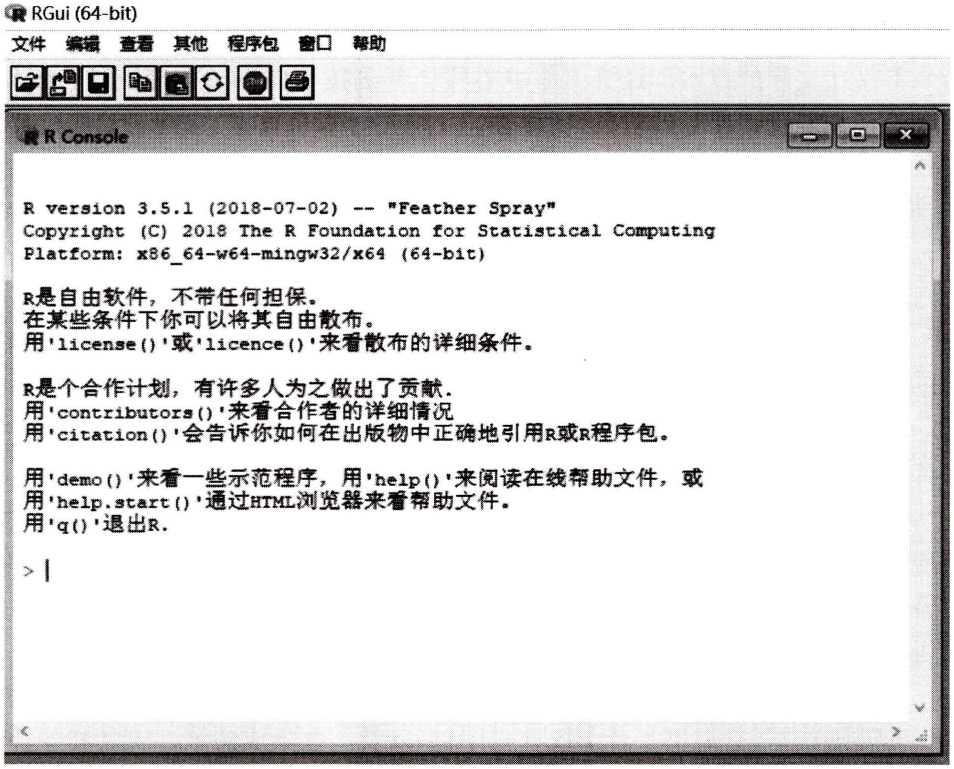
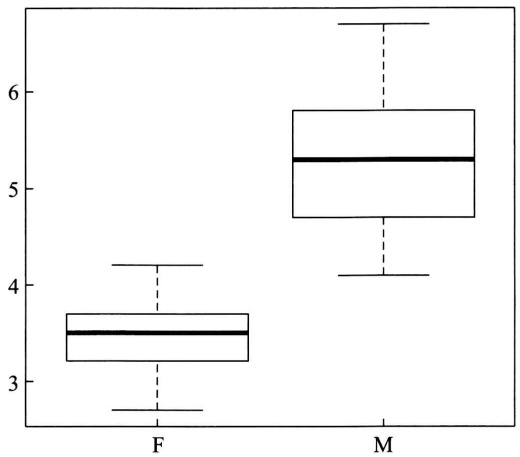
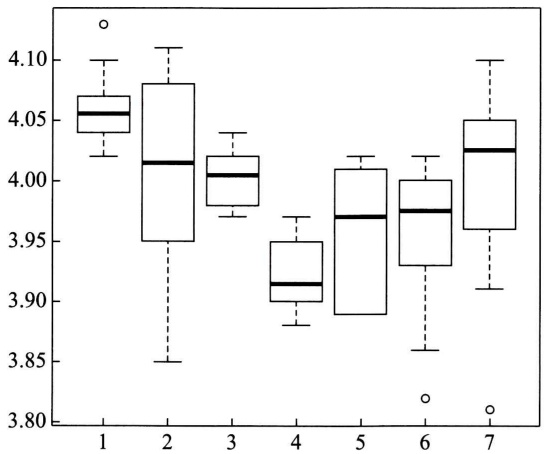
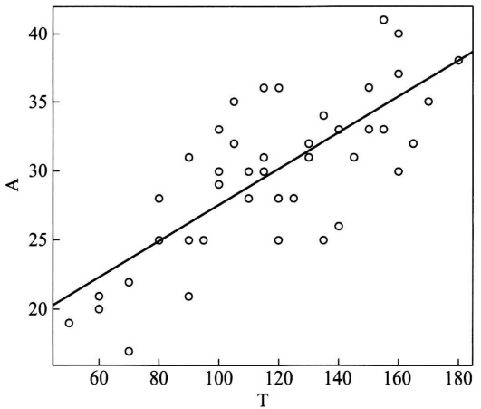

# 第十一章 在数理统计中应用R软件

原始 PDF 第 298–322 页。

# 第十一章 在数理统计中应用 R 软件①

## § 1 概述

## (一)计算机技术在数理统计中的应用

随着现代科学技术的迅猛发展,人类社会已开始进入一个利用和开发信息资源的信息社会.信息数据数量大、范围广、变化快,传统的人工处理手段无法适应社会、经济高速发展对统计提出的要求,也难以提高数据处理的速度和精度.计算机技术在数理统计中的应用,主要是在统计信息的存储和检索、统计资料的分析和检验等方面的应用,解决了统计工作中的难题.

不仅在实际的技术和经济工作中要将计算机技术应用于数理统计,在学习概率论与数理统计课程的阶段,同样也需要应用计算机技术.掌握了计算机技术在数理统计中的应用以后,读者将会明了,分析和研究问题的能力将极大地提高,研究问题的规模、分析计算的效率将极大地提高.

## (二) 在数理统计研究中应用 R 软件

功能强大的统计分析软件有 SAS(Statistical Analysis Software)、SPSS(原名为 Statistical Package for the Social Science, 2000 年改为 Statistical Product and Service Solutions) 等, 但是所有这些专业软件往往系统庞大、结构复杂, 大多数非统计专业人员难以运用自如, 而且价格昂贵, 是一般人难以承受的.

R 软件是一个开放的统计编程环境, 是一种语言. R 软件是一套完整的数据处理、计算和制图软件系统. 其功能包括: 数据存储和处理系统、数据运算工具、完整连贯的统计分析工具和便利的统计制图功能. R 软件是一种简便而强大的编程语言, 可操纵数据的输入和输出, 可实现分支、循环, 用户可自定义功能.

R 软件是一种数学计算环境. 因为 R 软件提供了有弹性的、互动的环境来分析和处理数据, 它提供了若干统计程序包, 以及一些集成的统计工具和各种数

<small><span class="docvortex-page-footnote" data-block-type="page_footnote" style="color:#6b7280">① 本书第四版中，本章为“在数理统计中应用Excel软件”.鉴于R软件使用更方便，功能更强，资源更丰富，且可以免费获得，因而在本版改用R软件.有关应用Excel软件的内容可以参见本书第四版.</span></small>

---

· 284 ·

第十一章 在数理统计中应用R软件

学计算、统计计算的函数,用户只需根据统计模型,指定相应的数据库及相关的参数,便可灵活机动地进行数据分析等工作.通过 R 软件的许多内嵌统计函数,用户可以方便地掌握 R 软件的语法,也可以编制自己的函数来扩展现有的 R 语言,完成科研工作.

R 软件是完全免费的.

## (三) R 软件的下载与安装

R 软件有一个“社区”CRAN(The Comprehensive R Archive Network, 综合的 R 档案网络), CRAN 中有很多 R 软件资源可供使用. 从 CRAN 的网站上可下载 R 软件的 Windows 版本.

按照 Windows 的提示下载和安装好 R 软件之后, 会创建程序组并在桌面上创建 R 主程序的快捷方式. 通过快捷方式运行 R 软件, 便可调出 R 软件的主窗口, 如图 11-1 所示.



<details>
<summary>text_image</summary>

R version 3.5.1 (2018-07-02) -- "Feather Spray"
Copyright (C) 2018 The R Foundation for Statistical Computing
Platform: x86_64-w64-mingw32/x64 (64-bit)

R是自由软件，不带任何担保。
在某些条件下你可以将其自由散布。
用'license()'或'licence()'来看散布的详细条件。

R是个合作计划，有许多人为之做出了贡献.
用'contributors()'来看合作者的详细情况
用'citation()'会告诉你如何在出版物中正确地引用R或R程序包。

用'demo()'来看一些示范程序，用'help()'来阅读在线帮助文件，或
用'help.start()'通过HTML浏览器来看帮助文件。
用'q()'退出R.

>
</details>

图11-1

---

§ 2 箱线图

· 285 ·

在 R 软件的主窗口中, R Console 是 R 的控制台.

主窗口上方的一些文字, 是 R 软件的一些说明和指引. 文字下面的“＞”符号是 R 软件的命令提示符, 其后跟着矩形光标. 在其后输入命令. R 软件采用交互式工作方式, 在输入命令并回车后便会执行, 并且在令其输出计算结果时便会输出.

## (四) R 软件的运行平台

R 软件有运行平台 RGui(R Graphic User's Interface). 运行平台上有“快捷方式”和“下拉式菜单”以实施运行控制.

快捷方式有8个图标, 自左至右分别是:(1) 打开程序脚本;(2) 加载工作空间;(3) 保存工作空间;(4) 复制;(5) 粘贴;(6) 复制并粘贴;(7) 中断当前计算;(8) 打印.

下拉式菜单分别是:

1. 文件:(1) 运行 R 脚本文件...;(2) 新建程序脚本;(3) 打开程序脚本...;(4) 显示文件内容...;(5) 加载工作空间...;(6) 保存工作空间...;(7) 加载历史...;(8) 保存历史...;(9) 改变工作目录...;(10) 打印...;(11) 保存到文件...;(12) 退出.
2. 编辑: (1) 复制; (2) 粘贴; (3) 仅粘贴命令行; (4) 复制并粘贴; (5) 全选; (6) 清空控制台; (7) 数据编辑器...; (8) GUI 选项...
3. 查看: (1) 工具栏; (2) 状态栏.
4. 其他: (1) 中断当前的计算; (2) 中断所有计算; (3) 缓冲输出; (4) 补全单词; (5) 补全文件名; (6) 列出对象; (7) 删除所有对象; (8) 列出查找路径.
5. 程序包:(1) 加载程序包...;(2) 设定 CRAN 镜像...;(3) 选择软件库...;(4) 安装程序包...;(5) 更新程序包...;(6) Install package(s) from local files...
6. 窗口:(1) 层叠;(2) 水平铺;(3) 垂直铺;(4) 排列图标;(5) 1 R Console.
7. 帮助:(1) 控制台;(2) R FAQ(frequently asked questions);(3) Windows 下的 R FAQ;(4) 手册(PDF 文件);(5) R 函数帮助(文本)...;(6) Html 帮助;(7) 搜索帮助...;(8) search.r-project.org...;(9) 模糊查找对象...;(10) R 主页;(11) CRAN 主页;(12) 关于.

## § 2 箱线图

例 分别画出第六章 §2 例4中女子组、男子组肺活量的箱线图.

解 R 语言程序如下.

$$
> \mathrm{F} <   - \mathrm{c} (2. 7, 2. 8, 2. 9, 3. 1, 3. 1, 3. 1, 3. 2, 3. 4, 3. 4,
$$

---

· 286 ·

第十一章 在数理统计中应用R软件

```diff
+         3.4,3.4,3.4,3.5,3.5,3.5,3.6,3.7,3.7,
+         3.7,3.8,3.8,4.0,4.1,4.2,4.2)
> M<-c(4.1,4.1,4.3,4.3,4.5,4.6,4.7,4.8,4.8,
+         5.1,5.3,5.3,5.3,5.4,5.4,5.5,5.6,5.7,
+         5.8,5.8,6.0,6.1,6.3,6.7,6.7)
> boxplot (F,M,names=c('F','M'))
```

女子组 F、男子组 M 的数据分别是一个数组,也可以看作是一个向量.在 R 软件中,用函数 c()①表示,c 表示连接(concatenate).符号“<一”表示自右边向左边赋值.

作箱线图, 只需要 boxplot() 一条命令, 回车之后, 在另一页面给出箱线图, 如图 11-2 所示②.



<details>
<summary>boxplot</summary>

| Category | Q1 | Q2 (Median) | Q3 | Min | Max |
| --- | --- | --- | --- | --- | --- |
| F | ~3.2 | 3.5 | ~3.7 | ~2.7 | ~4.2 |
| M | ~4.7 | ~5.3 | ~5.8 | ~4.1 | ~6.8 |
</details>

图11-2

## § 3 假设检验

## （一）单个总体  $N(\mu,\sigma^{2})$  均值  $\mu$  的检验

例 1 对第八章 §2 例 1 用 R 软件求解.

<small><span class="docvortex-page-footnote" data-block-type="page_footnote" style="color:#6b7280">① R 中的函数, 在函数名之后, 必须跟有圆括号“括开(”和圆括号“括闭)”, 不论函数是否有参数.</span></small>

<small><span class="docvortex-page-footnote" data-block-type="page_footnote" style="color:#6b7280">② 有时,没有直接转变成图形画面.这时,需要单击下拉式菜单的“窗口”,在其下拉出的菜单中,单击“2R 图形:Device 2(ACTIVE)”.</span></small>

---

§ 3 假设检验

· 287 ·

解 R 语言的程序和结果如下.

```txt
> x<-c(159,280,101,212,224,379,179,264,
+       222,362,168,250,149,260,485,170)
> t.test(x,alternative="greater",mu=225)
    One Sample t-test
data: x
t = 0.66852, df = 15, p-value = 0.257
alternative hypothesis: true mean is greater than 225
95 percent confidence interval:
  198.2321   Inf
sample estimates:
mean of x
  241.5
```

先将数据赋给 x，然后用命令 t.test() 作 t 检验。函数 t.test() 的参数是 t.test(x, y = NULL, alternative = c("two · sided", "less", "greater"), mu = 0, paired = FALSE, Var.equal = FALSE, Conf.level = 0.95, ...)，根据本题题意，只要程序中写明的 3 项就可以了，其余可以缺省。

键入 t.test() 命令并回车以后，R 软件就返回结果. 由 t = 0.66852, df = 15, 得 p 值 = 0.257. 于是，接受  $H_{0}$ ，认为元件的平均寿命不大于 225 h.

计算结果也给出了对应于置信水平为 $95\%$ 的置信区间(198.2321,∞). □

## （二）两个等方差正态总体 $N(\mu_1,\sigma^2),N(\mu_2,\sigma^2)$ 均值差的检验(t检验)

例 2 在两批电阻器中分别随机地取 6 只, 测得以下的电阻值(以  $\Omega$  计):

| A批(x) | 0.140 | 0.138 | 0.143 | 0.142 | 0.144 | 0.137 |
| --- | --- | --- | --- | --- | --- | --- |
| B批(y) | 0.135 | 0.140 | 0.142 | 0.136 | 0.138 | 0.140 |

设两批电阻器分别来自总体 $N(\mu_1,\sigma^2),N(\mu_2,\sigma^2),\mu_1,\mu_2,\sigma^2$ 均未知，两样本独立，试取 $\alpha = 0.05$ ，检验假设

$$
H _ {0}: \mu_ {1} = \mu_ {2}, \quad H _ {1}: \mu_ {1} \neq \mu_ {2}.
$$

解 R 语言的程序和结果如下:

```javascript
> x<-c(0.140,0.138,0.143,0.142,0.144,0.137)
> y<-c(0.135,0.140,0.142,0.136,0.138,0.140)
> t.test(x,y)
```

---

· 288 ·

第十一章 在数理统计中应用 R 软件

```txt
Welch Two Sample t - test
data: x and y
t = 1.3718, df = 9.9738, p - value = 0.2002
alternative hypothesis: true difference in means is not equal to 095 percent confidence interval:
- 0.001353666 0.005686999
sample estimates:
mean of x mean of y
0.1406667 0.1385000
```

先将数据赋予 x, y，然后键入命令 t.test(x, y)，回车以后，给出结果:p 值 = 0.2002 > α = 0.05，接受 H₀.

计算结果也给出了相应的置信区间.

## § 4 方差分析

## (一) 单因素方差分析

例1在7个不同实验室中测量某种马来酸氯苯那敏药片的马来酸氯苯那敏有效含量(以 $\mathrm{mg}$ 计)，得到以下的结果(Lab表示实验室):

| Lab 1 | Lab 2 | Lab 3 | Lab 4 | Lab 5 | Lab 6 | Lab 7 |
| --- | --- | --- | --- | --- | --- | --- |
| 4.13 | 3.86 | 4.00 | 3.88 | 4.02 | 4.02 | 4.00 |
| 4.07 | 3.85 | 4.02 | 3.88 | 3.95 | 3.86 | 4.02 |
| 4.04 | 4.08 | 4.01 | 3.91 | 4.02 | 3.96 | 4.03 |
| 4.07 | 4.11 | 4.01 | 3.95 | 3.89 | 3.97 | 4.04 |
| 4.05 | 4.08 | 4.04 | 3.92 | 3.91 | 4.00 | 4.10 |
| 4.04 | 4.01 | 3.99 | 3.97 | 4.01 | 3.82 | 3.81 |
| 4.02 | 4.02 | 4.03 | 3.92 | 3.89 | 3.98 | 3.91 |
| 4.06 | 4.04 | 3.97 | 3.90 | 3.89 | 3.99 | 3.96 |
| 4.10 | 3.97 | 3.98 | 3.97 | 3.99 | 4.02 | 4.05 |
| 4.04 | 3.95 | 3.98 | 3.90 | 4.00 | 3.93 | 4.06 |

设各样本分别来自正态总体  $N(\mu_{i},\sigma^{2}), i=1,2,\cdots,7$ ，各样本相互独立。试取显著性水平  $\alpha=0.05$  检验各实验室测量的马来酸氯苯那敏的有效含量的均值

---

§ 4 方差分析

· 289 ·

是否有显著差异.

解  $H_{0}:\mu_{1}=\mu_{2}=\cdots=\mu_{7},H_{1}:\mu_{1},\mu_{2},\cdots,\mu_{7}$  不全相等.

R 语言的程序和结果如下:

```txt
> X<-c(4.13,4.07,4.04,4.07,4.05,4.04,4.02,4.06,4.10,4.04,
+          3.86,3.85,4.08,4.11,4.08,4.01,4.02,4.04,3.97,3.95,
+          4.00,4.02,4.01,4.01,4.04,3.99,4.03,3.97,3.98,3.98,
+          3.88,3.88,3.91,3.95,3.92,3.97,3.92,3.90,3.97,3.90,
+          4.02,3.95,4.02,3.89,3.91,4.01,3.89,3.89,3.99,4.00,
+          4.02,3.86,3.96,3.97,4.00,3.82,3.98,3.99,4.02,3.93,
+          4.00,4.02,4.03,4.04,4.10,3.81,3.91,3.96,4.05,4.06)
> A<-factor(rep(1:7,each=10))
> contents<-data.frame(X,A)
> aov.cont<-aov(X~A,data=contents)
> summary(aov.cont)
```

```txt
Df  Sum Sq  Mean Sq      F value  Pr(>F)
A          6 0.1247  0.020790  5.66  9.45e-05 ***
Residuals   63 0.2314  0.003673
-----
Signif. codes: 0'***'0.001'**'0.01'*'0.05''0.1''1
> boxplot(X~A)
```

先将数据用 c() 函数赋予 X, 再用 factor() 函数 (factor 意为因子) 将数据的分组情况赋予 A (数据分为 7 组, 每组 10 个数据). X 和 A 构成一个数据框 (data.frame) 赋予 contents. 然后用 aov() 函数对 contents 作方差分析 (analysis of variance), 其结果赋予 aov.cont. 最后, 用 summary(aov.cont) 命令输出结果. p 值 = 9.45e-05 = 9.45×10^-5, 远小于 0.05, 故拒绝 H\_0, 认为差异是非常显著的.

输出的结果中含有显著性码(signif.codes)，例如，'\*\*\*'表示处于0到0.001之间，等等.

最后,用 boxplot()命令绘出 7 个实验室的箱线图,如图 11-3 所示.

□

例2 在第九章习题第2题中列出了仪器表在控制板上的三种不同的布置方案，测得各个方案在紧急情况下的反应时间如下（以 $1 / 10\mathrm{s}$ 计）:

| 方案I | 14 | 13 | 9 | 15 | 11 | 13 | 14 | 11 |  |  |  |  |
| --- | --- | --- | --- | --- | --- | --- | --- | --- | --- | --- | --- | --- |
| 方案II | 10 | 12 | 7 | 11 | 8 | 12 | 9 | 10 | 13 | 9 | 10 | 9 |
| 方案III | 11 | 5 | 9 | 10 | 6 | 8 | 8 | 7 |  |  |  |  |

---

· 290 ·

第十一章 在数理统计中应用R软件



<details>
<summary>boxplot</summary>

| Category | Q1 | Q2 (Median) | Q3 | IQR |
| --- | --- | --- | --- | --- |
| 1 | ~4.04 | ~4.055 | ~4.07 | ~0.03 |
| 2 | ~3.95 | ~4.015 | ~4.08 | ~0.03 |
| 3 | ~3.98 | ~4.005 | ~4.02 | ~0.04 |
| 4 | ~3.90 | ~3.915 | ~3.95 | ~0.05 |
| 5 | ~3.89 | ~3.97 | ~4.01 | ~0.02 |
| 6 | ~3.93 | ~3.975 | ~4.00 | ~0.07 |
| 7 | ~3.96 | ~4.025 | ~4.05 | ~0.09 |
</details>

图11-3

试在显著性水平 0.05 下检验各个方案的反应时间有无显著差异.

解  $H_{0}$ : 无显著差异,  $H_{1}$ : 有显著差异.

R 语言的程序和结果如下:

```txt
> time<- data.frame(
+     x<- c(14,13,9,15,11,13,14,11,10,12,7,11,8,12,9,10,13,9,10,9,
+    11,5,9,10,6,8,8,7),
+    A = factor(c(rep(1,8),rep(2,12),rep(3,8)))
+    )
> time.aov<- aov(x~A,data = time)
> summary(time.aov)
```

```txt
Df    Sum Sq   Mean Sq   F value   Pr(>F)
A         2    81.43   40.71   11.31   0.000318 ***
Residuals  25    90.00   3.60
---
```

```txt
Signif. codes: 0 '***' 0.001 '**' 0.01 '*' 0.05 '.' 0.1'' 1
```

本例与例1不同,本例的数据(方案Ⅰ,Ⅱ,Ⅲ的数据)的个数不一样,分别是8,12,8个.

本例用数据框 data.frame() 为所研究的反应时间 time 赋值. 数据框中, 将方案 I, II, III 的数据相应键入 x 向量, 用 factor() 函数为 A 赋值, rep(1,8) 表示方案 I 的数据为 8 个, rep(2,12) 表示方案 II 的数据为 12 个, rep(3,8) 表示方案 III 的数据为 8 个, 三者用 c() 函数构成一个向量. 接着用 aov(x\~A, data =

---

§ 4 方差分析

· 291 ·

time)作方差分析. 最后, 用 summary() 函数给出结果.

结果中，Df 是自由度，Sum Sq 是平方和，Mean Sq 是均方，F value 是 F 值， $\Pr(>F)$  是 p 值，p 值 <0.05，拒绝  $H_{0}$ ，认为各个方案的反应时间是有显著差异的。☐

## (二) 双因素无重复试验的方差分析

例 3 用 R 软件解第九章 §2 例 3.

解  $H_{0A}$ : 不同时间下颗粒状物含量的均值无显著差异,

$H_{1A}$ : 不同时间下颗粒状物含量的均值有显著差异.

$H_{0B}$ : 不同地点下颗粒状物含量的均值无显著差异,

$H_{1B}$ : 不同地点下颗粒状物含量的均值有显著差异.

R 语言的程序和结果如下:

```diff
> particles<- data.frame(
+     X = c(76,67,81,56,51,82,69,96,59,70,
+         68,59,67,54,42,63,56,64,58,37),
+     A = gl(4,5),
+     B = gl(5,1,20)
+ ) '
> parti.aov<- aov(X~A + B,data = particles)
> summary(parti.aov)
        Df   Sum Sq   Mean Sq    F value   Pr(>F)
A          3  1182.9      394.3    10.72   0.001033**
B          4  1947.5      486.9    13.24   0.000234**
Residuals   12   441.3      36.8
---
```

```txt
Signif. codes: 0 '***' 0.001 '**' 0.01 '*' 0.05'' 0.1'' 1
```

先用数据框 data.frame() 给 particles 赋值, 数据框中, X 是数据, A 是时间因素, B 是地点因素, 例题的原始数据可视作构成一矩阵, 其行数为 4, 每个 A 因素有 5 个数据, 列数为 5. 为 X 赋值, 先输入第 1 行, 然后是第 2 行, …, 直至第 4 行. 函数 gl() 意为“产生因子水平 (generate factor level)”, A = gl(4, 5) 表示 A 的个数为 4, 每个 A 因素有 5 个数据. B = gl(5, 1, 20) 表示 B 的个数为 5, B 的重复数为 1, 数据的总个数为 20. 然后用 aov() 作方差分析, 将结果赋予 parti.aov. 最后, 用 summary(parti.aov) 将结果输出. 对应于 A, p 值 = 0.001033, 对应于 B, p 值 = 0.000234, 都远小于 0.05, 故拒绝 $H_{0A}$ 和 $H_{0B}$, 认为对于不同时间和不同地点, 颗粒状物含量的均值的差异都是显著的. □

---

· 292 ·

第十一章 在数理统计中应用R软件

## (三) 双因素等重复试验的方差分析

例 4 用 R 软件解第九章 §2 例 2.

解 按题意需在显著性水平  $\alpha=0.05$  下检验: 热处理温度、时间以及这两者的交互作用对产品强度是否有显著的影响, 即需检验假设(见第九章(2.6), (2.7), (2.8)式)

$$
\left\{ \begin{array}{l} H _ {0 1}: \alpha_ {1} = \alpha_ {2} = \dots = \alpha_ {r} = 0, \\ H _ {1 1}: \alpha_ {1}, \alpha_ {2}, \dots , \alpha_ {r} \text {不全为零}. \end{array} \right.
$$

$$
\left\{ \begin{array}{l l} {H _ {0 2}:   \beta_ {1} = \beta_ {2} = \dots = \beta_ {s} = 0  ,} \\ {H _ {1 2}:   \beta_ {1}, \beta_ {2}, \dots , \beta_ {s}   \text {不全为零}.} \end{array} \right.
$$

$$
\left\{ \begin{array}{l} H _ {0 3}: \gamma_ {1 1} = \gamma_ {1 2} = \dots = \gamma_ {r s} = 0, \\ H _ {1 3}: \gamma_ {1 1}, \gamma_ {1 2}, \dots , \gamma_ {r s} \text {不全为零}. \end{array} \right.
$$

R 语言的程序和结果如下:

```diff
> strength<- data.frame(
+     X = c(38.0,38.6,47.0,44.8,45.0,43.8,42.4,40.8),
+     A = gl(2,4,8),
+     B = gl(2,2,8)
+ )

> strength.aov<- aov(X~A*B,data = strength)
> summary(strength.aov)
```

|  | Df | Sum Sq | Mean Sq | F value | Pr(>F) |
| --- | --- | --- | --- | --- | --- |
| A | 1 | 1.62 | 1.62 | 1.409 | 0.30094 |
| B | 1 | 11.52 | 11.52 | 10.017 | 0.03402* |
| A : B | 1 | 54.08 | 54.08 | 47.026 | 0.00237** |
| Residuals | 4 | 4.60 | 1.15 |  |  |

Signif. codes: 0 '\*\*\*' 0.001 '\*\*' 0.01 '\*' 0.05'' 0.1'' 1

先用数据框 data.frame() 给 strength 赋值, 数据框中, X 是数据, A 是时间因素, B 是热处理温度因素. 例题的原始数据可视作构成一分块矩阵, 其行数为 2, 列数为 2. 为 X 赋值, 首先输入分块矩阵的第 1 行、第 1 列子矩阵, 接着依次输入第 1 行、第 2 列子矩阵, 第 2 行、第 1 列子矩阵, 第 2 行、第 2 列子矩阵. 以 $A = \mathrm{gl}(2,4,8)$ 记 A 的个数为 2, 对应于 A 的每一行数据的数目为 4, 数据的总数为 8. $B = \mathrm{gl}(2,2,8)$ 表示 B 的个数为 2, 重复数为 2, 数据的总数为 8. 然后用 aov() 函数作方差分析, 将结果赋予 strength.aov.aov() 函数中的 $X \sim A * B$ 表示检验 A,

---

§ 5 线性回归

· 293 ·

B 以及 A, B 的交互作用对 X 的影响. 最后用 summary(strength.aov) 将结果输出, 对应于 A, p 值 = 0.30094, 大于  $\alpha = 0.05$ , 故接受  $H_{01}$ , 认为时间对产品强度的影响不显著; 对应于 B, p 值 = 0.03402, 小于  $\alpha = 0.05$ , 故拒绝  $H_{02}$ , 认为热处理温度对产品强度的影响显著; 对应于 A, B 的交互作用, p 值 = 0.00237, 小于  $\alpha = 0.05$ , 故拒绝  $H_{03}$ , 认为交互作用对产品强度的影响显著. □

## § 5 线性回归

我们以例题来说明用 R 软件求解一元线性回归问题的做法.

例 1 将冰晶放入一容器内, 容器内维持固定的温度 $(-5^{\circ}\mathrm{C})$ 和固定的湿度. 观察自冰晶放入的时刻开始计算的时间 T (以 s 计) 和晶体生长的轴向长度 A (以 $\mu\mathrm{m}$ 计), 得到 43 对观察数据如下:

| T | 50 | 60 | 60 | 70 | 70 | 80 | 80 | 90 | 90 | 90 | 95 |
| --- | --- | --- | --- | --- | --- | --- | --- | --- | --- | --- | --- |
| A | 19 | 20 | 21 | 17 | 22 | 25 | 28 | 21 | 25 | 31 | 25 |
| T | 100 | 100 | 100 | 105 | 105 | 110 | 110 | 110 | 115 | 115 | 115 |
| A | 30 | 29 | 33 | 35 | 32 | 30 | 28 | 30 | 31 | 36 | 30 |
| T | 120 | 120 | 120 | 125 | 130 | 130 | 135 | 135 | 140 | 140 | 145 |
| A | 36 | 25 | 28 | 28 | 31 | 32 | 34 | 25 | 26 | 33 | 31 |
| T | 150 | 150 | 155 | 155 | 160 | 160 | 160 | 165 | 170 | 180 |  |
| A | 36 | 33 | 41 | 33 | 40 | 30 | 37 | 32 | 35 | 38 |  |

设题目符合回归模型所要求的条件.

(1) 求线性回归方程  $\hat{A} = \hat{a} + \hat{b}T$ .
(2) 检验假设  $H_{0}: b=0, H_{1}: b \neq 0$  (取  $\alpha = 0.05$ ).
(3) 画出散点图.

解 R 语言的程序和结果如下:

```diff
> T<-c(50,60,60,70,70,80,80,90,90,95,100,100,100,105,105,
+         110,110,110,115,115,115,120,120,120,125,130,130,135,135,
+         140,140,145,150,150,155,155,160,160,160,165,170,180)
> A<-c(19,20,21,17,22,25,28,21,25,31,25,30,29,33,35,32,
+         30,28,30,31,36,30,36,25,28,28,31,32,34,25,
+         26,33,31,36,33,41,33,40,30,37,32,35,38)
> lm.reg<-lm(formula = A~T)
> summary(lm.reg)
Call:
lm(formula = A ~ T)
```

---

· 294 ·

第十一章 在数理统计中应用R软件

Residuals:

<div class="docvortex-algorithm" style="white-space: pre-wrap; font-family:monospace;">
Min      1Q   Median  3Q    Max
-7.064 -2.026  0.051 1.955 6.859
Coefficients:
            Estimate Std.Error t value Pr(&gt;|t|)
(Intercept) 14.4107     2.1494    6.705    4.31e-08***
T           0.1308     0.0176    7.430    4.10e-09***
-----
Signif.codes: 0'***' 0.001'**' 0.01'*' 0.05'' 0.1'' 1
&gt; plot(A~T);abline(lm.reg)
</div>

先将数据赋予 T(时间)和 A(晶体生长的轴向长度), 然后用函数 lm()作线性回归, 将结果赋予 lm.reg.lm() 的含意是线性模型(linear model). 最后用命令 summary(lm.reg) 将结果输出.

(1) (Intercept)=14.4107, 这是 $\hat{a}$ . T 的估计值为 0.1308, 这是 $\hat{b}$ . 于是得 A 关于 T 的回归方程

$$
\hat {A} = 1 4. 4 1 0 7 + 0. 1 3 0 8 T.
$$

(2) 表中 p 值一栏中有 T:4.10e-09, 这是关于 b 的双边检验

$$
H _ {0}: b = 0, H _ {1}: b \neq 0
$$

的 $p$ 值，由于 $4.10\mathrm{e} - 09 = 4.10\times 10^{-9}$ 远小于 $\alpha = 0.05$ ，故拒绝 $H_0$ ，认为回归效果是显著的.

（3）程序末行 plot(A～T) 表示输出散点图；abline(lm.reg) 表示画出回归得到的直线，如图 11-4 所示.



<details>
<summary>scatter</summary>

| T | A |
| --- | --- |
| ~50 | ~19 |
| ~60 | ~20 |
| ~60 | ~21 |
| ~70 | ~17 |
| ~70 | ~22 |
| ~80 | ~25 |
| ~80 | ~28 |
| ~90 | ~21 |
| ~90 | ~25 |
| ~90 | ~31 |
| ~100 | ~29 |
| ~100 | ~30 |
| ~100 | ~33 |
| ~105 | ~32 |
| ~105 | ~35 |
| ~110 | ~28 |
| ~115 | ~30 |
| ~115 | ~31 |
| ~115 | ~36 |
| ~120 | ~25 |
| ~120 | ~28 |
| ~120 | ~36 |
| ~130 | ~31 |
| ~130 | ~32 |
| ~135 | ~25 |
| ~135 | ~34 |
| ~140 | ~26 |
| ~145 | ~33 |
| ~145 | ~31 |
| ~150 | ~33 |
| ~150 | ~36 |
| ~155 | ~41 |
| ~160 | ~30 |
| ~160 | ~37 |
| ~160 | ~40 |
| ~165 | ~32 |
| ~170 | ~35 |
| ~180 | ~38 |
</details>

图11-4


---

§ 5 线性回归

· 295 ·

例 2 用 R 软件解第九章 §3 例 6.

解 本题中的平均价格 $Y$ (美元) 数据, 可取对数, 得 $y$; 将问题化为求一元线性回归. R 语言的程序和结果如下:

```txt
> x<-c(1,2,3,4,5,6,7,8,9,10)
> y<-c(7.8827,7.5720,7.3092,6.9912,6.6399,6.2879,6.1821,5.6699,
5.4205,5.3181)
>lm.price<-lm(formula = y ~ x)
>summary(lm.price)
Call:
lm(formula = y ~ x)
Residuals:
```

```txt
Min 1Q Median 3Q Max
-0.113242 -0.057792 0.009268 0.032563 0.130324
Coefficients:
Estimate Std. Error t value Pr(>|t|)
(Intercept) 8.164607 0.057045 143.13 6.35e-15 ***
x -0.297683 0.009194 -32.38 9.02e-10 ***
-----
Signif. codes: 0'***'0.001'**'0.01'*'0.05'.'0.1''1
```

先键入原始数据 x, y, 然后用 lm() 函数作回归, 用 summary() 函数输出结果, 得到回归方程的结果为

$$
\hat {y} = 8. 1 6 4 6 0 7 - 0. 2 9 7 6 8 3 x.
$$

代回原变量,得

$$
\hat {Y} = 3 5 1 4. 3 4 \mathrm{e} ^ {- 0. 2 9 7 6 8 3 x}.
$$

例 3 多元线性回归的例子: 用 R 软件解第九章 §4 的例.

解 R 语言的程序和结果如下:

```txt
>price<-data.frame(
+     x1 = c(20,25,30,35,40,50,60,65,70,75,80,90),
+     x2 = c(400,625,900,1225,1600,2500,3600,4225,4900,5625,6400,8100),
+     y = c(1.81,1.70,1.65,1.55,1.48,1.40,1.30,1.26,1.24,1.21,1.20,1.18)
+ )

>lm.price<-lm(y~x1 + x2,data = price)
>summary(lm.price)
```

---

· 296 ·

第十一章 在数理统计中应用 R 软件

Call:

```txt
lm(formula = y ~ x1 + x2, data = price)
```

Residuals:

```csv
Min 1Q Median 3Q Max
-0.0174763 -0.0065087 0.0001297 0.0071482 0.0151887
```

Coefficients:

```txt
Estimate Std. Error t value Pr(>|t|)
(Intercept) 2.198e+00 2.255e-02 97.48 6.38e-15 ***
x1       -2.252e-02 9.424e-04 -23.90 1.88e-09 ***
x2       1.251e-04 8.658e-06 14.45 1.56e-07 ***
```

Signif. codes: 0 '\*\*\*' 0.001 '\*\*' 0.01 '\*' 0.05 '.' 0.1'' 1

本题原来是非线性回归问题, 即 y 与 x 和  $x^{2}$  的回归问题. 现在, 用数据框 data.frame 将数据 x1(即 x), x2(即  $x^{2}$ ) 和 y 赋予 price, 然后用 lm 函数作回归, 用 summary() 函数输出结果, 得回归方程的结果为

$$
\begin{array}{l} \hat {y} = (2. 1 9 8 \mathrm{e} + 0 0) - (2. 2 5 2 \mathrm{e} - 0 2) x + (1. 2 5 1 \mathrm{e} - 0 4) x ^ {2} \\ = 2. 1 9 8 - 0. 0 2 2 5 2 x + 0. 0 0 0 1 2 5 1 x ^ {2}. \\ \end{array}
$$


## § 6 bootstrap 方法

我们用 R 软件求解 bootstrap 问题.

例 1 用 R 软件解第十章 §1 例 1.

解 R 语言的程序和结果如下:

```diff
> x<-c(9.5,21.1,12.0,10.2,12.0,21.1,10.2,
+       18.2,12.0,9.5,18.0,10.2,18.2)
> median(x)
[1] 12
> n = length(x);n
[1] 13
> N = 10000;k = 0
> theta<-numeric(N)
> for(i in 1: N){
+     xB<-sample(x, n, replace=TRUE)
+     theta[i]<-median(xB)
```

---

§ 6 bootstrap 方法

· 297 ·

```diff
+     k<-k+median(xB)
+ }
> thetabar = k/N; thetabar
[1]  12.83701
> squ<-0.0
> for(i in 1: N){
+       squ<-squ+(theta[i]-thetabar)^2
+ }
> sigma. theta<-sqrt(squ/9999);sigma.theta
[1]  2.676131
```

先键入原始数据 x，并得出 x 的中位数 median(x) = 12 和长度 n = 13.

确定循环数 N=10000，将计数器 k 清零。用 numeric(N) 确定  $\theta$  的容量以便存储。在第一个循环中，用 sample() 函数产生 xB。在 x 中作放回抽样，抽 n 个，将 xB 的中位数存入 theta[i]，累加 N 个中位数后计算平均值 thetabar。

做第二个循环前,先将 squ 清零,然后计算 theta[i] 和 thetabar 之差的平方,N 个这样的数累加之后除以(N-1),再开平方,得到结果 2.676131. □

例 2 用 R 软件解第十章 §1 例 2.

解 R 语言的程序和结果如下:

```c
>x<-c(133.7,134.1,134.3,134.4,134.5,134.7,134.8,134.8,134.8,
+       134.9,134.9,135.0,135.0,135.2,135.2,135.4,135.4,135.8,
+       135.8,136.3,136.6,141.2,143.3,146.5,147.8,148.8)
> n = length(x);n
[1]   26
> M = median(x);M
[1]   135.1
> N = 10000; M2 = 0.0
> for (i in 1:N){
+       xB = sample(x,n,replace = TRUE)
+       MB = median(xB)
+       M2 = M2 + (MB - M)^2
+ }
> MSE.median = M2/N;  MSE.median
[1] 0.07432325
```

先键入原始数据 x, 算得 x 的长度 n = 26, x 的中位数 M = 135.1. 确定循环数

---

· 298 ·

第十一章 在数理统计中应用R软件

N = 10000，在循环开始之前将计数器 M2 清零。在循环中，用 sample() 函数产生 bootstrap 样本 xB，在 x 中作放回抽样，抽 n 个。计算 xB 的中位数 MB。计算 (MB—M)²。循环完成，10 000 个 (MB—M)² 累加在 M2 中。结果是 M2/N。

例 3 用 R 软件解第十章 §1 例 3.

解 R 语言的程序和结果如下:

```diff
> x<-c(133.7,134.1,134.3,134.4,134.5,134.7,134.8,134.8,
+         134.9,134.9,135.0,135.0,135.2,135.2,135.4,135.4,135.8,
+         135.8,136.3,136.6,141.2,143.3,146.5,147.8,148.8)
> N = 10000;md<-numeric(N)
> for(i in 1:N){
+     xB<-sample(x,n,replace=TRUE)
+     md[i]=median(xB)
+ }
> bias = mean(md) - 135.1; bias
[1] 0.04333
```

先键入原始数据 x, 本例接在例 2 之后求解, x 已输入. 接着用 N = 10000 规定循环数, 用 numeric(N) 确定向量 md 的长度. 在循环中, 用 sample() 函数产生 bootstrap 样本 xB, 在 x 中作放回抽样, 抽 n 个, 计算 xB 的中位数, 存入 md[i]. 循环完成, 即可算得偏差 bias. □

例 4 用 R 软件解第十章 §1 例 4.

解 R 语言的程序和结果如下:

```txt
> x
[1] 133.7 134.1 134.3 134.4 134.5 134.7 134.8 134.8 134.8
134.9 134.9 135.0
[13] 135.0 135.2 135.2 135.4 135.4 135.8 135.8 136.3 136.6
141.2 143.3 146.5
[25] 147.8 148.8
> n = length(x);n
[1] 26
> N = 10000
> medianxB<-numeric(N)
> trimmedmeanxB<-numeric(N)
> for(i in 1:N){
+     xB<-sample(x,n,replace=TRUE)
```

---

§ 6 bootstrap 方法

· 299 ·

```matlab
+ medianxB[i] = median(xB)
+ sortB <- sort(xB)
+ trimmedmeanxB[i] = mean(sortB[6:21])
+ }
> quantile(medianxB,prob = c(0.025,0.05,0.10,0.90,0.95,0.975))
  2.5%    5%    10%    90%    95%    97.5%
  134.80   134.85   134.90   135.40   135.60    135.80
> quantile(trimmedmeanxB,prob = c(0.025,0.05,0.10,0.90,0.95,0.975))
  2.5%    5%    10%    90%    95%    97.5%
  134.8938   134.9437   135.0000   136.5250   136.9938   137.4563
```

先键入原始样本 $x^{①}$，计算向量长度 $n = \text{length}(x) = 26$. 接着规定循环数 $N = 10000$. 用 numeric(N)确定向量 medianxB 和 trimmedmeanxB 的长度. 然后做循环，在循环中，用 sample() 函数产生 bootstrap 样本 xB，在 x 中作放回抽样，抽 n 个. 求 xB 的中位数存入 medianxB[i]. 用 sort() 函数将 xB 排序求截尾均值存入 trimmedmeanxB[i]. 循环完成后用 quantile() 函数求置信区间. 例如，中位数的置信水平为 0.95 的 bootstrap 置信区间为 (134.80, 135.80). □

例 5 用 R 软件解第十章 §2 例 1.

解 R 语言的程序和结果如下:

```diff
> x<-c(0.4,0.6,0.7,0.9,1.0,1.3,1.9,2.0,
+         4.8,5.1,5.3,5.3,6.0,12.2,15.8)
> mean(x)
[1]  4.22
> N=10000; m<-numeric(N)
> for(i in 1:N){
+     xi<-rexp(15,1/4.22)
+     m[i]=mean(xi)
+ }
> quantile(m,prob=c(0.025,0.05,0.10,0.90,0.95,0.975))
    2.5%      5%      10%      90%      95%      97.5%
    2.392090  2.616341  2.904344  5.653182  6.158192  6.682134
```

先键入原始数据 x, 算得 x 的均值 4.22. 接着确定 N = 10000, 并用 numeric(N) 确定向量 m 的长度. 在循环中, 用函数 rexp() 产生 15 个参数为 4.22 的指数分布随

<small><span class="docvortex-page-footnote" data-block-type="page_footnote" style="color:#6b7280">① 本例接在例2、例3之后求解，x已先输入.</span></small>

---

· 300 ·

第十一章 在数理统计中应用R软件

机数 xi, 计算 xi 的均值, 存入 m[i]. 循环完成, 用 quantile() 函数输出结果. 例如, 总体均值的置信水平为 0.95 的 bootstrap 置信区间为 (2.39209, 6.68213). □

例 6 用 R 软件解第十章 §2 例 2.

解 R 语言的程序和结果如下:

```matlab
> x<-c(15.1,14.6,12.0,19.2,16.1,15.5,11.3,18.7,17.1,17.2)
> n = length(x); n
[1] 10
> lam<-mean(x); lam
[1] 15.68
> N = 10000; m<-numeric(N)
> for(i in 1:N){
+   xi<-rpois(10,lam)
+   m[i] = mean(xi)
+ }
> quantile(m,prob = c(0.025,0.05,0.10,0.90,0.95,0.975))
    2.5%  5%  10%  90%  95%  97.5%
    13.3  13.7  14.1  17.3  17.8  18.2
```

先用 $x < -c()$ 键入原始数据，接着算出 $x$ 的容量 $n = 10$，算出 $x$ 的均值 $lam = 15.68$，然后规定 $N = 10000$，用 numeric(N) 确定 $m$ 的容量。然后做 $N$ 次循环，每一次用 rpois(10, lam) 产生 10 个数据的参数 $\lambda = lam$ 的服从泊松分布的 bootstrap 样本 $xi$，计算其均值，存入 $m[i]$。最后，用 quantile() 函数输出结果。

例 7 用 R 软件解第十章 §2 例 3.

解 在第十章 §2 例3中, 已算出 x 的均值和标准差, 本例的 R 语言的程序和结果如下:

```txt
> N = 10000; m<-numeric(N); md<-numeric(N)
> for(i in 1 : N){
+     xi<-rnorm(16,13.87,2.84)
+     m[i] = mean(xi)
+     md[i] = median(xi)
+ }
> quantile(m,prob = c(0.025,0.05,0.10,0.90,0.95,0.975))
    2.5%      5%      10%      90%      95%      97.5%
    12.46357  12.69707  12.94994  14.76013  15.03243  15.25134
```

---

§ 6 bootstrap 方法

· 301 ·

```matlab
> quantile(md,prob = c(0.025,0.05,0.10,0.90,0.95,0.975))
    2.5 %    5 %    10 %    90 %    95 %    97.5 %
    12.17973  12.44600  12.75886  14.93289  15.27145  15.54354
```

先用 N = 10000 确定做 10 000 个 bootstrap 样本, 用 numeric(N) 分别确定向量 m 和 md 的长度. 然后用循环语句做 N 次, 每做一次, 用 rnorm() 产生 16 个服从正态分布的随机数, 正态分布的均值为 13.87, 标准差为 2.84, 分别求其均值存入向量 m[i], 求其中位数存入向量 md[i]. 最后用 quantile() 给出结果. □

例 8 用 R 软件解第十章 §2 例 4.

解 R 语言的程序和结果如下:

```matlab
> x<-c(9,10,10,10,10,10,10,11,11,11,11,11,11,11,11,
+ 11,11,11,12,12,12,12,12,12,12,12,12,12,
+ 13,13,13,13,13,13,13,13,14,14,14,14,15,15,16)
> n = length(x);n
[1] 48
> lam = 575/48;lam
[1] 11.97917
> N = 10000;m<-numeric(N)
> for(i in 1:N){
+   xi<-rpois(48,lam)
+   m[i] = mean(xi)
+ }
> quantile(m,prob = c(0.025,0.05,0.10,0.90,0.95,0.975))
    2.5%    5%    10%    90%    95%    97.5%
    11.00000  11.14583  11.33333  12.62500  12.81250  12.95833
```

以上是(1)的程序和结果,(2)的程序和结果如下:

```diff
> N = 10000; m<-numeric(N)
> for(i in 1:N){
+   xi<-sample(x,n,replace=TRUE)
+   m[i]=mean(xi)
+ }
> quantile(m,prob=c(0.025,0.05,0.10,0.90,0.95,0.975))
    2.5%      5%       10%      90%      95%      97.5%
    11.56250  11.62500  11.70833  12.27083  12.33333  12.41667
```

例 9 用 R 软件解第十章 §2 例 5.

---

· 302 ·

第十一章 在数理统计中应用R软件

解 R 语言的程序和结果如下:

```diff
> N = 10000; theta<-numeric(N)
> for(i in 1 : N){
+     x1 = 0; x2 = 0; x3 = 0
+     n = 1029
+     for(j in 1 : n){
+         ran<-runif(1,0,1)
+         if(ran<0.331)   x1 = x1 + 1
+         else if(ran<0.820)   x2 = x2 + 1
+         else   x3<-x3 + 1
+     }
+     theta[i] = (x2 + 2 * x3)/(2 * n)
+ }
> quantile(theta,prob = c(0.05,0.95))
    5 %        95 %
    0.4067055  0.4422012
```

在第十章 §2 例 5 中, 已经得到了如下结果:

| 基因型 | AA | Aa | aa |
| --- | --- | --- | --- |
| 概率 | 0.331 | 0.489 | 0.180 |

待估计参数 $\theta = (x_{2} + 2x_{3}) / (2n)$，式中 $x_{1}, x_{2}, x_{3}$ 分别是基因型为 AA, Aa, aa 的人数.

要产生基因型的样本,需产生随机数 ran:

0<ran<0.331为AA型,0.331<ran<0.820为Aa型,

0.820<ran<1.0 为 aa 型.

本例程序有内外两个循环. 先确定外循环数 $N = 10000$, 并用 numeric(N) 确定向量 theta 的长度. 进入外循环, 先将 x1, x2, x3 清零, 并规定 n = 1029. 进入内循环, 用 runif(1,0,1) 函数产生一个随机数 ran, 并用条件语句确定 x1 或 x2 或 x3 的计数器加 1. 内循环完成, 算出 theta[i] 并存储之. 外循环完成, 用 quantile() 函数输出结果.

一个数字例子: $x_{1}=339,x_{2}=492,x_{3}=198,n=1029,$

$$
\theta = 0. 4 3 1 4 9.
$$

例 10 用 R 软件解第十章 §3 例 1.

---

§ 6 bootstrap 方法

· 303 ·

解 R 语言的程序和结果如下:

```txt
> x<-c(34,39,41,28,33)
> y<-c(36,40,35,31,39,36)
> nx = length(x) ; nx
[1] 5
> ny = length(y) ; ny
[1] 6
> mx = mean(x) ; mx
[1] 35
> my = mean(y) ; my
[1] 36.16667
> v = my - mx ; v
[1] 1.166667
> z<-c(x,y) ; z
[1] 34 39 41 28 33 36 40 35 31 39 36
> B = 10000; k = 0
> for(i in 1 : B) {
+ xb<-sample(z,nx,replace=TRUE)
+ yb<-sample(z,ny,replace=TRUE)
+ vb = mean(yb)-mean(xb)
+ if(vb>v) k<-k+1
+ }
> k/B
[1] 0.3096
```

先键入原始数据 x 和 y，接着计算向量 x 和 y 的长度 nx 和 ny、均值 mx 和 my，计算 v=my-mx。再用  $z<-c(x,y)$  产生向量 z，并显示 z，接着确定做 B=10000 次循环，并将计数器 k 清零。在循环中的每一次，以放回抽样自 z 中产生 bootstrap 样本 xb 和 yb，计算  $vb=\text{mean}(yb)-\text{mean}(xb)$ 。若 vb>v，计数器加 l。

计算结果为  $k/B = 0.3096 > 0.05$ ，接受  $H_{0}$ .

例 11 用 R 软件解第十章 §3 例 2.

解 R 语言的程序和结果如下:

```txt
> x<-c(159,280,101,212,224,379,179,264,
+         222,362,168,250,149,260,485,170)
> mx = mean(x);mx
```

---

· 304 ·

第十一章 在数理统计中应用R软件

```diff
[1] 241.5
> n = length(x);n
[1] 16
> z = x - 241.5 + 225 ; z
[1] 142.5 263.5 84.5 195.5 207.5 362.5 162.5 247.5 205.5
345.5 151.5 233.5
[13] 132.5 243.5 468.5 153.5
> B = 10000
> k = 0
> for(i in 1 : B) {
+     xB = sample(z, n, replace = TRUE)
+     if(mean(xB) > mx ) k = k + 1
+ }
> k / B
[1] 0.2429
```

先键入原始数据 x，计算得其均值为 mx = 241.5，向量长度 n = 16。作变换 z = x - 241.5 + 225，并显示 z。

确定做循环 B=10000，执行循环前将计数器 k 清零。在循环中，用 sample() 函数产生 bootstrap 样本 xB。在 z 中作放回抽样，抽 n 个。若 mean(xB)>mx，则计数器 k 加 1。循环执行完毕 k=2429. k/B=0.2429，接受  $H_{0}$ 。

例 12 用 R 软件解第十章 §3 例 3.

解 R 语言的程序和结果如下:

```txt
> x<-c(4.07,4.88,5.10,5.26,5.27,5.29,5.29,5.30,5.34,5.34,
+ 5.36,5.39,5.42,5.44,5.46,5.47,5.50,5.53,5.55,5.57,5.58,5.61,
+ 5.62,5.63,5.65,5.75,5.79,5.85,5.86)
> n = length(x);n
[1] 29
> mean(x)
[1] 5.419655
> z<-x-5.42+5.51
> B=10000; k=0
> for(i in 1:B) {
+     zB<-sample(z,n,replace=TRUE)
+     if(mean(zB)>mean(x)) k=k+1
```

---

附录 R 软件的一些介绍

· 305 ·

```npy
+ }
>k/B
[1]0.9144
```

先键入原始数据 x，其长度 n=29，均值为 5.42。作变换 z<-x-5.42+5.51。确定循环数 B=10000，在执行循环前将计数器 k 清零。在循环中，用 sample() 函数在 z 中作放回抽样，抽 n 个，得 bootstrap 样本 zB。若 mean(zB)>mean(x)，计数器 k 加 1。循环执行完，k/B=0.9144，接受  $H_{0}$ 。

## 附录 R 软件的一些介绍

R 软件涉及的面很广, 在第十一章对 R 软件作了基本的介绍, 这里围绕本书用到的知识再作一些介绍.

在完成了 R 软件的下载和安装之后, 启用 R 软件, 在计算机的显示器上显示 R 软件的控制台 R Console. 在几段说明和指引的文字下面, 出现符号“＞”, 它是 R 软件的命令提示符. 接着是闪烁的光标, 可以在该处键入命令. 一条命令键入完毕, 回车, R 软件就执行这条命令. R 语言是一种“解释性语言”, 不需编译连接就可以执行. 如果键入的命令有误, 则 R 软件会显示错误, 并再显示命令提示符接受修改. R 软件实行交互式工作方式, 执行完一条命令, 就再显示命令提示符准备接受下一条命令. R 软件的执行很快, 即使是较为复杂的操作和较多的循环次数 (例如, 以万计), 也是瞬间完成.

键入 q() 命令并回车, 或是单击 RGui 右上角的叉号, 可退出 R.

## (一) R 的数据结构

## 1. R 的对象与属性

R 中论及的事物称为对象(object). 对象的属性有模式(mode)和长度(length).

模式有:数值型(numeric);字符型(character);逻辑型(logical);复数型(complex).例如:

```txt
> x <- 10;  y <- "wang";  z <- TRUE;  u <- 1 + 2i
> mode(x);  mode(y);  mode(z);  mode(u)
[1]"numeric"
[1]"character"
[1]"logical"
[1]"complex"
```

这里 x, y, z, u 是对象，对象的命名必须以拉丁字符 a, b, …, z, A, B, …, Z 开头（大小写字符被认为是不同的），其后可以跟字符、数字  $(0, 1, \cdots, 9)$ ，点（.）及下划线（\_）。上面所列出的前两行是命令。第一行是赋值命令，分别用符号“<—”（小于，负号）给 4 个对象赋值。这一行包含了 4 个命令，用分号“；”隔开。第二行是检查 4 个对象的模式。后四行是 R 软件返回的结果。[1] 表示从第一个量值开始，实际上这里的量值是第一个也是唯一的一个。R 软件这里的响应是与向量的情况共用的，下面讲到向量情况，就能看清楚。

对象长度的表示也是与向量情况共用的,标量对象的长度是1.

---

· 306 ·

第十一章 在数理统计中应用 R 软件

R 中还有 NA(Not Available) 和 NaN(Not a Number), NA 是数据缺失, NaN 表示不是一个数. 例如, 键入命令 sqrt(-15), 即求 $\sqrt{-15}$, R 返回结果“NaN”.

## 2. 运算

数值型对象的数学运算:+，加法；-，减法；\*，乘法；/，除法；^，乘方.

数值型对象的比较运算:<,小于;>,大于;<=,小于或等于;>=,大于或等于;==,等于;!=,不等于.

逻辑型对象的运算:!x，逻辑非；x&y 或 x&&y，逻辑与；x|y 或 x||y，逻辑或.

## 3. 向量

```csv
> T<-c(50,60,60,70,70,80,80,90,90,95,100,100,100,105,105,
+       110,110,110,115,115,115,120,120,120,125,130,130,135,135,
+       140,140,145,150,150,155,155,160,160,160,165,170,180)
> T
[1]    50   60   60   70   70   80   80   90   90   90   95   100   100   100   105   105   110
110   110   115   115   115   120   120   120   125   130   130   135   135   140   140   145
[34]    150   150   155   155   160   160   160   165   170   180
> length(T)
[1] 43
```

如上所示的 T 是一个向量, 它由 c() 的 43 个元素构成. c() 是构成向量的函数, c 表示连接 (concatenate). 命令 >T < -c() 是以 c() 为 T 赋值. 命令 >T 则是要 R 软件将 T 的内容显示出来. 显示器上显示了两行数据, 第一行以 [1] 领头, 其后有 33 个数据. 打印机纸张宽度不够会自动换行. 第二行以 [34] 领头, 其后有 10 个数据. 键入命令 >length(T), 显示“[1] 43”.

## 4. 数据框(data frame)

R 软件中的一种数据结构,应用广泛.

例如，在单因素方差分析中，包含了以下内容:(1) 本题的全部数据 $x$。（2）$x$ 的分组情况 $A$:(i) 分 $n$ 组；(ii) 各组的数据个数，若个数相同，它是多少，若不相同，它们分别是多少。用于双因素方差分析时，信息还要多一些。

## 5. 列表(list)

列表是一种特别的对象集合. 它的元素的类型可以是任意对象. 不同的元素可以是不同类型的对象.

## （二）R语言程序的编制

## 1. 循环语句

求解一个问题,往往要做大量的计算,要做循环.常用的一种形式是使用

$$
\text {for} (\mathrm{i} \quad \text {in} \quad 1: \mathrm{N}) \{\cdot \}
$$

语句, 这是做 N 次循环.  $\{\cdot\}$  则是要重复执行的命令, 可以有若干条.  $\{\cdot\}$  内还可以再包含低层次的要循环执行的下一层  $\{\cdot\}$ .

## 2. 分支语句

常用的是

---

本章参考文献

· 307 ·

if(cond) statement 或 if(cond) statement 1 else statement 2,

前一种情况是,若条件 cond 为“真(TRUE)”,则执行表达式 statement,否则即往下做.后一种情况是,若条件 cond 为“真”则执行 statement 1,否则执行 statement 2.

## 3. 善用各种有关的函数

在本书中,函数 t.test(),gl(),aov(),lm(),sample(),quantile(),rexp(),rnorm(),rpois(),runif()等都是很常用的,在使用它们时都已分别作了说明.

## （三）在键入和运行新程序前，先“清零”

在键入和运行新程序之前,先单击下拉式菜单的“其他”,弹出下拉式菜单之后,单击其中的“删除所有对象”.R软件会显示让使用者确认的选项,应单击“是”,完成操作.

## 习题

1. 为比较某一地区种植的4种谷物(大麦、小麦、玉米、燕麦)的维生素B的含量A,B,C,D(以 $\mu g/g$ 计)，今依次在总体A,B,C,D中各取一样本:

A: 5.2 4.5 6.0 6.1 6.7 5.8

B: 6.5 8.0 6.1 7.5 5.9 5.6

C: 5.8 4.7 6.4 4.9 6.0 5.2

D: 8.3 6.1 7.9 7.0 5.5 7.2

设总体 $A, B, C, D$ 依次服从正态分布 $N(\mu_i, \sigma^2) (i = 1, 2, 3, 4)$，并设各样本相互独立。试画出各个样本数据的箱线图，并取显著性水平 $\alpha = 0.05$ 检验各种谷物的维生素B含量的均值是否有显著差异。

2. 求解第九章习题第 4 题的方差分析问题.

3. 有人做过一项试验, 检测被测试者在英文文献中搜索到特定单词所需的时间(以 s 计), 搜索内容是在文献中找出含字母 k 的由 4 个字符组成的单词, 得到以下的数据:

| 单词所在的行序(x) | 9 | 11 | 15 | 17 | 19 | 21 | 24 | 25 | 29 | 32 | 34 | 36 | 39 | 41 |
| --- | --- | --- | --- | --- | --- | --- | --- | --- | --- | --- | --- | --- | --- | --- |
| 找到该单词所需的时间(y) | 8 | 8 | 7 | 9 | 14 | 13 | 14 | 16 | 17 | 19 | 21 | 21 | 26 | 27 |

设题目符合线性回归模型 $Y = \beta_0 + \beta_1x + \varepsilon, \varepsilon \sim N(0,1)$ 所要求的条件.

(1) 给出数据的散点图.

(2) 作 y 关于 x 的一元线性方程  $y = \hat{\beta}_{0} + \hat{\beta}_{1}x$ .

## 本章参考文献

[1] An Introduction to R. 单击 RGui 的下拉式菜单“帮助”，接着单击下拉出来的“手册（PDF 文件）”，弹出的第一项即是.
[2] 薛毅, 陈立萍. 统计建模与 R 软件. 北京: 清华大学出版社, 2007.
[3] 汤银才. R 语言与统计分析. 北京: 高等教育出版社, 2008.
