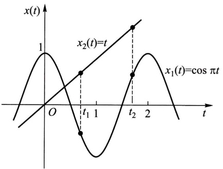
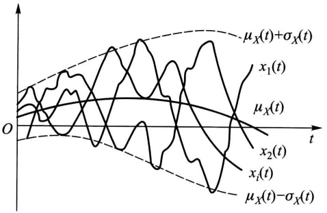
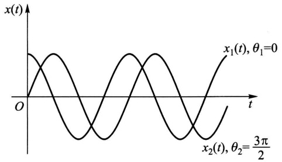
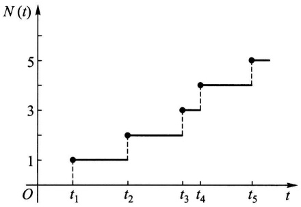
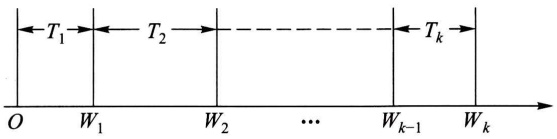

# 第十二章 随机过程

原始 PDF 第 323–337 页。

## 第十二章 随机过程

随机过程被认为是概率论的“动力学”部分. 意思是说, 它的研究对象是随时间演变的随机现象. 对于这种现象, 通常需要用一族无限多个随机变量来描述. 本章先引入随机过程的概念和记号, 再一般地介绍随机过程的统计描述方法, 最后讨论在实际问题中十分有用的泊松过程和维纳过程.

## § 1 随机过程的概念

用 $T$ 表示一无限实数集, 我们把依赖于参数 $t \in T$ 的一族随机变量 $\{X_t, t \in T\}$ 称为随机过程, $T$ 叫做参数集. 我们通常把 $t \in T$ 看作时间, 称对 $X_t$ 的观察值 $x_t$ 为 $t$ 时过程的状态, 随机过程 $\{X_t, t \in T\}$ 所有可能取的状态全体称为随机过程的状态空间. 对 $\{X_t, t \in T\}$ 进行一次试验 (即在 $T$ 上进行一次全程观测) 我们得到一个函数 $x(t), t \in T$, 称为随机过程的一个样本函数或样本曲线. 随机过程可以看作是多维随机变量的延伸. 随机过程与其样本函数的关系和数理统计中总体与样本的关系是类似的.

随机过程可根据其在任一时刻 $t$ 的状态 $X_{t}$ 是连续型随机变量或离散型随机变量而分为连续型随机过程或离散型随机过程. 随机过程还可依时间参数分类. 当 $T$ 是有限区间或无限区间时称 $\{X_{t}, t \in T\}$ 为连续参数随机过程. 对于连续参数随机过程我们常采用记号 $X(t) = X_{t}$ 来表示其对参数 $t$ 的函数依赖关系. 当 $T$ 为离散集合时称之为离散参数随机过程或时间序列.

例 1(掷骰子) 考虑抛掷一颗骰子的试验.(1) 设 $X_{n}$ 是第 $n$ 次抛掷的点数, 对于 $n=1,2,\cdots$ 的不同值 $X_{n}$ 是不同的随机变量, 因而 $\{X_{n}, n \geqslant 1\}$ 构成一随机过程, 称为伯努利过程或伯努利随机序列.(2) 设 $Y_{n}$ 是前 $n$ 次抛掷中出现的最大点数, $Y_{n}$ 也是一随机过程. $X_{n}, Y_{n}$ 都是离散型离散参数随机过程. 它们有相同的状态空间 $\{1,2,3,4,5,6\}$.

例2（股票价格）一只股票每日的收盘价是一个连续型离散参数随机过程.

例3(电话呼叫) 一个电话交换台在时间间隔 $[0, t]$ 内接到的呼叫次数 $X(t)$ 是一个以 $t$ 为参数的离散型连续参数随机过程.

例 4(维纳(Wiener)过程) 这是布朗运动的数学模型. 英国植物学家布朗

---

§ 2 随机过程的统计描述

· 309 ·

(Brown)在显微镜下观察到平静液面上的微小粒子不断地进行着杂乱无章的运动,这种现象后来称为布朗运动.用 $W(t)$ 表示运动中一微粒从时刻t=0到时刻t>0的位移的横坐标,且设 $W(0)=0$ ,则 $W(t)$ 是一个连续型连续参数随机过程.

随机过程与函数相互作用可以产生新的随机过程.

例5（随机切换）抛掷一枚硬币试验的样本空间是 $\{H, T\}$. 现借此定义随

机过程 $X(t), t \in (-\infty, \infty)$: 当 $H$ 出现时 $X(t) = \cos \pi t$, 而当 $T$ 出现时 $X(t) = t$. 显然这个随机过程的状态空间为 $(- \infty, \infty)$, 它是连续的. 但是该随机过程仅对应两个样本函数 $\{\cos \pi t, t\}$ (图12-1). 所以在任一时刻 $t, X(t)$ 的样本空间只有两个元素 $\{\cos \pi t, t\}$. 因此 $X(t)$ 是一个离散型连续参数随机过程.

观察我们周围的世界可以看到很多随机现象.例如,地震的波幅、结构物承受的

line

| Point | Intersection Time (t) | Intersection Value (x1(t)) | Intersection Value (x2(t)) |
| --- | --- | --- | --- |
| 1 | 0 | 0 | 1 |
| 2 | t1 | t1 | t2 |
| 3 | t2 | t2 | t2 |

图12-1

风荷载、时间间隔 $[0, t)$ 内船舶甲板“上浪”的次数、通信系统和自控系统中的各种噪声和干扰、生物群体的生长变化以及金融产品的价格等都可以用随机过程这一数学模型来描绘。不过大部分随机过程都不能很方便地用简单的函数关系式来描述，其主要原因在于在自然界和社会活动中产生随机因素的机理通常都相当复杂，甚至是不可能被观察到的。因而对大多数随机过程只有通过分析由观察所得到的样本函数才能掌握它们随时间变化的统计规律性。

最后指出随机过程的参数虽然通常解释为时间,但它也可以表示其他的量,如序号、距离等.

## § 2 随机过程的统计描述

随机过程在任一时刻的状态是随机变量,由此可以利用描述随机变量的统计方法来描述随机过程的统计特性.

## (一) 随机过程的分布函数族

给定随机过程 $\{X(t), t \in T\}$，对于每一个固定的 $t$，随机变量 $X(t)$ 的分布函数一般与 $t$ 有关，记为

$$
F _ {X} (x; t) = P \{X (t) \leqslant x \}, \quad x \in \mathbf {R},
$$

称它为随机过程 $\{X(t), t \in T\}$ 的一维分布函数，而 $\{F_X(x; t), t \in T\}$ 称为一维分

---

· 310 ·

第十二章 随机过程

## 布函数族.

一维分布函数族刻画了随机过程在各个个别时刻的统计特性.为了描述随机过程在不同时刻状态之间的统计联系,一般可对任意 $n(n=2,3,\cdots)$ 个不同时刻 $t_{1},t_{2},\cdots,t_{n}\in T$ 引入随机变量 $(X(t_{1}),X(t_{2}),\cdots,X(t_{n}))$ ,它的分布函数记为

$$
F _ {X} (x _ {1}, x _ {2}, \dots , x _ {n}; t _ {1}, t _ {2}, \dots , t _ {n}) = P \{X (t _ {1}) \leqslant x _ {1}, X (t _ {2}) \leqslant x _ {2}, \dots , X (t _ {n}) \leqslant x _ {n} \}.
$$

$$
x _ {i} \in \mathbf {R}, i = 1, 2, \dots , n.
$$

对于固定的 n，称  $\{F_{X}(x_{1},x_{2},\cdots,x_{n};t_{1},t_{2},\cdots,t_{n}),t_{i}\in T\}$  为随机过程  $\{X(t),t\in T\}$  的 n 维分布函数族.

当 n 充分大时, n 维分布函数族能够近似地描述随机过程的统计特性. 显然 n 取得越大, 则 n 维分布函数族描述随机过程的统计特性也越趋完善. 著名的科尔莫戈罗夫(Kolmogorov)定理指出: 有限维分布函数族, 即  $\{F_{X}(x_{1}, x_{2}, \cdots, x_{n}; t_{1}, t_{2}, \cdots, t_{n}), n=1,2,\cdots,t_{i} \in T\}$ , 完全地确定了随机过程的统计特性.

在上一节中,我们曾将随机过程按其状态或时间参数的连续或离散进行了分类.然而,随机过程的本质的分类法是按其分布特性来进行.具体地说,就是依照过程在不同时刻的状态之间的特殊统计依赖方式,抽象出一些不同类型的模型,如独立增量过程、平稳过程等.我们将在以后的章节中对它们作不同程度的介绍.

## (二) 随机过程的数字特征

随机过程的分布函数族能够完善地描述随机过程的统计特性.但是在实际应用中,根据观察往往只能得到随机过程的部分资料(样本),用它来完全确定有限维分布函数族是不可能的.因而像引入随机变量的数字特征那样,有必要引入随机过程的基本的数字特征——均值函数和相关函数等.这些数字特征在实际问题中更便于测量和应用.

给定随机过程 $\{X(t), t \in T\}$, 固定 $t \in T, X(t)$ 是一随机变量, 它的均值一般与 $t$ 有关, 记为

$$
\mu_ {X} (t) = E [ X (t) ], \tag {2.1}
$$

称之为随机过程 $\{X(t),t\in T\}$ 的均值函数.

注意, $\mu_{X}(t)$ 是随机过程的所有样本函数在时刻t的函数值的平均值,通常称这种平均为集平均或统计平均,以区别于下一章中将引入的时间平均的概念.

均值函数  $\mu_{X}(t)$  表示了随机过程  $X(t)$  在各个时刻的摆动中心, 如图 12-2 所示.

其次,我们把随机变量  $X(t)$  的二阶原点矩和二阶中心矩分别记作

$$
\Psi_ {X} ^ {2} (t) = E [ X ^ {2} (t) ] \tag {2.2}
$$

和

---

§ 2 随机过程的统计描述

· 311 ·

line

| Time (t) | \(\mu X(t)+\sigma X(t)\) | \(x1(t)\) | \(\mu X(t)\) | \(x2(t)\) | \(xi(t)\) | \(\mu X(t)-\sigma X(t)\) |
| --- | --- | --- | --- | --- | --- | --- |
| 0 | ~0.45 | ~0.35 | ~0.35 | ~0.35 | ~0.35 | 0 |
| t_max | ~0.95 | ~0.65 | ~0.15 | ~0.15 | ~0.15 | ~-0.85 |

图12-2

$$
\sigma_ {X} ^ {2} (t) = D _ {X} (t) = \mathrm{Var} [ X (t) ] = E \{[ X (t) - \mu_ {X} (t) ] ^ {2} \}, \tag {2.3}
$$

并分别称它们为随机过程 $\{X(t), t \in T\}$ 的均方值函数和方差函数. 方差函数的平方根 $\sigma_X(t)$ 称为随机过程的标准差函数, 它表示随机过程 $X(t)$ 在时刻 $t$ 对于均值函数 $\mu_X(t)$ 的平均偏离程度(见图12-2).

又对任意 $t_1, t_2 \in T$，我们把随机变量 $X(t_1)$ 和 $X(t_2)$ 的二阶混合原点矩记作

$$
R _ {X X} (t _ {1}, t _ {2}) = E [ X (t _ {1}) X (t _ {2}) ], \tag {2.4}
$$

并称它为随机过程 $\{X(t), t \in T\}$ 的自相关函数，简称相关函数。记号 $R_{XX}(t_1, t_2)$ 在不致混淆的场合常简记为 $R_X(t_1, t_2)$。

类似地，还可写出 $X(t_{1})$ 和 $X(t_{2})$ 的二阶混合中心矩，记作

$$
\begin{array}{l} C _ {X X} (t _ {1}, t _ {2}) = \operatorname{Cov} [ X (t _ {1}), X (t _ {2}) ] \\ = E \left\{\left[ X (t _ {1}) - \mu_ {X} (t _ {1}) \right] \left[ X (t _ {2}) - \mu_ {X} (t _ {2}) \right] \right\}, \tag {2.5} \\ \end{array}
$$

并称它为随机过程 $\{X(t), t \in T\}$ 的自协方差函数，简称协方差函数。记号 $C_{XX}(t_1, t_2)$ 也常简记为 $C_X(t_1, t_2)$。

由多维随机变量数字特征的知识可知,自相关函数和自协方差函数是刻画随机过程自身在两个不同时刻的状态之间统计依赖关系的数字特征.

现把(2.1)—(2.5)式定义的诸数字特征之间的关系简述如下:

由(2.2)和(2.4)式知

$$
\Psi_ {X} ^ {2} (t) = R _ {X} (t, t). \tag {2.6}
$$

由(2.5)式展开,得

$$
C _ {X} (t _ {1}, t _ {2}) = R _ {X} (t _ {1}, t _ {2}) - \mu_ {X} (t _ {1}) \mu_ {X} (t _ {2}). \tag {2.7}
$$

特别，当 $t_1 = t_2 = t$ 时，由(2.7)式，得

$$
\sigma_ {X} ^ {2} (t) = C _ {X} (t, t) = R _ {X} (t, t) - \mu_ {X} ^ {2} (t). \tag {2.8}
$$

由(2.6)—(2.8)式可知,以上诸数字特征中最主要的是均值函数和自相关函数.

从理论角度看,仅仅研究均值函数和自相关函数当然是不能代替对整个随机过程的研究的.但是由于它们确实刻画了随机过程的主要统计特性,而且远较

---

· 312 ·

第十二章 随机过程

有限维分布函数族易于观察和实际计算,因而对于实际问题而言,它们常常能够起到重要作用.据此,在随机过程的专著中通常都会着重研究所谓二阶矩过程.

如果对每一个 $t \in T$，随机过程 $\{X(t), t \in T\}$ 的二阶原点矩 $E[X^2(t)]$ 都存在，则称它为二阶矩过程。二阶矩过程的相关函数总是存在的。事实上，由于 $E[X^2(t_1)], E[X^2(t_2)]$ 存在，根据柯西-施瓦茨不等式（参见第四章习题37）有

$$
\{E [ X (t _ {1}) X (t _ {2}) ] \} ^ {2} \leqslant E [ X ^ {2} (t _ {1}) ] E [ X ^ {2} (t _ {2}) ], \quad t _ {1}, t _ {2} \in T,
$$

即知 $R_{X}(t_{1},t_{2}) = E[X(t_{1})X(t_{2})]$ 存在.

许多实际问题涉及一种特殊的二阶矩过程——正态过程. 随机过程  $\{X(t), t \in T\}$  称为正态过程, 是指它的每一个有限维分布都是正态分布, 亦即对于任意正整数  $n \geqslant 1$  及任意  $t_{1}, t_{2}, \cdots, t_{n} \in T, (X(t_{1}), X(t_{2}), \cdots, X(t_{n}))$  服从 n 维正态分布. 由第四章 §3, §4 知, 正态过程的全部统计特性完全由它的均值函数和自相关函数(或自协方差函数)所确定.

例1(线性过程) 设 $A, B$ 是两个随机变量. 试求随机过程 $X(t) = At + B$, $t \in T = (-\infty, \infty)$ 的均值函数和自相关函数. 如果 $A, B$ 相互独立, 且 $A \sim N(0,1)$, $B \sim U(0,2)$, 问 $X(t)$ 的均值函数和自相关函数又是怎样的?

解 $X(t)$ 的均值函数和自相关函数分别为

$$
\mu_ {X} (t) = E [ X (t) ] = E (A t + B) = t E (A) + E (B),
$$

$$
\begin{array}{l} R _ {X} (t _ {1}, t _ {2}) = E [ X (t _ {1}) X (t _ {2}) ] = E [ (A t _ {1} + B) (A t _ {2} + B) ] \\ = t _ {1} t _ {2} E (A ^ {2}) + (t _ {1} + t _ {2}) E (A B) + E (B ^ {2}), \quad t _ {1}, t _ {2} \in T. \\ \end{array}
$$

当 $A \sim N(0,1)$ 时，$E(A) = 0, E(A^2) = 1$；当 $B \sim U(0,2)$ 时，$E(B) = 1, E(B^2) = 4/3$；又因 $A$ 和 $B$ 相互独立，故 $E(AB) = 0$。所以 $\mu_X(t) = 1, R_X(t_1, t_2) = t_1 t_2 + 4/3, t_1, t_2 \in T$.

例 2(随机相位正弦波) 设 a 和  $\omega$  为正常数,  $\Theta \sim U(0, 2\pi)$ , 则随机过程

$$
X (t) = a \cos (\omega t + \Theta), \quad t \in (- \infty , \infty)
$$

通常称为随机相位正弦波(图 12-3 是两条样本曲线). 试求它的均值函数、方差函数和自相关函数.

line

| Time (t) | x1(t) | x2(t) |
| --- | --- | --- |
| 0 | 0 | ~1.5 |
| Peak 1 | ~1.5 | ~-1.5 |
| Trough 1 | 0 | ~1.5 |
| Peak 2 | ~-1.5 | ~-1.5 |
| Trough 2 | 0 | ~1.5 |
| Peak 3 | ~1.5 | ~-1.5 |
| Trough 3 | 0 | ~1.5 |
| Peak 4 | ~-1.5 | ~-1.5 |
| Trough 4 | 0 | ~1.5 |
| Peak 5 | ~1.5 | ~-1.5 |
| Trough 5 | 0 | ~1.5 |
| Peak 6 | ~-1.5 | ~-1.5 |
| Trough 6 | 0 | ~1.5 |
| Peak 7 | ~1.5 | ~-1.5 |
| Trough 7 | 0 | ~1.5 |
| Peak 8 | ~-1.5 | ~-1.5 |
| Trough 8 | 0 | ~1.5 |
| Peak 9 | ~1.5 | ~-1.5 |
| Trough 9 | 0 | ~1.5 |
| Peak 10 | ~-1.5 | ~-1.5 |
| Trough 10 | 0 | ~1.5 |
| Peak 11 | ~1.5 | ~-1.5 |
| Trough 11 | 0 | ~1.5 |
| Peak 12 | ~-1.5 | ~-1.5 |
| Trough 12 | 0 | ~1.5 |
| Peak 13 | ~1.5 | ~-1.5 |
| Trough 13 | 0 | ~1.5 |
| Peak 14 | ~-1.5 | ~-1.5 |
| Trough 14 | 0 | ~1.5 |
| Peak 15 | ~1.5 | ~-1.5 |
| Trough 15 | 0 | ~1.5 |
| Peak 16 | ~-1.5 | ~-1.5 |
| Trough 16 | 0 | ~1.5 |
| Peak 17 | ~1.5 | ~-1.5 |
| Trough 17 | 0 | ~1.5 |
| Peak 18 | ~-1.5 | ~-1.5 |
| Trough 18 | 0 | ~1.5 |
| Peak 19 | ~1.5 | ~-1.5 |
| Trough 19 | 0 | ~1.5 |
| Peak 20 | ~-1.5 | ~-1.5 |
| Trough 20 | 0 | ~1.5 |
| Peak 21 | ~1.5 | ~-1.5 |
| Trough 21 | 0 | ~1.5 |
| Peak 22 | ~-1.5 | ~-1.5 |
| Trough 22 | 0 | ~1.5 |
| Peak 23 | ~1.5 | ~-1.5 |
| Trough 23 | 0 | ~1.5 |
| Peak 24 | ~-1.5 | ~-1.5 |
| Trough 24 | 0 | ~1.5 |
| Peak 25 | ~1.5 | ~-1.5 |
| Trough 25 | 0 | ~1.5 |
| Peak 26 | ~-1.5 | ~-1.5 |
| Trough 26 | 0 | ~1.5 |
| Peak 27 | ~1.5 | ~-1.5 |
| Trough 27 | 0 | ~1.5 |
| Peak 28 | ~-1.5 | ~-1.5 |
| Trough 28 | 0 | ~1.5 |
| Peak 29 | ~1.5 | ~-1.5 |
| Trough 29 | 0 | ~1.5 |
| Peak 30 | ~-1.5 | ~-1.5 |
| Trough 30 | 0 | ~1.5 |
| Peak 31 | ~1.5 | ~-1.5 |
| Trough 31 | 0 | ~1.5 |
| Peak 32 | ~-1.5 | ~-1.5 |
| Trough 32 | 0 | ~1.5 |
| Peak 33 | ~1.5 | ~-1.5 |
| Trough 33 | 0 | ~1.5 |
| Peak 34 | ~-1.5 | ~-1.5 |
| Trough 34 | 0 | ~1.5 |
| Peak 35 | ~1.5 | ~-1.5 |
| Trough 35 | 0 | ~1.5 |
| Peak 36 | ~-1.5 | ~-1.5 |
| Trough 36 | 0 | ~1.5 |
| Peak 37 | ~1.5 | ~-1.5 |
| Trough 37 | 0 | ~1.5 |
| Peak 38 | ~-1.5 | ~-1.5 |
| Trough 38 | 0 | ~1.5 |
| Peak 39 | ~1.5 | ~-1.5 |
| Trough 39 | 0 | ~1.5 |
| Peak 40 | ~-1.5 | ~-1.5 |
| Trough 40 | 0 | ~1.5 |
| Peak 41 | ~1.5 | ~-1.5 |
| Trough 41 | 0 | ~1.5 |
| Peak 42 | ~-1.5 | ~-1.5 |
| Trough 42 | 0 | ~1.5 |
| Peak 43 | ~1.5 | ~-1.5 |
| Trough 43 | 0 | ~1.5 |
| Peak 44 | ~-1.5 | ~-1.5 |
| Trough 44 | 0 | ~1.5 |
| Peak 45 | ~1.5 | ~-1.5 |
| Trough 45 | 0 | ~1.5 |
| Peak 46 | ~-1.5 | ~-1.5 |
| Trough 46 | 0 | ~1.5 |
| Peak 47 | ~1.5 | ~-1.5 |
| Trough 47 | 0 | ~1.5 |
| Peak 48 | ~-1.5 | ~-1.5 |
| Trough 48 | 0 | ~1.5 |
| Peak 49 | ~1.5 | ~-1.5 |
| Trough 49 | 0 | ~1.5 |

图12-3

---

§ 2 随机过程的统计描述

· 313 ·

解 由假设 $\Theta$ 的概率密度函数为

$$
f (\theta) = \left\{ \begin{array}{l l}  \frac {1}{2 \pi}, & \theta \in (0, 2 \pi), \\ 0, & \text {其他}. \end{array} \right.
$$

由定义

$$
\begin{array}{l} \mu_ {X} (t) = E [ X (t) ] = E [ a \cos (\omega t + \Theta) ] \\ = \int_ {0} ^ {2 \pi} a \cos (\omega t + \theta) \cdot \frac {1}{2 \pi} \mathrm{d} \theta = 0, \\ \end{array}
$$

而自相关函数

$$
\begin{array}{l} R _ {X} \left(t _ {1}, t _ {2}\right) = E \left[ X \left(t _ {1}\right) X \left(t _ {2}\right) \right] = E \left[ a ^ {2} \cos \left(\omega t _ {1} + \Theta\right) \cos \left(\omega t _ {2} + \Theta\right) \right] \\ = \int_ {0} ^ {2 \pi} a ^ {2} \cos (\omega t _ {1} + \theta) \cos (\omega t _ {2} + \theta) \cdot \frac {1}{2 \pi} \mathrm{d} \theta = \frac {a ^ {2}}{2} \cos (\omega (t _ {2} - t _ {1})). \\ \end{array}
$$

令 $t_1 = t_2 = t$ ，即得方差函数

$$
\sigma_ {X} ^ {2} (t) = R _ {X} (t, t) - \mu_ {X} ^ {2} (t) = \frac {a ^ {2}}{2}.
$$

例3 设 $X(t) = A\cos \omega t + B\sin \omega t, t \in T = (-\infty, \infty)$，其中 $A, B$ 是相互独立，且都服从正态分布 $N(0, \sigma^2)$ 的随机变量，$\omega$ 是实常数。试证明 $X(t)$ 是正态过程，并求它的均值函数和自相关函数。

解 由假设 A, B 是相互独立的正态随机变量, 所以  $(A, B)$  是二维正态随机变量. 对任意一组实数  $t_{1}, t_{2}, \cdots, t_{n} \in T$ ,

$$
X (t _ {i}) = A \cos \omega t _ {i} + B \sin \omega t _ {i}, \quad i = 1, 2, \dots , n
$$

都是 A, B 的线性组合，于是根据第四章 §4 n 维正态随机变量的性质  $3^{\circ}$ ， $(X(t_{1}), X(t_{2}), \cdots, X(t_{n}))$  是 n 维正态随机变量。因为 n 和  $t_{i}$  是任意的，由定义， $X(t)$  是正态过程。另由题设  $E(A) = E(B) = E(AB) = 0, E(A^{2}) = E(B^{2}) = \sigma^{2}$ 。由此可算得  $X(t)$  的均值函数和自相关函数分别为

$$
\begin{array}{l} \mu_ {X} (t) = E (A \cos \omega t + B \sin \omega t) = 0, \\ R _ {X} \left(t _ {1}, t _ {2}\right) = E \left[ \left(A \cos \omega t _ {1} + B \sin \omega t _ {1}\right) \left(A \cos \omega t _ {2} + B \sin \omega t _ {2}\right) \right] \\ = \sigma^ {2} \left(\cos \omega t _ {1} \cos \omega t _ {2} + \sin \omega t _ {1} \sin \omega t _ {2}\right) \\ = \sigma^ {2} \cos \left(\omega \left(t _ {2} - t _ {1}\right)\right). \\ \end{array}
$$

## (三) 二维随机过程的分布函数和数字特征

在许多实际问题中,有时必须同时研究两个或两个以上随机过程及它们之间的统计联系.例如,某地在时段 $[0,t]$ 内的最高温度 $X(t)$ 和最低温度 $Y(t)$ 都是随机过程,需要研究它们之间的统计联系.又如,输入到一个系统的信号和噪声

---

· 314 ·

第十二章 随机过程

可以都是随机过程,这时输出也是随机过程,我们需要研究输出与输入之间的统计联系,等等.对于这类问题,除了对各个随机过程的统计特性加以研究外,还必须将几个随机过程作为整体研究其统计特性.

设 $X(t), Y(t)$ 是依赖于同一参数 $t \in T$ 的随机过程，对于不同的 $t \in T$，$(X(t), Y(t))$ 是不同的二维随机变量，我们称 $\{(X(t), Y(t)), t \in T\}$ 为二维随机过程.

给定二维随机过程 $\{(X(t),Y(t)),t\in T\},t_{1},t_{2},\cdots,t_{n};t_{1}^{\prime},t_{2}^{\prime},\cdots,t_{m}^{\prime}$ 是T中任意两组实数，我们称 $n+m$ 维随机变量

$$
(X (t _ {1}), X (t _ {2}), \dots , X (t _ {n}), Y (t _ {1} ^ {\prime}), Y (t _ {2} ^ {\prime}), \dots , Y (t _ {m} ^ {\prime}))
$$

的分布函数

$$
\begin{array}{l} F \left(x _ {1}, x _ {2}, \dots , x _ {n}; t _ {1}, t _ {2}, \dots , t _ {n}; y _ {1}, y _ {2}, \dots , y _ {m}; t _ {1} ^ {\prime}, t _ {2} ^ {\prime}, \dots , t _ {m} ^ {\prime}\right), \\ x _ {i}, y _ {j} \in \mathbf {R}, i = 1, 2, \dots , n, j = 1, 2, \dots , m \\ \end{array}
$$

为这个二维随机过程的 $n + m$ 维分布函数或随机过程 $X(t)$ 与 $Y(t)$ 的 $n + m$ 维联合分布函数. 同样可以定义二维随机过程的 $n + m$ 维分布函数族和有限维分布函数族.

如果对任意的正整数 n, m，任意的实数组  $t_{1}, t_{2}, \cdots, t_{n}; t_{1}^{\prime}, t_{2}^{\prime}, \cdots, t_{m}^{\prime} \in T, n$  维随机变量  $(X(t_{1}), X(t_{2}), \cdots, X(t_{n}))$  与 m 维随机变量  $(Y(t_{1}^{\prime}), Y(t_{2}^{\prime}), \cdots, Y(t_{m}^{\prime}))$  相互独立，则称随机过程  $X(t)$  和  $Y(t)$  是相互独立的.

关于数字特征,除了  $X(t)$ ,  $Y(t)$  各自的均值函数和自相关函数外,在应用中感兴趣的是  $X(t)$  和  $Y(t)$  的二阶混合原点矩,记作

$$
R _ {X Y} \left(t _ {1}, t _ {2}\right) = E \left[ X \left(t _ {1}\right) Y \left(t _ {2}\right) \right], \quad t _ {1}, t _ {2} \in T, \tag {2.9}
$$

并称它为随机过程 $X(t)$ 和 $Y(t)$ 的互相关函数.

类似地,还有如下定义的  $X(t)$  和  $Y(t)$  的互协方差函数:

$$
\begin{array}{l} C _ {X Y} (t _ {1}, t _ {2}) = E \{[ X (t _ {1}) - \mu_ {X} (t _ {1}) ] [ Y (t _ {2}) - \mu_ {Y} (t _ {2}) ] \} \\ = R _ {X Y} (t _ {1}, t _ {2}) - \mu_ {X} (t _ {1}) \mu_ {Y} (t _ {2}), \quad t _ {1}, t _ {2} \in T. \tag {2.10} \\ \end{array}
$$

如果二维随机过程 $(X(t),Y(t))$ 对任意的 $t_1,t_2\in T$ 恒有

$$
C _ {X Y} (t _ {1}, t _ {2}) = 0, \tag {2.11}
$$

则称随机过程 $X(t)$ 和 $Y(t)$ 是不相关的.

由第四章 §3 可以推知,两个随机过程如果是相互独立的,且它们的二阶矩存在,则它们必然不相关.反之,从不相关一般并不能推断出它们是相互独立的.

当同时考虑 $n(n > 2)$ 个随机过程或 $n$ 维随机过程时，我们可类似地引入它们的多维分布，以及均值函数和两两之间的互相关函数（或互协方差函数）.

在许多应用问题中,经常要研究几个随机过程之和(例如,将信号和噪声同

---

§ 3 泊松过程和维纳过程

· 315 ·

时输入到一个线性系统的情形)的统计特性. 现在考虑三个随机过程 $X(t), Y(t)$ 和 $Z(t)$ 之和的情形. 令

$$
W (t) = X (t) + Y (t) + Z (t),
$$

显然,均值函数

$$
\mu_ {W} (t) = \mu_ {X} (t) + \mu_ {Y} (t) + \mu_ {Z} (t).
$$

而 $W(t)$ 的自相关函数可以根据均值运算规则和相关函数的定义得到，即

$$
\begin{array}{l} R _ {w w} (t _ {1}, t _ {2}) = E [ W (t _ {1}) W (t _ {2}) ] \\ = R _ {X X} (t _ {1}, t _ {2}) + R _ {X Y} (t _ {1}, t _ {2}) + R _ {X Z} (t _ {1}, t _ {2}) \\ + R _ {Y X} (t _ {1}, t _ {2}) + R _ {Y Y} (t _ {1}, t _ {2}) + R _ {Y Z} (t _ {1}, t _ {2}) \\ + R _ {Z X} (t _ {1}, t _ {2}) + R _ {Z Y} (t _ {1}, t _ {2}) + R _ {Z Z} (t _ {1}, t _ {2}). \\ \end{array}
$$

此式表明: 几个随机过程之和的自相关函数可以表示为各个随机过程的自相关函数以及各对随机过程的互相关函数之和.

如果上述三个随机过程是两两不相关的,且各自的均值函数都为零,则由(2.10)式可知诸互相关函数均等于零,此时 $W(t)$ 的自相关函数简单地等于各个过程的自相关函数之和,即

$$
R _ {\mathrm{WW}} (t _ {1}, t _ {2}) = R _ {\mathrm{XX}} (t _ {1}, t _ {2}) + R _ {\mathrm{YY}} (t _ {1}, t _ {2}) + R _ {\mathrm{ZZ}} (t _ {1}, t _ {2}). \tag {2.12}
$$

特别地，令 $t_1 = t_2 = t$ ，由(2.12)式可得 $W(t)$ 的方差函数（此处即均方值函数）为

$$
\sigma_ {W} ^ {2} (t) = \Psi_ {W} ^ {2} (t) = \Psi_ {X} ^ {2} (t) + \Psi_ {Y} ^ {2} (t) + \Psi_ {Z} ^ {2} (t).
$$

## § 3 泊松过程和维纳过程

泊松过程和维纳过程是两个具体而又典型的随机过程,它们在随机过程的理论和应用中都有重要的地位.这两个随机过程都属于所谓的独立增量过程,所以下面先简要地介绍独立增量过程.

给定二阶矩过程 $\{X(t), t \geqslant 0\}$ ，我们称随机变量  $X(t) - X(s)$ ， $0 \leqslant s < t$  为随机过程在区间  $(s, t]$  上的增量。如果对任意选定的正整数 n 和任意选定的  $0 \leqslant t_{0} < t_{1} < t_{2} < \cdots < t_{n}$ ，n 个增量

$$
X (t _ {1}) - X (t _ {0}), X (t _ {2}) - X (t _ {1}), \dots , X (t _ {n}) - X (t _ {n - 1})
$$

相互独立，则称 $\{X(t),t\geqslant0\}$ 为独立增量过程。直观地说，独立增量过程在互不重叠的区间上，状态的增量是相互独立的。

对于独立增量过程,可以证明:在  $X(0)=0$  的条件下,它的有限维分布函数族可以由增量  $X(t)-X(s),0\leqslant s<t$  的分布所确定.

特别，若对任意的实数 $h$ 和 $0 \leqslant s + h < t + h, X(t + h) - X(s + h)$ 与 $X(t) - X(s)$ 具有相同的分布，则称增量具有平稳性。这时，增量 $X(t) - X(s)$ 的分布函

---

· 316 ·

第十二章 随机过程

数实际上只依赖于时间差 $t - s(0 \leqslant s < t)$，而不依赖于 $t$ 和 $s$ 本身。当增量具有平稳性时，称相应的独立增量过程是时齐的。

接着，在 $X(0) = 0$ 和方差函数 $D_{X}(t)$ 为已知的条件下，我们来计算独立增量过程 $\{X(t), t \geqslant 0\}$ 的协方差函数 $C_{X}(s, t)$. 记 $Y(t) = X(t) - \mu_{X}(t)$. 首先注意，当 $X(t)$ 具有独立增量时，$Y(t)$ 也具有独立增量；其次 $Y(0) = 0, E[Y(t)] = 0$，且方差函数 $D_{Y}(t) = E[Y^{2}(t)] = D_{X}(t)$. 利用这些性质，当 $0 \leqslant s < t$ 时，就有

$$
\begin{array}{l} C _ {X} (s, t) = E [ Y (s) Y (t) ] \\ = E \left\{\left[ Y (s) - Y (0) \right] \left[ Y (t) - Y (s) + Y (s) \right] \right\} \\ = E [ Y (s) - Y (0) ] E [ Y (t) - Y (s) ] + E [ Y ^ {2} (s) ] \\ = D _ {X} (s). \\ \end{array}
$$

于是可知，对任意 $s, t \geqslant 0$ ，协方差函数可用方差函数表示为

$$
C _ {X} (s, t) = D _ {X} (\min \{s, t \}). \tag {3.1}
$$

## (一) 泊松过程

许多随机现象和物理过程可以用泊松过程来刻画,它是随机建模的重要基石.下列随时间推移迟早会重复出现的事件给出了导致泊松过程的几个具体例子.

(i) 自电子管阴极发射的电子到达阳极.

(ii) 意外事故或意外差错的发生.

(iii) 要求服务的顾客到达服务站.

在(iii)中，“顾客”与“服务站”的含义是相当广泛的。例如，“顾客”可以是电话的呼叫，“服务站”是120急救中心；“顾客”可以是来领配件的汽车维修工，“服务站”是维修站配件仓库的管理员；“顾客”也可以是联网的个人电脑，“服务站”是某网站的主页，等等。

为建立一般模型方便起见,我们把电子、顾客等看作是时间轴上的质点,电子到达阳极、顾客到达服务站等事件的发生相当于质点出现.于是抽象地说,我们研究的对象将是随时间推移,陆续地出现在时间轴上的许多质点所构成的随机的质点流.

以  $N(t), t \geqslant 0$  表示在时间间隔  $(0, t]$  内出现的质点数.  $\{N(t), t \geqslant 0\}$  是一状态取非负整数，时间连续的随机过程，称为计数过程. 它的一个典型的样本函数如图 12-4 所示，图中  $t_{1}, t_{2}, \cdots$  是质点依次出现的时刻. 利用  $N(t)$ ，时间间隔  $(s, t]$  内出现的质点数可以表示为  $N(s, t) = N(t) - N(s)$ .

---

§ 3 泊松过程和维纳过程

· 317 ·

line

| Time (t) | N(t) |
| --- | --- |
| t1 | 1 |
| t2 | 2 |
| t3 | 3 |
| t4 | 4 |
| t5 | 5 |

图12-4

定义(泊松过程和泊松流) 称计数过程 $\{N(t), t \geqslant 0\}$ 是强度为  $\lambda$  的泊松过程, 是指其满足如下条件:

$1^{\circ}$   $N(t)$  是独立增量过程.
$2^{\circ}$ 对任何 $t > s \geqslant 0$ ，增量 $N(t) - N(s)$ 服从参数为 $\lambda (t - s)$ 的泊松分布，即

$$
P \{N (t) - N (s) = k \} = \frac {\left[ \lambda (t - s) \right] ^ {k}}{k !} \mathrm{e} ^ {- \lambda (t - s)}, \quad k = 0, 1, 2, \dots . \tag {3.2}
$$

$$
3 ^ {\circ} N (0) = 0.
$$

相应的质点流或即质点出现的随机时刻  $t_{1}, t_{2}, \cdots$  称作强度为  $\lambda$  的泊松流.

定义中的条件 $3^{\circ}$ 告诉我们计数过程 $\{N(t), t \geqslant 0\}$ 从时刻0开始计数，条件 $2^{\circ}$ 是泊松过程名字的来源。由第四章 §1, §2 知泊松过程的均值函数和方差函数分别为

$$
E [ N (t) ] = \lambda t, \quad D _ {N} (t) = \mathrm{Var} [ N (t) ] = \lambda t. \tag {3.3}
$$

从(3.3)式可以看到, $\lambda=E[N(t)/t]$ ，即泊松过程的强度 $\lambda$ 等于单位时间间隔内出现的质点数目的期望值.

关于泊松过程的协方差函数,则可由(3.1),(3.3)式直接推出

$$
C _ {N} (s, t) = \lambda \min \{s, t \}, \quad s, t \geqslant 0,
$$

而相关函数

$$
R _ {N} (s, t) = E [ N (s) N (t) ] = \lambda^ {2} s t + \lambda \min \{s, t \}, \quad s, t \geqslant 0.
$$

若泊松过程中的强度为非均匀的，即 $\lambda$ 是时间 $t$ 的函数 $\lambda = \lambda(t), t \geqslant 0$ ，则称泊松过程为非时齐的. 对于非时齐的泊松过程，类似地有

$$
E [ N (t) ] = \int_ {0} ^ {t} \lambda (\tau) \mathrm{d} \tau .
$$

$$
R _ {N} (s, t) = \int_ {0} ^ {\min \{s, t \}} \lambda (\tau) \mathrm{d} \tau \left[ 1 + \int_ {0} ^ {\max \{s, t \}} \lambda (\tau) \mathrm{d} \tau \right].
$$

$$
P \{N (t) - N (s) = k \} = \frac {\left[ \int_ {s} ^ {t} \lambda (\tau) \mathrm{d} \tau \right] ^ {k} \mathrm{e} ^ {- \int_ {s} ^ {t} \lambda (\tau) \mathrm{d} \tau}}{k !}, \quad t > s \geqslant 0, k = 0, 1, 2, \dots .
$$

接下来介绍与泊松过程有关的两个随机变量,即等待时间和点间间距,以及

---

· 318 ·

第十二章 随机过程

它们的概率分布.

在许多实际问题中,我们关心的不是对在时间间隔 $(t_{1},t_{2}]$ 中出现的质点计数,而是对记录到一定数量的质点所需要的时间进行计时.例如,为了研究含某种放射性元素的物质,常对它发射出来的粒子做计时试验.

一般,设质点(或事件)依次重复出现的时刻

$$
t _ {1}, t _ {2}, \dots , t _ {n}, \dots
$$

是一强度为 $\lambda$ 的泊松流，$\{N(t), t \geqslant 0\}$ 为相应的泊松过程。以惯用记号记

$$
W _ {0} = 0, \quad W _ {n} = t _ {n}, \quad n = 1, 2, \dots .
$$

则 $W_{n}$ 是一随机变量，它表示第 $n$ 个质点（或事件第 $n$ 次）出现的等待时间（见图12-5).我们来求 $W_{n}$ 的分布函数 $F_{W_n}(t) = P\{W_n\leqslant t\}$ .首先注意，事件 $\{W_n > t\} =$ $\{N(t) <   n\}$ ，所以

text_image

T₁ → T₂ → Tₖ
O W₁ W₂ ... Wₖ₋₁ Wₖ →

图12-5

$$
\begin{array}{l} F _ {W _ {n}} (t) = P \left\{W _ {n} \leqslant t \right\} = 1 - P \left\{W _ {n} > t \right\} = 1 - P \{N (t) <   n \} \\ = P \{N (t) \geqslant n \} = \sum_ {k = n} ^ {\infty} \mathrm{e} ^ {- \lambda t} \frac {(\lambda t) ^ {k}}{k !}, \quad t \geqslant 0. \\ F _ {W _ {n}} (t) = 0, \quad t <   0. \\ \end{array}
$$

将它关于 t 求导, 得  $W_{n}$  的概率密度为

$$
f _ {W _ {n}} (t) = \frac {\mathrm{d} F _ {W _ {n}} (t)}{\mathrm{d} t} = \left\{ \begin{array}{l l} \frac {\lambda (\lambda t) ^ {n - 1}}{(n - 1) !} \mathrm{e} ^ {- \lambda t}, & t > 0, \\ 0, & t \leqslant 0. \end{array} \right. \tag {3.4}
$$

这就是说, 泊松流(泊松过程)的等待时间  $W_{n}$  服从  $\Gamma$  分布. 特别, 质点(或事件)首次出现的等待时间  $W_{1}$  服从指数分布

$$
f _ {W _ {1}} (t) = \left\{ \begin{array}{l l} \lambda \mathrm{e} ^ {- \lambda t}, & t > 0, \\ 0, & t \leqslant 0. \end{array} \right. \tag {3.5}
$$

又记

$$
T _ {i} = W _ {i} - W _ {i - 1}, \quad i = 1, 2, \dots .
$$

它也是一个连续型随机变量，称为相继出现的第 $i - 1$ 个质点和第 $i$ 个质点的点间间距（见图12-5).下面来求 $T_{i}$ 的分布.由于 $T_{1} = W_{1}$ ，所以 $T_{1}$ 服从指数分布(3.5).对于 $i\geqslant 2$ ，先求在第 $i - 1$ 个质点出现在时刻 $t_{i - 1}$ 的条件下， $T_{i}$ 的条件分

---

§ 3 泊松过程和维纳过程

· 319 ·

布函数:当 $t \leqslant 0$ 时，$F_{T_i|W_{i-1}}(t|t_{i-1}) = 0$。当 $t > 0$ 时，由 $N(t)$ 的定义及增量的独立性，

$$
\begin{array}{l} F _ {T _ {i} \mid W _ {i - 1}} (t \mid t _ {i - 1}) = P \left\{T _ {i} \leqslant t \mid W _ {i - 1} = t _ {i - 1} \right\} \\ = P \left\{N \left(t _ {i - 1} + t\right) - N \left(t _ {i - 1}\right) \geqslant 1 \mid N \left(t _ {i - 1}\right) = i - 1 \right\} \\ = P \left\{N \left(t _ {i - 1} + t\right) - N \left(t _ {i - 1}\right) \geqslant 1 \right\} \\ = 1 - P \left\{N (t _ {i - 1} + t) - N (t _ {i - 1}) = 0 \right\}, \\ \end{array}
$$

再由增量的平稳性得

$$
F _ {T _ {i} | W _ {i - 1}} (t \mid t _ {i - 1}) = 1 - P \{N (t) = 0 \} = 1 - \mathrm{e} ^ {- \lambda t}.
$$

从而知相应的条件概率密度为

$$
f _ {T _ {i} | W _ {i - 1}} (t | t _ {i - 1}) = \left\{ \begin{array}{l l} \lambda \mathrm{e} ^ {- \lambda t}, & t > 0, \\ 0, & t \leqslant 0. \end{array} \right.
$$

于是随机变量 $T_{i}, W_{i-1}$ 的联合概率密度

$$
f (t, t _ {i - 1}) = \left\{ \begin{array}{l l} \lambda \mathrm{e} ^ {- \lambda t} f _ {\mathrm{w} _ {i - 1}} (t _ {i - 1}), & t > 0, t _ {i - 1} > 0, \\ 0, & \text {其他}. \end{array} \right.
$$

此处  $f_{W_{i-1}}(t_{i-1})$  为  $W_{i-1}$  的概率密度，将此表达式关于  $t_{i-1}$  积分，即得  $T_{i}(i=2,3,\cdots)$  的概率密度为

$$
f _ {T _ {i}} (t) = \left\{ \begin{array}{l l} \lambda \mathrm{e} ^ {- \lambda t}, & t > 0, \\ 0, & t \leqslant 0. \end{array} \right. \tag {3.6}
$$

由(3.5)和(3.6)式知，点间间距序列 $\{T_{i}\}$ 服从同一个指数分布，且还可证明 $T_{1}$ ， $T_{2},\cdots,T_{i},\cdots$ 是相互独立的随机变量。这些结论可以总结为:

定理 1(泊松流的分布) 强度为  $\lambda$  的泊松流的点间间距序列是相互独立的随机变量,且服从同一个指数分布(3.6).

这个定理的逆也是成立的,我们不加证明地叙述如下:

定理 2(泊松流的分布逆定理) 如果任意相继出现的两个质点的点间间距序列是相互独立的随机变量,且服从同一个指数分布(3.6),则质点流构成了强度为  $\lambda$  的泊松流.

这两个定理完全刻画了泊松流. 由定理 2, 为要确定一个计数过程是否为泊松过程, 只要用统计方法检验点间间距是否独立, 且服从同一个指数分布.

## (二) 维纳过程

维纳过程是布朗运动的数学模型. 英国植物学家布朗在显微镜下, 观察漂浮在平静的液面上的微小粒子, 发现它们不断地进行着杂乱无章的运动, 这种现象后来称为布朗运动. 以 $W(t)$ 表示运动中一微粒从时刻 $t = 0$ 到时刻 $t > 0$ 的位移

---

· 320 ·

第十二章 随机过程

的横坐标(同样也可以讨论纵坐标)，且设 $W(0) = 0$。根据爱因斯坦(Einstein)1905年提出的理论，微粒的这种运动是由于受到大量随机的、相互独立的分子碰撞的结果。于是，粒子在时段 $(s, t]$（与相继两次碰撞的时间间隔相比是很大的量）上的位移可看作是许多微小位移的代数和。显然，依中心极限定理，假定位移 $W(t) - W(s)$ 为正态分布是合理的。其次，由于粒子的运动完全是由液体分子的不规则碰撞而引起的，这样，在不相重叠的时间间隔内，碰撞的次数、大小和方向可假定是相互独立的，这就是说位移 $W(t)$ 具有独立的增量。另外，液面处于平衡状态，这时粒子在一时段上位移的概率分布可以认为只依赖于这时段的长度，而与观察的起始时刻无关，即 $W(t)$ 具有平稳增量。综合所述，可引入如下的数学模型:

定义(维纳过程) 给定二阶矩过程 $\{W(t), t \geqslant 0\}$ ，如果它满足

$1^{\circ}$  具有独立增量.

$2^{\circ}$  对任意的  $t > s \geqslant 0$ ，增量

$$
W (t) - W (s) \sim N (0, \sigma^ {2} (t - s)), \quad \sigma > 0.
$$

$$
3 ^ {\circ} W (0) = 0,
$$

则称此过程为维纳过程.

由 $2^{\circ}$ 可知，维纳过程的分布只与时间差有关，所以它是时齐的独立增量过程.还可知它也是正态过程.事实上，对任意 $n(n\geqslant 1)$ 个时刻 $0 < t_{1} < t_{2} < \dots < t_{n}$ （记 $t_0 = 0$），把 $W(t_k)$ 写成

$$
W (t _ {k}) = \sum_ {i = 1} ^ {k} \left[ W (t _ {i}) - W (t _ {i - 1}) \right], \quad k = 1, 2, \dots , n,
$$

根据 $1^{\circ} - 3^{\circ}$, 它们是独立的正态随机变量的和, 由第四章 §4 中的 $n$ 维正态随机变量的性质 $3^{\circ}$ 推知 $(W(t_1), W(t_2), \dots, W(t_n))$ 是 $n$ 维正态随机变量, 即 $\{W(t), t \geqslant 0\}$ 是正态过程. 因此, 其分布完全由它的均值函数和自协方差函数 (或自相关函数) 所确定.

根据条件 $2^{\circ}$ 和 $3^{\circ}$ 可知，$W(t) \sim N(0, \sigma^{2}t)$，由此可得维纳过程的均值函数与方差函数分别为

$$
E [ W (t) ] = 0, \quad D _ {W} (t) = \sigma^ {2} t,
$$

其中 $\sigma^2$ 称为维纳过程的参数，它可通过试验观察值加以估计.再根据(3.1)式就可求得自协方差函数(自相关函数)为

$$
C _ {W} (s, t) = R _ {W} (s, t) = \sigma^ {2} \min \{s, t \}, \quad s, t \geqslant 0.
$$

维纳过程不只是布朗运动的数学模型,电子元件或器件在恒温下的热噪声也可归结为维纳过程.

泊松过程和维纳过程的重要性,不仅在于实际中不少随时间演变的随机现

---

习题

· 321 ·

象可以归结为这两个模型,还在于理论与应用中常利用它们构造出一些新的重要的随机过程模型.

## 小结

随机过程是描述随机现象的最一般的模型. 一个随机过程 $X(t)$ 是依赖于参数 $t \in T$ 的一族随机变量. 作为特例当 $T$ 为离散集时, 我们就得到时间序列.

理论上随机过程的有限维分布函数族完全刻画了它的统计特性,但在实际应用中完全确定有限维分布函数族是做不到的.因此,关注的焦点通常是随机过程的数字特征.重要的数字特征包括均值函数、自相关函数和自协方差函数等.我们也介绍了与二维随机过程相关的数字特征.

对于具体应用问题来说,一般的随机过程理论太过广泛,人们常需要把注意力放在较为具体的随机过程上.本章中介绍了泊松过程和维纳过程——两个具体而又在应用中有重要地位的随机过程.

## ■ 重要术语及主题

随机过程 有限维分布函数族 随机过程的数字特征 均值函数 自相关函数 自协方差函数 二维随机过程 独立增量过程 泊松过程 维纳过程

## 习题

1. 利用抛掷一枚硬币的试验定义一随机过程

$$
X (t) = \left\{ \begin{array}{l l} {\cos \pi t,} & {\text {出现} H,} \\ {2 t,} & {\text {出现} T,} \end{array} \right. t \in (- \infty , \infty),
$$

假设 $P(H) = P(T) = 1 / 2$ ，试确定 $X(t)$ 的

(1) 一维分布函数  $F\left(x;\frac{1}{2}\right)$ ,  $F(x;1)$ .
(2) 二维分布函数  $F\left(x_{1}, x_{2}; \frac{1}{2}, 1\right)$ .

2. 给定随机过程 $\{X(t), t \in T\}$, $x$ 是任一实数, 定义另一个随机过程

$$
Y (t) = \left\{ \begin{array}{l l} 1, & X (t) \leqslant x, \\ 0, & X (t) > x, \end{array} \right. t \in T,
$$

试将  $Y(t)$  的均值函数和自相关函数用随机过程  $X(t)$  的一维和二维分布函数来表示.

3. 设随机过程 $X(t) = \mathrm{e}^{-At}, t > 0$，其中 $A$ 是在区间 $(0, a)$ 上服从均匀分布的随机变量，试求 $X(t)$ 的均值函数和自相关函数。
4. 设随机过程 $X(t) \equiv X$，其中 $X$ 是一随机变量，$E(X) = a, D(X) = \sigma^2 (\sigma > 0)$，试求 $X(t)$ 的均值函数和协方差函数。
5. 已知随机过程 $\{X(t), t \in T\}$ 的均值函数 $\mu_X(t)$ 和协方差函数 $C_X(t_1, t_2)$，而 $\varphi(t)$ 是普通的函数，试求随机过程 $Y(t) = X(t) + \varphi(t)$ 的均值函数和协方差函数。
6. 给定一随机过程 $\{X(t), t \in T\}$ 和常数 $a$，试以 $X(t)$ 的自相关函数表示出随机过程

---

· 322 ·

第十二章 随机过程

$Y(t)=X(t+a)-X(t),t\in T$ 的自相关函数.

7. 设 $Z(t) = X + Yt, t \in (-\infty, \infty)$，若已知二维随机变量 $(X, Y)$ 的协方差矩阵为

$$
\left[ \begin{array}{c c} \sigma_ {1} ^ {2} & \rho \sigma_ {1} \sigma_ {2} \\ \rho \sigma_ {1} \sigma_ {2} & \sigma_ {2} ^ {2} \end{array} \right],
$$

试求随机过程  $Z(t)$  的协方差函数.

8. 设 $X(t) = A t + B, t \in (-\infty, \infty)$, 式中 $A, B$ 是相互独立且都服从正态分布 $N(0, \sigma^2)$ 的随机变量, 试证明 $X(t)$ 是一正态过程, 并求出它的相关函数 (协方差函数).

9. 设随机过程 $X(t)$ 与 $Y(t), t \in T$ 不相关，试用它们的均值函数和协方差函数来表示随机过程

$$
Z (t) = a (t) X (t) + b (t) Y (t) + c (t), \quad t \in T
$$

的均值函数和自协方差函数,其中  $a(t)$ ,  $b(t)$ ,  $c(t)$  是普通的函数.

10. 设 $X(t)$ 与 $Y(t), t > 0$ 是两个相互独立的，分别具有强度 $\lambda$ 和 $\mu$ 的泊松过程，试证

$$
S (t) = X (t) + Y (t)
$$

是具有强度  $\lambda + \mu$  的泊松过程.

11. 设 $\{W(t), t \geqslant 0\}$ 是以 $\sigma^2$ 为参数的维纳过程，求下列过程的协方差函数:

(1)  $W(t)+At,A$  为常数.
(2) $W(t)+Xt,X$ 为与 $\{W(t),t\geqslant0\}$ 相互独立的标准正态随机变量.
(3) $aW(t/a^{2})$ ,a为正常数.
