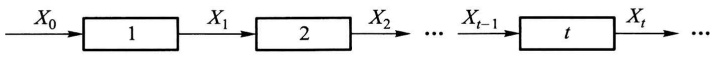
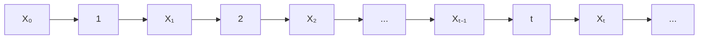
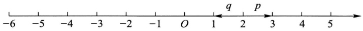
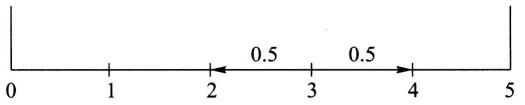
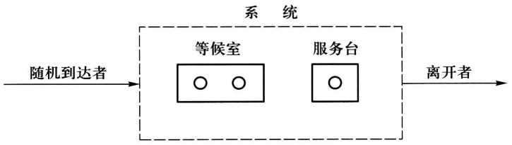

# 第十三章 马尔可夫链

原始 PDF 第 338–351 页。

## 第十三章 马尔可夫链

有些随机过程的特殊性质可以帮助我们更方便地刻画它们. 具有无记忆性的离散参数随机过程传统上称为马尔可夫链, 这类模型得名于早年就对其进行研究的俄国数学家马尔可夫. 马尔可夫链是独立随机试验模型的最直接推广, 它在近代物理学、生物学、管理科学、经济学、信息处理以及数字计算方法等领域有广泛的应用.

## § 1 定义与例子

定义(马尔可夫链) 状态空间为有限集或可列集的随机过程 $\{X_{t}, t=0,1,\cdots\}$ ，若对于任何一列状态 $i_{0}, i_{1}, \cdots, i_{t-1}, i, j, X_{t}$ 满足性质

$$
P \{X _ {t + 1} = j \mid X _ {0} = i _ {0}, \dots , X _ {t - 1} = i _ {t - 1}, X _ {t} = i \} = P \{X _ {t + 1} = j \mid X _ {t} = i \}, \tag {1.1}
$$

则称 $X_{t}$ 为马尔可夫链，简称马氏链.

性质(1.1)称为马尔可夫链的马尔可夫性,简称马氏性.如果将(1.1)式中的时间参数 t 看成是现在时刻,那么  $0,1,\cdots,t-1$  就表示过去时刻, $t+1$  表示将来时刻,则马尔可夫性可以直观解释为:若已知随机过程  $X_{t}$  现在所处的状态,则过程将来处于哪个状态的概率与过程过去曾经经历过的状态是无关的.因此,马氏性也称为无记忆性,或称无后效性.(1.1)式中的条件概率  $P\{X_{t+1}=j|X_{t}=i\}$  表示马氏链  $X_{t}$  在时刻 t 从状态 i 经过一步转移到状态 j 的概率.我们有以下定义:

定义(一步转移概率) 条件概率  $P\{X_{t+1}=j \mid X_{t}=i\}$  称为马尔可夫链  $\{X_{t}, t=0,1,\cdots\}$  在 t 时刻从 i 到 j 的一步转移概率. 当这一概率与 t 无关时我们称该马尔可夫链具有平稳转移概率, 并记为  $p_{ij}$ .

我们将主要讨论具有平稳转移概率的马尔可夫链，它也称作时间齐性马尔可夫链或简称时齐马尔可夫链。由于概率是非负的，而且过程从一个状态 $i$ 出发总要转移到某状态 $j$ 中去（这是必然事件），所以，对任意状态 $i, j, p_{ij} \geqslant 0$ 且

$$
\sum_ {j = 0} ^ {\infty} p _ {i j} = 1. \tag {1.2}
$$

通常把一步转移概率排成一个无穷维的方阵，记作

---

· 324 ·

第十三章 马尔可夫链

$$
\boldsymbol {P} = \left[ \begin{array}{c c c c c} p _ {0 0} & p _ {0 1} & \dots & p _ {0 j} & \dots \\ p _ {1 0} & p _ {1 1} & \dots & p _ {1 j} & \dots \\ \vdots & \vdots & & \vdots \\ p _ {i 0} & p _ {i 1} & \dots & p _ {i j} & \dots \\ \vdots & \vdots & & \vdots \end{array} \right], \tag {1.3}
$$

并称为时齐马尔可夫链的转移概率矩阵. 当状态空间为有限集时, $P$ 就是有限阶矩阵, 其阶数与状态空间中的状态数相同.

例 1(0-1 传输系统) 考虑如图 13-1 所示的只传输数字 0 和 1 的 t 级串联系统. 对每一级来说输出与输入具有相同的概率, 这一概率称为传真率, 相反的概率称为误码率. 设每一级的传真率均为 p, 误码率为 q=1-p. 并设一个单位时间传输一级,  $X_{0}$  是第一级的输入,  $X_{t}$  是第 t 级的输出. 那么  $X_{t}$  是一个状态空间为  $\{0,1\}$  的随机过程, 而且每一级的输出只与输入有关, 它是一个时齐马尔可夫链. 它的一步转移概率和一步转移概率矩阵分别为

$$
p _ {i j} = P \{X _ {n + 1} = j   |   X _ {n} = i \} = \left\{ \begin{array}{l l} p, & j = i, \\ q, & j \neq i, \end{array} \right. i, j \in \{0, 1 \},
$$

和

$$
\boldsymbol {P} = \left[ \begin{array}{l l} p & q \\ q & p \end{array} \right]. \tag {1.4}
$$



<details>
<summary>flowchart</summary>


</details>

图13-1

例2（直线上的随机游动）考虑在直线整数点上运动的粒子.设其向右及向左游动的概率分别为 $p$ 和 $q$ （如图13-2），并假定在初始时刻 $t = 0$ 时粒子处于原点，即 $X_0 = 0$ ，于是粒子在时刻 $t$ 所处的位置 $X_{t}$ 就是一个时齐马尔可夫链，其一步转移概率为 $p_{i(i + 1)} = p, p_{i(i - 1)} = q, p_{ii} = 1 - p - q.$ 当 $|i - j| > 1$ 时，$p_{ij} = 0$.



<details>
<summary>text_image</summary>

-6 -5 -4 -3 -2 -1 O 1 2 3 4 5
q p
</details>

图13-2

例3（有吸收壁的随机游动）在上例中如 $p = q = 0.5, X_{t}$ 就是对称随机游动，它可以用作公平赌博的模型。比如赌徒甲、乙用出现正反面概率都是0.5的钱币玩扔币游戏，每次的输赢为一元，用 $X_{t}$ 代表甲方在 $t$ 次扔币后所赢的钱数。假如甲方有赌本3，乙方有赌本2，则甲所感兴趣的问题是在自己输光之前乙输

---

§ 1 定义与例子

· 325 ·

光的可能性有多大. 这就是著名的赌徒输光问题. 注意这里 $X_{t}$ 一旦达到0（甲方输光）或达到5（乙方输光）就不再游动. 这个模型称为有吸收壁的随机游动（如图13-3）.



<details>
<summary>line</summary>

| Interval | Value |
| --- | --- |
| 2~4 | 0.5 |
</details>

图13-3

由上例可知当 $i, j \neq 0, 5$ 时，$p_{i(i+1)} = p_{i(i-1)} = 0.5$，当 $|i - j| \neq 1$ 时，$p_{ij} = 0$。$i = 0$ 或 $i = 5$ 对应甲方或乙方输光，从而 $X_t$ 不再游动。因此 $p_{00} = 1, p_{55} = 1$。再由(1.2)式知当 $i \neq 0$ 时，$p_{0i} = 0$，当 $i \neq 5$ 时，$p_{5i} = 0$。于是 $X_t$ 的一步转移概率矩阵为

$$
\boldsymbol {P} = \left[ \begin{array}{c c c c c c} 1 & 0 & 0 & 0 & 0 & 0 \\ 0. 5 & 0 & 0. 5 & 0 & 0 & 0 \\ 0 & 0. 5 & 0 & 0. 5 & 0 & 0 \\ 0 & 0 & 0. 5 & 0 & 0. 5 & 0 \\ 0 & 0 & 0 & 0. 5 & 0 & 0. 5 \\ 0 & 0 & 0 & 0 & 0 & 1 \end{array} \right]. \tag {1.5}
$$

例4（排队模型）设服务系统由一个服务员和只可容纳两个人的等候室组成(图13-4).规则是先到先服务，后来者需在等候室依次排队.如系统内已有三个顾客(一个正在接受服务，两个在等候室里排队)，再到来的顾客就会离开.设时间间隔 $\Delta t$ 内有一个顾客进入系统的概率为 $q$ ，如有顾客在服务中则其被服务完毕离开系统的概率为 $p$ .又设在这个时间区间里不可能有多于一个顾客进入或离开系统.再设有无顾客来到与服务是否完毕是相互独立的.



<details>
<summary>flowchart</summary>

```mermaid
graph LR
  A["随机到达者"] --> B{"系统"}
  subgraph B
    C["等候室"]
    D["服务台"]
  end
  B --> E["离开者"]
  E --> F[""]
```
</details>

图13-4

用 $X_{t}$ 表示时间区间 $((t - 1)\Delta t, t\Delta t]$ 中系统内的顾客数. 则 $X_{t}$ 为一时齐马尔可夫链，其状态空间为 $\{0,1,2,3\}$. 下面来计算其一步转移概率.

由 $q$ 的定义可见 $p_{00} = 1 - q, p_{01} = q$. 由于不能有两个以上顾客进出系统，当 $|i - j| > 1$ 时，$p_{ij} = 0$. 稍加思考我们可以看到 $p_{10} = p_{21} = p_{32}$，因为它们都代表系

---

· 326 ·

第十三章 马尔可夫链

统中有一个顾客接受服务后离开并且没有新顾客进入系统，这个概率为 $p(1 - q)$。类似地 $p_{23} = p_{12} = q(1 - p)$。较为复杂的是 $p_{11} = p_{22}$。有两种情况可以维持系统中人数不变:（1）正在接受服务的顾客没有离开，并且没有新顾客进入系统。（2）当前接受服务的顾客结束服务离开，并有一个新顾客进入系统，于是总概率为 $pq + (1 - p)(1 - q)$。一步转移概率 $p_{33}$ 稍有不同，因为系统中已有3个顾客，所以当无顾客离开系统时不能有新顾客进入，$p_{33} = pq + (1 - p)$。综合起来该系统的一步转移概率矩阵为

$$
\boldsymbol {P} = \left[ \begin{array}{c c c c} 1 - q & q & 0 & 0 \\ p (1 - q) & p q + (1 - p) (1 - q) & q (1 - p) & 0 \\ 0 & p (1 - q) & p q + (1 - p) (1 - q) & q (1 - p) \\ 0 & 0 & p (1 - q) & p q + (1 - p) \end{array} \right]. \tag {1.6}
$$

□

在实际问题中一步转移概率可通过统计试验确定. 下面看一实例:

例 5(估计一步转移概率) 某计算机机房的一台计算机经常出故障. 研究者每隔 15 min 观察一次计算机的运行状态, 收集了 24 h 的数据 (共作 97 次观察). 用 1 表示正常状态, 用 0 表示不正常状态, 所得的数据序列如下:

$$
\begin{array}{l} 1 1 1 0 0 1 0 0 1 1 1 1 1 1 1 0 0 1 1 1 1 0 1 1 1 1 1 1 0 0 1 1 1 1 1 1 1 1 1 0 0 0 1 1 0 1 1 0 1 \\ 1 1 1 0 1 1 0 1 1 0 1 0 1 1 1 1 0 1 1 1 0 1 1 1 1 0 1 1 1 1 1 0 0 1 1 0 1 1 1 1 1 1 0 0 1 1 1 \\ \end{array}
$$

设 $X_{t}$ 为第 $t(t = 1,2,\dots ,97)$ 个时段的计算机状态，可以认为它是一个时齐马尔可夫链，状态空间 $I = \{0,1\}$ .数据给出96次状态转移的情况是

$0 \to 0,8$ 次； $0 \to 1,18$ 次； $1 \to 0,18$ 次； $1 \to 1,52$ 次.

因此一步转移概率可用频率近似地表示为

$$
\begin{array}{l} p _ {0 0} = P \{X _ {t + 1} = 0 \mid X _ {t} = 0 \} \approx \frac {8}{8 + 1 8} = \frac {8}{2 6}, \\ p _ {0 1} = P \{X _ {t + 1} = 1 \mid X _ {t} = 0 \} \approx \frac {1 8}{8 + 1 8} = \frac {1 8}{2 6}, \tag {1.7} \\ p _ {1 0} = P \{X _ {t + 1} = 0 \mid X _ {t} = 1 \} \approx \frac {1 8}{1 8 + 5 2} = \frac {1 8}{7 0}, \\ p _ {1 1} = P \{X _ {t + 1} = 1 \mid X _ {t} = 1 \} \approx \frac {5 2}{1 8 + 5 2} = \frac {5 2}{7 0}. \\ \end{array}
$$

例6(续例5) 如果已知计算机在某一时段 $(15\mathrm{min})$ 的状态为0.问接下来计算机能连续工作 $45\mathrm{min}$ (3个时段)的概率有多大？

解 把已知状态为 0 的时段作为初始时段, 则所要求的概率为 $P\{X_1 = 1, X_2 = 1, X_3 = 1 \mid X_0 = 0\}$. 由乘法公式、马尔可夫性和时齐性可以算出

---

§ 2 多步转移概率的确定

· 327 ·

$$
\begin{array}{l} P \left\{X _ {1} = 1, X _ {2} = 1, X _ {3} = 1 \mid X _ {0} = 0 \right\} \\ = P \left\{X _ {1} = 1 \mid X _ {0} = 0 \right\} P \left\{X _ {2} = 1 \mid X _ {1} = 1 \right\} P \left\{X _ {3} = 1 \mid X _ {2} = 1 \right\} \\ = p _ {0 1} p _ {1 1} p _ {1 1} = \frac {1 8}{2 6} \cdot \frac {5 2}{7 0} \cdot \frac {5 2}{7 0} = 0. 3 8 2. \\ \end{array}
$$

## § 2 多步转移概率的确定

例1 在 §1 例5中如果设初始时段的状态为0, 我们想知道 $15\mathrm{min}$ 到 $30\mathrm{min}$ 的时间段里计算机正常工作的概率, 则需要计算 $P\{X_2 = 1 \mid X_0 = 0\}$. 这是一个两步转移概率, 它的计算需要考虑中间项 $X_1$ 的状态. 当 $X_0 = 0$ 时, $X_1$ 有两种可能, $X_1 = 0$ 或 $X_1 = 1$. 因此计算 $P\{X_2 = 1 \mid X_0 = 0\}$ 必须考虑这两条不同的路径, 从而

$$
\begin{array}{l} P \left\{X _ {2} = 1 \mid X _ {0} = 0 \right\} \\ = P \left\{X _ {2} = 1 \mid X _ {1} = 1 \right\} P \left\{X _ {1} = 1 \mid X _ {0} = 0 \right\} + P \left\{X _ {2} = 1 \mid X _ {1} = 0 \right\} P \left\{X _ {1} = 0 \mid X _ {0} = 0 \right\} \\ = p _ {0 1} p _ {1 1} + p _ {0 0} p _ {0 1} = \frac {1 8}{2 6} \cdot \frac {5 2}{7 0} + \frac {8}{2 6} \cdot \frac {1 8}{2 6} = 0. 7 2 7. \\ \end{array}
$$

上例中涉及的多步转移概率也出现在许多其他问题中. 我们先给出下述定义:

定义(n 步转移概率) 设  $\{X_{t}, t=0,1,\cdots\}$  为马尔可夫链, 条件概率

$$
p _ {i j} (t, t + n) = P \{X _ {t + n} = j   |   X _ {t} = i \}
$$

称为马尔可夫链 $X_{t}$ 在时刻 $t$ 处于状态 $i$ 的条件下经过 $n$ 步转移到达状态 $j$ 的转移概率.

若 $X_{t}$ 为时齐的，则 $p_{ij}(t,t + n)$ 与 $t$ 无关！将 $p_{ij}(t,t + n)$ 记作 $p_{ij}(n)$，相应的 $n$ 步转移概率矩阵 $(p_{ij}(n))$ 记作 $\mathbf{P}(n)$.

对于时齐马尔可夫链,上例中的方法同样可以用来计算多步转移概率.这就是著名的科尔莫戈罗夫一切普曼(Kolmogorov-Chapman)方程

$$
p _ {i j} (n + m) = \sum_ {k = 0} ^ {\infty} p _ {i k} (n) p _ {k j} (m), \quad i, j = 0, 1, 2, \dots , \tag {2.1}
$$

写成矩阵形式就是

$$
\boldsymbol {P} (n + m) = \boldsymbol {P} (n) \boldsymbol {P} (m). \tag {2.2}
$$

由此递推可见

$$
\boldsymbol {P} (n) = \boldsymbol {P} \boldsymbol {P} (n - 1) = \boldsymbol {P} ^ {n}. \tag {2.3}
$$

也就是说时齐马尔可夫链的 $n$ 步转移概率矩阵是一步转移概率矩阵的 $n$ 次方.

接着,我们来研究马尔可夫链的有限维分布.设 I 为自然数的一个集合,它

---

· 328 ·

第十三章 马尔可夫链

表示马尔可夫链  $X_{t}, t=0,1,\cdots$  的状态空间. 记

$$
p _ {j} (0) = P \{X _ {0} = j \}, \quad j \in I,
$$

称它为 $X_{t}$ 的初始分布. 再看 $X_{t}$ 在任一时刻 $n$ 的一维分布

$$
p _ {j} (n) = P \{X _ {n} = j \}, \quad j \in I. \tag {2.4}
$$

显然,作为概率分布  $\sum_{j=0}^{\infty}p_{j}(n)=1$ . 又有

$$
P \{X _ {n} = j \} = \sum_ {i = 1} ^ {\infty} P \{X _ {n} = j \mid X _ {0} = i \} P \{X _ {0} = i \},
$$

或

$$
p _ {j} (n) = \sum_ {i = 0} ^ {\infty} p _ {i} (0) p _ {i j} (n). \tag {2.5}
$$

如果我们用行向量

$$
\boldsymbol {p} (n) = \left(p _ {0} (n), p _ {1} (n), \dots , p _ {j} (n), \dots\right) \tag {2.6}
$$

来表示 $X_{t}$ 在时刻 $n$ 的一维分布，利用矩阵乘法（$I$ 是可列无限集时，仍用有限阶矩阵乘法的规则确定矩阵之积的元素），可以把(2.5)式写作

$$
\boldsymbol {p} (n) = \boldsymbol {p} (0) \boldsymbol {P} (n). \tag {2.7}
$$

换句话说,时齐马尔可夫链 $X_{t}$ 在任一时刻 $n$ 的一维分布由它的初始分布和 $n$ 步转移概率矩阵所确定.

对于任意 m 个时刻  $t_{1}, t_{2}, \cdots, t_{m}$  以及状态  $n_{1}, n_{2}, \cdots, n_{m} \in I$ ，时齐马尔可夫链  $X_{t}$  的 m 维分布为

$$
\begin{array}{l} P \left\{X _ {t _ {1}} = n _ {1}, X _ {t _ {2}} = n _ {2}, \dots , X _ {t _ {m}} = n _ {m} \right\} \\ = P \left\{X _ {t _ {1}} = n _ {1} \right\} P \left\{X _ {t _ {2}} = n _ {2} \mid X _ {t _ {1}} = n _ {1} \right\} \dots P \left\{X _ {t _ {m}} = n _ {m} \mid X _ {t _ {m - 1}} = n _ {m - 1} \right\} \\ = p _ {n _ {1}} (t _ {1}) p _ {n _ {1} n _ {2}} (t _ {2} - t _ {1}) \dots p _ {n _ {m - 1} n _ {m}} (t _ {m} - t _ {m - 1}). \tag {2.8} \\ \end{array}
$$

结合(2.5)和(2.8)式可知:时齐马尔可夫链的有限维分布同样地完全由初始分布和转移概率矩阵所确定.总之,转移概率矩阵决定了马尔可夫链的统计规律.

例2 设 $X_{n}$ 是具有三个状态 $\{0,1,2\}$ 的时齐马尔可夫链，其一步转移概率矩阵为

$$
\boldsymbol {P} = \left[ \begin{array}{c c c} 3 / 4 & 1 / 4 & 0 \\ 1 / 4 & 1 / 2 & 1 / 4 \\ 0 & 3 / 4 & 1 / 4 \end{array} \right], \tag {2.9}
$$

初始分布为  $p_{i}(0)=P\{X_{0}=i\}=1/3,i=0,1,2.$  试求(1)  $P\{X_{0}=0,X_{2}=1\}.$ 
(2)  $P\{X_{2}=1\}.$

解 这里关键是二步转移概率矩阵

---

§ 2 多步转移概率的确定

· 329 ·

$$
\boldsymbol {P} (2) = \boldsymbol {P} ^ {2} = \left[ \begin{array}{c c c} 5 / 8 & 5 / 1 6 & 1 / 1 6 \\ 5 / 1 6 & 1 / 2 & 3 / 1 6 \\ 3 / 1 6 & 9 / 1 6 & 1 / 4 \end{array} \right]. \tag {2.10}
$$

利用 $P(2)$ 容易算出:

(1) $P\{X_0 = 0,X_2 = 1\} = P\{X_0 = 0\} P\{X_2 = 1|X_0 = 0\}$

$$
= p _ {0} (0) p _ {0 1} (2) = \frac {1}{3} \cdot \frac {5}{1 6} = \frac {5}{4 8}.
$$

(2)

$$
P \left\{X _ {2} = 1 \right\} = p _ {0} (0) p _ {0 1} (2) + p _ {1} (0) p _ {1 1} (2) + p _ {2} (0) p _ {2 1} (2)
$$

$$
= \frac {1}{3} \left(\frac {5}{1 6} + \frac {1}{2} + \frac {9}{1 6}\right) = \frac {1 1}{2 4}.
$$

例3 在 §1 例1中,(1)设 $p = 0.9$, 求系统经二级传输后的传真率与三级传输后的误码率.(2)设初始分布 $p_1(0) = P\{X_0 = 1\} = \alpha, p_0(0) = P\{X_0 = 0\} = 1 - \alpha$. 又已知系统经 $n$ 级传输后输出为1, 问原发字符也是1的概率是多少?

解 回答这些问题的关键是计算 $n$ 步转移概率矩阵 $\pmb{P}(n) = \pmb{P}^n$. 由于

$$
\boldsymbol {P} = \left[ \begin{array}{l l} p & q \\ q & p \end{array} \right] \quad (q = 1 - p)
$$

有相异的特征值 $\lambda_1 = 1, \lambda_2 = p - q$，由线性代数知识，$P$ 与对角矩阵

$$
\boldsymbol {D} = \left[ \begin{array}{c c} \lambda_ {1} & 0 \\ 0 & \lambda_ {2} \end{array} \right] = \left[ \begin{array}{c c} 1 & 0 \\ 0 & p - q \end{array} \right]
$$

相似. 求出对应的特征向量

$$
\boldsymbol {v} _ {1} = \left[ \begin{array}{c} 1 / \sqrt {2} \\ 1 / \sqrt {2} \end{array} \right], \quad \boldsymbol {v} _ {2} = \left[ \begin{array}{c} - 1 / \sqrt {2} \\ 1 / \sqrt {2} \end{array} \right].
$$

再令

$$
\boldsymbol {H} = [ \boldsymbol {v} _ {1}, \boldsymbol {v} _ {2} ] = \left[ \begin{array}{c c} 1 / \sqrt {2} & - 1 / \sqrt {2} \\ 1 / \sqrt {2} & 1 / \sqrt {2} \end{array} \right],
$$

则 $P = HDH^{-1}$. 于是, 容易算出

$$
\begin{array}{l} \boldsymbol {P} ^ {n} = (\boldsymbol {H} \boldsymbol {D} \boldsymbol {H} ^ {- 1}) ^ {n} = \boldsymbol {H} \boldsymbol {D} ^ {n} \boldsymbol {H} ^ {- 1} \\ = \left[ \begin{array}{l l} \frac {1}{2} + \frac {1}{2} (p - q) ^ {n} & \frac {1}{2} - \frac {1}{2} (p - q) ^ {n} \\ \frac {1}{2} - \frac {1}{2} (p - q) ^ {n} & \frac {1}{2} + \frac {1}{2} (p - q) ^ {n} \end{array} \right]. \tag {2.11} \\ \end{array}
$$

（1）由(2.11)式可知，当 $p = 0.9$ 时，系统经二级传输后的传真率与三级传输后的误码率分别为

---

· 330 ·

第十三章 马尔可夫链

$$
p _ {1 1} (2) = p _ {0 0} (2) = \frac {1}{2} + \frac {1}{2} (0. 9 - 0. 1) ^ {2} = 0. 8 2 0,
$$

$$
p _ {1 0} (3) = p _ {0 1} (3) = \frac {1}{2} - \frac {1}{2} (0. 9 - 0. 1) ^ {3} = 0. 2 4 4.
$$

（2）根据贝叶斯公式，当已知系统经 $n$ 级传输后输出为1时，原发字符也是1的概率为

$$
\begin{array}{l} P \left\{X _ {0} = 1 \mid X _ {n} = 1 \right\} = \frac {P \left\{X _ {0} = 1 \right\} P \left\{X _ {n} = 1 \mid X _ {0} = 1 \right\}}{P \left\{X _ {n} = 1 \right\}} \\ = \frac {p _ {1} (0) p _ {1 1} (n)}{p _ {0} (0) p _ {0 1} (n) + p _ {1} (0) p _ {1 1} (n)} \\ = \frac {\alpha + \alpha (p - q) ^ {n}}{1 + (2 \alpha - 1) (p - q) ^ {n}}. \\ \end{array}
$$

## § 3 遍 历 性

上两小节我们从一步转移概率开始进而讨论了多步转移概率. 一个很自然想到的问题是当步数趋向无穷时转移概率会如何变化. 先看一个简单的例子.

例 1(两个状态的马尔可夫链) 对于一般的两个状态的马尔可夫链,一步转移概率矩阵为

$$
\boldsymbol {P} = \left[ \begin{array}{c c} 1 - a & a \\ b & 1 - b \end{array} \right] \quad (0 <   a, b <   1).
$$

和 §2 例 3 类似, 可以算出 $n$ 步转移概率矩阵为

$$
\boldsymbol {P} (n) = \boldsymbol {P} ^ {n} = \left[ \begin{array}{l l} p _ {0 0} (n) & p _ {0 1} (n) \\ p _ {1 0} (n) & p _ {1 1} (n) \end{array} \right] \tag {3.1}
$$

$$
= \frac {1}{a + b} \left[ \begin{array}{l l} b & a \\ b & a \end{array} \right] + \frac {(1 - a - b) ^ {n}}{a + b} \left[ \begin{array}{c c} a & - a \\ - b & b \end{array} \right], \quad n = 1, 2, \dots .
$$

于是 $n$ 步转移概率具有极限

$$
\lim _ {n \rightarrow \infty} p _ {0 0} (n) = \lim _ {n \rightarrow \infty} p _ {1 0} (n) = \frac {b}{a + b} \text {记成} \pi_ {0},
$$

$$
\lim _ {n \rightarrow \infty} p _ {0 1} (n) = \lim _ {n \rightarrow \infty} p _ {1 1} (n) = \frac {a}{a + b} \stackrel {\text {记成}} {=} \pi_ {1}.
$$

上述极限的意义是:对于固定的状态 j, 不管链在某一时刻从什么状态出发, 通过长时间转移, 到达状态 j 的概率都趋近于  $\pi_{j}$ , 这就是所谓的遍历性. 又由于  $\pi_{0} + \pi_{1} = 1$ , 所以行向量  $(\pi_{0}, \pi_{1}) = \pi$  构成一分布律, 称为该链的极限分布. 另外, 如果我们能用其他简便的方法直接求得极限分布  $\pi$ , 则反过来, 当  $n \gg 1$  时,

---

§ 3 遍 历 性

· 331 ·

就可得到 $n$ 步转移概率的近似值 $p_{ij}(n) \approx \pi_j$.

定义(遍历性) 设时齐马尔可夫链的状态空间为 $I$, 若对于所有 $i, j \in I$, 转移概率 $p_{ij}(n)$ 存在极限

$$
\pi_ {j} = \lim _ {n \to \infty} p _ {i j} (n),
$$

则称此链具有遍历性. 又若  $\sum_{j}\pi_{j}=1$  , 则同时称行向量  $\boldsymbol{\pi}=(\pi_{0},\pi_{1},\cdots)$  为该链的极限分布.

时齐马尔可夫链在什么条件下才具有遍历性？如何求出它的极限分布？这些问题在理论上已经圆满解决，但详述这一理论需要较多篇幅。下面仅就只有有限个状态的链，即有限链的遍历性给出一个充分条件。

定理(遍历性的充分条件) 设时齐马尔可夫链 $\{X_{t}, t \geqslant 0\}$ 的状态空间为 $I = \{0, 1, 2, \cdots, N\}$, P 是它的一步转移概率矩阵, 如果存在正整数 m, 使对任意 $i, j \in I$, 都有

$$
p _ {i j} (m) > 0, \quad i, j \in I, \tag {3.2}
$$

则此链具有遍历性. 而且其极限分布  $\boldsymbol{\pi}=(\pi_{0},\pi_{1},\cdots,\pi_{N})$  是矩阵方程

$$
\pi = \pi P \tag {3.3}
$$

或即

$$
\pi_ {j} = \sum_ {i = 0} ^ {N} \pi_ {i} p _ {i j}, \quad j = 0, 1, 2, \dots , N \tag {3.4}
$$

的满足条件

$$
\pi_ {j} > 0, \sum_ {j = 0} ^ {N} \pi_ {j} = 1 \tag {3.5}
$$

的唯一解.

证明略.

依照定理,为证明有限链是遍历的,只需找到正整数 m,使得 m 步转移概率矩阵  $P^{m}$  无零元.而求极限分布  $\pi$  的问题,则归结为求解(3.3)和(3.5).

在上述定理的条件下,马尔可夫链的极限分布同时也是它的平稳分布.也就是说,若用  $\pi$  作为链的初始分布,即  $\boldsymbol{p}(0)=\boldsymbol{\pi}$ , 则该链在任一时刻 t 的分布  $\boldsymbol{p}(t)$  永远与  $\pi$  一致. 这是因为由(3.3)式,有

$$
\boldsymbol {p} (t) = \boldsymbol {p} (0) \boldsymbol {P} (t) = \pi \boldsymbol {P} ^ {t} = \pi \boldsymbol {P} ^ {t - 1} = \dots = \pi \boldsymbol {P} = \pi .
$$

例2 我们来说明带有两个反射壁的随机游动是遍历的，并求其极限分布（平稳分布）。有两个反射壁的随机游动类似 §1 例3，见图13-3。差别在于当 $X_{t}$ 到达反射壁0或5时停留或被反射的概率各为 $1 / 2$ 。于是 $X_{t}$ 的一步转移概率矩阵为

---

· 332 ·

第十三章 马尔可夫链

$$
\boldsymbol {P} = \left[ \begin{array}{c c c c c c} 0. 5 & 0. 5 & 0 & 0 & 0 & 0 \\ 0. 5 & 0 & 0. 5 & 0 & 0 & 0 \\ 0 & 0. 5 & 0 & 0. 5 & 0 & 0 \\ 0 & 0 & 0. 5 & 0 & 0. 5 & 0 \\ 0 & 0 & 0 & 0. 5 & 0 & 0. 5 \\ 0 & 0 & 0 & 0 & 0. 5 & 0. 5 \end{array} \right]. \tag {3.6}
$$

为简便计,以符号×来代表转移概率矩阵的正元素.于是由上面的一步转移概率矩阵 P 得

$$
\boldsymbol {P} (2) = \boldsymbol {P} ^ {2} = \left[ \begin{array}{c c c c c c} \times & \times & 0 & 0 & 0 & 0 \\ \times & 0 & \times & 0 & 0 & 0 \\ 0 & \times & 0 & \times & 0 & 0 \\ 0 & 0 & \times & 0 & \times & 0 \\ 0 & 0 & 0 & \times & 0 & \times \\ 0 & 0 & 0 & 0 & \times & \times \end{array} \right] \left[ \begin{array}{c c c c c c} \times & \times & 0 & 0 & 0 & 0 \\ \times & 0 & \times & 0 & 0 & 0 \\ 0 & \times & 0 & \times & 0 & 0 \\ 0 & 0 & \times & 0 & \times & 0 \\ 0 & 0 & 0 & \times & \times & \times \\ 0 & 0 & 0 & 0 & \times & \times \end{array} \right]
$$

$$
= \left[ \begin{array}{c c c c c c} \times & \times & \times & 0 & 0 & 0 \\ \times & \times & 0 & \times & 0 & 0 \\ \times & 0 & \times & 0 & \times & 0 \\ 0 & \times & 0 & \times & 0 & \times \\ 0 & 0 & \times & 0 & \times & \times \\ 0 & 0 & 0 & \times & \times & \times \end{array} \right],
$$

$$
\begin{array}{l} \boldsymbol {P} (4) = \boldsymbol {P} (2) \boldsymbol {P} (2) = \left[ \begin{array}{c c c c c c} \times & \times & \times & 0 & 0 & 0 \\ \times & \times & 0 & \times & 0 & 0 \\ \times & 0 & \times & 0 & \times & 0 \\ 0 & \times & 0 & \times & 0 & \times \\ 0 & 0 & \times & 0 & \times & \times \\ 0 & 0 & 0 & \times & \times & \times \end{array} \right] \left[ \begin{array}{c c c c c c} \times & \times & \times & 0 & 0 & 0 \\ \times & \times & 0 & \times & 0 & 0 \\ \times & 0 & \times & 0 & \times & 0 \\ 0 & \times & 0 & \times & 0 & \times \\ 0 & 0 & \times & 0 & {\times} & \times \\ 0 & 0 & 0 & \times & \times & \times \end{array} \right] \\ = \left[ \begin{array}{c c c c c c} \times & \times & \times & \times & \times & 0 \\ \times & \times & \times & \times & 0 & \times \\ \times & \times & \times & 0 & \times & \times \\ \times & \times & 0 & \times & \times & \times \\ \times & 0 & \times & \times & \times & \times \\ 0 & \times & \times & \times & \times & \times \end{array} \right], \\ \end{array}
$$

---

§ 3 遍 历 性

· 333 ·

$$
\begin{array}{l} \boldsymbol {P} (5) = \boldsymbol {P} (4) \boldsymbol {P} = \left[ \begin{array}{c c c c c c} \times & \times & \times & \times & \times & 0 \\ \times & \times & \times & \times & 0 & \times \\ \times & \times & \times & 0 & \times & \times \\ \times & \times & 0 & \times & \times & \times \\ \times & 0 & \times & \times & \times & \times \\ 0 & \times & \times & \times & \times & \times \end{array} \right] \left[ \begin{array}{c c c c c c} \times & \times & 0 & 0 & 0 & 0 \\ \times & 0 & \times & 0 & 0 & 0 \\ 0 & \times & 0 & \times & 0 & 0 \\ 0 & 0 & \times & 0 & \times & 0 \\ 0 & 0 & 0 & \times & 0 & \times \\ 0 & 0 & 0 & 0 & \times & \times \end{array} \right] \\ = \left[ \begin{array}{c c c c c c} \times & \times & \times & \times & \times & \times \\ \times & \times & \times & \times & \times & \times \\ \times & \times & \times & \times & \times & \times \\ \times & \times & \times & \times & \times & \times \\ \times & \times & \times & \times & \times & \times \\ \times & \times & \times & \times & \times & \times \end{array} \right], \\ \end{array}
$$

即 $P(5)$ 无零元. 由上述定理可知带有两个反射壁的随机游动是遍历的. 再根据 (3.3) 和 (3.5) 式, 写出极限分布 $\pi = (\pi_0, \pi_1, \pi_2, \dots, \pi_5)$ 满足的方程组

$$
\begin{array}{l} \pi_ {0} = 0. 5 (\pi_ {0} + \pi_ {1}), \\ \pi_ {1} = 0. 5 \left(\pi_ {0} + \pi_ {2}\right), \\ \pi_ {2} = 0. 5 \left(\pi_ {1} + \pi_ {3}\right), \\ \pi_ {3} = 0. 5 \left(\pi_ {2} + \pi_ {4}\right), \\ \pi_ {4} = 0. 5 (\pi_ {3} + \pi_ {5}), \\ \pi_ {5} = 0. 5 (\pi_ {4} + \pi_ {5}), \\ 1 = \pi_ {0} + \pi_ {1} + \pi_ {2} + \pi_ {3} + \pi_ {4} + \pi_ {5}. \\ \end{array}
$$

先由前6个方程解得 $\pi_0 = \pi_1 = \pi_2 = \pi_3 = \pi_4 = \pi_5$ .将它们代入归一条件（即最后一个方程），得极限分布为 $\pi = (1 / 6,1 / 6,1 / 6,1 / 6,1 / 6,1 / 6)$ □

例3 再来研究 §1 例4中排队模型的遍历性. 由(1.6)式给出的一步转移概率矩阵 $\pmb{P}$ 可算得 $P(3) = P^3$ 无零元. 由本节定理知排队模型是遍历的. 其极限分布 $\pi = (\pi_0, \pi_1, \pi_2, \pi_3)$ 满足方程组

$$
\left\{ \begin{array}{l} \pi_ {0} = (1 - q) \pi_ {0} + p (1 - q) \pi_ {1}, \\ \pi_ {1} = q \pi_ {0} + [ p q + (1 - p) (1 - q) ] \pi_ {1} + p (1 - q) \pi_ {2}, \\ \pi_ {2} = q (1 - p) \pi_ {1} + [ p q + (1 - p) (1 - q) ] \pi_ {2} + p (1 - q) \pi_ {3}, \\ \pi_ {3} = q (1 - p) \pi_ {2} + [ p q + (1 - p) ] \pi_ {3}, \\ \pi_ {0} + \pi_ {1} + \pi_ {2} + \pi_ {3} = 1. \end{array} \right.
$$

解之,得唯一解

$$
\begin{array}{l} \pi_ {0} = p ^ {3} (1 - q) ^ {3} / C, \quad \pi_ {1} = p ^ {2} q (1 - q) ^ {2} / C, \\ \pi_ {2} = p q ^ {2} (1 - q) (1 - p) / C, \quad \pi_ {3} = q ^ {3} (1 - p) ^ {2} / C, \\ \end{array}
$$

---

· 334 ·

第十三章 马尔可夫链

其中 $C = p^3 (1 - q)^3 +p^2 q(1 - q)^2 +pq^2 (1 - q)(1 - p) + q^3 (1 - p)^2.$

假若此例中，$p = q = 1 / 2$，则可算得极限分布 $\pi = (1 / 7, 2 / 7, 2 / 7, 2 / 7)$. 这告诉我们经过相当长一段时间后，系统中无人的情形约占 $14\%$ 的时间，而系统中有一人、二人、三人的情形约各占 $29\%$ 的时间.

例 4(无遍历性) 并非所有马尔可夫链都具有遍历性. 设一马尔可夫链的一步转移概率矩阵为

$$
\boldsymbol {P} = \left[ \begin{array}{c c c c} 0 & 1 / 2 & 0 & 1 / 2 \\ 1 / 2 & 0 & 1 / 2 & 0 \\ 0 & 1 / 2 & 0 & 1 / 2 \\ 1 / 2 & 0 & 1 / 2 & 0 \end{array} \right],
$$

试讨论它的遍历性.

解 容易算得

$$
\boldsymbol {P} (2) = \boldsymbol {P} ^ {2} = \left[ \begin{array}{c c c c} 1 / 2 & 0 & 1 / 2 & 0 \\ 0 & 1 / 2 & 0 & 1 / 2 \\ 1 / 2 & 0 & 1 / 2 & 0 \\ 0 & 1 / 2 & 0 & 1 / 2 \end{array} \right].
$$

进一步可以验证: 当 n 为奇数时,  $\boldsymbol{P}(n)=\boldsymbol{P}(1)=\boldsymbol{P}; n$  为偶数时,  $\boldsymbol{P}(n)=\boldsymbol{P}(2)$ . 这表明对任一固定的 j=1,2,3,4, 极限  $\lim_{n\to\infty}p_{ij}(n)$  都不存在. 因此此链不具遍历性.

## 小结

马尔可夫链的主要特征是马氏性. 通俗地说就是将来的状态只与其现在的状态有关, 而不依赖于它过去的状态. 本章主要讨论有平稳转移概率的马尔可夫链, 即转移概率与时间无关, 这样的马尔可夫链称为时齐的. 它的性质完全由其一步转移概率矩阵 $\pmb{P}$ 决定.

接下来我们讨论了多步转移概率. 这里的主要工具是科尔莫戈罗夫一切普曼方程. 作为特例, 时齐马尔可夫链的 $n$ 步转移概率矩阵 $\pmb{P}(n) = \pmb{P}^n$, 即是其一步转移概率矩阵的 $n$ 次方. 转移概率矩阵的重要性在于时齐马尔可夫链的有限维分布同样地完全由初始分布和转移概率矩阵所确定. 因而, 转移概率矩阵决定了马尔可夫链的统计规律.

如果时齐马尔可夫链的 $n$ 步转移概率矩阵 $\pmb{P}(n)$ 当 $n$ 增加时趋向一个固定的极限，则称该链具有遍历性.在 §3 定理中我们给出了时齐马尔可夫链具有遍历性的一个充分条件.在此充分条件下马尔可夫链的极限分布 $\pi$ 与平稳分布相同，并可方便地通过矩阵方程 $\pi = \pi P$ 与归一条件解出.

## ■ 重要术语及主题

马尔可夫链 马氏性(无后效性) 状态空间 时齐性 转移概率 转移概率矩阵 科尔莫戈罗夫一切普曼方程 遍历性 极限分布 平稳分布

---

习题

· 335 ·

## 习题

1. 从数 $1,2,\dots ,N$ 中任取一数，记为 $X_{1}$ ；再从 $1,2,\dots ,X_{1}$ 中任取一数，记为 $X_{2}$ ；如此继续，从 $1,2,\dots ,X_{n - 1}$ 中任取一数，记为 $X_{n}$. 说明 $\{X_{n},n\geqslant 1\}$ 构成一时齐马尔可夫链，并写出它的状态空间和一步转移概率矩阵.

2. 设  $X_{0}=1, X_{1}, X_{2}, \cdots, X_{n}, \cdots$  是相互独立且都以概率  $p(0 < p < 1)$  取值 1，以概率 q = 1 - p 取值 0 的随机变量序列。令  $S_{n} = \sum_{k=0}^{n} X_{k}$ 。证明  $\{S_{n}, n \geqslant 0\}$  构成一马尔可夫链，并写出它的状态空间和一步转移概率矩阵。

3.（传染模型）考虑某种传染病在 $N$ 个人中传染，假设

(1) 在每个单位时间内此 N 个人中恰有两人互相接触,且一切成对的接触是等可能的.

(2) 当健康人与患者接触时, 被传染上的概率是  $\alpha$ .

(3) 患者康复的概率为 0, 健康人如不与患者接触, 得病的概率也是 0.

以 $X_{n}$ 表示第 $n$ 个单位时间内的患者人数. 试说明这种传染过程, 即 $\{X_{n}, n \geqslant 0\}$ 是一马尔可夫链, 并写出它的状态空间和一步转移概率矩阵.

4. 设马尔可夫链 $\{X_{n}, n \geqslant 0\}$ 的状态空间为 $I = \{1, 2, 3\}$，初始分布为 $p_{1}(0) = 1/4, p_{2}(0) = 1/2, p_{3}(0) = 1/4$，一步转移概率矩阵为

$$
\boldsymbol {P} = \left[ \begin{array}{c c c} 1 / 4 & 3 / 4 & 0 \\ 1 / 3 & 1 / 3 & 1 / 3 \\ 0 & 1 / 4 & 3 / 4 \end{array} \right].
$$

(1) 计算  $P\{X_{0}=1, X_{1}=2, X_{2}=2\}$ .

(2) 证明 $P\{X_1 = 2, X_2 = 2 \mid X_0 = 1\} = p_{12} p_{22}$.

(3) 计算  $p_{12}(2)=P\{X_{2}=2 \mid X_{0}=1\}$ .

(4) 计算  $p_{2}(2)=P\{X_{2}=2\}$ .

5. 说明如何得到 §1 例4中的转移概率 $p_{23}$ 和 $p_{34}$.

6. 用 §1 例 4 中转移概率 $p_{ij} (i \neq j)$ 导出转移概率 $p_{ii}$.

7. 证明公式(3.1).

8. 设任意相继的两天中, 雨天转晴天的概率为 $1/3$, 晴天转雨天的概率为 $1/2$, 任一天晴或雨互为逆事件, 以 0 表示晴天状态, 以 1 表示雨天状态, $X_{n}$ 表示第 $n$ 天的状态 (0 或 1). 试写出马尔可夫链 $\{X_{n}, n \geqslant 1\}$ 的一步转移概率矩阵. 又若已知 5 月 1 日为晴天, 问 5 月 3 日为晴天, 5 月 5 日为雨天的概率各等于多少?

9. 在一计算系统中, 每一循环具有误差的概率取决于先前一个循环是否有误差. 以 0 表示误差状态, 以 1 表示无误差状态. 设状态的一步转移概率矩阵为

$$
\boldsymbol {P} = \left[ \begin{array}{c c} 0. 7 5 & 0. 2 5 \\ 0. 5 & 0. 5 \end{array} \right],
$$

试证明相应的时齐马尔可夫链具有遍历性,并求其极限分布.

(1) 用定义解.

---

· 336 ·

第十三章 马尔可夫链

(2) 利用遍历性定理解.

10. 设时齐马尔可夫链的一步转移概率矩阵为

$$
\boldsymbol {P} = \left[ \begin{array}{c c c} q & p & 0 \\ q & 0 & p \\ 0 & q & p \end{array} \right], \quad q = 1 - p, \quad p \in (0, 1).
$$

试证明此链具有遍历性,并求其极限分布.

11. 设时齐马尔可夫链的一步转移概率矩阵为

$$
\boldsymbol {P} = \left[ \begin{array}{c c c} 1 / 2 & 1 / 2 & 0 \\ 1 / 2 & 1 / 2 & 0 \\ 0 & 0 & 1 \end{array} \right],
$$

试证明此链不具有遍历性.
