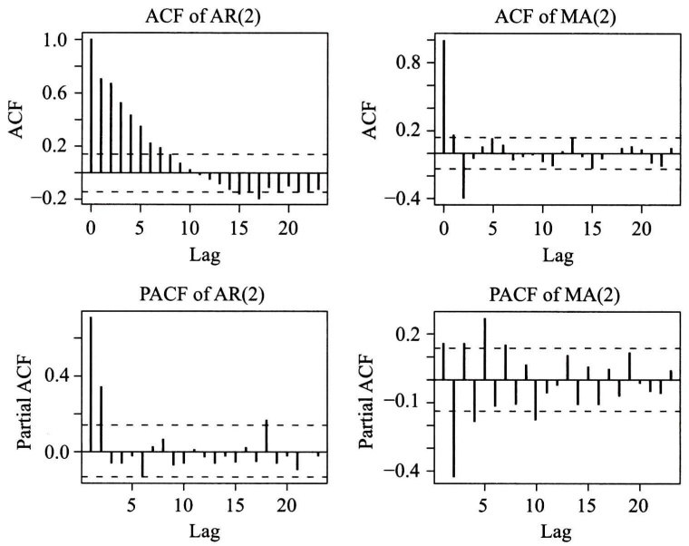
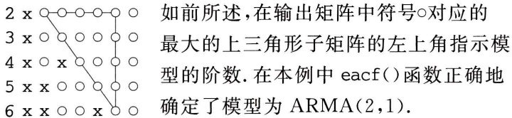
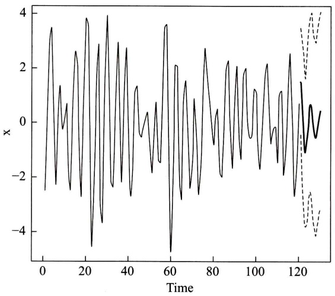
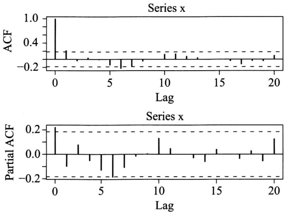
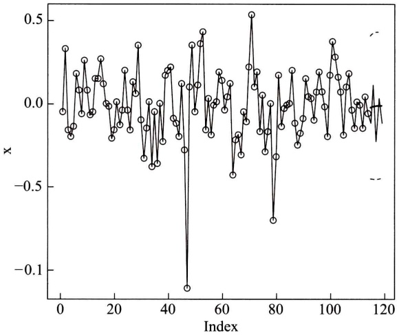

# 第十五章 时间序列分析

原始 PDF 第 372–389 页。

## 第十五章 时间序列分析

我们在实际问题中经常会遇到一系列随时间变化而又相互关联并包含着不确定性的数据.例如某地区的月降雨量纪录、上证指数每日的收盘价、一条流水线上每天出现的次品数等，这些都可以看成是离散参数随机过程 $\{X_{t},t=0,\pm1,\pm2,\cdots\}$ .由于t经常代表时间，常称这样的离散参数随机过程为时间序列.时间序列分析就是利用观测或试验所得到的动态数据来建立可以应用的模型.本章着重讨论较为简单但有着广泛应用的平稳时间序列的自回归滑动平均模型，简称ARMA.

## § 1 平稳时间序列

定义 若时间序列 $\{X_{t}, t=0, \pm1, \pm2, \cdots\}$ 满足条件(1) $E(X_{t})=\mu$ 和(2) $E(X_{t}X_{t+k})$ 均与t无关，则称之为平稳时间序列.

平稳时间序列是平稳随机过程的一个特例.

运用时间序列的关键在于刻画序列各项之间的关系.为此常会用到下面两种相关函数:

自相关函数 $\rho_{k} = \gamma_{k} / \gamma_{0}$ ，其中

$$
\gamma_ {k} = E \big [ (X _ {t} - \mu) (X _ {t + k} - \mu) \big ], \quad k = 0, \pm 1, \pm 2, \dots
$$

为自协方差函数. 可知当  $\{X_{t}, t=0, \pm1, \pm2, \cdots\}$  为平稳时间序列时， $\gamma_{k}, \rho_{k}$  都与 t 无关并具有下列性质:

(1) 对称性:  $\gamma_{k} = \gamma_{-k}$ .
(2) 非负定性: 对任意正整数 k,

$$
\boldsymbol {R} _ {k} = \left[ \begin{array}{c c c c c} 1 & \rho_ {1} & \rho_ {2} & \dots & \rho_ {k - 1} \\ \rho_ {1} & 1 & \rho_ {1} & \dots & \rho_ {k - 2} \\ \vdots & \vdots & \vdots & & \vdots \\ \rho_ {k - 1} & \rho_ {k - 2} & \rho_ {k - 3} & \dots & 1 \end{array} \right]
$$

是非负定矩阵.

（3）满足柯西不等式: $|\gamma_k|\leqslant \gamma_0,|\rho_k|\leqslant 1.$

自相关函数描述 $X_{t}$ 与 $X_{t + k}$ 之间的相关性.

偏相关函数 用 $X_{t}$ 的前 $k$ 个时刻的值 $X_{t - 1},\dots ,X_{t - k}$ 对 $X_{t}$ 作最小方差估

---

· 358 ·

第十五章 时间序列分析

计，即求 $a_{k1}, a_{k2}, \cdots, a_{kk}$ 使得 $E\left[\left(X_t - \sum_{i=1}^{k} a_{ki} X_{t-i}\right)^2\right]$ 最小. 当 $\{X_t, t = 0, \pm 1, \pm 2, \cdots\}$ 为平稳时间序列时，$a_{kk}$ 与 $t$ 无关，$a_{kk}$ 称为该时间序列的偏相关函数.

偏相关函数描述  $X_{t}$  与  $X_{t-1},\cdots,X_{t-k}$  的联系.

例 1(白噪声) 设时间序列  $\{\varepsilon_{t}, t=0,1,\cdots\}$  满足: (1)  $E(\varepsilon_{t})=0$ ; (2)  $E(\varepsilon_{t}\varepsilon_{s})=\sigma_{\varepsilon}^{2}\delta_{ts}$ ，其中

$$
\delta_ {t s} = \left\{ \begin{array}{l l} 1, & t = s, \\ 0, & t \neq s. \end{array} \right.
$$

易知 $E(\varepsilon_t \varepsilon_{t+k}) = \sigma_\varepsilon^2 \delta_{k0}$ 与 $t$ 无关，因此 $\{\varepsilon_t, t=0,1,\cdots\}$ 为平稳时间序列，称 $\{\varepsilon_t, t=0,1,\cdots\}$ 为白噪声序列. □

例2（平稳时间序列的延迟）对给定的平稳时间序列 $\{X_{t}, t = 0, \pm 1, \pm 2, \dots\}$ 和正整数 $d$，定义它的 $d$ 步延迟序列 $\{Y_{t} = X_{t - d}, t = 0, \pm 1, \pm 2, \dots\}$. 易知 $E(Y_{t}) = E(X_{t - d}) = \mu$ 和 $E(Y_{t}Y_{t + k}) = E(X_{t - d}X_{t + k - d})$ 均与 $t$ 无关. 因此 $\{Y_{t}, t = 0, \pm 1, \pm 2, \dots\}$ 也是平稳时间序列. □

由于延迟会经常用到,我们引进下述延迟算子:

定义 设 $\{X_{t}, t=0, \pm1, \pm2, \cdots\}$ 为时间序列，算子B满足等式 $BX_{t}=X_{t-1}$ ，称它为一步延迟算子。用 $B^{k}$ 表示连续应用一步延迟算子k次，并称之为k步延迟算子，则有 $B^{k}X_{t}=X_{t-k}$ 。

## § 2 线性自回归滑动平均模型

平稳时间序列的线性模型相对简单并具有广泛应用,本节讨论常用的线性自回归滑动平均模型.由于平稳时间序列各项的均值相同,则平移总可以把序列的均值归零,因此以下只关注均值为零的序列.

定义 设均值为零的平稳时间序列 $\{X_{t}, t=0, \pm1, \pm2, \cdots\}$ 满足等式

$$
X _ {t} - \varphi_ {1} X _ {t - 1} - \dots - \varphi_ {p} X _ {t - p} = \varepsilon_ {t} - \theta_ {1} \varepsilon_ {t - 1} - \dots - \theta_ {q} \varepsilon_ {t - q}, \tag {2.1}
$$

其中 $\{\varepsilon_{t},t=0,\pm1,\pm2,\cdots\}$ 为白噪声序列，且多项式方程 $\Phi(u)=1-\varphi_{1}u-\cdots-\varphi_{p}u^{p}=0$ 和 $\Theta(u)=1-\theta_{1}u-\cdots-\theta_{q}u^{q}=0$ 没有公共根，则称之为p阶自回归q阶滑动平均时间序列，简称ARMA $(p,q)$ 序列。系数 $\varphi_{1},\varphi_{2},\cdots,\varphi_{p},\theta_{1},\theta_{2},\cdots,\theta_{q}$ 称为模型的参数.p,q称为阶。利用延迟算子和多项式 $\Phi,\Theta$ 可以写出ARMA $(p,q)$ 序列的算子表达式:

$$
\Phi (B) X _ {t} = \Theta (B) \varepsilon_ {t}.
$$

在 $\mathrm{ARMA}(p,q)$ 模型中，如果 $q = 0$ ，则滑动平均现象不存在，此时得到纯 $p$ 阶自回归模型，将它简记为 $\operatorname {AR}(p)$ .我们将 $\operatorname {AR}(p)$ 模型表示为

---

§ 2 线性自回归滑动平均模型

· 359 ·

$$
X _ {t} = \sum_ {i = 1} ^ {p} \varphi_ {i} X _ {t - i} + \varepsilon_ {t}. \tag {2.2}
$$

如果 $p = 0$ ，则自回归现象不存在，就得到纯 $q$ 阶滑动平均模型，将它简记为 $\mathrm{MA}(q)$ 我们将 $\mathrm{MA}(q)$ 模型表示为

$$
X _ {t} = \varepsilon_ {t} - \sum_ {i = 1} ^ {q} \theta_ {i} \varepsilon_ {t - i}. \tag {2.3}
$$

$\mathrm{ARMA}(p,q)$ 是上述两种简单模型的混合.对于一个实际的时间序列问题，自相关函数和偏相关函数可以帮助我们有效地判定较为简单的 $\mathrm{AR}(p)$ 和 $\mathrm{MA}(q)$ 模型的适用性并估计阶数 $p$ 和 $q$

先讨论 AR(p) 的偏相关函数. 为了确定偏相关函数 $a_{kk}$, 我们寻找 $a_{k1}, a_{k2}, \cdots, a_{kk}$ 使得

$$
f = E \left[ \left(X _ {t} - \sum_ {i = 1} ^ {k} a _ {k i} X _ {t - i}\right) ^ {2} \right] \tag {2.4}
$$

达到最小. 将(2.2)式代入(2.4)式得到

$$
\begin{array}{l} f = E \left[ \left(\sum_ {i = 1} ^ {p} \varphi_ {i} X _ {t - i} + \varepsilon_ {t} - \sum_ {j = 1} ^ {k} a _ {k j} X _ {t - j}\right) ^ {2} \right] \\ = E \left\{\left[ \varepsilon_ {t} + \sum_ {i = 1} ^ {p} \left(\varphi_ {i} - a _ {k i}\right) X _ {t - i} - \sum_ {j = p + 1} ^ {k} a _ {k j} X _ {t - j} \right] ^ {2} \right\} \\ = E \left(\varepsilon_ {t} ^ {2}\right) + 2 E \left\{\varepsilon_ {t} \left[ \sum_ {i = 1} ^ {p} \left(\varphi_ {i} - a _ {k i}\right) X _ {t - i} - \sum_ {j = p + 1} ^ {k} a _ {k j} X _ {t - j} \right] \right\} \\ + E \left\{\left[ \sum_ {i = 1} ^ {p} \left(\varphi_ {i} - a _ {k i}\right) X _ {t - i} - \sum_ {j = p + 1} ^ {k} a _ {k j} X _ {t - j} \right] ^ {2} \right\}. \\ \end{array}
$$

注意到 $t > s$ 时 $E(\varepsilon_t X_s) = 0$，上式中第二项为零。由于 $E(\varepsilon_t^2)$ 为常数，要使 $f$ 达到最小，第三项作为完全平方必须为零。因此 $a_{ki} = \varphi_i$，当 $1 \leqslant i \leqslant p; a_{kj} = 0$，当 $p + 1 \leqslant j \leqslant k$。这样得到偏相关函数

$$
a _ {k k} = \left\{ \begin{array}{l l} \varphi_ {k}, & 1 \leqslant k \leqslant p, \\ 0, & k > p, \end{array} \right.
$$

上式表明 $k > p$ 时 $a_{kk} = 0$. 我们称 $X_{t}$ 的偏相关函数在 $p$ 处截尾.

与之对照的是 MA(q) 模型的自相关函数的截尾性. 由 MA(q) 的定义(2.3)式可知

$$
\gamma_ {k} = E (X _ {t} X _ {t + k}) = E \left[ \left(\varepsilon_ {t} - \sum_ {i = 1} ^ {q} \theta_ {i} \varepsilon_ {t - i}\right) \left(\varepsilon_ {t + k} - \sum_ {j = 1} ^ {q} \theta_ {j} \varepsilon_ {t + k - j}\right) \right]. \tag {2.5}
$$

当 $k > q$ 时上式两个括号中 $\varepsilon_{s}$ 所在的时间点 $s$ 无一相同，因此 $\gamma_{k} = 0$。又易算出 $\gamma_0 = \sigma_\epsilon^2\left(1 + \sum_{i=1}^{q} \theta_i^2\right)$。当 $1 \leqslant k \leqslant q$ 时我们将 $\gamma_k$ 写成

---

· 360 ·

第十五章 时间序列分析

$$
\gamma_ {k} = E \Big [ \left(\varepsilon_ {t} - \sum_ {i = 1} ^ {q} \theta_ {i} \varepsilon_ {t - i}\right) \varepsilon_ {t + k} \Big ] - \sum_ {i = 1} ^ {q} \theta_ {i} E (\varepsilon_ {t} \varepsilon_ {t + k - i}) + \sum_ {i = 1} ^ {q} \sum_ {j = 1} ^ {q} \theta_ {i} \theta_ {j} E (\varepsilon_ {t - i} \varepsilon_ {t + k - j}).
$$

上式第一项显然为零. 第二项中只有 $i = k$ 的一项非零, 其值为 $-\theta_k \sigma_\epsilon^2$. 第三项中只有那些满足 $t - i = t + k - j$ (也就是 $j = i + k$) 的项非零. 所以 $\gamma_k = \sigma_\epsilon^2 \left( -\theta_k + \sum_{i=1}^{q-k} \theta_i \theta_{i+k} \right)$. 综合起来有

$$
\gamma_ {k} = \left\{ \begin{array}{l l} \sigma_ {\epsilon} ^ {2} \left(1 + \sum_ {i = 1} ^ {q} \theta_ {i} ^ {2}\right), & k = 0, \\ \sigma_ {\epsilon} ^ {2} \left(- \theta_ {k} + \sum_ {i = 1} ^ {q - k} \theta_ {i} \theta_ {i + k}\right), & 1 \leqslant k \leqslant q, \\ 0, & k > q. \end{array} \right. \tag {2.6}
$$

于是

$$
\rho_ {k} = \left\{ \begin{array}{l l} 1, & k = 0, \\ \frac {- \theta_ {k} + \sum_ {i = 1} ^ {q - k} \theta_ {i} \theta_ {i + k}}{1 + \sum_ {i = 1} ^ {q} \theta_ {i} ^ {2}}, & 1 \leqslant k \leqslant q, \\ 0, & k > q, \end{array} \right. \tag {2.7}
$$

即自相关函数在 k=q 处截尾.

我们自然要问 AR(p) 模型的自相关函数和 MA(q) 模型的偏相关函数具有什么特点. 先看 AR(1) 模型:

$$
X _ {t} = \varphi_ {1} X _ {t - 1} + \varepsilon_ {t}. \tag {2.8}
$$

注意到 $E(X_{t - 1}\varepsilon_t) = 0$ ，在等式(2.8)两边取方差得到

$$
D (X _ {t}) = \varphi_ {1} ^ {2} D (X _ {t - 1}) + D (\varepsilon_ {t}).
$$

由 $X_{t}$ 的平稳性知 $\sigma^2 = D(X_t) = D(X_{t - 1})$ .记 $\sigma_{\varepsilon}^{2} = D(\varepsilon_{t})$ ，有

$$
\sigma^ {2} = \frac {\sigma_ {\varepsilon} ^ {2}}{1 - \varphi_ {1} ^ {2}}.
$$

这样参数 $\varphi_{1}$ 必须满足 $|\varphi_1| < 1$. 在此条件下 $\Phi^{-1}(u) = (1 - \varphi_1 u)^{-1} = \sum_{i=1}^{\infty} \varphi_1^i u^i$ 存在, 从而可以将(2.8)式改写为

$$
X _ {t} = \Phi^ {- 1} (B) \varepsilon_ {t} = \sum_ {i = 0} ^ {\infty} \varphi_ {1} ^ {i} \varepsilon_ {t - i}. \tag {2.9}
$$

与 $q$ 阶滑动平均模型 $\sum_{i=0}^{q} \varphi_1^i \varepsilon_{t-i}$ 比较, 我们可将(2.9)式看作是一个 $q = \infty$ 的滑动

---

§ 2 线性自回归滑动平均模型

· 361 ·

平均模型,由此可以推断它不会截尾.事实上将等式

$$
\gamma_ {k} = E (X _ {t} X _ {t + k}) = E [ X _ {t} (\varphi_ {1} X _ {t + k - 1} + \varepsilon_ {t + k}) ] = \varphi_ {1} \gamma_ {k - 1}
$$

除以 $\gamma_0$ 得到

$$
\rho_ {k} = \varphi_ {1} \rho_ {k - 1}.
$$

因 $\rho_0 = 1$ ，用上式递推可知 $\rho_{k} = \varphi_{1}^{k} = \mathrm{e}^{k\ln \varphi_{1}}\neq 0$ ，但以指数速度衰减至零.我们称 $X_{t}$ 的自相关函数拖尾.

对于一般的 $\mathrm{AR}(p)$ 模型 $\Phi(B)X_{t} = \varepsilon_{t}$，只要 $\Phi(u) = 0$ 的根都在单位圆外，$\Phi^{-1}(B)$ 就存在，从而自相关函数也是拖尾的。模型的自相关函数可以利用

$$
E \big [ \Phi (B) X _ {t + k} X _ {t} \big ] / \gamma_ {0} = E (\varepsilon_ {t + k} X _ {t}) / \gamma_ {0} = 0
$$

得到差分方程

$$
\rho_ {k} - \varphi_ {1} \rho_ {k - 1} - \dots - \varphi_ {p} \rho_ {k - p} = 0
$$

来解出(见本章末附录).

用类似的方法, 只要  $\Theta(u)=0$  的根都在单位圆外, 就可以把 MA(q) 模型  $X_{t}=\Theta(B)\varepsilon_{t}$  看成  $p=\infty$  的自回归模型  $\Theta^{-1}(B)X_{t}=\varepsilon_{t}$ , 从而推断其偏相关函数拖尾. 为了计算偏相关函数  $a_{kk}$ , 设  $a_{k1}, a_{k2}, \cdots, a_{kk}$  使得

$$
\begin{array}{l} f = E \left[ \left(X _ {t} - \sum_ {i = 1} ^ {k} a _ {k i} X _ {t - i}\right) ^ {2} \right] \\ = E \left[ X _ {t} ^ {2} - 2 X _ {t} \sum_ {i = 1} ^ {k} a _ {k i} X _ {t - i} + \left(\sum_ {i = 1} ^ {k} a _ {k i} X _ {t - i}\right) ^ {2} \right] \\ = E (X _ {t} ^ {2}) - 2 \sum_ {i = 1} ^ {k} a _ {k i} E (X _ {t} X _ {t - i}) + \sum_ {i = 1} ^ {k} \sum_ {j = 1} ^ {k} a _ {k i} a _ {k j} E (X _ {t - i} X _ {t - j}) \\ = \gamma_ {0} - 2 \sum_ {i = 1} ^ {k} a _ {k i} \gamma_ {i} + \sum_ {i = 1} ^ {k} \sum_ {j = 1} ^ {k} a _ {k i} a _ {k j} \gamma_ {i - j} \tag {2.10} \\ \end{array}
$$

达到最小. 将最优条件  $\frac{\partial f}{\partial a_{kj}} = 0 (j = 1, 2, \cdots, k)$  除以  $2\gamma_{0}$ ，写成矩阵方程

$$
\left[ \begin{array}{c c c c c} 1 & \rho_ {1} & \rho_ {2} & \dots & \rho_ {k - 1} \\ \rho_ {1} & 1 & \rho_ {1} & \dots & \rho_ {k - 2} \\ \vdots & \vdots & \vdots & & \vdots \\ \rho_ {k - 1} & \rho_ {k - 2} & \rho_ {k - 3} & \dots & 1 \end{array} \right] \left[ \begin{array}{c} a _ {k 1} \\ a _ {k 2} \\ \vdots \\ a _ {k k} \end{array} \right] = \left[ \begin{array}{c} \rho_ {1} \\ \rho_ {2} \\ \vdots \\ \rho_ {k} \end{array} \right], \tag {2.11}
$$

当 $k = 1$ 时可以直接得到 $a_{11} = \rho_1$. 令 $k = 2$, 解

$$
\left[ \begin{array}{l l} 1 & \rho_ {1} \\ \rho_ {1} & 1 \end{array} \right] \left[ \begin{array}{l} a _ {2 1} \\ a _ {2 2} \end{array} \right] = \left[ \begin{array}{l} \rho_ {1} \\ \rho_ {2} \end{array} \right] \tag {2.12}
$$

得到

$$
a _ {2 2} = \frac {\rho_ {2} - a _ {1 1} ^ {2}}{1 - a _ {1 1} ^ {2}}.
$$

---

· 362 ·

第十五章 时间序列分析

当 $k$ 较大时下面的莱文森一德宾(Levinson-Durbin①)递推公式可以用来有效地计算偏相关函数:

$$
a _ {k k} = \frac {\rho_ {k} - \sum_ {j = 1} ^ {k - 1} \rho_ {k - j} a _ {(k - 1) j}}{1 - \sum_ {j = 1} ^ {k - 1} \rho_ {j} a _ {(k - 1) j}}, \tag {2.13}
$$

其中  $a_{kj}=a_{(k-1)j}-a_{kk}a_{(k-1)(k-j)}, j=1,2,\cdots,k-1.$ ②

例(AR 和 MA 序列的自相关函数和偏相关函数) 考虑 AR(2) 模型

$$
X _ {t} = 0. 4 X _ {t - 1} + 0. 4 X _ {t - 2} + \varepsilon_ {t} \tag {2.14}
$$

和 MA(2) 模型

$$
X _ {t} = \varepsilon_ {t} + 0. 6 \varepsilon_ {t - 1} - 0. 4 \varepsilon_ {t - 2}, \tag {2.15}
$$

试用模拟方法分别生成上述两个模型长度为200的时间序列，并展示对应的自相关函数和偏相关函数的图形.

解 R 程序中的 arima.sim() 函数可以用来以模拟方法生成 ARMA 模型对应的时间序列. 试用下面的 R 程序语句:

$$
> \text {sim.ar} <   - \text {arima.sim(list(ar = c(0.4,0.4)),n = 200)}
$$

生成200项（2.14）式描述的AR(2)模型，并且将它们存入sim.ar.式中list(ar=c(0.4,0.4))设定生成AR模型，且该模型的参数为 $\varphi_{1} = 0.4$ 和 $\varphi_{2} = 0.4.$ 类似地试用语句

$$
> \text {sim.ma} <   - \text {arima.sim(list(ma = c(0.6, - 0.4)),n = 200)}
$$

生成 200 项(2.15)式描述的 MA(2) 模型, 并将它们存入 sim.ma. 这里需要特别注意的是 R 语言中的 MA(q) 模型写成

$$
X _ {t} = \varepsilon_ {t} + \sum_ {i = 1} ^ {q} \theta_ {i} \varepsilon_ {t - i},
$$

即系数前为正号,而定义(2.3)式中 MA 模型系数  $\theta_{i}$  前为负号.因此在输入(2.15)式的系数时要注意这一约定.

自相关函数和偏相关函数的图形可以分别用 R 函数 acf() 和 pacf() 得到. 下面的 R 程序中先用 par(mfrow = c(2,2)) 规定 4 个将要得到的图形应排成  $2 \times 2$  矩阵, 再作例题中要求的 4 个图形, 执行后会在计算机显示屏幕弹出新窗口 (见图 15-1) 给出自相关函数和偏相关函数的图形. 在 acf() 和 pacf() 的图中, 横轴上下两侧的虚线是统计上是否显著不同于零的临界值, 当时间序列的自

<small><span class="docvortex-page-footnote" data-block-type="page_footnote" style="color:#6b7280">① Levinson, N. The Wiener RMS error criterion in filter design and prediction. J. Math. Phys., 25: 261–278, 1947. Durbin, J. The fitting of time series models. Rev. Int. Statist. Inst., 28: 233–243, 1960.</span></small>

<small><span class="docvortex-page-footnote" data-block-type="page_footnote" style="color:#6b7280">② 递推顺序按 $a_{11} - a_{22} - a_{21} - a_{33} - a_{31} - a_{32} - a_{44} - \cdots$ 进行.</span></small>

---

§ 2 线性自回归滑动平均模型

· 363 ·

相关函数或偏相关函数的值落在这两条虚线以内的区域时，视为无法区别于0.在acf()和pacf()函数中，采用标准正态分布的 $95\%$ 置信区间来确定临界值 $\pm 2 / \sqrt{n}$，其中 $n$ 为时间序列的长度。从图15-1中可以清楚地看到生成的AR(2)序列的偏相关函数（从滞后 $\mathrm{Lag} = 1$ 开始）在 $\mathrm{Lag} = 2$ 处截尾，而它的自相关函数是拖尾的。成为对比的是生成的MA(2)序列的自相关函数（从滞后 $\mathrm{Lag} = 0$ 开始）在 $\mathrm{Lag} = 2$ 处截尾（在 $\mathrm{Lag} = 9$ 处大约等于临界值），而它的偏相关函数是拖尾的。相关R程序如下:

```txt
>par(mfrow = c(2,2))
>acf(sim.ar,main = "ACF of AR(2)")
>acf(sim.ma,main = "ACF of MA(2)")
>pacf(sim.ar,main = "PACF of AR(2)")
>pacf(sim.ma,main = "PACF of MA(2)")
```



图15-1

由于 ARMA 模型比 AR 模型和 MA 模型都更一般, 它的自相关函数和偏相关函数都拖尾. 表 15-1 总结了 ARMA $(p, q)$ 模型及其特例 AR $(p)$ 和 MA $(q)$ 的性质.

对于非平稳的时间序列 $X_{t}$ ，我们常考虑其导出的差分序列 $Y_{t} = X_{t} - X_{t - 1}$ .例如金融市场中的证券指数(如上证指数)有长期的增长趋势，因而作为时间序列是

---

· 364 ·

第十五章 时间序列分析

非平稳的. 但其相应的对数序列的差分序列却是平稳的, 它反映证券指数的百分比增益在固定范围内波动. 如果差分序列仍非平稳, 还可以考虑再做差分, 也就是考虑原时间序列的二阶差分. 当 $X_{t}$ 的 $d$ 阶差分序列满足 $\mathrm{ARMA}(p, q)$ 模型时, 我们说 $X_{t}$ 满足 $\mathrm{ARIMA}(p, d, q)$ 模型. 当 $d = 0$ 时, $\mathrm{ARIMA}(p, 0, q) = \mathrm{ARMA}(p, q)$.

表 15-1 三种线性模型的性质

| 模型 | MA(q) | AR(p) | ARMA(p,q) |
| --- | --- | --- | --- |
| 基本方程 | $X_{t} = \Theta(B)\varepsilon_{t}$ | $\Phi(B)X_{t} = \varepsilon_{t}$ | $\Phi(B)X_{t} = \Theta(B)\varepsilon_{t}$ |
| 自相关函数 | 截尾 | 拖尾 | 拖尾 |
| 偏相关函数 | 拖尾 | 截尾 | 拖尾 |

## § 3 模型的应用

在实际应用中观察时间序列得到的总是一个有限的样本. 我们必须依据这些有限的信息来初步判断适用的模型, 然后对模型的参数进行估计. 由于我们依据的是不完全的信息, 上述做法完全可能导致不同类型的, 或同类但不同阶数的模型. 要最终确定可以应用的模型, 还须对得到的模型进行考核, 经考核合格的模型才能用于对时间序列的实际预报. 下面我们结合 R 函数的应用来逐一讨论这些步骤.

## (一) 模型识别

将对时间序列进行观测得到的有限样本记为  $y_{1}, y_{2}, \cdots, y_{n}$ ，其中 n 为样本长度，用

$$
\overline {{y}} = \frac {\sum_ {i = 1} ^ {n} y _ {i}}{n}
$$

作为这个时间序列均值的估计. 再令  $x_{i}=y_{i}-\overline{y}(i=1,2,\cdots,n)$ ，得到一个零均值序列. 用

$$
\hat {\gamma} _ {k} = \frac {1}{n} \sum_ {i = 1} ^ {n - k} x _ {i} x _ {i + k} \tag {3.1}
$$

作为协方差函数的估计. 虽然(3.1)式是有偏估计, 但它可以保证自相关函数的非负定性. 而且由于实际应用中 $n$ 都很大 (至少大于 50) 且远大于 $k$ (通常 $k < n / 10$), (3.1) 式与无偏估计 $\sum_{i=1}^{n-k} x_i x_{i+k} / (n-k)$ 相差很小.

---

§ 3 模型的应用

· 365 ·

由上节表15-1可知，如果已知模型为 $\mathrm{AR}(p)$ 或 $\mathrm{MA}(q)$，则可用偏相关函数或自相关函数来确定它们的阶数。但是对于一般的ARMA模型，偏相关函数和自相关函数都是拖尾的。因此这两种相关函数难以直接用来有效地确定ARMA模型的阶数。针对这一问题，Tsay和Tiao发展了广义自相关函数(EACF)。①其原理是如果已知ARMA模型的AR部分的阶数 $p$，那么其系数可以通过对观测数据用回归方法得到，余下的MA部分的阶数可以用自相关函数的截尾性确定。广义自相关函数方法中对每个给定的AR阶数 $p$，将对应的MA部分的自相关函数按时间差由小到大表示为行向量。

例 1 $^{②}$ (广义自相关函数) 表 15-2 和表 15-3 是 3M 公司的股票自 1946 年 2 月到 2008 年 12 月(共 T=755 个月)月回报对数的广义自相关函数表. 其中表 15-2 为数值表, 表 15-3 为对应的简化表. 简化表的做法是以  $2\sqrt{T}$  为界, 绝对值小于这个界的用 O 来表示, 大于这个界的用 X 来表示. 理论上说简化广义自相关函数矩阵中 O 项构成的三角形的左上角的位置就指示了 ARMA 的阶数(参见下述例 2), 但在这个例子里当 p=0 时 q=2,5,9,11 处的值 -0.08,0.08,-0.08,0.09 的绝对值只比  $2/\sqrt{755}=0.073$  略大一点点. 如果略微放松截尾的界值, 则 p=0, q=2,5,9,11 处的 X 就会变成 O, 这样我们可以看出  $(p,q)=(0,0)$ . 实际情况经常不是非黑即白的.

表 15-2 EACF 数值表

<table><tr><td rowspan="2">p</td><td colspan="13">q</td></tr><tr><td>0</td><td>1</td><td>2</td><td>3</td><td>4</td><td>5</td><td>6</td><td>7</td><td>8</td><td>9</td><td>10</td><td>11</td><td>12</td></tr><tr><td>0</td><td>-0.06</td><td>-0.04</td><td>-0.08</td><td>0</td><td>0.02</td><td>0.08</td><td>0.01</td><td>0.01</td><td>-0.03</td><td>-0.08</td><td>0.05</td><td>0.09</td><td>-0.01</td></tr><tr><td>1</td><td>-0.47</td><td>0.01</td><td>-0.07</td><td>-0.02</td><td>0</td><td>0.08</td><td>-0.03</td><td>0</td><td>-0.01</td><td>-0.07</td><td>0.04</td><td>0.09</td><td>-0.02</td></tr><tr><td>2</td><td>-0.38</td><td>-0.35</td><td>-0.07</td><td>0.02</td><td>-0.01</td><td>0.08</td><td>0.03</td><td>0.01</td><td>0</td><td>-0.03</td><td>0.02</td><td>0.04</td><td>0.04</td></tr><tr><td>3</td><td>-0.18</td><td>0.14</td><td>0.38</td><td>-0.02</td><td>0</td><td>0.04</td><td>-0.02</td><td>0.02</td><td>-0.00</td><td>-0.03</td><td>0.02</td><td>0.01</td><td>0.04</td></tr><tr><td>4</td><td>0.42</td><td>0.03</td><td>0.45</td><td>-0.01</td><td>0</td><td>0</td><td>-0.01</td><td>0.03</td><td>0.01</td><td>0</td><td>0.02</td><td>0</td><td>0.01</td></tr><tr><td>5</td><td>-0.11</td><td>0.21</td><td>0.45</td><td>0.01</td><td>0.20</td><td>-0.01</td><td>0</td><td>0.04</td><td>-0.01</td><td>-0.01</td><td>0.03</td><td>0.01</td><td>0.03</td></tr><tr><td>6</td><td>-0.21</td><td>-0.25</td><td>0.24</td><td>0.31</td><td>0.17</td><td>-0.04</td><td>0</td><td>0.04</td><td>-0.01</td><td>-0.03</td><td>0.01</td><td>0.01</td><td>0.04</td></tr></table>

<small><span class="docvortex-page-footnote" data-block-type="page_footnote" style="color:#6b7280">① Tsay, R. S., Tiao, G. C. Consistent estimates of autoregressive parameters and extended sample autocorrelation function for stationary and nonstationary ARMA models. Journal of the American Statistical Association, 79:84–96, 1984.</span></small>

<small><span class="docvortex-page-footnote" data-block-type="page_footnote" style="color:#6b7280">② 本例取自 Tsay, R. S. Analysis of financial time series. 3rd edition. Wiley, 2010.</span></small>

---

· 366 ·

第十五章 时间序列分析

表 15-3 EACF 简化表

<table><tr><td rowspan="2">p</td><td colspan="13">q</td></tr><tr><td>0</td><td>1</td><td>2</td><td>3</td><td>4</td><td>5</td><td>6</td><td>7</td><td>8</td><td>9</td><td>10</td><td>11</td><td>12</td></tr><tr><td>0</td><td>O</td><td>O</td><td>X</td><td>O</td><td>O</td><td>X</td><td>O</td><td>O</td><td>O</td><td>X</td><td>O</td><td>X</td><td>O</td></tr><tr><td>1</td><td>X</td><td>O</td><td>O</td><td>O</td><td>O</td><td>X</td><td>O</td><td>O</td><td>O</td><td>O</td><td>O</td><td>X</td><td>O</td></tr><tr><td>2</td><td>X</td><td>X</td><td>O</td><td>O</td><td>O</td><td>X</td><td>O</td><td>O</td><td>O</td><td>O</td><td>O</td><td>O</td><td>O</td></tr><tr><td>3</td><td>X</td><td>X</td><td>X</td><td>O</td><td>O</td><td>O</td><td>O</td><td>O</td><td>O</td><td>O</td><td>O</td><td>O</td><td>O</td></tr><tr><td>4</td><td>X</td><td>O</td><td>X</td><td>O</td><td>O</td><td>O</td><td>O</td><td>O</td><td>O</td><td>O</td><td>O</td><td>O</td><td>O</td></tr><tr><td>5</td><td>X</td><td>X</td><td>X</td><td>O</td><td>X</td><td>O</td><td>O</td><td>O</td><td>O</td><td>O</td><td>O</td><td>O</td><td>O</td></tr><tr><td>6</td><td>X</td><td>X</td><td>X</td><td>X</td><td>X</td><td>O</td><td>O</td><td>O</td><td>O</td><td>O</td><td>O</td><td>O</td><td>O</td></tr></table>

□

在 R 中已有由 eacf() 函数直接给出的广义自相关函数简化表, 下面举例说明其应用.

例 2 调用 eacf() 函数处理时间序列要用到 R 中的特殊函数库 fBasics 和 TSA. 打开 R 后点击菜单中的程序包, 再选子菜单中的加载程序包, 就可以从函数库的目录中选择这两个库并加载 $^{①}$ . 然后用下面的指令调用:

```r
> library(fBasics)
> library(TSA)
```

再用指令 arima.sim 生成对应于模型

$$
X _ {t} = 0. 3 X _ {t - 1} - 0. 7 X _ {t - 2} + \varepsilon_ {t} + 0. 5 \varepsilon_ {t - 1},
$$

长度为 n=120 的时间序列并存入 x.

<div class="docvortex-algorithm" style="white-space: pre-wrap; font-family:monospace;">
$&gt; x &lt; -arima. \text{sim(list(order = c(2,0,1), ar = c(0.3, -0.7), ma = c(0.5)), n = 120)}$
</div>

注意当模型中同时具有 AR 和 MA 部分时, 要先用 order = c(p, 0, q) 给定 AR 部分的阶数 p 和 MA 部分的阶数 q, 中间的 0 是指差分的阶数. 接着用 R 的 eacf() 函数来识别模型:

```csv
> eacf(x,ar.max = 6,ma.max = 6)
AR/MA
0 1 2 3 4 5 6
0 x x x x x x x
1 x x x x x x x
```

<small><span class="docvortex-page-footnote" data-block-type="page_footnote" style="color:#6b7280">① 如果在加载程序包的选项中找不到 fBasics 和 TSA, 则要在 R 的主菜单中的程序包选项下先选 Install package(s) from local files... 来装载 fBasics 和 TSA 这两个库.</span></small>

---

§ 3 模型的应用

· 367 ·



<details>
<summary>text_image</summary>

如前所述,在输出矩阵中符号○对应的
最大的上三角形子矩阵的左上角指示模
型的阶数.在本例中 eacf()函数正确地
确定了模型为 ARMA(2,1).
</details>

值得指出的是,由于时间序列的随机性,应用 eacf() 函数于一组特定的观察值并不一定能保证正确地识别模型.反复运行上述两条指令可发现 eacf() 函数只是以比较大的概率正确地识别模型,误判是可能发生的.

## (二) 参数估计

知道了模型的阶数以后，还要估计模型的参数，未知参数除了模型中的系数外还包括  $\sigma_{\varepsilon}^{2}$ . 大致来说参数估计的方法是用观测样本和(3.1)式得到的估计值  $\hat{\gamma}_{i}$  代替 §2 公式(2.6)中的  $\gamma_{i}$ ，可估计模型 MA(q) 的参数  $\theta_{i}(i=1,2,\cdots,q)$  和  $\sigma_{\varepsilon}^{2}$ . 类似地，由  $\hat{\gamma}_{i}$  得到估计值  $\hat{\rho}_{i}=\hat{\gamma}_{i}/\hat{\gamma}_{0}$  并代入矩阵方程(2.11)，可以解出模型 AR(p) 的参数  $\varphi_{i}(i=1,2,\cdots,p)$  的估计. 一般的 ARMA(p,q) 模型的参数估计是上述两种模型参数估计方法的结合. R 函数库中的 arima() 函数可以用来对模型进行参数估计，指令如下（符号 % 后为说明）:

$> \mathrm{m} = \operatorname{arima}(\mathrm{x}, \text{order} = \mathrm{c}(2,0,1)) \%$ 按 ARMA(2,1)模型作参数估计并存入 $\mathfrak{m} > \mathfrak{m}\%$ 显示结果

```txt
Call:
arima(x = x, order = c(2, 0, 1))
Coefficients:
```

|  | ar1 | ar2 | mal | intercept |
| --- | --- | --- | --- | --- |
|  | 0.2334 | -0.7202 | 0.5936 | 0.0548 |
| s.e. | 0.0721 | 0.0675 | 0.0860 | 0.0997 |

```txt
sigma^2 estimated as 1.03:log likelihood = -173.36,aic = 354.72
```

可以看到函数arima()得到了相对准确的参数估计值 $\hat{\varphi}_1 = 0.2334, \hat{\varphi}_2 = -0.7202, \hat{\theta}_1 = 0.5936$，并给出了相应的标准误差(s.e.)，同时它也估计出 $\sigma_{\varepsilon}^{2} = 1.03$。值得说明的是，这里截距(intercept) $m = 0.0548$ 的意义为时间序列 $X_t - m$ 满足给出的模型。在这个例子里 $m = 0.0548$ 可以近似看作为零。

## (三) 模型考核

前面说过在时间序列模型识别过程中误判的可能是存在的,因此通过上面的

---

· 368 ·

第十五章 时间序列分析

模型识别与参数估计得到的模型需要通过考核. 如果通不过考核, 就需要考虑其他可能的模型. 下面用例 2 来介绍常用的考核方法. 上述模型识别与参数估计给出

$$
X _ {t} = \hat {\varphi_ {1}} X _ {t - 1} + \hat {\varphi_ {2}} X _ {t - 2} + \varepsilon_ {t} + \hat {\theta} _ {1} \varepsilon_ {t - 1}.
$$

用  $x_{t}, t=1,2,\cdots,n$  记时间序列的观察值. 当  $t\leqslant0$  时, 设  $x_{t}=\varepsilon_{t}=0$  是合理的. 这样可以自上式解出

$$
\begin{array}{l} \hat {\varepsilon} _ {1} = x _ {1}, \\ \hat {\varepsilon} _ {2} = x _ {2} - \hat {\varphi} _ {1} x _ {1} - \hat {\theta} _ {1} \hat {\varepsilon} _ {1}, \\ \hat {\varepsilon} _ {3} = x _ {3} - \hat {\varphi} _ {1} x _ {2} - \hat {\varphi} _ {2} x _ {1} - \hat {\theta} _ {1} \hat {\varepsilon} _ {2}, \\ \hat {\varepsilon} _ {4} = x _ {4} - \hat {\varphi} _ {1} x _ {3} - \hat {\varphi} _ {2} x _ {2} - \hat {\varphi} _ {3} x _ {1} - \hat {\theta} _ {1} \hat {\varepsilon} _ {3}, \\ \end{array}
$$

... ... ... ... ... ... ...

如此递推得到  $\varepsilon_{t}$  序列的估计  $\hat{\varepsilon}_{t}, t=1,2,\cdots,n.$  如果模型很接近实际情况，那么  $\hat{\varepsilon}_{t}, t=1,2,\cdots,n$  应有白噪声序列的特征。这是用以考核模型的基础。对于 ARMA  $(p,q)$  模型，我们常用其自相关函数是否接近于零来做判断，也就是检验假设  $H_{0}:\hat{\rho}_{1}=\hat{\rho}_{2}=\cdots=\hat{\rho}_{k}=0.$  用效果比较好的 Box-Ljung 方法考察统计量

$$
Q = n (n + 2) \sum_ {k = 1} ^ {h} \frac {\hat {\rho} _ {k} ^ {2}}{n - k},
$$

其中 $\hat{\rho_{k}}$ 是 $\hat{\varepsilon_{t}}, t=1,2,\cdots,n$ 的自相关函数. 当 $\hat{\varepsilon_{t}}, t=1,2,\cdots,n$ 为白噪声序列时，Q 应服从自由度为 h 的 $\chi^{2}$ 分布. R 的函数库包含 Box.test 函数，可以直接调用 Box-Ljung 方法，指令是:

$$
\begin{array}{c} > \text {Box.test(m\$residuals,lag = 12,type = 'Ljung',fitdf = 3)} \\ \text {Box - Ljung test} \end{array}
$$

$$
\text {data:} \quad \mathrm{m} \text {\$residuals}
$$

$$
\mathrm{X} - \text {squared} = 2. 9 4 1 4, \mathrm{df} = 9, \mathrm{p} - \text {value} = 0. 9 6 6 6
$$

调用这个函数时一般用 $\mathrm{lag} = n / 10$ 来给出自由度，并用 fitdf $= p + q$ 给出约束的数目。于是对于此例，自由度就是 $\mathrm{df} = \mathrm{lag} - p - q = 9$。$p$ 值为 0.9666，远大于拒绝假设 $H_0$ 的显著性水平 0.05。因而按 0.05 的显著性水平，这个模型可以通过考核。

## (四) 预报

在金融、气象、经济和工程实践中经常遇到的问题是如何根据历史和现状来预测将来的情况，因此建立并考核时间序列模型的最终目的是对时间序列进行预报。下面以零均值时间序列为例来讨论预报问题。设 $x_{i}, i = 1,2,\dots,n$ 为一个零均值时间序列的观察值，用它来对 $x_{n + l}, l > 0$ 作估计，并将这个估计值记为

---

§ 3 模型的应用

· 369 ·

$\hat{x}_{n}(l)$ . 这里 l 表示预报的是 n 个观测数据之后的第 l 个数据, 叫做 l 步预报. 在作 l 步预报时总会遇到 n 以后的白噪声的值. 注意到当 s > t 时

$$
E (\varepsilon_ {s} X _ {t}) = 0,
$$

也就是说  $x_{i}, i=1,2,\cdots,n$  与 t>n 以后的  $\varepsilon_{t}$  是不相关的. 所以我们约定 l>0 时

$$
\hat {\varepsilon} _ {n + l} = 0,
$$

也就是说将 n 以后的  $\varepsilon_{n+l}$  的估计值都取为零. 预报的原理是去寻找  $\hat{x}_{n}(l)$  作为  $x_{i}, i=1,2,\cdots,n$  的一个线性函数  $\hat{x}_{n}(l)=\sum_{i=1}^{n}c_{i}x_{i}$  使得

$$
E \{[ x _ {n + l} - \hat {x} _ {n} (l) ] ^ {2} \}
$$

达到最小, 这样的  $\hat{x}_{n}(l)$  称为  $x_{n+l}$  的线性最小方差估计. 下面来讨论 AR, MA 和 ARMA 模型的具体预报方法.

## AR 模型的预报

由(2.2)式知用估计好的参数 $\hat{\varphi}_{i}(i=1,2,\cdots,p)$ 可将模型写成

$$
x _ {n + l} = \hat {\varphi} _ {1} x _ {n + l - 1} + \hat {\varphi} _ {2} x _ {n + l - 2} + \dots + \hat {\varphi} _ {p} x _ {n + l - p} + \varepsilon_ {n + l}.
$$

已知 $l > 0$ 时 $\varepsilon_{n + l}$ 的估计 $\hat{\varepsilon}_{n + l} = 0$ ，因此估计公式成为

$$
x _ {n + l} = \hat {\varphi} _ {1} x _ {n + l - 1} + \hat {\varphi} _ {2} x _ {n + l - 2} + \dots + \hat {\varphi} _ {p} x _ {n + l - p}.
$$

当 $l = 1$ 时

$$
\hat {x} _ {n} (1) = \hat {\varphi} _ {1} x _ {n} + \hat {\varphi} _ {2} x _ {n - 1} + \dots + \hat {\varphi} _ {p} x _ {n - p + 1}.
$$

当 $l = 2$ 时公式右边所需的 $x_{n + 1}$ 用 $\hat{x}_n(1)$ 来替代，得到

$$
\hat {x} _ {n} (2) = \hat {\varphi} _ {1} \hat {x} _ {n} (1) + \hat {\varphi} _ {2} x _ {n} + \dots + \hat {\varphi} _ {p} x _ {n - p + 2}.
$$

类似地, 当 l=3 时

$$
\hat {x} _ {n} (3) = \hat {\varphi} _ {1} \hat {x} _ {n} (2) + \hat {\varphi} _ {2} \hat {x} _ {n} (1) + \hat {\varphi} _ {3} x _ {n} + \dots + \hat {\varphi} _ {p} x _ {n - p + 3}.
$$

不断递推就可以得到任意第 $l$ 步的预报值. 只是 $l$ 越大, 预报的准确性就越差. 如果对 $k \leqslant 0$ 约定 $\hat{x}_n(k) = x_{n+k}$, 那么上面的预报公式可以简约地写成

$$
\hat {x _ {n}} (l) = \sum_ {i = 1} ^ {p} \hat {\varphi_ {i}} \hat {x _ {n}} (l - i).
$$

## MA 模型的预报

估计好参数 $\hat{\theta}_{i}, i=1,2,\cdots,q$ 后模型为

$$
x _ {n + l} = \varepsilon_ {n + l} - \hat {\theta} _ {1} \varepsilon_ {n + l - 1} - \dots - \hat {\theta} _ {q} \varepsilon_ {n + l - q}. \tag {3.2}
$$

当 $s > n$ 时 $\varepsilon_{s} = 0$ ，因此 $l > q$ 时上式的右端各项均为零.因此 $\hat{x}_n(l) = 0$

当 $1 \leqslant l \leqslant q$ 时，由(3.2)式可知关键在于预报 $\hat{\varepsilon}_i, i = n - q + 1, \dots, n.$ 将(3.2)式改写为

---

· 370 ·

第十五章 时间序列分析

$$
\varepsilon_ {t} = x _ {t} + \hat {\theta} _ {1} \varepsilon_ {t - 1} + \dots + \hat {\theta} _ {q} \varepsilon_ {t - q}.
$$

注意到当 $s \leqslant 0$ 时 $\varepsilon_{s} = 0$ ，我们可以用递推的方法得到

$$
\begin{array}{l} \hat {\varepsilon} _ {1} = x _ {1}, \\ \hat {\varepsilon} _ {2} = x _ {2} + \hat {\theta} _ {1} \hat {\varepsilon} _ {1} \\ = x _ {2} + \hat {\theta} _ {1} x _ {1}, \\ \hat {\varepsilon} _ {3} = x _ {3} + \hat {\theta} _ {1} \hat {\varepsilon} _ {2} + \hat {\theta} _ {2} \hat {\varepsilon} _ {1} \\ = x _ {3} + \hat {\theta} _ {1} (x _ {2} + \hat {\theta} _ {1} x _ {1}) + \hat {\theta} _ {2} x _ {1}, \\ \end{array}
$$

... ... ... ... ... ... ...

算出 $\hat{\varepsilon}_{i}, i=n-q+1,\cdots,n$ 以后，把它们代回(3.2)式就可以得到预报值 $\hat{x}_{n}(l)$ ， $l=1,2,\cdots,q$ .

## ARMA 模型的预报

结合 AR 和 MA 模型的预报方法就可以预报 ARMA 模型. 先把 ARMA 模型写成

$$
x _ {n + l} = \hat {\varphi} _ {1} x _ {n + l - 1} + \dots + \hat {\varphi} _ {p} x _ {n + l - p} + \varepsilon_ {n + l} - \hat {\theta} _ {1} \varepsilon_ {n + l - 1} - \dots - \hat {\theta} _ {q} \varepsilon_ {n + l - q}. \tag {3.3}
$$

当 $l > q$ 时，有 $\hat{\varepsilon}_{n + l} = \hat{\varepsilon}_{n + l - 1} = \dots = \hat{\varepsilon}_{n + l - q} = 0$ ，于是ARMA模型(3.3)变成

$$
x _ {n + l} = \hat {\varphi} _ {1} x _ {n + l - 1} + \dots + \hat {\varphi} _ {p} x _ {n + l - p}.
$$

我们可以应用和 AR 模型相同的预报方法.

当  $1 \leqslant l \leqslant q$  时，可以用类似 MA 模型的方法得到  $\hat{\varepsilon}_{i}, i = n - q + 1, \cdots, n$ ，然后把它们代回(3.3)式，再应用 AR 模型的预报方法得到  $\hat{x}_{n}(l), l = 1, 2, \cdots, q$ .

R 函数库中的 predict() 函数可以用来方便地对考核过的 ARIMA 模型进行预报. 下面再以例 2 中生成的时间序列为例来说明如何使用 predict() 函数来预报并作图. 指令

$$
> \mathrm{m}. \text {pred} <   - \text {predict} (\text {arima} (\mathrm{x}, \text {order} = \mathrm{c} (2, 0, 1)), \mathrm{n}. \text {ahead} = 1 0)
$$

按 ARMA(2,1)模型生成对 x 的 10 步预报并存入 m.pred. 预报结果 m.pred 中包含两部分信息: 预报值 m.pred\$pred 和预报标准误差 m.pred\$se. 下面的指令运用这些信息作出预报, 如图 15-2 所示.

>plot(x,xlim = c(0,130)) % 图示原始数据并预留 130 - 120 = 10 步预报空间
>lines(m.pred\$pred,lwd = 2) % 图示预报值,lwd = 2 指定线条为 2 倍标准线粗

>lines(m.pred\$pred + 2 \* m.pred\$se, lty = 2) % 图示预报值上限, lty = 2 指定用虚线

---

§ 3 模型的应用

· 371 ·

>lines(m.pred\$pred - 2 \* m.pred\$se, lty = 2) % 图示预报值下限, lty = 2 指定用虚线



<details>
<summary>line</summary>

| Time | x |
| --- | --- |
| 0 | ~-2.5 |
| 5 | ~3.5 |
| 10 | ~-2.5 |
| 15 | ~2.5 |
| 20 | ~-4.5 |
| 25 | ~3.8 |
| 30 | ~-3.5 |
| 35 | ~3.9 |
| 40 | ~-2.5 |
| 45 | ~1.2 |
| 50 | ~-1.5 |
| 55 | ~3.5 |
| 60 | ~-4.8 |
| 65 | ~2.0 |
| 70 | ~-2.8 |
| 75 | ~2.7 |
| 80 | ~-1.8 |
| 85 | ~2.2 |
| 90 | ~-1.5 |
| 95 | ~2.0 |
| 100 | ~-1.8 |
| 105 | ~2.1 |
| 110 | ~-1.8 |
| 115 | ~2.5 |
| 120 | ~-2.8 |
| 125 | ~0.5 |
| 130 | ~0.4 |
</details>

图15-2

下例将以上讨论的方法应用于实际数据.

例3 已公布的统计数据列举了10年期国债利率从2005年1月至2014年12月的120个月度变化情况. 试用其一阶差分时间序列的前面114项建立模型, 对最后5项进行预报并与实际数据比较.

解 先从本书数字课程网站下载数据文件 shuju.csv, 存入子目录 C:/R-example(或任何其他子目录), 并用指令

$$
> \text {setwd} \left(" C: / R - \text {example}"\right)
$$

将上述子目录设置为 R 的工作目录. 然后用下面的指令读入数据, 计算差分序列并画出其前 114 项的 ACF 和 PACF 图形(见图 15-3).

$$
> \text {bond10} = \text {read.csv(file = "shuju.csv",head = TRUE,sep = ",")}
$$

>1 = length(bond10 \$Yield) % 计算序列长度

>h<-diff(bond10\$Yield)%计算利率差分序列

$>x<-h[1:(1-5)]\%$ 保留最后五项

$$
> \text {par} (\text {mfrow} = \mathrm{c} (2, 1))
$$

$$
> \operatorname{acf} (\mathbf {x})
$$

$$
> \text {pacf} (\mathbf {x})
$$

观察自相关函数和偏相关函数图形的截尾性质可见 AR(1), MA(1) 以及 MA(6) 都是可能的模型.

---

· 372 ·

第十五章 时间序列分析



图15-3

我们先考虑 AR(1) 模型并用 arima() 函数来估计参数如下:

```txt
>m1 = arima(x, order = c(1, 0, 0))
>m1
Call:
arima(x = x, order = c(1, 0, 0))
Coefficients:
```

```txt
ar1     intercept
        0.2207    -0.0149
s.e.   0.0909      0.0257
```

```txt
sigma^2 estimated as 0.04607:log likelihood = 13.64,aic = -21.27
```

参数估计的结果给出如下模型:

$$
x _ {t} = - 0. 0 1 4 9 + 0. 2 2 0 7 x _ {t - 1} + \sqrt {0 . 0 4 6 0 7} \theta_ {t},
$$

其中 $\theta_{t} \sim N(0,1)$. 接下来用 Box-Ljung 方法来考核模型. 指令是

```txt
>Box.test(m1\$residuals,lag = 12,type='Ljung',fitdf = 1)
    Box - Ljung test
```

```txt
data: m1\$residuals
X - squared = 12.7208, df = 11, p - value = 0.312
```

对于此例, 自由度是 df = 11. p 值为 0.312, 远大于拒绝假设  $H_{0}$  的显著性水平 0.05. 因而按 0.05 的显著性水平, 这个模型可以通过考核. 接下来我们用 AR(1) 模型来作预报并和保留的 5 个数据相比较. 由图 15-4 可见实际数据和预报相当接近.

```txt
>m1.pred<-predict(arima(x,order=c(1,0,0)),n.ahead=5)
```

---

小结

· 373 ·

```txt
>plot(x,xlim = c(0,119))
>lines(m1.pred$pred,lwd = 2)
>lines(m1.pred$pred + 2 * m1.pred$se, lty = 2)
>lines(m1.pred$pred - 2 * m1.pred$se, lty = 2)
>lines(h,lwd = 1)
```



<details>
<summary>line</summary>

| Index | x |
| --- | --- |
| 1 | ~-0.05 |
| 2 | ~0.32 |
| 3 | ~-0.18 |
| 4 | ~-0.15 |
| 5 | ~0.18 |
| 6 | ~0.08 |
| 7 | ~0.08 |
| 8 | ~-0.05 |
| 9 | ~0.25 |
| 10 | ~0.15 |
| 11 | ~0.15 |
| 12 | ~0.25 |
| 13 | ~0.12 |
| 14 | ~0.02 |
| 15 | ~-0.02 |
| 16 | ~-0.22 |
| 17 | ~-0.15 |
| 18 | ~-0.02 |
| 19 | ~-0.02 |
| 20 | ~-0.02 |
| 21 | ~-0.02 |
| 22 | ~-0.02 |
| 23 | ~-0.15 |
| 24 | ~0.20 |
| 25 | ~0.12 |
| 26 | ~0.35 |
| 27 | ~0.05 |
| 28 | ~-0.35 |
| 29 | ~-0.38 |
| 30 | ~-0.38 |
| 31 | ~-0.38 |
| 32 | ~-0.38 |
| 33 | ~-0.38 |
| 34 | ~-0.38 |
| 35 | ~-0.38 |
| 36 | ~-0.38 |
| 37 | ~-0.38 |
| 38 | ~-0.38 |
| 39 | ~-0.38 |
| 40 | ~-0.38 |
| 41 | ~-0.38 |
| 42 | ~-0.38 |
| 43 | ~-0.38 |
| 44 | ~-0.38 |
| 45 | ~-0.38 |
| 46 | ~-0.38 |
| 47 | ~-0.38 |
| 48 | ~-0.38 |
| 49 | ~-0.38 |
| 50 | ~-0.38 |
| 51 | ~-0.38 |
| 52 | ~-0.38 |
| 53 | ~-0.38 |
| 54 | ~-0.38 |
| 55 | ~-0.38 |
| 56 | ~-0.38 |
| 57 | ~-0.38 |
| 58 | ~-0.38 |
| 59 | ~-0.38 |
| 60 | ~-0.38 |
| 61 | ~-0.38 |
| 62 | ~-0.38 |
| 63 | ~-0.38 |
| 64 | ~-0.38 |
| 65 | ~-0.38 |
| 66 | ~-0.38 |
| 67 | ~-0.38 |
| 68 | ~-0.38 |
| 69 | ~-0.38 |
| 70 | ~-0.38 |
| 71 | ~-0.38 |
| 72 | ~-0.38 |
| 73 | ~-0.38 |
| 74 | ~-0.38 |
| 75 | ~-0.38 |
| 76 | ~-0.38 |
| 77 | ~-0.38 |
| 78 | ~-0.38 |
| 79 | ~-0.38 |
| 80 | ~-0.38 |
| 81 | ~-0.38 |
| 82 | ~-0.38 |
| 83 | ~-0.38 |
| 84 | ~-0.38 |
| 85 | ~-0.38 |
| 86 | ~-0.38 |
| 87 | ~-0.38 |
| 88 | ~-0.38 |
| 89 | ~-0.38 |
| 90 | ~-0.38 |
| 91 | ~-0.38 |
| 92 | ~-0.38 |
| 93 | ~-0.38 |
| 94 | ~-0.38 |
| 95 | ~-0.38 |
| 96 | ~-0.38 |
| 97 | ~-0.38 |
| 98 | ~-0.38 |
| 99 | ~-0.38 |
| 100 | ~-0.38 |
| 101 | ~-0.38 |
| 102 | ~-0.38 |
| 103 | ~-0.38 |
| 104 | ~-0.38 |
| 105 | ~-0.38 |
| 106 | ~-0.38 |
| 107 | ~-0.38 |
| 108 | ~-0.38 |
| 109 | ~-0.38 |
| 110 | ~-0.38 |
| 111 | ~-0.38 |
| 112 | ~-0.38 |
| 113 | ~-0.38 |
| 114 | ~-0.38 |
| 115 | ~-0.38 |
| 116 | ~-0.38 |
| 117 | ~-0.38 |
| 118 | ~-0.38 |
| 119 | ~-0.38 |
</details>

图15-4

最后我们指出用同样方法可得出 MA(1) 和 MA(6) 也能通过考核并很好预报上述差分序列(习题). 由此可见对于实际问题, 适合的模型可能不是唯一的, 取舍通常要视实际情况而定. □

## 小结

时间序列有着广泛的应用. 本章着重讨论平稳时间序列的线性自回归滑动平均模型及其特例自回归模型和滑动平均模型. 自相关函数和偏相关函数是刻画时间序列的重要数字特征, 它们可以有效地区分自回归滑动平均模型和它的子模型, 并可以用来估计这些模型的阶数.

在实际应用中,我们可以通过观察得到时间序列的有限样本.根据样本可以判断适用的模型,然后进行参数估计.如果得到的模型通过考核,则可以用来对时间序列给出预报.整个应用过程中所需的步骤都已经程序化,我们通过应用实例介绍了如何使用相关的函数来建模.

## ■ 重要术语及主题

时间序列 平稳时间序列 线性自回归滑动平均模型 自回归模型 滑动平均模型 自相关函数 偏相关函数 模型识别 参数估计 模型考核 预报

---

· 374 ·

第十五章 时间序列分析

## 附录 差分方程的解

我们看到 $\mathrm{AR}(p)$ 模型的自相关函数满足方程

$$
\rho_ {k} - \varphi_ {1} \rho_ {k - 1} - \dots - \varphi_ {p} \rho_ {k - p} = 0, \tag {1}
$$

这是一个典型的差分方程. 为求解, 设 $\rho_{k} = x^{k}$, 代入(1)式并除以 $x^{k - p}$ 得到代数方程

$$
x ^ {p} - \varphi_ {1} x ^ {p - 1} - \dots - \varphi_ {p - 1} x - \varphi_ {p} = 0. \tag {2}
$$

(2)式称为差分方程(1)的特征方程. 易见, 如果  $\xi$  是代数方程(2)的根, 则  $\rho_{k} = \xi^{k}$  为差分方程(1)的解. 代数方程(2)一般有 p 个根  $\xi_{1}, \xi_{2}, \cdots, \xi_{p}$  (假设没有重根). 由于差分方程(1)是线性的, 其解的线性组合仍然是解. 由此得到差分方程(1)的解的一般形式为

$$
\rho_ {k} = a _ {1} \xi_ {1} ^ {k} + a _ {2} \xi_ {2} ^ {k} + \dots + a _ {p} \xi_ {p} ^ {k},
$$

其中  $a_{1}, a_{2}, \cdots, a_{p}$  为参数，它们可由前 p 个自相关函数的值来确定.

## 习题

1. 用延迟算子表示下列模型:

(1) $X_{t}-0.5X_{t-1}=\varepsilon_{t}.$
(2) $X_{t}=\varepsilon_{t}-0.7\varepsilon_{t-1}-0.24\varepsilon_{t-2}.$
(3) $X_{t} - 0.5X_{t - 1} = \varepsilon_{t} - 0.7\varepsilon_{t - 1} - 0.24\varepsilon_{t - 2}$
(4) $X_{t}-1.5X_{t-1}+0.5X_{t-2}=\varepsilon_{t}.$
(5) $X_{t} - X_{t - 1} = \varepsilon_{t} - 0.5\varepsilon_{t - 1}$

2. 将上题中的模型(1)—(5)按 ARMA(p,q)分类.

3. 证明自相关函数的性质:(1)  $\rho_{k}=\rho_{-k}$  和 (2)  $\left|\rho_{k}\right|\leqslant1$ .

4. 求 $X_{t} = \varepsilon_{t} - 0.5\varepsilon_{t - 1} - 0.24\varepsilon_{t - 2}$ 的自相关函数.

5. 将 §2 例中运用的 R 程序用于下列模型:

(1) $X_{t}-0.5X_{t-1}=\varepsilon_{t}.$
(2) $X_{t} = \varepsilon_{t} - 0.7\varepsilon_{t - 1} - 0.24\varepsilon_{t - 2}$

6. 反复运行 §3 例 2 中的 arima.sim() 和 eacf() 至少 100 次, 函数正确识别模型的频率有多大? 与同学的结果作综合比较, 这个频率稳定吗?

7. 讨论 MA(1) 和 MA(6) 模型对 §3 例 3 中 10 年期国债利率的一阶差分时间序列的适用性.
