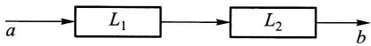
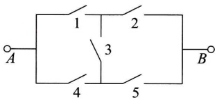
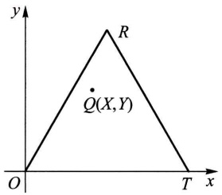

# 选做习题

原始 PDF 第 390–401 页。

## 选做习题

1. 一打靶场备有5支某种型号的枪，其中3支已经校正，2支未经校正。某人使用已校正的枪击中目标的概率为 $p_1$，使用未经校正的枪击中目标的概率为 $p_2$。他随机地取一支枪进行射击，已知他射击了5次，都未击中，求他使用的是已校正的枪的概率（设各次射击的结果相互独立）。

2. 某人共买了11个水果, 其中有3个是二级品, 8个是一级品. 随机地将水果分给 $A, B, C$ 三人, 各人分别得到4个、6个、1个.

(1) 求 C 未拿到二级品的概率.

(2) 已知 C 未拿到二级品, 求 A, B 均拿到二级品的概率.

(3) 求 A, B 均拿到二级品而 C 未拿到二级品的概率.

3. 一系统 $L$ 由两个只能传输字符0和1的独立工作的子系统 $L_{1}$ 与 $L_{2}$ 串联而成（如题3图），每个子系统输入为0输出为0的概率为 $p(0 < p < 1)$；而输入为1输出为1的概率也是

p. 今在图中 a 端输入字符 1, 求系统 L 的 b 端输出字符 0 的概率.

题3图

4. 甲、乙两人轮流掷一颗骰子，每轮掷一次，
谁先掷得6点谁得胜，从甲开始掷，问甲、乙得胜的概率各为多少？

5. 将一颗骰子掷两次, 考虑事件 $A =$ “第一次掷得点数 2 或 5”, $B =$ “两次点数之和至少为 7”, 求 $P(A), P(B)$, 并问事件 $A, B$ 是否相互独立.

6. A, B 两人轮流射击，每次每人射击一枪，射击的次序为 A, B, A, B, A, …，射击直至击中两枪为止。设每人击中的概率均为 p，且各次击中与否相互独立。求击中的两枪是由同一人射击的概率。（提示:分别考虑两枪是由 A 击中的与两枪是由 B 击中的两种情况，若两枪是由 A 击中的，则射击必然在奇数次结束。又当  $|x|<1$  时， $1+2x+3x^{2}+\cdots=1/(1-x)^{2}$ 。）

7. 有3个独立工作的元件1、元件2、元件3，它们的可靠性分别为 $p_1, p_2, p_3$。设由它们组成一个“3个元件取2个元件的表决系统”，记为 $2/3[G]$。这一系统的运行方式是当且仅当3个元件中至少有2个正常工作时这一系统正常工作。求这一 $2/3[G]$ 系统的可靠性。

8. 在如题 8 图所示的桥式结构的电路中, 第 i 个继电器触点闭合的概率为  $p_{i}, i=1,2,3,4,5$ . 各继电器工作相互独立.

（1）以继电器触点1是否闭合为条件，求 $A$ 到 $B$ 之间为通路的概率.

(2) 已知 A 到 B 为通路的条件下, 求继电器触点 3 闭

text_image

1
2
3
4
5
A
B

题8图

---

· 376 ·

选做习题

合的概率.

9. 进行非学历考试, 规定考甲、乙两门课程, 每门课程考试第一次未通过都只允许考第二次. 考生仅在课程甲通过后才能考课程乙, 如两门课程都通过可获得一张资格证书. 设某考生通过课程甲的各次考试的概率为 $p_1$, 通过课程乙的各次考试的概率为 $p_2$, 设各次考试的结果相互独立. 又设考生参加考试直至获得资格证书或者不准予再考为止. 以 $X$ 表示考生总共需考试的次数. 求 $X$ 的分布律.

10. (1) 5 只电池中有 2 只是次品, 每次取一只测试, 直到将 2 只次品都找到. 设第 2 只次品在第 $X(X = 2,3,4,5)$ 次找到, 求 $X$ 的分布律 (注: 实际上第 5 次检测可无须进行).

（2）5只电池中2只是次品，每次取一只，直到找出2只次品或3只正品为止.写出需要测试的次数的分布律.

11. 向某一目标发射炮弹, 设炮弹弹着点离目标的距离为 R (以 10 m 计), R 服从瑞利分布, 其概率密度为

$$
f _ {R} (r) = \left\{ \begin{array}{l l} \frac {2 r}{2 5} \mathrm{e} ^ {- r ^ {2} / 2 5}, & r > 0, \\ 0, & r \leqslant 0. \end{array} \right.
$$

若弹着点离目标不超过5个单位时,目标被摧毁.

(1) 求发射一枚炮弹能摧毁目标的概率.

(2) 为使至少有一枚炮弹能摧毁目标的概率不小于0.94,问最少需要独立发射多少枚炮弹?

12. 设一枚深水炸弹击沉一潜艇的概率为 $1/3$，击伤的概率为 $1/2$，击不中的概率为 $1/6$。并设击伤两次也会导致潜艇下沉。求施放 4 枚深水炸弹能击沉潜艇的概率。（提示:先求击不沉的概率。）

13. 一盒中装有4只白球，8只黑球，从中取3只球，每次一只，作不放回抽样。

(1) 求第 1 次和第 3 次都取到白球的概率。(提示: 考虑第 2 次的抽取.)

(2) 求在第 1 次取到白球的条件下, 前 3 次都取到白球的概率.

14. 设元件的寿命 T（以 h 计）服从指数分布，分布函数为

$$
F (t) = \left\{ \begin{array}{l l} 1 - \mathrm{e} ^ {- 0. 0 3 t}, & t > 0, \\ 0, & t \leqslant 0. \end{array} \right.
$$

(1) 已知元件至少工作了 30 h, 求它能再至少工作 20 h 的概率.

(2) 由 3 个独立工作的此种元件组成一个 $2 / 3[G]$ 系统(参见第 7 题). 求这一系统的寿命 $X > 20$ 的概率.

15.（1）已知随机变量 $X$ 的概率密度为 $f_{X}(x) = \frac{1}{2}\mathrm{e}^{-|x|}, - \infty < x < \infty$ ，求 $X$ 的分布函数.

(2) 已知随机变量 X 的分布函数为  $F_{X}(x)$ ，另有随机变量

$$
Y = \left\{ \begin{array}{l l} 1, & X > 0, \\ - 1, & X \leqslant 0, \end{array} \right.
$$

---

选做习题

· 377 ·

试求 $Y$ 的分布律和分布函数.

16.（1）设随机变量 $X$ 服从泊松分布，其分布律为

$$
P \{X = k \} = \frac {\lambda^ {k} \mathrm{e} ^ {- \lambda}}{k !}, \quad k = 0, 1, 2, \dots ,
$$

问当 $k$ 取何值时 $P\{X = k\}$ 为最大？

(2) 设随机变量 X 服从二项分布, 其分布律为

$$
P \{X = k \} = {\binom {n} {k}} p ^ {k} (1 - p) ^ {n - k}, \quad k = 0, 1, 2, \dots , n.
$$

问当 $k$ 取何值时 $P\{X = k\}$ 为最大？

17. 若离散型随机变量 $X$ 具有分布律

| X | 1 | 2 | $\cdots$ | n |
| --- | --- | --- | --- | --- |
| $p_k$ | $\frac{1}{n}$ | $\frac{1}{n}$ | $\cdots$ | $\frac{1}{n}$ |

则称 X 服从取值为  $1,2,\cdots,n$  的离散型均匀分布. 对于任意非负实数 x, 记 [x] 为不超过 x 的最大整数. 设随机变量  $U \sim U(0,1)$ , 证明  $X = [nU] + 1$  服从取值为  $1,2,\cdots,n$  的离散型均匀分布.

18. 设随机变量  $X \sim U(-1, 2)$ ，求  $Y = |X|$  的概率密度.

19. 设随机变量 $X$ 的概率密度为

$$
f _ {X} (x) = \left\{ \begin{array}{l l} 0, & x <   0, \\ \frac {1}{2}, & 0 \leqslant x <   1, \\ \frac {1}{2 x ^ {2}}, & 1 \leqslant x <   \infty . \end{array} \right.
$$

求 $Y = \frac{1}{X}$ 的概率密度.

20. 设随机变量 $X$ 服从参数为 $1 / \lambda$ 的指数分布. 验证随机变量 $Y = [X]$ 服从参数为 $1 - \mathrm{e}^{-\lambda}$ 的几何分布. 这一事实表明连续型随机变量的函数可以是离散型随机变量.

21. 投掷一枚硬币直至正面出现为止, 引入随机变量

$$
X = \text {投掷总次数}.
$$

$$
Y = \left\{ \begin{array}{l l} 1, & \text {若首次投掷得到正面,} \\ 0, & \text {若首次投掷得到反面.} \end{array} \right.
$$

(1) 求 X 和 Y 的联合分布律及边缘分布律.

(2) 求条件概率  $P\{X=1 \mid Y=1\}$ ,  $P\{Y=2 \mid X=1\}$ .

22. 设随机变量 $X \sim \pi(\lambda)$, 随机变量 $Y = \max\{X, 2\}$. 试求 $X$ 和 $Y$ 的联合分布律及边缘分布律.

23. 设 $X, Y$ 是相互独立的泊松随机变量，参数分别为 $\lambda_1, \lambda_2$，求给定 $X + Y = n$ 的条件下

---

· 378 ·

选做习题

$X$ 的条件分布.

24. 一教授将两篇论文分别交给两个打字员打印. 以 $X, Y$ 分别表示第一篇和第二篇论文的打印错误. 设 $X \sim \pi(\lambda), Y \sim \pi(\mu), X, Y$ 相互独立.

(1) 求 X, Y 的联合分布律.

(2) 求两篇论文总共至多 1 个打印错误的概率.

25. 一等边三角形 $ROT$ (如题25图)的边长为1,在三角形内随机地取点 $Q(X,Y)$ （意指随机点 $(X,Y)$ 在三角形 $ROT$ 内均匀分布).

(1) 写出随机变量 $(X,Y)$ 的概率密度.
(2) 求点 Q 到底边 OT 的距离的分布函数.

26. 设随机变量 $(X, Y)$ 具有概率密度

$$
f (x, y) = \left\{ \begin{array}{l l} x \mathrm{e} ^ {- x (y + 1)}, & x > 0, y > 0, \\ 0, & \text {其他}. \end{array} \right.
$$

text_image

y
R
Q(X,Y)
O
T x

题25图

(1) 求边缘概率密度  $f_{X}(x)$ ,  $f_{Y}(y)$ .
(2) 求条件概率密度  $f_{X|Y}(x \mid y)$ ,  $f_{Y|X}(y \mid x)$ .

27. 设有随机变量 $U$ 和 $V$, 它们都仅取 1, -1 两个值. 已知

$$
\begin{array}{l} P \{U = 1 \} = 1 / 2, \\ P \{V = 1 \mid U = 1 \} = 1 / 3 = P \{V = - 1 \mid U = - 1 \}. \\ \end{array}
$$

(1) 求 U 和 V 的联合分布律.
(2) 求 x 的方程  $x^{2} + Ux + V = 0$  至少有一个实根的概率.
(3) 求 x 的方程  $x^{2}+(U+V)x+U+V=0$  至少有一个实根的概率.

28. 某图书馆一天的读者人数 $X \sim \pi(\lambda)$, 任一读者借书的概率为 $p$, 各读者借书与否相互独立. 记一天读者借书的人数为 $Y$, 求 $X$ 和 $Y$ 的联合分布律.
29. 设随机变量 $X, Y$ 相互独立，且都服从均匀分布 $U(0,1)$，求两变量之一至少为另一变量之值之两倍的概率。
30. 一家公司有一份保单招标,两家保险公司竞标.规定标书的保险费必须在20万元至22万元之间.若两份标书保险费相差2000元或2000元以上,招标公司将选择报价低者,否则就重新招标.设两家保险公司的报价是相互独立的,且都在20万至22万之间均匀分布.试求招标公司需重新招标的概率.
31. 设随机变量 $X \sim N(0, \sigma_1^2), Y \sim N(0, \sigma_2^2)$，且 $X, Y$ 相互独立，求概率

$$
P \{0 <   \sigma_ {2} X - \sigma_ {1} Y <   2 \sigma_ {1} \sigma_ {2} \}.
$$

32. NBA 篮球赛中有这样的规律,两支实力相当的球队比赛时,每节主队得分与客队得分之差为正态随机变量,均值为 1.5,方差为 6,并且假设四节的比分差是相互独立的.问:

(1) 主队胜的概率有多大?
(2) 在前半场主队落后 5 分的情况下, 主队得胜的概率有多大?
(3) 在第一节主队赢 5 分的情况下, 主队得胜的概率有多大?

---

选做习题

· 379 ·

33. 产品的某种性能指标的测量值 $X$ 是随机变量，设 $X$ 的概率密度为

$$
f _ {X} (x) = \left\{ \begin{array}{l l} x \mathrm{e} ^ {- \frac {1}{2} x ^ {2}}, & x > 0, \\ 0, & \text {其他}. \end{array} \right.
$$

测量误差 $Y \sim U(-\varepsilon, \varepsilon), X, Y$ 相互独立. 求 $Z = X + Y$ 的概率密度 $f_{Z}(z)$, 并验证

$$
P \{Z > \varepsilon \} = \frac {1}{2 \varepsilon} \int_ {0} ^ {2 \varepsilon} \mathrm{e} ^ {- u ^ {2 / 2}} \mathrm{d} u.
$$

34. 在一化学过程中, 产品中有份额 $X$ 为杂质, 而在杂质中有份额 $Y$ 是有害的, 而其余部分不影响产品的质量. 设 $X \sim U(0,0.1), Y \sim U(0,0.5)$, 且 $X$ 和 $Y$ 相互独立. 求产品中有害杂质份额 $Z$ 的概率密度.

35. 设随机变量 $(X, Y)$ 的概率密度为

$$
f (x, y) = \left\{ \begin{array}{l l} \mathrm{e} ^ {- y}, & 0 <   x <   y, \\ 0, & \text {其他}. \end{array} \right.
$$

(1) 求  $(X,Y)$  的边缘概率密度.

(2) 问 X, Y 是否相互独立?

(3) 求  $X + Y$  的概率密度  $f_{X + Y}(z)$ .

(4) 求条件概率密度  $f_{X|Y}(x|y)$ .

(5) 求条件概率  $P\{X>3 \mid Y<5\}$ .

(6) 求条件概率  $P\{X>3 \mid Y=5\}$ .

36. 设某图书馆的读者借阅甲种图书的概率为 $p$, 借阅乙种图书的概率为 $\alpha$, 设每人借阅甲、乙图书的行动相互独立, 读者之间的行动也相互独立.

(1) 某天恰有 n 个读者, 求借阅甲种图书的人数的数学期望.

(2) 某天恰有 n 个读者, 求甲、乙两种图书中至少借阅一种的人数的数学期望.

37. 某种鸟在某时间区间 $(0, t_0]$ 下蛋数为 $1 \sim 5$ 只，下 $r$ 只蛋的概率与 $r$ 成正比。一个拾蛋人在时刻 $t_0$ 去收集鸟蛋，但他仅当鸟窝中多于3只蛋时才从中取走一只蛋。在某处有这种鸟的鸟窝6个（每个鸟窝保存完好，各鸟窝中蛋的只数相互独立）。

(1) 写出一个鸟窝中鸟蛋只数 X 的分布律.

(2) 对于指定的一个鸟窝, 求拾蛋人在该鸟窝中拾到一只蛋的概率.

(3) 求拾蛋人在 6 个鸟窝中拾到蛋的总数 Y 的分布律及数学期望.

(4) 求  $P\{Y<4\}$ ,  $P\{Y>4\}$ .

（5）当一个拾蛋人在这6个鸟窝中拾过蛋后，紧接着又有一个拾蛋人到这些鸟窝中拾蛋，也仅当鸟窝中多于3只蛋时，拾取一只蛋，求第二个拾蛋人拾得蛋数 $Z$ 的数学期望.

38. 设袋中有 $r$ 只白球、$N - r$ 只黑球. 在袋中取球 $n (n \leqslant r)$ 次, 每次任取一只作不放回抽样, 以 $Y$ 表示取到白球的个数, 求 $E(Y)$. (提示: 引入随机变量:

$$
X _ {i} = \left\{ \begin{array}{l l} 1, & \text {若第} i \text {次取到白球}, \\ 0, & \text {若第} i \text {次取到黑球}, \end{array} \right. i = 1, 2, \dots , n,
$$

则 $Y = X_{1} + X_{2} + \dots +X_{n}$

39. 抛一颗骰子直到所有点数全部出现为止, 求所需抛掷次数 Y 的数学期望. (提示: 令

---

· 380 ·

选做习题

$X_{1} = 1, X_{2} =$ “第一个点数得到后，等待第二个不同点数所需的等待次数”，$X_{3} =$ “第一、二两点数得到后，等待第三个不同点数所需的等待次数”，$X_{4}, X_{5}, X_{6}$ 类似，则 $Y = X_{1} + X_{2} + \dots + X_{6}$. 又几何分布 $P\{X = k\} = (1 - p)^{k - 1}p, k = 1, 2, \dots$ 的数学期望 $E(X) = \frac{1}{p}$.）

40. 设随机变量 $X, Y$ 相互独立. 且 $X, Y$ 分别服从以 $1 / \alpha, 1 / \beta$ 为均值的指数分布. 求 $E(X^2 + Y\mathrm{e}^{-X})$.

41. 一酒吧间柜台前有 6 张凳子,服务员预测,若两个陌生人进来就座的话,他们之间至少相隔两张凳子.(提示:先列出两人之间至少隔两张凳子的不同情况.)

(1) 若真有两个陌生人入内,他们随机地就座,问服务员预言为真的概率是多少?

(2) 设两位顾客是随机就座的, 求顾客之间凳子数的数学期望.

42. 设随机变量  $X_{1}, X_{2}, \cdots, X_{100}$  相互独立，且都服从  $U(0,1)$ ，又设  $Y = X_{1} \cdot X_{2} \cdot \cdots \cdot X_{100}$ ，求概率  $P\{Y < 10^{-40}\}$  的近似值.

43. 来自某个城市的长途电话呼唤的持续时间 X(以 min 计) 是一个随机变量, 它的分布函数是

$$
F (x) = \left\{ \begin{array}{l l} 1 - \frac {1}{2} \mathrm{e} ^ {- \frac {x}{3}} - \frac {1}{2} \mathrm{e} ^ {- \left[ \frac {x}{3} \right]}, & x \geqslant 0, \\ 0, & x <   0 \end{array} \right.
$$

$\left( \text{其中} \left[ \frac{x}{3} \right] \text{是不大于} \frac{x}{3} \text{的最大整数} \right).$\)

(1) 画出  $F(x)$  的图形.

(2) 说明 X 是什么类型的随机变量.

(3) 求  $P\{X=4\}, P\{X=3\}, P\{X<4\}, P\{X>6\}$ . (提示:  $P\{X=a\}=F(a)-F(a-0)$ .)

44. 一汽车保险公司分析一组(250人)签约的客户中的赔付情况. 据历史数据分析, 在未来的一周中一组客户中至少提出一项索赔的客户数 $X$ 占 $10\%$. 写出 $X$ 的分布, 并求 $X > 250 \times 0.12$ (即 $X > 30$) 的概率. 设各客户是否提出索赔相互独立.

45. 在区间 $(0,1)$ 随机地取一点 X. 定义  $Y=\min\{X,0.75\}$ .

(1) 求随机变量 Y 的值域.

(2) 求 Y 的分布函数, 并画出它的图形.

(3) 说明 Y 不是连续型随机变量, Y 也不是离散型随机变量.

46. 设 $X_{1}, X_{2}$ 是数学期望为 $\theta$ 的指数分布总体 $X$ 的容量为 2 的样本，设 $Y = \sqrt{X_{1}X_{2}}$，试证明 $E\left(\frac{4Y}{\pi}\right) = \theta$.

47. 设总体  $X \sim N(\mu, \sigma^{2})$ ,  $X_{1}, X_{2}, \cdots, X_{n}$  是一个样本.  $\overline{X}, S^{2}$  分别为样本均值和样本方差，试证  $E[(\overline{X}S^{2})^{2}] = \left(\frac{\sigma^{2}}{n} + \mu^{2}\right)\left(\frac{2\sigma^{4}}{n-1} + \sigma^{4}\right)$ . (提示: 注意到  $\overline{X}$  与  $S^{2}$  相互独立，且有  $\frac{(n-1)S^{2}}{\sigma^{2}} \sim \chi^{2}(n-1)$ .)

48. 设总体 $X$ 具有概率密度

---

选做习题

· 381 ·

$$
f (x) = \left\{ \begin{array}{l l} \frac {1}{\theta^ {2}} x \mathrm{e} ^ {- x / \theta}, & x > 0, \\ 0, & x \leqslant 0, \end{array} \right.
$$

其中  $\theta>0$  为未知参数， $X_{1},X_{2},\cdots,X_{n}$  是来自 X 的样本， $x_{1},x_{2},\cdots,x_{n}$  是相应的样本观察值.

(1) 求  $\theta$  的最大似然估计量.

(2) 求  $\theta$  的矩估计量.

(3) 问求得的估计量是否是无偏估计量?

49. 设  $X_{1}, X_{2}, \cdots, X_{n_{1}}$  以及  $Y_{1}, Y_{2}, \cdots, Y_{n_{2}}$  为分别来自总体  $N(\mu_{1}, \sigma^{2})$  与  $N(\mu_{2}, \sigma^{2})$  的样本，且它们相互独立.  $\mu_{1}, \mu_{2}, \sigma^{2}$  均未知，试求  $\mu_{1}, \mu_{2}, \sigma^{2}$  的最大似然估计量.
50. 为了研究一批贮存着的产品的可靠性，在产品投入贮存时，即在时刻  $t_{0}=0$  时，随机地选定 n 件产品，然后在预先规定的时刻  $t_{1}, t_{2}, \cdots, t_{k}$  取出来进行检测（检测时确定已失效的去掉，将未失效的继续投入贮存），今得到以下的寿命试验数据:

| 检测时刻(月) | $t_1$ | $t_2$ | ... | $t_k$ |  |
| --- | --- | --- | --- | --- | --- |
| 区间($t_{i-1},t_i$) | $(0,t_1]$ | $(t_1,t_2]$ | ... | $(t_{k-1},t_k]$ | $(t_k,\infty)$ |
| 在($t_{i-1},t_i$)的失效数 | $d_1$ | $d_2$ | ... | $d_k$ | $s$$\sum_{i=1}^{k}d_i + s = n$ |

这种数据称为区间数据. 设产品寿命 $T$ 服从指数分布, 其概率密度为

$$
f (t) = \left\{ \begin{array}{l l} \lambda \mathrm{e} ^ {- \lambda t}, & t > 0, \\ 0, & \text {其他}, \end{array} \right. \lambda > 0 \text {未知}.
$$

（1）试基于上述数据写出  $\lambda$  的对数似然方程。（提示:考虑事件“n 只产品分别在区间  $(0, t_{1}], (t_{1}, t_{2}], \cdots, (t_{k-1}, t_{k}]$  失效  $d_{1}, d_{2}, \cdots, d_{k}$  只，而直至  $t_{k}$  还有 s 只未失效”的概率。）
（2）设  $d_{1}<n, s<n$ ，我们可以用数值解法求得  $\lambda$  的最大似然估计值，在计算机上计算是容易的。特别，取检测时间是等间隔的，即取  $t_{i}=it_{1}, i=1,2,\cdots,k$ 。验证，此时可得  $\lambda$  的最大似然估计为

$$
\hat {\lambda} = \frac {1}{t _ {1}} \ln \Big [ 1 + \frac {n - s}{\sum_ {i = 2} ^ {k} (i - 1) d _ {i} + s k} \Big ].
$$

51. 设某种电子器件的寿命 $T$ (以 $\mathrm{h}$ 计) 服从指数分布, 概率密度为

$$
f (t) = \left\{ \begin{array}{l l} \lambda \mathrm{e} ^ {- \lambda t}, & t > 0, \\ 0, & \text {其他}, \end{array} \right.
$$

其中 $\lambda > 0$ 未知. 从这批器件中任取 $n$ 只在时刻 $t = 0$ 时投入独立寿命试验. 试验进行到预定时间 $T_0$ 结束. 此时, 有 $k (0 < k < n)$ 只器件失效, 试求 $\lambda$ 的最大似然估计. (提示: 考虑“试验直至时刻 $T_0$ 为止, 有 $k$ 只器件失效, 而有 $n - k$ 只未失效”这一事件的概率, 从而写出 $\lambda$ 的似然方程.)

52. 设系统由两个独立工作的成败型元件串联而成（成败型元件只有两种状态:正常工作或失效）。元件1、元件2的可靠性分别为 $p_1, p_2$，它们均未知。随机地取 $N$ 个系统投入试验，当系统中至少有一个元件失效时系统失效，现得到以下的试验数据:$n_1$ 表示仅元件1失

---

· 382 ·

选做习题

效的系统数， $n_{2}$  表示仅元件 2 失效的系统数， $n_{12}$  表示元件 1、元件 2 至少有一个失效的系统数，s 表示未失效的系统数。 $n_{1} + n_{2} + n_{12} + s = N$ 。这里  $n_{12}$  为隐蔽数据，也就是只知系统失效，但不能知道是由元件 1 或元件 2 单独失效引起的，还是由元件 1,2 均失效引起的，设隐蔽与系统失效的真正原因独立。

(1) 试写出  $p_{1}, p_{2}$  的似然函数.

（2）设有系统寿命试验数据 $N = 20, n_1 = 5, n_2 = 3, n_{12} = 1, s = 11$. 试求 $p_1, p_2$ 的最大似然估计值. (提示: $p_1$ 应满足方程 $(p_1 - 1)(12p_1^2 + 11p_1 - 14) = 0$.)

53.（1）设总体 $X$ 具有分布律

| X | 1 | 2 | 3 |
| --- | --- | --- | --- |
| $p_k$ | θ | θ | 1-2θ |

$\theta > 0$ 未知，今有样本

1 1 1 3 2 1 3 2 2 1 2 2 3 1 1 2

试求  $\theta$  的最大似然估计值和矩估计值.

(2) 设总体 X 服从  $\Gamma$  分布, 其概率密度为

$$
f (x) = \left\{ \begin{array}{l l} \frac {1}{\beta^ {\alpha} \Gamma (\alpha)} x ^ {\alpha - 1} \mathrm{e} ^ {- x / \beta}, & x > 0, \\ 0, & \text {其他.} \end{array} \right.
$$

其形状参数  $\alpha>0$  为已知，尺度参数  $\beta>0$  未知. 今有样本值  $x_{1}, x_{2}, \cdots, x_{n}$ ，求  $\beta$  的最大似然估计值.

54.（1）设随机变量 $Z = \ln X\sim N(\mu ,\sigma^2)$ ，即 $X$ 服从对数正态分布，验证 $E(X) =$ $\exp \left\{\mu +\frac{1}{2}\sigma^2\right\} .$

(2) 设自(1)中总体 X 中取一容量为 n 的样本  $x_{1}, x_{2}, \cdots, x_{n}$ ，求  $E(X)$  的最大似然估计。此处设  $\mu, \sigma^{2}$  均为未知。

（3）已知在文学家萧伯纳的 An Intelligent Woman's Guide To Socialism 一书中，一个句子的单词数近似地服从对数正态分布，设  $\mu$  及  $\sigma^{2}$  为未知。今自该书中随机地取 20 个句子，这些句子中的单词数分别为

| 52 | 24 | 15 | 67 | 15 | 22 | 63 | 26 | 16 | 32 |
| --- | --- | --- | --- | --- | --- | --- | --- | --- | --- |
| 7 | 33 | 28 | 14 | 7 | 29 | 10 | 6 | 59 | 30 |

问这本书中,一个句子单词数均值的最大似然估计值等于多少?

55. 考虑进行定数截尾寿命试验, 假设将随机抽取的 n 件产品在时间 t=0 时同时投入试验. 试验进行到 m 件  $(m<n)$  产品失效时停止, m 件失效产品的失效时间分别为  $0 \leqslant t_{1} \leqslant t_{2} \leqslant \cdots \leqslant t_{m}$ .  $t_{m}$  是第 m 件产品的失效时间. 设产品的寿命分布为韦布尔分布, 其概率密度为

$$
f (t) = \left\{ \begin{array}{l l} \frac {\beta}{\eta^ {\beta}} t ^ {\beta - 1} \mathrm{e} ^ {- \left(\frac {t}{\eta}\right) ^ {\beta}}, & t > 0, \\ 0, & \text {其他}, \end{array} \right.
$$

---

选做习题

· 383 ·

其中参数 $\beta > 0$ 已知. 求参数 $\eta$ 的最大似然估计.

56. 设某大城市郊区的一条林荫道两旁开设了许多小商店，这些商店的开设延续时间（以月计）是一个随机变量，现随机地取30家商店，将它们的延续时间按自小到大排序，选其中前8家商店，它们的延续时间分别是

$$
3. 2 \quad 3. 9 \quad 5. 9 \quad 6. 5 \quad 1 6. 5 \quad 2 0. 3 \quad 4 0. 4 \quad 5 0. 9
$$

假设商店开设延续时间的长度是韦布尔随机变量.其概率密度为

$$
f (x) = \left\{ \begin{array}{l l} \frac {\beta}{\eta^ {\beta}} x ^ {\beta - 1} \mathrm{e} ^ {- \left(\frac {x}{\eta}\right) ^ {\beta}}, & x > 0, \\ 0, & \text {其他}, \end{array} \right.
$$

其中  $\beta=0.8.$

(1) 试用上题结果, 写出  $\eta$  的最大似然估计.

(2) 按(1)的结果求商店开设延续时间至少为 2 年的概率的估计.

57. 设分别自总体 $N(\mu_1, \sigma^2)$ 和 $N(\mu_2, \sigma^2)$ 中抽取容量为 $n_1, n_2$ 的两独立样本，其样本方差分别为 $S_1^2, S_2^2$. 试证，对于任意常数 $a, b (a + b = 1), Z = aS_1^2 + bS_2^2$ 都是 $\sigma^2$ 的无偏估计，并确定常数 $a, b$，使 $D(Z)$ 达到最小.

58. 设总体  $X \sim N(\mu, \sigma^{2})$ ,  $X_{1}, X_{2}, \cdots, X_{n}$  是来自 X 的样本. 已知样本方差  $S^{2} = \frac{1}{n-1} \sum_{i=1}^{n} (X_{i} - \overline{X})^{2}$  是  $\sigma^{2}$  的无偏估计. 验证样本标准差 S 不是标准差  $\sigma$  的无偏估计. (提示: 记  $Y = \frac{(n-1)S^{2}}{\sigma^{2}}$ , 则  $Y \sim \chi^{2}(n-1)$ , 而  $S = \frac{\sigma}{\sqrt{n-1}} \sqrt{Y}$  是 Y 的函数, 利用  $\chi^{2}(n-1)$  的概率密度可得  $E(S) = \sqrt{\frac{2}{n-1}} \frac{\Gamma(n/2)\sigma}{\Gamma((n-1)/2)} \neq \sigma.$

59. 设总体 X 服从指数分布, 其概率密度为

$$
f (x) = \left\{ \begin{array}{l l} \frac {1}{\theta} \mathrm{e} ^ {- x / \theta}, & x > 0, \\ 0, & \text {其他.} \end{array} \right.
$$

$\theta>0$  未知.从总体中抽取一容量为 n 的样本  $X_{1}, X_{2}, \cdots, X_{n}$ .

(1) 证明 $\frac{2n\overline{X}}{\theta} \sim \chi^2 (2n)$.

(2) 求  $\theta$  的置信水平为  $1-\alpha$  的单侧置信下限.

(3) 某种元件的寿命(以 h 计)服从上述指数分布, 现从中抽得一容量 n=16 的样本, 测得样本均值为 5010 h, 试求元件的平均寿命的置信水平为 0.90 的单侧置信下限.

60. 设总体  $X \sim U(0, \theta)$ ,  $X_{1}, X_{2}, \cdots, X_{n}$  是来自 X 的样本.

(1) 验证  $Y=\max\{X_{1},X_{2},\cdots,X_{n}\}$  的分布函数为

$$
F _ {Y} (y) = \left\{ \begin{array}{l l} 0, & y <   0, \\ y ^ {n} / \theta^ {n}, & 0 \leqslant y <   \theta , \\ 1, & y \geqslant \theta . \end{array} \right.
$$

(2) 验证  $U = Y / \theta$  的概率密度为

---

· 384 ·

选做习题

$$
f _ {U} (u) = \left\{ \begin{array}{l l} n u ^ {n - 1}, & 0 <   u <   1, \\ 0, & \text {其他}. \end{array} \right.
$$

(3) 给定正数  $\alpha, 0 < \alpha < 1$ ，求 U 的分布的上  $\alpha / 2$  分位数  $h_{\alpha / 2}$  以及上  $1 - \alpha / 2$  分位数  $h_{1 - \alpha / 2}$ .

(4) 利用(2)，(3) 求参数  $\theta$  的置信水平为  $1 - \alpha$  的置信区间.

（5）设某人上班的等车时间  $X \sim U(0, \theta)$ ， $\theta$  未知。现在有样本  $x_{1} = 4.2, x_{2} = 3.5, x_{3} = 1.7, x_{4} = 1.2, x_{5} = 2.4$ ，求  $\theta$  的置信水平为 0.95 的置信区间。

61. 设总体 X 服从指数分布, 概率密度为

$$
f (x) = \left\{ \begin{array}{l l}  \frac {1}{\theta} \mathrm{e} ^ {- x / \theta}, & x > 0, \\ 0, & \text {其他}, \end{array} \right. \quad \theta > 0.
$$

设  $X_{1}, X_{2}, \cdots, X_{n}$  是来自 X 的一个样本. 试取第 59 题中当  $\theta = \theta_{0}$  时的统计量  $\chi^{2} = \frac{2n\overline{X}}{\theta_{0}}$  作为检验统计量, 检验假设  $H_{0}: \theta = \theta_{0}, H_{1}: \theta \neq \theta_{0}$ . 取显著性水平为  $\alpha$  (注意:  $E(\overline{X}) = \theta$ ).

设某种电子元件的寿命(以 h 计)服从均值为  $\theta$  的指数分布,随机取 12 只元件测得它们的寿命分别为

340 430 560 920 1380 1520 1660 1770 2100 2320 2350 2650 试取显著性水平 $\alpha = 0.05$ ，检验假设 $H_0: \theta = 1450, H_1: \theta \neq 1450$.

62. 经过十一年的试验, 达尔文于 1876 年得到 15 对玉米样品的数据如下表, 每对作物除授粉方式不同外, 其他条件都是相同的. 试用逐对比较法检验不同授粉方式对玉米高度是否有显著的影响 ( $\alpha=0.05$ ). 问应增设什么条件才能用逐对比较法进行检验?

<table><tr><td>授粉方式</td><td>1</td><td>2</td><td>3</td><td>4</td><td colspan="2">5</td><td>6</td><td>7</td></tr><tr><td>异株授粉的作物高度(xi)</td><td>23 1/8</td><td>12</td><td>20 3/8</td><td>22</td><td colspan="2">19 1/8</td><td>21 4/8</td><td>22 1/8</td></tr><tr><td>同株授粉的作物高度(yi)</td><td>27 3/8</td><td>21</td><td>20</td><td>20</td><td colspan="2">19 3/8</td><td>18 5/8</td><td>18 5/8</td></tr><tr><td>授粉方式</td><td>8</td><td>9</td><td>10</td><td>11</td><td>12</td><td colspan="2">13</td><td>14</td></tr><tr><td>异株授粉的作物高度(xi)</td><td>20 3/8</td><td>18 2/8</td><td>21 5/8</td><td>23 2/8</td><td>21</td><td colspan="2">22 1/8</td><td>23</td></tr><tr><td>同株授粉的作物高度(yi)</td><td>15 2/8</td><td>16 4/8</td><td>18</td><td>16 2/8</td><td>18</td><td colspan="2">12 6/8</td><td>15 4/8</td></tr></table>

63. 一内科医生声称, 如果患者每天傍晚聆听一种特殊的轻音乐会降低血压(舒张压, 以 mmHg 计, 1 mmHg=133.3224 Pa). 今选取了 10 个患者在试验之前和试验之后分别测量了血压, 得到以下的数据:

---

选做习题

· 385 ·

| 患者 | 1 | 2 | 3 | 4 | 5 | 6 | 7 | 8 | 9 | 10 |
| --- | --- | --- | --- | --- | --- | --- | --- | --- | --- | --- |
| 试验之前($x_i$) | 86 | 92 | 95 | 84 | 80 | 78 | 98 | 95 | 94 | 96 |
| 试验之后($y_i$) | 84 | 83 | 81 | 78 | 82 | 74 | 86 | 85 | 80 | 82 |

设  $D_{i}=X_{i}-Y_{i}(i=1,2,\cdots,10)$  为来自正态总体  $N(\mu_{D},\sigma_{D}^{2})$  的样本， $\mu_{D},\sigma_{D}^{2}$  均未知。试检验是否可以认为医生的意见是对的（取  $\alpha=0.05$ ）。

64. 以下是各种颜色的汽车的销售情况:

| 颜色 | 红 | 黄 | 蓝 | 绿 | 棕 |
| --- | --- | --- | --- | --- | --- |
| 车辆数 | 40 | 64 | 46 | 36 | 14 |

试检验顾客对这些颜色是否有偏爱，即检验销售情况是否是均匀的(取 $\alpha=0.05$ ).

65. 某种闪光灯, 每盏灯含 4 个电池, 随机地取 150 盏灯, 经检测得到以下的数据:

| 一盏灯损坏的电池数x | 0 | 1 | 2 | 3 | 4 |
| --- | --- | --- | --- | --- | --- |
| 灯的盏数 | 26 | 51 | 47 | 16 | 10 |

试取  $\alpha=0.05$  检验一盏灯损坏的电池数  $X\sim b(4,\theta)(\theta$  未知).

66. 临界闪烁频率(cff)是人眼对于闪烁光源能够分辨出它在闪烁的最高频率(以 Hz 计). 超过 cff 的频率, 即使光源实际是在闪烁的, 人看起来也是连续的(不闪烁的). 一项研究旨在判定 cff 的均值是否与人眼的虹膜颜色有关, 所得数据如下:

<table><tr><td>虹膜颜色</td><td colspan="2">棕色</td><td colspan="2">绿色</td><td colspan="2">蓝色</td></tr><tr><td rowspan="4">临界闪烁频率(cff)</td><td>26.8</td><td>26.3</td><td>26.4</td><td>29.1</td><td>25.7</td><td>29.4</td></tr><tr><td>27.9</td><td>24.8</td><td colspan="2">24.2</td><td>27.2</td><td>28.3</td></tr><tr><td>23.7</td><td>25.7</td><td colspan="2">28.0</td><td colspan="2">29.9</td></tr><tr><td>25.0</td><td>24.5</td><td colspan="2">26.9</td><td colspan="2">28.5</td></tr></table>

试在显著性水平0.05下，检验各种虹膜颜色相应的cff的均值有无显著的差异。设各个总体服从正态分布，且方差相等，不同颜色下的样本之间相互独立。

67. 下面列出了挪威人自 1938—1947 年间年人均脂肪消耗量与患动脉粥样硬化症而死亡的死亡率之间相关的一组数据:

---

· 386 ·

选做习题

| 年份 | 1938 | 1939 | 1940 | 1941 | 1942 | 1943 | 1944 | 1945 | 1946 | 1947 |
| --- | --- | --- | --- | --- | --- | --- | --- | --- | --- | --- |
| 脂肪消耗量x(kg/人年) | 14.4 | 16.0 | 11.6 | 11.0 | 10.0 | 9.6 | 9.2 | 10.4 | 11.4 | 12.5 |
| 死亡率y(1/(10^5人年)) | 29.1 | 29.7 | 29.2 | 26.0 | 24.0 | 23.1 | 23.0 | 23.1 | 25.2 | 26.1 |

设对于给定的 x, Y 为正态变量, 且方差与 x 无关.

(1) 求回归直线方程  $\hat{y}=a+\hat{b}x$ .
(2) 在显著性水平  $\alpha=0.05$  下检验假设  $H_{0}:b=0, H_{1}:b\neq0.$
(3) 求  $\hat{y}|_{x=13}$ .
(4) 求 x=13 处  $\mu(x)$  的置信水平为 0.95 的置信区间.
(5) 求 x=13 处 Y 的新观察值  $Y_{0}$  的置信水平为 0.95 的预测区间.

68. 下面给出 1924—1992 年奥林匹克运动会女子 100 m 仰泳的最佳成绩(以 s 计)(其中 1940 年及 1944 年未举行奥运会):

| 年份 | 1924 | 1928 | 1932 | 1936 | 1948 | 1952 | 1956 | 1960 |
| --- | --- | --- | --- | --- | --- | --- | --- | --- |
| 成绩 | 83.2 | 82.2 | 79.4 | 78.9 | 74.4 | 74.3 | 72.9 | 69.3 |
| 年份 | 1964 | 1968 | 1972 | 1976 | 1980 | 1984 | 1988 | 1992 |
| 成绩 | 67.7 | 66.2 | 65.8 | 61.8 | 60.9 | 62.6 | 60.9 | 60.7 |

(1) 画出散点图.
(2) 求成绩关于年份的线性回归方程.
(3) 检验回归效果是否显著(取  $\alpha=0.05$ ).
