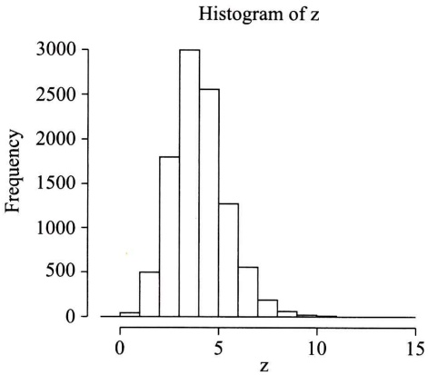

# 选读材料二 蒙特卡罗方法

原始 PDF 第 405–408 页。

## 参读材料二 蒙特卡罗方法

我们聚焦于由给定的模型直接产生大量的样本. 这些样本反映了模型的统计性能, 有关模型的问题能由研究样本的统计性能得到回答. 我们研究样本的统计性能得到关于模型的问题的回答, 这样的方法称为蒙特卡罗方法, 又称为蒙特卡罗模拟.

如果我们能在计算机上模拟一统计模型,那么就能自模型产生一大批数据样本,也就能用研究这些样本的性质代替对模型本身的研究,从而得到所需的结果.

例 1 长方形金属板的长度 X 和宽度 Y 分别服从分布  $X \sim U(2.9, 3.1)$  和  $Y \sim U(1.9, 2.1)$ ，X、Y 均以 m 计，且两者相互独立。试估计金属板面积 XY 的数学期望。

解 $X, Y$ 的分布函数分别为

$$
F _ {X} (x) = \left\{ \begin{array}{l l} 0, & x <   2. 9, \\ \frac {x - 2 . 9}{0 . 2}, & 2. 9 \leqslant x <   3. 1, \\ 1, & x \geqslant 3. 1. \end{array} \quad F _ {Y} (y) = \left\{ \begin{array}{l l} 0, & y <   1. 9, \\ \frac {y - 1 . 9}{0 . 2}, & 1. 9 \leqslant y <   2. 1, \\ 1, & y \geqslant 2. 1. \end{array} \right. \right.
$$

现在分别产生 $X, Y$ 的随机数. 设 $U = U(0,1)$, 令 $U = \frac{X - 2.9}{0.2}$, 得

$$
X = 2. 9 + 0. 2 U. \tag {*1}
$$

设 $U\sim U(0,1)$ ，令 $V = \frac{Y - 1.9}{0.2}$ 得

$$
Y = 1. 9 + 0. 2 V. \tag {*_{2}}
$$

按 $(\ast_{1})$ 式产生随机变量X的10 000个随机数，按 $(\ast_{2})$ 式产生Y的10 000个随机数，这样就得到A=XY的样本容量为10 000的样本值，列表如下:

| 长度x | 宽度y | 面积xy |
| --- | --- | --- |
| 3.055 969 | 2.091 012 | 6.390 068 |
| 2.976 204 | 2.037 167 | 6.063 026 |
| ⋮ | ⋮ | ⋮ |
| 3.003 077 | 1.929 107 | 5.793 258 |

以 A 的样本均值  $\frac{1}{10\ 000}\sum_{i=1}^{10\ 000}x_{i}y_{i}$  作为金属板面积 A 的数学期望的估计, 得到面积 A 的数学期望的近似值为 6.000762 m².

此例说明,用蒙特卡罗方法得到的 A 的数学期望,与 A 的数学期望的真值  $E(A)=E(XY)=E(X)E(Y)=6\ m^{2}$  非常接近. □

---

参读材料二 蒙特卡罗方法

· 391 ·

例2 设一设备需经两个独立的组装阶段. 第一阶段的组装时间 $X$ (以 $\mathrm{h}$ 计) 是一个随机变量, 服从均值为 1 的指数分布, 第二阶段的组装时间 $Y$ 也是一个随机变量且 $Y \sim N(3,1)$, 试估计整个组装时间 $X + Y$.

解 下面用蒙特卡罗方法给出  $X + Y$  的直方图.

设 $U\sim U(0,1)$ ，在参读材料一例4中令 $\theta = 1$ ，则

$$
X = - \ln U \quad (* _ {3})
$$

就是均值为1的指数分布随机变量. 又按参读材料一例6, 设 $U_{i} \sim U(0,1), i = 1,2,\dots,12$, 且它们相互独立, 则 $X = \sum_{i=1}^{12} U_{i} - 6 \stackrel{\text{近似}}{\sim} N(0,1)$, 于是

$$
Y = X + 3 \quad \left(* _ {4}\right)
$$

近似服从正态分布 $N(3,1)$. 在计算机上分别按 $(\ast_{3})$ 式和 $(\ast_{4})$ 式产生 $X$ 和 $Y$ 的独立的样本值（样本容量为 10000），利用这 10000 个数据作出 $X + Y$ 的频率直方图，如图 1 所示，我们就可以用直方图顶部的台阶形曲线作为 $X + Y$ 的概率密度曲线的近似. 从而可以对随机变量 $X + Y$ 的性质作出统计推断. 例如，$X + Y$ 落在区间 (3.4, 4.2) 的概率可估计为

$$
P \{3. 4 <   X + Y <   4. 2 \} \approx 0. 6 2.
$$

R 语言的程序和作出的直方图如下:

```diff
> N = 10000; z<-numeric(N)
> for(i in 1:N){
+    x<-(-log(runif(1,0,1)))
+    y<-rnorm(1,3,1)
+    z[i]<-x+y
+ }
> hist(z)
```



<details>
<summary>histogram</summary>

| Bin (z) | Frequency |
| --- | --- |
| 0~1 | ~50 |
| 1~2 | ~500 |
| 2~3 | ~1800 |
| 3~4 | ~3000 |
| 4~5 | ~2550 |
| 5~6 | ~1250 |
| 6~7 | ~550 |
| 7~8 | ~200 |
| 8~9 | ~50 |
| 9~10 | ~25 |
| 10~11 | ~10 |
</details>

图1

在统计数据分析中,许多人们感兴趣的问题能够归结为求某个随机变量 X 的函数  $h(X)$  的数学期望  $E[h(X)]$ . 令  $\varphi(x)$  表示 X 的概率密度, 由强大数定律, 若  $X_{1}, X_{2}, \cdots, X_{n}$  是相互独

---

· 392 ·

参读材料二 蒙特卡罗方法

立的同分布的随机变量序列,它们与随机变量 X 有相同的分布,则有

$$
P \left\{\lim _ {n \to \infty} \frac {1}{n} \sum_ {i = 1} ^ {n} h (X _ {i}) = E [ h (X) ] \right\} = 1. \tag {*5}
$$

在上式中，将 $n$ 取定为充分大的数，就能得到下述求数学期望近似值的方法.

定义 用于估计数学期望 $E[h(X)]$ 的蒙特卡罗方法是一种数值方法，它基于近似式:

$$
E [ h (X) ] \approx \frac {1}{n} \sum_ {i = 1} ^ {n} h (X _ {i}), \tag {*6}
$$

其中  $X_{1}, X_{2}, \cdots, X_{n}$  是相互独立且与 X 有相同分布的随机变量序列.

为了估计 $E[h(X)]$ 的值，需要自模型产生大量的样本 $X_{i}$. 例如在 $(\ast_{6})$ 式中取 $h(X) = X$ ，得到

$$
E (X) \approx \frac {1}{n} \sum_ {i = 1} ^ {n} X _ {i} = \overline {{X}}.
$$

这就是我们经常使用的数学期望的估计式.

例3 试估计数学期望 $E[\sin (X^2)]$ ，其中 $X\sim N(\mu ,\sigma^2),\mu = 1,\sigma^2 = 0.1^2.$

解 用分析的方法求得 $E[\sin (X^2)]$ 的精确解是困难的，但容易用蒙特卡罗方法求得它的估计值.我们取 $n$ 充分大，例如取 $n = 1000$ ，以分布 $N(\mu ,\sigma^2)$ 产生样本 $X_{1},X_{2},\dots ,X_{1000}$ ，由$(\ast_{6})$ 式即得

$$
E [ \sin (X ^ {2}) ] \approx \frac {1}{1 0 0 0} \sum_ {i = 1} ^ {1 0 0 0} \sin (x _ {i} ^ {2}) = 0. 8 3 5 7 7 8 5.
$$

R 语言的程序如下:

```txt
> N = 1000; k = 0.0
> for(i in 1 : N){
+    x < -rnorm(1,1,0.1)   % 用 rnorm() 产生 1 个服从分布 N(1,0.1²) 的随机数
+    k < -k + sin(x^2)
+ }
> k/1000
[1] 0.835 778 5
```

例 4 设  $X_{1}, X_{2}$  是来自分布  $N(0,1)$  的两个相互独立的随机变量，试估计数学期望  $E(|X_{1}-X_{2}|)$ .

解 独立地, 自分布  $N(0,1)$  抽取 n=1000 个容量为 2 的样本

$$
(x _ {1} ^ {(i)}, x _ {2} ^ {(i)}), \quad i = 1, 2, \dots , 1 0 0 0.
$$

得到所求的 $E(|X_1 - X_2|)$ 的估计为

$$
E (\mid X _ {1} - X _ {2} \mid) \approx \frac {1}{1 0 0 0} \sum_ {i = 1} ^ {1 0 0 0} \mid x _ {1} ^ {(i)} - x _ {2} ^ {(i)} \mid = 1. 1 2 0 2 0 9.
$$

R 语言的程序如下:

```diff
> N = 1000;g<-numeric(N)
> for(i in 1:N){
+     x<-rnorm(2)
```

---

参读材料二 蒙特卡罗方法

· 393 ·

```diff
+    g[i]< - abs(x[1] - x[2])
+ }
> est<- mean(g);  est
[1]   1.120 209
```

我们还能利用 $\left(*_{6}\right)$ 式来估计积分

$$
\int_ {a} ^ {b} f (x) \mathrm{d} x.
$$

设随机变量  $X_{1}, X_{2}, \cdots, X_{n}$  相互独立，且具有相同的分布，其概率密度为

$$
\varphi (x) = \left\{ \begin{array}{l l} \frac {1}{b - a}, & a <   x <   b, \\ 0, & \text {其他}. \end{array} \right.
$$

则由 $(\ast_{6})$ 式有

$$
\int_ {a} ^ {b} f (x) \mathrm{d} x = (b - a) \int_ {a} ^ {b} f (x) \varphi (x) \mathrm{d} x = (b - a) E [ f (x) ] \approx \frac {b - a}{n} \sum_ {i = 1} ^ {n} f (x _ {i}).
$$

即对于充分大的 $n$ ，有

$$
\int_ {a} ^ {b} f (x) \mathrm{d} x \approx \frac {b - a}{n} \sum_ {i = 1} ^ {n} f (x _ {i}). \tag {*7}
$$

例 5 试估计积分  $\int_{0}^{2\pi} e^{\cos x} dx$ .

解 独立地自概率密度为

$$
\varphi (x) = \left\{ \begin{array}{l l} \frac {1}{2 \pi}, & 0 <   x <   2 \pi , \\ 0, & \text {其他} \end{array} \right.
$$

的均匀分布抽取样本  $x_{1}, x_{2}, \cdots, x_{1000}$ ，由  $(*_{7})$  式得到

$$
\int_ {0} ^ {2 \pi} \mathrm{e} ^ {\cos x} \mathrm{d} x \approx \frac {2 \pi}{1 0 0 0} \sum_ {i = 1} ^ {1 0 0 0} \mathrm{e} ^ {\cos x _ {i}} = 7. 7 5 6 5 5.
$$

R 语言的程序如下:

```diff
> N = 1000; k = 0.0
> for(i in 1 : N){
+    x < -runif(1,0,2 * pi)      % 用 runif( )产生 1 个服从分布 U(0,2π)的随机变量，
                   在 R 中用 pi 表示 π
+    k < -k + exp(cos (x))
+ }
> k * 2 * pi/1000
[1]     7.75655
```
