这里“重复”是指在每次试验中  $P(A)=p$  保持不变；“独立”是指各次试验的结果互不影响，即若以  $C_{i}$  记第 i 次试验的结果， $C_{i}$  为 A 或  $\overline{A}, i=1,2,\cdots,n.$  “独立”是指

$$
P (C _ {1} C _ {2} \dots C _ {n}) = P (C _ {1}) P (C _ {2}) \dots P (C _ {n}). \tag {2.5}
$$

$n$ 重伯努利试验是一种很重要的数学模型，它有广泛的应用，是研究极多的模型之一.

例如，$E$ 是抛一枚硬币观察得到正面或反面。$A$ 表示得正面，这是一个伯努利试验。如将硬币抛 $n$ 次，就是 $n$ 重伯努利试验。又如抛一颗骰子，若 $A$ 表示得到“1点”，$\overline{A}$ 表示得到“非1点”。将骰子抛 $n$ 次，就是 $n$ 重伯努利试验。再如在袋中装有 $a$ 只白球，$b$ 只黑球。试验 $E$ 是在袋中任取一只球，观察其颜色。以 $A$ 表示“取到白球”，$P(A)=a/(a+b)$。若连续取球 $n$ 次作放回抽样，这就是 $n$ 重伯努利试验。然而，若作不放回抽样，虽则每次试验都有 $P(A)=a/(a+b)$（见第一章 §4 例5），但各次试验不再相互独立①，因而不再是 $n$ 重伯努利试验了。

以 X 表示 n 重伯努利试验中事件 A 发生的次数, X 是一个随机变量, 我们来求它的分布律. X 所有可能取的值为  $0, 1, 2, \cdots, n$ . 由于各次试验是相互独立的, 因此事件 A 在指定的  $k (0 \leqslant k \leqslant n)$  次试验中发生, 在其他 n-k 次试验中 A 不发生 (例如在前 k 次试验中 A 发生, 而后 n-k 次试验中 A 不发生) 的概率为

$$
\underbrace {p \cdot p \cdot \cdots \cdot p} _ {k \text {个}} \cdot \underbrace {(1 - p) \cdot (1 - p) \cdot \cdots \cdot (1 - p)} _ {n - k \text {个}} = p ^ {k} (1 - p) ^ {n - k}.
$$

这种指定的方式共有 $\binom{n}{k}$ 种, 它们是两两互不相容的, 故在n次试验中A发生k次的概率为 $\binom{n}{k}p^{k}(1-p)^{n-k}$ , 记q=1-p, 即有

$$
P \{X = k \} = \binom {n} {k} p ^ {k} q ^ {n - k}, \quad k = 0, 1, 2, \dots , n. \tag {2.6}
$$

显然

$$
P \{X = k \} \geqslant 0, \quad k = 0, 1, 2, \dots , n;
$$

$$
\sum_ {k = 0} ^ {n} P \{X = k \} = \sum_ {k = 0} ^ {n} \binom {n} {k} p ^ {k} q ^ {n - k} = (p + q) ^ {n} = 1.
$$

<small>① 对于不放回抽样，以 $A_{1}, A_{2}$ 分别记第一次、第二次取到白球，则有 $P(A_{2} \mid A_{1}) = \frac{a - 1}{a + b - 1}$，而 $P(A_{2}) = \frac{a}{a + b}, P(A_{2} \mid A_{1}) \neq P(A_{2})$，故第一次、第二次试验不相互独立。即知(2.5)不成立。</small>

即 $P\{X = k\}$ 满足条件（2.2），(2.3). 注意到 $\binom{n}{k} p^k q^{n - k}$ 刚好是二项式 $(p + q)^n$ 的展开式中出现 $p^k$ 的那一项，我们称随机变量 $X$ 服从参数为 $n, p$ 的二项分布，并记为 $X \sim b(n, p)$.

特别, 当 n=1 时二项分布(2.6)化为

$$
P \{X = k \} = p ^ {k} q ^ {1 - k}, \quad k = 0, 1.
$$

这就是(0-1)分布.

例 2 按规定,某种型号电子元件的使用寿命超过 1500 h 的为一级品.已知某一大批产品的一级品率为 0.2,现在从中随机地抽查 20 只.问 20 只元件中恰有 k 只  $(k=0,1,\cdots,20)$  为一级品的概率是多少?

解 这是不放回抽样.但由于这批元件的总数很大,且抽查的元件的数量相对于元件的总数来说又很小,因而可以当作放回抽样来处理,这样做会有一些误差,但误差不大.我们将检查一只元件看它是否为一级品看成是一次试验,检查20只元件相当于做20重伯努利试验.以X记20只元件中一级品的只数,那么,X是一个随机变量,且有 $X\sim b(20,0.2)$ .由(2.6)式即得所求概率为

$$
P \{X = k \} = {\binom {2 0} {k}} 0. 2 ^ {k} 0. 8 ^ {2 0 - k}, \quad k = 0, 1, \dots , 2 0.
$$

将计算结果列表如下:

<table><tr><td> $P\{X=0\}=0.012$ </td><td> $P\{X=4\}=0.218$ </td><td> $P\{X=8\}=0.022$ </td></tr><tr><td> $P\{X=1\}=0.058$ </td><td> $P\{X=5\}=0.175$ </td><td> $P\{X=9\}=0.007$ </td></tr><tr><td> $P\{X=2\}=0.137$ </td><td> $P\{X=6\}=0.109$ </td><td> $P\{X=10\}=0.002$ </td></tr><tr><td> $P\{X=3\}=0.205$ </td><td> $P\{X=7\}=0.055$ </td><td></td></tr><tr><td colspan="3">当 $k\geqslant 11$ 时, $P\{X=k\}<0.001$ </td></tr></table>

为了对本题的结果有一个直观了解,我们作出上表的图形,如图2-3所示.

从图2-3中看到，当 $k$ 增加时，概率 $P\{X = k\}$ 先是随之增加，直至达到最大值（本例中当 $k = 4$ 时取到最大值），随后单调减少.我们指出，一般，对于固定的 $n$ 及 $p$ ，二项分布 $b(n,p)$ 都具有这一性质. □

例 3 某人进行射击,设每次射击的命中率为 0.02,独立射击 400 次,试求至少击中两次的概率.

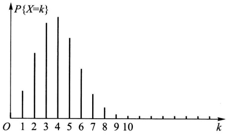

bar

| k | P{X=k} |
| --- | --- |
| 1 | ~0.25 |
| 2 | ~0.65 |
| 3 | ~0.95 |
| 4 | ~1.05 |
| 5 | ~0.85 |
| 6 | ~0.45 |
| 7 | ~0.20 |
| 8 | ~0.08 |
| 9 | ~0.04 |
| 10 | ~0.03 |
| 11 | ~0.02 |
| 12 | ~0.02 |
| 13 | ~0.02 |
| 14 | ~0.02 |
| 15 | ~0.02 |
| 16 | ~0.02 |
| 17 | ~0.02 |
| 18 | ~0.02 |
| 19 | ~0.02 |
| 20 | ~0.02 |

图2-3

解 将一次射击看成是一次试验. 设击中的次数为 $X$, 则 $X \sim b(400, 0.02)$. $X$ 的分布律为

$$
P \{X = k \} = \binom {4 0 0} {k} 0. 0 2 ^ {k} 0. 9 8 ^ {4 0 0 - k}, \quad k = 0, 1, \dots , 4 0 0.
$$

于是所求概率为

$$
\begin{array}{l} P \{X \geqslant 2 \} = 1 - P \{X = 0 \} - P \{X = 1 \} \\ = 1 - 0. 9 8 ^ {4 0 0} - 4 0 0 \times 0. 0 2 \times 0. 9 8 ^ {3 9 9} = 0. 9 9 7 2. \\ \end{array}
$$

这个概率很接近于1. 我们从两方面来讨论这一结果的实际意义. 其一, 虽然每次射击的命中率很小（为0.02），但如果射击400次，则击中目标至少两次是几乎可以肯定的. 这一事实说明，一个事件尽管在一次试验中发生的概率很小，但只要试验次数很多，而且试验是独立地进行的，那么这一事件的发生几乎是肯定的. 这也告诉人们绝不能轻视小概率事件. 其二，如果射手在400次射击中，击中目标的次数竟不到两次，那么由于概率 $P\{X < 2\} \approx 0.003$ 很小，根据实际推断原理，我们将怀疑“每次射击的命中率为0.02”这一假设，即认为该射手射击的命中率达不到0.02.

例 4 设有 80 台同类型设备, 各台工作是相互独立的, 发生故障的概率都是 0.01, 且一台设备的故障能由一个人处理. 考虑两种配备维修工人的方法, 其一是由 4 人维护, 每人负责 20 台; 其二是由 3 人共同维护 80 台. 试比较这两种方法在设备发生故障时不能及时维修的概率的大小.

解 按第一种方法. 以 $X$ 记“第1人维护的20台中同一时刻发生故障的台数”，以 $A_{i}(i = 1,2,3,4)$ 表示事件“第 $i$ 人维护的20台中发生故障不能及时维修”，则知80台中发生故障而不能及时维修的概率为

$$
P (A _ {1} \cup A _ {2} \cup A _ {3} \cup A _ {4}) \geqslant P (A _ {1}) = P \{X \geqslant 2 \}.
$$

而 $X \sim b(20, 0.01)$, 故有

$$
\begin{array}{l} P \{X \geqslant 2 \} = 1 - \sum_ {k = 0} ^ {1} P \{X = k \} \\ = 1 - \sum_ {k = 0} ^ {1} {\binom {2 0} {k}} 0. 0 1 ^ {k} 0. 9 9 ^ {2 0 - k} = 0. 0 1 6 9. \\ \end{array}
$$

即有 $P(A_{1} \cup A_{2} \cup A_{3} \cup A_{4}) \geqslant 0.0169.$

按第二种方法. 以 $Y$ 记80台中同一时刻发生故障的台数. 此时, $Y \sim b(80, 0.01)$, 故80台中发生故障而不能及时维修的概率为

$$
P \{Y \geqslant 4 \} = 1 - \sum_ {k = 0} ^ {3} {\binom {8 0} {k}} 0. 0 1 ^ {k} 0. 9 9 ^ {8 0 - k} = 0. 0 0 8 7.
$$

我们发现,在后一种情况尽管任务重了(每人平均维护约27台),但工作效率不仅没有降低,反而提高了.

## (三) 泊松分布

设随机变量 X 所有可能取的值为 0,1,2,…,而取各个值的概率为

$$
P \{X = k \} = \frac {\lambda^ {k} \mathrm{e} ^ {- \lambda}}{k !}, k = 0, 1, 2, \dots ,
$$

其中 $\lambda > 0$ 是常数. 则称 $X$ 服从参数为 $\lambda$ 的泊松分布, 记为 $X \sim \pi(\lambda)$.

易知， $P\{X=k\}\geqslant0,k=0,1,2,\cdots$ ，且有

$$
\sum_ {k = 0} ^ {\infty} P \{X = k \} = \sum_ {k = 0} ^ {\infty} \frac {\lambda^ {k} \mathrm{e} ^ {- \lambda}}{k !} = \mathrm{e} ^ {- \lambda} \sum_ {k = 0} ^ {\infty} \frac {\lambda^ {k}}{k !} = \mathrm{e} ^ {- \lambda} \cdot \mathrm{e} ^ {\lambda} = 1.
$$

即 $P\{X = k\}$ 满足条件（2.2），(2.3).

参数 $\lambda$ 的意义将在第四章说明, 有关服从泊松分布的随机变量的数学模型将在第十二章中讨论.

具有泊松分布的随机变量在实际应用中是很多的.例如,一本书一页中的印刷错误数,某地区在一天内邮递遗失的信件数,某一医院在一天内的急诊病人数,某一地区一个时间间隔内发生交通事故的次数,在一个时间间隔内某种放射性物质发出的、经过计数器的 $\alpha$ 粒子数等都服从泊松分布.泊松分布也是概率论中的一种重要分布.

下面介绍一个用泊松分布来逼近二项分布的定理.

泊松定理 设 $\lambda > 0$ 是一个常数, $n$ 是任意正整数, 设 $np_n = \lambda$, 则对于任一固定的非负整数 $k$, 有

$$
\lim _ {n \to \infty} \binom {n} {k} p _ {n} ^ {k} (1 - p _ {n}) ^ {n - k} = \frac {\lambda^ {k} \mathrm{e} ^ {- \lambda}}{k !}.
$$

证 由 $p_n = \frac{\lambda}{n}$, 有

$$
\begin{array}{l} \binom {n} {k} p _ {n} ^ {k} (1 - p _ {n}) ^ {n - k} = \frac {n (n - 1) \cdots (n - k + 1)}{k !} \left(\frac {\lambda}{n}\right) ^ {k} \left(1 - \frac {\lambda}{n}\right) ^ {n - k} \\ = \frac {\lambda^ {k}}{k !} \left[ 1 \cdot \left(1 - \frac {1}{n}\right) \dots \left(1 - \frac {k - 1}{n}\right) \right] \left(1 - \frac {\lambda}{n}\right) ^ {n} \left(1 - \frac {\lambda}{n}\right) ^ {- k}. \\ \end{array}
$$

对于任意固定的 $k$ ，当 $n\to \infty$ 时，

$$
1 \cdot \left(1 - \frac {1}{n}\right) \dots \left(1 - \frac {k - 1}{n}\right)\rightarrow 1, \quad \left(1 - \frac {\lambda}{n}\right) ^ {n} \rightarrow \mathrm{e} ^ {- \lambda}, \quad \left(1 - \frac {\lambda}{n}\right) ^ {- k} \rightarrow 1.
$$

故有

$$
\lim _ {n \to \infty} \binom {n} {k} p _ {n} ^ {k} (1 - p _ {n}) ^ {n - k} = \frac {\lambda^ {k} \mathrm{e} ^ {- \lambda}}{k !}.
$$

定理的条件 $np_{n} = \lambda$ （常数）意味着当 $n$ 很大时 $p_n$ 必定很小，因此，上述定理表明当 $n$ 很大，$p$ 很小 $(np = \lambda)$ 时有以下近似式

$$
\(\binom {n} {k} p ^ {k} (1 - p) ^ {n - k} \approx \frac {\lambda^ {k} \mathrm{e} ^ {- \lambda}}{k !} \quad (\text {其中} \lambda = n p). \tag {2.7}
$$

也就是说以 $n, p$ 为参数的二项分布的概率值可以由参数为 $\lambda = np$ 的泊松分布的概率值近似. 上式也能用来作二项分布概率的近似计算.

例 5 计算机硬件公司制造某种特殊型号的微型芯片, 次品率达 0.1%, 各芯片成为次品相互独立. 求在 1 000 只产品中至少有 2 只次品的概率. 以 X 记产品中的次品数,  $X \sim b(1\ 000, 0.001)$ .

解 所求概率为

$$
\begin{array}{l} P \{X \geqslant 2 \} = 1 - P \{X = 0 \} - P \{X = 1 \} \\ = 1 - 0. 9 9 9 ^ {1 0 0 0} - \binom {1 0 0 0} {1} 0. 9 9 9 ^ {9 9 9} \times 0. 0 0 1 \\ \approx 1 - 0. 3 6 7 6 9 5 4 - 0. 3 6 8 0 6 3 5 = 0. 2 6 4 2 4 1 1. \\ \end{array}
$$

利用(2.7)式来计算得, $\lambda=1\ 000\times0.001=1$ ,

$$
\begin{array}{l} P \{X \geqslant 2 \} = 1 - P \{X = 0 \} - P \{X = 1 \} \\ \approx 1 - \mathrm{e} ^ {- 1} - \mathrm{e} ^ {- 1} \approx 0. 2 6 4 2 4 1 1. \\ \end{array}
$$

显然利用(2.7)式的计算来得方便.一般,当 $n\geqslant20,p\leqslant0.05$ 时,用 $\frac{\lambda^{k}e^{-\lambda}}{k!}\quad(\lambda=np)$ 作为 $\binom{n}{k}p^{k}(1-p)^{n-k}$ 的近似值效果颇佳.

## § 3 随机变量的分布函数

对于非离散型随机变量 $X$ ，由于其可能取的值不能一一列举出来，因而就不能像离散型随机变量那样可以用分布律来描述它.另外，我们通常所遇到的非离散型随机变量取任一指定的实数值的概率都等于0（这一点在下一节将会讲到).再者，在实际中，对于这样的随机变量，例如误差 $\varepsilon$ 、元件的寿命 $T$ 等，我们并不会对误差 $\varepsilon = 0.05\mathrm{mm}$ ，寿命 $T = 1251.3\mathrm{h}$ 的概率感兴趣，而是考虑误差落在某个区间内的概率，寿命 $T$ 大于某个数的概率.因而我们转而去研究随机变量所取的值落在一个区间 $(x_{1},x_{2}]$ 的概率: $P\{x_{1} < X\leqslant x_{2}\}$ .但由于

$$
P \{x _ {1} <   X \leqslant x _ {2} \} = P \{X \leqslant x _ {2} \} - P \{X \leqslant x _ {1} \},
$$

所以我们只需知道 $P\{X \leqslant x_2\}$ 和 $P\{X \leqslant x_1\}$ 就可以了. 下面引入随机变量的分布函数的概念①.

定义 设 $X$ 是一个随机变量, $x$ 是任意实数, 函数

$$
F (x) = P \{X \leqslant x \}, - \infty <   x <   \infty
$$

称为 $X$ 的分布函数.

对于任意实数 $x_{1}, x_{2} (x_{1} < x_{2})$，有

$$
P \{x _ {1} <   X \leqslant x _ {2} \} = P \{X \leqslant x _ {2} \} - P \{X \leqslant x _ {1} \} = F (x _ {2}) - F (x _ {1}), \tag {3.1}
$$

因此,若已知 X 的分布函数,我们就知道 X 落在任一区间  $(x_{1}, x_{2}]$  上的概率,从这个意义上说,分布函数完整地描述了随机变量的统计规律性.

分布函数是一个普通的函数,正是通过它,我们将能用数学分析的方法来研究随机变量.

如果将 $X$ 看成是数轴上的随机点的坐标, 那么, 分布函数 $F(x)$ 在 $x$ 处的函数值就表示 $X$ 落在区间 $(- \infty, x]$ 上的概率.

分布函数  $F(x)$  具有以下的基本性质:

$1^{\circ}F(x)$ 是一个不减函数.

事实上，由(3.1)式对于任意实数 $x_{1}, x_{2} (x_{1} < x_{2})$ ，有

$$
F (x _ {2}) - F (x _ {1}) = P \{x _ {1} <   X \leqslant x _ {2} \} \geqslant 0.
$$

$2^{\circ}0\leqslant F(x)\leqslant 1$ ，且

$$
F (- \infty) = \lim _ {x \to - \infty} F (x) = 0, \quad F (\infty) = \lim _ {x \to \infty} F (x) = 1.
$$

上面两个式子,我们只从几何上加以说明.在图2-4中,将区间端点x沿数轴无限向左移动(即 $x\rightarrow-\infty$ ),则“随机点X落在点x左边”这一事件趋于不

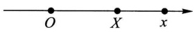

图2-4

可能事件,从而其概率趋于0,即有 $F(-\infty)=0$ ;又若将点x无限右移(即 $x\to\infty$ ),则“随机点X落在点x左边”这一事件趋于必然事件,从而其概率趋于1,即有 $F(\infty)=1$ .

$3^{\circ}F(x + 0) = F(x)$ ，即 $F(x)$ 是右连续的.（证略.）

反之，可证具备性质 $1^{\circ}, 2^{\circ}, 3^{\circ}$ 的函数 $F(x)$ 必是某个随机变量的分布函数.

例1 设随机变量 $X$ 的分布律为

| X | -1 | 2 | 3 |
| --- | --- | --- | --- |
| $p_k$ | $\frac{1}{4}$ | $\frac{1}{2}$ | $\frac{1}{4}$ |

<small>① 虽然对于离散型随机变量，我们可以用分布律全面地描述它，但为了从数学上能统一地对随机变量进行研究，在这里，我们对离散型随机变量和非离散型随机变量统一地定义了分布函数.</small>

求 $X$ 的分布函数，并求 $P\left\{X \leqslant \frac{1}{2}\right\}, P\left\{\frac{3}{2} < X \leqslant \frac{5}{2}\right\}, P\{2 \leqslant X \leqslant 3\}$.

解 $X$ 仅在 $x = -1,2,3$ 三点处其概率 $\neq 0$ ，而 $F(x)$ 的值是 $X\leqslant x$ 的累积概率值，由概率的有限可加性，知它即为小于或等于 $x$ 的那些 $x_{k}$ 处的概率 $p_k$ 之和，有

$$
F (x) = \left\{ \begin{array}{l l} 0 & x <   - 1, \\ P \{X = - 1 \}, & - 1 \leqslant x <   2, \\ P \{X = - 1 \} + P \{X = 2 \}, & 2 \leqslant x <   3, \\ 1, & x \geqslant 3. \end{array} \right.
$$

即 $F(x) = \begin{cases} 0, & x < -1, \\ \frac{1}{4}, & -1 \leqslant x < 2, \\ \frac{3}{4}, & 2 \leqslant x < 3, \\ 1, & x \geqslant 3. \end{cases}$

$F(x)$ 的图形如图2-5所示,它是一条阶梯形的曲线,在x=-1,2,3处有跳跃点,跳跃值分别为 $\frac{1}{4}$ , $\frac{1}{2}$ , $\frac{1}{4}$ .又

$$
P \left\{X \leqslant \frac {1}{2} \right\} = F \left(\frac {1}{2}\right) = \frac {1}{4},
$$

$$
\begin{array}{l} P \left\{\frac {3}{2} <   X \leqslant \frac {5}{2} \right\} = F \left(\frac {5}{2}\right) - F \left(\frac {3}{2}\right) \\ = \frac {3}{4} - \frac {1}{4} = \frac {1}{2}. \\ \end{array}
$$

$$
\begin{array}{l} P \{2 \leqslant X \leqslant 3 \} = F (3) - F (2) + P \{X = 2 \} \\ = 1 - \frac {3}{4} + \frac {1}{2} = \frac {3}{4}. \\ \end{array}
$$

一般,设离散型随机变量 X 的分布律为

$$
P \{X = x _ {k} \} = p _ {k}, \quad k = 1, 2, \dots .
$$

由概率的可列可加性得 $X$ 的分布函数为

$$
F (x) = P \{X \leqslant x \} = \sum_ {x _ {k} \leqslant x} P \{X = x _ {k} \},
$$

即 $F(x) = \sum_{x_k\leqslant x}p_k,$ (3.2)

这里和式是对于所有满足 $x_{k} \leqslant x$ 的 $k$ 求和的. 分布函数 $F(x)$ 在 $x = x_{k} (k = 1,$

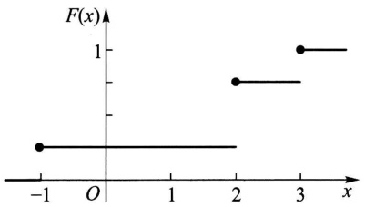

scatter

| x | F(x) |
| --- | --- |
| -1 | 0 |
| 2 | 0.75 |
| 3 | 1 |

图2-5

2, $\cdots$ 处有跳跃,其跳跃值为 $p_{k}=P\{X=x_{k}\}$ .

例2 一个靶子是半径为 $2\mathrm{m}$ 的圆盘，设击中靶上任一同心圆盘上的点的概率与该圆盘的面积成正比，并设射击都能中靶，以 $X$ 表示弹着点与圆心的距离.试求随机变量 $X$ 的分布函数.

解 若 $x < 0$ ，则 $\{X \leqslant x\}$ 是不可能事件，于是

$$
F (x) = P \{X \leqslant x \} = 0.
$$

若 $0 \leqslant x \leqslant 2$ ，由题意，$P\{0 \leqslant X \leqslant x\} = kx^2, k$ 是某一常数，为了确定 $k$ 的值，取 $x = 2$ ，有 $P\{0 \leqslant X \leqslant 2\} = 2^2k$ ，但已知 $P\{0 \leqslant X \leqslant 2\} = 1$ ，故得 $k = 1/4$ ，即

$$
P \{0 \leqslant X \leqslant x \} = \frac {x ^ {2}}{4}.
$$

于是

$$
\begin{array}{l} F (x) = P \{X \leqslant x \} = P \{X <   0 \} + P \{0 \leqslant X \leqslant x \} \\ = \frac {x ^ {2}}{4}. \\ \end{array}
$$

若 $x \geqslant 2$ ，由题意 $\{X \leqslant x\}$ 是必然事件，于是

$$
F (x) = P \{X \leqslant x \} = 1.
$$

综合上述,即得 X 的分布函数为

$$
F (x) = \left\{ \begin{array}{l l} 0, & x <   0, \\ \frac {x ^ {2}}{4}, & 0 \leqslant x <   2, \\ 1, & x \geqslant 2. \end{array} \right.
$$

它的图形是一条连续曲线,如图 2-6 所示.

另外,容易看到本例中的分布函数 $F(x)$ ,对于任意x可以写成形式

$$
F (x) = \int_ {- \infty} ^ {x} f (t) \mathrm{d} t,
$$

其中

$$
f (t) = \left\{ \begin{array}{l l} \frac {t}{2}, & 0 <   t <   2, \\ 0, & \text {其他}. \end{array} \right.
$$

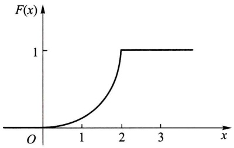

line

| x | F(x) |
| --- | --- |
| 0 | 0 |
| 2 | 1 |
| >2 | 1 |

图2-6

这就是说， $F(x)$ 恰是非负函数 $f(t)$ 在区间 $(-\infty, x]$ 上的积分，在这种情况我们称 X 为连续型随机变量。下一节我们将给出连续型随机变量的一般定义。

## § 4 连续型随机变量及其概率密度

一般,如上节例2中的随机变量那样,如果对于随机变量X的分布函数 $F(x)$ ,存在非负可积函数 $f(x)$ ,使对于任意实数x有

$$
F (x) = \int_ {- \infty} ^ {x} f (t) \mathrm{d} t, \tag {4.1}
$$

则称 $X$ 为连续型随机变量，$f(x)$ 称为 $X$ 的概率密度函数，简称概率密度①.

由(4.1)式,据数学分析的知识知连续型随机变量的分布函数是连续函数.

在实际应用中遇到的基本上是离散型或连续型随机变量. 本书只讨论这两种随机变量.

由定义知道,概率密度  $f(x)$  具有以下性质:

$$
\begin{array}{l} 1 ^ {\circ} f (x) \geqslant 0. \\ 2 ^ {\circ} \int_ {- \infty} ^ {\infty} f (x) \mathrm{d} x = 1. \\ \end{array}
$$

$3^{\circ}$ 对于任意实数 $x_{1}, x_{2} (x_{1} \leqslant x_{2})$,

$$
P \{x _ {1} <   X \leqslant x _ {2} \} = F (x _ {2}) - F (x _ {1}) = \int_ {x _ {1}} ^ {x _ {2}} f (x) \mathrm{d} x.
$$

$4^{\circ}$ 若 $f(x)$ 在点 $x$ 处连续，则有 $F'(x) = f(x)$.

反之，若 $f(x)$ 具备性质 $1^{\circ}, 2^{\circ}$，引入

$$
G (x) = \int_ {- \infty} ^ {x} f (t) \mathrm{d} t,
$$

它是某一随机变量 $X$ 的分布函数，$f(x)$ 是 $X$ 的概率密度.

由性质 $2^{\circ}$ 知道介于曲线 $y = f(x)$ 与 $Ox$ 轴之间的面积等于1（图2-7）.由 $3^{\circ}$ 知道 $X$ 落在区间 $(x_{1}, x_{2}]$ 的概率 $P\{x_{1} < X \leqslant x_{2}\}$ 等于区间 $(x_{1}, x_{2}]$ 上曲线 $y = f(x)$ 之下的曲边梯形的面积(图2-8).由性质 $4^{\circ}$ 知道在 $f(x)$ 的连续点 $x$ 处有

$$
f (x) = \lim _ {\Delta x \to 0 ^ {+}} \frac {F (x + \Delta x) - F (x)}{\Delta x} = \lim _ {\Delta x \to 0 ^ {+}} \frac {P \{x <   X \leqslant x + \Delta x \}}{\Delta x}. \tag {4.2}
$$

从这里我们看到概率密度的定义与物理学中的线密度的定义相类似, 这就是称  $f(x)$  为概率密度的缘故.

<small>① 由定义知道, 改变概率密度  $f(x)$  在个别点的函数值不影响分布函数  $F(x)$  的取值. 因此, 并不在乎改变概率密度在个别点上的值.</small>

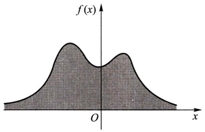

area

| X | f(x) |
| --- | --- |
| ~-1.5 | ~0.2 |
| ~-0.8 | ~0.9 |
| 0 | ~0.3 |
| ~0.8 | ~0.9 |
| ~1.5 | ~0.2 |

图2-7

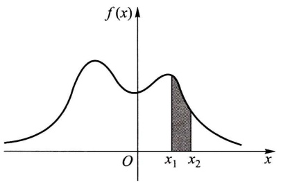

area

| X-axis | Y-axis |
| --- | --- |
| 0 | ~0.2 |
| x1 | ~0.6 |
| x2 | ~0.3 |

图2-8

由(4.2)式知道,若不计高阶无穷小,有

$$
P \{x <   X \leqslant x + \Delta x \} \approx f (x) \Delta x. \tag {4.3}
$$

这表示 $X$ 落在小区间 $(x, x + \Delta x]$ 上的概率近似地等于 $f(x)\Delta x$.

例 1 设随机变量 X 具有概率密度

$$
f (x) = \left\{ \begin{array}{l l} k x, & 0 \leqslant x <   3, \\ 2 - \frac {x}{2}, & 3 \leqslant x \leqslant 4, \\ 0, & \text {其他}. \end{array} \right.
$$

(1) 确定常数 $k$. (2) 求 $X$ 的分布函数 $F(x)$. (3) 求 $P\left\{1 < X \leqslant \frac{7}{2}\right\}$.

解（1）由 $\int_{-\infty}^{\infty}f(x)\mathrm{d}x = 1$ ，得

$$
\int_ {0} ^ {3} k x \mathrm{d} x + \int_ {3} ^ {4} \left(2 - \frac {x}{2}\right) \mathrm{d} x = 1,
$$

解得 $k = \frac{1}{6}$ ，于是 $X$ 的概率密度为

$$
f (x) = \left\{ \begin{array}{l l} \frac {x}{6}, & 0 \leqslant x <   3, \\ 2 - \frac {x}{2}, & 3 \leqslant x <   4, \\ 0, & \text {其他}. \end{array} \right.
$$

(2) $X$ 的分布函数为

$$
F (x) = \left\{ \begin{array}{l l} 0, & x <   0, \\ \int_ {0} ^ {x} \frac {x}{6} \mathrm{d} x, & 0 \leqslant x <   3, \\ \int_ {0} ^ {3} \frac {x}{6} \mathrm{d} x + \int_ {3} ^ {x} \left(2 - \frac {x}{2}\right) \mathrm{d} x, & 3 \leqslant x <   4, \\ 1, & x \geqslant 4. \end{array} \right.
$$

$$
F (x) = \left\{ \begin{array}{l l} 0, & x <   0, \\ \frac {x ^ {2}}{1 2}, & 0 \leqslant x <   3, \\ - 3 + 2 x - \frac {x ^ {2}}{4}, & 3 \leqslant x <   4, \\ 1, & x \geqslant 4. \end{array} \right.
$$

$$
P \left\{1 <   X \leqslant \frac {7}{2} \right\} = F \left(\frac {7}{2}\right) - F (1) = \frac {4 1}{4 8}. \tag {3}
$$

需要指出的是,对于连续型随机变量 X 来说,它取任一指定实数值 a 的概率均为 0, 即  $P\{X=a\}=0$ . 事实上, 设 X 的分布函数为  $F(x), \Delta x>0$ , 则由  $\{X=a\}\subset\{a-\Delta x<X\leqslant a\}$  得

$$
0 \leqslant P \{X = a \} \leqslant P \{a - \Delta x <   X \leqslant a \} = F (a) - F (a - \Delta x).
$$

在上述不等式中令 $\Delta x\to 0$ ，并注意到 $X$ 为连续型随机变量，其分布函数 $F(x)$ 是连续的，即得

$$
P \{X = a \} = 0. \tag {4.4}
$$

据此,在计算连续型随机变量落在某一区间的概率时,可以不必区分该区间是开区间或闭区间或半闭区间.例如有

$$
P \{a <   X \leqslant b \} = P \{a \leqslant X \leqslant b \} = P \{a <   X <   b \}.
$$

在这里,事件 $\{X=a\}$ 并非不可能事件,但有 $P\{X=a\}=0$ . 这就是说,若A是不可能事件,则有 $P(A)=0$ ;反之,若 $P(A)=0$ ,并不一定意味着A是不可能事件.

以后当我们提到一个随机变量 $X$ 的“概率分布”时，指的是它的分布函数；或者，当 $X$ 是连续型随机变量时，指的是它的概率密度，当 $X$ 是离散型随机变量时，指的是它的分布律.

下面介绍三种重要的连续型随机变量.

## (一)均匀分布

若连续型随机变量 $X$ 具有概率密度

$$
f (x) = \left\{ \begin{array}{l l} \frac {1}{b - a}, & a <   x <   b, \\ 0, & \text {其他，} \end{array} \right. \tag {4.5}
$$

则称 X 在区间  $(a, b)$  上服从均匀分布, 记为  $X \sim U(a, b)$ .

易知 $f(x) \geqslant 0$ ，且 $\int_{-\infty}^{\infty} f(x) \, \mathrm{d}x = 1.$

在区间 $(a, b)$ 上服从均匀分布的随机变量 $X$，具有下述意义的等可能性，即它落在区间 $(a, b)$ 中任意等长度的子区间内的可能性是相同的。或者说它落在$(a, b)$ 的子区间内的概率只依赖于子区间的长度而与子区间的位置无关. 事实上, 对于任一长度为 $l$ 的子区间 $(c, c + l), a \leqslant c < c + l \leqslant b$, 有

$$
P \{c <   X \leqslant c + l \} = \int_ {c} ^ {c + l} f (x) \mathrm{d} x = \int_ {c} ^ {c + l} \frac {1}{b - a} \mathrm{d} x = \frac {l}{b - a}.
$$

由(4.1)式得 $X$ 的分布函数为

$$
F (x) = \left\{ \begin{array}{l l} 0, & x <   a, \\ \frac {x - a}{b - a}, & a \leqslant x <   b, \\ 1, & x \geqslant b. \end{array} \right. \tag {4.6}
$$

$f(x)$  及  $F(x)$  的图形分别如图 2-9, 图 2-10 所示.

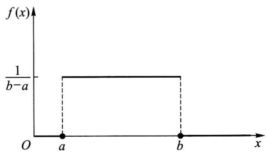

area

| X | f(x) |
| --- | --- |
| a | 1/b-a |
| b | 1/b-a |

图2-9

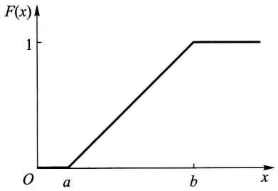

line

| X | F(x) |
| --- | --- |
| 0 | 0 |
| a | 0 |
| b | 1 |
| >b | 1 |

图2-10

例 2 设电阻值 R 是一个随机变量, 均匀分布在  $900 \sim 1100 \Omega$ . 求 R 的概率密度及 R 落在  $950 \sim 1050 \Omega$  的概率.

解 按题意,R 的概率密度为

$$
f (r) = \left\{ \begin{array}{l l} \frac {1}{1 1 0 0 - 9 0 0}, & 9 0 0 <   r <   1 1 0 0, \\ 0, & \text {其他.} \end{array} \right.
$$

故有 $P\{950 < R \leqslant 1050\} = \int_{950}^{1050} \frac{1}{200} \mathrm{d}r = 0.5.$

## (二) 指数分布

若连续型随机变量 $X$ 的概率密度为

$$
f (x) = \left\{ \begin{array}{l l} \frac {1}{\theta} \mathrm{e} ^ {- x / \theta}, & x > 0, \\ 0, & \text {其他}, \end{array} \right. \tag {4.7}
$$

其中  $\theta>0$  为常数, 则称 X 服从参数为  $\theta$  的指数分布.

易知 $f(x) \geqslant 0$，且 $\int_{-\infty}^{\infty} f(x) \mathrm{d}x = 1$. 图2-11中分别画出了 $\theta = 1/3, \theta = 1$

$\theta=2$  时  $f(x)$  的图形.

由(4.7)式容易得到随机变量 $X$ 的分布函数为

$$
F (x) = \left\{ \begin{array}{l l} 1 - \mathrm{e} ^ {- x / \theta}, & x > 0, \\ 0, & \text {其他}. \end{array} \right. \tag {4.8}
$$

服从指数分布的随机变量 X 具有以下有趣的性质:

对于任意 $s, t > 0$，有

$$
P \{X > s + t \mid X > s \} = P \{X > t \}. \tag {4.9}
$$

事实上

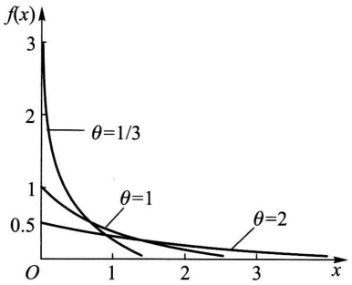

line

| x | \(f(x) (\theta=1/3)\) | \(f(x) (\theta=1)\) | \(f(x) (\theta=2)\) |
| --- | --- | --- | --- |
| 0 | 3 | 1 | 0.5 |
| 1 | ~0.4 | ~0.4 | ~0.3 |
| 2 | — | — | ~0.2 |
| 3 | — | — | ~0.15 |

图2-11

$$
\begin{array}{l} P \{X > s + t \mid X > s \} = \frac {P \{(X > s + t) \cap (X > s) \}}{P \{X > s \}} \\ = \frac {P \{X > s + t \}}{P \{X > s \}} = \frac {1 - F (s + t)}{1 - F (s)} \\ = \frac {\mathrm{e} ^ {- (s + t) / \theta}}{\mathrm{e} ^ {- s / \theta}} = \mathrm{e} ^ {- t / \theta} \\ = P \{X > t \}. \\ \end{array}
$$

性质(4.9)称为无记忆性.如果 $X$ 是某一元件的寿命，那么(4.9)式表明:已知元件已使用了 $s\mathrm{h}$，它总共能使用至少 $(s + t)\mathrm{h}$ 的条件概率，与从开始使用时算起它至少能使用 $t\mathrm{h}$ 的概率相等.这就是说，元件对它已使用过 $s\mathrm{h}$ 没有记忆.具有这一性质是指数分布有广泛应用的重要原因.

指数分布在可靠性理论与排队论中有广泛的应用.

## (三) 正态分布

若连续型随机变量 $X$ 的概率密度为

$$
f (x) = \frac {1}{\sqrt {2 \pi} \sigma} \mathrm{e} ^ {- \frac {(x - \mu) ^ {2}}{2 \sigma^ {2}}}, \quad - \infty <   x <   \infty , \tag {4.10}
$$

其中  $\mu,\sigma(\sigma>0)$  为常数，则称 X 服从参数为  $\mu,\sigma$  的正态分布或高斯(Gauss)分布，记为  $X\sim N(\mu,\sigma^{2})$ .

显然 $f(x) \geqslant 0$ ，下面来证明 $\int_{-\infty}^{\infty} f(x) \mathrm{d}x = 1.$ 令 $(x - \mu) / \sigma = t$ ，得到

$$
\int_ {- \infty} ^ {\infty} \frac {1}{\sqrt {2 \pi} \sigma} \mathrm{e} ^ {- \frac {(x - \mu) ^ {2}}{2 \sigma^ {2}}} \mathrm{d} x = \frac {1}{\sqrt {2 \pi}} \int_ {- \infty} ^ {\infty} \mathrm{e} ^ {- t ^ {2} / 2} \mathrm{d} t.
$$

记 $I = \int_{-\infty}^{\infty}\mathrm{e}^{-t^2 /2}\mathrm{d}t$ ，则有 $I^2 = \int_{-\infty}^{\infty}\int_{-\infty}^{\infty}\mathrm{e}^{-(t^2 +u^2) / 2}\mathrm{d}t\mathrm{d}u$ ，利用极坐标将它化成累次积分，得到

$$
I ^ {2} = \int_ {0} ^ {2 \pi} \int_ {0} ^ {\infty} r \mathrm{e} ^ {- r ^ {2} / 2} \mathrm{d} r \mathrm{d} \theta = 2 \pi .
$$

而 $I > 0$ ，故有 $I = \sqrt{2\pi}$ ，即有

$$
\int_ {- \infty} ^ {\infty} \mathrm{e} ^ {- t ^ {2} / 2} \mathrm{d} t = \sqrt {2 \pi}, \tag {4.11}
$$

于是

$$
\frac {1}{\sqrt {2 \pi} \sigma} \int_ {- \infty} ^ {\infty} \mathrm{e} ^ {- \frac {(x - \mu) ^ {2}}{2 \sigma^ {2}}} \mathrm{d} x = \frac {1}{\sqrt {2 \pi}} \int_ {- \infty} ^ {\infty} \mathrm{e} ^ {- t ^ {2} / 2} \mathrm{d} t = 1.
$$

参数 $\mu, \sigma$ 的意义将在第四章中说明. $f(x)$ 的图形如图2-12所示, 它具有以下性质.

$1^{\circ}$ 曲线关于 $x = \mu$ 对称. 这表明对于任意 $h > 0$ 有 (图2-12)

$$
P \{\mu - h <   X \leqslant \mu \} = P \{\mu <   X \leqslant \mu + h \}.
$$

$2^{\circ}$ 当 $x = \mu$ 时取到最大值

$$
f (\mu) = \frac {1}{\sqrt {2 \pi} \sigma}.
$$

$x$ 离 $\mu$ 越远, $f(x)$ 的值越小. 这表明对于同样长度的区间, 当区间离 $\mu$ 越远时, $X$ 落在这个区间上的概率越小.

在 $x = \mu \pm \sigma$ 处曲线有拐点. 曲线以 $Ox$ 轴为渐近线.

另外,如果固定  $\sigma$ , 改变  $\mu$  的值, 则图形沿着 Ox 轴平移, 而不改变其形状(如图 2-12), 可见正态分布的概率密度曲线  $y = f(x)$  的位置完全由参数  $\mu$  所确定.  $\mu$  称为位置参数.

如果固定 $\mu$ ，改变 $\sigma$ ，由于最大值 $f(\mu) = \frac{1}{\sqrt{2\pi}\sigma}$ ，可知当 $\sigma$ 越小时图形变得越尖（如图2-13），因而 $X$ 落在 $\mu$ 附近的概率越大.

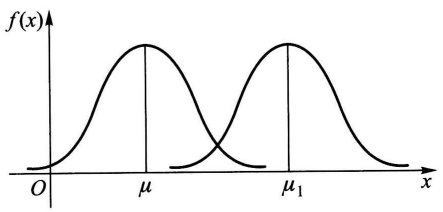

contour

| Feature | Value |
| --- | --- |
| Mean \((\mu)\) | \(\mu\) |
| Mean \((\mu1)\) | \(\mu1\) |

图2-12

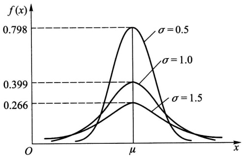

violin

| Category | \(\sigma=0.5\) | \(\sigma=1.0\) | \(\sigma=1.5\) |
| --- | --- | --- | --- |
| Peak Value | 0.798 | 0.399 | 0.266 |

图2-13

由(4.10)式得 $X$ 的分布函数为(如图2-14)

$$
F (x) = \frac {1}{\sqrt {2 \pi} \sigma} \int_ {- \infty} ^ {x} \mathrm{e} ^ {- \frac {(t - \mu) ^ {2}}{2 \sigma^ {2}}} \mathrm{d} t, \tag {4.12}
$$

特别，当 $\mu = 0, \sigma = 1$ 时称随机变量 $X$ 服从标准正态分布. 其概率密度和分布函数分别用 $\varphi(x), \Phi(x)$ 表示，即有

$$
\varphi (x) = \frac {1}{\sqrt {2 \pi}} \mathrm{e} ^ {- x ^ {2} / 2}, \tag {4.13}
$$

$$
\Phi (x) = \frac {1}{\sqrt {2 \pi}} \int_ {- \infty} ^ {x} \mathrm{e} ^ {- t ^ {2} / 2} \mathrm{d} t. \tag {4.14}
$$

易知 $\Phi (-x) = 1 - \Phi (x)$ (4.15)

(参见图 2-15).

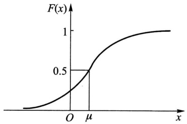

line

| X | F(x) |
| --- | --- |
| \(\mu\) | 0.5 |

图2-14

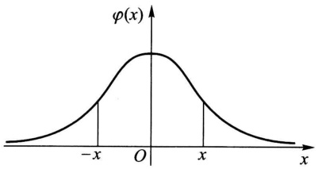

contour

| X | \(\phi(x)\) |
| --- | --- |
| -x | ~0.25 |
| 0 | 1.0 |
| x | ~0.25 |

图2-15

人们已编制了  $\Phi(x)$  的函数表, 可供查用 (见附表 2).

一般,若随机变量  $X \sim N(\mu, \sigma^{2})$ , 我们只要通过一个线性变换就能将它化成标准正态分布.

引理 若随机变量 $X \sim N(\mu, \sigma^2)$，则 $Z = \frac{X - \mu}{\sigma} \sim N(0, 1)$.

证 $Z = \frac{X - \mu}{\sigma}$ 的分布函数为

$$
P \{Z \leqslant x \} = P \left\{\frac {X - \mu}{\sigma} \leqslant x \right\} = P \{X \leqslant \mu + \sigma x \} = \frac {1}{\sqrt {2 \pi} \sigma} \int_ {- \infty} ^ {\mu + \sigma x} \mathrm{e} ^ {- \frac {(t - \mu) ^ {2}}{2 \sigma^ {2}}} \mathrm{d} t,
$$

令 $\frac{t-\mu}{\sigma}=u$ , 得

$$
P \{Z \leqslant x \} = \frac {1}{\sqrt {2 \pi}} \int_ {- \infty} ^ {x} \mathrm{e} ^ {- u ^ {2} / 2} \mathrm{d} u = \Phi (x),
$$

由此知 $Z = \frac{X - \mu}{\sigma} \sim N(0,1)$.

于是，若随机变量 $X \sim N(\mu, \sigma^2)$，则它的分布函数 $F(x)$ 可写成

$$
F (x) = P \{X \leqslant x \} = P \left\{\frac {X - \mu}{\sigma} \leqslant \frac {x - \mu}{\sigma} \right\} = \Phi \left(\frac {x - \mu}{\sigma}\right). \tag {4.16}
$$

对于任意区间 $(x_{1}, x_{2}]$，有

$$
\begin{array}{l} P \left\{x _ {1} <   X \leqslant x _ {2} \right\} = P \left\{\frac {x _ {1} - \mu}{\sigma} <   \frac {X - \mu}{\sigma} \leqslant \frac {x _ {2} - \mu}{\sigma} \right\} \\ = \Phi \left(\frac {x _ {2} - \mu}{\sigma}\right) - \Phi \left(\frac {x _ {1} - \mu}{\sigma}\right). \tag {4.17} \\ \end{array}
$$

例如,设随机变量  $X \sim N(1,4)$ , 查表得

$$
\begin{array}{l} P \{0 <   X \leqslant 1. 6 \} = \Phi \left(\frac {1 . 6 - 1}{2}\right) - \Phi \left(\frac {0 - 1}{2}\right) = \Phi (0. 3) - \Phi (- 0. 5) \\ = 0. 6 1 7 9 - [ 1 - \Phi (0. 5) ] = 0. 6 1 7 9 - 1 + 0. 6 9 1 5 = 0. 3 0 9 4. \\ \end{array}
$$

设  $X \sim N(\mu, \sigma^{2})$ ，由  $\Phi(x)$  的函数表还能得到（图 2-16）:

$$
P \{\mu - \sigma <   X <   \mu + \sigma \} = \Phi (1) - \Phi (- 1) = 2 \Phi (1) - 1 = 68.26\%
$$

$$
P \left\{\mu - 2 \sigma <   X <   \mu + 2 \sigma \right\} = \Phi (2) - \Phi (- 2) = 95.44 \%,
$$

$$
P \left\{\mu - 3 \sigma <   X <   \mu + 3 \sigma \right\} = \Phi (3) - \Phi (- 3) = 99.74 \%.
$$

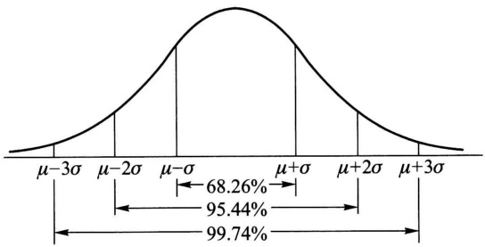

qq

| Interval | Percentage |
| --- | --- |
| \(\mu-3\sigma\) to μ-2σ | 68.26% |
| \(\mu-2\sigma\) to μ-σ | 95.44% |
| \(\mu-\sigma\) to μ+σ | 99.74% |
| \(\mu+\sigma\) to μ+2σ | — |
| \(\mu+2\sigma\) to μ+3σ | — |
| \(\mu+3\sigma\) to μ+3σ | — |

图2-16

我们看到, 尽管正态变量的取值范围是 $(-\infty, \infty)$, 但它的值落在 $(\mu - 3\sigma, \mu + 3\sigma)$ 内几乎是肯定的事. 这就是人们所说的“$3\sigma$”法则.

例3 将一温度调节器放置在贮存着某种液体的容器内. 调节器整定在 $d^{\circ}\mathrm{C}$, 液体的温度 $X$ (以 ${}^{\circ}\mathrm{C}$ 计) 是一个随机变量, 且 $X \sim N(d, 0.5^{2})$. (1) 若 $d = 90^{\circ}\mathrm{C}$, 求 $X$ 小于 $89^{\circ}\mathrm{C}$ 的概率. (2) 若要求保持液体的温度至少为 $80^{\circ}\mathrm{C}$ 的概率不低于 0.99, 问 $d$ 至少为多少?

解（1）所求概率为

$$
\begin{array}{l} P \{X <   8 9 \} = P \left\{\frac {X - 9 0}{0 . 5} <   \frac {8 9 - 9 0}{0 . 5} \right\} = \Phi \left(\frac {8 9 - 9 0}{0 . 5}\right) = \Phi (- 2) \\ = 1 - \Phi (2) = 1 - 0. 9 7 7 2 = 0. 0 2 2 8. \\ \end{array}
$$

(2) 按题意需求 $d$ 满足