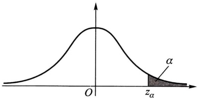
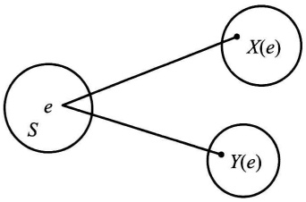
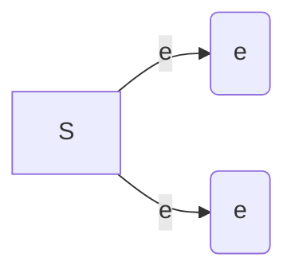
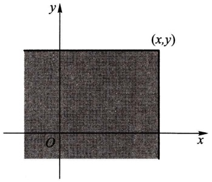
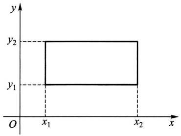
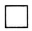
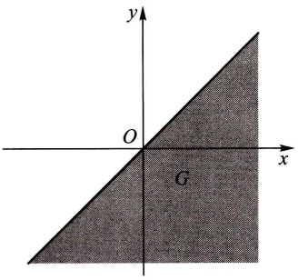

$$
\begin{array}{l} 0. 9 9 \leqslant P \{X \geqslant 8 0 \} = P \left\{\frac {X - d}{0 . 5} \geqslant \frac {8 0 - d}{0 . 5} \right\} \\ = 1 - P \left\{\frac {X - d}{0 . 5} <   \frac {8 0 - d}{0 . 5} \right\} = 1 - \Phi \left(\frac {8 0 - d}{0 . 5}\right). \\ \end{array}
$$

即 $\Phi \left(\frac{d - 80}{0.5}\right) \geqslant 0.99 = \Phi(2.327)$,

亦即 $\frac{d - 80}{0.5} \geqslant 2.327.$

故需  $d \geqslant 81.1635.$

为了便于今后在数理统计中的应用,对于标准正态随机变量,我们引入上  $\alpha$  分位数的定义.

设 $X \sim N(0,1)$, 若 $z_{\alpha}$ 满足条件

$$
P \{X > z _ {\alpha} \} = \alpha , 0 <   \alpha <   1, \tag {4.18}
$$

则称 $z_{\alpha}$ 为标准正态分布的上 $\alpha$ 分位数（如图2-17).下面列出了几个常用的 $z_{\alpha}$ 的值:

text_image

O
z_{\alpha}
\alpha

图2-17

| $\alpha$ | 0.001 | 0.005 | 0.01 | 0.025 | 0.05 | 0.10 |
| --- | --- | --- | --- | --- | --- | --- |
| $z_{\alpha}$ | 3.090 | 2.576 | 2.326 | 1.960 | 1.645 | 1.282 |

另外，由  $\varphi(x)$  图形的对称性知道  $z_{1-\alpha} = -z_{\alpha}$ .

在自然现象和社会现象中,大量随机变量都服从或近似服从正态分布.例如,一个地区的男性成年人的身高、测量某零件长度的误差、海洋波浪的高度、半导体器件中的热噪声电流或电压等,都服从正态分布.在概率论与数理统计的理论研究和实际应用中正态随机变量起着特别重要的作用.在第五章我们将进一步说明正态随机变量的重要性.

## § 5 随机变量的函数的分布

在实际中,我们常对某些随机变量的函数更感兴趣.例如,在一些试验中,所关心的随机变量往往不能由直接测量得到,而它却是某个能直接测量的随机变量的函数.比如我们能测量圆轴截面的直径d,而关心的却是截面面积 $A=\frac{1}{4}\pi d^{2}$ .这里,随机变量A是随机变量d的函数.在这一节中,我们将讨论如何由已知的随机变量X的概率分布去求得它的函数 $Y=g(X)(g(\cdot)$ 是已知的连续函数)的概率分布.这里Y是这样的随机变量,当X取值x时,Y取值 $g(x)$ .

例1 设随机变量 $X$ 具有以下的分布律:

| X | -1 | 0 | 1 | 2 |
| --- | --- | --- | --- | --- |
| $p_k$ | 0.2 | 0.3 | 0.1 | 0.4 |

试求 $Y = (X - 1)^2$ 的分布律.

解 $Y$ 所有可能取的值为0,1,4.由

$$
P \{Y = 0 \} = P \{(X - 1) ^ {2} = 0 \} = P \{X = 1 \} = 0. 1,
$$

$$
P \{Y = 1 \} = P \{X = 0 \} + P \{X = 2 \} = 0. 7,
$$

$$
P \{Y = 4 \} = P \{X = - 1 \} = 0. 2,
$$

即得 $Y$ 的分布律为

| Y | 0 | 1 | 4 |
| --- | --- | --- | --- |
| $p_k$ | 0.1 | 0.7 | 0.2 |

□

例2 设随机变量 $X$ 具有概率密度

$$
f _ {X} (x) = \left\{ \begin{array}{l l} \frac {x}{8}, & 0 <   x <   4, \\ 0, & \text {其他}. \end{array} \right.
$$

求随机变量  $Y=2X+8$  的概率密度.

解 分别记 X, Y 的分布函数为  $F_{X}(x)$ ,  $F_{Y}(y)$ . 下面先来求  $F_{Y}(y)$ .

$$
\begin{array}{l} F _ {Y} (y) = P \{Y \leqslant y \} = P \{2 X + 8 \leqslant y \} \\ = P \left\{X \leqslant \frac {y - 8}{2} \right\} = F _ {x} \left(\frac {y - 8}{2}\right). \\ \end{array}
$$

将 $F_{Y}(y)$ 关于 $y$ 求导数，得 $Y = 2X + 8$ 的概率密度为

$$
\begin{array}{l} f _ {Y} (y) = f _ {X} \left(\frac {y - 8}{2}\right) \left(\frac {y - 8}{2}\right) ^ {\prime} \\ = \left\{ \begin{array}{l l} \frac {1}{8} \times \frac {y - 8}{2} \times \frac {1}{2}, & 0 <   \frac {y - 8}{2} <   4, \\ 0, & \text {其他} \end{array} \right. \\ = \left\{ \begin{array}{l l} \frac {y - 8}{3 2}, & 8 <   y <   1 6, \\ 0, & \text {其他.} \end{array} \right. \\ \end{array}
$$

例3 设随机变量 $X$ 具有概率密度 $f_{X}(x), -\infty < x < \infty$，求 $Y = X^{2}$ 的概率密度.

解 分别记 $X, Y$ 的分布函数为 $F_{X}(x), F_{Y}(y)$. 先来求 $Y$ 的分布函数

$F_{Y}(y)$. 由于 $Y = X^{2} \geqslant 0$, 故当 $y \leqslant 0$ 时 $F_{Y}(y) = 0$. 当 $y > 0$ 时有

$$
\begin{array}{l} F _ {Y} (y) = P \{Y \leqslant y \} = P \{X ^ {2} \leqslant y \} \\ = P \{- \sqrt {y} \leqslant X \leqslant \sqrt {y} \} \\ = F _ {X} (\sqrt {y}) - F _ {X} (- \sqrt {y}). \\ \end{array}
$$

将 $F_{Y}(y)$ 关于 $y$ 求导数，即得 $Y$ 的概率密度为

$$
f _ {Y} (y) = \left\{ \begin{array}{l l} \frac {1}{2 \sqrt {y}} [ f _ {X} (\sqrt {y}) + f _ {X} (- \sqrt {y}) ], & y > 0, \\ 0, & y \leqslant 0. \end{array} \right. \tag {5.1}
$$

例如, 设  $X \sim N(0,1)$ , 其概率密度为

$$
\varphi (x) = \frac {1}{\sqrt {2 \pi}} \mathrm{e} ^ {- x ^ {2} / 2}, \quad - \infty <   x <   \infty .
$$

由(5.1)式得 $Y = X^{2}$ 的概率密度为

$$
f _ {Y} (y) = \left\{ \begin{array}{l l} \frac {1}{\sqrt {2 \pi}} y ^ {- 1 / 2} \mathrm{e} ^ {- y / 2}, & y > 0, \\ 0, & y \leqslant 0. \end{array} \right.
$$

此时称 $Y$ 服从自由度为1的 $\chi^2$ 分布.

上述两个例子解法的关键一步是在“ $Y \leqslant y$ ”中，即在“ $g(X) \leqslant y$ ”中解出X，从而得到一个与“ $g(X) \leqslant y$ ”等价的X的不等式，并以后者代替“ $g(X) \leqslant y$ ”。例如，在例2中以“ $X \leqslant \frac{y - 8}{2}$ ”代替“ $2X + 8 \leqslant y$ ”；在例3中，当y > 0时以“ $-\sqrt{y} \leqslant X \leqslant \sqrt{y}$ ”代替“ $X^{2} \leqslant y$ ”。一般来说，可以用这样的方法①求连续型随机变量的函数的分布函数或概率密度。下面我们仅对 $Y = g(X)$，其中 $g(\cdot)$ 是严格单调函数的情况，写出一般的结果。

定理 设随机变量 $X$ 具有概率密度 $f_{X}(x), -\infty < x < \infty$，又设函数 $g(x)$ 处处可导且恒有 $g'(x) > 0$（或恒有 $g'(x) < 0$），则 $Y = g(X)$ 是连续型随机变量，其概率密度为

$$
f _ {Y} (y) = \left\{ \begin{array}{l l} f _ {X} [ h (y) ] \mid h ^ {\prime} (y) |, & \alpha <   y <   \beta , \\ 0, & \text {其他，} \end{array} \right. \tag {5.2}
$$

其中 $\alpha = \min \{g(-\infty), g(\infty)\}, \beta = \max \{g(-\infty), g(\infty)\}, h(y)$ 是 $g(x)$ 的反函数.

我们只证 $g^{\prime}(x) > 0$ 的情况. 此时 $g(x)$ 在 $(-\infty, \infty)$ 内严格单调增加, 它的反函数 $h(y)$ 存在，且在 $(\alpha, \beta)$ 内严格单调增加、可导。分别记 $X, Y$ 的分布函数为 $F_{X}(x), F_{Y}(y)$。现在先来求 $Y$ 的分布函数 $F_{Y}(y)$。

<small>① 连续型随机变量 $X$ 的函数 $Y = g(X)$ 不一定是连续型随机变量.</small>

因为 $Y = g(X)$ 在 $(\alpha, \beta)$ 内取值，故当 $y \leqslant \alpha$ 时，$F_{Y}(y) = P\{Y \leqslant y\} = 0$；当 $y \geqslant \beta$ 时，$F_{Y}(y) = P\{Y \leqslant y\} = 1$.

当 $\alpha < y < \beta$ 时，

$$
\begin{array}{l} F _ {Y} (y) = P \{Y \leqslant y \} = P \{g (X) \leqslant y \} \\ = P \{X \leqslant h (y) \} = F _ {X} [ h (y) ]. \\ \end{array}
$$

将 $F_{Y}(y)$ 关于 $y$ 求导数，即得 $Y$ 的概率密度

$$
f _ {Y} (y) = \left\{ \begin{array}{l l} f _ {X} [ h (y) ] h ^ {\prime} (y), & \alpha <   y <   \beta , \\ 0, & \text {其他.} \end{array} \right. \tag {5.3}
$$

对于 $g'(x) < 0$ 的情况可以同样地证明，此时有

$$
f _ {Y} (y) = \left\{ \begin{array}{l l} f _ {X} [ h (y) ] \left[ - h ^ {\prime} (y) \right], & \alpha <   y <   \beta , \\ 0, & \text {其他.} \end{array} \right. \tag {5.4}
$$

合并(5.3)与(5.4)两式，(5.2)式得证.

若 $f(x)$ 在有限区间 $[a, b]$ 以外等于零，则只需假设在 $[a, b]$ 上恒有 $g'(x) > 0$ （或恒有 $g'(x) < 0$），此时

$$
\alpha = \min \{g (a), g (b) \}, \quad \beta = \max \{g (a), g (b) \}.
$$

例4 设随机变量 $X \sim N(\mu, \sigma^2)$. 试证明 $X$ 的线性函数 $Y = aX + b (a \neq 0)$ 也服从正态分布.

证 $X$ 的概率密度为

$$
f _ {X} (x) = \frac {1}{\sqrt {2 \pi} \sigma} \mathrm{e} ^ {- \frac {(x - \mu) ^ {2}}{2 \sigma^ {2}}}, - \infty <   x <   \infty .
$$

现在 $y = g(x) = ax + b$ ，由这一式子解得

$$
x = h (y) = \frac {y - b}{a}, \text {且有} h ^ {\prime} (y) = \frac {1}{a}.
$$

由（5.2）式得 $Y = aX + b$ 的概率密度为

$$
f _ {Y} (y) = \frac {1}{| a |} f _ {X} \left(\frac {y - b}{a}\right), \quad - \infty <   y <   \infty .
$$

即

$$
f _ {Y} (y) = \frac {1}{| a |} \frac {1}{\sqrt {2 \pi} \sigma} \mathrm{e} ^ {- \frac {\left(\frac {y - b}{a} - \mu\right) ^ {2}}{2 \sigma^ {2}}} = \frac {1}{| a | \sigma \sqrt {2 \pi}} \mathrm{e} ^ {- \frac {[ y - (b + a \mu) ] ^ {2}}{2 (a \sigma) ^ {2}}}, \quad - \infty <   y <   \infty .
$$

即有 $Y = aX + b\sim N(a\mu +b,(a\sigma)^2)$

特别，在上例中取 $a = \frac{1}{\sigma}, b = -\frac{\mu}{\sigma}$ 得

$$
Y = \frac {X - \mu}{\sigma} \sim N (0, 1).
$$

这就是上一节引理的结果.

例 5 设电压  $V = A \sin \Theta$ ，其中 A 是一个已知的正常数，相角  $\Theta$  是一个随机变量，且有  $\Theta \sim U\left(-\frac{\pi}{2}, \frac{\pi}{2}\right)$ ，试求电压 V 的概率密度.

解 现在 $v = g(\theta) = A\sin \theta$ 在 $\left(-\frac{\pi}{2}, \frac{\pi}{2}\right)$ 上恒有 $g'(\theta) = A\cos \theta > 0$，且有反函数

$$
\theta = h (v) = \arcsin \frac {v}{A}, \quad h ^ {\prime} (v) = \frac {1}{\sqrt {A ^ {2} - v ^ {2}}},
$$

又，$\Theta$ 的概率密度为

$$
f (\theta) = \left\{ \begin{array}{l l} { \frac {1}{\pi},} & {- \frac {\pi}{2} <   \theta <   \frac {\pi}{2},} \\ {0,} & {\text {其他}.} \end{array} \right.
$$

由(5.2)式得  $V = A \sin \Theta$  的概率密度为

$$
\psi (v) = \left\{ \begin{array}{l l}  \frac {1}{\pi} \cdot \frac {1}{\sqrt {A ^ {2} - v ^ {2}}}, & - A <   v <   A, \\ 0, & \text {其他}. \end{array} \right.
$$

若在上题中 $\Theta \sim U(0, \pi)$，因为此时 $v = g(\theta) = A\sin \theta$ 在 $(0, \pi)$ 内不是单调函数，上述定理失效，应仍按例3的方法来做。请读者自行求出其结果。

小结

随机变量 $X = X(e)$ 是定义在样本空间 $S = \{e\}$ 上的实值单值函数.也就是说，它是随机试验结果的函数.它的取值随试验的结果而定，是不能预先确定的，它的取值有一定的概率.随机变量的引入，使概率论的研究由个别随机事件扩大为随机变量所表征的随机现象的研究.今后，我们主要研究随机变量和它的分布.

一个随机变量,如果它所有可能的值是有限个或可列无限个,这种随机变量称为离散型随机变量,不是这种情况则称为非离散型的.不论是离散型的或非离散型的随机变量X,都可以借助分布函数

$$
F (x) = P \{X \leqslant x \}, \quad - \infty <   x <   \infty
$$

来描述.若已知随机变量 $X$ 的分布函数，则能知道 $X$ 落在任一区间 $(x_{1}, x_{2}]$ 上的概率

$$
P \{x _ {1} <   X \leqslant x _ {2} \} = F (x _ {2}) - F (x _ {1}), \quad x _ {1} <   x _ {2}.
$$

这样,分布函数就能完整地描述随机变量取值的统计规律性.

对于离散型随机变量,我们需要掌握的是它可能取哪些值,以及它以怎样的概率取这些值,这就是离散型随机变量取值的统计规律性.因而,对于离散型随机变量,用分布律

$$
P \{X = x _ {k} \} = p _ {k}, \quad k = 1, 2, \dots
$$

或写成

$$
\begin{array}{c c c c c c} X & x _ {1} & x _ {2} & \dots & x _ {k} & \dots \\ \hline p _ {k} & p _ {1} & p _ {2} & \dots & p _ {k} & \dots \end{array}
$$

$\left(\text{这里}\sum_{k=1}^{\infty}p_k = 1\right)$ 来描述它的取值的统计规律性较为直观和简洁.分布律与分布函数有以下的关系

$$
F (x) = P \{X \leqslant x \} = \sum_ {x _ {k} \leqslant x} P \{X = x _ {k} \},
$$

它们是一一对应的.

设随机变量 $X$ 的分布函数为 $F(x)$，如果存在非负可积函数 $f(x)$，使得对于任意 $x$，有

$$
F (x) = \int_ {- \infty} ^ {x} f (x) \mathrm{d} x,
$$

则称 $X$ 是连续型随机变量，其中 $f(x) \geqslant 0$ 称为 $X$ 的概率密度.

给定 $X$ 的概率密度 $f(x)$ 就能确定 $F(x)$，由于 $f(x)$ 位于积分号之内，故改变 $f(x)$ 在个别点上的函数值并不改变 $F(x)$ 的值。因此，改变 $f(x)$ 在个别点上的值，是无关紧要的。

连续型随机变量 X 的分布函数是连续的, 连续型随机变量取任一指定实数值 a 的概率为 0, 即  $P\{X=a\}=0$ . 离散型随机变量是不具备这两点性质的.

我们将随机变量分成:

$$
\text {随机变量} \left\{ \begin{array}{l} \text {离散型} \\ \text {非离散型} \end{array} \right. \left\{ \begin{array}{l} \text {连续型} \\ \text {其他} \end{array} \right.
$$

读者不要误以为,一个随机变量,如果它不是离散型的那一定是连续型的.但本书只讨论两类重要的随机变量:离散型和连续型随机变量.

读者应掌握分布函数、分布律、概率密度的性质.本章引入了几种重要的随机变量的分布:(0-1)分布、二项分布、泊松分布、指数分布、均匀分布和正态分布.读者必须熟知这几种随机变量的分布律或概率密度.

随机变量 $X$ 的函数 $Y = g(X)$ 也是一个随机变量，要掌握如何由已知的 $X$ 的分布（$X$ 的分布律或概率密度）去求得 $Y = g(X)$ 的分布（$Y$ 的分布律或概率密度）.

## ■ 重要术语及主题

随机变量 分布函数 离散型随机变量及其分布律 连续型随机变量及其概率密度伯努利试验 (0-1)分布 $n$ 重伯努利试验 二项分布 泊松分布 指数分布 均匀分布正态分布 随机变量函数的分布

## 习题

1. 考虑为期一年的一张保险单, 若投保人在投保后一年内因意外死亡, 则公司赔付20万元; 若投保人因其他原因死亡, 则公司赔付5万元; 若投保人在投保期末生存, 则公司无须付给任何费用. 若投保人在一年内因意外死亡的概率为 0.0002, 因其他原因死亡的概率为 0.0010, 求公司赔付金额的分布律.

2.（1）一袋中装有5只球，编号为1,2,3,4,5.在袋中同时取3只，以 $X$ 表示取出的3只球中的最大号码，写出随机变量 $X$ 的分布律.

(2) 将一颗骰子抛掷两次, 以 X 表示两次中得到的小的点数, 试求 X 的分布律.

3. 设在 15 只同类型的零件中有 2 只是次品，在其中取 3 次，每次任取 1 只，作不放回抽样。以 $X$ 表示取出的次品的只数。

(1) 求 X 的分布律.
(2) 画出分布律的图形.

4. 进行重复独立试验, 设每次试验成功的概率为 $p$, 失败的概率为 $q = 1 - p$ ($0 < p < 1$).

（1）将试验进行到出现一次成功为止，以 X 表示所需的试验次数，求 X 的分布律。（此时称 X 服从以 p 为参数的几何分布。）
（2）将试验进行到出现 $r$ 次成功为止，以 $Y$ 表示所需的试验次数，求 $Y$ 的分布律。（此时称 $Y$ 服从以 $r, p$ 为参数的帕斯卡分布或负二项分布。）
（3）一篮球运动员的投篮命中率为 $45\%$ .以 $X$ 表示他首次投中时累计已投篮的次数，写出 $X$ 的分布律，并计算 $X$ 取偶数的概率.

5. 一房间有3扇同样大小的窗子, 其中只有一扇是打开的. 有一只鸟自开着的窗子飞入了房间, 它只能从开着的窗子飞出去. 鸟在房间里飞来飞去, 试图飞出房间. 假定鸟是没有记忆的, 它飞向各扇窗子是随机的.

(1) 以 X 表示鸟为了飞出房间试飞的次数, 求 X 的分布律.
（2）户主声称，他养的一只鸟是有记忆的，它飞向任一窗子的尝试不多于一次。以 $Y$ 表示这只聪明的鸟为了飞出房间试飞的次数。如户主所说是确实的，试求 $Y$ 的分布律。
(3) 求试飞次数 X 小于 Y 的概率和试飞次数 Y 小于 X 的概率.

6. 一大楼装有 5 台同类型的供水设备. 设各台设备是否被使用相互独立. 调查表明在任一时刻 t 每台设备被使用的概率为 0.1, 问在同一时刻,

(1) 恰有 2 台设备被使用的概率是多少?
(2) 至少有 3 台设备被使用的概率是多少?
(3) 至多有 3 台设备被使用的概率是多少?
(4) 至少有 1 台设备被使用的概率是多少?

7. 设事件 $A$ 在每次试验中发生的概率为0.3. 当 $A$ 发生不少于3次时，指示灯发出信号.

(1) 进行了 5 次重复独立试验, 求指示灯发出信号的概率.
(2) 进行了 7 次重复独立试验, 求指示灯发出信号的概率.

8. 甲、乙两人投篮, 投中的概率分别为 0.6, 0.7. 今各投 3 次. 求

(1) 两人投中次数相等的概率.
(2) 甲比乙投中次数多的概率.

9. 有一大批产品, 其验收方案如下, 先作第一次检验: 从中任取 10 件, 经检验无次品时接受这批产品,次品数大于2时拒收;否则作第二次检验,其做法是从中再任取5件,仅当5件中无次品时接受这批产品.若产品的次品率为10%,求

(1) 这批产品经第一次检验就能接受的概率.

(2) 需作第二次检验的概率.

(3) 这批产品按第二次检验的标准被接受的概率.

(4) 这批产品在第一次检验未能作决定且第二次检验时被通过的概率.

(5) 这批产品被接受的概率.

10. 有甲、乙两种味道和颜色都极为相似的名酒各4杯. 如果从中挑4杯, 能将甲种酒全部挑出来, 算是试验成功一次.

(1) 某人随机地去挑, 问他试验成功一次的概率是多少?

(2) 某人声称他通过品尝能区分两种酒. 他连续试验 10 次, 成功 3 次. 试推断他是猜对的, 还是他确有区分的能力 (设各次试验是相互独立的).

11. 尽管在几何教科书中已经讲过仅用圆规和直尺三等分一个任意角是不可能的,但每一年总是有一些“发明者”撰写关于仅用圆规和直尺将角三等分的文章.设某地区每年撰写此类文章的篇数 $X$ 服从参数为6的泊松分布.求明年没有此类文章的概率.

12. 一电话总机每分钟收到呼唤的次数服从参数为 4 的泊松分布. 求

(1) 某一分钟恰有 8 次呼唤的概率.

(2) 某一分钟的呼唤次数大于3的概率.

13. 某一公安局在长度为 $t$ 的时间间隔内收到的紧急呼救的次数 $X$ 服从参数为 $t / 2$ 的泊松分布，而与时间间隔的起点无关(时间以 $\mathrm{h}$ 计). 求

(1) 某一天中午 12 时至下午 3 时未收到紧急呼救的概率.

(2) 某一天中午 12 时至下午 5 时至少收到 1 次紧急呼救的概率.

14. 某人家中在时间间隔 $t$ (以 $\mathrm{h}$ 计) 内接到电话的次数 $X$ 服从参数为 $2t$ 的泊松分布.

(1) 若他外出计划用时 10 min, 问其间电话铃响一次的概率是多少?

(2) 若他希望外出时没有电话的概率至少为 0.5, 问他外出应控制的最长时间是多少?

15. 保险公司在一天内承保了 5 000 张相同年龄、为期一年的寿险保单，每人一份。在合同有效期内若投保人死亡，则公司需赔付 3 万元。设在一年内，该年龄段的死亡率为 0.0015，且各投保人是否死亡相互独立。求该公司对于这批投保人的赔付总额不超过 30 万元的概率（利用泊松定理计算）。

16. 有一繁忙的汽车站, 每天有大量汽车通过, 设一辆汽车在一天的某段时间内出事故的概率为 0.0001. 在某天的该时间段内有 1000 辆汽车通过. 问出事故的车辆数不小于 2 的概率是多少? (利用泊松定理计算.)

17.（1）设 $X$ 服从(0-1)分布，其分布律为 $P\{X = k\} = p^k (1 - p)^{1 - k}, k = 0,1$ ，求 $X$ 的分布函数，并作出其图形.

(2) 求第 2 题(1)中的随机变量的分布函数.

18. 在区间 $[0, a]$ 上任意投掷一个质点，以 $X$ 表示这个质点的坐标。设这个质点落在 $[0, a]$ 中任意小区间内的概率与这个小区间的长度成正比例。试求 $X$ 的分布函数。

19. 以 $X$ 表示某商店从早晨开始营业起直到第一个顾客到达的等待时间（以 $\min$ 计），$X$ 的分布函数是

$$
F _ {X} (x) = \left\{ \begin{array}{l l} 1 - \mathrm{e} ^ {- 0. 4 x}, & x > 0, \\ 0, & x \leqslant 0. \end{array} \right.
$$

求下述概率:

(1)  $P\{$ 至多 3 min\}.
(2)  $P\{至少 4 \text{ min}\}$ .
(3)  $P\{3 \text{ min 至 } 4 \text{ min 之间}\}$ .
(4)  $P\{$ 至多 3 min 或至少 4 min\}.
(5)  $P\{恰好 2.5 \text{ min}\}$ .

20. 设随机变量 $X$ 的分布函数为

$$
F _ {X} (x) = \left\{ \begin{array}{l l} 0, & x <   1, \\ \ln x, & 1 \leqslant x <   \mathrm{e}, \\ 1, & x \geqslant \mathrm{e}. \end{array} \right.
$$

(1) 求  $P\{X<2\}, P\{0<X\leqslant3\}, P\{2<X<5/2\}$ .
(2) 求概率密度  $f_{X}(x)$ .

21. 设随机变量 $X$ 的概率密度为

(1) $f(x)=\left\{\begin{aligned}&2(1-1/x^{2}),&1\leqslant x\leqslant2,\\ &0,&\text{其他.}\end{aligned}\right.$
(2) $f(x) = \begin{cases} x, & 0 \leqslant x < 1, \\ 2 - x, & 1 \leqslant x < 2, \\ 0, & \text{其他}. \end{cases}$

求 $X$ 的分布函数 $F(x)$，并画出(2)中的 $f(x)$ 及 $F(x)$ 的图形.

22.（1）分子运动速度的绝对值 X 服从麦克斯韦(Maxwell)分布,其概率密度为

$$
f (x) = \left\{ \begin{array}{l l} A x ^ {2}   \mathrm{e} ^ {- x ^ {2} / b}, & x > 0, \\ 0, & \text {其他}, \end{array} \right.
$$

其中 $b = m / (2kT), k$ 为玻耳兹曼(Boltzmann)常数，$T$ 为绝对温度，$m$ 是分子的质量，试确定常数 $A$.

(2) 某人研究了英格兰在 1875—1951 年间, 在矿山发生导致不少于 10 人死亡的事故的频繁程度, 得知相继两次事故之间的时间 $T$ (以日计) 服从指数分布, 其概率密度为

$$
f _ {T} (t) = \left\{ \begin{array}{l l}  \frac {1}{2 4 1} \mathrm{e} ^ {- t / 2 4 1}, & t > 0, \\ 0, & \text {其他}. \end{array} \right.
$$

求分布函数 $F_{T}(t)$ ，并求概率 $P\{50 < T < 100\}$

23. 某种型号器件的寿命 $X$ (以 $\mathrm{h}$ 计) 具有概率密度

$$
f (x) = \left\{ \begin{array}{l l} \frac {1 0 0 0}{x ^ {2}}, & x > 1 0 0 0, \\ 0, & \text {其他}. \end{array} \right.
$$

现有一大批此种器件(设各器件损坏与否相互独立)，任取5只，问其中至少有2只寿命大于$1500\mathrm{h}$ 的概率是多少？

24. 设顾客在某银行的窗口等待服务的时间 $X$ (以 $\min$ 计) 服从指数分布, 其概率密度为

$$
f _ {X} (x) = \left\{ \begin{array}{l l} \frac {1}{5} \mathrm{e} ^ {- x / 5}, & x > 0, \\ 0, & \text {其他}. \end{array} \right.
$$

某顾客在窗口等待服务,若超过10 min,他就离开.他一个月要到银行5次.以Y表示一个月内他未等到服务而离开窗口的次数.写出Y的分布律,并求 $P\{Y\geqslant1\}$ .

25. 设 $K$ 在 $(0,5)$ 内服从均匀分布, 求 $x$ 的方程

$$
4 x ^ {2} + 4 K x + K + 2 = 0
$$

有实根的概率.

26. 设 $X \sim N(3, 2^2)$.

(1) 求  $P\{2<X\leqslant5\}$ ,  $P\{-4<X\leqslant10\}$ ,  $P\{|X|>2\}$ ,  $P\{X>3\}$ .

(2) 确定 c，使得  $P\{X > c\} = P\{X \leqslant c\}$ .

(3) 设 d 满足  $P\{X>d\}\geqslant0.9$ ，问 d 至多为多少？

27. 某地区 18 岁的女青年的血压(收缩压, 以 mmHg 计, 1 mmHg = 133.3224 Pa)服从  $N(110, 12^{2})$  分布. 在该地区任选一 18 岁的女青年, 测量她的血压 X.

(1) 求  $P\{X \leqslant 105\}$ ,  $P\{100 < X \leqslant 120\}$ .

(2) 确定最小的 x，使  $P\{X > x\} \leqslant 0.05$ .

28. 由某机器生产的螺栓的长度(以 cm 计)服从参数  $\mu=10.05,\sigma=0.06$  的正态分布. 规定长度在范围  $10.05\pm0.12$  内为合格品, 求一螺栓为不合格品的概率.

29. 一工厂生产的某种元件的寿命 $X$ (以 $\mathrm{h}$ 计) 服从参数为 $\mu = 160, \sigma (\sigma > 0)$ 的正态分布. 若要求 $P\{120 < X \leqslant 200\} \geqslant 0.80$, 允许 $\sigma$ 最大为多少?

30. 设在一电路中, 电阻两端的电压(以 V 计)服从  $N(120,2^{2})$  分布, 今独立测量了 5 次, 试确定有 2 次测定值落在区间 [118,122] 之外的概率.

31. 某人上班, 自家里去办公楼要经过一交通指示灯, 这一指示灯有 80% 时间亮红灯, 此时他在指示灯旁等待直至绿灯亮. 等待时间在区间 [0, 30] (以 s 计) 上服从均匀分布. 以 X 表示他的等待时间, 求 X 的分布函数  $F(x)$ . 画出  $F(x)$  的图形, 并问 X 是否为连续型随机变量, 是否为离散型的? (要说明理由.)

32. 设 $f(x), g(x)$ 都是概率密度函数, 求证

$$
h (x) = \alpha f (x) + (1 - \alpha) g (x), \quad 0 \leqslant \alpha \leqslant 1
$$

也是一个概率密度函数.

33. 设随机变量 $X$ 的分布律为

| X | -2 | -1 | 0 | 1 | 3 |
| --- | --- | --- | --- | --- | --- |
| $p_k$ | $\frac{1}{5}$ | $\frac{1}{6}$ | $\frac{1}{5}$ | $\frac{1}{15}$ | $\frac{11}{30}$ |

求 $Y = X^{2}$ 的分布律.

34. 设随机变量 $X$ 在区间 $(0,1)$ 内服从均匀分布.

(1) 求  $Y=e^{X}$  的概率密度.
(2) 求  $Y = -2 \ln X$  的概率密度.

35. 设随机变量 $X \sim N(0,1)$.

(1) 求  $Y=e^{X}$  的概率密度.
(2) 求  $Y=2X^{2}+1$  的概率密度.
(3) 求  $Y = |X|$  的概率密度.

36.（1）设随机变量 $X$ 的概率密度为 $f(x), -\infty < x < \infty$. 求 $Y = X^3$ 的概率密度.

(2) 设随机变量 X 的概率密度为

$$
f (x) = \left\{ \begin{array}{l l} \mathrm{e} ^ {- x}, & x > 0, \\ 0, & \text {其他}. \end{array} \right.
$$

求 $Y = X^{2}$ 的概率密度.

37. 设随机变量 $X$ 的概率密度为

$$
f (x) = \left\{ \begin{array}{l l} \frac {2 x}{\pi^ {2}}, & 0 <   x <   \pi , \\ 0, & \text {其他}. \end{array} \right.
$$

求  $Y=\sin X$  的概率密度.

38. 设电流 $I$ 是一个随机变量, 它均匀分布在 $9 \sim 11 \mathrm{~A}$ 之间. 若此电流通过 $2 \Omega$ 的电阻, 在其上消耗的功率 $W = 2I^2$. 求 $W$ 的概率密度.
39. 某物体的温度 $T$ (以 ${}^{\circ}\mathrm{F}$ 计) 是随机变量, 且有 $T \sim N(98.6,2)$, 已知 $\Theta = \frac{5}{9}(T - 32)$, 试求 $\Theta$ (以 ${}^{\circ}\mathrm{C}$ 计) 的概率密度.

## 第三章 多维随机变量及其分布

## § 1 二维随机变量

以上我们只限于讨论一个随机变量的情况,但在实际问题中,对于某些随机试验的结果需要同时用两个或两个以上的随机变量来描述.例如,为了研究某一地区学龄前儿童的发育情况,对这一地区的儿童进行抽查.对于每个儿童都能观察到他的身高 H 和体重 W.在这里,样本空间  $S=\{e\}=\{$  某地区的全部学龄前儿童 $\}$ ,而  $H(e)$  和  $W(e)$  是定义在 S 上的两个随机变量.又如炮弹弹着点的位置需要由它的横坐标和纵坐标来确定,而横坐标和纵坐标是定义在同一个样本空间的两个随机变量.

一般，设 $E$ 是一个随机试验，它的样本空间是 $S = \{e\}$，设 $X = X(e)$ 和 $Y = Y(e)$ 是定义在 $S$ 上的随机变量，由它们构成的一个向量 $(X, Y)$，叫做二维随机向量或二维随机变量（如图3-1). 第二章讨论的随机变量也叫一维随机变量.

flowchart

图3-1

二维随机变量 $(X,Y)$ 的性质不仅与 $X$ 及 $Y$

有关, 而且还依赖于这两个随机变量的相互关系. 因此, 逐个地来研究 $X$ 或 $Y$ 的性质是不够的, 还需将 $(X, Y)$ 作为一个整体来进行研究.

和一维的情况类似,我们也借助“分布函数”来研究二维随机变量.

定义 设 $(X,Y)$ 是二维随机变量, 对于任意实数 $x, y$, 二元函数:

$$
F (x, y) = P \{(X \leqslant x) \cap (Y \leqslant y) \} {\stackrel {\text {记成}} {=}} P \{X \leqslant x, Y \leqslant y \}
$$

称为二维随机变量 $(X,Y)$ 的分布函数,或称为随机变量X和Y的联合分布函数.

如果将二维随机变量 $(X,Y)$ 看成平面上随机点的坐标,那么,分布函数 $F(x,y)$ 在 $(x,y)$ 处的函数值就是随机点 $(X,Y)$ 落在如图3-2所示的,以点 $(x,y)$ 为顶点而位于该点左下方的无穷矩形域内的概率.

依照上述解释,借助于图3-3容易算出随机点 $(X,Y)$ 落在矩形域 $\{(x,y)\mid x_{1}<x\leqslant x_{2},y_{1}<y\leqslant y_{2}\}$ 的概率为

$$
\begin{array}{l} P \{x _ {1} <   X \leqslant x _ {2}, y _ {1} <   Y \leqslant y _ {2} \} \\ = F (x _ {2}, y _ {2}) - F (x _ {2}, y _ {1}) + F (x _ {1}, y _ {1}) - F (x _ {1}, y _ {2}). \tag {1.1} \\ \end{array}
$$

text_image

y
(x,y)
O
x

图3-2

text_image

y
y₂
y₁
O x₁ x₂ x

图3-3

分布函数 $F(x,y)$ 具有以下的基本性质:

$1^{\circ}F(x,y)$ 是变量 $x$ 和 $y$ 的不减函数，即对于任意固定的 $y$ ，当 $x_{2} > x_{1}$ 时$F(x_{2},y)\geqslant F(x_{1},y)$ ；对于任意固定的 $x$ ，当 $y_{2} > y_{1}$ 时 $F(x,y_2)\geqslant F(x,y_1)$

$2^{\circ}0\leqslant F(x,y)\leqslant 1$ ，且

对于任意固定的 $y, F(-\infty, y) = 0$

对于任意固定的 $x, F(x, -\infty) = 0$

$$
F (- \infty , - \infty) = 0, F (\infty , \infty) = 1.
$$

上面四个式子可以从几何上加以说明.例如，在图3-2中将无穷矩形的右面边界向左无限平移(即 $x\to -\infty$ )，则“随机点 $(X,Y)$ 落在这个矩形内”这一事件趋于不可能事件，故其概率趋于0，即有 $F(-\infty ,y) = 0$ ；又如当 $x\to \infty ,y\to \infty$ 时图3-2中的无穷矩形扩展到全平面，随机点 $(X,Y)$ 落在其中这一事件趋于必然事件，故其概率趋于1，即 $F(\infty ,\infty) = 1$

$3^{\circ}F(x + 0,y) = F(x,y),F(x,y + 0) = F(x,y)$ ，即 $F(x,y)$ 关于 $x$ 右连续，关于 $y$ 也右连续.

$4^{\circ}$ 对于任意 $(x_{1},y_{1}),(x_{2},y_{2}),x_{1}<x_{2},y_{1}<y_{2}$ ，下述不等式成立:

$$
F (x _ {2}, y _ {2}) - F (x _ {2}, y _ {1}) + F (x _ {1}, y _ {1}) - F (x _ {1}, y _ {2}) \geqslant 0.
$$

这一性质由(1.1)式及概率的非负性即可得.

如果二维随机变量 $(X,Y)$ 全部可能取到的值是有限对或可列无限多对，则称 $(X,Y)$ 是二维离散型随机变量.

设二维离散型随机变量 $(X,Y)$ 所有可能取的值为 $(x_{i},y_{j}),i,j=1,2,\cdots$ ，记 $P\{X=x_{i},Y=y_{j}\}=p_{ij},i,j=1,2,\cdots$ ，则由概率的定义有

$$
p _ {i j} \geqslant 0, \quad \sum_ {i = 1} ^ {\infty} \sum_ {j = 1} ^ {\infty} p _ {i j} = 1.
$$

我们称  $P\{X=x_{i},Y=y_{j}\}=p_{ij}, i,j=1,2,\cdots$  为二维离散型随机变量  $(X,Y)$  的分布律，或称为随机变量 X 和 Y 的联合分布律.

我们也能用表格来表示 X 和 Y 的联合分布律, 如下表所示①.

| Y\\X | $x_{1}$ | $x_{2}$ | ... | $x_{i}$ | ... |
| --- | --- | --- | --- | --- | --- |
| $y_{1}$ | $p_{11}$ | $p_{21}$ | ... | $p_{i1}$ | ... |
| $y_{2}$ | $p_{12}$ | $p_{22}$ | ... | $p_{i2}$ | ... |
| $\vdots$ | $\vdots$ | $\vdots$ |  | $\vdots$ |  |
| $y_{j}$ | $p_{1j}$ | $p_{2j}$ | ... | $p_{ij}$ | ... |
| $\vdots$ | $\vdots$ | $\vdots$ |  | $\vdots$ |  |

例1 设随机变量 $X$ 在 $1,2,3,4$ 四个整数中等可能地取一个值，另一个随机变量 $Y$ 在 $1 \sim X$ 中等可能地取一整数值. 试求 $(X,Y)$ 的分布律.

解 由乘法公式容易求得 $(X,Y)$ 的分布律. 易知 $\{X = i, Y = j\}$ 的取值情况是: $i = 1,2,3,4,j$ 取不大于 $i$ 的正整数, 且

$$
P \{X = i, Y = j \} = P \{Y = j \mid X = i \} P \{X = i \} = \frac {1}{i} \cdot \frac {1}{4}, \quad i = 1, 2, 3, 4, j \leqslant i.
$$

于是 $(X,Y)$ 的分布律为

| Y\\X | 1 | 2 | 3 | 4 |
| --- | --- | --- | --- | --- |
| 1 | $\frac{1}{4}$ | $\frac{1}{8}$ | $\frac{1}{12}$ | $\frac{1}{16}$ |
| 2 | 0 | $\frac{1}{8}$ | $\frac{1}{12}$ | $\frac{1}{16}$ |
| 3 | 0 | 0 | $\frac{1}{12}$ | $\frac{1}{16}$ |
| 4 | 0 | 0 | 0 | $\frac{1}{16}$ |

将 $(X,Y)$ 看成一个随机点的坐标，由图3-2知道离散型随机变量 $X$ 和 $Y$ 的联合分布函数为

$$
F (x, y) = \sum_ {x _ {i} \leqslant x} \sum_ {y _ {j} \leqslant y} p _ {i j}, \tag {1.2}
$$

其中和式是对一切满足 $x_{i} \leqslant x, y_{j} \leqslant y$ 的 $i, j$ 来求和的.

<small>① 考虑到读者的阅读习惯,本书表格形式与第四版一致.</small>

与一维随机变量相似,对于二维随机变量 $(X,Y)$ 的分布函数 $F(x,y)$ ,如果存在非负可积函数 $f(x,y)$ 使对于任意x,y有

$$
F (x, y) = \int_ {- \infty} ^ {y} \int_ {- \infty} ^ {x} f (u, v) \mathrm{d} u \mathrm{d} v,
$$

则称 $(X,Y)$ 是二维连续型随机变量，函数 $f(x,y)$ 称为二维连续型随机变量$(X,Y)$ 的概率密度，或称为随机变量 $X$ 和 $Y$ 的联合概率密度.

按定义,概率密度  $f(x,y)$  具有以下性质:

$1^{\circ}f(x,y)\geqslant 0.$

$2^{\circ}\int_{-\infty}^{\infty}\int_{-\infty}^{\infty}f(x,y)\mathrm{d}x\mathrm{d}y = F(\infty ,\infty) = 1.$

$3^{\circ}$ 设 $G$ 是 $xOy$ 平面上的区域，点 $(X,Y)$ 落在 $G$ 内的概率为

$$
P \{(X, Y) \in G \} = \iint_ {G} f (x, y) \mathrm{d} x \mathrm{d} y. \tag {1.3}
$$

$4^{\circ}$ 若 $f(x,y)$ 在点 $(x,y)$ 连续，则有

$$
\frac {\partial^ {2} F (x , y)}{\partial x \partial y} = f (x, y).
$$

由性质 $4^{\circ}$, 在 $f(x, y)$ 的连续点处有

$$
\begin{array}{l} \lim_{\substack{\Delta x\to 0^{+}\\ \Delta y\to 0^{+}}}\frac{P\{x <   X\leqslant x + \Delta x,y <   Y\leqslant y + \Delta y\}}{\Delta x\Delta y} \\ \xlongequal {\text {由(1.1)}} \lim_ {\substack {\Delta x \rightarrow 0 ^ {+}\\\Delta y \rightarrow 0 ^ {+}}} \frac {1}{\Delta x \Delta y} [ F (x + \Delta x, y + \Delta y) - F (x + \Delta x, y) - F (x, y + \Delta y) + F (x, y) ] \\ = \frac {\partial^ {2} F (x , y)}{\partial x \partial y} = f (x, y). \\ \end{array}
$$

这表示若 $f(x,y)$ 在点 $(x,y)$ 处连续，则当 $\Delta x,\Delta y$ 很小时

$$
P \{x <   X \leqslant x + \Delta x, y <   Y \leqslant y + \Delta y \} \approx f (x, y) \Delta x \Delta y,
$$

也就是点 $(X,Y)$ 落在小矩形 $(x,x + \Delta x]\times (y,y + \Delta y]$ 内的概率近似地等于$f(x,y)\Delta x\Delta y.$

在几何上 $z = f(x, y)$ 表示空间的一个曲面. 由性质 $2^{\circ}$ 知, 介于它和 $xOy$ 平面的空间区域的体积为1. 由性质 $3^{\circ}, P\{(X, Y) \in G\}$ 的值等于以 $G$ 为底, 以曲面 $z = f(x, y)$ 为顶面的柱体体积.

例 2 设二维随机变量 $(X,Y)$ 具有概率密度

$$
f (x, y) = \left\{ \begin{array}{l l} 2 \mathrm{e} ^ {- (2 x + y)}, & x > 0, y > 0, \\ 0, & \text {其他}. \end{array} \right.
$$

(1) 求分布函数  $F(x, y)$ . (2) 求概率  $P\{Y \leqslant X\}$ .

解 (1) $F(x,y) = \int_{-\infty}^{y}\int_{-\infty}^{x}f(x,y)\mathrm{d}x\mathrm{d}y$

$$
= \left\{ \begin{array}{l l} \int_ {0} ^ {y} \int_ {0} ^ {x} 2 \mathrm{e} ^ {- (2 x + y)} \mathrm{d} x \mathrm{d} y, & x > 0, y > 0, \\ 0, & \text {其他.} \end{array} \right.
$$

即有 $F(x,y) = \left\{ \begin{array}{ll}(1 - \mathrm{e}^{-2x})(1 - \mathrm{e}^{-y}), & x > 0,y > 0,\\ 0, & \text{其他.} \end{array} \right.$

(2) 将  $(X,Y)$  看作平面上随机点的坐标. 即有

$$
\{Y \leqslant X \} = \{(X, Y) \in G \},
$$

其中 G 为 xOy 平面上直线 y = x 及其下方的部分, 如图 3-4. 于是

$$
\begin{array}{l} P \{Y \leqslant X \} = P \{(X, Y) \in G \} = \iint_ {G} f (x, y) \mathrm{d} x \mathrm{d} y \\ = \int_ {0} ^ {\infty} \int_ {y} ^ {\infty} 2 \mathrm{e} ^ {- (2 x + y)} \mathrm{d} x \mathrm{d} y = \frac {1}{3}. \\ \end{array}
$$

以上关于二维随机变量的讨论,不难推广到 $n(n>2)$ 维随机变量的情况.一般,设E是一个随机试验,它的样本空间是 $S=\{e\}$ ,设 $X_{1}=X_{1}(e)$ , $X_{2}=X_{2}(e),\cdots,X_{n}=X_{n}(e)$ 是定义在S上的随机

text_image

y
O
x
G

图3-4

变量,由它们构成的一个 n 维向量 $(X_{1},X_{2},\cdots,X_{n})$ 称为 n 维随机向量或 n 维随机变量.

对于任意 n 个实数  $x_{1}, x_{2}, \cdots, x_{n}, n$  元函数

$$
F (x _ {1}, x _ {2}, \dots , x _ {n}) = P \{X _ {1} \leqslant x _ {1}, X _ {2} \leqslant x _ {2}, \dots , X _ {n} \leqslant x _ {n} \}
$$

称为 n 维随机变量  $(X_{1}, X_{2}, \cdots, X_{n})$  的分布函数或随机变量  $X_{1}, X_{2}, \cdots, X_{n}$  的联合分布函数. 它具有类似于二维随机变量的分布函数的性质.

## § 2 边缘分布

二维随机变量 $(X,Y)$ 作为一个整体，具有分布函数 $F(x,y)$. 而 $X$ 和 $Y$ 都是随机变量，各自也有分布函数，将它们分别记为 $F_{X}(x), F_{Y}(y)$，依次称为二维随机变量 $(X,Y)$ 关于 $X$ 和关于 $Y$ 的边缘分布函数. 边缘分布函数可以由 $(X,Y)$ 的分布函数 $F(x,y)$ 所确定，事实上，

$$
F _ {X} (x) = P \{X \leqslant x \} = P \{X \leqslant x, Y <   \infty \} = F (x, \infty),
$$

即 $F_{X}(x) = F(x,\infty).$ (2.1)

就是说, 只要在函数  $F(x, y)$  中令  $y \to \infty$  就能得到  $F_{X}(x)$ . 同理

$$
F _ {Y} (y) = F (\infty , y). \tag {2.2}
$$

对于离散型随机变量,由(1.2),(2.1)式可得