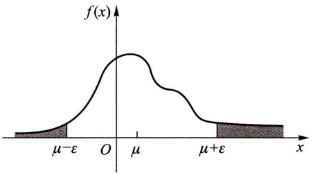

$$
f _ {Y} (y) = \left\{ \begin{array}{l l} \frac {1}{\theta} \mathrm{e} ^ {- y / \theta}, & y > 0, \\ 0, & y \leqslant 0. \end{array} \right. \quad \theta > 0,
$$

问若要获得利润的数学期望最大,应生产多少件产品 $(m,n,\theta$ 均为已知)?

解 设生产 $x$ 件, 则获利 $Q$ 是 $x$ 的函数

$$
Q = Q (x) = \left\{ \begin{array}{l l} m Y - n (x - Y), & Y <   x, \\ m x, & Y \geqslant x. \end{array} \right.
$$

$Q$ 是随机变量, 它是 $Y$ 的函数, 其数学期望为

$$
\begin{array}{l} E (Q) = \int_ {0} ^ {\infty} Q f _ {Y} (y) \mathrm{d} y = \int_ {0} ^ {x} [ m y - n (x - y) ] \frac {1}{\theta} \mathrm{e} ^ {- y / \theta} \mathrm{d} y + \int_ {x} ^ {\infty} m x \frac {1}{\theta} \mathrm{e} ^ {- y / \theta} \mathrm{d} y \\ = (m + n) \theta - (m + n) \theta \mathrm{e} ^ {- x / \theta} - n x. \\ \end{array}
$$

令 $\frac{\mathrm{d}}{\mathrm{d}x} E(Q) = (m + n)\mathrm{e}^{-x / \theta} - n = 0,$

得 $x = -\theta \ln \frac{n}{m + n}.$

而 $\frac{\mathrm{d}^2}{\mathrm{d}x^2} E(Q) = \frac{-(m + n)}{\theta}\mathrm{e}^{-x / \theta} < 0,$

故知当  $x = -\theta \ln \frac{n}{m + n}$  时  $E(Q)$  取极大值, 且可知这也是最大值.

例如,若

$$
f _ {Y} (y) = \left\{ \begin{array}{l l} \frac {1}{1 0 0 0 0} \mathrm{e} ^ {- \frac {y}{1 0 0 0 0}}, & y > 0, \\ 0, & y \leqslant 0, \end{array} \right.
$$

且有 m=500 元, n=2 000 元, 则

$$
x = - 1 0 0 0 0 \ln \frac {2 0 0 0}{5 0 0 + 2 0 0 0} = 2 2 3 1. 4.
$$

取 x=2 231 件.

例 11 设甲与其他三人参与一个项目的竞拍,价格以千美元计,价格高者获胜.若甲中标,他就将此项目以10千美元转让给他人.可认为其他三人的竞拍价是相互独立的,且都在7千\~11千美元之间均匀分布.问甲应如何报价才能使获益的数学期望最大(若甲中标,则必须将此项目以他自己的报价买下).

解设 $X_{1}, X_{2}, X_{3}$ 是其他三人的报价，按题意 $X_{1}, X_{2}, X_{3}$ 相互独立，且在区间(7,11)上服从均匀分布.其分布函数为

$$
F (u) = \left\{ \begin{array}{l l} 0, & u <   7, \\ \frac {u - 7}{4}, & 7 \leqslant u <   1 1, \\ 1, & u \geqslant 1 1. \end{array} \right.
$$

以 $Y$ 记三人的最高出价，即 $Y = \max \{X_1, X_2, X_3\}$. $Y$ 的分布函数为

$$
F _ {Y} (u) = \left\{ \begin{array}{l l} 0, & u <   7, \\ \left(\frac {u - 7}{4}\right) ^ {3}, & 7 \leqslant u <   1 1, \\ 1, & u \geqslant 1 1. \end{array} \right.
$$

若甲的报价为 $x$ ，按题意 $7 \leqslant x \leqslant 10$ ，知甲能赢得这一项目的概率为

$$
p = P \{Y \leqslant x \} = F _ {Y} (x) = \left(\frac {x - 7}{4}\right) ^ {3} \quad (7 \leqslant x \leqslant 1 0).
$$

以 $G(X)$ 记甲的赚钱数，$G(X)$ 是一个随机变量，它的分布律为

| G(X) | 10-x | 0 |
| --- | --- | --- |
| 概率 | $\left(\frac{x-7}{4}\right)^{3}$ | $1-\left(\frac{x-7}{4}\right)^{3}$ |

于是甲的赚钱数的数学期望为

$$
E [ G (X) ] = \left(\frac {x - 7}{4}\right) ^ {3} (1 0 - x).
$$

令 $\frac{\mathrm{d}}{\mathrm{d}x} E[G(X)] = \frac{1}{4^3} [(x - 7)^2 (37 - 4x)] = 0,$

得 $x = 37 / 4, x = 7$ （舍去）.

又知 $\frac{\mathrm{d}^2}{\mathrm{d}x^2} E[G(X)]\Big|_{x = 37 / 4} < 0.$

故知当甲的报价为 $x = 37 / 4$ 千美元时，他的赚钱数的数学期望达到极大值，还可知这也是最大值. □

现在来证明数学期望的几个重要性质①(以下设所遇到的随机变量的数学期望存在).

$1^{\circ}$ 设 C 是常数, 则有 $E(C)=C$.

$2^{\circ}$ 设 $X$ 是一个随机变量, $C$ 是常数, 则有

$$
E (C X) = C E (X).
$$

$3^{\circ}$ 设 $X, Y$ 是两个随机变量, 则有

$$
E (X + Y) = E (X) + E (Y).
$$

这一性质可以推广到任意有限个随机变量之和的情况.

$4^{\circ}$ 设 X, Y 是相互独立的随机变量, 则有

$$
E (X Y) = E (X) E (Y).
$$

<small>① 这里我们只对连续型随机变量的情况加以证明，读者只要将证明中的“积分”用“和式”代替，就能得到离散型随机变量情况的证明.</small>

这一性质可以推广到任意有限个相互独立的随机变量之积的情况.

证 $1^{\circ}, 2^{\circ}$ 由读者自己证明. 我们来证 $3^{\circ}$ 和 $4^{\circ}$.

设二维随机变量 $(X,Y)$ 的概率密度为 $f(x,y)$. 其边缘概率密度为 $f_{X}(x), f_{Y}(y)$. 由(1.5)式

$$
\begin{array}{l} E (X + Y) = \int_ {- \infty} ^ {\infty} \int_ {- \infty} ^ {\infty} (x + y) f (x, y) \mathrm{d} x \mathrm{d} y \\ = \int_ {- \infty} ^ {\infty} \int_ {- \infty} ^ {\infty} x f (x, y) \mathrm{d} x \mathrm{d} y + \int_ {- \infty} ^ {\infty} \int_ {- \infty} ^ {\infty} y f (x, y) \mathrm{d} x \mathrm{d} y \\ = E (X) + E (Y). \\ \end{array}
$$

$3^{\circ}$ 得证.

又若 $X$ 和 $Y$ 相互独立，

$$
\begin{array}{l} E (X Y) = \int_ {- \infty} ^ {\infty} \int_ {- \infty} ^ {\infty} x y f (x, y) \mathrm{d} x \mathrm{d} y = \int_ {- \infty} ^ {\infty} \int_ {- \infty} ^ {\infty} x y f _ {X} (x) f _ {Y} (y) \mathrm{d} x \mathrm{d} y \\ = \Big [ \int_ {- \infty} ^ {\infty} x f _ {X} (x) \mathrm{d} x \Big ] \Big [ \int_ {- \infty} ^ {\infty} y f _ {Y} (y) \mathrm{d} y \Big ] = E (X) E (Y). \\ \end{array}
$$

$4^{\circ}$ 得证.

例 12 一民航送客车载有 20 位旅客自机场开出, 旅客有 10 个车站可以下车. 如到达一个车站没有旅客下车就不停车. 以 X 表示停车的次数, 求  $E(X)$  (设每位旅客在各个车站下车是等可能的, 并设各位旅客是否下车相互独立).

解 引入随机变量

$$
X _ {i} = \left\{ \begin{array}{l l} 0, & \text {在第} i \text {站没有人下车}, \\ 1, & \text {在第} i \text {站有人下车}, \end{array} \quad i = 1, 2, \dots , 1 0. \right.
$$

易知

$$
X = X _ {1} + X _ {2} + \dots + X _ {1 0}.
$$

现在来求  $E(X)$ .

按题意,任一旅客在第 i 站不下车的概率为  $\frac{9}{10}$ , 因此 20 位旅客都不在第 i 站下车的概率为  $\left(\frac{9}{10}\right)^{20}$ , 在第 i 站有人下车的概率为  $1 - \left(\frac{9}{10}\right)^{20}$ , 也就是

$$
P \{X _ {i} = 0 \} = \left(\frac {9}{1 0}\right) ^ {2 0}, \quad P \{X _ {i} = 1 \} = 1 - \left(\frac {9}{1 0}\right) ^ {2 0}, \quad i = 1, 2, \dots , 1 0.
$$

由此

$$
E (X _ {i}) = 1 - \left(\frac {9}{1 0}\right) ^ {2 0}, \quad i = 1, 2, \dots , 1 0.
$$

进而 $E(X) = E(X_{1} + X_{2} + \dots +X_{10}) = E(X_{1}) + E(X_{2}) + \dots +E(X_{10})$

$$
= 1 0 \left[ 1 - \left(\frac {9}{1 0}\right) ^ {2 0} \right] = 8. 7 8 4 (\text {次}).
$$

本题是将 $X$ 分解成数个随机变量之和，然后利用随机变量和的数学期望等于随机变量数学期望之和来求数学期望的，这种处理方法具有一定的普遍意义.

□

例 13 设一电路中电流 I（以 A 计）与电阻 R（以  $\Omega$  计）是两个相互独立的随机变量，其概率密度分别为

$$
g (i) = \left\{ \begin{array}{l l} 2 i, & 0 \leqslant i \leqslant 1, \\ 0, & \text {其他}, \end{array} \right. h (r) = \left\{ \begin{array}{l l} \frac {r ^ {2}}{9}, & 0 \leqslant r \leqslant 3, \\ 0, & \text {其他}. \end{array} \right.
$$

试求电压 V=IR 的均值.

解 $E(V) = E(IR) = E(I)E(R) = \left[\int_{-\infty}^{\infty}ig(i)\mathrm{d}i\right]\left[\int_{-\infty}^{\infty}rh(r)\mathrm{d}r\right]$

$$
= \left(\int_ {0} ^ {1} 2 i ^ {2} \mathrm{d} i\right) \left(\int_ {0} ^ {3} \frac {r ^ {3}}{9} \mathrm{d} r\right) = \frac {3}{2} (\mathrm{V}).
$$

□

## § 2 方 差

先从例子说起.例如,有一批灯泡,知其平均寿命是 $E(X)=1\ 000\ \text{h}$.仅由这一指标我们还不能判定这批灯泡的质量好坏.事实上,有可能其中绝大部分灯泡的寿命都在950\~1050 h;也有可能其中约有一半是高质量的,它们的寿命大约有1300 h,另一半却是质量很差的,其寿命大约只有700 h.为评定这批灯泡质量的好坏,还需进一步考察灯泡寿命X与其均值 $E(X)=1\ 000\ \text{h}$ 的偏离程度.若偏离程度较小,则表示质量比较稳定.从这个意义上来说,我们认为质量较好.前面也曾提到在检验棉花的质量时,既要注意纤维的平均长度,还要注意纤维长度与平均长度的偏离程度.由此可见,研究随机变量与其均值的偏离程度是十分必要的.那么,用怎样的量去度量这个偏离程度呢?容易看到

$$
E [ | X - E (X) | ]
$$

能度量随机变量与其均值 $E(X)$ 的偏离程度.但由于上式带有绝对值，运算不方便，为运算方便起见，通常用量

$$
E \{[ X - E (X) ] ^ {2} \}
$$

来度量随机变量 X 与其均值  $E(X)$  的偏离程度.

定义 设 $X$ 是随机变量, 若 $E\{[X - E(X)]^2\}$ 存在, 则称它为 $X$ 的方差, 记为 $D(X)$ 或 $\operatorname{Var}(X)$, 即

$$
D (X) = \operatorname{Var} (X) = E \left\{\left[ X - E (X) \right] ^ {2} \right\}. \tag {2.1}
$$

在应用上还引入量 $\sqrt{D(X)}$ ，记为 $\sigma (X)$ ，称为标准差或均方差

按定义,随机变量 X 的方差表达了 X 的取值与其数学期望的偏离程度.若  $D(X)$  较小,则意味着 X 的取值在  $E(X)$  的附近比较集中,反之,若  $D(X)$  较大,则表示 X 的取值较分散.因此, $D(X)$  是刻画 X 取值分散程度的一个量,它是衡量 X 取值分散程度的一个尺度.

由定义知,方差实际上就是随机变量 X 的函数  $g(X)=\left[X-E(X)\right]^{2}$  的数学期望.于是对于离散型随机变量,按(1.3)式有

$$
D (X) = \sum_ {k = 1} ^ {\infty} [ x _ {k} - E (X) ] ^ {2} p _ {k}, \tag {2.2}
$$

其中  $P\{X=x_{k}\}=p_{k}, k=1,2,\cdots$  是 X 的分布律.

对于连续型随机变量,按(1.4)式有

$$
D (X) = \int_ {- \infty} ^ {\infty} [ x - E (X) ] ^ {2} f (x) \mathrm{d} x, \tag {2.3}
$$

其中  $f(x)$  是 X 的概率密度.

随机变量 X 的方差可按下列公式计算:

$$
D (X) = E (X ^ {2}) - [ E (X) ] ^ {2}. \tag {2.4}
$$

证 由数学期望的性质 $1^{\circ}, 2^{\circ}, 3^{\circ}$ 得

$$
\begin{array}{l} D (X) = E \left\{\left[ X - E (X) \right] ^ {2} \right\} = E \left\{X ^ {2} - 2 X E (X) + \left[ E (X) \right] ^ {2} \right\} \\ = E (X ^ {2}) - 2 E (X) E (X) + [ E (X) ] ^ {2} \\ = E (X ^ {2}) - [ E (X) ] ^ {2}. \\ \end{array}
$$

例1 设随机变量 $X$ 具有数学期望 $E(X) = \mu$ ，方差 $D(X) = \sigma^2 \neq 0.$ 记

$$
X ^ {*} = \frac {X - \mu}{\sigma},
$$

则 $E(X^{*}) = \frac{1}{\sigma} E(X - \mu) = \frac{1}{\sigma}[E(X) - \mu] = 0,$

$$
\begin{array}{l} D (X ^ {*}) = E (X ^ {* 2}) - [ E (X ^ {*}) ] ^ {2} = E \left[ \left(\frac {X - \mu}{\sigma}\right) ^ {2} \right] \\ = \frac {1}{\sigma^ {2}} E [ (X - \mu) ^ {2} ] = \frac {\sigma^ {2}}{\sigma^ {2}} = 1. \\ \end{array}
$$

即 $X^{*} = \frac{X - \mu}{\sigma}$ 的数学期望为0，方差为1. $X^{*}$ 称为 $X$ 的标准化变量

例 2 设随机变量 X 具有  $(0-1)$  分布, 其分布律为

$$
P \{X = 0 \} = 1 - p, \quad P \{X = 1 \} = p.
$$

求 $D(X)$

解 $E(X) = 0 \times (1 - p) + 1 \times p = p,$

$$
E (X ^ {2}) = 0 ^ {2} \times (1 - p) + 1 ^ {2} \times p = p.
$$

由(2.4)式

$$
D (X) = E (X ^ {2}) - [ E (X) ] ^ {2} = p - p ^ {2} = p (1 - p).
$$

例 3 设随机变量  $X \sim \pi(\lambda)$ ，求  $D(X)$ .

解 随机变量 $X$ 的分布律为

$$
P \{X = k \} = \frac {\lambda^ {k} \mathrm{e} ^ {- \lambda}}{k !}, \quad k = 0, 1, 2, \dots , \quad \lambda > 0.
$$

上节例6已算得 $E(X) = \lambda$ ，而

$$
\begin{array}{l} E (X ^ {2}) = E [ X (X - 1) + X ] = E [ X (X - 1) ] + E (X) \\ = \sum_ {k = 0} ^ {\infty} k (k - 1) \frac {\lambda^ {k} \mathrm{e} ^ {- \lambda}}{k !} + \lambda = \lambda^ {2} \mathrm{e} ^ {- \lambda} \sum_ {k = 2} ^ {\infty} \frac {\lambda^ {k - 2}}{(k - 2) !} + \lambda \\ = \lambda^ {2} \mathrm{e} ^ {- \lambda} \mathrm{e} ^ {\lambda} + \lambda = \lambda^ {2} + \lambda , \\ \end{array}
$$

所以方差

$$
D (X) = E (X ^ {2}) - \left[ E (X) \right] ^ {2} = \lambda .
$$

由此可知，泊松分布的数学期望与方差相等，都等于参数 $\lambda$。因为泊松分布只含一个参数 $\lambda$，只要知道它的数学期望或方差就能完全确定它的分布了。$\square$

例 4 设随机变量  $X \sim U(a, b)$ ，求  $D(X)$ .

解 $X$ 的概率密度为

$$
f (x) = \left\{ \begin{array}{l l} { \frac {1}{b - a},} & {a <   x <   b,} \\ {0,} & {\text {其他}.} \end{array} \right.
$$

上节例7已算得 $E(X) = \frac{a + b}{2}$. 方差为

$$
\begin{array}{l} D (X) = E (X ^ {2}) - [ E (X) ] ^ {2} \\ = \int_ {a} ^ {b} x ^ {2} \frac {1}{b - a} \mathrm{d} x - \left(\frac {a + b}{2}\right) ^ {2} = \frac {(b - a) ^ {2}}{1 2}. \\ \end{array}
$$

例 5 设随机变量 X 服从指数分布, 其概率密度为

$$
f (x) = \left\{ \begin{array}{l l} \frac {1}{\theta} \mathrm{e} ^ {- x / \theta}, & x > 0, \\ 0, & x \leqslant 0, \end{array} \right.
$$

其中  $\theta>0$ ，求  $E(X)$ ,  $D(X)$ .

解 $E(X) = \int_{-\infty}^{\infty}xf(x)\mathrm{d}x = \int_0^\infty x\frac{1}{\theta}\mathrm{e}^{-x / \theta}\mathrm{d}x$

$$
= - x \mathrm{e} ^ {- x / \theta} \bigg | _ {0} ^ {\infty} + \int_ {0} ^ {\infty} \mathrm{e} ^ {- x / \theta} \mathrm{d} x = \theta ,
$$

$$
\begin{array}{l} E (X ^ {2}) = \int_ {- \infty} ^ {\infty} x ^ {2} f (x) \mathrm{d} x = \int_ {0} ^ {\infty} x ^ {2} \frac {1}{\theta} \mathrm{e} ^ {- x / \theta} \mathrm{d} x \\ = - x ^ {2} \mathrm{e} ^ {- x / \theta} \Bigg | _ {0} ^ {\infty} + \int_ {0} ^ {\infty} 2 x \mathrm{e} ^ {- x / \theta} \mathrm{d} x = 2 \theta^ {2}, \\ \end{array}
$$

于是 $D(X) = E(X^2) - [E(X)]^2 = 2\theta^2 -\theta^2 = \theta^2.$

即有 $E(X) = \theta, D(X) = \theta^2.$

现在来证明方差的几个重要性质(以下设所遇到的随机变量其方差存在).

$1^{\circ}$ 设 C 是常数, 则 $D(C)=0$.

$2^{\circ}$ 设 X 是随机变量, C 是常数, 则有

$$
D (C X) = C ^ {2} D (X), \quad D (X + C) = D (X).
$$

$3^{\circ}$ 设 $X, Y$ 是两个随机变量, 则有

$$
D (X + Y) = D (X) + D (Y) + 2 E \{[ X - E (X) ] [ Y - E (Y) ] \}. \tag {2.5}
$$

特别,若 X,Y 相互独立,则有

$$
D (X + Y) = D (X) + D (Y). \tag {2.6}
$$

这一性质可以推广到任意有限多个相互独立的随机变量之和的情况.

$4^{\circ}D(X)=0$ 的充要条件是X以概率1取常数 $E(X)$ ，即

$$
P \{X = E (X) \} = 1.
$$

证 $1^{\circ}D(C) = E\{[C - E(C)]^{2}\} = 0.$

$$
\begin{array}{l} 2 ^ {\circ} D (C X) = E \{[ C X - E (C X) ] ^ {2} \} = C ^ {2} E \{[ X - E (X) ] ^ {2} \} = C ^ {2} D (X). \\ D (X + C) = E \{[ X + C - E (X + C) ] ^ {2} \} = E \{[ X - E (X) ] ^ {2} \} = D (X). \\ \end{array}
$$

$$
\begin{array}{l} 3 ^ {\circ} D (X + Y) = E \{[ (X + Y) - E (X + Y) ] ^ {2} \} \\ = E \{[ (X - E (X)) + (Y - E (Y)) ] ^ {2} \} \\ = E \{[ X - E (X) ] ^ {2} \} + E \{[ Y - E (Y) ] ^ {2} \} \\ + 2 E \{[ X - E (X) ] [ Y - E (Y) ] \} \\ = D (X) + D (Y) + 2 E \{[ X - E (X) ] [ Y - E (Y) ] \}. \\ \end{array}
$$

上式右端第三项:

$$
\begin{array}{l} 2 E \left\{\left[ X - E (X) \right] \left[ Y - E (Y) \right] \right\} \\ = 2 E [ X Y - X E (Y) - Y E (X) + E (X) E (Y) ] \\ = 2 \left[ E (X Y) - E (X) E (Y) - E (Y) E (X) + E (X) E (Y) \right] \\ = 2 [ E (X Y) - E (X) E (Y) ]. \\ \end{array}
$$

若 X, Y 相互独立, 由数学期望的性质  $4^{\circ}$  知道上式右端为 0, 于是

$$
D (X + Y) = D (X) + D (Y).
$$

$4^{\circ}$ 充分性. 设 $P\{X = E(X)\} = 1$，则有 $P\{X^{2} = [E(X)]^{2}\} = 1$，于是

$$
D (X) = E (X ^ {2}) - \left[ E (X) \right] ^ {2} = 0.
$$

必要性的证明写在切比雪夫不等式证明的后面.

例 6 设随机变量  $X \sim b(n, p)$ ，求  $E(X), D(X)$ .

解 由二项分布的定义知,随机变量 X 是 n 重伯努利试验中事件 A 发生的次数,且在每次试验中 A 发生的概率为 p. 引入随机变量

$$
X _ {k} = \left\{ \begin{array}{l l} 1, & A \text {在第} k \text {次试验中发生}, \\ 0, & A \text {在第} k \text {次试验中不发生}, \end{array} \right. \quad k = 1, 2, \dots , n.
$$

易知 $X = X_{1} + X_{2} + \dots + X_{n},$ (2.7)

由于  $X_{k}$  只依赖于第 k 次试验，而各次试验相互独立，于是  $X_{1}, X_{2}, \cdots, X_{n}$  相互独立，又知  $X_{k}, k=1,2,\cdots,n$  服从同一  $(0-1)$  分布

| Xk | 0 | 1 |
| --- | --- | --- |
| pk | 1-p | p |

(2.7)式表明以 $n, p$ 为参数的二项分布变量，可分解成为 $n$ 个相互独立且都服从以 $p$ 为参数的(0-1)分布的随机变量之和。

由例 2 知  $E(X_{k})=p, D(X_{k})=p(1-p), k=1,2,\cdots,n.$  故知

$$
E (X) = E \Big (\sum_ {k = 1} ^ {n} X _ {k} \Big) = \sum_ {k = 1} ^ {n} E (X _ {k}) = n p.
$$

又由于  $X_{1}, X_{2}, \cdots, X_{n}$  相互独立，得

$$
D (X) = D \Big (\sum_ {k = 1} ^ {n} X _ {k} \Big) = \sum_ {k = 1} ^ {n} D (X _ {k}) = n p (1 - p).
$$

即 $E(X) = np, D(X) = np(1 - p)$.

例 7 设随机变量  $X \sim N(\mu, \sigma^{2})$ ，求  $E(X), D(X)$ .

解 先求标准正态变量

$$
Z = \frac {X - \mu}{\sigma}
$$

的数学期望和方差. $Z$ 的概率密度为

$$
\varphi (t) = \frac {1}{\sqrt {2 \pi}} \mathrm{e} ^ {- t ^ {2 / 2}},
$$

于是 $E(Z) = \frac{1}{\sqrt{2\pi}}\int_{-\infty}^{\infty}t\mathrm{e}^{-t^2 /2}\mathrm{d}t = \frac{-1}{\sqrt{2\pi}}\mathrm{e}^{-t^2 /2}\Bigg|_{-\infty}^{\infty} = 0,$

$$
\begin{array}{l} D (Z) = E (Z ^ {2}) = \frac {1}{\sqrt {2 \pi}} \int_ {- \infty} ^ {\infty} t ^ {2} \mathrm{e} ^ {- t ^ {2} / 2} \mathrm{d} t \\ = \frac {- 1}{\sqrt {2 \pi}} t \mathrm{e} ^ {- t ^ {2} / 2} \Bigg | _ {- \infty} ^ {\infty} + \frac {1}{\sqrt {2 \pi}} \int_ {- \infty} ^ {\infty} \mathrm{e} ^ {- t ^ {2} / 2} \mathrm{d} t = 1. \\ \end{array}
$$

因 $X = \mu +\sigma Z$ ，即得

$$
\begin{array}{l} E (X) = E (\mu + \sigma Z) = \mu , \\ D (X) = D (\mu + \sigma Z) = D (\sigma Z) = \sigma^ {2} D (Z) = \sigma^ {2}. \\ \end{array}
$$

这就是说,正态分布的概率密度中的两个参数  $\mu$  和  $\sigma$  分别就是该分布的数学期望和均方差,因而正态分布完全可由它的数学期望和方差所确定.

再者，由上一章§5中例1知道，若 $X_{i}\sim N(\mu_{i},\sigma_{i}^{2}),i=1,2,\cdots,n$ ，且它们相互独立，则它们的线性组合: $C_{1}X_{1}+C_{2}X_{2}+\cdots+C_{n}X_{n}$ （ $C_{1},C_{2},\cdots,C_{n}$ 是不全为0的常数）仍然服从正态分布，于是由数学期望和方差的性质知道

$$
C _ {1} X _ {1} + C _ {2} X _ {2} + \dots + C _ {n} X _ {n} \sim N \left(\sum_ {i = 1} ^ {n} C _ {i} \mu_ {i}, \sum_ {i = 1} ^ {n} C _ {i} ^ {2} \sigma_ {i} ^ {2}\right) \tag {2.8}
$$

这一重要结果.

例如, 若 $X \sim N(1,3), Y \sim N(2,4)$ 且 $X, Y$ 相互独立, 则 $Z = 2X - 3Y$ 也服从正态分布, 而 $E(Z) = 2 \times 1 - 3 \times 2 = -4, D(Z) = D(2X - 3Y) = 4D(X) + 9D(Y) = 48$. 故有 $Z \sim N(-4,48)$. □

例8 设活塞的直径（以 $\mathrm{cm}$ 计） $X \sim N(22.40, 0.03^2)$，气缸的直径 $Y \sim N(22.50, 0.04^2)$，$X, Y$ 相互独立。任取一只活塞，任取一只气缸，求活塞能装入气缸的概率。

解 按题意需求 $P\{X < Y\} = P\{X - Y < 0\}$. 由于

$$
X - Y \sim N (- 0. 1 0, 0. 0 0 2 5),
$$

故有

$$
\begin{array}{l} P \{X <   Y \} = P \{X - Y <   0 \} \\ = P \left\{\frac {(X - Y) - (- 0 . 1 0)}{\sqrt {0 . 0 0 2 5}} <   \frac {0 - (- 0 . 1 0)}{\sqrt {0 . 0 0 2 5}} \right\} \\ = \Phi \left(\frac {0 . 1 0}{0 . 0 5}\right) = \Phi (2) = 0. 9 7 7 2. \\ \end{array}
$$

下面介绍一个重要的不等式.

定理 设随机变量 X 具有数学期望  $E(X)=\mu$ ，方差  $D(X)=\sigma^{2}$ ，则对于任意正数  $\varepsilon$ ，不等式

$$
P \{| X - \mu | \geqslant \varepsilon \} \leqslant \frac {\sigma^ {2}}{\varepsilon^ {2}} \tag {2.9}
$$

成立.

这一不等式称为切比雪夫(Chebyshev)不等式.

证 我们只就连续型随机变量的情况来证明. 设 $X$ 的概率密度为 $f(x)$, 则有 (如图 4-2)

$$
\begin{array}{l} P \{| X - \mu | \geqslant \varepsilon \} = \int_ {| x - \mu | \geqslant \varepsilon} f (x) \mathrm{d} x \\ \leqslant \int_ {| x - \mu | \geqslant \varepsilon} \frac {| x - \mu | ^ {2}}{\varepsilon^ {2}} f (x) \mathrm{d} x \\ \leqslant \frac {1}{\varepsilon^ {2}} \int_ {- \infty} ^ {\infty} (x - \mu) ^ {2} f (x) \mathrm{d} x = \frac {\sigma^ {2}}{\varepsilon^ {2}}. \\ \end{array}
$$

area

| Interval | Description |
| --- | --- |
| \(\mu-\epsilon\) to O | Area below the curve |
| \(\mu-\epsilon\) to μ+ε | Area between 0 and \(\mu+\epsilon\) |
| \(\mu+\epsilon\) to x | Area above the curve |

图4-2

切比雪夫不等式也可以写成如下的形式:

$$
P \{| X - \mu | <   \varepsilon \} \geqslant 1 - \frac {\sigma^ {2}}{\varepsilon^ {2}}. \tag {2.10}
$$

切比雪夫不等式给出了在随机变量的分布未知，而只知道 $E(X)$ 和 $D(X)$ 的情况下估计概率 $P\{|X - E(X)| < \varepsilon\}$ 的界限.例如在(2.10)式中分别取 $\varepsilon = 3\sqrt{D(X)}, 4\sqrt{D(X)}$ 得到

$$
\begin{array}{l} P \{| X - E (X) | <   3 \sqrt {D (X)} \} \geqslant 0. 8 8 8 9, \\ P \{| X - E (X) | <   4 \sqrt {D (X)} \geqslant 0. 9 3 7 5. \\ \end{array}
$$

这个估计是比较粗糙的①,如果已经知道随机变量的分布,那么所需求的概率可以确切地计算出来,也就没有必要利用这一不等式来作估计了.

方差性质 $4^{\circ}$ 必要性的证明:

设  $D(X)=0$ ，要证  $P\{X=E(X)\}=1$ 。

证 用反证法. 假设 $P\{X = E(X)\} < 1$，则对于某一个数 $\varepsilon > 0$，有 $P\{|X - E(X)| \geqslant \varepsilon\} > 0$. 但由切比雪夫不等式，对于任意 $\varepsilon > 0$，由(2.9)式因 $\sigma^2 = 0$，有

$$
P \{| X - E (X) | \geqslant \varepsilon \} = 0,
$$

矛盾,于是  $P\{X=E(X)\}=1$ .

在书末附表1中列出了多种常用的随机变量的数学期望和方差,供读者查用.

<small>① 例如若 $X \sim U(0,8)$，则有 $E(X) = 4, D(X) = 16/3$，由切比雪夫不等式(2.10)，$P\{|X - 4| < 4\} \geqslant 1 - 1/3 = 2/3$，但准确的结果是 $P\{|X - 4| < 4\} = 1$.</small>

## § 3 协方差及相关系数

对于二维随机变量 $(X,Y)$，我们除了讨论 $X$ 与 $Y$ 的数学期望和方差以外，还需讨论描述 $X$ 与 $Y$ 之间相互关系的数字特征。本节讨论有关这方面的数字特征。

在本章 §2 方差性质 $3^{\circ}$ 的证明中, 我们已经看到, 如果两个随机变量 $X$ 和 $Y$ 是相互独立的, 则

$$
E \{\left[ X - E (X) \right] \left[ Y - E (Y) \right] \} = 0.
$$

这意味着当 $E\{[X - E(X)][Y - E(Y)]\} \neq 0$ 时，$X$ 与 $Y$ 不相互独立，而是存在着一定的关系的.

定义 量 $E\{[X - E(X)][Y - E(Y)]\}$ 称为随机变量 $X$ 与 $Y$ 的协方差. 记为 $\operatorname{Cov}(X, Y)$, 即

$$
\operatorname{Cov} (X, Y) = E \left\{\left[ X - E (X) \right] \left[ Y - E (Y) \right] \right\}.
$$

而 $\rho_{XY} = \frac{\mathrm{Cov}(X,Y)}{\sqrt{D(X)}\sqrt{D(Y)}}$ 而

称为随机变量 X 与 Y 的相关系数.

由定义,即知

$$
\operatorname{Cov} (X, Y) = \operatorname{Cov} (Y, X), \quad \operatorname{Cov} (X, X) = D (X).
$$

由上述定义及(2.5)式知道,对于任意两个随机变量 X 和 Y,下列等式成立:

$$
D (X + Y) = D (X) + D (Y) + 2 \operatorname{Cov} (X, Y). \tag {3.1}
$$

将 $\operatorname{Cov}(X,Y)$ 的定义式展开, 易得

$$
\operatorname{Cov} (X, Y) = E (X Y) - E (X) E (Y). \tag {3.2}
$$

我们常常利用这一式子计算协方差.

协方差具有下述性质:

$1^{\circ}\operatorname{Cov}(aX,bY)=ab\operatorname{Cov}(X,Y), a,b$ 是常数.

$2^{\circ}\operatorname{Cov}(X_{1} + X_{2},Y) = \operatorname{Cov}(X_{1},Y) + \operatorname{Cov}(X_{2},Y).$

(证明由读者自己来完成.)

下面我们来推导 $\rho_{XY}$ 的两条重要性质，并说明 $\rho_{XY}$ 的含义.

考虑以 $X$ 的线性函数 $a + bX$ 来近似表示 $Y$. 我们以均方误差

$$
\begin{array}{l} e = E \left\{\left[ Y - (a + b X) \right] ^ {2} \right\} \\ = E \left(Y ^ {2}\right) + b ^ {2} E \left(X ^ {2}\right) + a ^ {2} - 2 b E (X Y) + 2 a b E (X) - 2 a E (Y) \tag {3.3} \\ \end{array}
$$

来衡量以 $a + bX$ 近似表达 $Y$ 的好坏程度. $e$ 的值越小表示 $a + bX$ 与 $Y$ 的近似程度越好. 这样, 我们就取 $a, b$ 使 $e$ 取到最小. 下面就来求最佳近似式 $a + bX$ 中的 $a, b$. 为此, 将 $e$ 分别关于 $a, b$ 求偏导数, 并令它们等于零, 得

$$
\left\{ \begin{array}{l} \frac {\partial e}{\partial a} = 2 a + 2 b E (X) - 2 E (Y) = 0, \\ \frac {\partial e}{\partial b} = 2 b E (X ^ {2}) - 2 E (X Y) + 2 a E (X) = 0. \end{array} \right.
$$

解得 $b_{0} = \frac{\mathrm{Cov}(X,Y)}{D(X)},$

$$
a _ {0} = E (Y) - b _ {0} E (X) = E (Y) - E (X) \frac {\mathrm{Cov} (X , Y)}{D (X)}.
$$

将 $a_0, b_0$ 代入(3.3)式得

$$
\min _ {a, b} E \left\{\left[ Y - (a + b X) \right] ^ {2} \right\} = E \left\{\left[ Y - (a _ {0} + b _ {0} X) \right] ^ {2} \right\} = (1 - \rho_ {X Y} ^ {2}) D (Y) ①. \tag {3.4}
$$

由(3.4)式容易得到下述定理:

定理 $1^{\circ}|\rho_{XY}|\leqslant 1.$

$2^{\circ}|\rho_{XY}| = 1$ 的充要条件是，存在常数 $a,b$ 使

$$
P \{Y = a + b X \} = 1.
$$

证 $1^{\circ}$ 由(3.4)式与 $E\{[Y - (a_0 + b_0X)]^2\}$ 及 $D(Y)$ 的非负性，知 $1 - \rho_{XY}^{2} \geqslant 0$ 亦即 $|\rho_{XY}| \leqslant 1$.

$2^{\circ}$ 若 $|\rho_{XY}| = 1$ ，由(3.4)式得

$$
E \{[ Y - (a _ {0} + b _ {0} X) ] ^ {2} \} = 0.
$$

从而 $0 = E\{[Y - (a_0 + b_0X)]^2\} = D[Y - (a_0 + b_0X)] + \{E[Y - (a_0 + b_0X)]\}^2,$

故有 $D[Y - (a_0 + b_0X)] = 0,$

$$
E [ Y - (a _ {0} + b _ {0} X) ] = 0.
$$

又由方差的性质 $4^{\circ}$ 知

$$
P \{Y - (a _ {0} + b _ {0} X) = 0 \} = 1, \text {即} P \{Y = a _ {0} + b _ {0} X \} = 1.
$$

反之,若存在常数  $a^{*}, b^{*}$  使

$$
P \{Y = a ^ {*} + b ^ {*} X \} = 1 \text {, 即} P \{Y - (a ^ {*} + b ^ {*} X) = 0 \} = 1,
$$

于是 $P\{[Y - (a^{*} + b^{*}X)]^{2} = 0\} = 1.$

即得 $E\{[Y - (a^{*} + b^{*}X)]^{2}\} = 0.$

$$
\begin{array}{l} = D(Y - b_{0}X) + \left(-\frac{1}{2}\frac{\partial e}{\partial a}\Bigg|_{\substack{a = a_{0}\\ b = b_{0}}}\right)^{2} = D(Y - b_{0}X) + 0 \\ = D (Y) + b _ {0} ^ {2} D (X) - 2 b _ {0} \operatorname{Cov} (X, Y) = D (Y) + \frac {\operatorname{Cov} ^ {2} (X , Y)}{D (X)} - 2 \frac {\operatorname{Cov} ^ {2} (X , Y)}{D (X)} \\ = D (Y) \left[ 1 - \frac {\mathrm{Cov} ^ {2} (X , Y)}{D (X) D (Y)} \right] = (1 - \rho_ {X Y} ^ {2}) D (Y). \\ \end{array}
$$

① $E\{\left[Y - (a_0 + b_0X)\right]^2\} = D(Y - a_0 - b_0X) + \left[E(Y - a_0 - b_0X)\right]^2$

故有 $0 = E\{\left[Y - (a^{*} + b^{*}X)\right]^{2}\} \geqslant \min_{a,b}E\{\left[Y - (a + bX)\right]^{2}\}$

$$
= E \{[ Y - (a _ {0} + b _ {0} X) ] ^ {2} \} = (1 - \rho_ {X Y} ^ {2}) D (Y).
$$

即得 $|\rho_{XY}| = 1.$

由(3.4)式知,均方误差e是 $|\rho_{XY}|$ 的严格单调减少函数,这样 $\rho_{XY}$ 的含义就很明显了.当 $|\rho_{XY}|$ 较大时e较小,表明X,Y(就线性关系来说)联系较紧密.特别当 $|\rho_{XY}|=1$ 时,由定理中的 $2^{\circ},X,Y$ 之间以概率1存在着线性关系.于是 $\rho_{XY}$ 是一个可以用来表征X,Y之间线性关系紧密程度的量.当 $|\rho_{XY}|$ 较大时,我们通常说X,Y线性相关的程度较好;当 $|\rho_{XY}|$ 较小时,我们说,X,Y线性相关的程度较差.

当 $\rho_{XY}=0$ 时,称X和Y不相关.

假设随机变量 $X, Y$ 的相关系数 $\rho_{XY}$ 存在. 当 $X$ 和 $Y$ 相互独立时, 由数学期望的性质 $4^{\circ}$ 及 (3.2) 式知 $\operatorname{Cov}(X, Y) = 0$, 从而 $\rho_{XY} = 0$, 即 $X, Y$ 不相关. 反之, 若 $X, Y$ 不相关, $X$ 和 $Y$ 却不一定相互独立 (见例 1). 上述情况, 从“不相关”和“相互独立”的含义来看是明显的. 这是因为不相关只是就线性关系来说的, 而相互独立是就一般关系而言的.

不过，从例2可以看到，当 $(X,Y)$ 服从二维正态分布时，$X$ 和 $Y$ 不相关与 $X$ 和 $Y$ 相互独立是等价的.

例1 设 $(X,Y)$ 的分布律为

| Y\\X | -2 | -1 | 1 | 2 | P{Y=j} |
| --- | --- | --- | --- | --- | --- |
| 1 | 0 | 1/4 | 1/4 | 0 | 1/2 |
| 4 | 1/4 | 0 | 0 | 1/4 | 1/2 |
| P{X=i} | 1/4 | 1/4 | 1/4 | 1/4 | 1 |

易知 $E(X) = 0, E(Y) = 5 / 2, E(XY) = 0$，于是 $\rho_{XY} = 0, X, Y$ 不相关。这表示 $X, Y$ 不存在线性关系。但，$P\{X = -2, Y = 1\} = 0 \neq P\{X = -2\} P\{Y = 1\}$，知 $X, Y$ 不是相互独立的。事实上，$X$ 和 $Y$ 具有关系:$Y = X^2, Y$ 的值完全可由 $X$ 的值所确定。

例 2 设  $(X,Y)$  服从二维正态分布, 它的概率密度为

$$
f (x, y) = \frac {1}{2 \pi \sigma_ {1} \sigma_ {2} \sqrt {1 - \rho^ {2}}} \exp \left\{\frac {- 1}{2 (1 - \rho^ {2})} \left[ \frac {(x - \mu_ {1}) ^ {2}}{\sigma_ {1} ^ {2}} \right. \right.
$$

$$
\left. - 2 \rho \frac {(x - \mu_ {1}) (y - \mu_ {2})}{\sigma_ {1} \sigma_ {2}} + \frac {(y - \mu_ {2}) ^ {2}}{\sigma_ {2} ^ {2}} \right] \Bigg \},
$$

我们来求 X 和 Y 的相关系数.

在第三章 §2 例3中已经知道 $(X,Y)$ 的边缘概率密度为

$$
\begin{array}{l} f _ {X} (x) = \frac {1}{\sqrt {2 \pi} \sigma_ {1}} \mathrm{e} ^ {- \frac {(x - \mu_ {1}) ^ {2}}{2 \sigma_ {1} ^ {2}}}, \quad - \infty <   x <   \infty , \\ f _ {Y} (y) = \frac {1}{\sqrt {2 \pi} \sigma_ {2}} \mathrm{e} ^ {- \frac {(y - \mu_ {2}) ^ {2}}{2 \sigma_ {2} ^ {2}}}, \quad - \infty <   y <   \infty . \\ \end{array}
$$

故知 $E(X) = \mu_1, E(Y) = \mu_2, D(X) = \sigma_1^2, D(Y) = \sigma_2^2.$ 而

$$
\begin{array}{l} \mathrm{Cov} (X, Y) = \int_ {- \infty} ^ {\infty} \int_ {- \infty} ^ {\infty} (x - \mu_ {1}) (y - \mu_ {2}) f (x, y) \mathrm{d} x \mathrm{d} y \\ = \frac {1}{2 \pi \sigma_ {1} \sigma_ {2} \sqrt {1 - \rho^ {2}}} \int_ {- \infty} ^ {\infty} \int_ {- \infty} ^ {\infty} (x - \mu_ {1}) (y - \mu_ {2}) \\ \times \exp \left\{\frac {- 1}{2 (1 - \rho^ {2})} \left(\frac {y - \mu_ {2}}{\sigma_ {2}} - \rho \frac {x - \mu_ {1}}{\sigma_ {1}}\right) ^ {2} - \frac {(x - \mu_ {1}) ^ {2}}{2 \sigma_ {1} ^ {2}} \right\} \mathrm{d} y \mathrm{d} x. \\ \end{array}
$$

令 $t = \frac{1}{\sqrt{1 - \rho^2}}\left(\frac{y - \mu_2}{\sigma_2} -\rho \frac{x - \mu_1}{\sigma_1}\right),u = \frac{x - \mu_1}{\sigma_1}$ ，则有

$$
\begin{array}{l} \mathrm{Cov} (X, Y) = \frac {1}{2 \pi} \int_ {- \infty} ^ {\infty} \int_ {- \infty} ^ {\infty} (\sigma_ {1} \sigma_ {2} \sqrt {1 - \rho^ {2}} t u + \rho \sigma_ {1} \sigma_ {2} u ^ {2}) \mathrm{e} ^ {- (u ^ {2} + t ^ {2}) / 2} \mathrm{d} t \mathrm{d} u \\ = \frac {\rho \sigma_ {1} \sigma_ {2}}{2 \pi} \left(\int_ {- \infty} ^ {\infty} u ^ {2} \mathrm{e} ^ {- \frac {u ^ {2}}{2}} \mathrm{d} u\right) \left(\int_ {- \infty} ^ {\infty} \mathrm{e} ^ {- \frac {t ^ {2}}{2}} \mathrm{d} t\right) \\ + \frac {\sigma_ {1} \sigma_ {2} \sqrt {1 - \rho^ {2}}}{2 \pi} \left(\int_ {- \infty} ^ {\infty} u \mathrm{e} ^ {- \frac {u ^ {2}}{2}} \mathrm{d} u\right) \left(\int_ {- \infty} ^ {\infty} t \mathrm{e} ^ {- \frac {t ^ {2}}{2}} \mathrm{d} t\right) \\ = \frac {\rho \sigma_ {1} \sigma_ {2}}{2 \pi} \sqrt {2 \pi} \cdot \sqrt {2 \pi}, \\ \end{array}
$$

即有  $\mathrm{Cov}(X,Y)=\rho\sigma_{1}\sigma_{2}.$

于是 $\rho_{XY} = \frac{\mathrm{Cov}(X,Y)}{\sqrt{D(X)}\sqrt{D(Y)}} = \rho .$

这就是说,二维正态随机变量 $(X,Y)$ 的概率密度中的参数 $\rho$ 就是X和Y的相关系数,因而二维正态随机变量的分布完全可由X,Y各自的数学期望、方差以及它们的相关系数所确定.

在第三章 §4 中已经讲过, 若  $(X,Y)$  服从二维正态分布, 那么 X 和 Y 相互独立的充要条件为  $\rho=0$ . 现在知道  $\rho=\rho_{XY}$ , 故知对于二维正态随机变量  $(X,Y)$  来说, X 和 Y 不相关与 X 和 Y 相互独立是等价的.

## § 4 矩、协方差矩阵

本节先介绍随机变量的另外几个数字特征. 设 $(X, Y)$ 是二维随机变量.

定义 设 X 和 Y 是随机变量, 若

$$
E (X ^ {k}), \quad k = 1, 2, \dots
$$

存在,称它为 X 的 k 阶原点矩,简称 k 阶矩.

若  $E\{[X-E(X)]^{k}\},\quad k=2,3,\cdots$

存在,称它为 X 的 k 阶中心矩.

若  $E(X^{k}Y^{l})$ ,  $k, l=1,2,\cdots$

存在,称它为 X 和 Y 的  $k+l$  阶混合矩.

若  $E\{[X-E(X)]^{k}[Y-E(Y)]^{l}\},\quad k,l=1,2,\cdots$

存在,称它为 X 和 Y 的  $k+l$  阶混合中心矩.

显然，$X$ 的数学期望 $E(X)$ 是 $X$ 的一阶原点矩，方差 $D(X)$ 是 $X$ 的二阶中心矩，协方差 $\operatorname{Cov}(X, Y)$ 是 $X$ 和 $Y$ 的二阶混合中心矩.

下面介绍 n 维随机变量的协方差矩阵. 先从二维随机变量讲起.

二维随机变量 $(X_{1},X_{2})$ 有四个二阶中心矩(设它们都存在)，分别记为

$$
\begin{array}{l} c _ {1 1} = E \{\left[ X _ {1} - E (X _ {1}) \right] ^ {2} \}, \\ c _ {1 2} = E \{[ X _ {1} - E (X _ {1}) ] [ X _ {2} - E (X _ {2}) ] \}, \\ c _ {2 1} = E \{[ X _ {2} - E (X _ {2}) ] [ X _ {1} - E (X _ {1}) ] \}, \\ c _ {2 2} = E \{\left[ X _ {2} - E (X _ {2}) \right] ^ {2} \}. \\ \end{array}
$$

将它们排成矩阵的形式

$$
\left( \begin{array}{c c} c _ {1 1} & c _ {1 2} \\ c _ {2 1} & c _ {2 2} \end{array} \right).
$$

这个矩阵称为随机变量 $(X_{1},X_{2})$ 的协方差矩阵.

设 n 维随机变量 $(X_{1}, X_{2}, \cdots, X_{n})$ 的二阶混合中心矩

$$
c _ {i j} = \mathrm{Cov} (X _ {i}, X _ {j}) = E \{[ X _ {i} - E (X _ {i}) ] [ X _ {j} - E (X _ {j}) ] \}, \quad i, j = 1, 2, \dots , n
$$

都存在,则称矩阵

$$
\boldsymbol {C} = \left( \begin{array}{c c c c} c _ {1 1} & c _ {1 2} & \dots & c _ {1 n} \\ c _ {2 1} & c _ {2 2} & \dots & c _ {2 n} \\ \vdots & \vdots & & \vdots \\ c _ {n 1} & c _ {n 2} & \dots & c _ {n n} \end{array} \right)
$$

为 n 维随机变量  $(X_{1}, X_{2}, \cdots, X_{n})$  的协方差矩阵. 由于  $c_{ij} = c_{ji} \quad (i \neq j; i, j = 1, 2, \cdots, n)$ ，因而上述矩阵是一个对称矩阵.

一般，$n$ 维随机变量的分布是不知道的，或者是太复杂，以致在数学上不易处理，因此在实际应用中协方差矩阵就显得重要了。

本节的最后,介绍 n 维正态随机变量的概率密度.我们先将二维正态随机变量的概率密度改写成另一种形式,以便将它推广到 n 维随机变量的场合中去.二维正态随机变量 $(X_{1},X_{2})$ 的概率密度为

$$
\begin{array}{l} f (x _ {1}, x _ {2}) = \frac {1}{2 \pi \sigma_ {1} \sigma_ {2} \sqrt {1 - \rho^ {2}}} \exp \left\{\frac {- 1}{2 (1 - \rho^ {2})} \left[ \frac {(x _ {1} - \mu_ {1}) ^ {2}}{\sigma_ {1} ^ {2}} \right. \right. \\ \left. - 2 \rho \frac {(x _ {1} - \mu_ {1}) (x _ {2} - \mu_ {2})}{\sigma_ {1} \sigma_ {2}} + \frac {(x _ {2} - \mu_ {2}) ^ {2}}{\sigma_ {2} ^ {2}} \right] \Bigg \}. \\ \end{array}
$$

现在将上式中花括号内的式子写成矩阵形式,为此引入下面的列矩阵

$$
\boldsymbol {X} = \binom{x _ {1}}{x _ {2}}, \quad \boldsymbol {\mu} = \binom{\mu_ {1}}{\mu_ {2}}.
$$

$(X_{1}, X_{2})$ 的协方差矩阵为

$$
\boldsymbol {C} = \left( \begin{array}{c c} c _ {1 1} & c _ {1 2} \\ c _ {2 1} & c _ {2 2} \end{array} \right) = \left( \begin{array}{c c} \sigma_ {1} ^ {2} & \rho \sigma_ {1} \sigma_ {2} \\ \rho \sigma_ {1} \sigma_ {2} & \sigma_ {2} ^ {2} \end{array} \right),
$$

它的行列式 $\operatorname{det} C = \sigma_1^2 \sigma_2^2 (1 - \rho^2)$, $C$ 的逆矩阵为

$$
\boldsymbol {C} ^ {- 1} = \frac {1}{\det \boldsymbol {C}} \left( \begin{array}{c c} \sigma_ {2} ^ {2} & - \rho \sigma_ {1} \sigma_ {2} \\ - \rho \sigma_ {1} \sigma_ {2} & \sigma_ {1} ^ {2} \end{array} \right).
$$

经过计算可知(这里矩阵 $(\boldsymbol{X}-\boldsymbol{\mu})^{\mathrm{T}}$ 是 $X-\mu$ 的转置矩阵)

$$
\begin{array}{l} (\boldsymbol {X} - \boldsymbol {\mu}) ^ {\mathrm{T}} \boldsymbol {C} ^ {- 1} (\boldsymbol {X} - \boldsymbol {\mu}) \\ = \frac {1}{\det \boldsymbol {C}} (x _ {1} - \mu_ {1} \quad x _ {2} - \mu_ {2}) \left( \begin{array}{c c} \sigma_ {2} ^ {2} & - \rho \sigma_ {1} \sigma_ {2} \\ - \rho \sigma_ {1} \sigma_ {2} & \sigma_ {1} ^ {2} \end{array} \right) \binom{x _ {1} - \mu_ {1}}{x _ {2} - \mu_ {2}} \\ = \frac {1}{1 - \rho^ {2}} \left[ \frac {(x _ {1} - \mu_ {1}) ^ {2}}{\sigma_ {1} ^ {2}} - 2 \rho \frac {(x _ {1} - \mu_ {1}) (x _ {2} - \mu_ {2})}{\sigma_ {1} \sigma_ {2}} + \frac {(x _ {2} - \mu_ {2}) ^ {2}}{\sigma_ {2} ^ {2}} \right]. \\ \end{array}
$$

于是 $(X_{1}, X_{2})$ 的概率密度可写成

$$
f (x _ {1}, x _ {2}) = \frac {1}{(2 \pi) ^ {2 / 2} (\det C) ^ {1 / 2}} \exp \left\{- \frac {1}{2} (X - \boldsymbol {\mu}) ^ {\mathrm{T}} C ^ {- 1} (X - \boldsymbol {\mu}) \right\}.
$$

上式容易推广到 n 维正态随机变量  $(X_{1}, X_{2}, \cdots, X_{n})$  的情况.

引入列矩阵

$$
\boldsymbol {X} = \left( \begin{array}{c} {{x _ {1}}} \\ {{x _ {2}}} \\ {{\vdots}} \\ {{x _ {n}}} \end{array} \right) \text {和} \boldsymbol {\mu} = \left( \begin{array}{c} {{\mu_ {1}}} \\ {{\mu_ {2}}} \\ {{\vdots}} \\ {{\mu_ {n}}} \end{array} \right) = \left( \begin{array}{c} {{E (X _ {1})}} \\ {{E (X _ {2})}} \\ {{\vdots}} \\ {{E (X _ {n})}} \end{array} \right).
$$

n 维正态随机变量 $(X_{1}, X_{2}, \cdots, X_{n})$ 的概率密度定义为