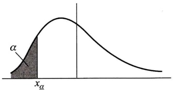
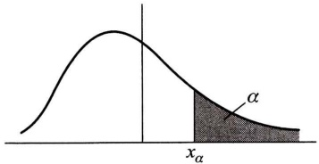

$$
f (x _ {1}, x _ {2}, \dots , x _ {n}) = \frac {1}{(2 \pi) ^ {n / 2} (\det \boldsymbol {C}) ^ {1 / 2}} \exp \left\{- \frac {1}{2} (\boldsymbol {X} - \boldsymbol {\mu}) ^ {\mathrm{T}} \boldsymbol {C} ^ {- 1} (\boldsymbol {X} - \boldsymbol {\mu}) \right\},
$$

其中 C 是  $(X_{1}, X_{2}, \cdots, X_{n})$  的协方差矩阵.

n 维正态随机变量具有以下四条重要性质(证略):

$1^{\circ}$ n 维正态随机变量 $(X_{1}, X_{2}, \cdots, X_{n})$ 的每一个分量 $X_{i}, i=1,2,\cdots,n$ 都是正态随机变量；反之，若 $X_{1}, X_{2}, \cdots, X_{n}$ 都是正态随机变量，且相互独立，则 $(X_{1}, X_{2}, \cdots, X_{n})$ 是 n 维正态随机变量.

$2^{\circ}$ n 维随机变量 $(X_{1}, X_{2}, \cdots, X_{n})$  服从 n 维正态分布的充要条件是 $X_{1}, X_{2}, \cdots, X_{n}$ 的任意的线性组合

$$
l _ {1} X _ {1} + l _ {2} X _ {2} + \dots + l _ {n} X _ {n}
$$

服从一维正态分布(其中  $l_{1}, l_{2}, \cdots, l_{n}$  不全为零).

$3^{\circ}$ 若 $(X_{1}, X_{2}, \cdots, X_{n})$ 服从 $n$ 维正态分布，设 $Y_{1}, Y_{2}, \cdots, Y_{k}$ 是 $X_{j} (j = 1, 2, \cdots, n)$ 的线性函数，则 $(Y_{1}, Y_{2}, \cdots, Y_{k})$ 也服从多维正态分布.

这一性质称为正态变量的线性变换不变性.

$4^{\circ}$ 设 $(X_{1}, X_{2}, \cdots, X_{n})$ 服从 n 维正态分布，则“ $X_{1}, X_{2}, \cdots, X_{n}$ 相互独立”与“ $X_{1}, X_{2}, \cdots, X_{n}$ 两两不相关”是等价的.

n 维正态分布在随机过程和数理统计中常会遇到.

## 小结

随机变量的数字特征是由随机变量的分布确定的，能描述随机变量某一个方面的特征的常数.最重要的数字特征是数学期望和方差.数学期望 $E(X)$ 描述随机变量 $X$ 取值的平均大小，方差 $D(X) = E\{[X - E(X)]^2\}$ 描述随机变量 $X$ 与它自己的数学期望 $E(X)$ 的偏离程度.数学期望和方差在应用和理论上都非常重要.

要掌握随机变量的函数 $Y = g(X)$ 的数学期望 $E(Y) = E[g(X)]$ 的计算公式(1.3)和(1.4). 这两个公式的意义在于当我们求 $E(Y)$ 时，不必先求出 $Y = g(X)$ 的分布律或概率密度，而只需利用 $X$ 的分布律或概率密度就可以了，这样做的好处是明显的.

要掌握数学期望和方差的性质.提请读者注意的是:

(1) 当  $X_{1}, X_{2}$  独立或  $X_{1}, X_{2}$  不相关时，才有  $E(X_{1}X_{2}) = E(X_{1})E(X_{2})$ .
(2) 设 C 为常数, 则有  $D(CX)=C^{2}D(X)$ , 右边的系数是  $C^{2}$ , 不是 C.
(3) $D(X_{1} + X_{2}) = D(X_{1}) + D(X_{2}) + 2\mathrm{Cov}(X_{1},X_{2})$ ，当 $X_{1},X_{2}$ 独立或 $X_{1},X_{2}$ 不相关时才有

$$
D (X _ {1} + X _ {2}) = D (X _ {1}) + D (X _ {2}).
$$

例如，若 $X_{1}, X_{2}$ 独立，则有 $D(2X_{1} - 3X_{2}) = 4D(X_{1}) + 9D(X_{2})$

相关系数 $\rho_{XY}$ 有时也称为线性相关系数，它是一个可以用来描述随机变量 $(X,Y)$ 的两个分量 $X, Y$ 之间的线性关系紧密程度的数字特征。当 $|\rho_{XY}|$ 较小时 $X, Y$ 的线性相关的程度较差；当 $\rho_{XY} = 0$ 时称 $X, Y$ 不相关。不相关是指 $X, Y$ 之间不存在线性关系，$X, Y$ 不相关，它们还可能存在除线性关系之外的关系（参见 §3 例1）。又由于 $X, Y$ 相互独立是指 $X, Y$ 的一般关系而言的，因此有以下的结论:$X, Y$ 相互独立则 $X, Y$ 一定不相关；反之，若 $X, Y$ 不相关则 $X, Y$ 不一定相互独立。

特别，对于二维正态随机变量 $(X,Y),X$ 和 $Y$ 不相关与 $X$ 和 $Y$ 相互独立是等价的.而二元正态随机变量的相关系数 $\rho_{XY}$ 就是参数 $\rho$ 于是，用“$\rho = 0$”是否成立来检验 $X,Y$ 是否相互独立是很方便的.

切比雪夫不等式给出了在随机变量 $X$ 的分布未知，只知道 $E(X)$ 和 $D(X)$ 的情况下，对事件 $\{|X - E(X)| < \varepsilon\}$ 概率的下限的估计。

## ■重要术语及主题

数学期望 随机变量函数的数学期望 数学期望的性质 方差 标准差 方差的性质标准化的随机变量 协方差 相关系数 相关系数的性质 $X, Y$ 不相关 切比雪夫不等式几种重要分布的数学期望和方差 矩 协方差矩阵

## 习题

1.（1）在下列句子中随机地取一个单词，以 $X$ 表示取到的单词所包含的字母个数，写出$X$ 的分布律并求 $E(X)$

"THE GIRL PUT ON HER BEAUTIFUL RED HAT".

(2) 在上述句子的 30 个字母中随机地取一个字母, 以 $Y$ 表示取到的字母所在单词所包含的字母数, 写出 $Y$ 的分布律并求 $E(Y)$.

(3) 一人掷骰子, 如得 6 点则掷第 2 次, 此时得分为 $6+$ 第二次得到的点数; 否则得分为他第一次掷得的点数, 且不能再掷, 求得分 $X$ 的分布律及 $E(X)$.

2. 某产品的次品率为 0.1, 检验员每天检验 4 次. 每次随机地取 10 件产品进行检验, 如发现其中的次品数多于 1, 就去调整设备. 以 X 表示一天中调整设备的次数, 试求  $E(X)$ . (设诸产品是否为次品是相互独立的.)

3. 有 3 只球、4 个盒子, 盒子的编号为 1,2,3,4. 将球逐个独立地, 随机地放入 4 个盒子中去. 以 $X$ 表示其中至少有一只球的盒子的最小号码 (例如 $X = 3$ 表示第 1 号、第 2 号盒子是空的, 第 3 号盒子至少有一只球), 试求 $E(X)$.

4.（1）设随机变量 X 的分布律为  $P\left\{X=(-1)^{j+1}\frac{3^{j}}{j}\right\}=\frac{2}{3^{j}}, j=1,2,\cdots$ ，说明 X 的数学期望不存在.

（2）一盒中装有一只黑球、一只白球，作摸球游戏，规则如下:一次从盒中随机摸一只球，若摸到白球，则游戏结束；若摸到黑球，放回再放入一只黑球，然后再从盒中随机地摸一只球。试说明要游戏结束的摸球次数 X 的数学期望不存在。

5. 设在某一规定的时间间隔里, 某电气设备用于最大负荷的时间 X (以 min 计) 是一个随机变量, 其概率密度为

$$
f (x) = \left\{ \begin{array}{l l} \frac {1}{1 5 0 0 ^ {2}} x, & 0 \leqslant x \leqslant 1 5 0 0, \\ \frac {- 1}{1 5 0 0 ^ {2}} (x - 3 0 0 0), & 1 5 0 0 <   x \leqslant 3 0 0 0, \\ 0, & \text {其他.} \end{array} \right.
$$

求 $E(X)$

6.（1）设随机变量 $X$ 的分布律为

| X | -2 | 0 | 2 |
| --- | --- | --- | --- |
| $p_k$ | 0.4 | 0.3 | 0.3 |

求 $E(X), E(X^2), E(3X^2 + 5)$.

(2) 设  $X \sim \pi(\lambda)$ ，求  $E[1/(X+1)]$ .

7.（1）设随机变量 $X$ 的概率密度为

$$
f (x) = \left\{ \begin{array}{l l} \mathrm{e} ^ {- x}, & x > 0, \\ 0, & x \leqslant 0. \end{array} \right.
$$

求(i) $Y = 2X$ ，(ii) $Y = \mathrm{e}^{-2X}$ 的数学期望.

（2）设随机变量  $X_{1}, X_{2}, \cdots, X_{n}$  相互独立，且都服从  $(0,1)$  上的均匀分布。(i) 求  $U = \max\{X_{1}, X_{2}, \cdots, X_{n}\}$  的数学期望，(ii) 求  $V = \min\{X_{1}, X_{2}, \cdots, X_{n}\}$  的数学期望。

8. 设随机变量 $(X, Y)$ 的分布律为

| Y\\X | 1 | 2 | 3 |
| --- | --- | --- | --- |
| -1 | 0.2 | 0.1 | 0.0 |
| 0 | 0.1 | 0.0 | 0.3 |
| 1 | 0.1 | 0.1 | 0.1 |

(1) 求  $E(X)$ ,  $E(Y)$ .
(2) 设 Z=Y/X, 求  $E(Z)$ .
(3) 设 $Z=(X-Y)^{2}$ ，求 $E(Z)$ .

9.（1）设随机变量 $(X,Y)$ 的概率密度为

$$
f (x, y) = \left\{ \begin{array}{l l} 1 2 y ^ {2}, & 0 \leqslant y \leqslant x \leqslant 1, \\ 0, & \text {其他}. \end{array} \right.
$$

求 $E(X), E(Y), E(XY), E(X^2 + Y^2)$.

(2) 设随机变量 X, Y 的联合概率密度为

$$
f (x, y) = \left\{ \begin{array}{l l} { \frac {1}{y} \mathrm{e} ^ {- (y + x / y)},} & {x > 0, y > 0,} \\ {0,} & {\text {其他}.} \end{array} \right.
$$

求 $E(X), E(Y), E(XY)$.

10.（1）设随机变量 $X\sim N(0,1),Y\sim N(0,1)$ 且 $X,Y$ 相互独立.求 $E[X^2 /(X^2 +Y^2)]$

(2) 一飞机进行空投物资作业, 设目标点为原点 $O(0,0)$, 物资着陆点为 $(X,Y), X,Y$ 相互独立, 且设 $X \sim N(0,\sigma^2), Y \sim N(0,\sigma^2)$, 求原点到点 $(X,Y)$ 间距离的数学期望.

11. 一工厂生产的某种设备的寿命 $X$ (以年计)服从指数分布, 概率密度为

$$
f (x) = \left\{ \begin{array}{l l} \frac {1}{4} \mathrm{e} ^ {- x / 4}, & x > 0, \\ 0, & x \leqslant 0. \end{array} \right.
$$

工厂规定,出售的设备若在售出一年之内损坏可予以调换.若工厂售出一台设备赢利100元,调换一台设备厂方需花费300元.试求厂方出售一台设备净赢利的数学期望.

12. 某车间生产的圆盘直径在区间 $(a,b)$ 上服从均匀分布,试求圆盘面积的数学期望.

13. 设电压(以 V 计) $X \sim N(0,9)$ . 将电压施加于一检波器, 其输出电压为  $Y = 5X^{2}$ , 求输出电压 Y 的均值.

14. 设随机变量 $X_{1}, X_{2}$ 的概率密度分别为

$$
f _ {1} (x) = \left\{ \begin{array}{l l} 2 \mathrm{e} ^ {- 2 x}, & x > 0, \\ 0, & x \leqslant 0, \end{array} \right. f _ {2} (x) = \left\{ \begin{array}{l l} 4 \mathrm{e} ^ {- 4 x}, & x > 0, \\ 0, & x \leqslant 0. \end{array} \right.
$$

(1) 求  $E(X_{1}+X_{2})$ ,  $E(2X_{1}-3X_{2}^{2})$ .

(2) 又设  $X_{1}, X_{2}$  相互独立, 求  $E(X_{1}X_{2})$ .

15. 将 $n$ 只球 $(1 \sim n$ 号) 随机地放进 $n$ 个盒子 $(1 \sim n$ 号) 中去, 一个盒子装一只球. 若一只球装入与球同号的盒子中, 则称为一个配对. 记 $X$ 为总的配对数, 求 $E(X)$.

16. 若有 $n$ 把看上去样子相同的钥匙, 其中只有一把能打开门上的锁, 用它们去试开门上的锁. 设取到每只钥匙是等可能的. 若每把钥匙试开一次后除去, 试用下面两种方法求试开次数 $X$ 的数学期望.

(1) 写出 X 的分布律.

(2) 不写出 X 的分布律.

17. 设 $X$ 为随机变量, $C$ 是常数, 证明 $D(X) < E[(X - C)^2]$, 对于 $C \neq E(X)$. (由于 $D(X) = E\{[X - E(X)]^2\}$, 上式表明 $E[(X - C)^2]$ 当 $C = E(X)$ 时取到最小值.)

18. 设随机变量 X 服从瑞利分布, 其概率密度为

$$
f (x) = \left\{ \begin{array}{l l} \frac {x}{\sigma^ {2}} \mathrm{e} ^ {- x ^ {2} / (2 \sigma^ {2})}, & x > 0, \\ 0, & x \leqslant 0, \end{array} \right.
$$

其中  $\sigma>0$  是常数. 求  $E(X), D(X)$ .

19. 设随机变量 X 服从  $\Gamma$  分布, 其概率密度为

$$
f (x) = \left\{ \begin{array}{l l} \frac {1}{\beta^ {\alpha} \Gamma (\alpha)} x ^ {\alpha - 1} \mathrm{e} ^ {- x / \beta}, & x > 0, \\ 0, & x \leqslant 0, \end{array} \right.
$$

其中  $\alpha>0,\beta>0$  是常数. 求  $E(X), D(X)$ .

20. 设随机变量 $X$ 服从几何分布, 其分布律为

$$
P \{X = k \} = p (1 - p) ^ {k - 1}, \quad k = 1, 2, \dots ,
$$

其中 $0 < p < 1$ 是常数. 求 $E(X), D(X)$.

21. 设长方形的长(以 m 计) $X \sim U(0,2)$ ，已知长方形的周长(以 m 计)为 20. 求长方形面积 A 的数学期望和方差.

22.（1）设随机变量 $X_{1}, X_{2}, X_{3}, X_{4}$ 相互独立，且有 $E(X_{i}) = i, D(X_{i}) = 5 - i, i = 1, 2, 3, 4.$ 设 $Y = 2X_{1} - X_{2} + 3X_{3} - \frac{1}{2} X_{4}$. 求 $E(Y), D(Y)$.

（2）设随机变量 $X, Y$ 相互独立，且 $X \sim N(720, 30^2), Y \sim N(640, 25^2)$，求 $Z_1 = 2X + Y$，$Z_2 = X - Y$ 的分布，并求概率 $P\{X > Y\}, P\{X + Y > 1400\}$.

23. 五家商店联营，它们每两周售出的某种农产品的数量（以 $\mathrm{kg}$ 计）分别为 $X_{1}, X_{2}, X_{3}, X_{4}, X_{5}$. 已知 $X_{1} \sim N(200, 225), X_{2} \sim N(240, 240), X_{3} \sim N(180, 225), X_{4} \sim N(260, 265), X_{5} \sim N(320, 270), X_{1}, X_{2}, X_{3}, X_{4}, X_{5}$ 相互独立.

(1) 求五家商店两周的总销售量的均值和方差.

（2）商店每隔两周进货一次，为了使新的供货到达前商店不会脱销的概率大于0.99，问商店的仓库应至少储存多少千克该产品？

24. 卡车装运水泥, 设每袋水泥质量 X(以 kg 计) 服从  $N(50, 2.5^{2})$ , 问至多装多少袋水泥使总质量超过 2000 的概率不大于 0.05?

25. 设随机变量 $X, Y$ 相互独立，且都服从 $(0,1)$ 上的均匀分布.

(1) 求  $E(XY)$ ,  $E(X/Y)$ ,  $E[\ln(XY)]$ ,  $E(|Y-X|)$ .

(2) 以 X, Y 为边长作一长方形，以 A, C 分别表示长方形的面积和周长，求 A 和 C 的相关系数.

26.（1）设随机变量 $X_{1}, X_{2}, X_{3}$ 相互独立，且有 $X_{1} \sim b(4, 1/2), X_{2} \sim b(6, 1/3), X_{3} \sim b(6, 1/3)$，求 $P\{X_{1} = 2, X_{2} = 2, X_{3} = 5\}, E(X_{1}X_{2}X_{3}), E(X_{1} - X_{2}), E(X_{1} - 2X_{2})$.

（2）设 X, Y 是随机变量，且有  $E(X)=3, E(Y)=1, D(X)=4, D(Y)=9$ ，令  $Z=5X-Y+15$ ，分别在下列 3 种情况下求  $E(Z)$  和  $D(Z)$ .

(i) X, Y 相互独立，(ii) X, Y 不相关，(iii) X 与 Y 的相关系数为 0.25.

27. 下列各对随机变量 X 和 Y, 问哪几对是相互独立的? 哪几对是不相关的?

(1)  $X \sim U(0,1)$ ,  $Y = X^{2}$ .
(2) $X \sim U(-1,1), Y = X^2.$
(3)  $X = \cos V, Y = \sin V, V \sim U(0, 2\pi).$

若 $(X,Y)$ 的概率密度为 $f(x,y)$ ,

(4) $f(x,y)=\begin{cases}x+y,&0<x<1,0<y<1,\\0,&\text{其他}.\end{cases}$
(5) $f(x,y)=\left\{\begin{aligned}&2y,&0<x<1,0<y<1,\\ &0,& 其他.\end{aligned}\right.$

28. 设二维随机变量 $(X, Y)$ 的概率密度为

$$
f (x, y) = \left\{ \begin{array}{l l} { \frac {1}{\pi},} & {x ^ {2} + y ^ {2} \leqslant 1,} \\ {0,} & {\text {其他}.} \end{array} \right.
$$

试验证 $X$ 和 $Y$ 是不相关的，但 $X$ 和 $Y$ 不是相互独立的.

29. 设随机变量 $(X, Y)$ 的分布律为

| Y\\X | -1 | 0 | 1 |
| --- | --- | --- | --- |
| -1 | $1/8$ | $1/8$ | $1/8$ |
| 0 | $1/8$ | 0 | $1/8$ |
| 1 | $1/8$ | $1/8$ | $1/8$ |

验证 X 和 Y 是不相关的, 但 X 和 Y 不是相互独立的.

30. 设 $A$ 和 $B$ 是试验 $E$ 的两个事件, 且 $P(A) > 0, P(B) > 0$, 并定义随机变量 $X, Y$ 如下:

$$
X = \left\{ \begin{array}{l l} 1, & \text {若} A \text {发生}, \\ 0, & \text {若} A \text {不发生}, \end{array} \quad Y = \left\{ \begin{array}{l l} 1, & \text {若} B \text {发生}, \\ 0, & \text {若} B \text {不发生}. \end{array} \right. \right.
$$

证明若 $\rho_{XY}=0$ ，则X和Y必定相互独立.

31. 设随机变量 $(X, Y)$ 具有概率密度

$$
f (x, y) = \left\{ \begin{array}{l l} 1, & | y | <   x, 0 <   x <   1, \\ 0, & \text {其他}. \end{array} \right.
$$

求 $E(X), E(Y), \operatorname{Cov}(X, Y)$.

32. 设随机变量 $(X, Y)$ 具有概率密度

$$
f (x, y) = \left\{ \begin{array}{l l} { \frac {1}{8} (x + y),} & {0 \leqslant x \leqslant 2, 0 \leqslant y \leqslant 2,} \\ {0,} & {\text {其他}.} \end{array} \right.
$$

求 $E(X), E(Y), \mathrm{Cov}(X, Y), \rho_{XY}, D(X + Y)$.

33. 设随机变量 $X \sim N(\mu, \sigma^2), Y \sim N(\mu, \sigma^2)$，且设 $X, Y$ 相互独立，试求 $Z_1 = \alpha X + \beta Y$ 和 $Z_2 = \alpha X - \beta Y$ 的相关系数（其中 $\alpha, \beta$ 是不为零的常数）.

34.（1）设随机变量 $W = (aX + 3Y)^2$，$E(X) = E(Y) = 0$，$D(X) = 4$，$D(Y) = 16$，$\rho_{XY} = -0.5$. 求常数 $a$ 使 $E(W)$ 为最小，并求 $E(W)$ 的最小值.

（2）设随机变量 $(X,Y)$ 服从二维正态分布，且有 $D(X) = \sigma_X^2, D(Y) = \sigma_Y^2$. 证明当 $a^2 = \sigma_X^2 / \sigma_Y^2$ 时，随机变量 $W = X - aY$ 与 $V = X + aY$ 相互独立.

35. 设随机变量 $(X, Y)$ 服从二维正态分布，且 $X \sim N(0, 3), Y \sim N(0, 4)$，相关系数 $\rho_{XY} = -1/4$，试写出 $X$ 和 $Y$ 的联合概率密度。

36. 已知正常男性成人血液中, 每一毫升所含白细胞数的均值是 7300, 均方差是 700. 利用切比雪夫不等式估计每毫升含白细胞数在 5200\~9400 的概率 p.

37. 对于两个随机变量 $V, W$，若 $E(V^2), E(W^2)$ 存在，证明

$$
\left[ E (V W) \right] ^ {2} \leqslant E (V ^ {2}) E (W ^ {2}). \tag {A}
$$

这一不等式称为柯西一施瓦茨(Cauchy-Schwarz)不等式.

提示:考虑实变量 t 的函数

$$
q (t) = E \big [ (V + t W) ^ {2} \big ] = E (V ^ {2}) + 2 t E (V W) + t ^ {2} E (W ^ {2}).
$$

## 38. 分位数(分位点).

定义 设连续型随机变量 X 的分布函数为  $F(x)$ ，概率密度函数为  $f(x)$ .

$1^{\circ}$ 对于任意正数 $\alpha (0 < \alpha < 1)$, 称满足条件

$$
P \{X \leqslant x _ {\underline {{\alpha}}} \} = F (x _ {\underline {{\alpha}}}) = \int_ {- \infty} ^ {x _ {\underline {{\alpha}}}} f (x) \mathrm{d} x = \alpha
$$

的数 $x_{\underline{\alpha}}$ 为此分布的 $\alpha$ 分位数或下 $\alpha$ 分位数.

$2^{\circ}$ 对于任意正数 $\alpha (0 < \alpha < 1)$, 称满足条件

$$
P \{X > x _ {\alpha} \} = 1 - F (x _ {\alpha}) = \int_ {x _ {\alpha}} ^ {\infty} f (x) \mathrm{d} x = \alpha
$$

的数  $x_{\alpha}$  为此分布的上  $\alpha$  分位数.

特别，当 $\alpha = 0.5$ 时，

$$
F (x _ {0. 5}) = F (x _ {\underline {{0 . 5}}}) = \int_ {0. 5} ^ {\infty} f (x) \mathrm{d} x = 0. 5,
$$

$x_{0.5}$ 称为此分布的中位数.

下  $\alpha$  分位数  $x_{\alpha}$  将概率密度曲线下的面积分为两部分, 左侧的面积恰为  $\alpha$  (见题 38 图(1)). 上  $\alpha$  分位数  $x_{\alpha}$  也将概率密度曲线下的面积分为两部分, 右侧的面积恰为  $\alpha$  (见题 38 图(2)).

text_image

α
xₐ

(1)

text_image

x_\alpha
\alpha

(2)

题38图

下  $\alpha$  分位数与上  $\alpha$  分位数有以下的关系:

$$
x _ {\alpha} = x _ {\underline {{1 - \alpha}}}, \quad x _ {\underline {{\alpha}}} = x _ {1 - \alpha}.
$$

类似地,可定义离散型随机变量 X 的分位数.

定义 对于任意正数 $\alpha (0 < \alpha < 1)$, 称满足条件

$$
P \{X <   x _ {\underline {{\alpha}}} \} \leqslant \alpha \quad \text {且} \quad P \{X \leqslant x _ {\underline {{\alpha}}} \} \geqslant \alpha
$$

的数  $x_{\underline{\alpha}}$  为此分布的  $\alpha$  分位数或下  $\alpha$  分位数.

(1) 设 X 的概率密度为

$$
f (x) = \left\{ \begin{array}{l l} 2 \mathrm{e} ^ {- 2 x}, & x \geqslant 0, \\ 0, & \text {其他}. \end{array} \right.
$$

试求 X 的中位数 M.

(2) 设 X 服从柯西分布, 其概率密度为

$$
f (x) = \frac {b}{\pi [ (x - a) ^ {2} + b ^ {2} ]}, \quad b > 0.
$$

试求 X 的中位数 M.

## 第五章 大数定律及中心极限定理

极限定理是概率论的基本理论，在理论研究和应用中起着重要的作用，其中最重要的是称为“大数定律”与“中心极限定理”的一些定理。大数定律是叙述随机变量序列的前一些项的算术平均值在某种条件下收敛到这些项的均值的算术平均值；中心极限定理则是确定在什么条件下，大量随机变量之和的分布逼近于正态分布。本章介绍几个大数定律和中心极限定理。

## § 1 大数定律

第一章曾讲过,大量试验证实,随机事件 A 的频率  $f_{n}(A)$  当重复试验的次数 n 增大时总呈现出稳定性,稳定在某一个常数的附近.频率的稳定性是概率定义的客观基础.本节我们将对频率的稳定性作出理论的说明.

弱大数定律(辛钦大数定律) 设  $X_{1}, X_{2}, \cdots$  是相互独立①, 服从同一分布的随机变量序列, 且具有数学期望  $E(X_{k}) = \mu (k = 1, 2, \cdots)$ . 作前 n 个变量的算术平均  $\frac{1}{n} \sum_{k=1}^{n} X_{k}$ , 则对于任意  $\varepsilon > 0$ , 有

$$
\lim _ {n \to \infty} P \left\{\left| \frac {1}{n} \sum_ {k = 1} ^ {n} X _ {k} - \mu \right| <   \varepsilon \right\} = 1. \tag {1.1}
$$

证 我们只在随机变量的方差  $D(X_{k})=\sigma^{2}(k=1,2,\cdots)$  存在这一条件下证明上述结果. 因为

$$
E \Big (\frac {1}{n} \sum_ {k = 1} ^ {n} X _ {k} \Big) = \frac {1}{n} \sum_ {k = 1} ^ {n} E (X _ {k}) = \frac {1}{n} n \mu = \mu ,
$$

又由独立性得

$$
D \Big (\frac {1}{n} \sum_ {k = 1} ^ {n} X _ {k} \Big) = \frac {1}{n ^ {2}} \sum_ {k = 1} ^ {n} D (X _ {k}) = \frac {1}{n ^ {2}} n \sigma^ {2} = \frac {\sigma^ {2}}{n},
$$

由切比雪夫不等式(见第四章(2.9)式)得

$$
1 \geqslant P \Bigg \{\left| \frac {1}{n} \sum_ {k = 1} ^ {n} X _ {k} - \mu \right| <   \varepsilon \Bigg \} \geqslant 1 - \frac {\sigma^ {2} / n}{\varepsilon^ {2}}.
$$

<small>① 这里指对于任意  $n>1, X_{1}, X_{2}, \cdots, X_{n}$  是相互独立的.</small>

在上式中令 $n\to \infty$ ，即得

$$
\lim _ {n \to \infty} P \left\{\left| \frac {1}{n} \sum_ {k = 1} ^ {n} X _ {k} - \mu \right| <   \varepsilon \right\} = 1.
$$

$\left\{\left|\frac{1}{n}\sum_{k=1}^{n}X_{k}-\mu\right|<\varepsilon\right\}$ 是一个随机事件. 等式(1.1)表明, 当 $n\to \infty$ 时这个事件的概率趋于1. 即对于任意正数 $\varepsilon$, 当 $n$ 充分大时, 不等式 $\left|\frac{1}{n}\sum_{k=1}^{n}X_{k}-\mu\right|<\varepsilon$ 成立的概率很大. 通俗地说, 辛钦大数定律是说, 对于独立同分布且具有均值 $\mu$ 的随机变量 $X_{1}, X_{2}, \cdots, X_{n}$, 当 $n$ 很大时它们的算术平均 $\frac{1}{n}\sum_{k=1}^{n}X_{k}$ 很可能接近于 $\mu$.

设  $Y_{1}, Y_{2}, \cdots, Y_{n}, \cdots$  是一个随机变量序列，a 是一个常数。若对于任意正数  $\varepsilon$ ，有

$$
\lim _ {n \to \infty} P \{| Y _ {n} - a | <   \varepsilon \} = 1,
$$

则称序列  $Y_{1}, Y_{2}, \cdots, Y_{n}, \cdots$  依概率收敛于 a，记为

$$
Y _ {n} \xrightarrow {P} a.
$$

依概率收敛的序列有以下的性质.

设 $X_{n}\xrightarrow{P}a,Y_{n}\xrightarrow{P}b$ ，又设函数 $g(x,y)$ 在点 $(a,b)$ 连续，则

$$
g (X _ {n}, Y _ {n}) \stackrel {P} {\longrightarrow} g (a, b). (\text {证略.})
$$

这样,辛钦大数定律又可叙述为:

弱大数定律(辛钦大数定律) 设随机变量  $X_{1}, X_{2}, \cdots, X_{n}, \cdots$  相互独立，服从同一分布且具有数学期望  $E(X_{k}) = \mu (k = 1, 2, \cdots)$ ，则序列  $\overline{X} = \frac{1}{n} \sum_{k=1}^{n} X_{k}$  依概率收敛于  $\mu$ ，即  $\overline{X} \xrightarrow{P} \mu$ .

下面介绍辛钦大数定律的一个重要推论.

伯努利大数定律 设 $f_{A}$ 是 $n$ 次独立重复试验中事件 $A$ 发生的次数, $p$ 是事件 $A$ 在每次试验中发生的概率, 则对于任意 $\varepsilon > 0$, 有

$$
\lim _ {n \to \infty} P \left\{\left| \frac {f _ {A}}{n} - p \right| <   \varepsilon \right\} = 1 \tag {1.2}
$$

或

$$
\lim _ {n \to \infty} P \left\{\left| \frac {f _ {A}}{n} - p \right| \geqslant \varepsilon \right\} = 0. \tag {1.2}
$$

证 因为 $f_{\mathrm{A}} \sim b(n, p)$, 由第四章 §2 例6, 有

$$
f _ {A} = X _ {1} + X _ {2} + \dots + X _ {n},
$$

其中， $X_{1}, X_{2}, \cdots, X_{n}$  相互独立，且都服从以 p 为参数的 (0-1) 分布，因而  $E(X_{k}) = p (k = 1, 2, \cdots, n)$ ，由 (1.1) 式即得

$$
\lim _ {n \to \infty} P \left\{\left| \frac {1}{n} \sum_ {k = 1} ^ {n} X _ {k} - p \right| <   \varepsilon \right\} = 1,
$$

即 $\lim_{n\to \infty}P\left\{\left|\frac{f_A}{n} -p\right|\geqslant \varepsilon \right\} = 0.$

伯努利大数定律的结果表明,对于任意  $\varepsilon>0$ , 只要重复独立试验的次数 n 充分大, 事件  $\left\{\left|\frac{f_{A}}{n}-p\right|\geqslant\varepsilon\right\}$  是一个小概率事件, 由实际推断原理知(见第一章 §4), 这一事件实际上几乎是不发生的, 即在 n 充分大时事件  $\left\{\left|\frac{f_{A}}{n}-p\right|<\varepsilon\right\}$  实际上几乎是必定要发生的, 亦即对于给定的任意小的正数  $\varepsilon$ , 在 n 充分大时, 事件“频率  $\frac{f_{A}}{n}$  与概率 p 的偏差小于  $\varepsilon$ ”实际上几乎是必定要发生的. 这就是我们所说的频率稳定性的真正含义. 由实际推断原理, 在实际应用中, 当试验次数很大时, 便可以用事件的频率来代替事件的概率.

## § 2 中心极限定理

在客观实际中有许多随机变量,它们是由大量的相互独立的随机因素的综合影响所形成的.而其中每一个别因素在总的影响中所起的作用都是微小的.这种随机变量往往近似地服从正态分布.这种现象就是中心极限定理的客观背景.本节只介绍三个常用的中心极限定理.

定理 1(独立同分布的中心极限定理) 设随机变量  $X_{1}, X_{2}, \cdots, X_{n}, \cdots$  相互独立，服从同一分布，且具有数学期望和方差: $E(X_{k}) = \mu, D(X_{k}) = \sigma^{2} > 0 (k = 1, 2, \cdots)$ ，则随机变量之和  $\sum_{k=1}^{n} X_{k}$  的标准化变量

$$
Y _ {n} = \frac {\sum_ {k = 1} ^ {n} X _ {k} - E \left(\sum_ {k = 1} ^ {n} X _ {k}\right)}{\sqrt {D \left(\sum_ {k = 1} ^ {n} X _ {k}\right)}} = \frac {\sum_ {k = 1} ^ {n} X _ {k} - n \mu}{\sqrt {n} \sigma}
$$

的分布函数 $F_{n}(x)$ 对于任意 $x$ 满足

$$
\begin{array}{l} \lim _ {n \to \infty} F _ {n} (x) = \lim _ {n \to \infty} P \left\{\frac {\sum_ {k = 1} ^ {n} X _ {k} - n \mu}{\sqrt {n} \sigma} \leqslant x \right\} \\ = \int_ {- \infty} ^ {x} \frac {1}{\sqrt {2 \pi}} \mathrm{e} ^ {- t ^ {2} / 2} \mathrm{d} t = \Phi (x). \tag {2.1} \\ \end{array}
$$

证明略.

这就是说,均值为  $\mu$ , 方差为  $\sigma^{2}>0$  的独立同分布的随机变量  $X_{1}, X_{2}, \cdots, X_{n}$  之和  $\sum_{k=1}^{n} X_{k}$  的标准化变量, 当 n 充分大时, 有

$$
\frac {\sum_ {k = 1} ^ {n} X _ {k} - n \mu}{\sqrt {n} \sigma} \stackrel {\text {近似地}} {\sim} N (0, 1). \tag {2.2}
$$

在一般情况下,很难求出 n 个随机变量之和  $\sum_{k=1}^{n}X_{k}$  的分布函数,(2.2)式表明,当 n 充分大时,可以通过  $\Phi(x)$  给出其近似的分布.这样,就可以利用正态分布对  $\sum_{k=1}^{n}X_{k}$  作理论分析或作实际计算,其好处是明显的.

将(2.2)式左端改写成 $\frac{\frac{1}{n}\sum_{k = 1}^{n}X_k - \mu}{\sigma / \sqrt{n}} = \frac{\overline{X} - \mu}{\sigma / \sqrt{n}}$ ，这样，上述结果可写成:当 $n$ 充分大时，

$$
\frac {\overline {{X}} - \mu}{\sigma / \sqrt {n}} \stackrel {\text {近似地}} {\sim} N (0, 1) \quad \text {或} \quad \overline {{X}} \stackrel {\text {近似地}} {\sim} N (\mu , \sigma^ {2} / n). \tag {2.3}
$$

这是独立同分布的中心极限定理结果的另一个形式.这就是说，均值为  $\mu$ ，方差为  $\sigma^{2}>0$  的独立同分布的随机变量  $X_{1}, X_{2}, \cdots, X_{n}$  的算术平均  $\overline{X} = \frac{1}{n} \sum_{k=1}^{n} X_{k}$ ，当 n 充分大时近似地服从均值为  $\mu$ ，方差为  $\sigma^{2}/n$  的正态分布。这一结果是数理统计中大样本统计推断的基础。

定理 2(李雅普诺夫(Lyapunov)定理) 设随机变量  $X_{1}, X_{2}, \cdots, X_{n}, \cdots$  相互独立, 它们具有数学期望和方差

$$
E (X _ {k}) = \mu_ {k}, \quad D (X _ {k}) = \sigma_ {k} ^ {2} > 0, \quad k = 1, 2, \dots ,
$$

记 $B_{n}^{2} = \sum_{k = 1}^{n}\sigma_{k}^{2}.$

若存在正数 $\delta$ ，使得当 $n\to \infty$ 时，

$$
\frac {1}{B _ {n} ^ {2 + \delta}} \sum_ {k = 1} ^ {n} E \{\mid X _ {k} - \mu_ {k} \mid^ {2 + \delta} \} \rightarrow 0,
$$

则随机变量之和 $\sum_{k=1}^{n} X_k$ 的标准化变量

$$
Z _ {n} = \frac {\sum_ {k = 1} ^ {n} X _ {k} - E \left(\sum_ {k = 1} ^ {n} X _ {k}\right)}{\sqrt {D \left(\sum_ {k = 1} ^ {n} X _ {k}\right)}} = \frac {\sum_ {k = 1} ^ {n} X _ {k} - \sum_ {k = 1} ^ {n} \mu_ {k}}{B _ {n}}
$$

的分布函数 $F_{n}(x)$ 对于任意 $x$ ，满足

$$
\begin{array}{l} \lim _ {n \to \infty} F _ {n} (x) = \lim _ {n \to \infty} P \left\{\frac {\sum_ {k = 1} ^ {n} X _ {k} - \sum_ {k = 1} ^ {n} \mu_ {k}}{B _ {n}} \leqslant x \right\} \\ = \int_ {- \infty} ^ {x} \frac {1}{\sqrt {2 \pi}} \mathrm{e} ^ {- t ^ {2} / 2} \mathrm{d} t = \varPhi (x). \tag {2.4} \\ \end{array}
$$

证明略.

定理 2 表明, 在定理的条件下, 随机变量

$$
Z _ {n} = \frac {\sum_ {k = 1} ^ {n} X _ {k} - \sum_ {k = 1} ^ {n} \mu_ {k}}{B _ {n}}
$$

当 $n$ 很大时，近似地服从正态分布 $N(0,1)$. 由此，当 $n$ 很大时，$\sum_{k=1}^{n} X_k = B_n Z_n + \sum_{k=1}^{n} \mu_k$ 近似地服从正态分布 $N\left(\sum_{k=1}^{n} \mu_k, B_n^2\right)$. 这就是说，无论各个随机变量 $X_k (k=1, 2, \cdots)$ 服从什么分布，只要满足定理的条件，那么它们的和 $\sum_{k=1}^{n} X_k$ 当 $n$ 很大时，就近似地服从正态分布. 这就是正态随机变量在概率论中占有重要地位的一个基本原因. 在很多问题中，所考虑的随机变量可以表示成很多个独立的随机变量之和. 例如，在任一指定时刻，一个城市的耗电量是大量用户耗电量的总和；一个物理实验的测量误差是由许多观察不到的、可加的微小误差所合成的，它们往往近似地服从正态分布.

下面介绍另一个中心极限定理,它是定理1的特殊情况.

定理 3（棣莫弗-拉普拉斯（De Moivre-Laplace）定理）设随机变量  $\eta_{n}(n=1,2,\cdots)$  服从参数为 n, p (0<p<1) 的二项分布，则对于任意 x，有

$$
\lim _ {n \to \infty} P \left\{\frac {\eta_ {n} - n p}{\sqrt {n p (1 - p)}} \leqslant x \right\} = \int_ {- \infty} ^ {x} \frac {1}{\sqrt {2 \pi}} \mathrm{e} ^ {- t ^ {2} / 2} \mathrm{d} t = \Phi (x). \tag {2.5}
$$

证 由第四章 §2 例6知可以将 $\eta_n$ 分解成为 $n$ 个相互独立、服从同一(0-1)分布的诸随机变量 $X_1, X_2, \cdots, X_n$ 之和，即有

$$
\eta_ {n} = \sum_ {k = 1} ^ {n} X _ {k},
$$

其中  $X_{k}(k=1,2,\cdots,n)$  的分布律为

$$
P \{X _ {k} = i \} = p ^ {i} (1 - p) ^ {1 - i}, \quad i = 0, 1.
$$

由于  $E(X_{k})=p, D(X_{k})=p(1-p)$  ( $k=1,2,\cdots,n$ )，由定理 1 得

$$
\begin{array}{l} \lim _ {n \to \infty} P \left\{\frac {\eta_ {n} - n p}{\sqrt {n p (1 - p)}} \leqslant x \right\} = \lim _ {n \to \infty} P \left\{\frac {\sum_ {k = 1} ^ {n} X _ {k} - n p}{\sqrt {n p (1 - p)}} \leqslant x \right\} \\ = \int_ {- \infty} ^ {x} \frac {1}{\sqrt {2 \pi}} \mathrm{e} ^ {- t ^ {2} / 2} \mathrm{d} t = \varPhi (x). \\ \end{array}
$$

这个定理表明,正态分布是二项分布的极限分布.当 n 充分大时,我们可以利用(2.5)式来计算二项分布的概率.下面举几个关于中心极限定理应用的例子.

例 1 一加法器同时收到 20 个噪声电压  $V_{k}(k=1,2,\cdots,20)$ ，设它们是相互独立的随机变量，且都在区间  $(0,10)$  上服从均匀分布。记  $V=\sum_{k=1}^{20}V_{k}$ ，求  $P\{V>105\}$  的近似值。

解 易知  $E(V_{k})=5, D(V_{k})=100/12 (k=1,2,\cdots,20)$ . 由定理 1, 随机变量

$$
Z = \frac {\sum_ {k = 1} ^ {2 0} V _ {k} - 2 0 \times 5}{\sqrt {1 0 0 / 1 2} \sqrt {2 0}} = \frac {V - 2 0 \times 5}{\sqrt {1 0 0 / 1 2} \sqrt {2 0}}
$$

近似服从正态分布  $N(0,1)$ ，于是

$$
\begin{array}{l} P \{V > 1 0 5 \} = P \left\{\frac {V - 2 0 \times 5}{(1 0 / \sqrt {1 2}) \sqrt {2 0}} > \frac {1 0 5 - 2 0 \times 5}{(1 0 / \sqrt {1 2}) \sqrt {2 0}} \right\} \\ = P \left\{\frac {V - 1 0 0}{(1 0 / \sqrt {1 2}) \sqrt {2 0}} > 0. 3 8 7 \right\} \\ = 1 - P \left\{\frac {V - 1 0 0}{(1 0 / \sqrt {1 2}) \sqrt {2 0}} \leqslant 0. 3 8 7 \right\} \\ \approx 1 - \int_ {- \infty} ^ {0. 3 8 7} \frac {1}{\sqrt {2 \pi}} \mathrm{e} ^ {- t ^ {2} / 2} \mathrm{d} t = 1 - \Phi (0. 3 8 7) = 0. 3 4 8. \\ \end{array}
$$

即有

$$
P \{V > 1 0 5 \} \approx 0. 3 4 8.
$$

例 2 一船舶在某海区航行, 已知每遭受一次波浪的冲击, 纵摇角大于  $3^{\circ}$  的概率为 p=1/3, 若船舶遭受了 90 000 次波浪冲击, 问其中有 29 500～30 500 次纵摇角度大于  $3^{\circ}$  的概率是多少?

解 我们将船舶每遭受一次波浪冲击看作一次试验,并假定各次试验是独立的. 在 90 000 次波浪冲击中纵摇角度大于 $3^{\circ}$ 的次数记为 $X$, 则 $X$ 是一个随机变量, 且有 $X \sim b(90\ 000, 1/3)$. 其分布律为

$$
P \{X = k \} = \binom {9 0 0 0 0} {k} \left(\frac {1}{3}\right) ^ {k} \left(\frac {2}{3}\right) ^ {9 0 0 0 0 - k}, \quad k = 0, 1, \dots , 9 0 0 0 0.
$$

所求的概率为

$$
P \{2 9 5 0 0 \leqslant X \leqslant 3 0 5 0 0 \} = \sum_ {k = 2 9 5 0 0} ^ {3 0 5 0 0} \binom {9 0 0 0 0} {k} \left(\frac {1}{3}\right) ^ {k} \left(\frac {2}{3}\right) ^ {9 0 0 0 0 - k},
$$

要直接计算是麻烦的,我们利用棣莫弗一拉普拉斯定理来求它的近似值.即有

$$
\begin{array}{l} P \{2 9 5 0 0 \leqslant X \leqslant 3 0 5 0 0 \} \\ = P \left\{\frac {2 9 5 0 0 - n p}{\sqrt {n p (1 - p)}} \leqslant \frac {X - n p}{\sqrt {n p (1 - p)}} \leqslant \frac {3 0 5 0 0 - n p}{\sqrt {n p (1 - p)}} \right\} \\ \approx \int_ {\frac {2 9 5 0 0 - n p}{\sqrt {n p (1 - p)}}} ^{\frac {30 5 0 0 - n p}{\sqrt {n p (1 - p)}}} \frac{1}{\sqrt {2 \pi}} \mathrm{e} ^ {-t ^ {2} / 2} \mathrm{d} t = \Phi \left(\frac {30 5 0 0 - n p}{\sqrt {n p (1 - p)}}\right) - \Phi \left(\frac {29 5 0 0 - n p}{\sqrt {n p (1 - p)}}\right), \\ \end{array}
$$

其中 $n = 90000, p = 1 / 3$. 即有

$$
P \{2 9 5 0 0 \leqslant X \leqslant 3 0 5 0 0 \} \approx \Phi \Big (\frac {5 \sqrt {2}}{2} \Big) - \Phi \Big (- \frac {5 \sqrt {2}}{2} \Big) = 0. 9 9 9 5.
$$

例3 对于一个学生而言，来参加家长会的家长人数是一个随机变量，设一个学生无家长、有1名家长、有2名家长来参加会议的概率分别为0.05、0.8、0.15。若学校共有400名学生，设各学生参加会议的家长人数相互独立，且服从同一分布。

(1) 求参加会议的家长人数 X 超过 450 的概率.
(2) 求有 1 名家长来参加会议的学生人数不多于 340 的概率.

解（1）以 $X_{k}(k = 1,2,\dots ,400)$ 记第 $k$ 个学生来参加会议的家长人数，则$X_{k}$ 的分布律为

| $X_k$ | 0 | 1 | 2 |
| --- | --- | --- | --- |
| $p_k$ | 0.05 | 0.8 | 0.15 |

易知  $E(X_{k})=1.1, D(X_{k})=0.19, k=1,2,\cdots,400.$  而  $X=\sum_{k=1}^{400}X_{k}.$  由定理 1，随机变量

$$
\frac {\sum_ {k = 1} ^ {4 0 0} X _ {k} - 4 0 0 \times 1 . 1}{\sqrt {4 0 0} \sqrt {0 . 1 9}} = \frac {X - 4 0 0 \times 1 . 1}{\sqrt {4 0 0} \sqrt {0 . 1 9}}
$$

近似服从正态分布 $N(0,1)$，于是

$$
\begin{array}{l} P \{X > 4 5 0 \} = P \left\{\frac {X - 4 0 0 \times 1 . 1}{\sqrt {4 0 0} \sqrt {0 . 1 9}} > \frac {4 5 0 - 4 0 0 \times 1 . 1}{\sqrt {4 0 0} \sqrt {0 . 1 9}} \right\} \\ = 1 - P \left\{\frac {X - 4 0 0 \times 1 . 1}{\sqrt {4 0 0} \sqrt {0 . 1 9}} \leqslant 1. 1 4 7 \right\} \\ \approx 1 - \Phi (1. 1 4 7) = 0. 1 2 5 1. \\ \end{array}
$$

(2) 以 Y 记有 1 名家长参加会议的学生人数, 则  $Y \sim b(400, 0.8)$ , 由定理 3,

$$
\begin{array}{l} P \{Y \leqslant 3 4 0 \} = P \left\{\frac {Y - 4 0 0 \times 0 . 8}{\sqrt {4 0 0 \times 0 . 8 \times 0 . 2}} \leqslant \frac {3 4 0 - 4 0 0 \times 0 . 8}{\sqrt {4 0 0 \times 0 . 8 \times 0 . 2}} \right\} \\ = P \left\{\frac {Y - 4 0 0 \times 0 . 8}{\sqrt {4 0 0 \times 0 . 8 \times 0 . 2}} \leqslant 2. 5 \right\} \approx \Phi (2. 5) = 0. 9 9 3 8. \\ \end{array}
$$

小结

人们在长期实践中认识到频率具有稳定性,即当试验次数不断增大时,频率稳定在一个数的附近.这一事实显示了可以用一个数来表征事件发生的可能性的大小.这使人们认识到概率是客观存在的,进而由频率的性质的启发和抽象给出了概率的定义,因而频率的稳定性是概率定义的客观基础.伯努利大数定律则以严密的数学形式论证了频率的稳定性.

中心极限定理表明，在相当一般的条件下，当独立随机变量的个数不断增加时，其和的分布趋于正态分布。这一事实阐明了正态分布的重要性，也揭示了为什么在实际应用中会经常遇到正态分布，也就是揭示了产生正态分布变量的源泉。另一方面，它提供了独立同分布随机变量之和 $\sum_{k=1}^{n} X_k$（其中 $X_k$ 的方差存在）的近似分布，只要和式中加项的个数充分大，就可以不必考虑和式中的随机变量服从什么分布，都能用正态分布来近似，这在应用上是有效和重要的。

中心极限定理的内容包含极限,因而称它为极限定理是很自然的.又由于它在统计中的重要性,称它为中心极限定理,这是波利亚(Pólya)在1920年取的名字.

## ■ 重要术语及主题

依概率收敛 伯努利大数定律 辛钦大数定律 独立同分布的中心极限定理 李雅普诺夫中心极限定理 棣莫弗-拉普拉斯中心极限定理

## 习题

1. 据以往经验,某种电器元件的寿命服从均值为  $100 \, h$  的指数分布,现随机地取 16 只,设它们的寿命是相互独立的.求这 16 只元件的寿命的总和大于  $1920 \, h$  的概率.

2.（1）一保险公司有 10 000 个汽车投保人，每个投保人索赔金额的数学期望为 280 美元，标准差为 800 美元，求索赔总金额超过 2 700 000 美元的概率.

(2) 一公司有 50 张签约保险单, 各张保险单的索赔金额  $X_{i}, i=1,2,\cdots,50$  (以千美元计)

服从韦布尔(Weibull)分布,均值  $E(X_{i})=5$ , 方差  $D(X_{i})=6$ , 求 50 张保险单索赔的合计金额大于 300 的概率(设各保险单索赔金额是相互独立的).

3. 计算器在进行加法时，将每个加数舍入最靠近它的整数，设所有舍入误差相互独立且在 $(-0.5, 0.5)$ 上服从均匀分布.

(1) 将 1500 个数相加, 问误差总和的绝对值超过 15 的概率是多少?
(2) 最多可有几个数相加使得误差总和的绝对值小于 10 的概率不小于 0.90?

4. 设各零件的质量都是随机变量, 它们相互独立, 且服从相同的分布, 其数学期望为 $0.5 \mathrm{~kg}$, 均方差为 $0.1 \mathrm{~kg}$, 问 5000 个零件的总质量超过 $2510 \mathrm{~kg}$ 的概率是多少?
5. 有一批建筑房屋用的木柱，其中 $80\%$ 的长度不小于 $3\mathrm{m}$，现从这批木柱中随机地取100根，求其中至少有30根短于 $3\mathrm{m}$ 的概率。
6. 一工人修理一台机器需两个阶段, 第一阶段所需时间(以 h 计)服从均值为 0.2 的指数分布, 第二阶段所需时间服从均值为 0.3 的指数分布, 且与第一阶段独立. 现有 20 台机器需要修理, 求他在 8 h 内完成的概率.
7. 一食品店有三种蛋糕出售，由于售出哪一种蛋糕是随机的，因而售出一只蛋糕的价格是一个随机变量，它取1元、1.2元、1.5元各个值的概率分别为0.3,0.2,0.5。若售出300只蛋糕。

(1) 求收入至少 400 元的概率.

(2) 求售出价格为1.2元的蛋糕多于60只的概率.

8. 一复杂的系统由100个相互独立起作用的部件所组成，在整个运行期间每个部件损坏的概率为0.1.为了使整个系统起作用，至少必须有85个部件正常工作，求整个系统起作用的概率.

9. 已知在某十字路口, 一周事故发生数的数学期望为 2.2, 标准差为 1.4.

(1) 以 $\overline{X}$ 表示一年(以52周计)此十字路口事故发生数的算术平均, 试用中心极限定理求 $\overline{X}$ 的近似分布, 并求 $P\{\overline{X}<2\}$.

(2) 求一年事故发生数小于 100 的概率.

10. 某种小汽车氧化氮的排放量的数学期望为 $0.9\mathrm{g / km}$, 标准差为 $1.9\mathrm{g / km}$, 某汽车公司有这种小汽车 100 辆, 以 $\overline{X}$ 表示这些车辆氧化氮排放量的算术平均, 问当 $L$ 为何值时 $\overline{X} > L$ 的概率不超过 0.01?
11. 随机地选取两组学生, 每组 80 人, 分别在两个实验室里测量某种化合物的 pH. 各人测量的结果是随机变量, 它们相互独立, 服从同一分布, 数学期望为 5, 方差为 0.3, 以 $\overline{X}, \overline{Y}$ 分别表示第一组和第二组所得结果的算术平均.

(1) 求  $P\{4.9 < \overline{X} < 5.1\}$ .
(2) 求  $P\{-0.1 < \overline{X} - \overline{Y} < 0.1\}$ .

12. 一公寓有 200 户住户, 一户住户拥有汽车辆数 X 的分布律为

| X | 0 | 1 | 2 |
| --- | --- | --- | --- |
| $p_k$ | 0.1 | 0.6 | 0.3 |

问需要多少车位,才能使每辆汽车都具有一个车位的概率至少为0.95?