13. 某种电子器件的寿命(以 h 计)具有数学期望  $\mu$ (未知)，方差  $\sigma^{2}=400$ . 为了估计  $\mu$ ，随机地取 n 只这种器件，在时刻 t=0 投入测试(测试是相互独立的)直到失效，测得其寿命为  $X_{1}, X_{2}, \cdots, X_{n}$ ，以  $\overline{X}=\frac{1}{n}\sum_{i=1}^{n}X_{i}$  作为  $\mu$  的估计，为使  $P\{| \overline{X}-\mu|<1\}\geqslant0.95$ ，问 n 至少为多少？
14. 某药厂断言,该厂生产的某种药品对于医治一种疑难血液病的治愈率为0.8,医院任意抽查100个服用此药品的患者,若其中多于75人治愈,就接受此断言,否则就拒绝此断言.

(1) 若实际上此药品对这种疾病的治愈率为 0.8, 问接受这一断言的概率是多少?

(2) 若实际上此药品对这种疾病的治愈率为 0.7, 问接受这一断言的概率是多少?

## 第六章 样本及抽样分布

前面五章我们讲述了概率论的基本内容,随后的四章将讲述数理统计.数理统计是具有广泛应用的一个数学分支,它以概率论为理论基础,根据试验或观察得到的数据,来研究随机现象,对研究对象的客观规律性作出种种合理的估计和判断.

数理统计的内容包括:如何收集、整理数据资料;如何对所得的数据资料进行分析、研究,从而对所研究的对象的性质、特点作出推断.后者就是我们所说的统计推断问题.本书只讲述统计推断的基本内容.

在概率论中,我们所研究的随机变量,它的分布都是假设已知的,在这一前提下去研究它的性质、特点和规律性,例如求出它的数字特征,讨论随机变量函数的分布,介绍常用的各种分布等.在数理统计中,我们研究的随机变量,它的分布是未知的,或者是不完全知道的,人们是通过对所研究的随机变量进行重复独立的观察,得到许多观察值,对这些数据进行分析,从而对所研究的随机变量的分布作出种种推断的.

本章我们介绍总体、随机样本及统计量等基本概念，并着重介绍几个常用统计量及抽样分布.

## § 1 随机样本

我们知道,随机试验的结果很多是可以用数来表示的,另有一些试验的结果虽是定性的,但总可以将它数量化.例如,检验某个学校学生的血型这一试验,其可能结果有O型、A型、B型、AB型4种,是定性的.如果分别以1,2,3,4依次记这4种血型,那么试验的结果就能用数来表示了.

在数理统计中,我们往往研究有关对象的某一项数量指标(例如研究某种型号灯泡的寿命这一数量指标).为此,考虑与这一数量指标相联系的随机试验,对这一数量指标进行试验或观察.我们将试验的全部可能的观察值称为总体,这些值不一定都不相同,数目上也不一定是有限的,每一个可能观察值称为个体.总体中所包含的个体的个数称为总体的容量.容量为有限的称为有限总体,容量为无限的称为无限总体.

例如在考察某大学一年级男生的身高这一试验中,若一年级男生共2 000人,每个男生的身高是一个可能观察值,所形成的总体中共含2 000个可能观察值, 是一个有限总体. 又如考察某一湖泊中某种鱼的含汞量, 所得总体也是有限总体. 观察并记录某一地点每天(包括以往、现在和将来)的最高气温, 或者测量一湖泊任一地点的深度, 所得总体是无限总体. 有些有限总体的容量很大, 我们可以认为它是一个无限总体. 例如, 考察全国正在使用的某种型号灯泡的寿命所形成的总体, 由于可能观察值的个数很多, 就可以认为是无限总体.

总体中的每一个个体是随机试验的一个观察值,因此它是某一随机变量 X 的值,这样,一个总体对应于一个随机变量 X. 我们对总体的研究就是对一个随机变量 X 的研究,X 的分布函数和数字特征就称为总体的分布函数和数字特征.今后将不区分总体与相应的随机变量,笼统称为总体 X.

例如,我们检验自生产线出来的零件是次品还是正品,以0表示产品为正品,以1表示产品为次品.设出现次品的概率为p（常数),那么总体是由一些“1”和一些“0”所组成,这一总体对应于一个具有参数为p的(0-1)分布:

$$
P \{X = x \} = p ^ {x} (1 - p) ^ {1 - x}, \quad x = 0, 1
$$

的随机变量. 我们就将它说成是(0-1)分布总体. 意指总体中的观察值是(0-1)分布随机变量的值. 又如上述灯泡寿命这一总体是指数分布总体, 意指总体中的观察值是指数分布随机变量的值.

在实际中, 总体的分布一般是未知的, 或只知道它具有某种形式而其中包含着未知参数. 在数理统计中, 人们都是通过从总体中抽取一部分个体, 根据获得的数据来对总体分布作出推断的. 被抽出的部分个体叫做总体的一个样本.

所谓从总体抽取一个个体, 就是对总体 X 进行一次观察并记录其结果. 我们在相同的条件下对总体 X 进行 n 次重复的、独立的观察. 将 n 次观察结果按试验的次序记为  $X_{1}, X_{2}, \cdots, X_{n}$ . 由于  $X_{1}, X_{2}, \cdots, X_{n}$  是对随机变量 X 观察的结果, 且各次观察是在相同的条件下独立进行的, 所以有理由认为  $X_{1}, X_{2}, \cdots, X_{n}$  是相互独立的, 且都是与 X 具有相同分布的随机变量. 这样得到的  $X_{1}, X_{2}, \cdots, X_{n}$  称为来自总体 X 的一个简单随机样本, n 称为这个样本的容量. 以后如无特别说明, 所提到的样本都是指简单随机样本.

当 n 次观察一经完成,我们就得到一组实数  $x_{1}, x_{2}, \cdots, x_{n}$ , 它们依次是随机变量  $X_{1}, X_{2}, \cdots, X_{n}$  的观察值, 称为样本值.

对于有限总体,采用放回抽样就能得到简单随机样本,但放回抽样使用起来不方便,当个体的总数 N 比要得到的样本的容量 n 大得多时,在实际中可将不放回抽样近似地当作放回抽样来处理.

至于无限总体,因抽取一个个体不影响它的分布,所以总是用不放回抽样.例如,在生产过程中,每隔一定时间抽取一个个体,抽取 n 个就得到一个简单随机样本,实验室中的记录,水文、气象等观察资料都是样本.试制新产品得到的样品的质量指标,也常被认为是样本.

综合上述,我们给出以下的定义.

定义 设 X 是具有分布函数 F 的随机变量, 若  $X_{1}, X_{2}, \cdots, X_{n}$  是具有同一分布函数 F 的、相互独立的随机变量, 则称  $X_{1}, X_{2}, \cdots, X_{n}$  为从分布函数 F (或总体 F、或总体 X) 得到的容量为 n 的简单随机样本, 简称样本, 它们的观察值  $x_{1}, x_{2}, \cdots, x_{n}$  称为样本值, 又称为 X 的 n 个独立的观察值.

也可以将样本看成是一个随机向量，写成 $(X_{1},X_{2},\cdots,X_{n})$ ，此时样本值相应地写成 $(x_{1},x_{2},\cdots,x_{n})$ 。若 $(x_{1},x_{2},\cdots,x_{n})$ 与 $(y_{1},y_{2},\cdots,y_{n})$ 都是相应于样本 $(X_{1},X_{2},\cdots,X_{n})$ 的样本值，一般来说它们是不相同的。

由定义得: 若  $X_{1}, X_{2}, \cdots, X_{n}$  为 F 的一个样本, 则  $X_{1}, X_{2}, \cdots, X_{n}$  相互独立, 且它们的分布函数都是 F, 所以  $(X_{1}, X_{2}, \cdots, X_{n})$  的分布函数为

$$
F ^ {*} (x _ {1}, x _ {2}, \dots , x _ {n}) = \prod_ {i = 1} ^ {n} F (x _ {i}).
$$

又若 X 具有概率密度 f，则  $(X_{1}, X_{2}, \cdots, X_{n})$  的概率密度为

$$
f ^ {*} (x _ {1}, x _ {2}, \dots , x _ {n}) = \prod_ {i = 1} ^ {n} f (x _ {i}).
$$

## § 2 直方图和箱线图

为了研究总体分布的性质,人们通过试验得到许多观察值,一般来说这些数据是杂乱无章的.为了利用它们进行统计分析,将这些数据加以整理,还常借助于表格或图形对它们加以描述.本节将通过例子对连续型随机变量X引入“频率直方图”,接着介绍数据的“箱线图”.它们使人们对总体X的分布有一个粗略的了解.

## (一) 直方图

例 1 下面列出了 84 个伊特鲁里亚人(Etruscans)男子的头颅的最大宽度(以 mm 计)，现在来画这些数据的“频率直方图”.

| 141 | 148 | 132 | 138 | 154 | 142 | 150 | 146 | 155 | 158 |
| --- | --- | --- | --- | --- | --- | --- | --- | --- | --- |
| 150 | 140 | 147 | 148 | 144 | 150 | 149 | 145 | 149 | 158 |
| 143 | 141 | 144 | 144 | 126 | 140 | 144 | 142 | 141 | 140 |
| 145 | 135 | 147 | 146 | 141 | 136 | 140 | 146 | 142 | 137 |
| 148 | 154 | 137 | 139 | 143 | 140 | 131 | 143 | 141 | 149 |
| 148 | 135 | 148 | 152 | 143 | 144 | 141 | 143 | 147 | 146 |
| 150 | 132 | 142 | 142 | 143 | 153 | 149 | 146 | 149 | 138 |
| 142 | 149 | 142 | 137 | 134 | 144 | 146 | 147 | 140 | 142 |

140 137 152 145

解 这些数据杂乱无章,先要将它们进行整理.这些数据的最小值、最大值分别为126、158,即所有数据落在区间[126,158]上,现取区间[124.5,159.5],它能覆盖区间[126,158].将区间[124.5,159.5]等分为7个小区间①,小区间的长度记为 $\Delta,\Delta=(159.5-124.5)/7=5$ .  $\Delta$ 称为组距.小区间的端点称为组限.数出落在每个小区间内的数据的频数 $f_{i}$ ,算出频率 $f_{i}/n\ (n=84,i=1,2,\cdots,7)$ 如下表:

| 组限 | 频数$f_i$ | 频率$f_i/n$ | 累积频率 |
| --- | --- | --- | --- |
| 124.5~129.5 | 1 | 0.011 9 | 0.011 9 |
| 129.5~134.5 | 4 | 0.047 6 | 0.059 5 |
| 134.5~139.5 | 10 | 0.119 1 | 0.178 6 |
| 139.5~144.5 | 33 | 0.392 9 | 0.571 5 |
| 144.5~149.5 | 24 | 0.285 7 | 0.857 2 |
| 149.5~154.5 | 9 | 0.107 1 | 0.964 3 |
| 154.5~159.5 | 3 | 0.035 7 | 1 |

现在自左至右依次在各个小区间上作以 $\frac{f_{i}}{n}/\Delta$ 为高的小矩形.如图6-1所示,这样的图形叫频率直方图.显然这种小矩形的面积就等于数据落在该小区间的频率 $f_{i}/n$ .由于当n很大时,频率接近于概率,因而一般来说,每个小区间上的小矩形面积接近于概率密度曲线之下该小区间之上的曲边梯形的面积.于是,一般来说,直方图的外廓曲线接近于总体X的概率密度曲线.从本例的直方图看(图6-1),它有一个峰,中间高,两头低,比较对称.看起来样本很像来自某一正态总体X(在第八章中将进一步讨论).从直方图上还可以估计X落在某一区间的概率,例如从图上看到有51.2%的人最大头颅宽度落在区间(134.5,144.5)之内,最大头颅宽度小于129.5的仅占1.19%,等等.

## (二) 箱线图

先介绍样本分位数.

定义 设有容量为 n 的样本观察值  $x_{1}, x_{2}, \cdots, x_{n}$ ，样本 p 分位数 (0 < p < 1) 记为  $x_{p}$ ，它具有以下的性质:(1) 至少有 np 个观察值小于或等于  $x_{p}$ . (2) 至少有  $n(1 - p)$  个观察值大于或等于  $x_{p}$ .

<small>① 作直方图时，先取一个区间，其下限比最小的数据稍小，其上限比最大的数据稍大，然后将这一区间分为 $k$ 个小区间，通常当 $n$ 较大时 $k$ 取 $10\sim 20$ ，当 $n < 50$ 时 $k$ 取 $5\sim 6$ .若 $k$ 取得过大，则会出现某些小区间内频数为零的情况（一般应设法避免).分点通常取得比数据精度高一位，以免数据落在分点上.</small>

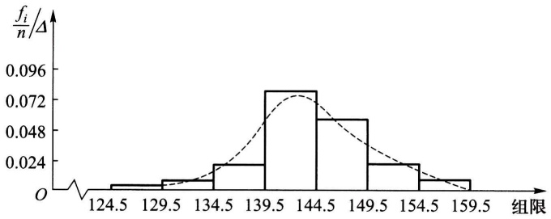

histogram

| Bin Range | Frequency |
| --- | --- |
| 124.5~129.5 | ~0.005 |
| 129.5~134.5 | ~0.01 |
| 134.5~139.5 | ~0.024 |
| 139.5~144.5 | ~0.08 |
| 144.5~149.5 | ~0.06 |
| 149.5~154.5 | ~0.024 |
| 154.5~159.5 | ~0.01 |

图6-1

样本 p 分位数可按以下法则求得. 将  $x_{1}, x_{2}, \cdots, x_{n}$  按自小到大的次序排列成  $x_{(1)} \leqslant x_{(2)} \leqslant \cdots \leqslant x_{(n)}$ .

$1^{\circ}$ 若 $np$ 不是整数，则只有一个数据满足定义中的两点要求，这一数据位于大于 $np$ 的最小整数处，即为位于 $[np] + 1$ 处的数。例如，$n = 12, p = 0.9, np = 10.8, n(1 - p) = 1.2$，则 $x_{p}$ 的位置应满足至少有10.8个数据 $\leqslant x_{p}(x_{p}$ 应位于第11或大于第11处）；且至少有1.2个数据 $\geqslant x_{p}(x_{p}$ 应位于第11或小于第11处），故 $x_{p}$ 应位于第11处。

$2^{\circ}$ 若 $np$ 是整数. 例如在 $n = 20, p = 0.95$ 时, $x_{p}$ 的位置应满足至少有19个数据 $\leqslant x_{p}(x_{p}$ 应位于第19或大于第19处)且至少有1个数据 $\geqslant x_{p}(x_{p}$ 应位于第20或小于第20处), 故第19或第20的数据均符合要求, 就取这两个数的平均值作为 $x_{p}$.

综上，

$$
x _ {p} = \left\{ \begin{array}{l l} x _ {([ n p ] + 1)}, & \text {当} n p \text {不是整数}, \\ \frac {1}{2} [ x _ {(n p)} + x _ {(n p + 1)} ], & \text {当} n p \text {是整数}. \end{array} \right.
$$

特别，当 $p = 0.5$ 时，0.5分位数 $x_{0.5}$ 也记为 $Q_{2}$ 或 $M$ ，称为样本中位数，即有

$$
x _ {0. 5} = \left\{ \begin{array}{l l} x _ {\left(\left[ \frac {n}{2} \right] + 1\right)}, & \text {当} n \text {是奇数,} \\ \frac {1}{2} \left[ x _ {\left(\frac {n}{2}\right)} + x _ {\left(\frac {n}{2} + 1\right)} \right], & \text {当} n \text {是偶数.} \end{array} \right.
$$

易知，当 $n$ 是奇数时中位数 $x_{0.5}$ 就是 $x_{(1)} \leqslant x_{(2)} \leqslant \dots \leqslant x_{(n)}$ 这一数组中最中间的一个数；而当 $n$ 是偶数时中位数 $x_{0.5}$ 就是 $x_{(1)} \leqslant x_{(2)} \leqslant \dots \leqslant x_{(n)}$ 这一数组中最中间两个数的平均值.

0.25分位数 $x_{0.25}$ 称为第一四分位数，又记为 $Q_{1};0.75$ 分位数 $x_{0.75}$ 称为第三四分位数，又记为 $Q_{3}.x_{0.25},x_{0.5},x_{0.75}$ 在统计中是很有用的.

例 2 设有一组容量为 18 的样本值如下(已经过排序):

$$
1 2 2 \quad 1 2 6 \quad 1 3 3 \quad 1 4 0 \quad 1 4 5 \quad 1 4 5 \quad 1 4 9 \quad 1 5 0 \quad 1 5 7
$$

$$
1 6 2 \quad 1 6 6 \quad 1 7 5 \quad 1 7 7 \quad 1 7 7 \quad 1 8 3 \quad 1 8 8 \quad 1 9 9 \quad 2 1 2
$$

求样本分位数: $x_{0.2},x_{0.25},x_{0.5}$ .

解 因为 $np = 18 \times 0.2 = 3.6, x_{0.2}$ 位于第[3.6] + 1 = 4处，即有 $x_{0.2} = x_{(4)} = 140$.

因为 $np = 18 \times 0.25 = 4.5, x_{0.25}$ 位于第[4.5] + 1 = 5处，即有 $x_{0.25} = 145$.

因为 $np = 18 \times 0.5 = 9, x_{0.5}$ 是这组数中间两个数的平均值，即有

$$
x _ {0. 5} = \frac {1}{2} (1 5 7 + 1 6 2) = 1 5 9. 5.
$$

下面介绍箱线图.

数据集的箱线图是由箱子和直线组成的图形,它是基于以下5个数的图形概括:最小值Min,第一四分位数 $Q_{1}$ ,中位数M,第三四分位数 $Q_{3}$ 和最大值Max.它的作法如下:

（1）画一水平数轴，在轴上标上 Min, $Q_{1}, M, Q_{3}, \mathrm{Max}$. 在数轴上方画一个上、下侧平行于数轴的矩形箱子，箱子的左右两侧分别位于 $Q_{1}, Q_{3}$ 的上方. 在 $M$ 点的上方画一条垂直线段. 线段位于箱子内部.

（2）自箱子左侧引一条水平线直至最小值 Min，在同一水平高度自箱子右侧引一条水平线直至最大值。这样就将箱线图作好了，如图 6-2 所示。箱线图也可以沿垂直数轴来作。自箱线图可以形象地看出数据集的以下重要性质。

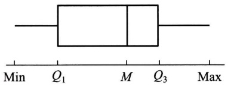

text_image

Min Q₁ M Q₃ Max

图6-2

① 中心位置: 中位数所在的位置就是数据集的中心.

② 散布程度: 全部数据都落在  $[Min, Max]$  之内, 在区间  $[Min, Q_{1}]$ ,  $[Q_{1}, M]$ ,  $[M, Q_{3}]$ ,  $[Q_{3}, Max]$  上的数据个数各约占 1/4. 区间较短时, 表示落在该区间的点较集中, 反之较为分散.

（3）关于对称性:若中位数位于箱子的中间位置，则数据分布较为对称。又若 Min 离 M 的距离较 Max 离 M 的距离大，则表示数据分布向左倾斜，反之表示数据向右倾斜，且能看出分布尾部的长短。

例 3 以下是 8 个患者的血压(收缩压,以 mmHg 计)数据(已经过排序),试作出箱线图.

$$
1 0 2 \quad 1 1 0 \quad 1 1 7 \quad 1 1 8 \quad 1 2 2 \quad 1 2 3 \quad 1 3 2 \quad 1 5 0
$$

解 因 $np = 8 \times 0.25 = 2$，故 $x_{0.25} = Q_1 = \frac{1}{2}(110 + 117) = 113.5$.

因 $np = 8 \times 0.5 = 4$，故 $x_{0.5} = Q_2 = \frac{1}{2}(118 + 122) = 120$.

因 $np = 8 \times 0.75 = 6$，故 $x_{0.75} = Q_3 = \frac{1}{2}(123 + 132) = 127.5$.

Min=102, Max=150, 作出箱线图如图 6-3 所示.

例4 下面分别给出了25个男子和25个女子的肺活量(以L计.数据已经排过序):

<table><tr><td rowspan="3">女子组</td><td>2.7</td><td>2.8</td><td>2.9</td><td>3.1</td><td>3.1</td><td>3.1</td><td>3.2</td><td>3.4</td><td>3.4</td></tr><tr><td>3.4</td><td>3.4</td><td>3.4</td><td>3.5</td><td>3.5</td><td>3.5</td><td>3.6</td><td>3.7</td><td>3.7</td></tr><tr><td>3.7</td><td>3.8</td><td>3.8</td><td>4.0</td><td>4.1</td><td>4.2</td><td>4.2</td><td></td><td></td></tr><tr><td rowspan="3">男子组</td><td>4.1</td><td>4.1</td><td>4.3</td><td>4.3</td><td>4.5</td><td>4.6</td><td>4.7</td><td>4.8</td><td>4.8</td></tr><tr><td>5.1</td><td>5.3</td><td>5.3</td><td>5.3</td><td>5.4</td><td>5.4</td><td>5.5</td><td>5.6</td><td>5.7</td></tr><tr><td>5.8</td><td>5.8</td><td>6.0</td><td>6.1</td><td>6.3</td><td>6.7</td><td>6.7</td><td></td><td></td></tr></table>

试分别画出这两组数据的箱线图.

解 女子组 Min=2.7, Max=4.2, M=3.5.

因  $np=25\times0.25=6.25,Q_{1}=3.2$

因  $np=25\times0.75=18.75,Q_{3}=3.7$

男子组 Min=4.1, Max=6.7, M=5.3.

因 $np=25\times0.25=6.25,Q_{1}=4.7$ .

因 $np=25\times0.75=18.75,Q_{3}=5.8$

作出箱线图如图 6-4 所示.

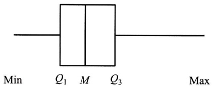

text_image

Min Q₁ M Q₃ Max

图6-3

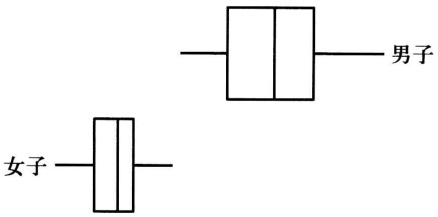

text_image

女子
男子

图6-4

箱线图特别适用于比较两个或两个以上数据集的性质,为此,我们将几个数据集的箱线图画在同一个数轴上.例如在例4中可以明显地看到男子的肺活量要比女子大,男子的肺活量较女子的肺活量更为分散.

若在数据集中某一个观察值不寻常地大于或小于该数集中的其他数据,则称之为疑似异常值.疑似异常值的存在,会对随后的计算结果产生不适当的影响.检查疑似异常值并加以适当的处理是十分重要的.箱线图只要稍加修改,就能用来检测数据集是否存在疑似异常值.

第一四分位数 $Q_{1}$ 与第三四分位数 $Q_{3}$ 之间的距离: $Q_{3} - Q_{1}\stackrel {\text{记成}}{=}IQR$ ，称为四分位数间距. 若数据小于 $Q_{1} - 1.5IQR$ 或大于 $Q_{3} + 1.5IQR$，就认为它是疑似异常值. 我们将上述箱线图的作法(1)，(2)，(3)作如下的改变:

(1') 同(1).

(2′) 计算  $IQR = Q_{3} - Q_{1}$ ，若一个数据小于  $Q_{1} - 1.5IQR$  或大于  $Q_{3} + 1.5IQR$ ，则认为它是一个疑似异常值。画出疑似异常值，并以 \* 表示。

（3′）自箱子左侧引一水平线段直至数据集中除去疑似异常值后的最小值，又自箱子右侧引一水平线直至数据集中除去疑似异常值后的最大值.

按 $(1')$ ， $(2')$ ， $(3')$ 作出的图形称为修正箱线图.

例 5 下面给出了某医院 21 个患者的住院时间(以天计),试画出修正箱线图(数据已经过排序).

$$
\begin{array}{c c c c c c c c c c c c} 1 & 2 & 3 & 3 & 4 & 4 & 5 & 6 & 6 & 7 & 7 & 9 & 9 \\ 1 0 & & 1 2 & 1 2 & 1 3 & & 1 5 & 1 8 & 2 3 & & 5 5 \end{array}
$$

解 Min=1, Max=55, M=7.

因  $21 \times 0.25 = 5.25$ ，得  $Q_{1} = 4$ 。

又  $21 \times 0.75 = 15.75$ ，得  $Q_{3} = 12$ 。

故 $IQR = Q_{3} - Q_{1} = 8,$

$$
Q _ {3} + 1. 5 I Q R = 1 2 + 1. 5 \times 8 = 2 4, \quad Q _ {1} - 1. 5 I Q R = 4 - 1 2 = - 8.
$$

观察值 55>24, 故 55 是疑似异常值, 且仅此一个疑似异常值. 作出修正箱线图如图 6-5 所示. 可见数据分布不对称, 而向右倾斜, 在中位数的右边较为分散. □

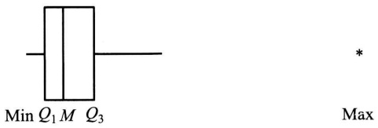

text_image

Min Q₁ M Q₃
*
Max

图6-5

数据集中,疑似异常值的产生源于:(1) 数据的测量、记录或输入计算机时的错误.(2) 数据来自不同的总体.(3) 数据是正确的,但它只体现小概率事件.当检测出疑似异常值时,人们需对疑似异常值出现的原因加以分析.如果是由于测量或记录的错误,或某些其他明显的原因造成的,那么将这些疑似异常值从数据集中丢弃就可以了.然而当出现的原因无法解释时,要作出丢弃或保留这些值的决策无疑是困难的,此时我们在对数据集作分析时尽量选用稳健的方法,使得疑似异常值对我们的结论的影响较小.例如我们采用中位数来描述数据集的中心趋势,而不使用数据集的平均值,因为后者受疑似异常值的影响较大.

## § 3 抽样分布

样本是进行统计推断的依据. 在应用时, 往往不是直接使用样本本身, 而是针对不同的问题构造样本的适当函数, 利用这些样本的函数进行统计推断.

定义 设  $X_{1}, X_{2}, \cdots, X_{n}$  是来自总体 X 的一个样本， $g(X_{1}, X_{2}, \cdots, X_{n})$  是  $X_{1}, X_{2}, \cdots, X_{n}$  的函数，若 g 中不含未知参数，则称  $g(X_{1}, X_{2}, \cdots, X_{n})$  是一统计量.

因为  $X_{1}, X_{2}, \cdots, X_{n}$  都是随机变量，而统计量  $g(X_{1}, X_{2}, \cdots, X_{n})$  是随机变量的函数，因此统计量是一个随机变量。设  $x_{1}, x_{2}, \cdots, x_{n}$  是相应于样本  $X_{1}, X_{2}, \cdots, X_{n}$  的样本值，则称  $g(x_{1}, x_{2}, \cdots, x_{n})$  是  $g(X_{1}, X_{2}, \cdots, X_{n})$  的观察值。

下面列出几个常用的统计量. 设  $X_{1}, X_{2}, \cdots, X_{n}$  是来自总体 X 的一个样本， $x_{1}, x_{2}, \cdots, x_{n}$  是这一样本的观察值. 定义

样本均值

$$
\overline {{X}} = \frac {1}{n} \sum_ {i = 1} ^ {n} X _ {i};
$$

样本方差

$$
S ^ {2} = \frac {1}{n - 1} \sum_ {i = 1} ^ {n} (X _ {i} - \overline {{X}}) ^ {2} = \frac {1}{n - 1} \Big (\sum_ {i = 1} ^ {n} X _ {i} ^ {2} - n \overline {{X}} ^ {2} \Big);
$$

样本标准差

$$
S = \sqrt {S ^ {2}} = \sqrt {\frac {1}{n - 1} \sum_ {i = 1} ^ {n} (X _ {i} - \overline {{X}}) ^ {2}};
$$

样本 $k$ 阶(原点)矩

$$
A _ {k} = \frac {1}{n} \sum_ {i = 1} ^ {n} X _ {i} ^ {k}, k = 1, 2, \dots ;
$$

样本 $k$ 阶中心矩

$$
B _ {k} = \frac {1}{n} \sum_ {i = 1} ^ {n} (X _ {i} - \overline {{X}}) ^ {k}, k = 2, 3, \dots .
$$

它们的观察值分别为

$$
\bar {x} = \frac {1}{n} \sum_ {i = 1} ^ {n} x _ {i};
$$

$$
s ^ {2} = \frac {1}{n - 1} \sum_ {i = 1} ^ {n} (x _ {i} - \bar {x}) ^ {2} = \frac {1}{n - 1} \Big (\sum_ {i = 1} ^ {n} x _ {i} ^ {2} - n \bar {x} ^ {2} \Big);
$$

$$
s = \sqrt {\frac {1}{n - 1} \sum_ {i = 1} ^ {n} (x _ {i} - \bar {x}) ^ {2}};
$$

$$
a _ {k} = \frac {1}{n} \sum_ {i = 1} ^ {n} x _ {i} ^ {k}, \quad k = 1, 2, \dots ;
$$

$$
b _ {k} = \frac {1}{n} \sum_ {i = 1} ^ {n} (x _ {i} - \bar {x}) ^ {k}, \quad k = 2, 3, \dots .
$$

这些观察值仍分别称为样本均值、样本方差、样本标准差、样本 $k$ 阶（原点）矩以及样本 $k$ 阶中心矩.

我们指出，若总体 X 的 k 阶矩  $E(X^{k}) \stackrel{\text{记成}}{=} \mu_{k}$  存在，则当  $n \to \infty$  时， $A_{k} \xrightarrow{P} \mu_{k}, k = 1, 2, \cdots$ . 这是因为  $X_{1}, X_{2}, \cdots, X_{n}$  独立且与 X 同分布，所以  $X_{1}^{k}, X_{2}^{k}, \cdots, X_{n}^{k}$  独立且与  $X^{k}$  同分布. 故有

$$
E (X _ {1} ^ {k}) = E (X _ {2} ^ {k}) = \dots = E (X _ {n} ^ {k}) = \mu_ {k}.
$$

从而由第五章的辛钦大数定律知

$$
A _ {k} = \frac {1}{n} \sum_ {i = 1} ^ {n} X _ {i} ^ {k} \xrightarrow {P} \mu_ {k}, \quad k = 1, 2, \dots .
$$

进而由第五章中关于依概率收敛的序列的性质知道

$$
g (A _ {1}, A _ {2}, \dots , A _ {k}) {\xrightarrow {P}} g (\mu_ {1}, \mu_ {2}, \dots , \mu_ {k}),
$$

其中 $g$ 为连续函数. 这就是下一章所要介绍的矩估计法的理论根据.

我们还要介绍一个与总体分布函数 $F(x)$ 相应的统计量——经验分布函数.

定义 设 $x_{1}, x_{2}, \cdots, x_{n}$ 是来自分布函数为 $F(x)$ 的总体 $X$ 的样本观察值. $X$ 的经验分布函数, 记为 $F_{n}(x)$, 定义为样本观察值 $x_{1}, x_{2}, \cdots, x_{n}$ 中小于或等于指定值 $x$ 所占的比率, 即

$$
F _ {n} (x) = \frac {\sharp (x _ {i} \leqslant x)}{n}, \quad - \infty <   x <   \infty .
$$

其中 $\#(x_{i}\leqslant x)$ 表示 $x_{1},x_{2},\cdots,x_{n}$ 中小于或等于x的个数.

按定义, 当给定样本观察值  $x_{1}, x_{2}, \cdots, x_{n}$  时,  $F_{n}(x)$  是自变量 x 的函数, 它具有分布函数的三个条件: ①  $F_{n}(x)$  是 x 的不减函数. ②  $0 \leqslant F_{n}(x) \leqslant 1$ , 且  $F(-\infty) = 0, F(\infty) = 1$ . ③  $F(x)$  是一个右连续函数. 由此知  $F_{n}(x)$  是一个分布函数. 当  $x_{1}, x_{2}, \cdots, x_{n}$  各不相同时,  $F_{n}(x)$  是以等概率 1/n 取  $x_{1}, x_{2}, \cdots, x_{n}$  的离散型随机变量的分布函数①.

一般地，设  $x_{1}, x_{2}, \cdots, x_{n}$  是总体 X 的一个容量为 n 的样本观察值，先将  $x_{1}, x_{2}, \cdots, x_{n}$  按自小到大的次序排序，并重新编号为

<small>① 当  $x_{1}, x_{2}, \cdots, x_{n}$  中有相同的数时，例如  $x_{1} = x_{2} = x_{3}$  而  $x_{4}, x_{5}, \cdots, x_{n}$  各不相同时， $F_{n}(x)$  是以概率 3/n 取  $x_{1}$ ，而以等概率 1/n 取  $x_{4}, x_{5}, \cdots, x_{n}$  的离散型随机变量的分布函数.</small>

$$
x _ {(1)} \leqslant x _ {(2)} \leqslant \dots \leqslant x _ {(n)},
$$

则经验分布函数 $F_{n}(x)$ 可写成

$$
F _ {n} (x) = \left\{ \begin{array}{l l} 0, & x <   x _ {(1)}, \\ k / n, & x _ {(k)} \leqslant x <   x _ {(k + 1)}, \\ 1, & x \geqslant x _ {(n)}. \end{array} \right. \quad k = 1, 2, \dots , n - 1,
$$

例如,设总体 X 有样本观察值  $x_{(1)} = -1, x_{(2)} = 1, x_{(3)} = 2$ , 得经验分布函数为 (如图 6-6):

$$
F _ {3} (x) = \left\{ \begin{array}{l l} 0, & x <   - 1, \\ 1 / 3, & - 1 \leqslant x <   1, \\ 2 / 3, & 1 \leqslant x <   2, \\ 1, & x \geqslant 2. \end{array} \right.
$$

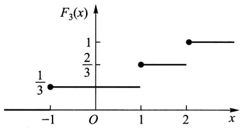

line

| x | F3(x) |
| --- | --- |
| -1 | 1/3 |
| 1 | 2/3 |
| 2 | 1 |

图6-6

另一方面，当给定 x 时， $F_{n}(x)$ 是样本 $X_{1}, X_{2}, \cdots, X_{n}$ 的函数，因此，它是一个统计量。格里汶科(Glivenko)在 1933 年给出了以下的定理。

定理 1(格里汶科定理) 设  $X_{1}, X_{2}, \cdots, X_{n}$  是来自以  $F(x)$  为分布函数的总体 X 的样本,  $F(x)$  是经验分布函数, 则有

$$
P \Bigl \{\lim _ {n \to \infty} \sup _ {- \infty <   x <   \infty} | F _ {n} (x) - F (x) | = 0 \Bigr \} = 1.
$$

(证明略.)

定理1的含义是 $F_{n}(x)$ 在整个实轴上以概率1均匀收敛于 $F(x)$. 于是当样本容量 $n$ 充分大时, $F_{n}(x)$ 能够良好地逼近总体分布函数 $F(x)$. 这是在概率统计学中以样本推断总体的依据.

## (一) $\chi^2$ 分布

设  $X_{1}, X_{2}, \cdots, X_{n}$  是来自总体  $N(0,1)$  的样本，则称统计量

$$
\chi^ {2} = X _ {1} ^ {2} + X _ {2} ^ {2} + \dots + X _ {n} ^ {2} \tag {3.1}
$$

服从自由度为 $n$ 的 $\chi^2$ 分布，记为 $\chi^2\sim \chi^2 (n)$

此处,自由度是指(3.1)式右端包含的独立变量的个数.

$\chi^2 (n)$ 分布的概率密度为

$$
f (y) = \left\{ \begin{array}{l l} \frac {1}{2 ^ {n / 2} \Gamma (n / 2)} y ^ {n / 2 - 1} \mathrm{e} ^ {- y / 2}, & y > 0, \\ 0, & \text {其他}. \end{array} \right. \tag {3.2}
$$

$f(y)$ 的图形如图6-7所示.

现在来推求(3.2)式.

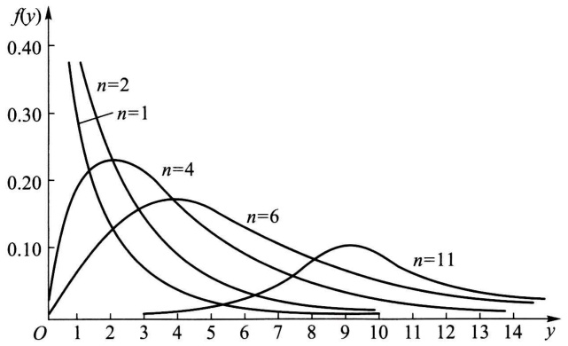

line

| y | n=1 | n=2 | n=4 | n=6 | n=11 |
| --- | --- | --- | --- | --- | --- |
| 0 | 0 | 0 | 0 | 0 | 0 |
| 1 | ~0.38 | ~0.29 | ~0.15 | ~0.05 | ~0.01 |
| 2 | ~0.28 | ~0.23 | ~0.23 | ~0.12 | ~0.02 |
| 3 | ~0.18 | ~0.15 | ~0.22 | ~0.16 | ~0.03 |
| 4 | ~0.12 | ~0.09 | ~0.18 | ~0.17 | ~0.04 |
| 5 | ~0.08 | ~0.06 | ~0.14 | ~0.16 | ~0.05 |
| 6 | ~0.06 | ~0.04 | ~0.11 | ~0.14 | ~0.06 |
| 7 | ~0.05 | ~0.03 | ~0.08 | ~0.12 | ~0.08 |
| 8 | ~0.04 | ~0.02 | ~0.06 | ~0.10 | ~0.10 |
| 9 | ~0.03 | ~0.02 | ~0.05 | ~0.08 | ~0.11 |
| 10 | ~0.03 | ~0.02 | ~0.04 | ~0.07 | ~0.10 |
| 11 | ~0.02 | ~0.02 | ~0.03 | ~0.06 | ~0.08 |
| 12 | ~0.02 | ~0.02 | ~0.03 | ~0.05 | ~0.07 |
| 13 | ~0.02 | ~0.02 | ~0.02 | ~0.04 | ~0.06 |
| 14 | ~0.02 | ~0.02 | ~0.02 | ~0.04 | ~0.05 |
| 15 | — | — | — | — | ~0.04 |

图6-7

首先由第二章§5例3及第三章§5例3知 $\chi^{2}(1)$ 分布即为 $\Gamma\left(\frac{1}{2},2\right)$ 分布.现 $X_{i}\sim N(0,1)$ ，由定义 $X_{i}^{2}\sim\chi^{2}(1)$ ，即 $X_{i}^{2}\sim\Gamma\left(\frac{1}{2},2\right),i=1,2,\cdots,n.$ 再由 $X_{1},X_{2},\cdots,X_{n}$ 的独立性知 $X_{1}^{2},X_{2}^{2},\cdots,X_{n}^{2}$ 相互独立，从而由 $\Gamma$ 分布的可加性（见第三章§5例3）知

$$
\chi^ {2} = \sum_ {i = 1} ^ {n} X _ {i} ^ {2} \sim \Gamma \Big (\frac {n}{2}, 2 \Big), \tag {3.3}
$$

即得 $\chi^2 (n)$ 分布的概率密度如(3.2)式所示.

根据 $\Gamma$ 分布的可加性易得 $\chi^2$ 分布的可加性如下:

$\chi^{2}$  分布的可加性 设  $\chi_{1}^{2}\sim\chi^{2}(n_{1}),\chi_{2}^{2}\sim\chi^{2}(n_{2})$ ，并且  $\chi_{1}^{2},\chi_{2}^{2}$  相互独立，则有

$$
\chi_ {1} ^ {2} + \chi_ {2} ^ {2} \sim \chi^ {2} (n _ {1} + n _ {2}). \tag {3.4}
$$

$\chi^{2}$  分布的数学期望和方差 若  $\chi^{2}\sim\chi^{2}(n)$ ，则有

$$
E (\chi^ {2}) = n, \quad D (\chi^ {2}) = 2 n. \tag {3.5}
$$

事实上，因 $X_{i}\sim N(0,1)$ ，故

$$
E (X _ {i} ^ {2}) = D (X _ {i}) = 1,
$$

$$
D (X _ {i} ^ {2}) = E (X _ {i} ^ {4}) - [ E (X _ {i} ^ {2}) ] ^ {2} = 3 - 1 = 2, \quad i = 1, 2, \dots , n.
$$

于是 $E(\chi^2) = E\Big(\sum_{i=1}^{n}X_i^2\Big) = \sum_{i=1}^{n}E(X_i^2) = n,$

$$
D (\chi^ {2}) = D \Big (\sum_ {i = 1} ^ {n} X _ {i} ^ {2} \Big) = \sum_ {i = 1} ^ {n} D (X _ {i} ^ {2}) = 2 n.
$$

$\chi^2$ 分布的上分位数 对于给定的正数 $\alpha, 0 < \alpha < 1$，满足条件（参见120页）

$$
P \{\chi^ {2} > \chi_ {\alpha} ^ {2} (n) \} = \int_ {\chi_ {\alpha} ^ {2} (n)} ^ {\infty} f (y) \mathrm{d} y = \alpha \tag {3.6}
$$

的 $\chi_{\alpha}^{2}(n)$ 就是 $\chi^2 (n)$ 分布的上 $\alpha$ 分位数，如图6-8所示.对于不同的 $\alpha ,n$ ，上 $\alpha$ 分位数的值已制成表格,可以查用(参见附表5).例如对于 $\alpha=0.1,n=25$ ,查得 $\chi_{0.1}^{2}(25)=34.382$ .但该表只详列到n=40为止,费希尔(R.A.Fisher)曾证明,当n充分大时,近似地有

$$
\chi_ {\alpha} ^ {2} (n) \approx \frac {1}{2} (z _ {\alpha} + \sqrt {2 n - 1}) ^ {2}, \quad (3. 7)
$$

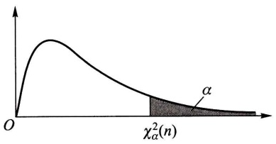

text_image

O
χ²_α(n)
α

图6-8

其中 $z_{\alpha}$ 是标准正态分布的上 $\alpha$ 分位数. 利用(3.7)式可以求得当 $n > 40$ 时 $\chi^2 (n)$ 分布的上 $\alpha$ 分位数的近似值.

例如，由(3.7)式可得 $\chi_{0.05}^{2}(50) \approx \frac{1}{2} (1.645 + \sqrt{99})^{2} = 67.221$ （由更详细的表得 $\chi_{0.05}^{2}(50) = 67.505$）.

## (二) $t$ 分布

设 $X \sim N(0,1), Y \sim \chi^2(n)$，且 $X, Y$ 相互独立，则称随机变量

$$
t = \frac {X}{\sqrt {Y / n}} \tag {3.8}
$$

服从自由度为 n 的 t 分布. 记为  $t \sim t(n)$ .

$t$ 分布又称学生氏(Student)分布. $t(n)$ 分布的概率密度函数为

$$
h (t) = \frac {\Gamma [ (n + 1) / 2 ]}{\sqrt {\pi n} \Gamma (n / 2)} \left(1 + \frac {t ^ {2}}{n}\right) ^ {- (n + 1) / 2}, \quad - \infty <   t <   \infty \tag {3.9}
$$

(证略). 图 6-9 中画出了 $h(t)$ 的图形. $h(t)$ 的图形关于 $t=0$ 对称, 当 $n$ 充分大时其图形类似于标准正态变量概率密度的图形. 事实上, 利用 $\Gamma$ 函数的性质可得

$$
\lim _ {n \to \infty} h (t) = \frac {1}{\sqrt {2 \pi}} \mathrm{e} ^ {- t ^ {2} / 2}, \tag {3.10}
$$

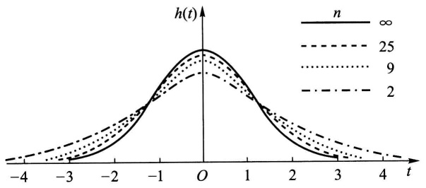

line

| t | \(h(t) (n=\infty)\) | \(h(t) (n=2)\) | \(h(t) (n=9)\) | \(h(t) (n=25)\) |
|---|---|---|---|---|
| -4 | ~0.05 | ~0.15 | ~0.25 | ~0.35 |
| -3 | ~0.15 | ~0.35 | ~0.55 | ~0.75 |
| -2 | ~0.45 | ~0.65 | ~0.85 | ~1.05 |
| -1 | ~0.95 | ~1.15 | ~1.35 | ~1.55 |
| O | 1.0 | 0.9 | 0.8 | 0.7 |
| 1 | ~0.95 | ~1.15 | ~1.35 | ~1.55 |
| 2 | ~0.45 | ~0.65 | ~0.85 | ~1.05 |
| 3 | ~0.15 | ~0.35 | ~0.55 | ~0.75 |
| 4 | ~0.05 | ~0.15 | ~0.25 | ~0.35 |

图6-9

故当 $n$ 足够大时 $t$ 分布近似于 $N(0,1)$ 分布. 但对于较小的 $n, t$ 分布与 $N(0,1)$ 分布相差较大 (见附表2与附表4).

t 分布的上分位数 对于给定的  $\alpha, 0 < \alpha < 1$ ，满足条件

$$
P \{t > t _ {\alpha} (n) \} = \int_ {t _ {\alpha} (n)} ^ {\infty} h (t) \mathrm{d} t = \alpha \tag {3.11}
$$

的  $t_{\alpha}(n)$  就是  $t(n)$  分布的上  $\alpha$  分位数(如图 6-10).

由  $t(n)$  分布的上  $\alpha$  分位数的定义及  $h(t)$  图形的对称性知

$$
t _ {1 - \alpha} (n) = - t _ {\alpha} (n). \tag {3.12}
$$

t 分布的上  $\alpha$  分位数可自附表 4 查得. 当 n > 45 时, 对于常用的  $\alpha$  的值, 就用正态近似

$$
t _ {\alpha} (n) \approx z _ {\alpha}. \tag {3.13}
$$

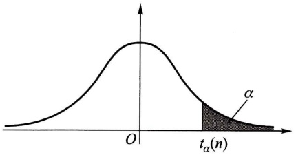

text_image

O
tₐ(n)
α

图6-10

## (三) $F$ 分布

设 $U \sim \chi^2(n_1), V \sim \chi^2(n_2)$，且 $U, V$ 相互独立，则称随机变量

$$
F = \frac {U / n _ {1}}{V / n _ {2}} \tag {3.14}
$$

服从自由度为 $(n_{1},n_{2})$ 的F分布,记为 $F\sim F(n_{1},n_{2})$ .

$F(n_{1},n_{2})$ 分布的概率密度为

$$
\psi (y) = \left\{ \begin{array}{l l} { \frac {\Gamma [ (n _ {1} + n _ {2}) / 2 ] (n _ {1} / n _ {2}) ^ {n _ {1} / 2} y ^ {(n _ {1} / 2) - 1}}{\Gamma (n _ {1} / 2) \Gamma (n _ {2} / 2) [ 1 + (n _ {1} y / n _ {2}) ] ^ {(n _ {1} + n _ {2}) / 2}},} & {y > 0,} \\ {0,} & {\text {其他}} \end{array} \right. \tag {3.15}
$$

(证略). 图 6-11 中画出了  $\psi(y)$  的图形.

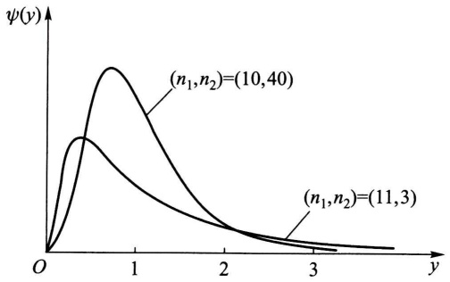

line

| y | \(\psi(y) ((n1, n2)=(10, 40))\) | \(\psi(y) ((n1, n2)=(11, 3))\) |
| --- | --- | --- |
| 0 | 0 | 0 |
| ~0.5 | ~peak | ~peak |
| ~1.0 | ~peak | ~low |
| ~2.0 | ~low | ~low |
| ~3.0 | ~near zero | ~near zero |

图6-11

由定义可知, 若  $F \sim F(n_{1}, n_{2})$ , 则

$$
\frac {1}{F} \sim F (n _ {2}, n _ {1}). \tag {3.16}
$$

F 分布的上分位数 对于给定的  $\alpha, 0 < \alpha < 1$ ，满足条件

$$
P \{F > F _ {\alpha} (n _ {1}, n _ {2}) \} = \int_ {F _ {\alpha} (n _ {1}, n _ {2})} ^ {\infty} \psi (y) \mathrm{d} y = \alpha \tag {3.17}
$$

的 $F_{\alpha}(n_1,n_2)$ 就是 $F(n_{1},n_{2})$ 分布的上 $\alpha$ 分位数(图6-12). $F$ 分布的上 $\alpha$ 分位数有表可查(见附表6).

类似地有  $\chi^{2}$  分布, t 分布, F 分布的下分位数.

F 分布的上  $\alpha$  分位数有如下的重要性质①:

$$
F _ {1 - \alpha} (n _ {1}, n _ {2}) = \frac {1}{F _ {\alpha} (n _ {2} , n _ {1})}.
$$

(3.18)

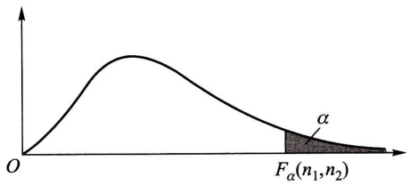

text_image

O
F_{\alpha}(n_1,n_2)
\alpha

图6-12

(3.18)式常用来求 F 分布表中未列出的常用的上  $\alpha$  分位数.例如,

$$
F _ {0. 9 5} (1 2, 9) = \frac {1}{F _ {0 . 0 5} (9 , 1 2)} = \frac {1}{2 . 8 0} = 0. 3 5 7.
$$

## (四) 正态总体的样本均值与样本方差的分布

设总体 X (不管服从什么分布, 只要均值和方差存在) 的均值为  $\mu$ , 方差为  $\sigma^{2}$ ,  $X_{1}, X_{2}, \cdots, X_{n}$  是来自 X 的一个样本,  $\overline{X}, S^{2}$  分别是样本均值和样本方差, 则有

$$
E (\overline {{X}}) = \mu , \quad D (\overline {{X}}) = \sigma^ {2} / n. \tag {3.19}
$$

而 $E(S^{2}) = E\left[\frac{1}{n - 1}\Big(\sum_{i = 1}^{n}X_{i}^{2} - n\overline{X}^{2}\right)\right] = \frac{1}{n - 1}\Big[\sum_{i = 1}^{n}E(X_{i}^{2}) - nE(\overline{X}^{2})\Big]$

① (3.18)式的证明如下: 若  $F \sim F(n_{1}, n_{2})$ , 按定义

$$
\begin{array}{l} 1 - \alpha = P \{F > F _ {1 - \alpha} (n _ {1}, n _ {2}) \} = P \left\{\frac {1}{F} <   \frac {1}{F _ {1 - \alpha} (n _ {1} , n _ {2})} \right\} \\ = 1 - P \left\{\frac {1}{F} \geqslant \frac {1}{F _ {1 - \alpha} (n _ {1} , n _ {2})} \right\} = 1 - P \left\{\frac {1}{F} > \frac {1}{F _ {1 - \alpha} (n _ {1} , n _ {2})} \right\}, \\ \end{array}
$$

于是 $P\left\{\frac{1}{F} > \frac{1}{F_{1 - \alpha}(n_1, n_2)}\right\} = \alpha.$ (1)

再由 $\frac{1}{F} \sim F(n_2, n_1)$ 知 $P\left\{\frac{1}{F} > F_{\alpha}(n_2, n_1)\right\} = \alpha.$ (2)

比较(1)，(2)两式得

$$
\frac {1}{F _ {1 - \alpha} (n _ {1} , n _ {2})} = F _ {\alpha} (n _ {2}, n _ {1}), \text {即} F _ {1 - \alpha} (n _ {1}, n _ {2}) = \frac {1}{F _ {\alpha} (n _ {2} , n _ {1})}.
$$