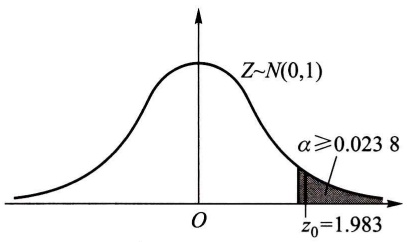
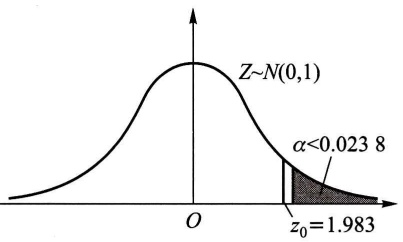
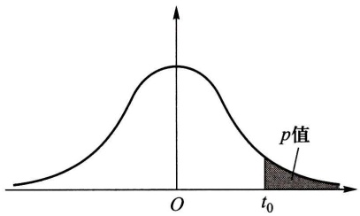
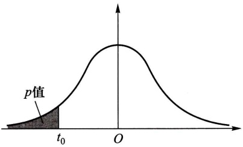
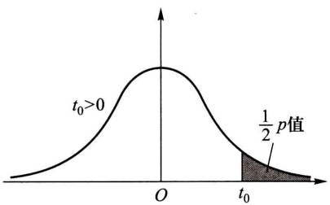
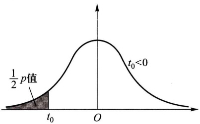

表 8-7 例 5 的 ${\chi }^{2}$ 拟合检验计算表

<table><tr><td> $A_i$ </td><td> $f_i$ </td><td> $\hat{p}_i$ </td><td> $n\hat{p}_i$ </td><td> $f_i^2/(n\hat{p}_i)$ </td></tr><tr><td> $A_1: x \leqslant 129.5$ </td><td rowspan="2"> $\left.\begin{array}{l}1 \\4\end{array}\right\}_{5}$ </td><td rowspan="2"> $\left.\begin{array}{l}0.0087 \\0.0519\end{array}\right\}$ </td><td rowspan="2"> $\left.\begin{array}{l}0.73 \\4.36\end{array}\right\}_{5.09}$ </td><td rowspan="2">4.91</td></tr><tr><td> $A_2: 129.5 < x \leqslant 134.5$ </td></tr><tr><td> $A_3: 134.5 < x \leqslant 139.5$ </td><td>10</td><td>0.1752</td><td>14.72</td><td>6.79</td></tr><tr><td> $A_4: 139.5 < x \leqslant 144.5$ </td><td>33</td><td>0.3120</td><td>26.21</td><td>41.55</td></tr><tr><td> $A_5: 144.5 < x \leqslant 149.5$ </td><td>24</td><td>0.2811</td><td>23.61</td><td>24.40</td></tr><tr><td> $A_6: 149.5 < x \leqslant 154.5$ </td><td rowspan="2"> $\left.\begin{array}{l}9 \\3\end{array}\right\}_{12}$ </td><td rowspan="2"> $\left.\begin{array}{l}0.1336 \\0.0375\end{array}\right\}$ </td><td rowspan="2"> $\left.\begin{array}{l}11.22 \\3.15\end{array}\right\}_{14.37}$ </td><td rowspan="2">10.02</td></tr><tr><td> $A_7: 154.5 < x < \infty$ </td></tr></table>

$$
\Sigma = 8 7. 6 7
$$

现在 $\chi^2 = 87.67 - 84 = 3.67$ ，因为 $\chi_{0.1}^{2}(k - r - 1) = \chi_{0.1}^{2}(5 - 2 - 1) = \chi_{0.1}^{2}(2) = 4.605 > 3.67$ ，故在水平0.1下接受 $H_0$ ，即认为数据来自正态分布总体. □

## § 7 假设检验问题的 p 值法

以上讨论的假设检验方法称为临界值法. 本节介绍另一种被称为 $p$ 值法的检验方法. 先从一个例题讲起.

例 1 设总体  $X \sim N(\mu, \sigma^{2})$ ,  $\mu$  未知,  $\sigma^{2} = 100$ , 现有样本  $x_{1}, x_{2}, \cdots, x_{52}$ , 算得  $\overline{x} = 62.75$ . 现在来检验假设

$$
H _ {0}: \mu \leqslant \mu_ {0} = 6 0, \quad H _ {1}: \mu > 6 0.
$$

采用 Z 检验法,检验统计量为

$$
Z = \frac {\overline {{X}} - \mu_ {0}}{\sigma / \sqrt {n}}.
$$

以数据代入, 得 Z 的观察值为

$$
z _ {0} = \frac {6 2 . 7 5 - 6 0}{1 0 / \sqrt {5 2}} = 1. 9 8 3.
$$

概率

$$
P \{Z \geqslant z _ {0} \} = P \{Z \geqslant 1. 9 8 3 \} = 1 - \Phi (1. 9 8 3) = 0. 0 2 3 8.
$$

此即为图8-7中标准正态曲线下位于 $z_0$ 右边的尾部面积.

此概率称为 $Z$ 检验法的右边检验的 $p$ 值. 记为

$$
P \{Z \geqslant z _ {0} \} = p \text {值} (= 0. 0 2 3 8).
$$

若显著性水平 $\alpha \geqslant p = 0.0238$ ，则对应的临界值 $z_{\alpha} \leqslant 1.983$ ，这表示观察值 $z_0 = 1.983$ 落在拒绝域内（图8-7(1)），因而拒绝 $H_0$ ；又若显著性水平 $\alpha < p = 0.0238$ ，则对应的临界值 $z_{\alpha} > 1.983$ ，这表示观察值 $z_0 = 1.983$ 不落在拒绝域内（图8-7(2)），因而接受 $H_0$

area

| Metric | Value |
| --- | --- |
| Curve Type | Normal Distribution |
| Peak (z) | 0 |
| Lower Bound (z₀) | 1.983 |
| Upper Bound \((\alpha)\) | \(\ge 0.0238\) |

(1)

area

| Metric | Value |
| --- | --- |
| Peak (Z~N(0,1)) | 1 |
| Lower Bound (z₀) | 1.983 |
| Upper Bound (α) | <0.0238 |

(2)

图8-7

据此，$p$ 值 $= P\{Z \geqslant z_0\} = 0.0238$ 是原假设 $H_0$ 可被拒绝的最小显著性水平.

一般地，p 值的定义是:

定义 假设检验问题的 p 值(probability value)是由检验统计量的样本观察值得出的原假设可被拒绝的最小显著性水平.

常用的检验问题的 $p$ 值可以根据检验统计量的样本观察值以及检验统计量在 $H_0$ 下一个特定的参数值（一般是 $H_0$ 与 $H_1$ 所规定的参数的分界点）对应的分布求出。例如在正态总体 $N(\mu, \sigma^2)$ 均值的检验中，当 $\sigma$ 未知时，可采用检验统计量 $t = \frac{\overline{X} - \mu_0}{S / \sqrt{n}}$，在以下三个检验问题中，当 $\mu = \mu_0$ 时 $t \sim t(n-1)$。如果由样本求得统计量 $t$ 的观察值为 $t_0$，那么在检验问题

$H_{0}:\mu \leqslant \mu_{0},H_{1}:\mu >\mu_{0}$ 中，

p 值  $= P_{\mu_{0}} \{ t \geqslant t_{0} \} = t_{0}$  右侧尾部面积(如图 8-8(1));

$H_{0}:\mu\geqslant\mu_{0},H_{1}:\mu<\mu_{0}$ 中，

$p$ 值 $= P_{\mu_0}\{t\leqslant t_0\} = t_0$ 左侧尾部面积(如图8-8(2)).

text_image

O
t₀
p值

(1)

area

| X-axis | Y-axis |
| --- | --- |
| t0 | p值 (Area under Curve) |

(2)

图8-8

$H_0: \mu = \mu_0, H_1: \mu \neq \mu_0$ 中，

(i) 当 $t_0 > 0$ 时，

$$
\begin{array}{l} p \mathrm{值} = P _ {\mu_ {0}} \{| t | \geqslant t _ {0} \} = P _ {\mu_ {0}} \{(t \leqslant - t _ {0}) \cup (t \geqslant t _ {0}) \} \\ = 2 \times (t _ {0} \text {右侧尾部面积}) (\text {如图} 8 - 9 (1)). \\ \end{array}
$$

(ii) 当  $t_{0}<0$  时，

$$
\begin{array}{l} p \text {值} = P _ {\mu_ {0}} \{\mid t \mid \geqslant - t _ {0} \} = P _ {\mu_ {0}} \{(t \leqslant t _ {0}) \bigcup (t \geqslant - t _ {0}) \} \\ = 2 \times (t _ {0} \text {左侧尾部面积}) (\text {如图} 8 - 9 (2)). \\ \end{array}
$$

综合(i)(ii), p 值=2×(由  $t_{0}$  界定的尾部面积).

area

| Variable | Value |
| --- | --- |
| Peak (t0) | 0 |
| Area at t0 | 1/2 p value |

(1)

text_image

1/2 p值
t₀
O
t₀<0

(2)

图8-9

图8-8和图8-9中的曲线均为 $t(n - 1)$ 分布的概率密度曲线.

在现代计算机统计软件中,一般都给出检验问题的 p 值.

按 p 值的定义, 对于任意指定的显著性水平  $\alpha$ , 就有

(1) 若 p 值  $\leqslant \alpha$ ，则在显著性水平  $\alpha$  下拒绝  $H_{0}$ .
(2) 若 p 值  $>\alpha$ ，则在显著性水平  $\alpha$  下接受  $H_{0}$ .

有了这两条结论就能方便地确定是否拒绝 $H_0$. 这种利用 $p$ 值来确定是否拒绝 $H_0$ 的方法, 称为 $p$ 值法.

用临界值法来确定 $H_0$ 的拒绝域时，例如当取 $\alpha = 0.05$ 时知道要拒绝 $H_0$ 再取 $\alpha = 0.01$ 也要拒绝 $H_0$ ，但不能知道将 $\alpha$ 再降低一些是否也要拒绝 $H_0$ .而 $p$ 值法给出了拒绝 $H_0$ 的最小显著性水平.因此 $p$ 值法比临界值法给出了有关拒绝域的更多的信息.

例 2 用 p 值法检验本章 §1 例 2 的检验问题

$$
H _ {0}: \mu \leqslant \mu_ {0} = - 0. 5 4 5, \quad H _ {1}: \mu > \mu_ {0}, \quad \alpha = 0. 0 5.
$$

解 用 $Z$ 检验法, 现在检验统计量 $Z = \frac{\overline{X} - \mu_0}{\sigma / \sqrt{n}}$ 的观察值为

$$
z _ {0} = \frac {- 0 . 5 3 5 - (- 0 . 5 4 5)}{0 . 0 0 8 / \sqrt {5}} = 2. 7 9 5 1,
$$

$$
\begin{array}{l} p \text {值} = P _ {\mu_ {0}} \{Z \geqslant 2. 7 9 5 1 \} \\ = 1 - \Phi (2. 7 9 5 1) = 0. 0 0 2 6, \\ \end{array}
$$

p 值 $<\alpha=0.05$ , 故拒绝  $H_{0}$ .

例 3 用 p 值法检验本章 §2 例 1 的检验问题

$$
H _ {0}: \mu \leqslant \mu_ {0} = 2 2 5, \quad H _ {1}: \mu > 2 2 5, \quad \alpha = 0. 0 5.
$$

解 用 t 检验法, 现在检验统计量  $t=\frac{\overline{X}-\mu_{0}}{S/\sqrt{n}}$  的观察值为

$$
t _ {0} = \frac {2 4 1 . 5 - 2 2 5}{9 8 . 7 2 5 9 / \sqrt {1 6}} = 0. 6 6 8 5,
$$

由计算机算得

$$
p \text {值} = P _ {\mu_ {0}} \{t \geqslant 0. 6 6 8 5 \} = 0. 2 5 7 0,
$$

p 值 $>\alpha=0.05$ , 故接受  $H_{0}$ .

例 4 用 p 值法检验本章 §3 例 1 中检验问题

$$
H _ {0}: \sigma^ {2} = \sigma_ {0} ^ {2} = 5 0 0 0, \quad H _ {1}: \sigma^ {2} \neq 5 0 0 0, \quad \alpha = 0. 0 2.
$$

解 用 $\chi^{2}$ 检验法. 现在检验统计量 $\chi^{2}=\frac{(n-1)S^{2}}{\sigma_{0}^{2}}$ 的观察值为

$$
\chi_ {0} ^ {2} = \frac {2 5 \times 9 2 0 0}{5 0 0 0} = 4 6,
$$

由计算机得

$$
p \text {值} = 2 \times P _ {\sigma_ {0} ^ {2}} \{\chi^ {2} \geqslant 4 6 \} = 0. 0 1 2 8,
$$

p 值 $<\alpha=0.02$ , 故拒绝  $H_{0}$ .

p 值表示反对原假设  $H_{0}$  的依据的强度, p 值越小, 反对  $H_{0}$  的依据越强、越充分(譬如对于某个检验问题的检验统计量的观察值的 p 值 = 0.0009, p 值如此地小, 以至于几乎不可能在  $H_{0}$  为真时出现目前的观察值, 这说明拒绝  $H_{0}$  的理由很强, 我们就拒绝  $H_{0}$ ).

一般，若 $p$ 值 $\leqslant 0.01$ ，称推断拒绝 $H_0$ 的依据很强或称检验是高度显著的；若 $0.01 < p$ 值 $\leqslant 0.05$ ，称推断拒绝 $H_0$ 的依据是强的或称检验是显著的；若 $0.05 < p$ 值 $\leqslant 0.1$ ，称推断拒绝 $H_0$ 的理由是弱的，检验是不显著的；若 $p$ 值 $>0.1$ ，一般来说没有理由拒绝 $H_0$ .基于 $p$ 值，研究者可以使用任意希望的显著性水平来作计算.在杂志上或在一些技术报告中，许多研究者在讲述假设检验的结果时，常不明显地论及显著性水平以及临界值，代之以简单地引用假设检验的 $p$ 值，利用或让读者利用它来评价反对原假设的依据的强度，作出推断.

## 小结

统计推断就是由样本来推断总体,它包括两个基本问题:统计估计和假设检验.上一章讲述了参数估计,本章讨论假设检验问题.有关总体分布的未知参数或未知分布形式的种种论断叫统计假设,人们要根据样本所提供的信息对所考虑的假设作出接受或拒绝的决策.假设检验就是作出这一决策的过程.

一般，人们总是对原假设 $H_0$ 作出接受或拒绝的决策。由于作出判断原假设 $H_0$ 是否为真的依据是一个样本，又由于样本的随机性，当 $H_0$ 为真时，检验统计量的观察值也会落入拒绝域，致使我们作出拒绝 $H_0$ 的错误决策；而当 $H_0$ 为不真时，检验统计量的观察值也会未落入拒绝域，致使我们作出接受 $H_0$ 的错误决策。

假设检验的两类错误

<table><tr><td rowspan="2">真实情况(未知)</td><td colspan="2">所作决策</td></tr><tr><td>接受 $H_0$ </td><td>拒绝 $H_0$ </td></tr><tr><td> $H_0$ 为真</td><td>正确</td><td>犯第I类错误</td></tr><tr><td> $H_0$ 不真</td><td>犯第II类错误</td><td>正确</td></tr></table>

我们使用“接受假设”或“拒绝假设”这样的术语.接受一个假设并不意味着确信它是真的，它只意味着决定采取某种行动（例如 $A$ ）；拒绝一个假设也不意味着它是假的，这也仅仅是作出采取另一种不同的行动（例如 $B$ ）.不论哪种情况，都存在作出错误选择的可能性.

当样本容量 $n$ 固定时，减小犯第I类错误的概率，就会增大犯第Ⅱ类错误的概率，反之亦然.我们的做法是控制犯第I类错误的概率，使

$$
P \{\text {当} H _ {0} \text {为真时拒绝} H _ {0} \} \leqslant \alpha ,
$$

其中 $0 < \alpha < 1$ 是给定的小的数。$\alpha$ 称为检验的显著性水平。这种只对犯第I类错误的概率加以控制而不考虑犯第II类错误的概率的检验称为显著性检验。

在进行显著性检验时，犯第Ⅰ类错误的概率是由我们控制的. $\alpha$ 取得小，则概率 $P\{当H_{0}为真时拒绝H_{0}\}$ 就小，这保证了当 $H_{0}$ 为真时错误地拒绝 $H_{0}$ 的可能性很小.这意味着 $H_{0}$ 是受到保护的，也表明 $H_{0},H_{1}$ 的地位不是对等的.于是，在一对对立假设中，选哪一个作为 $H_{0}$ 需要小心.例如，考虑某种药品是否为真，这里可能犯两种错误:(1)将假药误作为真药，则冒着伤害患者的健康甚至生命的风险.(2)将真药误作为假药，则冒着造成经济损失的风险.显然，犯错误(1)比犯错误(2)的后果严重，因此，我们选取“ $H_{0}$ :药品为假， $H_{1}$ :药品为真”，即是使得犯第Ⅰ类错误“当药品为假时错判药品为真”的概率 $\leqslant\alpha$ .就是说，选择 $H_{0},H_{1}$ 使得两类错误中后果严重的错误成为第Ⅰ类错误.这是选择 $H_{0},H_{1}$ 的一个原则.

如果在两类错误中，没有一类错误的后果严重更需要避免时，常常取 $H_0$ 为维持现状，即取 $H_0$ 为“无效益”“无改进”“无价值”，等等.例如，取

$$
H _ {0}: \text {新技术未提高效益}, \quad H _ {1}: \text {新技术提高效益}.
$$

实际上，我们感兴趣的是 $H_{1}$ “提高效益”，但对采用新技术应持慎重态度.选取 $H_0$ 为“新技术未提高效益”，一旦 $H_0$ 被拒绝了，表示有较强的理由去采用新技术.

在实际问题中,情况比较复杂,如何选取  $H_{0}$ 、 $H_{1}$  只能在实践中积累经验,根据实际情况去判断了.

注意,拒绝域的形式是由  $H_{1}$  确定的.

我们还介绍了置信区间与假设检验的关系.知道了置信区间就能容易判明是否接受原假设；反之，知道了检验的接受域就得到了相应的置信区间.

## ■ 重要术语及主题

原假设 备择假设 检验统计量 单边检验 双边检验 显著性水平 拒绝域 显著性检验 一个正态总体的参数的检验 两个正态总体均值差、方差比的检验 成对数据的检验 $\chi^2$ 分布拟合检验 假设检验问题的 $p$ 值法

## 习题

1. 某批矿砂的 5 个样品中的镍含量(以%计), 经测定为

$$
3. 2 5 \cdot 3. 2 7 \quad 3. 2 4 \quad 3. 2 6 \quad 3. 2 4
$$

设测定值总体服从正态分布,但参数均未知,问在  $\alpha=0.01$  下能否接受假设:这批矿砂的镍含量的均值为 3.25?

2. 如果一个矩形的宽度 $w$ 与长度 $l$ 的比 $w / l = \frac{1}{2} (\sqrt{5} - 1) \approx 0.618$，这样的矩形称为黄金矩形。这种尺寸的矩形使人们看上去有良好的感觉。现代的建筑构件（如窗架）、工艺品（如图片镜框），甚至司机的执照、商业的信用卡等常常都是采用黄金矩形。下面列出某工艺品工厂随机取的20个矩形的宽度与长度的比值:

$$
0. 6 9 3 \quad 0. 7 4 9 \quad 0. 6 5 4 \quad 0. 6 7 0 \quad 0. 6 6 2 \quad 0. 6 7 2 \quad 0. 6 1 5 \quad 0. 6 0 6 \quad 0. 6 9 0 \quad 0. 6 2 8
$$

$$
0. 6 6 8 \quad 0. 6 1 1 \quad 0. 6 0 6 \quad 0. 6 0 9 \quad 0. 6 0 1 \quad 0. 5 5 3 \quad 0. 5 7 0 \quad 0. 8 4 4 \quad 0. 5 7 6 \quad 0. 9 3 3
$$

设这一工厂生产的矩形的宽度与长度的比值总体服从正态分布，其均值为 $\mu$ ，方差为 $\sigma^2, \mu, \sigma^2$ 均未知. 试检验假设（取 $\alpha = 0.05$）

$$
H _ {0}: \mu = 0. 6 1 8, \quad H _ {1}: \mu \neq 0. 6 1 8.
$$

3. 要求一种元件平均使用寿命不得低于 $1000\mathrm{h}$，生产者从一批这种元件中随机抽取25件，测得其寿命的平均值为 $950\mathrm{h}$. 已知该种元件寿命服从标准差为 $\sigma = 100\mathrm{h}$ 的正态分布. 试在显著性水平 $\alpha = 0.05$ 下判断这批元件是否合格？设总体均值为 $\mu, \mu$ 未知. 即需检验假设 $H_0: \mu \geqslant 1000, H_1: \mu < 1000$.

4. 下面列出的是某工厂随机选取的 20 只部件的装配时间(以 min 计):

$$
\begin{array}{c c c c c c c c c c} 9. 8 & 1 0. 4 & 1 0. 6 & 9. 6 & 9. 7 & 9. 9 & 1 0. 9 & 1 1. 1 & 9. 6 & 1 0. 2 \\ 1 0. 3 & 9. 6 & 9. 9 & 1 1. 2 & 1 0. 6 & 9. 8 & 1 0. 5 & 1 0. 1 & 1 0. 5 & 9. 7 \end{array}
$$

设装配时间的总体服从正态分布 $N(\mu, \sigma^2), \mu, \sigma^2$ 均未知. 是否可以认为装配时间的均值 $\mu$ 显著大于10（取 $\alpha = 0.05$）?

5. 按规定，100 g 罐头番茄汁中的平均维生素 C 含量不得少于 21 mg/g。现从工厂的产

品中抽取17个罐头，其 $100\mathrm{g}$ 番茄汁中，测得维生素C含量（以 $\mathrm{mg / g}$ 计）记录如下:

$$
1 6 \quad 2 5 \quad 2 1 \quad 2 0 \quad 2 3 \quad 2 1 \quad 1 9 \quad 1 5 \quad 1 3 \quad 2 3 \quad 1 7 \quad 2 0 \quad 2 9 \quad 1 8 \quad 2 2 \quad 1 6 \quad 2 2
$$

设维生素C含量服从正态分布 $N(\mu, \sigma^2), \mu, \sigma^2$ 均未知，问这批罐头是否符合要求（取显著性水平 $\alpha = 0.05$）？

6. 下表分别给出两位文学家马克·吐温(Mark Twain)的8篇小品文以及斯诺特格拉斯(Snodgrass)的10篇小品文中由3个字母组成的单词的比例:

| 马克·吐温 | 0.225 | 0.262 | 0.217 | 0.240 | 0.230 | 0.229 | 0.235 | 0.217 |  |  |
| --- | --- | --- | --- | --- | --- | --- | --- | --- | --- | --- |
| 斯诺特格拉斯 | 0.209 | 0.205 | 0.196 | 0.210 | 0.202 | 0.207 | 0.224 | 0.223 | 0.220 | 0.201 |

设两组数据分别来自正态总体,且两总体方差相等,但参数均未知.两样本相互独立.问两位作家所写的小品文中包含由3个字母组成的单词的比例是否有显著的差异(取 $\alpha=0.05$ )?

7. 在20世纪70年代后期人们发现，在酿造啤酒时，麦芽在干燥过程中形成致癌物质N-亚硝基二甲胺(NDMA). 到了20世纪80年代初期开发了一种新的麦芽干燥过程. 下面分别给出新老两种过程中形成的NDMA含量（以10亿份中的份数计）:

| 老过程 | 6 | 4 | 5 | 5 | 6 | 5 | 5 | 6 | 4 | 6 | 7 | 4 |
| --- | --- | --- | --- | --- | --- | --- | --- | --- | --- | --- | --- | --- |
| 新过程 | 2 | 1 | 2 | 2 | 1 | 0 | 3 | 2 | 1 | 0 | 1 | 3 |

设两样本分别来自正态总体，且两总体的方差相等，但参数均未知。两样本独立。分别以 $\mu_{1}$ ，$\mu_{2}$ 记对应于老、新过程的总体的均值，试检验假设 $(\alpha = 0.05)$

$$
H _ {0}: \mu_ {1} - \mu_ {2} \leqslant 2, \quad H _ {1}: \mu_ {1} - \mu_ {2} > 2.
$$

8. 随机地选了 8 个人, 分别测量了他们在早晨起床时和晚上就寝时的身高(以 cm 计), 得到以下的数据:

| 序号 | 1 | 2 | 3 | 4 | 5 | 6 | 7 | 8 |
| --- | --- | --- | --- | --- | --- | --- | --- | --- |
| 早上($x_i$) | 172 | 168 | 180 | 181 | 160 | 163 | 165 | 177 |
| 晚上($y_i$) | 172 | 167 | 177 | 179 | 159 | 161 | 166 | 175 |

设各对数据的差  $D_{i}=X_{i}-Y_{i}(i=1,2,\cdots,8)$  是来自正态总体  $N(\mu_{D},\sigma_{D}^{2})$  的样本， $\mu_{D},\sigma_{D}^{2}$  均未知. 问是否可以认为早晨的身高比晚上的身高要高（取  $\alpha=0.05$ ）?

9. 为了比较用来做鞋子后跟的两种材料的质量,选取了15名男子(他们的生活条件各不相同),每人穿一双新鞋,其中一只是以材料A做后跟,另一只以材料B做后跟,其厚度均为10 mm.过了一个月再测量厚度,得到数据(以mm计)如下:

| 男子 | 1 | 2 | 3 | 4 | 5 | 6 | 7 | 8 | 9 | 10 | 11 | 12 | 13 | 14 | 15 |
| --- | --- | --- | --- | --- | --- | --- | --- | --- | --- | --- | --- | --- | --- | --- | --- |
| 材料$A(x_i)$ | 6.6 | 7.0 | 8.3 | 8.2 | 5.2 | 9.3 | 7.9 | 8.5 | 7.8 | 7.5 | 6.1 | 8.9 | 6.1 | 9.4 | 9.1 |
| 材料$B(y_i)$ | 7.4 | 5.4 | 8.8 | 8.0 | 6.8 | 9.1 | 6.3 | 7.5 | 7.0 | 6.5 | 4.4 | 7.7 | 4.2 | 9.4 | 9.1 |

设  $D_{i}=X_{i}-Y_{i}(i=1,2,\cdots,15)$  是来自正态总体  $N(\mu_{D},\sigma_{D}^{2})$  的样本， $\mu_{D},\sigma_{D}^{2}$  均未知。问是否可以认为以材料 A 制成的后跟比材料 B 的耐穿（取  $\alpha=0.05$ ）？

10. 为了试验两种不同的某谷物的种子的优劣,选取了10块土质不同的土地,并将每块土地分为面积相同的两部分,分别种植这两种种子.设在每块土地的两部分人工管理等条件完全一样.下面给出各块土地上的单位面积产量:

| 土地编号i | 1 | 2 | 3 | 4 | 5 | 6 | 7 | 8 | 9 | 10 |
| --- | --- | --- | --- | --- | --- | --- | --- | --- | --- | --- |
| 种子A($x_i$) | 23 | 35 | 29 | 42 | 39 | 29 | 37 | 34 | 35 | 28 |
| 种子B($y_i$) | 26 | 39 | 35 | 40 | 38 | 24 | 36 | 27 | 41 | 27 |

设  $D_{i}=X_{i}-Y_{i}(i=1,2,\cdots,10)$  是来自正态总体  $N(\mu_{D},\sigma_{D}^{2})$  的样本， $\mu_{D},\sigma_{D}^{2}$  均未知。问以这两种种子种植的谷物的产量是否有显著的差异（取  $\alpha=0.05$ ）？

11. 一种混杂的小麦品种, 株高的标准差为 $\sigma_0 = 14 \mathrm{~cm}$, 经提纯后随机抽取 10 株, 它们的株高 (以 $\mathrm{cm}$ 计) 为

$$
9 0 \quad 1 0 5 \quad 1 0 1 \quad 9 5 \quad 1 0 0 \quad 1 0 0 \quad 1 0 1 \quad 1 0 5 \quad 9 3 \quad 9 7
$$

考察提纯后的群体是否比原群体整齐？取显著性水平 $\alpha = 0.01$ ，并设小麦株高服从 $N(\mu, \sigma^2)$

12. 某种导线, 要求其电阻的标准差不得超过 $0.005 \Omega$, 今在生产的一批导线中取样品 9 根, 测得 $s = 0.007 \Omega$, 设总体为正态分布, 参数均未知. 问在显著性水平 $\alpha = 0.05$ 下能否认为这批导线的标准差显著地偏大?

13. 在第 2 题中记总体的标准差为  $\sigma$ ，试检验假设(取  $\alpha=0.05$ )

$$
H _ {0}: \sigma^ {2} = 0. 1 1 ^ {2}, \quad H _ {1}: \sigma^ {2} \neq 0. 1 1 ^ {2}.
$$

14. 测定某种溶液中的水分, 它的 10 个测定值给出 $s = 0.037\%$, 设测定值总体为正态分布, $\sigma^2$ 为总体方差, $\sigma^2$ 未知. 试在显著性水平 $\alpha = 0.05$ 下检验假设

$$
H _ {0}: \sigma \geqslant 0.04\%, \quad H _ {1}: \sigma <   0.04\%.
$$

15. 在第6题中分别记两个总体的方差为 $\sigma_1^2$ 和 $\sigma_2^2$. 试检验假设(取 $\alpha = 0.05$)

$$
H _ {0}: \sigma_ {1} ^ {2} = \sigma_ {2} ^ {2}, \quad H _ {1}: \sigma_ {1} ^ {2} \neq \sigma_ {2} ^ {2},
$$

以说明在第6题中我们假设 $\sigma_1^2 = \sigma_2^2$ 是合理的.

16. 在第 7 题中分别记两个总体的方差为 $\sigma_{1}^{2}$ 和 $\sigma_{2}^{2}$. 试检验假设 (取 $\alpha = 0.05$)

$$
H _ {0}: \sigma_ {1} ^ {2} = \sigma_ {2} ^ {2}, \quad H _ {1}: \sigma_ {1} ^ {2} \neq \sigma_ {2} ^ {2},
$$

以说明在第7题中我们假设 $\sigma_1^2 = \sigma_2^2$ 是合理的.

17. 两种小麦品种从播种到抽穗所需的天数如下:

| x | 101 | 100 | 99 | 99 | 98 | 100 | 98 | 99 | 99 | 99 |
| --- | --- | --- | --- | --- | --- | --- | --- | --- | --- | --- |
| y | 100 | 98 | 100 | 99 | 98 | 99 | 98 | 98 | 99 | 100 |

设两样本依次来自正态总体 $N(\mu_1,\sigma_1^2),N(\mu_2,\sigma_2^2),\mu_i,\sigma_i (i = 1,2)$ 均未知，两样本相互独立.

(1) 试检验假设  $H_{0}:\sigma_{1}^{2}=\sigma_{2}^{2}, H_{1}:\sigma_{1}^{2}\neq\sigma_{2}^{2}$  （取  $\alpha=0.05$ ）.
(2) 若能接受  $H_{0}$ ，接着检验假设  $H_{0}^{\prime}:\mu_{1}=\mu_{2}, H_{1}^{\prime}:\mu_{1}\neq\mu_{2}$  （取  $\alpha=0.05$ ）.

18. 用一种叫“混乱指标”的尺度去衡量工程师的英语文章的可理解性, 对混乱指标的打分越低表示可理解性越高. 分别随机选取 13 篇刊载在工程杂志上的论文, 以及 10 篇未出版的学术报告, 对它们的打分列于下表:

| 工程杂志上的论文(数据I) | 未出版的学术报告(数据II) |
| --- | --- |
| 1.79 1.75 1.67 1.65 | 2.39 2.51 2.86 |
| 1.87 1.74 1.94 | 2.56 2.29 2.49 |
| 1.62 2.06 1.33 | 2.36 2.58 |
| 1.96 1.69 1.70 | 2.62 2.41 |

设数据Ⅰ，Ⅱ分别来自正态总体 $N(\mu_1,\sigma_1^2),N(\mu_2,\sigma_2^2),\mu_1,\mu_2,\sigma_1^2,\sigma_2^2$ 均未知，两样本相互独立.

(1) 试检验假设  $H_{0}:\sigma_{1}^{2}=\sigma_{2}^{2}, H_{1}:\sigma_{1}^{2}\neq\sigma_{2}^{2}$  （取  $\alpha=0.1$ ）.
(2) 若能接受  $H_{0}$ ，接着检验假设  $H_{0}^{\prime}:\mu_{1}=\mu_{2}, H_{1}^{\prime}:\mu_{1}\neq\mu_{2}$ （取  $\alpha=0.1$ ）.

19. 有两台机器生产金属部件. 分别在两台机器所生产的部件中各取一容量 $n_1 = 60$, $n_2 = 40$ 的样本, 测得部件质量 (以 $\mathrm{kg}$ 计) 的样本方差分别为 $s_1^2 = 15.46, s_2^2 = 9.66$. 设两样本相互独立. 两总体分别服从 $N(\mu_1, \sigma_1^2)$, $N(\mu_2, \sigma_2^2)$ 分布 $\mu_i, \sigma_i^2 (i = 1, 2)$ 均未知. 试在显著性水平 $\alpha = 0.05$ 下检验假设

$$
H _ {0}: \sigma_ {1} ^ {2} \leqslant \sigma_ {2} ^ {2}, \quad H _ {1}: \sigma_ {1} ^ {2} > \sigma_ {2} ^ {2}.
$$

20. 设需要对某一正态总体的均值进行假设检验

$$
H _ {0}: \mu \geqslant 1 5, \quad H _ {1}: \mu <   1 5.
$$

已知 $\sigma^2 = 2.5$. 取 $\alpha = 0.05$. 若要求当 $H_{1}$ 中的 $\mu \leqslant 13$ 时犯第Ⅱ类错误的概率不超过 $\beta = 0.05$，求所需的样本容量.

21. 电池在货架上滞留的时间不能太长. 下面给出某商店随机选取的 8 只电池的货架滞留时间(以天计):

$$
1 0 8 \quad 1 2 4 \quad 1 2 4 \quad 1 0 6 \quad 1 3 8 \quad 1 6 3 \quad 1 5 9 \quad 1 3 4
$$

设数据来自正态总体 $N(\mu, \sigma^2), \mu, \sigma^2$ 未知.

(1) 试检验假设  $H_{0}:\mu\leqslant125,H_{1}:\mu>125$  , 取  $\alpha=0.05$
（2）若要求在上述 $H_{1}$ 中 $(\mu - 125) / \sigma \geqslant 1.4$ 时，犯第Ⅱ类错误的概率不超过 $\beta = 0.1$ ，求所需的样本容量.
22. 一药厂生产一种新的止痛片，厂方希望验证服用新药片后至开始起作用的时间间隔较原有止痛片至少缩短一半，因此厂方提出需检验假设

$$
H _ {0}: \mu_ {1} \leqslant 2 \mu_ {2}, \quad H _ {1}: \mu_ {1} > 2 \mu_ {2}.
$$

此处 $\mu_1, \mu_2$ 分别是服用原有止痛片和服用新止痛片后至起作用的时间间隔的总体的均值. 设两总体均为正态且方差分别为已知值  $\sigma_{1}^{2}, \sigma_{2}^{2}$ . 现分别在两总体中取一样本  $X_{1}, X_{2}, \cdots, X_{n_{1}}$  和  $Y_{1}, Y_{2}, \cdots, Y_{n_{2}}$ , 设两个样本独立. 试给出上述假设  $H_{0}$  的拒绝域, 取显著性水平为  $\alpha$ .

23. 检查了一本书的100页，记录各页中印刷错误的个数，其结果为

| 错误个数 $f_{i}$ | 0 | 1 | 2 | 3 | 4 | 5 | 6 | $\geqslant 7$ |
| --- | --- | --- | --- | --- | --- | --- | --- | --- |
| 含 $f_{i}$ 个错误的页数 | 36 | 40 | 19 | 2 | 0 | 2 | 1 | 0 |

问能否认为一页的印刷错误的个数服从泊松分布(取 $\alpha = 0.05$)?

24. 在一批灯泡中抽取 300 只做寿命试验, 其结果如下:

| 寿命 t(h) | 0≤t≤100 | 100200t>300 | 200t>300 | t>300 |
| --- | --- | --- | --- | --- |
| 灯泡数 | 121 | 78 | 43 | 58 |

取 $\alpha = 0.05$ ，试检验假设

$H_0$ :灯泡寿命服从指数分布

$$
f (t) = \left\{ \begin{array}{l l} 0. 0 0 5 \mathrm{e} ^ {- 0. 0 0 5 t}, & t \geqslant 0, \\ 0, & t <   0. \end{array} \right.
$$

25. 下面给出了随机选取的某大学一年级学生(200名)一次数学考试的成绩.

(1) 画出数据的直方图.
(2) 试取  $\alpha=0.1$  检验数据来自正态总体  $N(60,15^{2})$ .

| 分数x | 20≤x≤30 | 304050 | 4050 | 50 |
| --- | --- | --- | --- | --- |
| 学生数 | 5 | 15 | 30 | 51 |
| 分数x | 60708090 | 708090 | 8090 | 90 |
| 学生数 | 60 | 23 | 10 | 6 |

26. 袋中装有 8 只球, 其中红球数未知. 在其中任取 3 只, 记录红球的只数 $X$, 然后放回, 再任取 3 只, 记录红球的只数, 然后放回. 如此重复进行了 112 次, 其结果如下:

| X | 0 | 1 | 2 | 3 |
| --- | --- | --- | --- | --- |
| 次数 | 1 | 31 | 55 | 25 |

试取 $\alpha = 0.05$ 检验假设

$H_0: X$ 服从超几何分布

$$
P \{X = k \} = \binom {5} {k} \binom {3} {3 - k} / \binom {8} {3}, \quad k = 0, 1, 2, 3.
$$

即检验假设 $H_0$ : 红球的只数为5.

27. 一农场10年前在一鱼塘中按比例 $20:15:40:25$ 投放了四种鱼:鲑鱼、鲈鱼、竹夹鱼和鲇鱼的鱼苗，现在在鱼塘里获得一样本如下:

| 序号 | 1 | 2 | 3 | 4 |  |
| --- | --- | --- | --- | --- | --- |
| 种类 | 鲑鱼 | 鲈鱼 | 竹夹鱼 | 鲇鱼 |  |
| 数量(条) | 132 | 100 | 200 | 168 | Σ=600 |

试取 $\alpha = 0.05$ ，检验各类鱼数量的比例较10年前是否有显著的改变

28. 某种鸟在起飞前, 双足齐跳的次数 X 服从几何分布, 其分布律为

$$
P \{X = x \} = p ^ {x - 1} (1 - p), \quad x = 1, 2, \dots .
$$

今获得一样本如下:

| x | 1 | 2 | 3 | 4 | 5 | 6 | 7 | 8 | 9 | 10 | 11 | 12 | $\geqslant 13$ |
| --- | --- | --- | --- | --- | --- | --- | --- | --- | --- | --- | --- | --- | --- |
| 观察到x的次数 | 48 | 31 | 20 | 9 | 6 | 5 | 4 | 2 | 1 | 1 | 2 | 1 | 0 |

(1) 求 p 的最大似然估计值.

(2) 取  $\alpha=0.05$ ，检验假设  $H_{0}$ :数据来自总体  $P\{X=x\}=p^{x-1}(1-p), x=1,2,\cdots$ .

29.（1）设总体服从  $N(\mu,100)$ ， $\mu$  未知，现有样本 n=16,  $\bar{x}=13.5$ ，试检验假设  $H_{0}:\mu\leqslant10, H_{1}:\mu>10$ ，(i) 取  $\alpha=0.05$ ，(ii) 取  $\alpha=0.10$ ，(iii) 求  $H_{0}$  可被拒绝的最小显著性水平.

(2) 考察生长在老鼠身上的肿块的大小. 以 $X$ 表示在老鼠身上生长了 15 天的肿块的直径 (以 $\mathrm{mm}$ 计), 设 $X \sim N(\mu, \sigma^2), \mu, \sigma^2$ 均未知. 今随机地取 9 只老鼠 (在它们身上的肿块都长了 15 天), 测得 $\bar{x} = 4.3, s = 1.2$, 试取 $\alpha = 0.05$, 用 $p$ 值法检验假设 $H_0: \mu = 4.0, H_1: \mu \neq 4.0$, 求出 $p$ 值.

(3) 用 p 值法检验 §2 例 4 的检验问题.
(4) 用 p 值法检验第 27 题中的检验问题.

## 第九章 方差分析及回归分析

方差分析和回归分析都是数理统计中具有广泛应用的内容. 本章对它们的最基本部分作一介绍.

## § 1 单因素试验的方差分析

## (一) 单因素试验

在科学试验和生产实践中,影响一事物的因素往往是很多的.例如,在化工生产中,有原料成分、原料剂量、催化剂、反应温度、压力、溶液浓度、反应时间、机器设备及操作人员的水平等因素.每一因素的改变都有可能影响产品的数量和质量.有些因素影响较大,有些较小.为了使生产过程得以稳定,保证优质、高产,就有必要找出对产品质量有显著影响的那些因素.为此,我们需进行试验.方差分析就是根据试验的结果进行分析,鉴别各个有关因素对试验结果影响的有效方法.

在试验中,我们将要考察的指标称为试验指标.影响试验指标的条件称为因素.因素可分为两类,一类是人们可以控制的(可控因素);一类是人们不能控制的.例如,反应温度、原料剂量、溶液浓度等是可以控制的,而测量误差、气象条件等一般是难以控制的.以下我们所说的因素都是指可控因素.因素所处的状态,称为该因素的水平(见下述各例).如果在一项试验的过程中只有一个因素在改变则称为单因素试验,如果多于一个因素在改变则称为多因素试验.

例 1 设有三台机器,用来生产规格相同的铝合金薄板.取样,测量薄板的厚度精确至千分之一厘米.得结果如表 9-1 所示.

表 9-1 铝合金薄板的厚度

| 机器I | 机器II | 机器III |
| --- | --- | --- |
| 0.236 | 0.257 | 0.258 |
| 0.238 | 0.253 | 0.264 |
| 0.248 | 0.255 | 0.259 |
| 0.245 | 0.254 | 0.267 |
| 0.243 | 0.261 | 0.262 |

这里，试验指标是薄板的厚度。机器为因素，不同的三台机器就是这个因素的三个不同的水平。我们假定除机器这一因素外，材料的规格、操作人员的水平等其他条件都相同。这是单因素试验。试验的目的是为了考察各台机器所生产的薄板的厚度有无显著的差异，即考察机器这一因素对薄板厚度有无显著的影响。如果厚度有显著差异，就表明机器这一因素对薄板厚度的影响是显著的。

例 2 表 9-2 列出了随机选取的、用于计算器的四种类型的电路的响应时间(以 ms 计).

表 9-2 电路的响应时间

| 类型I | 类型II | 类型III | 类型IV |
| --- | --- | --- | --- |
| 19 15 | 20 40 | 16 17 | 18 |
| 22 | 21 | 15 | 22 |
| 20 | 33 | 18 | 19 |
| 18 | 27 | 26 |  |

这里,试验指标是电路的响应时间.电路类型为因素,这一因素有4个水平.这是一个单因素试验.试验的目的是为了考察各种类型电路的响应时间有无显著差异,即考察电路类型这一因素对响应时间有无显著的影响. □

例 3 一火箭使用四种燃料、三种推进器作射程试验. 每种燃料与每种推进器的组合各发射火箭两次, 得射程如表 9-3(以 n mile 计):

表 9-3 火箭的射程

<table><tr><td colspan="2">推进器(B)</td><td> $B_1$ </td><td> $B_2$ </td><td> $B_3$ </td></tr><tr><td rowspan="8">燃料(A)</td><td rowspan="2"> $A_1$ </td><td>58.2</td><td>56.2</td><td>65.3</td></tr><tr><td>52.6</td><td>41.2</td><td>60.8</td></tr><tr><td rowspan="2"> $A_2$ </td><td>49.1</td><td>54.1</td><td>51.6</td></tr><tr><td>42.8</td><td>50.5</td><td>48.4</td></tr><tr><td rowspan="2"> $A_3$ </td><td>60.1</td><td>70.9</td><td>39.2</td></tr><tr><td>58.3</td><td>73.2</td><td>40.7</td></tr><tr><td rowspan="2"> $A_4$ </td><td>75.8</td><td>58.2</td><td>48.7</td></tr><tr><td>71.5</td><td>51.0</td><td>41.4</td></tr></table>

这里试验指标是射程. 推进器和燃料是因素, 它们分别有 3 个、4 个水平. 这是一个双因素试验. 试验的目的在于考察在各种因素的各个水平下射程有无显著的差异, 即考察推进器和燃料这两个因素对射程是否有显著的影响. □

本节限于讨论单因素试验. 我们就例1来讨论. 在例1中, 我们在因素的每一个水平下进行独立试验, 其结果是一个样本. 表中数据可看成来自三个不同总体(每个水平对应一个总体)的样本值. 将各个总体的均值依次记为 $\mu_{1}, \mu_{2}, \mu_{3}$. 按题意需检验假设

$$
H _ {0}: \mu_ {1} = \mu_ {2} = \mu_ {3},
$$

$H_{1}:\mu_{1},\mu_{2},\mu_{3}$  不全相等.

现在进而假设各总体均为正态变量,且各总体的方差相等,但参数均未知.那么这是一个检验同方差的多个正态总体均值是否相等的问题.下面所要讨论的方差分析法,就是解决这类问题的一种统计方法.

现在开始讨论单因素试验的方差分析. 设因素 A 有 s 个水平  $A_{1}, A_{2}, \cdots, A_{s}$ ，在水平  $A_{j} (j=1,2,\cdots,s)$  下，进行  $n_{j}(n_{j} \geqslant 2)$  次独立试验，得到如表 9-4 的结果.

表9-4

<table><tr><td>水平</td><td> $A_{1}$ </td><td> $A_{2}$ </td><td>...</td><td> $A_{s}$ </td></tr><tr><td rowspan="4">观察结果</td><td> $X_{11}$ </td><td> $X_{12}$ </td><td>...</td><td> $X_{1s}$ </td></tr><tr><td> $X_{21}$ </td><td> $X_{22}$ </td><td>...</td><td> $X_{2s}$ </td></tr><tr><td> $\vdots$ </td><td> $\vdots$ </td><td></td><td> $\vdots$ </td></tr><tr><td> $X_{n_{1}1}$ </td><td> $X_{n_{2}2}$ </td><td>...</td><td> $X_{n_{s}s}$ </td></tr><tr><td>样本总和</td><td> $T_{.1}$ </td><td> $T_{.2}$ </td><td>...</td><td> $T_{.s}$ </td></tr><tr><td>样本均值</td><td> $\overline{X}_{.1}$ </td><td> $\overline{X}_{.2}$ </td><td>...</td><td> $\overline{X}_{.s}$ </td></tr><tr><td>总体均值</td><td> $\mu_{1}$ </td><td> $\mu_{2}$ </td><td>...</td><td> $\mu_{s}$ </td></tr></table>

我们假定:各个水平  $A_{j}(j=1,2,\cdots,s)$  下的样本  $X_{1j}, X_{2j}, \cdots, X_{n_{j}j}$  来自具有相同方差  $\sigma^{2}$ ，均值分别为  $\mu_{j}(j=1,2,\cdots,s)$  的正态总体  $N(\mu_{j}, \sigma^{2}), \mu_{j}$  与  $\sigma^{2}$  未知。且设不同水平  $A_{j}$  下的样本之间相互独立。

由于 $X_{ij} \sim N(\mu_j, \sigma^2)$，即有 $X_{ij} - \mu_j \sim N(0, \sigma^2)$，故 $X_{ij} - \mu_j$ 可看成是随机误差。记 $X_{ij} - \mu_j = \varepsilon_{ij}$，则 $X_{ij}$ 可写成

$$
\left. \begin{array}{l} {{X _ {i j} = \mu_ {j} + \varepsilon_ {i j},}} \\ {{\varepsilon_ {i j} \sim N (0, \sigma^ {2}), \text {各} \varepsilon_ {i j} \text {独立},}} \\ {{i = 1, 2, \dots , n _ {j}, j = 1, 2, \dots , s,}} \end{array} \right\} \tag {1.1}
$$

其中 $\mu_{j}$ 与 $\sigma^2$ 均为未知参数.(1.1)式称为单因素试验方差分析的数学模型.这

是本节的研究对象.

方差分析的任务是对于模型(1.1)，

$1^{\circ}$ 检验 $s$ 个总体 $N(\mu_1,\sigma^2),\dots ,N(\mu_s,\sigma^2)$ 的均值是否相等，即检验假设

$$
H _ {0}: \mu_ {1} = \mu_ {2} = \dots = \mu_ {s}, \tag {1.2}
$$

$H_{1}:\mu_{1},\mu_{2},\cdots,\mu_{s}$  不全相等.

$2^{\circ}$ 作出未知参数 $\mu_1, \mu_2, \dots, \mu_s, \sigma^2$ 的估计.

为了将问题(1.2)写成便于讨论的形式,我们将  $\mu_{1},\mu_{2},\cdots,\mu_{s}$  的加权平均值  $\frac{1}{n}\sum_{j=1}^{s}n_{j}\mu_{j}$  记为  $\mu$ , 即

$$
\mu = \frac {1}{n} \sum_ {j = 1} ^ {s} n _ {j} \mu_ {j}, \tag {1.3}
$$

其中 $n = \sum_{j=1}^{s} n_j, \mu$ 称为总平均. 再引入

$$
\delta_ {j} = \mu_ {j} - \mu , \quad j = 1, 2, \dots , s, \tag {1.4}
$$

此时有  $n_{1}\delta_{1}+n_{2}\delta_{2}+\cdots+n_{s}\delta_{s}=0,\delta_{j}$  表示水平  $A_{j}$  下的总体均值与总平均的差异，习惯上将  $\delta_{j}$  称为水平  $A_{j}$  的效应.

利用这些记号,模型(1.1)可改写成

$$
\left. \begin{array}{l} X _ {i j} = \mu + \delta_ {j} + \varepsilon_ {i j}, \\ \varepsilon_ {i j} \sim N (0, \sigma^ {2}), \text {各} \varepsilon_ {i j} \text {独立}, \\ i = 1, 2, \dots , n _ {j}, j = 1, 2, \dots , s, \\ \sum_ {j = 1} ^ {s} n _ {j} \delta_ {j} = 0. \end{array} \right\} \tag {1.1} ^ {\prime}
$$

而假设(1.2)等价于假设

$$
H _ {0}: \delta_ {1} = \delta_ {2} = \dots = \delta_ {s} = 0, \tag {1.2}
$$

$H_{1}:\delta_{1},\delta_{2},\cdots,\delta_{s}$  不全为零.

这是因为当且仅当  $\mu_{1} = \mu_{2} = \cdots = \mu_{s}$  时  $\mu_{j} = \mu$ ，即  $\delta_{j} = 0, j = 1, 2, \cdots, s.$

## (二) 平方和的分解

下面我们从平方和的分解着手,导出假设检验问题(1.2) $^{'}$ 的检验统计量.

引入总偏差平方和

$$
S _ {T} = \sum_ {j = 1} ^ {s} \sum_ {i = 1} ^ {n _ {j}} (X _ {i j} - \overline {{X}}) ^ {2}, \tag {1.5}
$$

其中 $\overline{X} = \frac{1}{n}\sum_{j = 1}^{s}\sum_{i = 1}^{n_j}X_{ij}$ (1.6)

是数据的总平均. $S_{T}$ 能反映全部试验数据之间的差异, 因此 $S_{T}$ 又称为总变差.又记水平 $A_{j}$ 下的样本均值为 $\overline{X}_{\cdot j}$, 即

$$
\overline {{X}} _ {. j} = \frac {1}{n _ {j}} \sum_ {i = 1} ^ {n _ {j}} X _ {i j}. \tag {1.7}
$$

我们将 $S_{T}$ 写成

$$
\begin{array}{l} S _ {T} = \sum_ {j = 1} ^ {s} \sum_ {i = 1} ^ {n _ {j}} [ (X _ {i j} - \overline {{X}} _ {. j}) + (\overline {{X}} _ {. j} - \overline {{X}}) ] ^ {2} \\ = \sum_ {j = 1} ^ {s} \sum_ {i = 1} ^ {n _ {j}} (X _ {i j} - \overline {{X}} _ {. j}) ^ {2} + \sum_ {j = 1} ^ {s} \sum_ {i = 1} ^ {n _ {j}} (\overline {{X}} _ {. j} - \overline {{X}}) ^ {2} + 2 \sum_ {j = 1} ^ {s} \sum_ {i = 1} ^ {n _ {j}} (X _ {i j} - \overline {{X}} _ {. j}) (\overline {{X}} _ {. j} - \overline {{X}}). \\ \end{array}
$$

注意到上式第三项(即交叉项)

$$
\begin{array}{l} 2 \sum_ {j = 1} ^ {s} \sum_ {i = 1} ^ {n _ {j}} (X _ {i j} - \overline {{X}} _ {. j}) (\overline {{X}} _ {. j} - \overline {{X}}) \\ = 2 \sum_ {j = 1} ^ {s} (\overline {{X}} _ {. j} - \overline {{X}}) \left[ \sum_ {i = 1} ^ {n _ {j}} (X _ {i j} - \overline {{X}} _ {. j}) \right] = 2 \sum_ {j = 1} ^ {s} (\overline {{X}} _ {. j} - \overline {{X}}) \left(\sum_ {i = 1} ^ {n _ {j}} X _ {i j} - n _ {j} \overline {{X}} _ {. j}\right) = 0. \\ \end{array}
$$

于是我们就将 $S_{T}$ 分解成为

$$
S _ {T} = S _ {E} + S _ {A}, \tag {1.8}
$$

其中 $S_{E} = \sum_{j = 1}^{s}\sum_{i = 1}^{n_{j}}(X_{ij} - \overline{X}_{.j})^{2},$ (1.9)

$$
S _ {A} = \sum_ {j = 1} ^ {s} \sum_ {i = 1} ^ {n _ {j}} (\overline {{X}} _ {. j} - \overline {{X}}) ^ {2} = \sum_ {j = 1} ^ {s} n _ {j} (\overline {{X}} _ {. j} - \overline {{X}}) ^ {2} = \sum_ {j = 1} ^ {s} n _ {j} \overline {{X}} _ {. j} ^ {2} - n \overline {{X}} ^ {2}. \tag {1.10}
$$

上述 $S_{E}$ 的各项 $(X_{ij} - \overline{X}_{.j})^{2}$ 表示在水平 $A_{j}$ 下，样本观察值与样本均值的差异，这是由随机误差所引起的。$S_{E}$ 叫做误差平方和。$S_{A}$ 的各项 $n_j(\overline{X}_{.j} - \overline{X})^2$ 表示 $A_{j}$ 水平下的样本均值与数据总平均的差异，这是由水平 $A_{j}$ 的效应的差异以及随机误差引起的。$S_{A}$ 叫做因素 $A$ 的效应平方和。(1.8)式就是我们所需要的平方和分解式。

## （三） $S_{E}, S_{A}$ 的统计特性

为了引出检验问题(1.2) $^{\prime}$ 的检验统计量,我们依次来讨论 $S_{E},S_{A}$ 的一些统计特性.先将 $S_{E}$ 写成

$$
S _ {E} = \sum_ {i = 1} ^ {n _ {1}} (X _ {i 1} - \overline {{X}} _ {. 1}) ^ {2} + \dots + \sum_ {i = 1} ^ {n _ {s}} (X _ {i s} - \overline {{X}} _ {. s}) ^ {2}. \tag {1.11}
$$

注意到 $\sum_{i=1}^{n_j}(X_{ij}-\overline{X}_{.j})^2$ 是总体 $N(\mu_j,\sigma^2)$ 的样本方差的 $n_j - 1$ 倍，于是有