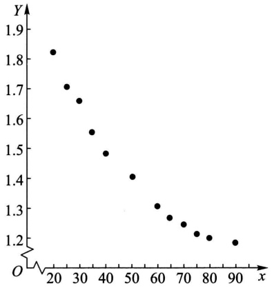

| x | 20 | 25 | 30 | 35 | 40 | 50 | 60 | 65 | 70 | 75 | 80 | 90 |
| --- | --- | --- | --- | --- | --- | --- | --- | --- | --- | --- | --- | --- |
| y | 1.81 | 1.70 | 1.65 | 1.55 | 1.48 | 1.40 | 1.30 | 1.26 | 1.24 | 1.21 | 1.20 | 1.18 |

画出散点图如图9-5所示.我们选取模型

$$
Y = b _ {0} + b _ {1} x + b _ {2} x ^ {2} + \varepsilon ,   \varepsilon \sim N (0, \sigma^ {2}) \tag {4.8}
$$

来拟合它,现在来求回归方程.

令 $x_{1} = x, x_{2} = x^{2}$, 则(4.8)式可写成

$$
Y = b _ {0} + b _ {1} x _ {1} + b _ {2} x _ {2} + \varepsilon , \quad \varepsilon \sim N (0, \sigma^ {2}),
$$

这是一个二元线性回归模型,现在

$$
\boldsymbol {X} = \left( \begin{array}{c c c} 1 & 2 0 & 4 0 0 \\ 1 & 2 5 & 6 2 5 \\ 1 & 3 0 & 9 0 0 \\ 1 & 3 5 & 1 2 2 5 \\ 1 & 4 0 & 1 6 0 0 \\ 1 & 5 0 & 2 5 0 0 \\ 1 & 6 0 & 3 6 0 0 \\ 1 & 6 5 & 4 2 2 5 \\ 1 & 7 0 & 4 9 0 0 \\ 1 & 7 5 & 5 6 2 5 \\ 1 & 8 0 & 6 4 0 0 \\ 1 & 9 0 & 8 1 0 0 \end{array} \right), \boldsymbol {Y} = \left( \begin{array}{c} 1. 8 1 \\ 1. 7 0 \\ 1. 6 5 \\ 1. 5 5 \\ 1. 4 8 \\ 1. 4 0 \\ 1. 3 0 \\ 1. 2 6 \\ 1. 2 4 \\ 1. 2 1 \\ 1. 2 0 \\ 1. 1 8 \end{array} \right), \boldsymbol {B} = \left( \begin{array}{c} b _ {0} \\ b _ {1} \\ b _ {2} \end{array} \right).
$$

scatter

| x | Y |
| --- | --- |
| 20 | ~1.83 |
| 25 | ~1.71 |
| 30 | ~1.66 |
| 35 | ~1.56 |
| 40 | ~1.49 |
| 50 | ~1.41 |
| 60 | ~1.31 |
| 65 | ~1.27 |
| 70 | ~1.25 |
| 75 | ~1.22 |
| 80 | ~1.21 |
| 90 | ~1.19 |

图9-5

经计算

$$
\boldsymbol {X} ^ {\mathrm{T}} \boldsymbol {X} = \left( \begin{array}{c c c} 1 2 & 6 4 0 & 4 0 1 0 0 \\ 6 4 0 & 4 0 1 0 0 & 2 7 7 9 0 0 0 \\ 4 0 1 0 0 & 2 7 7 9 0 0 0 & 2 0 4 7 0 2 5 0 0 \end{array} \right),
$$

$$
(\boldsymbol {X} ^ {\mathrm{T}} \boldsymbol {X}) ^ {- 1} = \frac {1}{\Delta} \left( \begin{array}{c c c} 4. 8 5 7 2 9 2 5 \times 1 0 ^ {1 1} & - 1. 9 5 7 1 7 \times 1 0 ^ {1 0} & 1 7 0 5 5 0 0 0 0 \\ - 1. 9 5 7 1 7 \times 1 0 ^ {1 0} & 8 4 8 4 2 0 0 0 0 & - 7 6 8 4 0 0 0 \\ 1 7 0 5 5 0 0 0 0 & - 7 6 8 4 0 0 0 & 7 1 6 0 0 \end{array} \right),
$$

$$
\Delta = 1. 4 1 9 1 8 \times 1 0 ^ {1 1}.
$$

即得正规方程组的解为

$$
\begin{array}{l} \hat {\boldsymbol {B}} = \left( \begin{array}{l} \hat {b} _ {0} \\ \hat {b} _ {1} \\ \hat {b} _ {2} \end{array} \right) = (\boldsymbol {X} ^ {\mathrm{T}} \boldsymbol {X}) ^ {- 1} \boldsymbol {X} ^ {\mathrm{T}} \boldsymbol {Y} = (\boldsymbol {X} ^ {\mathrm{T}} \boldsymbol {X}) ^ {- 1} \left( \begin{array}{l} 1 6. 9 8 \\ 8 5 1. 3 \\ 5 1 1 6 2 \end{array} \right) \\ = \left( \begin{array}{c} 2. 1 9 8 2 6 6 2 9 \\ - 0. 0 2 2 5 2 2 3 6 \\ 0. 0 0 0 1 2 5 0 7 \end{array} \right). \\ \end{array}
$$

于是得到回归方程为

$$
\hat {y} = 2. 1 9 8 2 6 6 2 9 - 0. 0 2 2 5 2 2 3 6 x + 0. 0 0 0 1 2 5 0 7 x ^ {2}.
$$

像一元线性回归一样,模型(4.1)往往是一种假定,为了考察这一假定是否符合实际观察结果,还需进行以下的假设检验:

$$
\begin{array}{l} H _ {0}: \quad b _ {1} = b _ {2} = \dots = b _ {p} = 0, \\ H _ {1}: \quad b _ {i} (i = 1, 2, \dots , p) \text {不全为零.} \\ \end{array}
$$

若在显著性水平 $\alpha$ 下拒绝 $H_0$ ，我们就认为回归效果是显著的.

另外，也与一元线性回归一样，多元线性回归方程的一个重要应用是确定给定点 $(x_{01},x_{02},\cdots,x_{0p})$ 处对应的Y的观察值的预测区间.

## 小结

本章介绍了两种用途广泛的统计模型:方差分析模型和回归分析模型.

在实际中试验的指标往往要受到一种或多种因素的影响. 方差分析就是通过对试验数据进行分析, 检验方差相同的多个(多于两个)正态总体的均值是否相等, 用以判断各因素对试验指标的影响是否显著. 方差分析按影响试验指标的因素的个数分为单因素方差分析、双因素方差分析和多因素方差分析, 本章只介绍前面两种.

考虑单因素方差分析的情况. 观察到的数据总是参差不齐的, 我们用总偏差平方和 $S_{T} = \sum_{j=1}^{s} \sum_{i=1}^{n_{j}} (X_{ij} - \overline{X})^{2}$ 来度量数据间总的变异(即离散程度), 将它分解为可追溯到来源的部分变异(也用平方和来度量) $S_{E} = \sum_{j=1}^{s} \sum_{i=1}^{n_{j}} (X_{ij} - \overline{X}_{,j})^{2}$ (它是由随机误差引起的) 与 $S_{A} = \sum_{j=1}^{s} \sum_{i=1}^{n_{j}} (X_{,j} - \overline{X})^{2}$ (它是由各水平效应的差异及随机误差引起的) 之和. 若后者较前者大得多, 则有理由认为因素的各个水平对应的试验结果有显著差异, 从而拒绝因素各水平对应的正态总体的均值相等这一原假设. 这就是单因素方差分析法的基本思想. 双因素方差分析的基本思想类似.

“方差分析”事实上不是真正分析方差，而是分析用偏差平方和度量的数据的变异。Snedecor说过:“它是从可比组的数据中分解出可追溯到某些指定来源的变异的一种技巧。”

双因素方差分析分考虑交互作用的与不考虑交互作用的两种情况,读者需分辨清楚.

单因素方差分析表和双因素方差分析表分别记录了单因素和双因素方差分析的全部结果,读者应很好掌握.

回归分析是研究自变量为一般变量(非随机变量)，因变量为随机变量时两者之间的相关关系的统计分析方法.设随机变量 $Y$ （因变量）与自变量 $x$ （一般变量）存在着相关关系，为了研究这种关系，作为一种近似转而去研究 $Y$ 的数学期望 $E(Y) = \mu (x)$ 与 $x$ 的确定性关系，即函数关系，这里 $\mu (x)$ 叫做 $Y$ 关于 $x$ 的回归函数.一元线性回归是研究 $\mu (x)$ 为 $x$ 的线性函数$\mu (x) = a + bx$ 的情况.一元线性回归模型为

$$
Y = a + b x + \varepsilon , \quad \varepsilon \sim N (0, \sigma^ {2}),
$$

其中 $a, b$ 及 $\sigma$ 都不依赖于 $x$, 且 $a, b, \sigma^2$ 均未知.

我们要讨论的问题是:

$1^{\circ}$ 利用样本值 $(x_{1},y_{1}),(x_{2},y_{2}),\dots ,(x_{n},y_{n})$ 来估计 $a,b$ ，从而得到 $\mu (x)$ 的最大似然估计$\hat{\mu} (x) = \hat{a} +\hat{b} x$ ，记 $\hat{y} = \hat{a} +\hat{b} x$ ，我们称 $\hat{y} = \hat{a} +\hat{b} x$ 为回归方程，其图形称为回归直线.

$2^{\circ}$ 求出误差 $\varepsilon$ 的方差 $D(\varepsilon) = \sigma^2$ 的无偏估计:

$$
\hat {\sigma} ^ {2} = \frac {Q _ {e}}{n - 2},
$$

其中 $Q_{e} = \sum_{i=1}^{n}(y_{i}-\hat{a}-\hat{b}x_{i})^{2} = S_{yy}-\hat{b}S_{xy}$ 为残差平方和.

$3^{\circ}$ 作线性假设: $H_0:b = 0,H_1:b\neq 0$ 的显著性检验. $H_0$ 的拒绝域为

$$
\mid t \mid = \frac {\mid \hat {b} \mid}{\hat {\sigma}} \sqrt {S _ {x x}} \geqslant t _ {\alpha / 2} (n - 2) \quad (\alpha \text {为显著性水平}),
$$

如果拒绝 $H_0$ ，则认为回归效果是显著的；否则，认为回归效果不显著，此时不宜用线性回归模型，需另行研究.

$4^{\circ}$ 求出回归系数 $b$ 的置信水平为 $1 - \alpha$ 的置信区间为

$$
\Big (\hat {b} \pm t _ {\alpha / 2} (n - 2) \frac {\hat {\sigma}}{\sqrt {S _ {x x}}} \Big).
$$

$5^{\circ}$ 求出回归函数 $\mu (x)$ 在点 $x_0$ 处的函数值 $\mu (x_0)$ 的置信水平为 $1 - \alpha$ 的置信区间

$$
\left(\hat {a} + \hat {b} x _ {0} \pm t _ {\alpha / 2} (n - 2) \hat {\sigma} \sqrt {1 / n + (x _ {0} - \overline {{x}}) ^ {2} / S _ {x x}}\right).
$$

$6^{\circ}$ 以 $x_0$ 处的回归值 $\hat{y}_0 = \hat{a} +\hat{bx}_0$ 作为 $Y$ 在 $x_0$ 处的观察值 $Y_{0} = a + bx_{0} + \varepsilon_{0}$ 的预测值，求出 $Y_{0}$ 的置信水平为 $1 - \alpha$ 的预测区间为

$$
\left(\hat {a} + \hat {b} x _ {0} \pm t _ {\alpha / 2} (n - 2) \hat {\sigma} \sqrt {1 + 1 / n + (x _ {0} - \overline {{x}}) ^ {2} / S _ {x x}}\right).
$$

对随机变量 $Y$ 的观察值进行预测是回归方程最重要的应用.

## ■ 重要术语及主题

单因素试验方差分析的数学模型 $S_{T} = S_{E} + S_{A}$ 单因素方差分析表 双因素方差分析表

一元线性回归的数学模型 回归直线 $\hat{y} = \hat{a} +\hat{b} x$ 中的系数 $\hat{a},\hat{b}$ 误差 $\varepsilon$ 的方差 $D(\varepsilon) = \sigma^2$ 的无偏估计 线性假设的显著性检验 回归系数 $\hat{b}$ 的区间估计 回归函数值 $\mu (x_0)$ 的点估计和区间估计 观察值 $Y_{0} = a + bx_{0} + \varepsilon_{0}$ 的点预测和区间预测

## 附录 §3 中有关统计量结果的证明

下面将证明 §3 中涉及的各有关统计量的一些结果.

$1^{\circ} \overline{Y} \sim N(a + b\overline{x}, \sigma^{2}/n)$.
$2^{\circ}\hat{b}\sim N(b,\sigma^{2} / S_{xx}).$
$3^{\circ}\hat{Y}_{0} = \hat{a} +\hat{b} x_{0} = \overline{Y} +\hat{b} (x_{0} - \overline{x})\sim N\Big(a + bx_{0},\Big[\frac{1}{n} +\frac{(x_{0} - \overline{x})^{2}}{S_{xx}}\Big]\sigma^{2}\Big).$
$4^{\circ} Q_{e} / \sigma^{2} \sim \chi^{2}(n - 2)$.
$5^{\circ}$ $\overline{Y},\hat{b},Q_{e}$ 相互独立.
$6^{\circ}$ 若 $Y_{0} = a + bx_{0} + \varepsilon_{0}$ 与 $Y_{1}, Y_{2}, \dots, Y_{n}$ 独立，则 $Y_{0}, \hat{Y}_{0}, Q_{e}$ 相互独立.

上述结果的证明见下方二维码.

有关统计量

结果的证明

## 习题

以下约定各个习题均符合涉及的方差分析模型或回归分析模型所要求的条件.

1. 今有某种型号的电池三批, 它们分别是 A, B, C 三个工厂所生产的. 为评比其质量, 各随机抽取 5 只电池为样品, 经试验得其寿命(以 h 计) 如下:

| A | B | C |
| --- | --- | --- |
| 40 42 | 26 28 | 39 50 |
| 48 45 | 34 32 | 40 50 |
| 38 | 30 | 43 |

试在显著性水平0.05下检验电池的平均寿命有无显著的差异.若差异是显著的，试求均值差$\mu_{A} - \mu_{B},\mu_{A} - \mu_{C}$ 和 $\mu_B - \mu_C$ 的置信水平为 $95\%$ 的置信区间.

2. 为了寻找飞机控制板上仪器表的最佳布置,试验了三个方案,观察领航员在紧急情况的反应时间(以  $1/10 \, s$  计),随机地选择 28 名领航员,得到他们对于不同的布置方案的反应时间如下:

| 方案I | 14 | 13 | 9 | 15 | 11 | 13 | 14 | 11 |  |  |  |  |
| --- | --- | --- | --- | --- | --- | --- | --- | --- | --- | --- | --- | --- |
| 方案II | 10 | 12 | 7 | 11 | 8 | 12 | 9 | 10 | 13 | 9 | 10 | 9 |
| 方案III | 11 | 5 | 9 | 10 | 6 | 8 | 8 | 7 |  |  |  |  |

试在显著性水平0.05下检验各个方案的反应时间有无显著差异.若有差异，试求 $\mu_1 - \mu_2$ ，$\mu_{1} - \mu_{3},\mu_{2} - \mu_{3}$ 的置信水平为0.95的置信区间.

3. 某防治站对 4 个林场的松毛虫密度进行调查,每个林场调查 5 块地得资料如下表:

<table><tr><td>地点</td><td colspan="5">松毛虫密度(头/标准地)</td></tr><tr><td> $A_1$ </td><td>192</td><td>189</td><td>176</td><td>185</td><td>190</td></tr><tr><td> $A_2$ </td><td>190</td><td>201</td><td>187</td><td>196</td><td>200</td></tr><tr><td> $A_3$ </td><td>188</td><td>179</td><td>191</td><td>183</td><td>194</td></tr><tr><td> $A_4$ </td><td>187</td><td>180</td><td>188</td><td>175</td><td>182</td></tr></table>

判断 4 个林场松毛虫密度有无显著差异, 取显著性水平  $\alpha = 0.05$ .

4. 一试验用来比较 4 种不同药品解除外科手术后疼痛的延续时间(以 h 计)，结果如下表:

<table><tr><td>药品</td><td></td><td></td><td colspan="3">时间长度(h)</td></tr><tr><td>A</td><td>8</td><td>6</td><td>4</td><td>2</td><td></td></tr><tr><td>B</td><td>6</td><td>6</td><td>4</td><td>4</td><td></td></tr><tr><td>C</td><td>8</td><td>10</td><td>10</td><td>10</td><td>12</td></tr><tr><td>D</td><td>4</td><td>4</td><td>2</td><td></td><td></td></tr></table>

试在显著性水平 $\alpha = 0.05$ 下检验各种药品对解除疼痛的延续时间有无显著差异.

5. 将抗生素注入人体会产生抗生素与血浆蛋白质结合的现象, 以致减少了药效. 下表列出 5 种常用的抗生素注入牛的体内时, 抗生素与血浆蛋白质结合的百分比 (以 % 计).

| 青霉素 | 四环素 | 链霉素 | 红霉素 | 氯霉素 |
| --- | --- | --- | --- | --- |
| 29.6 | 27.3 | 5.8 | 21.6 | 29.2 |
| 24.3 | 32.6 | 6.2 | 17.4 | 32.8 |
| 28.5 | 30.8 | 11.0 | 18.3 | 25.0 |
| 32.0 | 34.8 | 8.3 | 19.0 | 24.2 |

试在显著性水平 $\alpha = 0.05$ 下检验这些百分比的均值有无显著的差异.

6. 下表给出某种化工过程在三种浓度、四种温度水平下得率(以 % 计)的数据:

<table><tr><td rowspan="2">浓度(因素A)</td><td colspan="4">温度(因素B)</td></tr><tr><td>10°C</td><td>24°C</td><td>38°C</td><td>52°C</td></tr><tr><td>2%</td><td>14 10</td><td>11 11</td><td>13 9</td><td>10 12</td></tr><tr><td>4%</td><td>9 7</td><td>10 8</td><td>7 11</td><td>6 10</td></tr><tr><td>6%</td><td>5 11</td><td>13 14</td><td>12 13</td><td>14 10</td></tr></table>

试在显著性水平 $\alpha = 0.05$ 下检验:在不同浓度下得率的均值是否有显著差异，在不同温度下得率的均值是否有显著差异，交互作用的效应是否显著。

7. 为了研究某种金属管防腐蚀的功能, 考虑了 4 种不同的涂料涂层. 将金属管埋设在 3 种不同性质的土壤中, 经历了一定时间, 测得金属管腐蚀的最大深度如下表所示 (以 mm 计):

<table><tr><td rowspan="2">涂层(因素A)</td><td colspan="3">土壤类型(因素B)</td></tr><tr><td>1</td><td>2</td><td>3</td></tr><tr><td>1</td><td>1.63</td><td>1.35</td><td>1.27</td></tr><tr><td>2</td><td>1.34</td><td>1.30</td><td>1.22</td></tr><tr><td>3</td><td>1.19</td><td>1.14</td><td>1.27</td></tr><tr><td>4</td><td>1.30</td><td>1.09</td><td>1.32</td></tr></table>

试取显著性水平 $\alpha = 0.05$ 检验在不同涂层下腐蚀的最大深度的平均值有无显著差异，在不同土壤下腐蚀的最大深度的平均值有无显著差异.设两因素间没有交互作用效应.

8. 下表数据是退火温度 $x$ (以 ${}^{\circ}\mathrm{C}$ 计) 对黄铜延性 $Y$ 效应的试验结果, $Y$ 是以延长度计算的.

| x(°C) | 300 | 400 | 500 | 600 | 700 | 800 |
| --- | --- | --- | --- | --- | --- | --- |
| y(%) | 40 | 50 | 55 | 60 | 67 | 70 |

画出散点图并求 $Y$ 对于 $x$ 的线性回归方程.

9. 在钢线碳含量对于电阻的效应的研究中, 得到以下的数据:

| 碳含量x(%) | 0.10 | 0.30 | 0.40 | 0.55 | 0.70 | 0.80 | 0.95 |
| --- | --- | --- | --- | --- | --- | --- | --- |
| 20°C时电阻y(μΩ) | 15 | 18 | 19 | 21 | 22.6 | 23.8 | 26 |

(1) 画出散点图.

(2) 求线性回归方程  $\hat{y} = \hat{a} + \hat{b}x$ .

(3) 求  $\varepsilon$  的方差  $\sigma^{2}$  的无偏估计.

(4) 检验假设  $H_{0}: b = 0, H_{1}: b \neq 0.$

(5) 若回归效果显著, 求 b 的置信水平为 0.95 的置信区间.

(6) 求 x = 0.50 处  $\mu(x)$  的置信水平为 0.95 的置信区间.

(7) 求 x = 0.50 处观察值 Y 的置信水平为 0.95 的预测区间.

10. 下表列出了 18 名 5～8 岁儿童的体重(这是容易测得的)和体积(这是难以测量的):

| 体重x(kg) | 17.1 | 10.5 | 13.8 | 15.7 | 11.9 | 10.4 | 15.0 | 16.0 | 17.8 |
| --- | --- | --- | --- | --- | --- | --- | --- | --- | --- |
| 体积y(dm3) | 16.7 | 10.4 | 13.5 | 15.7 | 11.6 | 10.2 | 14.5 | 15.8 | 17.6 |
| 体重x(kg) | 15.8 | 15.1 | 12.1 | 18.4 | 17.1 | 16.7 | 16.5 | 15.1 | 15.1 |
| 体积y(dm3) | 15.2 | 14.8 | 11.9 | 18.3 | 16.7 | 16.6 | 15.9 | 15.1 | 14.5 |

(1) 画出散点图.

(2) 求 $Y$ 关于 $x$ 的线性回归方程 $\hat{y} = \hat{a} + \hat{b} x$.

(3) 求 x = 14.0 时 Y 的置信水平为 0.95 的预测区间.

11. 蟋蟀用一个翅膀在另一翅膀上快速地滑动, 从而发出吱吱喳喳的叫声. 生物学家知道叫声的频率 $x$ 与气温 $Y$ 具有线性关系. 下表列出了 15 对频率与气温间的对应关系的观察结果:

| 频率$x_{i}$(叫声数/s) | 20.0 | 16.0 | 19.8 | 18.4 | 17.1 | 15.5 | 14.7 | 17.1 |
| --- | --- | --- | --- | --- | --- | --- | --- | --- |
| 气温$y_{i}$(°C) | 31.4 | 22.0 | 34.1 | 29.1 | 27.0 | 24.0 | 20.9 | 27.8 |
| 频率$x_{i}$(叫声数/s) | 15.4 | 16.2 | 15.0 | 17.2 | 16.0 | 17.0 | 14.4 |  |
| 气温$y_{i}$(°C) | 20.8 | 28.5 | 26.4 | 28.1 | 27.0 | 28.6 | 24.6 |  |

试求 Y 关于 x 的线性回归方程.

12. 下面列出了自 1952—2004 年各届奥林匹克运动会男子 10 000 m 赛跑的冠军的成绩（时间以 min 计）:

| 年份(x) | 1952 | 1956 | 1960 | 1964 | 1968 | 1972 | 1976 |
| --- | --- | --- | --- | --- | --- | --- | --- |
| 成绩(y) | 29.3 | 28.8 | 28.5 | 28.4 | 29.4 | 27.6 | 27.7 |
| 年份(x) | 1980 | 1984 | 1988 | 1992 | 1996 | 2000 | 2004 |
| 成绩(y) | 27.7 | 27.8 | 27.4 | 27.8 | 27.1 | 27.3 | 27.1 |

(1) 求 Y 关于 x 的线性回归方程  $\hat{y} = \hat{a} + \hat{b}x$ .

(2) 检验假设  $H_{0}: b = 0, H_{1}: b \neq 0$  (显著性水平  $\alpha = 0.05$ ).

(3) 求 2008 年冠军成绩的预测值.

13. 以 $x$ 与 $Y$ 分别表示人的脚长与手长（均以英寸计，1 英寸 = 2.54 厘米），下面列出了 15 名女子的脚的长度 $x$ 与手的长度 $Y$ 的样本值:

| x | 9.00 | 8.50 | 9.25 | 9.75 | 9.00 | 10.00 | 9.50 | 9.00 |
| --- | --- | --- | --- | --- | --- | --- | --- | --- |
| y | 6.50 | 6.25 | 7.25 | 7.00 | 6.75 | 7.00 | 6.50 | 7.00 |
| x | 9.25 | 9.50 | 9.25 | 10.00 | 10.00 | 9.75 | 9.50 |  |
| y | 7.00 | 7.00 | 7.00 | 7.50 | 7.25 | 7.25 | 7.25 |  |

(1) 试求 Y 关于 x 的线性回归方程  $\hat{y} = \hat{a} + \hat{b}x$ .

(2) 求 b 的置信水平为 0.95 的置信区间.

14. 槲寄生是一种寄生在大树上部树枝上的寄生植物. 它喜欢寄生在年轻的大树上. 下面给出在一定条件下完成的试验中采集的数据:

<table><tr><td>大树的年龄x(年)</td><td>3</td><td>4</td><td>9</td><td>15</td><td>40</td></tr><tr><td rowspan="3">每株大树上槲寄生的株数y</td><td>28</td><td>10</td><td>15</td><td>6</td><td>1</td></tr><tr><td>33</td><td>36</td><td>22</td><td>14</td><td>1</td></tr><tr><td>22</td><td>24</td><td>10</td><td>9</td><td></td></tr></table>

(1) 作出 $(x_{i}, y_{i})$ 的散点图.

(2) 令 $z_{i} = \ln y_{i}$, 作出 $(x_{i}, z_{i})$ 的散点图.

（3）以模型 $Y = ae^{bx}\varepsilon ,\ln \varepsilon \sim N(0,\sigma^2)$ 拟合数据，其中 $a,b,\sigma^2$ 与 $x$ 无关.试求曲线回归方程 $\hat{y} = \hat{a}\exp \{\hat{bx}\}$

15. 一种合金在某种添加剂的不同浓度之下, 各做三次试验, 得数据如下:

<table><tr><td>浓度x</td><td>10.0</td><td>15.0</td><td>20.0</td><td>25.0</td><td>30.0</td></tr><tr><td rowspan="3">抗压强度y</td><td>25.2</td><td>29.8</td><td>31.2</td><td>31.7</td><td>29.4</td></tr><tr><td>27.3</td><td>31.1</td><td>32.6</td><td>30.1</td><td>30.8</td></tr><tr><td>28.7</td><td>27.8</td><td>29.7</td><td>32.3</td><td>32.8</td></tr></table>

(1) 作散点图.

(2) 以模型  $Y = b_{0} + b_{1}x + b_{2}x^{2} + \varepsilon, \varepsilon \sim N(0, \sigma^{2})$  拟合数据，其中  $b_{0}, b_{1}, b_{2}, \sigma^{2}$  与 x 无关. 求回归方程  $\hat{y} = \hat{b}_{0} + \hat{b}_{1}x + \hat{b}_{2}x^{2}$ .

16. 某种化工产品的得率 $Y$ 与反应温度 $x_{1}$ 、反应时间 $x_{2}$ 及某反应物浓度 $x_{3}$ 有关. 今得试验结果如下表所示, 其中 $x_{1}, x_{2}, x_{3}$ 均为二水平且均以编码形式表达.

| $x_{1}$ | -1 | -1 | -1 | -1 | 1 | 1 | 1 | 1 |
| --- | --- | --- | --- | --- | --- | --- | --- | --- |
| $x_{2}$ | -1 | -1 | 1 | 1 | -1 | -1 | 1 | 1 |
| $x_{3}$ | -1 | 1 | -1 | 1 | -1 | 1 | -1 | 1 |
| 得率 | 7.6 | 10.3 | 9.2 | 10.2 | 8.4 | 11.1 | 9.8 | 12.6 |

(1) 设  $\mu(x_{1}, x_{2}, x_{3}) = b_{0} + b_{1}x_{1} + b_{2}x_{2} + b_{3}x_{3}$ ，求 Y 的多元线性回归方程.
(2) 若认为反应时间不影响得率, 即认为

$$
\mu (x _ {1}, x _ {2}, x _ {3}) = \beta_ {0} + \beta_ {1} x _ {1} + \beta_ {3} x _ {3},
$$

求 Y 的多元线性回归方程.

## 第十章 bootstrap 方法(自助法)

bootstrap 方法为统计数据分析提供了强有力的途径和方法，与传统的参数方法相比较，它具有更一般性的应用。bootstrap 方法的实现，需要在计算机上作较多的计算。现在由于计算机的容量大，速度快，这样的计算是容易的。bootstrap 方法现在已成为一种流行的方法。

bootstrap 方法是由埃弗龙(Bradley Efron)在 20 世纪 70 年代后期建立的，近四十年来发展很快.

## § 1 非参数 bootstrap 方法

bootstrap 方法的目标是基于已知数据去估计未知参数,例如估计均值、中位数、标准差等,构造未知参数的置信区间,以及对参数作假设检验等.

## (一) 估计量的标准误差的 bootstrap 估计

在估计总体未知参数 $\theta$ 时，人们不但要给出 $\theta$ 的估计 $\hat{\theta}$，还需要给出这一 $\hat{\theta}$ 的精度，通常我们用估计量 $\hat{\theta}$ 的标准差 $\sigma_{\hat{\theta}} = \sqrt{D(\hat{\theta})}$ 来度量估计 $\hat{\theta}$ 的精度。估计量 $\hat{\theta}$ 的标准差也称为估计量 $\hat{\theta}$ 的标准误差。

设 $(X_{1},X_{2},\cdots,X_{n})$ 是来自以 $F(x)$ 为分布函数的总体的样本, $\theta$ 是待估的未知参数.用 $\hat{\theta}=\hat{\theta}(X_{1},X_{2},\cdots,X_{n})$ 作为 $\theta$ 的估计量,在实际应用中 $\hat{\theta}$ 的抽样分布常常是难以处理的,这样 $\sqrt{D(\hat{\theta})}$ 常没有一个简单的表达式.不过我们可以用蒙特卡罗(Monte Carlo)模拟的方法来求得 $\sqrt{D(\hat{\theta})}$ 的估计.为此,自F产生很多容量为n的样本(例如B个),对于每一个样本计算 $\hat{\theta}$ 的值,得到 $\hat{\theta}_{1},\hat{\theta}_{2},\cdots,\hat{\theta}_{B}$ ,则 $\sqrt{D(\hat{\theta})}$ 可以用

$$
\hat {\sigma} _ {\hat {\theta}} = \sqrt {\frac {1}{B - 1} \sum_ {i = 1} ^ {B} (\hat {\theta} _ {i} - \bar {\theta}) ^ {2}} \tag {1.1}
$$

来估计, 其中  $\bar{\theta}=\frac{1}{B}\sum_{i=1}^{B}\hat{\theta}_{i}$ . 然而 F 常常是未知的. 这样就无法用模拟的方法产生 F 的样本, 不能得到 (1.1) 式的结果, 需要另外的方法.

现在设总体分布函数 F 未知,但是已经有一个容量为 n 的来自 F 的原始数据样本  $(x_{1}, x_{2}, \cdots, x_{n})$ ①. 考虑到此时对应于样本  $(x_{1}, x_{2}, \cdots, x_{n})$  的经验分布  $F_{n}$  是已知的,由格里汶科定理(见第六章 §3),当 n 很大时, $F_{n}$  接近于 F. 我们就用  $F_{n}$  代替 F,在  $F_{n}$  中抽取样本. 在  $F_{n}$  中抽取样本就是在原始样本  $(x_{1}, x_{2}, \cdots, x_{n})$  中一次随机地取一个个体,放回,再在  $(x_{1}, x_{2}, \cdots, x_{n})$  中抽取一个个体,直到得到容量为 n 的样本,也就是对具有概率密度函数为

$$
f (x) = \left\{ \begin{array}{l l} \frac {1}{n}, & x \in (x _ {1}, x _ {2}, \dots , x _ {n}), \\ 0, & \text {其他} \end{array} \right.
$$

的离散型均匀分布随机变量以放回抽样的方法抽取容量为 n 的样本, 将得到的样本记为  $(x_{1}^{*}, x_{2}^{*}, \cdots, x_{n}^{*})$ , 称为 bootstrap 样本.

对 bootstrap 样本按上一段中计算估计  $\hat{\theta}(x_{1}, x_{2}, \cdots, x_{n})$  那样求出  $\theta$  的估计  $\hat{\theta}^{*} = \hat{\theta}(x_{1}^{*}, x_{2}^{*}, \cdots, x_{n}^{*})$ ， $\hat{\theta}^{*}$  称为  $\theta$  的 bootstrap 估计。相继地、独立地抽得许多 bootstrap 样本（例如 B 个），以这些样本分别求出  $\theta$  的 bootstrap 估计如下:

bootstrap 样本  $1(x_{1}^{*1}, x_{2}^{*1}, \cdots, x_{n}^{*1})$ ，求出  $\theta$  的 bootstrap 估计  $\hat{\theta}_{1}^{*}$

bootstrap 样本  $2(x_{1}^{*2}, x_{2}^{*2}, \cdots, x_{n}^{*2})$ ，求出  $\theta$  的 bootstrap 估计  $\hat{\theta}_{2}^{*}$

:

bootstrap 样本 $B(x_{1}^{*B}, x_{2}^{*B}, \cdots, x_{n}^{*B})$，求出 $\theta$ 的 bootstrap 估计 $\hat{\theta}_{B}^{*}$，则 $\hat{\theta}$ 的标准误差 $\sqrt{D(\hat{\theta})}$ 就以

$$
\hat {\sigma} _ {\hat {\theta}} = \sqrt {\frac {1}{B - 1} \sum_ {i = 1} ^ {B} (\hat {\theta} _ {i} ^ {*} - \bar {\theta} ^ {*}) ^ {2}} \tag {1.2}
$$

来估计,其中  $\bar{\theta}^{*}=\frac{1}{B}\sum_{i=1}^{B}\hat{\theta}_{i}^{*}$ .(1.2)式就定义为  $\sqrt{D(\hat{\theta})}$  的 bootstrap 估计.

综上所述,得到求 $\sqrt{D(\hat{\theta})}$ 的 bootstrap 估计的步骤如下:

$1^{\circ}$ 对原始样本 $x = (x_{1}, x_{2}, \dots, x_{n})$ 按放回抽样的方法抽得容量为 $n$ 的样本 $x^{*} = (x_{1}^{*}, x_{2}^{*}, \dots, x_{n}^{*})$ （称为bootstrap样本）.

$2^{\circ}$ 相继地、独立地求出 $B$ 个 $(B\geqslant 10000)$ 容量为 $n$ 的bootstrap样本 $x^{*i} = (x_1^{*i},x_2^{*i},\dots ,x_n^{*i}),i = 1,2,\dots ,B.$ 对第 $i$ 个bootstrap样本计算 $\hat{\theta}_i^* = \hat{\theta} (x_1^{*i},x_2^{*i},\dots ,$ $x_{n}^{*i}),i = 1,2,\dots ,B$ （ $\hat{\theta}_i^*$ 称为 $\theta$ 的第 $i$ 个bootstrap估计）.

<small>① 例如，在进行复杂的物理实验时得到一组实验数据，但未能知道数据来自什么分布.</small>

$3^{\circ}$ 计算

$$
\hat {\sigma} _ {\hat {\theta}} = \sqrt {\frac {1}{B - 1} \sum_ {i = 1} ^ {B} (\hat {\theta} _ {i} ^ {*} - \bar {\theta} ^ {*}) ^ {2}}, \text {其中} \bar {\theta} ^ {*} = \frac {1}{B} \sum_ {i = 1} ^ {B} \hat {\theta} _ {i} ^ {*}.
$$

例 1 某种基金的年回报率是具有分布函数 F 的连续型随机变量, F 未知, F 的中位数  $\theta$  为未知参数. 现有以下的原始样本(以 % 计):

$$
\begin{array}{l} 9. 5 \quad 2 1. 1 \quad 1 2. 0 \quad 1 0. 2 \quad 1 2. 0 \quad 2 1. 1 \quad 1 0. 2 \\ 1 8. 2 \quad 1 2. 0 \quad 9. 5 \quad 1 8. 0 \quad 1 0. 2 \quad 1 8. 2 \\ \end{array}
$$

试求 F 的中位数的标准误差的 bootstrap 估计.

解 将原始样本自小到大排序, 中间一个数为 12.0, 得中位数为 12.0. 相继地、独立地在上述 13 个数据中, 按放回抽样的方法取样, 取 B=10 000. 得到 10 000 个 bootstrap 样本①:

$$
\begin{array}{l} \text {样本} 1 \quad 1 0. 2 \quad 1 0. 2 \quad 1 8. 2 \quad 1 8. 2 \quad 1 8. 2 \quad 1 0. 2 \quad 1 0. 2 \quad 2 1. 1 \quad 1 2. 0 \quad 1 8. 2 \\ 2 1. 1 \quad 2 1. 1 \quad 1 2. 0 \\ \text {样本} 2 \quad 1 8. 2 \quad 9. 5 \quad 2 1. 1 \quad 2 1. 1 \quad 1 0. 2 \quad 1 8. 0 \quad 9. 5 \quad 1 0. 2 \quad 1 0. 2 \quad 9. 5 \\ 1 0. 2 \quad 1 2. 0 \quad 2 1. 1 \\ \end{array}
$$

:

$$
\text {样本} 1 0 0 0 0 \quad 2 1. 1 \quad 9. 5 \quad 1 0. 2 \quad 9. 5 \quad 1 2. 0 \quad 1 2. 0 \quad 2 1. 1 \quad 1 8. 2 \quad 1 8. 0
$$

$$
2 1. 1 \quad 1 2. 0 \quad 9. 5 \quad 2 1. 1
$$

对以上每个 bootstrap 样本, 分别求出其样本中位数  $\hat{\theta}_{i}^{*}, i=1,2,\cdots,10\ 000$ . 将它们代入 (1.2) 式, 得到所求的标准误差的 bootstrap 估计为

$$
\hat {\sigma} _ {\hat {\theta}} = \sqrt {\frac {1}{9 9 9 9} \sum_ {i = 1} ^ {1 0 0 0 0} (\hat {\theta} _ {i} ^ {*} - \bar {\theta} ^ {*}) ^ {2}} = 2. 6 7 6 1 3 1.
$$

其中 $\bar{\theta}^{*} = \frac{1}{B}\sum_{i = 1}^{B}\hat{\theta}_{i}^{*}$

计算程序见第十一章 §6 例 1.

□

## (二) 估计量的均方误差的 bootstrap 估计

下面举例来说明.

例 2(均方误差) 设金属元素铂的升华热是具有分布函数 F(F 未知) 的连续型随机变量. F 的中位数  $\theta$  是未知参数, 现测得以下的原始样本(以 kcal/mol 计 $^{②}$ ):

$$
\begin{array}{l} 1 3 3. 7 \quad 1 3 4. 1 \quad 1 3 4. 3 \quad 1 3 4. 4 \quad 1 3 4. 5 \quad 1 3 4. 7 \quad 1 3 4. 8 \quad 1 3 4. 8 \quad 1 3 4. 8 \\ 1 3 4. 9 \quad 1 3 4. 9 \quad 1 3 5. 0 \quad 1 3 5. 0 \quad 1 3 5. 2 \quad 1 3 5. 2 \quad 1 3 5. 4 \quad 1 3 5. 4 \quad 1 3 5. 8 \\ \end{array}
$$

<small>① 由于取样是用放回抽样的方法，原始样本中有些元素会不止抽到一次，有些元素不会被抽到.</small>

<small>② 1 千卡/摩尔 = 4186.8 焦耳/摩尔 (1 kcal/mol = 4186.8 J/mol).</small>

$$
1 3 5. 8 \quad 1 3 6. 3 \quad 1 3 6. 6 \quad 1 4 1. 2 \quad 1 4 3. 3 \quad 1 4 6. 5 \quad 1 4 7. 8 \quad 1 4 8. 8
$$

(数据已排序). 以原始样本的中位数 $M = M(x)$ 作为总体中位数 $\theta$ 的估计, 试求均方误差 $MSE = E[(M - \theta)^2]$ 的 bootstrap 估计.

解 将原始样本自小到大排序, 左起第 13 个数为 135.0, 左起第 14 个数为 135.2, 于是原始样本的中位数为 135.1. 以 135.1 作为总体中位数 $\theta$ 的估计, 即 $\hat{\theta} = 135.1$. 需估计均值 $E[(M - 135.1)^2]$.

相继地、独立地自原始样本抽取 10 000 个 bootstrap 样本如下:

$$
\begin{array}{c c c c c c c c c c} \text {样本 1} & 1 4 3. 3 & 1 3 4. 8 & 1 4 8. 8 & 1 3 5. 4 & 1 3 5. 2 & 1 3 5. 2 & 1 3 4. 8 & 1 3 4. 4 & 1 3 4. 7 \\ & 1 3 5. 2 & 1 3 5. 0 & 1 3 5. 0 & 1 3 5. 4 & 1 3 5. 4 & 1 3 6. 3 & 1 3 4. 4 & 1 3 4. 9 & 1 3 4. 8 \\ & 1 3 6. 6 & 1 3 4. 1 & 1 3 4. 8 & 1 3 4. 8 & 1 3 3. 7 & 1 3 4. 8 & 1 3 4. 8 & 1 3 4. 4 \end{array}
$$

得样本中位数为  $M_{1}^{*}=134.85,(M_{1}^{*}-135.1)^{2}=0.0625;$

:

$$
\begin{array}{l l l l l l l l} \text {样本 10 000} & 1 3 5. 8 & 1 3 5. 2 & 1 3 4. 9 & 1 3 5. 2 & 1 3 5. 4 & 1 3 5. 2 & 1 3 4. 3 & 1 3 4. 9 \\ & 1 3 4. 3 & 1 3 5. 0 & 1 3 4. 5 & 1 3 5. 8 & 1 4 6. 5 & 1 4 3. 3 & 1 3 5. 0 & 1 3 5. 2 \\ & 1 4 8. 8 & 1 3 6. 6 & 1 3 5. 4 & 1 3 6. 6 & 1 3 5. 2 & 1 3 3. 7 & 1 4 6. 5 & 1 3 5. 0 \\ & 1 3 5. 4 & 1 3 4. 8 \end{array}
$$

得样本中位数为 $M_{10000}^{*} = 135.2, (M_{10000}^{*} - 135.1)^{2} = 0.01.$

将这 10 000 个数 $(M_{1}^{*}-135.1)^{2},\cdots,(M_{10\ 000}^{*}-135.1)^{2}$ 取平均值,得到

$$
\frac {1}{1 0 0 0 0} \sum_ {i = 1} ^ {1 0 0 0 0} (M _ {i} ^ {*} - 1 3 5. 1) ^ {2} = 0. 0 7 4 3 2 3 2 5.
$$

我们就用0.07432325作为均方误差 $E[(M - \theta)^2]$ 的bootstrap估计.

计算程序见第十一章 §6 例 2.

□

## (三) 偏差的 bootstrap 估计

设 $(X_{1},X_{2},\cdots,X_{n})$ 是来自以F为分布函数的总体的样本, $\hat{\theta}=\hat{\theta}(X_{1},X_{2},\cdots,X_{n})$ 是未知参数 $\theta$ 的估计量. $\theta$ 的估计量 $\hat{\theta}$ 关于 $\theta$ 的偏差定义为

$$
b = E (\hat {\theta} - \theta) = E (\hat {\theta}) - \theta .
$$

当 $\hat{\theta}$ 是 $\theta$ 的无偏估计时 $b = 0$.

例3 试在例2中，以原始样本中位数 $M = M(\pmb{x})$ 作为总体中位数 $\theta$ 的估计，求偏差 $b = E(M - \theta)$ 的bootstrap估计.

解 由例2知原始样本的中位数为135.1.以135.1作为总体中位数 $\theta$ 的估计，即 $\hat{\theta} = 135.1.$ 需估计均值 $E(M - 135.1)$.

对于例2中10000个bootstrap样本计算

$$
M _ {i} ^ {*} - 1 3 5. 1, \quad i = 1, 2, \dots , 1 0 0 0 0,
$$

即有对于样本1有 $M_1^* - 135.1 = 134.85 - 135.1 = -0.25$

:

对于样本 10 000 有  $M_{10\ 000}^{*}-135.1=135.2-135.1=0.1$ .

将上述10000个数取平均值得到偏差 $b$ 的bootstrap估计为

$$
\hat {b} ^ {*} = \frac {1}{1 0 0 0 0} \sum_ {i = 1} ^ {1 0 0 0 0} (M _ {i} ^ {*} - 1 3 5. 1) = \frac {1}{1 0 0 0 0} \sum_ {i = 1} ^ {1 0 0 0 0} M _ {i} ^ {*} - 1 3 5. 1 = 0. 0 4 3 3 3,
$$

计算程序见第十一章 §6 例 3.

□

## (四) 用分位数法求未知参数的 bootstrap 置信区间

设  $\boldsymbol{X}=(X_{1},X_{2},\cdots,X_{n})$  是来自以 F 为分布函数 (F 未知) 的总体的样本.  $\boldsymbol{x}=(x_{1},x_{2},\cdots,x_{n})$  是已知的来自 F 的原始样本. 总体中含有未知参数  $\theta$ . 现在来求  $\theta$  的置信水平为  $1-\alpha$  的置信区间.

相继地、独立地自样本  $\boldsymbol{x}=(x_{1},x_{2},\cdots,x_{n})$  抽出 B 个（例如取 B=10 000）容量为 n 的 bootstrap 样本，对于每个 bootstrap 样本求出  $\theta$  的 bootstrap 估计  $\hat{\theta}_{1}^{*}$ ， $\hat{\theta}_{2}^{*}$ ， $\cdots$ ， $\hat{\theta}_{B}^{*}$ ，将它们自小到大排序得到

$$
\hat {\theta} _ {(1)} ^ {*} \leqslant \hat {\theta} _ {(2)} ^ {*} \leqslant \dots \leqslant \hat {\theta} _ {(B)} ^ {*}.
$$

令 $m = [(a / 2)B]$ ，则区间

$$
(\hat {\theta} _ {(m)} ^ {*}, \hat {\theta} _ {(B - m)} ^ {*}) \tag {1.3}
$$

是  $\theta$  的一个近似  $1-\alpha$  置信区间. 这一区间的两端点分别是诸  $\hat{\theta}_{i}^{*}(i=1,2,\cdots,B)$  的经验分布的下分位数  $\alpha/2,1-\alpha/2$ .

区间(1.3)称为  $\theta$  的置信水平为  $1-\alpha$  的 bootstrap 置信区间. 这种求置信区间的方法称为分位数法.

例 4 在例 2 中, 给出了金属元素铂的升华热的 26 个数据. 试利用这些数据求下述置信区间:

（1）以样本中位数作为总体中位数 $\theta$ 的估计，求 $\theta$ 的置信水平为0.95的bootstrap置信区间.
（2）以样本 $20\%$ 截尾均值作为总体 $20\%$ 截尾均值 $\mu_t$ 的估计，求 $\mu_t$ 的置信水平为0.95的bootstrap置信区间.

解 $n = 26, B = 10000$，原始样本以及10000个模拟bootstrap样本见例2.

（1）对于每一个 bootstrap 样本算出中位数  $M_{1}^{*}, M_{2}^{*}, \cdots, M_{10\ 000}^{*}$ . 将它们自小到大排序得到

$$
M _ {(1)} ^ {*} \leqslant M _ {(2)} ^ {*} \leqslant \dots \leqslant M _ {(2 5 0)} ^ {*} \leqslant M _ {(2 5 1)} ^ {*} \leqslant \dots \leqslant M _ {(9 7 5 0)} ^ {*} \leqslant M _ {(9 7 5 1)} ^ {*} \leqslant \dots \leqslant M _ {(1 0 0 0 0)} ^ {*}.
$$

由 $B = 10000, 1 - \alpha = 0.95, \alpha = 0.05, m = [(\alpha / 2)B] = [0.025 \times 10000] = 250, B - m = 9750$，得 $\theta$ 的一个置信水平为 0.95 的 bootstrap 置信区间为

$$
(M _ {(2 5 0)} ^ {*}, M _ {(9 7 5 0)} ^ {*}) = (1 3 4. 8 0, 1 3 5. 8 0).
$$

（2）对于例 2 中的 10 000 个 bootstrap 样本中的每一个，算出样本 20% 截尾均值: $\bar{x}_{t1}^{*}, \bar{x}_{t2}^{*}, \cdots, \bar{x}_{t10\ 000}^{*}$ ，将它们自小到大排序得到

$$
\overline {{x}} _ {t (1)} ^ {*} \leqslant \overline {{x}} _ {t (2)} ^ {*} \leqslant \dots \leqslant \overline {{x}} _ {t (2 5 0)} ^ {*} \leqslant \overline {{x}} _ {t (2 5 1)} ^ {*} \leqslant \dots \leqslant \overline {{x}} _ {t (9 7 5 0)} ^ {*} \leqslant \overline {{x}} _ {t (9 7 5 1)} ^ {*} \leqslant \dots \leqslant \overline {{x}} _ {t (1 0 0 0 0)} ^ {*}.
$$

按分位数法由(1.3)式得到 $20\%$ 截尾均值的一个置信水平为0.95的bootstrap置信区间为

$$
(1 3 4. 8 9 3 8, 1 3 7. 4 5 6 3).
$$

计算程序见第十一章 §6 例 4.

例 5 有 30 窝仔猪, 出生时各窝猪的存活只数为

$$
\begin{array}{c c c c c c c c c c c c c c c c} 9 & 8 & 1 0 & 1 2 & 1 1 & 1 2 & 7 & 9 & 1 1 & 8 & 9 & 7 & 7 & 8 & 9 \\ 7 & 9 & 9 & 1 0 & 9 & 9 & 9 & 1 2 & 1 0 & 1 0 & 9 & 1 3 & 1 1 & 1 3 & 9 \end{array}
$$

以样本均值  $\bar{x}$  作为总体均值  $\mu$  的估计，以样本标准差 s 作为总体标准差  $\sigma$  的估计，试按分位数法求  $\mu$  以及  $\sigma$  的置信水平为 0.90 的 bootstrap 置信区间.

解 相继地、独立地自原始样本数据用放回抽样的方法,得到 10 000 个容量均为 30 的 bootstrap 样本:

$$
\begin{array}{c c c c c c c c c c c c c c c c c} \text {样本 1} & 8 & 8 & 1 0 & 1 2 & 7 & 1 1 & 1 1 & 8 & 1 0 & 1 2 & 7 & 9 & 1 0 & 8 & 9 & 1 1 \\ & 1 0 & 1 3 & 9 & 9 & 9 & 1 0 & 8 & 1 3 & 8 & 9 & 9 & 7 & 1 0 & 8 \\ & & & & & & \vdots \end{array}
$$

$$
\begin{array}{c c c c c c c c c c c c c c c c c} \text {样本} & 1 0 & 0 0 0 & 9 & 1 0 & 7 & 1 0 & 9 & 7 & 9 & 7 & 1 0 & 7 & 9 & 9 & 1 3 & 1 1 & 1 2 & 1 0 \\ & & & 1 2 & 1 2 & 1 0 & 9 & 8 & 1 1 & 9 & 9 & 9 & 1 1 & 1 2 & 1 1 & 1 2 & 9 \end{array}
$$

对上述每个 bootstrap 样本算出样本均值  $\bar{x}_{i}^{*}(i=1,2,\cdots,10\ 000)$ ，将 10 000 个  $\bar{x}_{i}^{*}$  按自小到大排序，左起第 500 位为  $\bar{x}_{(500)}^{*}=9.03$ ，左起第 9 500 位为  $\bar{x}_{(9\ 500)}^{*}=10.038$ 。于是按 (1.3) 式得  $\mu$  的一个置信水平为 0.90 的 bootstrap 置信区间为

$$
(\overline {{x}} _ {(5 0 0)} ^ {*}, \quad \overline {{x}} _ {(9 5 0 0)} ^ {*}) = (9. 0 3, 1 0. 0 3 8).
$$

对上述 10 000 个 bootstrap 样本的每一个算出标准差  $s_{i}^{*}(i=1,2,\cdots,10\ 000)$ ，将 10 000 个  $s_{i}^{*}$  按自小到大排序。左起第 500 位为  $s_{(500)}^{*}=1.35$ ，左起第 9 500 位为  $s_{(9\ 500)}^{*}=1.98$ ，于是按 (1.3) 式得  $\sigma$  的一个置信水平为 0.90 的 bootstrap 置信区间为  $(s_{(500)}^{*}, s_{(9\ 500)}^{*})=(1.35, 1.98)$ 。

(本题的计算程序由读者自行给出.)

□

## § 2 参数 bootstrap 方法

假设所研究的总体的分布函数  $F(x;\beta)$  的形式已知，但其中包含未知参数  $\beta$  ( $\beta$  可以是向量). 现在已知有一个来自  $F(x;\beta)$  的样本  $X_{1}, X_{2}, \cdots, X_{n}$ . 利用这一样本求出  $\beta$  (在  $F(x;\beta)$  下) 的最大似然估计  $\hat{\beta}$ . 在  $F(x;\beta)$  中以  $\hat{\beta}$  代替  $\beta$  得  $F(x;\hat{\beta})$ ，接着在  $F(x;\hat{\beta})$  中产生容量为 n 的样本

$$
X _ {1} ^ {*}, X _ {2} ^ {*}, \dots , X _ {n} ^ {*} \sim F (x; \hat {\beta}) ①.
$$

这种样本可以产生很多个,例如产生 B 个 $(B\geqslant10\ 000)$ ,就可以利用这些样本对总体进行统计推断,其做法与非参数 bootstrap 方法一样.这种方法称为参数 bootstrap 方法.

例 1 某种类型的热泵的寿命 X(以年计)服从指数分布, 其分布函数为

$$
F (x; \theta) = \left\{ \begin{array}{l l} 1 - \mathrm{e} ^ {- x / \theta}, & x > 0, \\ 0, & \text {其他}, \end{array} \right. \quad \theta > 0 \text {未知}.
$$

且知总体具有样本:

$$
\begin{array}{l} 0. 4 \quad 0. 6 \quad 0. 7 \quad 0. 9 \quad 1. 0 \quad 1. 3 \quad 1. 9 \quad 2. 0 \\ 4. 8 \quad 5. 1 \quad 5. 3 \quad 5. 3 \quad 6. 0 \quad 1 2. 2 \quad 1 5. 8 \\ \end{array}
$$

求总体 X 的均值  $\mu$  的置信水平为 0.95 的 bootstrap 置信区间.

解 由题意知上述样本的样本均值为 $\bar{x} = 4.22$. 由最大似然估计法求得 $\theta$ 的估计为 $\hat{\theta} = \bar{x} = 4.22$. 以 $\hat{\theta}$ 代替 $F(x; \theta)$ 中的 $\theta$, 得

$$
F (x; \theta) = \left\{ \begin{array}{l l} 1 - \mathrm{e} ^ {- x / 4. 2 2}, & x > 0, \\ 0, & \text {其他}. \end{array} \right.
$$

相继地、独立地以  $F(x;\theta)$  为分布函数产生 10 000 个容量为 15 的 bootstrap 样本. 算出这 10 000 个样本各自的均值  $\bar{x}_{1}^{*}, \bar{x}_{2}^{*}, \cdots, \bar{x}_{10\ 000}^{*}$ . 将它们自小到大排序得到

$$
\overline {{x}} _ {(1)} ^ {*} \leqslant \overline {{x}} _ {(2)} ^ {*} \leqslant \dots \leqslant \overline {{x}} _ {(2 5 0)} ^ {*} \leqslant \dots \leqslant \overline {{x}} _ {(9 7 5 0)} ^ {*} \leqslant \dots \leqslant \overline {{x}} _ {(1 0 0 0 0)} ^ {*},
$$

得总体的均值 $\mu$ 的置信水平为0.95的bootstrap置信区间为

$$
(\bar {x} _ {(2 5 0)} ^ {*}, \bar {x} _ {(9 7 5 0)} ^ {*}) = (2. 3 9 2 0 9, 6. 6 8 2 1 3).
$$

计算程序见第十一章 §6 例 5.

例 2 猫的听觉神经反应速度 Y 近似服从参数为  $\lambda$  的泊松分布. 抽取了 10 只猫, 测得它们的听觉神经纤维反应速度(即为噪声爆发的每 200 ms 的脉冲个

<small>① 意指样本  $X_{1}^{*}, X_{2}^{*}, \cdots, X_{n}^{*}$  来自以  $F(x; \hat{\beta})$  为分布函数的总体.</small>