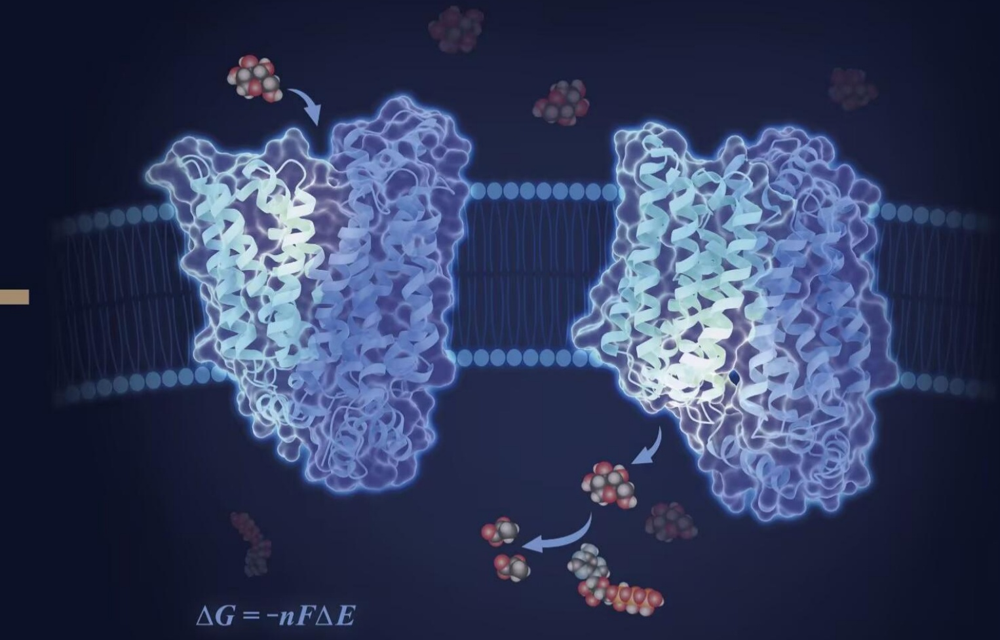

# 封面、前言与目录

原始 PDF 第 1–17 页。

## 生物化学（上册）

BIOCHEMISTRY

主编昌增益 施一公 王新泉

副主编 陈玲玲 徐彦辉 李珍 秦咏梅

“101 计划”核心教材

生物科学领域

chemical

Molecular interaction diagram showing electron density change ΔG = -nFΔE between two protein domains

$$
\Delta G = \Delta H - T \Delta S
$$

中国教育出版传媒集团

高等教育出版社

---

## 生物化学

BIOCHEMISTRY

---

---

# 生物化学(上册)

BIOCHEMISTRY

主编 昌增益 施一公 王新泉

副主编 陈玲玲 徐彦辉 李珍 秦咏梅

编著者（以姓氏拼音为序）

柴皓曦 昌增益 常卿 陈佳

陈玲玲 陈曦子 陈宇凌 程红

程净东 邓海腾 丁智 杜海宁

范仕龙 冯雁 高宁 葛霄飞

龚海鹏 光寿红 胡奇 李兵

李国红 李森 李雪明 李珍

刘翔宇 娄智勇 卢晓云 麻锦彪

秦咏梅 阮一骏 施一公 万蕊雪

王建斌 王新泉 郗乔然 肖俊宇

谢田 徐彦辉 薛毅颜宁

杨广笑 杨建华 伊成器 殷平

于湘晖 张 余 赵 帅 郑丙莲

“101 计划” 核心教材
生物科学领域

中国教育出版传媒集团

高等教育出版社·北京

---

## 内容简介

本教材为上、下两册，包含4篇共27章，上册包含第一篇“蛋白质与核酸的结构和功能”和第二篇“遗传信息的传递与表达”，下册包含第三篇“糖类和脂类的结构与功能”和第四篇“生物体内的物质与能量代谢”。全书有以下三个特点:（1）将生物化学的学习从传统的宏观层面拓展至分子水平，由体外到体内、由定性到定量、由静态到动态逐步深入，在全面且准确阐述生物化学基本原理的基础上，从历史背景引入，详细介绍相关理论的起源、发展及其背后的科学思维，同时融入生物化学学科的前沿研究成果，尤为注重生物大分子结构与功能间的紧密联系，强调思想性、逻辑性与历史性，注重科学理论的依据及推演过程。（2）设置专门章节介绍生物化学领域的经典探究技术，如光谱分析、色谱分离等，展现科学突破与技术进步的相互促进关系。（3）编写者力图反映生物化学发展的总体情况，也特别重视反映中国科学家的卓越研究成果与贡献。书中配有大量原创插图辅助读者理解理论知识，可读性和趣味性强，适合生命科学及相关专业学生使用，特别是综合性大学的生物科学专业学生。

封面图片说明:葡萄糖转运蛋白（GLUT）负责跨膜运输葡萄糖，是能量和物质代谢的重要起始点。本图展示了人源葡萄糖转运蛋白的不同构象，分别为处于向外开放状态的 GLUT3（左）和处于向内开放状态的 GLUT1（右），葡萄糖通过 GLUT 的交替开放机制，跨越细胞质膜进入细胞。（颜宁供图）

## 图书在版编目（CIP）数据

生物化学. 上册/昌增益，施一公，王新泉主编；陈玲玲等副主编.--北京:高等教育出版社，2025.12. ISBN 978-7-04-064884-3

I. Q5

中国国家版本馆CIP数据核字第2025QE9214号网上数字资源围绕纸质教材知识体系设计，充分体现学科知识的广度和深度，是纸质教材的有力拓展和补充。数字资源主要包括教学课件、思考题参考答案等，内容丰富、形式多样，可供教师教学和学生参考。

SHENGWU HUAXUE

| 策划编辑 | 王莉 赵晓玉 | 开本 | 889mm×1194mm 1/16 |
| --- | --- | --- | --- |
| 责任编辑 | 赵晓玉 王莉 | 印张 | 40.75 |
| 封面设计 | 姜磊 | 字数 | 1100千字 |
| 版式设计 | 王凌波 赵阳 | 购书热线 | 010-58581118 |
| 责任绘图 | 裴一丹 | 咨询电话 | 400-810-0598 |
| 责任印制 | 张益豪 | 网址 | http://www.hep.edu.cn http://www.hep.com.cn |
|  |  | 网上订购 | http://www.hepmall.com.cn http://www.hepmall.com |
| 出版发行 | 高等教育出版社 |  | http://www.hepmall.cn |
| 社址 | 北京市西城区德外大街4号 | 版次 | 2025年12月第1版 |
| 邮政编码 | 100120 | 印次 | 2025年12月第1次印刷 |
| 印刷 | 北京中科印刷有限公司 | 定价 | 162.00元 |

新形态教材网
Abooks

数字资源

## 使用方法

1. 电脑或移动设备访问新形态教材网。

abooks.hep.com.cn/64884

2. 注册并登录后，进入“个人中心”。

3. 刮开图书封底防伪码涂层，通过扫描二维码或手动输入 20 位密码，完成防伪码绑定。

4. 绑定成功后，即可开始学习。

如有使用问题,请点击页面下方的“疑问”按钮。

本书如有缺页、倒页、脱页等质量问题，请到所购图书销售部门联系调换

版权所有 侵权必究

物料号 64884-00

---

# 序

# 博大精深的生命科学

地球 46 亿年演化至今，生物可以说是最为复杂多样的存在，并在过去半个世纪成为科学世界最被广泛关注的研究对象。2005 年，《科学》周刊根据全球科学家的反馈，提出的 125 个悬而未决的基本科学问题中有一多半与生命科学直接相关，其中遴选出的 25 个特别关注里有 15 个是生物学问题。近 20 年过去了，新的知识、理论和技术不断涌现，给生物科学领域带来了深刻变革和巨大进步，然而之前提出的那些基本问题没有一个获得最终答案，很多甚至依旧在原地踏步。

与物理、化学等学科相比，生物学有其鲜明的特点。目前阶段，生物学仍主要通过观察现象去理解机理，以实验科学和数据分析为主，还没有发展到从基本理论出发、推导结论的程度。可能也正因为如此，生物学是进入21世纪以来最活跃的研究领域，新问题、新突破层出不穷，也是学科交叉的汇聚焦点。面对新的机遇和挑战，如何培养能够引领未来、创造未来的拔尖人才？教育部2023年启动的基础学科系列“101计划”就是为解决这一问题而实施的高校教育教学综合改革方案。

生物科学“101计划”的专家委员会通过分析近年来生物科学各领域的深刻变革，以及社会发展对生命科学人才培养的新要求，提出了11门课程作为生物科学专业核心课程:普通生物学、生物化学、细胞与分子生物学、遗传学和发育生物学、生理学、微生物学、神经生物学、生物物理学、生物信息学、生态学、免疫生物学，并编写了一套具有鲜明特点的理论和实验教材。教材主编和参编者均为活跃在教学和科研第一线的学者，他们不仅在各自领域取得了出色的研究成果，而且积累了丰富的教学经验，从而保证了教材内容的准确性和教学适用性。本套教材有以下几个特点:

一是注重系统性和前沿性。全面梳理了生物学科知识模块，重构了核心知识框架；注重经典和前沿的融合，关注国际学术前沿和国家战略发展需求，突出学科交叉，更新迭代新知识、新内容。

---

ii

序

二是注重深入浅出，启蒙创新思维。不仅清晰介绍知识点，更注重讲述科学发现背后的逻辑，力求能够激发学生的创新火花，培养科学思维、批判性思维和定量思维。

三是体现中国特色。紧密关注国家战略发展需求，充分反映国内生物学领域高水平学术成果，生动展现我国科技事业发展取得的长足进步。

四是呈现形态多元。采用纸质教材加数字资源的新形态教材出版形式，二者一体化设计、有机融合。纸质教材确保可读性和趣味性，数字资源充分展示学科知识的广度与深度，实现信息技术与教材的深度融合。

生物学是一门极富生命力的学科，问题层出不穷，发展日新月异，“授之以鱼不如授之以渔”。我们在期待这套教材能够让读者朋友们系统掌握生物科学知识体系的同时，更希望激发大家对生命科学领域的好奇心、想象力、探知欲，掌握基本的方法论，成为未来创新的主力军。

在这里，要特别感谢生物科学“101计划”专家委员会成员、主编团队以及一起奋斗的400余位编委、撰稿人，没有大家的辛勤付出，不可能短时间内高质量完成这套教材的编写工作；更要感谢几十所高校的资深专家、一线老师和同学在教材编写、审读、试讲试用中提供的宝贵建议。当然，第一版教材肯定会有很多不足之处，恳请读者朋友们带着批判的态度，反馈宝贵的改进意见，我们将继续努力，力争把这套教材打造成为经典，真正走向世界。

尺寸教材，悠悠国事。衷心希望这套教材为有志于在生命科学领域有所作为的青年人带来一点启发，也助力中国科研教育工作者在全社会的持续支持下为探索未知、培养人才做出更大的贡献。

text_image

张凡

施一公

2025 年 3 月于西湖大学

---

## 前言

## 生物化学:物质、能量与信息的交响曲

不论是我国上古神话中的女娲造人还是西方宗教里描述的伊甸园，人类对于“我是谁？我从哪里来？我到哪里去？”的追问永不停歇。对应到现代生命科学，又是三个最本质也最令人痴迷的问题:生命是什么？生命如何起源？生命如何进化？从某种意义上说，生物化学正是离这三个问题最近的现代生物学分支之一。

在探寻生命起源的诸多尝试中，最广为人知的是米勒模拟实验（Miller-Urey experiment），验证了在还原条件下小分子可以生成有机化合物，这是最具代表性的生命前化学（prebiotic chemistry）实验思路。自此，化学家们在可控的条件下合成出越来越多的与生命有关的有机物质。时至今日，合成生物学家们更是雄心勃勃，期待能够从无生命的物质组装出具有生命特征的细胞。这种研究思路与著名物理学家、诺贝尔奖得主理查德·费曼（Richard Feynman）所说的“What I cannot create, I do not understand”一脉相承，而更广大的研究者则是利用还原论的方法和思路，抽丝剥茧，试图揭示生命的底层逻辑。

但是对比从简单的几个公理和直观假设就可以一步一步推导出一系列公式，从而解释大千世界的物理和数学，生物学给人的印象大多是描述和观察结果，知识似乎呈现碎片化；尤其是生物化学，厚厚一部教材，各种术语、公式、分子式林林总总，令很多人觉得烦琐，望而生畏。这既与生命科学的发展阶段相关，也是由其学科特点决定的。

数学和物理是基于方法的学科，拥有自己的一整套逻辑严密的方法，比如数学里的微积分、概率论，都是方法，物理中的牛顿力学三大定律、电磁学麦克斯韦方程组，都是方法，方法的特点就是可以广泛应用于不同场景。与数理形成鲜明对比，生物学是基于研究领域的学科，自己独立的方法很少。

---

iv

前言

## 生物学是基于研究领域的学科

广义的生物学也可以称为生命科学，可以说包罗万象、博大精深。农业科学、林业科学、海洋学、生态学、传统的动物学和植物学等，都可以归类到宏观生命科学；药学、医学，从根本上说也是生命科学；而以分子生物学、细胞生物学、生物化学和生物物理学为代表的微观生命科学则支撑和涵盖了几十个研究领域和分支，包括神经生物学、遗传生物学、发育生物学、微生物学、生理学、免疫学、病毒学等。可以说，凡是和生命活动相关的研究领域都可以称为生命科学。其中，生物化学、生物物理学、生物信息学，以及历史上的分子生物学都是基于方法的学科，但其底层的方法又是数学、物理学、化学和计算机科学。所以，这些研究领域中，很少有完全来自生物学的独立方法。比如，生物化学研究中常用的凝胶电泳，让带电物质在电场作用下根据其携带电荷和本身质量产生的不同运动速度以达到分离的目的，是一个典型的物理方法；而分子生物学中的PCR扩增依赖于酶促反应，是一个典型的化学方法。

生命形式五花八门，生命科学博大精深，科学界对于生命的理解也许还处在物理的十六世纪，新发现层出不穷。一方面，人类目前面临的悬而未决的125个重大科学问题中一大半来自生命科学领域；但另一方面，还导致了该学科知识迄今大多呈现碎片化的现状。生命科学的这一特点，也同时决定了其入门门槛相对较低，但要精通生命科学任何一个分支都需要比数理更长的学习和适应期，因为任何一个分支都往往和生命科学其他领域关系密切、难以简单切割，所以不得不同时了解一系列相关领域的知识和方法。相比之下，数学和物理的各个分支领域相对独立，内部知识结构井然有序、易于推导和推演。恰恰因为我们对于生命的理解依旧处于相对初级的阶段，生命科学在过去三十多年时间里一直是最为活跃、研究人数最多的自然科学学科，作为一个学科呈现出旺盛的生命力和巨大的发展前景。

## 生物化学的范畴

生命过程可以理解为一个高度调控的化学过程，生物化学就是描述这一过程的科学。从这个角度讲，生物化学是现代生命科学最重要的基石，没有之一，几乎每一个研究领域或研究方向最终都需要生物化学来解释其底层逻辑和背后机制。由于生命过程极为复杂，生物化学也涵盖了很多内容，但这些内容都聚焦在地球物种中普适性的规律，也可以说是最重要的规律。

当我们破除对繁冗知识的抗拒，沉下心来纵横梳理、融会贯通，就会发现生命科学其实早已总结出了几条简单的定律。尽管地球上飞禽走兽、花鸟鱼虫、海

---

前言

V

藻地衣、真菌细菌……各种生命形态令人眼花缭乱，但到了分子层面，它们都遵循着同样的遗传法则和热力学定律，同时进行着类似的化学反应。经典遗传学有孟德尔学说（Mendelism），分子生物学有中心法则（central dogma），而生物化学则有不是那么广为人知的化学渗透理论（chemiosmotic theory），前两者描述了信息在代际、在细胞内的流动，后者支撑起物质与能量代谢的底盘。

生物化学，归根到底就是在诠释物质、能量、信息的转化与流淌如何定义、支撑复杂的生命过程。在生命的物质与能量代谢里，最基本也最有趣的是下面两个简单公式:

呼吸作用:

$$
\mathrm{有机物（储存能量）+氧气} \xrightarrow {\mathrm{线粒体}} \mathrm{二氧化碳+水+能量}
$$

光合作用:

$$
\mathrm{二氧化碳} + \mathrm{水} \xrightarrow [ \mathrm{叶绿体} ]{\mathrm{光能}} \mathrm{有机物（储存能量）} + \mathrm{氧气}
$$

前者的化学本质就是燃烧，但是与生活中的有机物燃烧过后、能量以光和热量的形式散失掉不同，精密的生命体系利用不同的空间把这个燃烧过程一步步分解偶联，把其中释放出来的能量最终储存在生命的能量货币——ATP中。

后面这个从简单小分子到生成有机物的反应要在化学实验室实现可就没那么容易了，多少化学家前赴后继，利用几十个化学反应才能在高耗能、高成本下实现从二氧化碳到淀粉的合成。然而当生物进化到能够有效捕获太阳能，便成为了最高明的合成化学家，不仅仅在常温常压下完成了二氧化碳加水变成淀粉和氧气这一高难动作，更是进一步合成蛋白质、DNA、RNA、核糖体、染色质等组分、结构与功能越来越复杂的生物大分子机器，在支撑每一种生物的生老病死的同时，改变了地球表面的大气成分、地质成分乃至地形地貌……生物一直在改造着地球。

能量的捕获与转化、生物分子的合成与分解始终是生物化学的核心研究内容，共同构成了“新陈代谢”的核心内容。最为神奇的是，呼吸作用和光合作用的核心都是不同形式的能量——前者为电子链传递释放出来的化学能，后者为通过光子形式捕获的光能——都被转化成为跨越磷脂膜的质子梯度。质子是自然界最简单的离子，本身带一个正电荷，在磷脂膜两侧的浓度梯度就形成了电化学势能，当质子通过 $F_{0}F_{1}$ -ATP合酶顺流而下的时候，推动这个生物大分子机器像水轮发电机一样转动起来；只不过在细胞这个微观世界里，电化学势能通过驱动 $F_{0}F_{1}$ -ATP合酶工作，将ADP和磷酸根合成高能物质ATP，从而把能量转化成化学能储存起来。利用质子动力势（proton motive force，PMF）驱动ATP合成，一举统一了上面两个公式中呼吸作用和光合作用最关键的一步能量转化，这个伟大

---

前言

的 “化学渗透理论” 使英国生化学家彼得·米切尔（Peter Mitchell）当之无愧地赢得了 1978 年的诺贝尔化学奖。

神奇的生命现象最终都可以还原成能够用科学语言描述、能够被人类理解的化学反应，让我们距离生命本质越来越近，这本身难道不是一个奇迹么？其重要性难道不能与物理、数学、化学中最激动人心的突破相提并论么？可以说，生物化学就是理解生命化学本质的学科。从这个角度讲，生物化学是现代生命科学最重要的基石，几乎每一个研究领域或研究方向最终都需要生物化学来解释。

当理解了生命的化学本质，再环顾四周，为什么碳水使我快乐？减肥为何反而要吃以脂类为主的食物？辟谷行不行？健身吃蛋白粉对不对？疫苗与抗体的作用原理是什么？……这些与我们日常生活息息相关的营养与健康、疾病与代谢等问题，几乎都可以从生物化学已知的内容里寻求答案。

尽管生物化学研究内容与生命的所有内容息息相关，但长久以来生物化学作为一门学科的研究重点基本主要围绕着新陈代谢和对生物信息传递的化学解释。

对于地球上的任何一种生物而言，其遗传物质都是核酸，除了某些病毒之外，都是脱氧核糖核酸（DNA）。虽然 DNA 携带了所有的生命信息，从根本上决定生命形式、控制生命过程，但生命过程的执行者主要是蛋白质（protein），DNA 与蛋白质之间的信息流通过 RNA 介导。细胞分裂过程中 DNA 不断复制自我，同时，DNA 通过转录（transcription）变成信使 RNA（messenger RNA, mRNA），mRNA 通过翻译（translation）变成蛋白质，这一生命信息流的基本规律被称为中心法则。在真核生物中，DNA 通过转录只能变成前体 mRNA（precursor mRNA, pre-mRNA），pre-mRNA 必须通过剪接（splicing）才能变成 mRNA。比如人类基因组中有两万多种编码蛋白质的基因，通过可变剪接最终编码近十万个不同序列的蛋白质，而每一种蛋白质又可以有很多种翻译后的化学修饰，从而执行不同的功能。具有几百种组分、超百万道尔顿分子量、不同结构和构象的剪接体本质就是一种巨大的催化酶，催化在 pre-mRNA 剪接中的两步转酯反应。围绕着中心法则的研究在历史上已经产生出 12 个诺贝尔奖。

生物化学就是围绕上述最普适性的规律展开描述。生物分子（第1章）包罗万象，但最重要的是与中心法则相关的蛋白质（第2、3、5、12章）和核酸（第6、7、8、9、10、11、13、26章），一类特殊的蛋白质是有催化活性的酶（第4章），其他具有重要生理功能的生物分子还包括糖类（第14章）和脂质（第15章）。一般来说，这些生物分子在体内和细胞内都有代谢循环（第16、18、19、20章），其合成代谢（第21、23、25、26章）需要消耗能量，而其分解代谢

---

前言

vii

（第 17、22、24、26 章）则产生能量；在多细胞生物中，这些复杂代谢过程受到激素调节（第 27 章）。

除了上述最核心的内容，细胞内还有许许多多的各种生理过程，背后都有完整的生物化学机制。比如信号转导，从胞外配体结合细胞膜表面受体开始，一直到细胞核内改变基因表达，是一个典型的生物化学过程，这部分内容在细胞生物学教科书中有详细描述。再比如钠钾离子通道与神经动作电位，也是一个典型的生物化学过程，这部分内容在神经生物学教科书中有详细描述。

## 生物化学的语言

由于生命过程极为复杂，生物化学也涵盖了很多内容。要学好生物化学，就必须掌握其语言。

生物化学的语言分为两部分:一是基础化学知识。细胞内时刻进行着各种复杂的化学反应和化学平衡，但参与这些过程的离子和有机分子遵守最基本的热力学三定律、酶学原理和各种化学规律。一种简单的化学反应平衡式 $A + B = AB$ 及相关的结合常数 $K_{\mathrm{d}} = [A] \times [B]/[AB]$ 不仅在代谢反应的描述中尤为重要，更在所有生化过程中都体现得淋漓尽致。元素周期表中的知识在理解生化反应和蛋白质等大分子的性质与功能则时刻用得到。比如锌指蛋白（zinc finger protein）中螯合过渡金属锌离子的配体一般是半胱氨酸（cysteine）和组氨酸（histidine），而结合钙离子的配体则常常是多肽主链上的羰基和谷氨酸（glutamate）与天冬氨酸（aspartate）的侧链。如果没有学过无机化学和有机化学，是很难精通生物化学的。同时，物理化学的基础知识对于解释生物化学过程也有潜移默化的重要作用。比如封闭系统里的自由能公式 $\Delta G = \Delta H - T \times \Delta S$，不仅可以解释生化过程，也可以解释蛋白质结构特征。为什么热稳定的蛋白质内部常常包埋有通过盐桥相互作用的酸碱氨基酸？因为这样的作用会让蛋白变性过程的 $\Delta H$ 成为正值，从而阻止蛋白质变性。

二是生物有机分子知识。这里主要指的是氨基酸、核苷酸、磷脂、糖类等的结构式及物理化学性质，比如20种天然氨基酸的侧链结构与性质极为重要，几乎是解释生命过程的最关键的要素之一，这些知识有一些是要用心记忆下来的。生物有机分子知识也包括蛋白质、核酸、多糖的结构与性质。比如，一种抗酸的代谢酶在pH为7.4时几乎没有任何活性，但在pH为6.0及以下时有很强的活性，为什么会这样呢？生化基础薄弱的学生对这样一个简单描述会很茫然、搞不清背后是什么原因，但熟悉氨基酸性质的学生很快会意识到:最大的可能是这种代谢酶里的一个组氨酸残基的咪唑侧链在pH从7.4变化到6.0的过程中发生了质子化，变成了带正电的氨基酸。因为20种天然氨基酸里只有组氨酸的侧链

---

viii

前言

$pK_{a}$  在 6.0 附近。其实，研究论文中常说的 “pH 诱导的蛋白质构象变化”，应该都是在相关 pH 附近改变了氨基酸残基的侧链带电情况，这一情况要求该残基的  $pK_{a}$  也在相关 pH 附近。

以上例子比比皆是，挂一漏万。在本文中仅信手描述笔者熟悉和偏爱的内容，在本书各章节中我们则尽量选取最具代表性、在科学史上占据举足轻重地位的成果以飨读者。

施一公

2025年3月

---

## 目录

绪论 001

## 第Ⅰ篇 蛋白质与核酸的结构和功能

## 1 生命的化学基础 019

1.1 地球表面大约 1/3 种类的元素被用于形成生物分子 020
1.2 生物分子的特性可从化学和物理学等角度进行表征 021
1.3 碳是形成生物分子的核心元素 029
1.4 很多生物分子依赖非共价相互作用形成三维结构而发挥功能 035
1.5 某些含碳化合物是生命能源的储存和提供者 038
1.6 生物分子最初可能通过地球表面的化学过程产生 039
1.7 生命过程以水为介质 042
1.8 很多生物分子表现出弱酸特征 048

## 2 蛋白质结构 056

2.1 氨基酸是蛋白质的基本组成单位 057
2.2 氨基酸的线性排列顺序构成蛋白质的一级结构 063
2.3 多肽链主链通过氢键形成的规则构象构成蛋白质的二级结构 067
2.4 蛋白质多肽链上的所有原子共同参与形成三级结构 071
2.5 具有三级结构的蛋白质亚基进一步组装产生四级结构 077
2.6 蛋白质多肽链具有自发折叠形成独特空间结构的能力 078
2.7 分子伴侣等可协助细胞内的蛋白质折叠过程 081
2.8 蛋白质错误折叠导致许多人类疾病的发生 083

---

x

目录

## 3 蛋白质功能 087

3.1 肌红蛋白和血红蛋白利用血红素可逆结合氧气 088
3.2 膜转运蛋白通过构象变化跨膜转运底物 102
3.3 脊椎动物通过抗体特异性识别抗原进行免疫防御 107
3.4 G蛋白偶联受体通过构象变化介导信号跨膜传递 111
3.5 蛋白质结构和功能可通过翻译后修饰调节 115

## 4 酶 122

4.1 酶是一类主要由蛋白质构成的生物催化剂 123
4.2 酶通过活性中心特异性结合底物并降低反应活化能以实现高效催化 128
4.3 酶动力学通过米氏方程及其参数定量阐明酶的催化特性 134
4.4 酶活性可通过共价修饰、酶原激活和别构效应等多种机制进行精密调控 142
4.5 小分子抑制剂通过可逆或不可逆方式精确干预酶功能 145

## 5 蛋白质探究 156

5.1 基于蛋白质物理和化学性质的差异而进行分离和纯化 157
5.2 蛋白质可通过多种物理或化学的手段来进行体外表征 167
5.3 蛋白质氨基酸序列可通过化学和质谱方法测定而且多肽可以通过化学方法合成 176
5.4 蛋白质 - 蛋白质相互作用可通过多种方法进行鉴定与分析 183
5.5 蛋白质分子的三维结构可通过物理方法测定 190
5.6 根据氨基酸序列可对蛋白质的结构和功能特征进行理论预测 198
5.7 蛋白质的折叠过程、动态结构及相互作用可通过计算机软件进行一定程度的模拟 201

## 6 核酸 206

6.1 对核酸结构和功能认识的历史 207
6.2 DNA 和 RNA 的基本组成单位皆为核苷酸 211
6.3 DNA 和 RNA 分子的一级结构 219
6.4 DNA 一般以双链形式形成空间结构 221
6.5 RNA 一般通过形成独特的三维结构而发挥其生物学功能 231
6.6 DNA 与 RNA 的结构差异及其功能关联 238
6.7 细胞内核酸分子的结构稳定性和功能实现依赖于与蛋白质的相互作用 242

---

目录

xi

## 7 核酸探究 248

7.1 核酸分子可通过不同方法进行分离纯化 249
7.2 核酸的基础表征依赖其物理化学性质 252
7.3 核酸参与多种分子间相互作用 257
7.4 核酸分子链可通过酶法和化学法延伸 263
7.5 核酸分子的碱基序列可被精确测定 268
7.6 多种技术可对核酸分子进行改造 272

## 第Ⅱ篇 遗传信息的传递与表达

## 8 DNA 复制、修复与重组 283

8.1 经典实验揭示 DNA 的复制方式 284
8.2 DNA 复制由高保真性的 DNA 聚合酶复合物催化 289
8.3 DNA 复制分为起始、延伸和终止三个阶段 297
8.4 DNA 复制受到严格调控 305
8.5 细胞内 DNA 可被多种因素损伤进而导致遗传突变 311
8.6 细胞内存在多种 DNA 损伤修复系统 321
8.7 细菌细胞 DNA 的同源重组及细菌接合过程 337
8.8 真核生殖细胞发生减数分裂过程中进行 DNA 同源重组 340
8.9 位点特异性重组可使 DNA 发生精确的重排 343
8.10 转座子 DNA 可从染色体一个位点转移至另外一个位点 348

## 9 基因、染色质与表观遗传 356

9.1 不同生物体的基因组具有复杂性和特异性 357
9.2 真核生物的基因组以染色质形式存在 359
9.3 DNA 甲基化修饰是承载表观遗传信息的重要方式之一 364
9.4 组蛋白上的赖氨酸残基可以发生多种类型的酰基化修饰 372
9.5 组蛋白甲基化修饰是另一种承载表观遗传信息的重要方式 378
9.6 组蛋白上还存在多种其他类型的蛋白质翻译后修饰 385
9.7 组蛋白变体具有与常规组蛋白不同的序列和功能 387
9.8 染色质重塑是调控表观遗传信息正确传递的重要方式 392
9.9 细胞内染色质形成高维结构 397
9.10 染色质上的多种序列元件在基因转录中发挥重要作用 401

---

xii

目录

## 10 RNA 的生成 407

10.1 基因和基因表达调控 408
10.2 细菌基因转录和调控 410
10.3 真核生物 RNA 聚合酶 416
10.4 真核生物 RNA Pol II 的转录起始 425
10.5 真核生物 RNA Pol II 的转录延伸 440
10.6 真核生物转录终止 451
10.7 以 RNA 为模板生成 RNA 454

## 11 mRNA 前体的加工 462

11.1 mRNA 前体通过 RNA 剪接去除内含子并使外显子相连 463
11.2 成熟 mRNA 从细胞核转运到细胞质 483
11.3 细胞内严格的质量控制机制识别并降解异常的 mRNA 490
11.4 RNA 的化学修饰调控其功能和稳定性 497

## 12 蛋白质生成 517

12.1 中心法则假说提出 DNA 序列如何决定蛋白质氨基酸序列 518
12.2 遗传密码子通过体外翻译实验等被破译 520
12.3 氨酰-tRNA合成酶是将核酸语言转换成蛋白质语言的真正翻译者 531
12.4 由 mRNA 指导的多肽链合成发生在核糖体上 536
12.5 多肽链合成开始于特异的起始密码子，结束于终止密码子 541
12.6 新生肽链通过其自身所携带的结构信息定位于特异的亚细胞部位 556
12.7 蛋白质生成过程受到严格的质量控制 567

## 13 非编码 RNA 579

13.1 组成性非编码 RNA 的生物合成、加工修饰及功能 580
13.2 小 RNA 的产生、作用机制与功能 596
13.3 长链非编码 RNA 的发现、表达特征与功能 612

后记 624

索引 627
