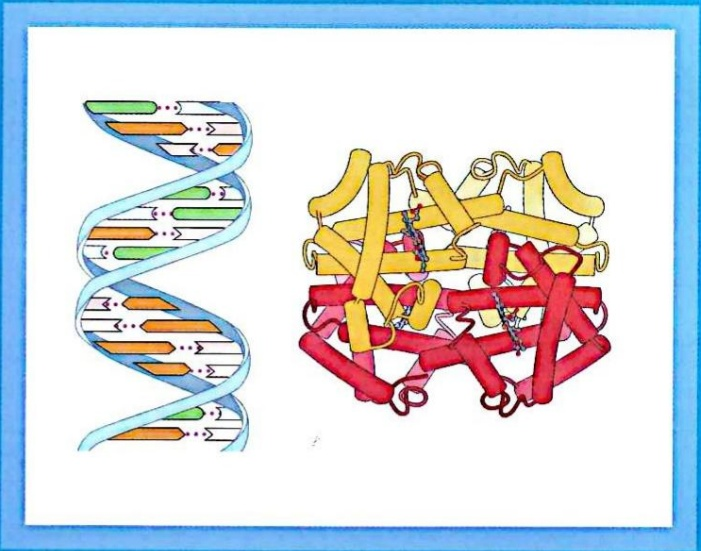

# 第I篇 蛋白质与核酸的结构和功能·分篇页

原始 PDF 第 34–35 页。

natural_image

Illustration of a DNA double helix and a 3D protein structure with alpha helices (no text or labels)

## 第1篇

## 蛋白质与核酸的结构和功能

生命，自然界最精妙的化学体系，其奥秘长久以来一直笼罩在神秘面纱之下。19世纪，一场化学革命悄然兴起:1828年，弗里德里希·维勒（Friedrich Wöhler）在实验室中合成尿素，首次在人造条件下合成了典型的有机物，表明有机化合物同样遵循普遍的化学规律，揭开了生命化学研究的新篇章。人们逐渐认识到，生命体由碳、氢、氧、氮、磷、硫等基本元素精巧构筑，形成蛋白质、核酸、脂质、多糖等有序的生物大分子。这些生物大分子不仅是细胞的结构单元，更是生命活动的执行者，构成了一切生命现象的物质基础。

对蛋白质的探究贯穿生物化学的发展史。从19世纪初分离白蛋白和球蛋白，发现蛋白质水解产物为氨基酸，到1902年埃米尔·费歇尔（Emil Fischer）提出蛋白质是由氨基酸通过肽键连接而成的多肽链，其化学本质逐步清晰。20世纪中叶，该领域迎来了突破性进展:弗雷德里克·桑格（Frederick Sanger）首次测定胰岛素的氨基酸序列，揭示

---

了蛋白质的一级结构；莱纳斯·鲍林（Linus Pauling）和同事提出α螺旋与β折叠模型，阐明了蛋白质二级结构的形成规律；约翰·肯德鲁（John Kendrew）和马克斯·佩鲁茨（Max Perutz）分别解析了肌红蛋白和血红蛋白的三维空间结构。这些里程碑式的成果标志着蛋白质研究从成分解析跃升到结构与功能深度关联的新纪元。

酶的发现尤为关键地彰显了蛋白质的核心作用。作为高效、特异且可调控的生物催化剂，酶体现了生命化学反应的精密设计。从费歇尔的锁钥学说（1894）对底物特异性的解释，到丹尼尔·科什兰（Daniel Koshland）的诱导契合学说（1958）揭示酶结合底物过程中的动态构象变化，人们对酶的功能机制的理解不断深化。无论是作为结构支撑（如胶原蛋白）、免疫卫士（如抗体），还是信号转导参与者（如激素受体），蛋白质功能的惊人多样性构成了细胞复杂活动的分子基石，也为人们理解生命过程的精确调控提供了核心线索。归根结底，蛋白质的功能由其精妙的多层次结构所决定。

核酸的探索历程同样充满曲折。1869年，弗雷德里希·米歇尔（Friedrich Miescher）从脓细胞中分离出富含磷的核素（nuclein），但其生物学意义长期被忽视。直到1940年代，埃尔温·查加夫（Erwin Chargaff）系统分析DNA碱基组成，发现了著名的“查加夫规则”（A=T，G=C），为DNA具备信息编码潜能提供了关键化学线索。随着电泳、层析，尤其是X射线衍射等技术的飞速发展，科学家得以深入解析核酸的化学组成与空间构象，为最终揭示其核心遗传功能奠定了坚实的方法学与理论基础。1953年，詹姆斯·沃森（James Waston）和弗朗西斯·克里克（Francis Crick）提出DNA双螺旋结构模型，此结构是其承载和传递遗传信息这一核心功能的物质基础。

本篇为生物化学的基石篇。从氨基酸的序列密码到 DNA 的双螺旋蓝图，从酶的锁钥识别到遗传密码的破译，系统地回顾科学史上的辉煌瞬间，见证人类如何运用化学的语言，层层解密生命的分子基础，并为理解后续遗传信息的存储、复制、表达与调控奠定坚实的理论基础。
