# 1 生命的化学基础

原始 PDF 第 36–72 页。

# 生命的化学基础

现存于地球上的生命形式极其多样。动物和植物等肉眼可见，细菌等单细胞生物则肉眼通常不可见；有的生活在常温（25℃）环境中，有的则生活在超过80℃（甚至100℃）的高温环境中。尽管生物均以细胞为基本结构和功能单位，但原核细胞无细胞核，也缺乏内膜系统；而真核细胞则含有细胞核和复杂的内膜系统。

具有细胞结构的独立生命形式均具某些共同特征，既包括生长和繁殖等宏观特征，也包括新陈代谢、稳态、组织性、能量转换、应激性和适应性等微观特征，这些特征均为长期演化的结果。尽管如此，人们仍无法对生命现象进行简单定义，只能笼统地将生命定义为一种条件或一个过程。这类似于17世纪时人们对水的认识:大家都知道水能以液体、气体和固体等状态存在，但无人可以对它进行简单定义。直到后来人们认识到不同形式的水皆具 $H_{2}O$ 这一共同分子结构时，水的定义才被基本确定。期望未来也可以给予生命一种简单而准确的定义。

人们对生命现象开展化学探究已历经 200 多年，人们逐渐发现并认识到，外观和生活环境差异极大的不同生命形式，在分子水平却具有高度的统一性。例如，所有细胞均利用 ATP（腺苷三磷酸）作为通用能量“货币”，不同物种细胞中所发生的葡萄糖降解过程（即糖酵解）也基本相同，等等。不同类型的生命在分子水平的共性和个性正是生物化学所关注的重点内容。

对生物所开展的化学探究揭示，碳是构成生物分子的核心元素，而且生物分子的特性或多或少都取决于它们自身之间以及它们与水分子之间相互作用的方式。因此，在深入认识生物分子的结构、功能、作用机制、分解和合成代谢以及相关的能量转换特征等内容之前，需先了解以碳原子为基础构建的有机分子以及水分子等的化学特征。

text_image

1

---

020

1 生命的化学基础

## 1.1 地球表面大约 1/3 种类的元素被用于形成生物分子

18—19世纪，法国学者安托万·拉瓦锡（Antoine Lavoisier，1743—1794）和德国学者尤斯图斯·李比希（Justus Liebig，1803—1873）等先后对来自不同动植物及酵母等生物体的组分进行了系统的定性和定量元素分析。结果表明，植物组分蔗糖由碳、氢和氧等元素按照一定比例组合而成；其中氢和氧的比例似乎与水分子（$\mathrm{H}_2\mathrm{O}$）中的比例相同，故提出了碳水化合物的概念。同时，人们也对动物组分乳酸、尿素等小分子物质，以及脂肪和蛋白质等更大的分子（当时核酸类分子尚未被鉴定）的元素组成进行了系统分析，推断出它们的经验化学式，发现蛋白质皆含一定比例的氮。

对大量不同生命物质所进行的元素组成分析结果揭示，在地球表层天然存在的约90种元素中，只有约30种存在于生物体内。这些被选择的元素各具特性，满足制造不同特性生物分子的需求。在地球生命演化的漫长初期，这些元素是如何被特异选择的呢？这是一个值得深入思考和探究的科学问题。

就大多数生物体而言，其质量的 $99\%$ 以上为由碳（C）、氢（H）、氧（O）和氮（N）4种元素形成的分子。就化学成键能力而言，氢、氧、氮和碳分别是最轻的可形成1、2、3、4个共价单键的元素（图1-1）；通过共价键，这些原子之间可形成稳定且结构多样的生物分子，发挥多样的生物功能；因此，在生物演化过程中，它们被选择成为了用于形成生物分子的主要元素。

多种元素（如碳、氮、硫）在生物体内的占比远高于在地球表层的占比。这表明，在地球生命演化形成过程中，用于形成生命物质的元素是基于其特性（非丰度）而被高度选择的（图1-1），这是生物的演化属性在化学水平的体现。

除上述4种元素外，钠、磷、硫、氯、钾、钙和镁等元素在生物体内的相对含量也较高。所有这些含量较高的元素被称作生物的常量元素（macro element），而其他含量低的元素，如锰、铁、铜、锌、硒、钼、碘等则被称作生物的微量元素（trace

图1-1 生命物质由大约30种元素组成

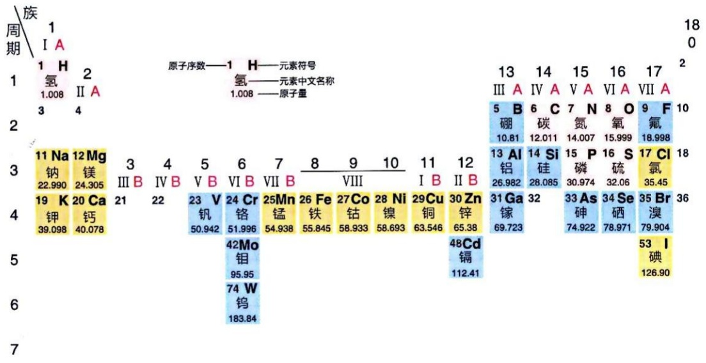

other

| Element | Atomic Number | Chemical Name |
| :--- | :--- | :--- |
| 1 | 1 | H |
| 2 | 2 | 氢 |
| 3 | 3 | Na |
| 4 | 4 | K |
| 5 | 5 | V |
| 6 | 6 | Cr |
| 7 | 7 | Mn |
| 8 | 8 | Fe |
| 9 | 9 | Co |
| 10 | 10 | Ni |
| 11 | 11 | Cu |
| 12 | 12 | Zn |
| 13 | 13 | Al |
| 14 | 14 | Si |
| 15 | 15 | P |
| 16 | 16 | S |
| 17 | 17 | Cl |
| 18 | 18 | 铝 |
| 19 | 19 | K |
| 20 | 20 | Ca |
| 21 | 21 | 钙 |
| 22 | 22 | 钙 |
| 23 | 23 | 钼 |
| 24 | 24 | 铬 |
| 25 | 25 | 锰 |
| 26 | 26 | 铁 |
| 27 | 27 | 钴 |
| 28 | 28 | 镍 |
| 29 | 29 | 铜 |
| 30 | 30 | 锌 |
| 31 | 31 | Ga |
| 32 | 32 | 镓 |
| 33 | 33 | As |
| 34 | 34 | Se |
| 35 | 35 | Br |
| 36 | 36 | 溴 |
| 37 | — | 砷 |
| 38 | — | 硒 |
| 39 | — | 硒 |
| 40 | — | 硒 |
| 41 | — | 硒 |
| 42 | — | 钼 |
| 43 | — | 钼 |
| 44 | — | 钼 |
| 45 | — | 钼 |
| 46 | — | 钼 |
| 47 | — | 钼 |
| 48 | — | 钼 |
| 49 | — | 钼 |
| 50 | — | 钼 |
| 51 | — | 钼 |
| 52 | — | 钼 |
| 53 | — | 钼 |
| 54 | — | 钼 |
| 55 | — | 钼 |
| 56 | — | 钼 |
| 57 | — | 钼 |
| 58 | — | 钼 |
| 59 | — | 钼 |
| 60 | — | 钼 |
| 61 | — | 钼 |
| 62 | — | 钼 |
| 63 | — | 钼 |
| 64 | — | 钼 |
| 65 | — | 钼 |
| 66 | — | 钼 |
| 67 | — | 钼 |
| 68 | — | 钼 |
| 69 | — | 钼 |
| 70 | — | 钼 |
| 71 | — | 钼 |
| 72 | — | 钼 |
| 73 | — | 钼 |
| 74 | — | 钼 |
| 75 | — | 钼 |
| 76 | — | 钼 |
| 77 | — | 钼 |
| 78 | — | 钼 |
| 79 | — | 钼 |
| 80 | — | 钼 |
| 81 | — | 钼 |
| 82 | — | 钼 |
| 83 | — | 钼 |
| 84 | — | 钼 |
| 85 | — | 钼 |
| 86 | — | 钼 |
| 87 | — | 钼 |
| 88 | — | 钼 |
| 89 | — | 钼 |
| 90 | — | 钼 |
| 91 | — | 钼 |
| 92 | — | 钼 |
| 93 | — | 钼 |
| 94 | — | 钼 |
| 95 | — | 钼 |
| 96 | — | 钼 |
| 97 | — | 钼 |
| 98 | — | 钼 |
| 99 | — | 钼 |
| 100 | — | 钼 |

**Atomic Numbers:**
- H: Hydrogen
- I: Hydrogen
- A: Aluminum
- B: Boron
- C: Carbon
- D: Nitrogen
- E: Nitrogen
- F: Fluorine
- G: Gallium
- H: Sodium
- I: Indium
- J: Nickel
- K: Potassium
- L: Lanthanum
- M: Manganese
- N: Neodymium
- O: Oxygen
- P: Phosphorus
- Q: Quartz
- R: Rubber
- S: Sulfur
- T: Toluene
- U: Uranium
- V: Vanadium
- W: Tungsten
- X: Xanthanum
- Y: Yttrium

---

1.2 生物分子的特性可从化学和物理学等角度进行表征

021

element, microelement) (表 1-1)。需注意的是，这里强调的是元素在生物体内的相对含量，而非重要性。微量元素对生物体而言是不可或缺的。

表 1-1 存在于地壳和人体内元素含量的比较

| 元素 | 占地壳质量的百分比/% | 占人体质量的百分比/% |
| --- | --- | --- |
| 氧(O) | 46.6 | 65.0 |
| 碳(C) | 0.2 | 18.5 |
| 氢(H) | 0.14 | 10 |
| 氮(N) | 0.1 | 3.3 |
| 钙(Ca) | 3.6 | 1.5 |
| 磷(P) | 0.07 | 1.0 |
| 钾(K) | 2.5 | 0.35 |
| 硫(S) | 0.03 | 0.3 |
| 钠(Na) | 2.8 | 0.2 |
| 镁(Mg) | 2.1 | 0.1 |
| 硅(Si) | 27.7 | 0.026 |
| 铁(Fe) | 4.5 | &lt;0.006 |
| 锌(Zn) | 0.007 | 0.003 |

## 1.2 生物分子的特性可从化学和物理学等角度进行表征

生物体由大小不同、性质各异的化学分子组成。生物代谢则涉及生物体内分子之间的化学转换。因此，必须从化学角度认识生命现象，这也正是生物化学作为一个学科的使命。

## 1.2.1 现代化学萌芽于 17 世纪，开始于 18 世纪，成熟于 20 世纪

从某种意义上说，现代化学诞生于炼丹术。炼丹术始于古代中国、古印度和古希腊等地；术士们试图将低级金属转变为高级金属（如金子等）。这种将一种物质转换为另一种物质的尝试和努力为现代化学奠定了基础，为此人们鉴定出某些新物质（如汞元素和几种强酸等）的存在。现代化学的兴起则在一定程度上标志着炼丹术的结束。

现代化学发展的简单脉络可总结如下。1660年代，英国学者罗伯特·波义耳（Robert Boyle，1627—1691）通过出版《怀疑的化学家》（The Sceptical Chymist）一书，将化学与神秘的炼丹术进行了剥离，试图将化学转变为一门实证科学。他抛弃亚里士多德（Aristotle，公元前384—前322）所提出的“土、水、气和火”四种元素的

---

022

1 生命的化学基础

概念，更加科学地将元素（主要是金属元素）定义为不可再分解为其他物质的最简单成分，将化合物定义为元素结合后形成的新物质，并将这些概念引入化学分析过程，由此拉开了现代化学的序幕。

在大约 100 年后的 1780 年代，法国学者拉瓦锡等建立了对不同元素进行定量分析的“燃烧法”，开启了对包括有机物在内的物质进行元素组成定性和定量分析的化学新时代。拉瓦锡还对动物呼吸、乙醇发酵等生物过程中发生的物质转换现象进行了化学探究。通过深入分析乙醇发酵过程，他揭示了化学反应的质量守恒定律——在任何化学反应过程中，产物和反应物的总质量相等。拉瓦锡因此被称为现代化学之父。

1790 年代，法国学者约瑟夫·普鲁斯特（Joseph Proust，1754—1826）等通过分析大量由两种元素组成的二元无机化合物（特别是铁的氧化物）的元素组成，揭示了化合物形成的定比定律（law of definite proportions）:任何一种特定化合物，其组成元素的种类和相对质量的比例都是恒定不变的，这为建立分子概念奠定了基础。

基于质量守恒定律和定比定律，19世纪初英国学者约翰·道尔顿（John Dalton, 1766—1844）提出了元素的原子理论。他将元素的最小存在形式定义为原子；一种特定元素的原子，无论以何种形式存在，均具有完全相同的质量和特性；化合物是由两种或更多种不同原子结合形成的产物；原子在化学反应过程中以完整形式进行分离和组合。

1910 年代，英国学者欧内斯特·卢瑟福（Ernest Rutherford，1871—1937）等根据放射性同位素所产生的  $\alpha$  粒子对金属原子的衍射效应，提出假说:原子由中心高度致密的带正电的原子核和外围带负电的可移动电子共同组成。也就是说，原子并非像道尔顿所想象的那样是一种实体，而是一种具有微小太阳系特征的结构:周围的电子围绕中间的原子核旋转。在此基础上，同期美国学者吉尔伯特·路易斯（Gilbert Lewis，1875—1946）等为解释有机分子的结构，提出不带电荷化学键（即共价键）的概念:即两个原子可通过共享一对电子而形成稳定的化学键。该理论后来被证明具有高度的普适性，不仅适应于有机分子，也适应于绝大多数无机分子（如  $H_{2}O$ ， $NH_{3}$ ， $O_{2}$  等）。而当时已经成熟的离子键理论则是基于原子间发生电子的完全转移而形成静电作用而建立的。至此，人们认识到了通过质量关系所反映的化合物结构，以及通过化学反应发生的物质转换过程的微观本质。

后续研究表明，化合物的结构形成和化学反应等过程还需从能量及量子力学等角度来认识。如前所述，能量是一种抽象的物理概念，它定量描述一个系统做功的能力。通过考察化学反应过程中反应物和产物之间的自由能差异，可以判断在一定条件下某种化学反应发生的可能性、方向性和进行程度等。与生物相关的能量有辐射能（太阳能）、热能（与分子和原子的随机运动相关）、化学能（与化学物质的结构相关）、势能（与物体所处位置相关）等。

正是在化学和物理学理论与技术的推动下，人们对生命物质和生命过程的认识进入微观的分子水平，也引入了定量描述的方法。

---

1.2 生物分子的特性可从化学和物理学等角度进行表征

023

## 1.2.2 生物分子中的原子通过共价键等化学键结合

生物体内的主要元素（如碳、氢、氧、氮、磷、硫等）均参与生物分子的形成。分子（molecule）可以定义为由两个或两个以上原子通过化学键结合形成的、电中性的，能够独立存在的化学实体。从热力学角度看，原子通过化学键形成分子的主要原因是分子比游离原子更加稳定。

笼统地说，两个原子可通过形成化学键而相互结合。化学键包括共价键、离子键（存在于带正、负电荷的离子之间的静电力）和金属键（所有阳离子都共享可自由流通的离域电子）等不同形式。对于生物分子而言，共价键最为普遍和重要，这里对其进行简单介绍。

依据化学键理论，两个原子如果可共享一对（或多对）电子即可形成共价键（covalent bond）。图1-2显示几种典型分子中形成共价键的情况。一般而言，一个共价键的共享电子对由两个原子各提供一个电子组成，生物分子中存在的共价键大部分属于这一类型。在少数情况下，共享电子对全都由一个原子提供，这种共价键被称作配位（coordinate）共价键（简称配位键）。例如，血红素分子中的铁原子与氮原子之间（见第3章）以及氨分子中的氮原子额外结合一个质子所形成的共价键均为配位键，这两种情况下，共享电子对完全由氮原子一方提供。此外，两个原子之间还可共享两对电子形成双键（如二氧化碳分子），或共享三对电子形成三键（如氮气分子）。仅共享一对电子的共价键则为单键。

不同分子之间的转换可通过化学反应实现。依据共价键理论，化学反应涉及共价键的断裂和重新形成，以获得更加稳定的产物为驱动力。生物体内发生的化学反应可以归纳为几种主要类型，具体将在下册第16章中详细介绍。

图 1-2 几种典型的共价键示意图

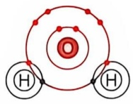

水 $\left(\mathrm{H}_{2}\mathrm{O}\right)$

2个单键

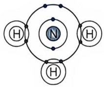

氨（NH₃）

3个单键

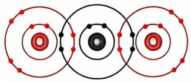

natural_image

Symmetrical diagram with three concentric circles and red/black segments, no text or symbols present

二氧化碳（$\mathrm{CO}_{2}$）

2个双键

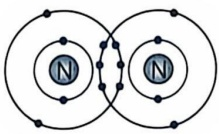

氮气（ $N_{2}$ ）

1个三键

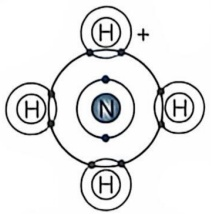

chemical

Molecular structure diagram showing a central nitrogen atom bonded to four hydrogen atoms in a ring system

铵离子（NH$_{4}^{+}$）

3个单键+1个配位键

---

024

1 生命的化学基础

## 1.2.3 某些生物小分子可进一步共价连接成富含信息的生物大分子

生命活动涉及大量小分子（如水、二氧化碳、氨、丙酮酸、乳酸、甘油磷脂、腺苷三磷酸、氨基酸、核苷酸、单糖等）的参与，但生命现象更多依赖大量生物大分子的存在。这些生命大分子主要包括蛋白质、核酸（DNA 和 RNA）和多糖等。经过长期探究，人们逐渐认识到，这些生物大分子均为由若干简单小分子单位通过特异共价键缩合而成的多聚体。例如，多糖以不同的单糖分子为基本单位，通过糖苷键缩合而成；蛋白质以氨基酸分子为基本单位，通过肽键连接而成；核酸以核苷酸分子为基本单位，通过磷酸二酯键连接而成（图 1-3）。

对于生物大分子，既要掌握其组成单位的结构和特性，也要了解组成单位之间的共价连接方式，以及所形成大分子的空间结构和生物功能等。这些是生物化学的重要内容，将在后面章节进行详细介绍。

## 1.2.4 生物体内发生的化学反应多为可逆反应

在 19 世纪初法国学者克劳德·伯索利特（Claude Berthollet，1748—1822）提出可逆反应概念之前，人们长期认为自然界发生的所有化学反应都是不可逆的。如人

图 1-3 生物大分子由小分子单位共价连接而成

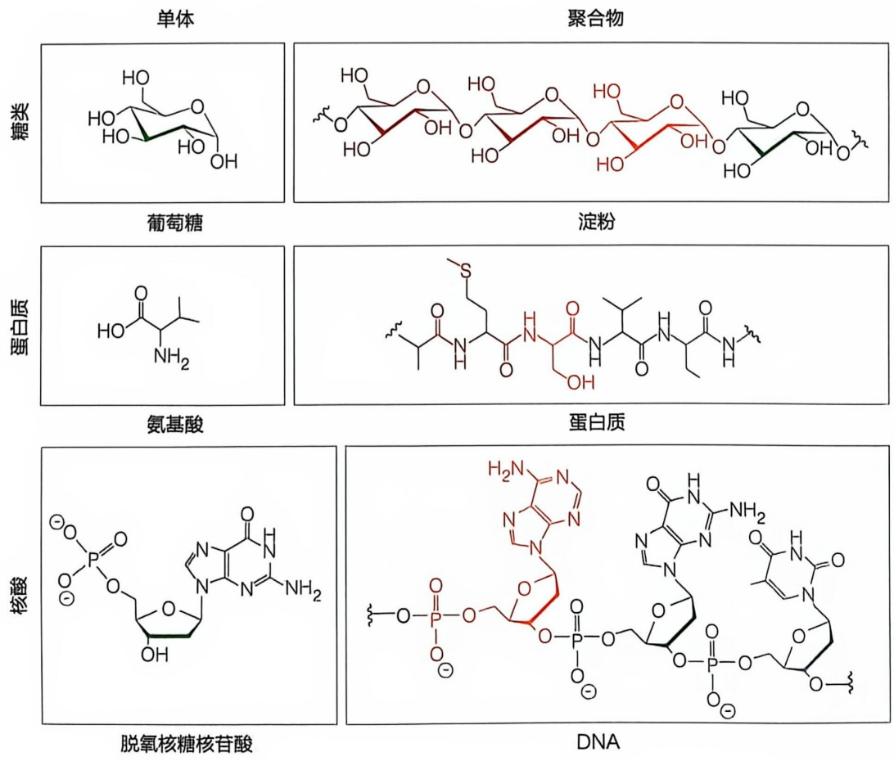

chemical

五种蛋白质结构式：糖类、葡萄糖、蛋白质、氨基酸、核酸，分别对应单体、聚合物、淀粉、蛋白质、脱氧核糖核苷酸和DNA

---

1.2 生物分子的特性可从化学和物理学等角度进行表征

025

们一直认为碳酸钠与氯化钙反应生成碳酸钙和氯化钠的过程是单方向的（$\mathrm{Na}_{2} \mathrm{CO}_{3} + \mathrm{CaCl}_{2} \rightarrow \mathrm{CaCO}_{3} + 2 \mathrm{NaCl}$），但伯索利特在盐湖的边缘观察到大量碳酸钠的存在！由此他意识到，在水蒸发后，大量的氯化钠又与碳酸钙反应形成了碳酸钠，这表明上述化学反应其实是可逆的。也就是说，在该化学反应中，反应物从未被彻底消耗，且反应物和产物都通过化学反应被不断产生。

可逆化学反应可通过平衡常数 $K_{\mathrm{eq}}$ 进行表征，一般可通过以下化学反应式反映:

$$
\mathrm{A} + \mathrm{B} \xrightarrow [ k _ {- 1} ]{k _ {1}} \mathrm{C} + \mathrm{D} \tag {1-1}
$$

可逆化学反应可以被看作是两个化学反应同时发生。一个是正向的化学反应，速率常数以 $k_{1}$ 表示；一个是逆向反应，速率常数以 $k_{-1}$ 表示。也就是说，在反应物分子（A和B）通过重构其化学键形成产物的同时，产物分子（C和D）也在通过重构其化学键而重新形成反应物。

可逆化学反应的正向反应速率可表示为 $k_{1}[\mathrm{A}][\mathrm{B}]$，而逆向反应速率可表示为 $k_{-1}[\mathrm{C}][\mathrm{D}]$（方括号表示分子的浓度）。对于该二级反应（即反应速率与两种反应物的浓度相关）而言，速率常数 $k_{1}$ 和 $k_{-1}$ 的单位为 $\mathrm{L} \cdot \mathrm{mol}^{-1} \cdot \mathrm{s}^{-1}$；对于一级和零级反应（一级反应指反应速率与单一反应物浓度的一次方成正比；零级反应是指反应速率与反应物无关或与底物浓度的零次方成正比）而言，其速率常数的单位则分别为 $\mathrm{s}^{-1}$ 和 $\mathrm{mol} \cdot \mathrm{L}^{-1} \cdot \mathrm{s}^{-1}$。

在特定温度和压力条件下，当上述可逆化学反应进行一定时间后，将达到一种正向和逆向反应速率相等的状态，即:

$$
k _ {1} [ \mathrm{A} ] [ \mathrm{B} ] = k _ {- 1} [ \mathrm{C} ] [ \mathrm{D} ] \tag {1-2}
$$

此时，反应物 A 和 B 以及产物 C 和 D 的浓度处于恒定状态，这种状态被称为该反应的平衡态（equilibrium state）。对于不同化学反应而言，达到平衡态时的产物和底物浓度是不同的。据此，人们定义了一种反映不同可逆化学反应各自特征的平衡常数（equilibrium constant） $K_{eq}$ :

$$
K _ {\mathrm{eq}} = \frac {[ \mathrm{C} ] [ \mathrm{D} ]}{[ \mathrm{A} ] [ \mathrm{B} ]} \tag {1-3}
$$

根据式（1-2），显然 $K_{\mathrm{eq}} = k_{1} / k_{-1}$ 。需注意的是，与速率常数不同，平衡常数反映的是一种比值，故无单位。如果两个不同可逆化学反应的 $K_{\mathrm{eq}}$ 分别为 $10^{3}$ 和 $10^{-3}$，则表明前一化学反应的正向反应速率为逆向反应速率的1000倍，即达到平衡态时产物浓度的乘积远高于反应物浓度的乘积；相反，在后一反应中，逆向反应速率是正向反应速率的1000倍，即达到平衡状态时产物浓度的乘积远低于反应物浓度的乘积。就正向反应而言，前者可有效发生，而后者则难以发生。

对于每一种可逆化学反应，在特定温度和压力下，其平衡常数为一特征性不变参数。一种化学反应的平衡常数与其标准自由能变化（$\Delta G^{\ominus}$）这一热力学参数直接相关，均可反映一种可逆化学反应的发生方向和程度等。

---

026

1 生命的化学基础

## 1.2.5 生物化学反应可从热力学和动力学两个方面进行表征

在探究化学反应发生的特征时，存在两个需要回答的科学问题。为什么某些物质之间能够发生化学反应，而另外一些物质之间却不能发生？为什么有些化学反应发生得很快，而另外一些却发生得很慢？大约自19世纪中期开始，人们试图从能学角度来回答这些问题。目前，能否发生的问题可通过热力学方法进行表征，而发生快慢的问题则可通过动力学方法进行表征。

## (1) 可逆化学反应发生的方向和程度可通过热力学表征

简单而言，热力学（thermodynamics）试图描述热量、功、温度和能量之间的定量关系。广义而言，热力学关注能量的传递和转换。热力学方法体系中的一个关键概念是热量，它是一种能量形式，可与机械能之间进行定量转换。

绝大多数可逆化学反应均伴随能量的吸收与释放。化学反应中的能量变化一般利用美国学者约西亚·吉布斯（Josiah Gibbs，1839—1903）于1880年代建立的自由能变化（free energy change， $\Delta G$ ）进行表征。

对于一种可逆化学反应而言，热力学关注的是产物与反应物之间的自由能差值。这种差异（$\Delta G$）可反映可逆化学反应发生的总体方向及发生的程度（图1-4），它能帮助回答一种化学反应能否发生的问题。需要注意的是，热力学并不关注化学反应具体发生的过程等细节，它只关注反应的起始和终止状态，因此热力学中的有关参数（如自由能等）为状态函数而非过程函数。也就是说，热力学只关注产物和反应物之间的自由能差异，而不关注从反应物到产物（或其逆反应）具体经历的步骤，包括它们必须获得足够活化能以经历高能量过渡态（图1-4）等事件的本质。

包括代谢反应在内的生命活动，需将能量在多种形式之间进行转换。迄今所建立的基于恒温恒压条件下化学反应自由能变化的概念，是探究生物体内化学反应和多种其他能量转换过程最合适的概念体系。但如何将这样的概念直接应用于表征发生于生物体内的化学反应（即代谢反应），仍面临诸多挑战。

图 1-4 可逆化学反应可从热力学和动力学两个方面进行表征

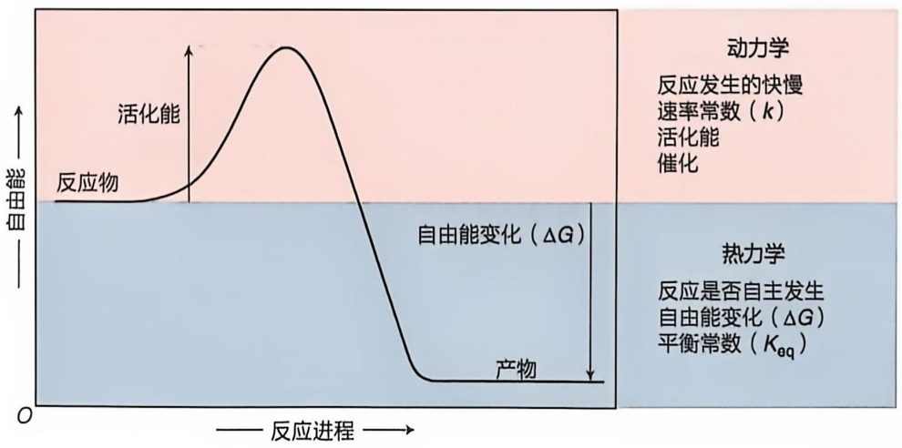

line

| Phase | Description |
| --- | --- |
| 动力学 | 反应发生的快慢 速率常数 (k) 活化能 催化 |
| 热力学 | 反应是否自主发生 自由能变化 (ΔG) 平衡常数 (Keq) |

---

1.2 生物分子的特性可从化学和物理学等角度进行表征

027

研究表明，包括化学反应在内的生命过程也遵循两条基本的热力学定律:①描述能量守恒的热力学第一定律，即能量既不可被产生也不可被消灭，只可从一种形式转变为另外一种形式；②描述自然界何种热力学过程不可发生的热力学第二定律，即不可能从单一热源取热使之完全转换为有用功而不产生其他影响，或一种孤立系统的熵值（无序度）永远不会降低而只会增加，或热量不会自发地从低温物体转移至高温物体。

## (2) 可逆化学反应的速率可通过动力学分析表征

就一种化学反应而言，人们不仅要判断其发生的方向和程度，还需知道其发生的快慢。后者属于化学动力学（chemical kinetics）所需回答的问题。与热力学不同的是，动力学必须关注化学反应发生的具体过程，因为一种化学反应发生的快慢与反应过程高度相关。

1930 年代，美国学者亨利·艾林（Henry Eyring，1901—1981）等提出，在任何化学反应发生过程中，其反应物必须经过一种能量水平高且极其不稳定的过渡态才可转变为产物（图 1-4）。过渡态与反应物之间的能量差，就是反应物转变为产物所必须经历的一种能垒，这被称作活化能（activation energy，一般用  $\Delta G^{\ddagger}$  表示）。一个化学反应的速率常数（k）与活化能（ $\Delta G^{\ddagger}$ ）相关:

$$
k = \frac {k _ {\mathrm{B}} T}{h} \mathrm{e} ^ {- \Delta G ^ {\ddagger} / R T} \tag {1-4}
$$

式中， $k_{B}$  为玻尔兹曼（Boltzmann）常数（ $k_{B}=1.381\times10^{-23}J\cdot K^{-1}$ ）；h 为普朗克（Planck）常数（ $h=6.626\times10^{-34}J\cdot s$ ）；R 为气体常数（ $R=8.314J\cdot mol^{-1}\cdot K^{-1}$ ）；T 为热力学温度（单位为 K）。活化能越高，反应速率越低；活化能越低，则反应速率越高。

## 1.2.6 生物化学反应等生命过程中的能量转换可通过自由能概念表征

19 世纪，热力学概念开始被用于描述能量转换过程。热力学代表一种与经典力学完全不同的范式:热力学定律与经典力学中占据核心地位的惯性定律、加速度定律和作用力与反作用力定律等几乎完全无关。它代表科学认识的一种深化，具体体现在以下方面:从优化热机效率的工程实践揭示能量转换的理论；从热机运转的宏观过程认识到分子热运动的微观过程；从热机运转的具体现象认识到自由能、熵和焓等抽象概念；从对化学反应、机械运动的观察建立平衡态统计分析的方法，等等。

顾名思义，热力学关注的是热能与机械能（力）之间的转换规律。在19世纪，人们认识到，热并非一种物质，而是一种能量形式。1820年代，法国学者萨迪·卡诺（Sadi Carnot，1796—1832）等在试图改进蒸汽机的过程中探究了热作为一种机械运动驱动力的规律，逐渐认识到了热能与机械能两种能量形式之间的有效转换机制。尽管卡诺提出的理论长期未被重视，但这是热力学的前身。

1840 年代，德国学者赫尔曼·亥姆霍兹（Hermann von Helmholtz，1821—1894）

---

028

1 生命的化学基础

等基于对肌肉产热生理过程等的观察，提出了能量守恒定律（即热力学第一定律）。该定律表明，热、光、电等不同的能量形式可从一种形式转换为另一种形式，但能量本身既不能被消灭，也不能被创造。1860年代，德国学者鲁道夫·克劳修斯（Rudolf Clausius，1822—1888）等观察到，热机输出的机械能总是少于对其输入的热能（即热力学第二定律）。克劳修斯为了描述起始和终止热系统的差异，引入熵这一概念，以反映物质（分子）的分散度或无序度。据此，热力学第二定律也可被描述为:在封闭系统中，热现象有关的一切宏观过程总是向着熵（无序度）增加的方向进行；当熵达到最大值时，系统处于平衡态。但这些认识仅仅对现象进行了一种定性描述，当时尚缺乏对现象的定量描述。

1870 年代，美国学者吉布斯等将热力学概念从物理学延伸到了化学领域，催生了化学热力学。他建立了一种针对化学反应的热力学参数——吉布斯自由能（简称自由能，G）；通过引入该参数将恒压条件下发生的化学反应中的焓（H）、熵（S）以及温度（T）等参数进行了有效整合:

$$
G = H - T S \tag {1-5}
$$

式中的焓反映了一种化学反应的内能、压力和体积等因素的综合影响。

因为是状态函数，人们在探究能量（自由能）转换过程中无需考察这些热力学参数的绝对值，而仅需关注各自的变化。因此式（1-5）可被转化为:

$$
\Delta G = \Delta H - T \Delta S \tag {1-6}
$$

通过这个公式，热力学领域的概念被用于表征化学反应发生的方向和程度。但因有关参数过于复杂和抽象，该公式经过一个相当漫长的过程才被化学家们逐渐关注和应用。

19 世纪八九十年代，荷兰学者雅各布斯·范托夫（Jacobus van't Hoff，1852—1911）等建立了在恒温恒压条件下发生的化学反应的自由能变化与其产物和反应物浓度之间的关系式:

$$
\Delta G = \Delta G ^ {\ominus} + R T \ln Q \tag {1-7}
$$

式中，$\Delta G$ 被定义为一种化学反应的实际自由能变化，反映化学反应在特定温度及一定反应物和底物浓度条件下可以做的最大功；$\Delta G^{\ominus}$ 被定义为化学反应的标准自由能变化，即当所有反应物（包括产物）都处于 $1 \mathrm{~mol} / \mathrm{L}$ 浓度条件下的自由能变化；$R$ 为理想气体常数；$T$ 为绝对温度；$\ln$ 为自然对数；$Q$ 为反应商（reaction quotient），即特定时间点的产物浓度乘积与反应物浓度乘积之比［就式（1-1）而言，$Q = \frac{[\mathrm{C}][\mathrm{D}]}{[\mathrm{A}][\mathrm{B}]}$］。

对于一种可逆化学反应，当达到平衡状态时，其反应体系的自由能不再变化，即 $\Delta G = 0$ ，此时，反应商恒定且等于平衡常数。据式（1-7），$\Delta G^{\ominus} = -RT\ln Q$ 。处于平衡状态时的反应商等于反应的平衡常数 $K_{\mathrm{eq}}$ ，因此:

$$
\Delta G ^ {\ominus} = - R T \ln K _ {\mathrm{eq}} = - 2. 3 0 3 R T \lg K _ {\mathrm{eq}} \tag {1-8}
$$

由此，抽象的自由能概念与化学家所熟悉的且可测定的平衡常数存在直接关联。这使得自由能变化（标准自由能变化和实际自由能变化）对于任何一个特定可逆化学

---

1.3 碳是形成生物分子的核心元素

029

反应而言，都成为可测定的特征参数。这把对可逆化学反应的能量学和反应平衡的表征推进到一个新高度。

从此，一种可逆化学反应在特定条件下的发生方向和程度可通过测定其实际自由能变化而确定。如果 $\Delta G < 0$ ，则反应主要沿正向发生；如果 $\Delta G > 0$ ，则沿逆向发生；如果 $\Delta G = 0$ ，则反应达到平衡状态，即正向和逆向发生的速率相等。

至此，一种可逆化学反应便可从热力学和动力学两个角度进行表征，这促进了物理化学这个重要交叉学科的出现。

虽然，人们还很难将自由能变化等参数直接有效应用于描述发生于生物体内的可逆化学反应，但至少可以用其来表征体外发生的酶促化学反应。鉴于生物体内发生的酶促可逆化学反应一般都在中性 $\mathrm{pH}$ 条件下发生，所以在体外对生物化学反应进行分析时一般都将 $\mathrm{pH}$ 设置为7；所测定的自由能均加上一撇，即以 $\Delta G^{\ominus}$ 表示，以区别于不考虑 $\mathrm{pH}$ 时所测定的 $\Delta G^{\ominus}$ 。

## 1.3 碳是形成生物分子的核心元素

碳元素（carbon，C）在生物分子中广泛存在。鉴于此，人们对其物理化学特性进行了长期研究。结果表明，碳原子的结构非常独特。一方面，它具有形成高度多样共价键的能力，在自然界可形成超过百万种的含碳化合物。另一方面，碳原子参与形成的生物分子大多具有三维空间结构。碳元素在生命演化进程中扮演了极其关键的角色，其重要性是其他任何元素所无法比拟的。就去除水分后的细胞干重而言，碳元素占据其质量的一半以上。如果没有碳原子存在，地球上的生命也不会出现。以下介绍碳元素的主要特性。

## 1.3.1 碳原子与碳原子或其他原子之间可形成共价键

尽管碳元素在地壳所含元素中仅占大约 0.03% 但在生物分子中却广泛存在，它的多方面物理化学特征使其成为形成生物分子的核心元素。

作为一种非金属元素，碳在元素周期表中的原子序数为6（图1-1），原子量一般为12（含6个质子和6个电子）。6个电子中的2个位于原子核内层；另外4个电子位于外层，可参与共价键的形成（图1-5A）。由于碳原子的最外层以拥有8个电子为最稳定结构，因此每个碳原子最多可与其他原子共享4个电子而形成4个共价单键，达到最稳定状态。

碳原子具备多种成键能力。在形形色色、多种多样的生物分子中，碳原子（C）除了自身之间形成 C—C 共价单键之外，它还可与氢、氧和氮等多种原子形成 C—H、C—O 和 C—N 等共价单键。此外，碳原子还可与自身或其他原子形成共价双键或三键。碳原子形成多样共价键的能力在地表所存在元素中极其罕见。

---

030

1 生命的化学基础

图 1-5 碳原子结构及其成键特征

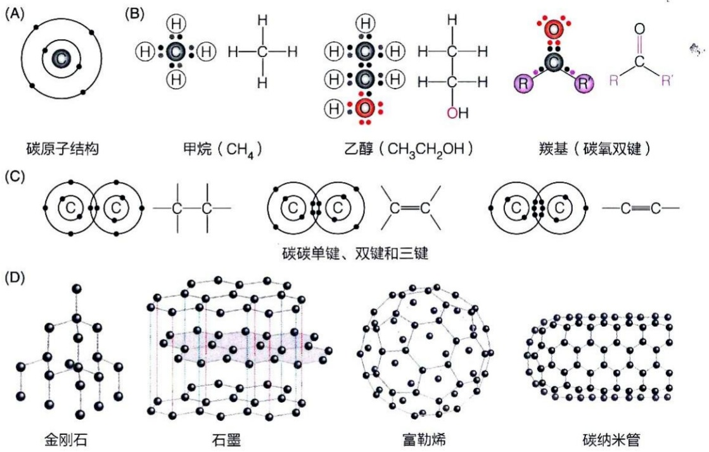

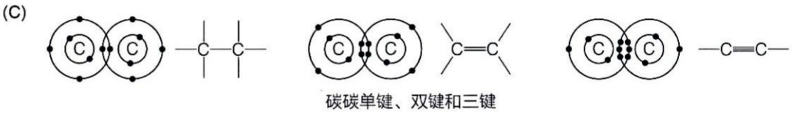

自然界存在的碳元素大多为  ${}^{12}C$  同位素，而氧元素为  ${}^{16}O$ 、 ${}^{17}O$  和  ${}^{18}O$  三种同位素 \* 的混合物。因此自 1961 年起， ${}^{12}C$  取代了氧成为测定其他所有元素原子量的标准。值得注意的是，自然界也存在少量  ${}^{14}C$  放射性同位素（半衰期大约为 5730 年）及少量稳定重同位素  ${}^{13}C$ 。 ${}^{14}C$  常用于测定化石等含碳有机物的年龄（一般限于 5 万年之内）；利用人工制备的  ${}^{13}C$  标记特定的生物大分子，则可通过核磁共振波谱学分析生物大分子三维结构（见第 5 章）。在进行代谢分析过程中，可在生物分子中引入  ${}^{13}C$，通过质谱分析追踪生物分子在生物体内的代谢去向（见第 5 章）。C—C 单键和 C=C 双键广泛存在于生物分子中，而碳碳三键尚未在生物分子中发现。这些共价键都相当稳定，但在一定条件下也可发生断裂和重组，这使得各种含碳有机分子之间可进行有效的化学转换（包括氧化分解等）。

在自然界，非生物体内的碳原子也可通过形成共价键而产生多种独特结构（图 1-5D），包括石墨和金刚石。另外，基于对碳原子能形成多种稳定结构的认识，人们先后发现了富勒烯（fullerene）和碳纳米管。富勒烯是由碳原子组成的空心笼状分子，形似足球；碳纳米管则是由碳原子形成的细长中空圆管（图 1-5D）。它们都展现了碳元素构成复杂三维结构的非凡能力。这些由单一碳元素形成的成键方式和结构不同的分子被称为同素异形体（allotrope）。但只含碳元素的物质并未在生物体内发现。

## 1.3.2 大多数生物分子可被视作碳氢化合物的衍生物

就含碳生物分子而言，可将由碳原子和氢原子通过共价键形成的碳氢类化合物

<small>\* 同位素为同一种元素的不同形式，它们的原子序数相同，但原子量不同，即质子数相同，但中子数不同；一般将原子量置于元素符号的左上方，以区别不同同位素。</small>

---

1.3 碳是形成生物分子的核心元素

031

（分子式  $C_{n}H_{m}$ ）看作其衍生起始点。基于上述碳原子之间的成键特性，碳氢化合物能以烷烃（具直线、分支或环形结构）、烯烃（含碳碳双键）、炔烃（含碳碳三键）、芳烃（含芳香环）等不同形式存在。

尽管单纯的碳氢化合物在生物体内不多见，但如果将碳氢骨架上的氢原子替换为氧、氮、硫、磷等原子或含有它们的基团，即可衍生出许多重要的生物分子（图1-6）。例如，当氢原子被氧原子替换时，即可形成含羟基、醚基、羰基、羧基、酯基等基团的生物分子；当氢原子被氮原子替换时，则可形成含氨基、亚氨基、胍基、咪唑基及席夫碱等基团的生物分子；当氢原子被硫原子替换时，则可形成含巯基的生物分子。换句话说，生物体内存在的各种醇、胺、醛、酮、酸、酯等类型的分子，包括蛋白质、核酸、脂质和糖类等重要生物分子，皆可被看作是碳氢化合物的衍生物。在后面的章节可以获知，一种生物分子的独特化学和生物“个性”，决定于其所含官能团的本质及空间排布。

## 1.3.3 含碳化合物可形成具有不同构型的立体或平面异构体

除具有极强的成键能力外，碳原子还可形成化学结构完全相同但空间结构不同的立体异构体（stereoisomer）。立体异构体分为两大类，一类是由不对称碳原子或 C=C 双键而形成的构型（configuration）异构体，另一类则是因 C—C 单键自由旋转所形成的构象（conformation）异构体。以下介绍构型异构体。

## (1) 含不对称碳原子的化合物可形成构型异构体

碳原子成键的一个重要特征是 4 个单键呈四面体排列（图 1-7A）。这是法国学者巴斯德为了解释酒石酸以两种旋光活性形式存在这一现象而提出的概念。酒石酸分子所形成的四面体结构特征在 1950 年代通过 X 射线晶体衍射分析得到了确认。

对原子核外围电子分布特征的探究结果表明，碳原子成键具有以下三维特征:当1个碳原子与另外4个原子（如氢原子）形成单键连接时，由于这4个原子的电子云需尽量各自远离，它们在空间上就会形成一种呈正四面体形状的立体分布特征:碳原子位于正四面体的中心，4个成键原子分别位于正四面体的4个角上。这样每两个单键之间的夹角均为 $109.5^{\circ}$ 。在金刚石中，每个碳原子与另外4个碳原子之间也为四面体结构（图1-6D）。这种四面体成键特征使得碳原子通过“线性”连接形成的烷烃的碳骨架并非直线结构，而是呈“之”字形。这是含碳有机化合物大多具有立体结构的化学基础。

碳原子的立体成键特征导致了不对称碳和对映异构体（也称手性异构体）的存在。具体而言，当1个碳原子与4个不同原子（或基团）形成单键时，必然存在两种不同的空间排布方式（图1-7B），由此形成的两种立体异构体之间具有镜像关系，被形象地称作对映异构体（enantiomer）。此外，对映异构体之间也可类比于人左手和右手之间的关系，所以对应的碳原子被称作手性（chiral）或不对称（asymmetry）碳。一对对映异构体分子之间存在的共价键连接方式差异，被定义为具有不同的构型

---

032

1 生命的化学基础

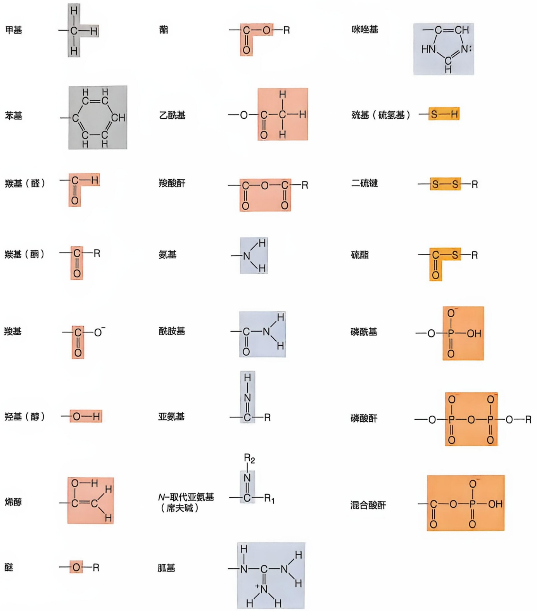

chemical

Structural formulas of various amino acids and nucleotides, including methyl, ester, carboxylic acid, and phosphate groups

图1-6 大多数生物分子中的官能团可被视作碳氢化合物的衍生物

---

1.3 碳是形成生物分子的核心元素

033

(configuration)，两种构型之间需通过共价键的断裂和重新形成才可相互转换。

显然，当一种分子中含有 n 个不对称碳原子时，则一共可形成  $2^{n}$  种对映异构体。例如，作为一种六碳糖，葡萄糖分子含 4 个不对称碳原子，因此可形成  $2^{4}=16$  种不同的立体异构体，而生物体内的 D-葡萄糖仅代表这 16 种立体异构体中的一种（见第 14 章）。

两种对映异构体分子的化学性质几乎完全相同，因此无法通过常规的化学方法将它们进行区分。如前所述，对映异构体是基于它们具有不同旋光性这一物理特征而被发现的，如果其中的一种异构体使平面偏振光向左旋转，那么另外一种将使偏振光向右旋转，但二者旋转的幅度完全相同（图 1-8）。

(2) 含碳化合物也可因 C=C 双键的存在而产生构型异构体

除上述因不对称碳原子的存在而产生的对映异构体构型之外，含碳化合物还可因 C=C 双键的存在而产生顺反（构型）异构体。

就键长而言，C=C 双键为 0.134 nm，而 C—C 单键为 0.154 nm。更为重要的是，在 C=C 双键中，成键的 2 个碳原子与和它们通过单键相连的 4 个原子均处于同一刚性平面内。对于一种含 C=C 双键的分子而言，如果每个碳原子各自所连接的两个基团不完全相同，则可形成顺式（cis）或反式（trans）两种不同

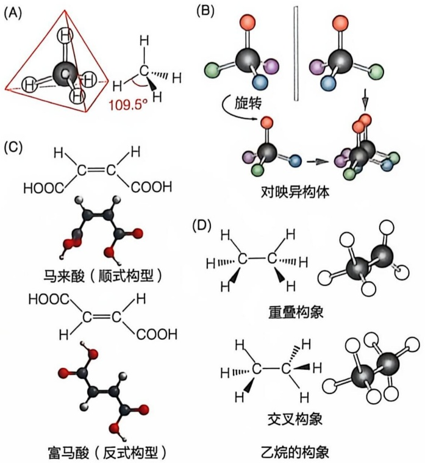

图 1-7 含碳化合物可具不同构型和构象

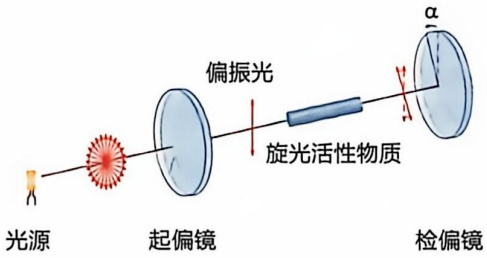

text_image

光源
起偏镜
偏振光
旋光活性物质
检偏镜
α

图 1-8 对映异构体可使平面偏振光向不同方向旋转

的构型（图 1-7C）。在顺式构型中，两个较大基团位于双键的同侧，而在反式构型中，则位于异侧；它们之间也互为空间异构体，被称作顺反异构体。双键碳原子在内的6个成键原子皆位于同一平面而不涉及三维空间，所以这种结构差异也被称作不同的几何构型。例如，化学式为  $C_{4}O_{4}H_{4}$  的分子中存在一个 C=C 双键，与每个碳原子相连的是 1 个羧基和 1 个氢原子。该分子能以两种几何构型存在:两个碳原子各自连接的较大基团羧基均位于双键同一侧（较小的氢原子位另一侧）所形成的双键为顺式构型，形成的分子被称作马来酸（maleic acid）；羧基位于双键两侧则形成反式构型，形成的分子被称作富马酸（fumaric acid，又称为延胡索酸）（图 1-7C）。

反式构型分子中基团之间的空间位阻显然低于顺式构型，故反式构型分子的稳定性相对更强。对映异构体之间的化学特性几乎完全相同，而顺反异构体之间存在明显的化学和物理性质差异，一般可通过常规化学方法进行有效区分和分离。例如，互为顺反异构体的富马酸和马来酸（图1-7C）的熔点、溶解度甚至两个羧基的解离特征（以 $pK_{n}$ 值反映）都存在明显差异（表1-2）。其实，具反式构型的富马酸是一种重要

---

034

1 生命的化学基础

表 1-2 马来酸与富马酸之间的性质比较

| 性质 | 马来酸 | 富马酸 |
| --- | --- | --- |
| 熔点/°C | 130 | 286 |
| 溶解度(g/L;25°C水中) | 788 | 7 |
| $pK_{a1}$ | 1.9 | 3.0 |
| $pK_{a2}$ | 6.5 | 4.5 |

的代谢中间产物，而具顺式构型的马来酸并不存在于生物体内。

值得再次强调的是，无论是因为不对称碳的存在而形成的两种对映异构体之间，还是因 C=C 双键的存在而形成的两种顺反异构体之间，都必须通过共价键的断裂和重新形成才可相互转换。

## 1.3.4 通过 C—C 单键的自由旋转可形成大量构象异构体

由于 C—C 单键自由旋转而产生的大量立体异构体被定义为具有不同的构象（conformation）（图 1-7D）。构象异构体之间的相互转换无需共价键的断裂和形成；对于较小的含碳分子而言，构象异构体之间的空间位阻差异不大，故稳定性接近，难以各自独立存在和进行区分。例如，对于乙烷这样的小分子而言，通过其 C—C 单键的自由旋转可以产生无数种构象，其中交叉构象比重叠构象稳定（图 1-7D），但两种构象无法被分离，可自由相互转换。然而，很多生物大分子中由于其他非共价相互作用

的存在而出现空间位阻，使得很多 C—C 单键进行旋转所需克服的能障很高，因此在生理条件下它们一般以某一种或几种相对稳定的天然构象形式存在，这种相对稳定构象对生物大分子发挥其特异生物学功能不可或缺。

## 1.3.5 含碳有机分子的立体结构可通过不同方式进行平面展示

碳原子形成 4 个单键时的四面体特征使得含碳有机分子具有三维结构特征，因此在二维平面上难以有效展示两种对映异构体之间的差异，这促使人们设计出了多种在二维平面展示有机分子三维结构的方法（图 1-9）。

最早于 1890 年代设计的费歇尔投影式（Fischer projection）是一套较为简单的展示方法。它以两条垂直相交线段代表一个碳原子形成的四面体结构；碳原子处于交叉点；伸向两侧的水平线分别代表指向纸页前面的 2 个化学键，而向上下伸展的两条垂直线则分别代表指向纸页后面的 2 个键。在此基础上，演化出了透视式（perspective）:以两个实体楔形分别代表指向纸页前面的 2 个化学键，两个虚体楔形代表指向纸页后面的 2 个化学键。透视式展示方法更具立体特征，比费歇尔投影式更加直观形象且易于理解。另外还有球棍（ball-and-stick）模型（以球代表原子，以棍代表化学键）以及

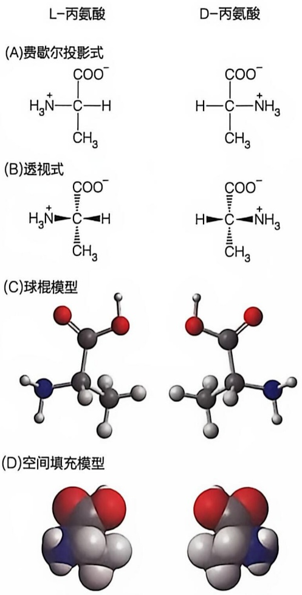

图 1-9 有机分子三维结构的平面展示方式

---

1.4 很多生物分子依赖非共价相互作用形成三维结构而发挥功能

035

空间填充（space-filling）模型（每个原子按照其范德瓦耳斯直径比例画出）等。

这些模型各具优缺点。透视式仅可反映一个不对称碳原子所连接的4个单键的方向；球棍模型除了可粗略反映4个单键的空间方位之外，还可反映分子中不同共价键的相对长度和相互之间的夹角大小；空间填充模型则可反映分子中每个原子的相对半径以及分子的整体外观。理论上，更大的有机分子如蛋白质等也可通过类似方式展示，但需借助计算机软件实现。

需要注意的是，蛋白质等生物大分子的空间结构既包括其构型特征（即所含双键和不对称碳原子的特定构型异构体），也包括其构象特征（即所有 C—C 单键所处空间结构）。

## 1.4 很多生物分子依赖非共价相互作用形成三维结构而发挥功能

原子间的共价键连接固然是生物分子形成的基础，但在此基础上，生物分子还存在非共价相互作用。尽管对于这样的弱相互作用进行实验表征仍存在诸多挑战，但已经明确的是，它们对于生物分子三维结构的形成和维持，以及生物分子之间进行特异性识别等都极为重要。从某种意义上说，生物大分子的空间结构是通过非共价相互作用而逐级组装形成的。因此，认识非共价相互作用对于认识生命的本质至关重要。

## 1.4.1 对非共价相互作用认识的历史较短

对分子间发生非共价相互作用的认识可能开始于17世纪对晶体形成现象（即颗粒之间的紧密堆积）的观察和思考。1870年代荷兰学者约翰尼斯·范德瓦耳斯（Johannes van der Waals，1837—1923）观察到，一种物质在液态和气态之间存在一定的连续性，并无绝对的界限，并且认为处于液态时形成了动态的分子簇（即并非像固态一样完全有序，也非像气态一样完全无序），这是人们认识分子间弱相互作用的开始。分子簇被认为是分子通过弱相互作用暂时形成的有序结构。

尽管弱相互作用对于生命现象的存在极为重要，但对其的科学表征晚于对共价相互作用约半个世纪。例如，对于氢键的认识开始于1920年代前后；而疏水效应概念到1950年代末才形成。非共价相互作用（non-covalent interaction）这一术语在1970年代才开始被使用，在此之前被描述为“分子间相互作用”或“黏性相互作用”，而且属于假想性的认识。

自 1930 年代以来，人们逐步认识到，蛋白质和核酸等生物大分子特异三维结构的形成以及生物分子间特异性识别的发生，基本上都由弱相互作用决定。对蛋白质三维结构的认识开始于对蛋白质变性现象的观察。中国学者吴宪（Tsian Wu，1893—1959）于 1931 年提出的蛋白质变性理论认为，蛋白质变性的关键特征是紧密盘绕

---

036

1 生命的化学基础

在一起的多肽链的伸展，但不涉及共价键的断裂。1936年，美国学者莱纳斯·鲍林（Linus Pauling，1901—1994）等提出，蛋白质变性是维持其结构的弱相互作用（当时主要指氢键）的破坏所致。

## 1.4.2 生物系统中主要存在 4 种非共价相互作用

包括离子相互作用（也被称为盐桥）、氢键、范德瓦耳斯相互作用和疏水效应在内的弱相互作用概念逐渐进入生物化学家的视野，并已成为人们认识生物大分子形成其三维结构以及发生相互作用等生物过程的关键概念。因对其进行定量分析和理论表征的系统尚有待建立，以下仅对这4种非共价相互作用进行定性描述。

## (1) 离子相互作用是一种典型的静电相互作用

离子相互作用是存在于带正电荷和带负电荷（如中性 pH 条件下的氨基与羧基）基团之间的一种近距离静电吸引力（图 1-10A）。相反，如果两个基团均带正电荷或均带负电荷，则会产生静电排斥力。对生物分子而言，离子相互作用的形成依赖于两个带相反电荷基团之间的近距离直接接触，可以与带电基团发生相互作用的因子如水或其他离子的存在等都可能干扰这种静电相互作用，使离子相互作用减弱甚至完全消失。

## (2) 氢键是由带正电荷的氢原子所介导形成的分子内或分子间相互作用

1920 年代，在对水、氨和盐酸的介电常数（dielectric constant，一种反映特定物质的介电或绝缘性能的参数；它也反映该物质对电荷的屏蔽效应，数值越高，则屏蔽效应越强）进行比较时，人们观察到，在两个水分子或两个氨分子之间可形成一种由氢原子介导的弱键。在此基础上，鲍林于 1930 年代正式提出了氢键这一概念，并认为它是维持蛋白质等生物大分子天然三维结构的一种重要相互作用力。

具体而言，氢键（hydrogen bond）可以定义为一个与电负性的供体原子（如 N 或

图 1-10 存在于生物系统中的 4 种非共价相互作用示意图

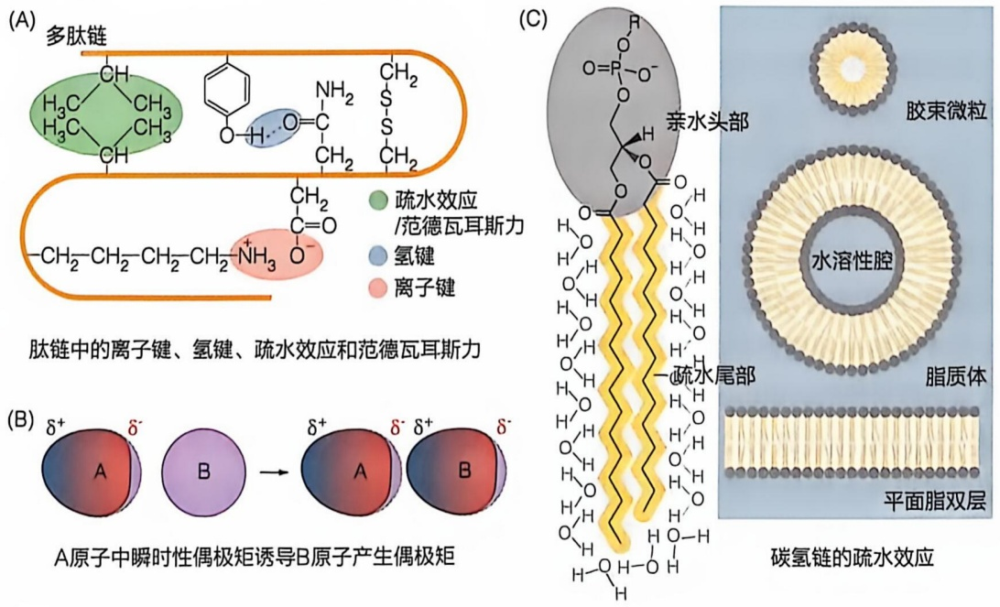

---

1.4 很多生物分子依赖非共价相互作用形成三维结构而发挥功能

037

O 等）共价连接的氢原子与一个带有孤对电子的受体原子（如 N 或 O 等）之间的相互作用（图 1-10A）。这种相互作用并不共享电子，其本质是静电相互作用。显然，如果形成氢键的三个原子（两个电负性原子和一个氢原子）处于同一条直线上，则所形成的氢键最强，否则会减弱，故氢键具有方向性。在蛋白质、核酸和多糖分子形成三维空间结构或与其他分子发生相互作用过程中，普遍依赖特异基团之间形成氢键。

## (3) 范德瓦耳斯力发生于处一定距离范围内的所有非带电基团之间

第三种非共价相互作用是由范德瓦耳斯于1880年代为解释气体分子之间的相互作用而提出，被称作范德瓦耳斯力。它是基于一定距离范围内不带电但具极性或不具极性的中性基团的原子之间，因为永久存在或瞬时被诱导所产生的电偶极矩之间的弱静电相互作用力（图1-10B）。后续研究表明，这种弱相互作用也存在于液体或固体分子之中或之间，而且比气体分子之间的效应更强。尽管范德瓦耳斯力最早作为一个分子整体与另一分子整体之间的相互作用而被描述，但在一个生物大分子内部，某些处于一定距离范围的基团（原子）之间也可产生类似相互作用，如蛋白质内部的某些整齐排列的疏水基团之间。

## （4）疏水效应是非极性基团或分子之间因被水分子的排挤而被迫接近的一种相互作用

第四种非共价相互作用被称作疏水效应（hydrophobic effect）。它是非极性的分子或基团之间被水分子排挤后聚集在一起的倾向；它不是严格意义上的相互作用，而仅仅是一种热力学效应。但当这样的疏水基团紧密排列在一起时，可以发生范德瓦耳斯力。

1890 年代，人们观察到油分子可在一个水体的表面形成薄层，这是对疏水效应的最初科学观察。但直到 1950 年代，人们才意识到疏水效应是一种促使生物分子形成重要结构的驱动因子，即蛋白质分子折叠的主要驱动要素。它被定义为因水分子的排斥而产生的非极性基团（如碳氢链）或分子之间进行被迫缔合的现象（图 1-10C）。人们对疏水相互作用微观本质及特征的认识还相当有限，尚存在不少争议。

## 1.4.3 生物分子间通过非共价相互作用进行立体特异性识别

早在1890年代，德国学者埃米尔·费歇尔（Emil Fischer，1852—1919）等就观察到，$\alpha-$ 葡萄糖苷能被转化酶水解，但不能被苦杏仁酶水解；相反，$\beta-$ 葡萄糖苷却能被苦杏仁酶水解，但不能被转化酶水解。为解释此现象，他提出，酶与葡萄糖苷之间为发生化学反应必须像锁和钥匙一样相互结合在一起。这是对分子立体特异性识别现象的最早认识之一。

后续研究表明，生物体内的酶促化学反应大多具立体特异性。对于含手性碳的分子而言，酶分子仅识别其中的一种手性异构体作为反应物或只产生其中的一种异构体作为产物。酶催化的这种立体特异性特征通过测定酶的三维结构得到了印证:所有酶的活性中心均具不对称空间结构。例如，细胞中大多只产生L-氨基酸并利用其进行蛋白质合成，却很少合成其对映异构体D-氨基酸或利用其合成蛋白质分子。这导致

---

038

1 生命的化学基础

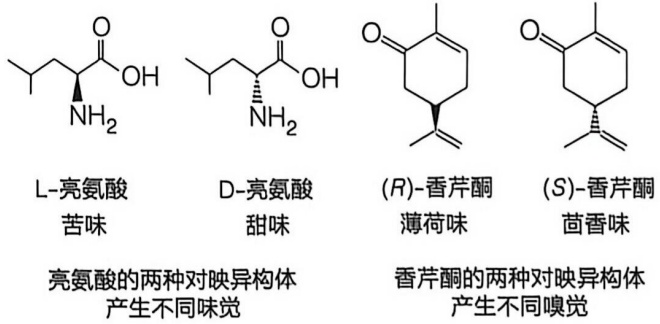

chemical

四种亮氨酸与香芹酮的化学结构式对比图，标注各化合物名称及味觉含义

图 1-11 生物分子间的相互作用大多具有立体特异性

所有蛋白质分子中的氨基酸均为 L-氨基酸。

人们逐渐认识到，除酶之外的其他蛋白质分子发挥功能时也具有类似的立体特异性识别现象。某些物质的两种对映异构体可被人体的味觉受体进行精细区分，如L-和D-亮氨酸分别被人体味觉受体识别产生苦味和甜味，而香芹酮（carvone）的两种对映异构体则可被人体嗅觉受体识别产生完全不同的嗅觉（图1-11）。

结构测定等结果表明，这种立体特异性的识别均通过非共价相互作用实现。在后面的章节可以获知，生物

分子间的立体特异性特征普遍存在，体现在很多生命过程中。这种立体特异性反映了生命过程的高度精确性，不仅为区分两种对映异构体提供了有效手段，也为人们认识立体特异现象提供了另外一种视角。

## 1.5 某些含碳化合物是生命能源的储存和提供者

大小不一、种类繁多的含碳有机分子在不同生命过程中发挥各种各样的生物学功能。某些有机分子是生物能源的短期或长期储存者，其氧化可释放能量，以驱动各种耗能生命过程的发生。有机化合物所发挥的这种能量储存作用，对于地球生命现象的存在不可或缺。

具体而言，这既涉及有机化合物通过还原性途径的合成，也涉及它们通过氧化性途径的有效分解（图 1-12A）。为此，生物体演化产生了相应的代谢途径。例如，某些植物和微生物通过光合作用过程，即利用捕获的太阳能将大气中的  $CO_{2}$  固定（转化）成糖类化合物（如葡萄糖等），形成的单糖分子可通过共价键连接成多糖（如植物中的淀粉或动物中的糖原）进行能量的短期或中期储存。在动物体内单糖分子也可被转化为脂肪酸并进一步合成脂质（如三酰甘油），进行能量的长期储存（图 1-12B）。含碳化合物是无法进行光合作用的异养生物或者光合生物在黑暗环境中所必需的。尽管糖类可快速提供能量，但仅可短期储存，且存量较低；相反，脂质尽管供能速率较

图 1-12 有机化合物是生物能量的储存者和提供者

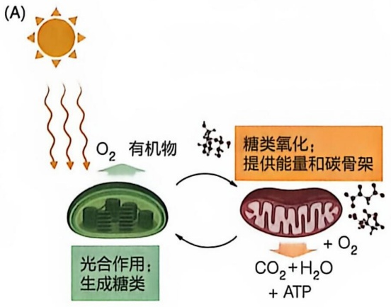

flowchart

(B)

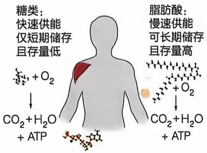

text_image

糖类：
快速供能
仅短期储存
且存量低

脂肪酸：
慢速供能
可长期储存
且存量高

CO₂ + H₂O
+ ATP

CO₂ + H₂O
+ ATP

---

1.6 生物分子最初可能通过地球表面的化学过程产生

039

慢，但可长期储存，且存量很高。具体将在相应章节详细介绍。

生物体内储存的糖类和脂质物质，在需要的时候可以先降解为其基本单位，然后氧化分解成  $CO_{2}$  和  $H_{2}O$  并释放能量，释放的能量经由能量货币分子 ATP，可驱动多种多样的耗能生命过程。例如，糖酵解、β 氧化、柠檬酸循环和氧化磷酸化等均涉及将糖类和脂质等化合物储存的能量通过氧化分解释放并合成 ATP 的过程。此外，这些分解代谢途径还为合成形形色色的生物分子提供了前体。能量和前体的提供对生命过程均不可或缺。

显然，有机化合物的合成和分解代谢途径是生命现象得以演化的关键。这些分解和合成代谢途径是如何演化产生的呢？这也是认识地球生命现象的一个重要方面。

## 1.6 生物分子最初可能通过地球表面的化学过程产生

达尔文于 1850 年代提出物种演化理论后，人们结合对细胞（特别是组成细胞的有机分子）复杂特征的认识，对生物体内形形色色分子的结构、功能及转化过程等开展了广泛而深入的研究。在此背景下，一个显而易见的科学问题是，在地球存在的大约 45 亿年的时间里，在第一个祖细胞以独立生命形式出现之前，形成生命所需的生物分子是何时、何地并通过何种方式产生的呢？为此，人们只能依据至今仍存在于地球上的不同生命形式（特别是单细胞生物）以及生物化石的特征等进行推测。但是，我们可能难以准确地知道早期的地球生命究竟是如何演化产生的。

人们认识到现生生物体内的关键分子组分是蛋白质和脱氧核糖核酸（DNA）。对生命现象而言，蛋白质分子的催化功能和 DNA 分子携带遗传信息的功能是最为根本性的和不可或缺的两类功能。这里需要回答两个问题:第一，蛋白质与 DNA 中哪个先演化形成？就生物学功能而言，似乎只有同时演化产生才行。这表明，按照这样的逻辑提问题本身可能就是错误的。第二，形成蛋白质和 DNA 所需的基本单位即氨基酸和核苷酸分子最初是否可能通过地球表面的化学过程从简单无机分子生成？

## 1.6.1 地球上的始祖细胞可能在极长时间尺度里通过非生命过程形成

19 世纪颇为流行的活力论（vitalism）认为，活的生物体中存在一种 “生命力”，它使得生命世界与非生命世界截然不同。据此，有机世界最初可能并非产生于无机世界。基于此认识，人们提出了生命来自地球外太空的生物外源论。但随着马克思和恩格斯的唯物哲学理论，特别是恩格斯的唯物辩证法理论的提出，人们认识到，尽管复杂，但生命也必然存在一种可以被认识的物理起源。一批生物学者，包括探究酶这类生物催化分子的苏联学者亚历山大·奥巴林（Alekandr Oparin，1894—1980）以及探究遗传和酶促现象的英国学者约翰·霍尔丹（John Haldane，1892—1964）等，于1920年代提出了地球生命的物质起源假说。

---

040

1 生命的化学基础

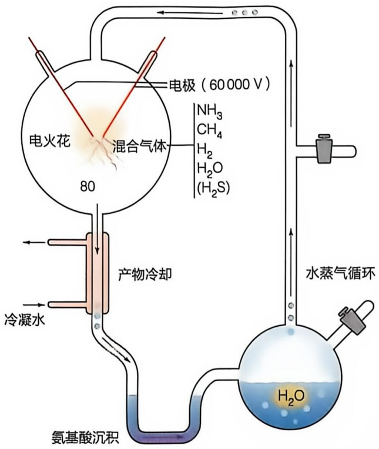

chemical

Electrochemical cell diagram for ammonia gas purification and ammonia hydrolysis, showing components like emitters, mixture gas, and water vapor circulation.

图 1-13 模拟早期地球表面产生生物分子化学过程的实验

他们认为，在几十亿年前尚无氧气存在的原始地球表面的还原性大气中，存在甲烷、氢气、氨、二氧化碳、硫化氢和水等简单无机分子。通过闪电、太阳光紫外线或热等提供的能量，可能在地球表面发生化学反应，从简单到复杂，并最终形成简单有机分子。由于缺乏氧气和微生物，形成的有机分子并不会被快速降解，逐渐积累而形成某种“原始汤”（primordial soup）。考虑到当时的地球表面可能大部分被海洋覆盖，人们设想最初的生命形式产生于海底火山或其他高温环境中，具体产生的可能为某类微生物。出现于大约39亿年前的、为所有现存生命的最后一个共同祖先（the last universal common ancestor，LUCA）的第一个始祖细胞。也许就是在漫长的时间尺度里，通过化学反应产生的有机分子不断积累并发生相互作用，最后使不可能变成了可能。但发生于远古地球表面的这些化学过程难以在今天的实验室重现。

1950 年代，美国学者斯坦利·米勒（Stanley Miller,

1930—2007）和哈罗德·尤里（Harold Urey，1893—1981）等试图对奥巴林等提出的地球早期生命起源理论进行科学验证。为此，他们模拟早期地球表面的还原性大气，将含有氢气、甲烷、氨、水（后续实验加入了硫化氢）等的混合气体置于电火花（模拟闪电）中一个星期或更长时间，然后收集微量反应产物进行化学鉴定（图 1-13）。他们在产物中检测到了氨基酸、羟基酸、醛类和氢氰酸等物质。值得注意的是，产生的氢氰酸和甲醛等简单分子，被认为是合成更复杂生物分子（如核苷酸碱基）的关键前体。氨基酸（包括简单的甘氨酸和丙氨酸等）的产生暗示，合成蛋白质所需基本元件也许的确可以通过简单化学过程在早期的地球表面产生。但复杂氨基酸（如色氨酸等）能否通过这样的非生物过程合成仍属未知。当然，我们也无法确认这样的模拟实验在多大程度反映了早期生命在地球上演化产生的化学过程。

如果地球上的始祖细胞的确可以通过这样的非生命过程产生，那它如何进行分裂，又如何演化产生出今日地球上存在的极其多样的单细胞和多细胞生物呢？回答这样的问题同样充满挑战，人们目前只能通过提出假说的方式进行猜测。

对地球现存生物和生物化石的研究表明，第一个始祖细胞可能继续演化产生出了类似现存古菌这样的单细胞生物。但这样的单细胞生物很少能以化石形式保留，所以对它们在生命演化过程中的角色只能是猜测性的，难以被证实或证伪。

地球生物演化过程中发生的一个关键事件是大气中氧气的出现，这是在大约25亿年前由类似蓝细菌这样的光合微生物通过裂解水分子而产生。对当时的大部分生物而言，氧气具有强“毒性”，很可能导致了大量微生物种类的灭绝。但其中少部分微生物种类不仅适应了氧气的存在，而且演化出了更为有效的能量获取途径（即

---

1.6 生物分子最初可能通过地球表面的化学过程产生

041

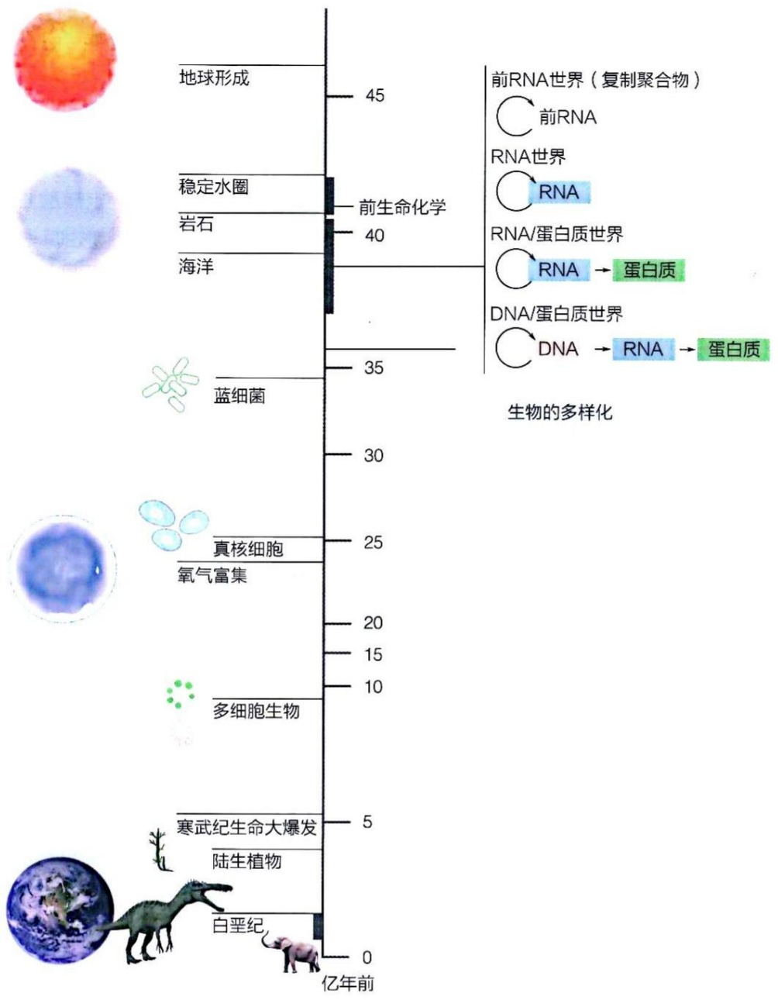

bar

| Biological Process | Duration (Years) |
| :--- | :--- |
| 地球形成 | 45 |
| 稳定水圈 | 40 |
| 岩石 | 40 |
| 海洋 | 35 |
| 蓝细菌 | 35 |
| 真核细胞 | 25 |
| 氧气富集 | 20 |
| 多细胞生物 | 10 |
| 寒武纪生命大爆发 | 5 |
| 陆生植物 | 5 |
| 白垩纪 | 0 |

图 1-14 地球生命演化的大致时间轴及生命早期演化的 RNA 世界假说

有氧呼吸）。大约20亿年前，具有细胞核的真核生物在地球上出现了。根据美国学者林恩·马古利斯（Lynn Margulis，1938—2011）于1970年代提出的内共生理论（endosymbiosis theory），某些细菌进入真核细胞并成为其一部分，进而演化形成了线粒体和叶绿体。线粒体和叶绿体的产生大大提高了真核细胞的生存能力，使其演化出了更为复杂的生命形式。大约10亿年前，多细胞真核生物在地球上出现，并演化产生了植物、真菌和动物等生物种类（图1-14）。

总之，对于地球生命演化的详细过程，我们难以准确认识，只能根据现存生物或化石的特征进行推理。

---

042

1 生命的化学基础

## 1.6.2 地球上最早产生的生物大分子可能是 RNA

美国学者西德尼·奥尔特曼（Sidney Altman，1939—2022）和托马斯·切克（Thomas Cech）等在1980年代鉴定到某些具催化活性的RNA分子的存在。具体而言，某些存在于细菌和原生动物细胞中的RNA分子可催化RNA分子中特定磷酸二酯键的断裂和重新形成，从而催化RNA前体的加工成熟，形成其最终的功能形式。

美国学者哈利·诺勒（Harry Noller）等在1990年代观察到，用蛋白水解酶等去除大部分蛋白质组分后，细菌核糖体仍可保持其催化肽键形成的活性。但是，如果用核糖核酸酶处理细菌核糖体，则其催化肽键形成的活性却会丧失。这意味着是核糖体中的RNA组分，而非蛋白质组分催化了新生肽链中肽键的形成。当核糖体的三维结构在2000年代被测定时，上述假说得到了强有力的支持:核糖体中催化肽键形成的活性部位全部由RNA分子所占据，并无蛋白质成分存在。

这些发现为一个长期存在争议的生物演化问题——在生命演化过程中究竟是蛋白质分子还是 DNA 分子先出现——提供了一种全新的理论见解。在演化过程中，最先被产生的生物大分子可能既非蛋白质也非 DNA，而是 RNA！可以想象的是，这样的 RNA 分子既可携带遗传信息（如 RNA 病毒），也可催化自身的复制，即同时具有蛋白质和 DNA 的关键特征。据此，人们设想，在蛋白质和 DNA 分子尚未登上历史舞台之前的演化阶段，一个“前 RNA 世界”和“RNA 世界”（RNA world）可能相继出现（图 1-14）。可以设想的是，某些 RNA 分子或类 RNA 分子可催化其自身的复制；但为了进一步提高效率，这种催化和遗传功能后来分别被蛋白质和 DNA 取代了。

当然，RNA 世界假说仅仅解释了生命早期演化的某一方面的内涵，而生命早期的演化还涉及很多其他内容:例如，为个体生长所必需的细胞代谢途径最早是如何演化产生的？使相对稳定的细胞内部与相对多变的外界环境隔开的细胞膜结构是如何演化产生的？等等。总之，就第一个始祖细胞是如何产生的、具有何种特征和模样等问题而言，目前可以帮助人们进行理论思考和推理的素材还相当有限。

## 1.7 生命过程以水为介质

就现生生物而言，其质量的大约 70% 均为水。水被视为生命过程的溶剂或介质。在地球生命演化过程中，碳元素和水分子可能发挥了决定性的作用；也就是说，如果没有它们，地球生命很可能就不会产生。所以人们在探寻其他星球是否存在生命现象时，都会首先考察它是否存在碳元素和水。这一做法的假设是:其他星球上如果存在生命，其形式与地球上的相似或相同。

广义而言，水分子也是一种不可或缺、结构极其独特的生物分子。要认识生命的本质，首先必须了解水分子的独特结构和性质。

---

1.7 生命过程以水为介质

043

## 1.7.1 极性特征使得水分子间可发生非共价相互作用

水是地球上极少数能以固态、液态和气态三种不同形式同时存在的分子。1920年代，基于共价键的电子共享理论，人们提出了水分子具 V 形结构（更早时被错误地认为呈线性结构）且分子间可形成弱相互作用（氢键）的假说。这是人们科学认识水的独特物理和化学特性的开始。

## (1) $\mathrm{H}_{2}\mathrm{O}$ 为具双极性的 V 形分子

水分子（$\mathrm{H}_2\mathrm{O}$）由1个氧原子与2个氢原子分别通过共价单键连接而成，是一种V形极性分子（图1-15A）。与之相比，二氧化碳（$\mathrm{CO}_2$）分子由1个碳原子与2个氧原子通过两个共价双键形成，为线形分子，所形成的两个 $\mathrm{C} = \mathrm{O}$ 双键的极性被相互抵消，使得 $\mathrm{CO}_2$ 成为一种非极性分子（图1-15B）。因此，$\mathrm{H}_2\mathrm{O}$ 和 $\mathrm{CO}_2$ 分子具有完全不同的化学特性。

每个氧原子含 6 个外层电子，故可通过与 2 个氢原子分别形成共价单键而获得 2 个额外电子，形成具 8 个外层电子的稳定结构。在水分子中，氧原子外周的 4 对电子（其中 2 对为自身的孤电子对，2 对为成键的共享电子对）类似碳原子的结构，呈四面体结构（图 1-15A）。氧原子吸引电子的能力更强，导致水分子中的氢原子和氧原子分别带部分正电和负电（分别以 $\delta^{+}$ 和 $\delta^{-}$ 表示），形成具有极性的分子结构。水分子的这种非对称性电子分布特征是水所呈现出的大部分物理化学特性的微观结构基础。

## (2) 两个邻近的水分子间可形成氢键

一个  $H_{2}O$  中的 O 原子与另一个  $H_{2}O$  分子中的 H 原子之间，当距离合适时，可通过静电吸引而形成氢键。 $H_{2}O$  分子中的两个 O—H 共价键长度分别为 0.0965 nm，而

(A)

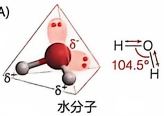

chemical

Molecular structure of water molecules with bond angle annotation and O-H bond length

(B)

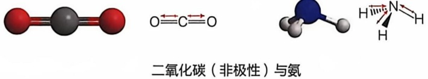

chemical

化学结构式：二氧化碳（非极性）与氨，标注了O=C=O和H-N-H键的化学方程式

图 1-15 $H_{2}O$、$CO_{2}$ 和 $NH_{3}$ 分子的结构以及各自发生相互作用的特性

(C)

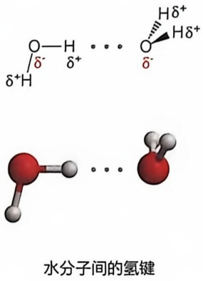

chemical

氢键结构示意图，展示水分子间氢键的化学反应路径

(D)

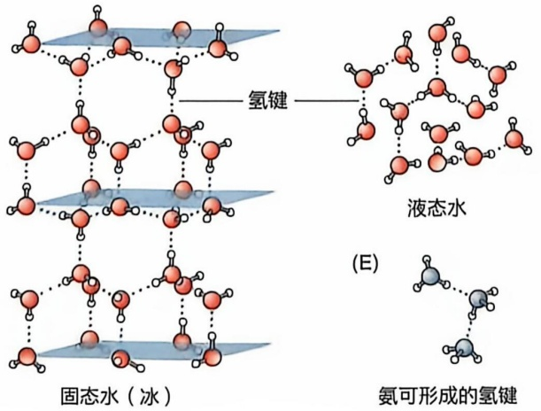

chemical

氢键形成示意图，展示固态水（冰）与液态水的结构对比

---

044

1 生命的化学基础

形成氢键的 O 和 H 原子之间的键长约为其两倍，即 0.177 nm（图 1-15C）。需注意的是，水分子中是由氧原子的两对孤电子与邻近水分子中的氢原子间形成氢键；处于液态时，每个水分子平均可与另外 3\~4 个邻近水分子形成氢键；而处于固态（即形成冰）时，每个水分子可与另外 4 个邻近水分子形成氢键（图 1-15D）。

## 1.7.2 水分子间的非共价相互作用赋予水溶液独特的物理和化学特征

溶液中的每个水分子可与另外3\~4个水分子形成氢键，这导致水分子之间具有高度黏性，也使得水具有高熔点（0℃）和高沸点（100℃）等物理特性。而与其分子量高度接近的氨（NH₃）分子（分子量为17，水的分子量为18）的熔点和沸点却分别为-78℃和-33℃，远低于水。造成如此差异的原因主要有两个:由于氨分子的几何形状和空间位阻，在液态下，每个氨分子平均仅能形成约2个氢键，远少于水分子（图1-15E）；二是氧原子的电负性高于氮原子，使得H₂O分子间的氢键键能高于NH₃分子之间的氢键键能。这些特征使得在地球表面的常见温度范围内，水主要以液态存在，而氨则以气态存在。

水分子的上述独特性质是地球上产生生命的必备条件，同时也塑造了生命现象的演化进程。

## 1.7.3 极性溶质分子可溶解于水溶液，而非极性溶质分子则被水分子排挤

水分子的极性特征不仅使水分子间能形成氢键而产生高度黏性，而且使水分子通过与其他极性或带电分子之间发生静电相互作用而成为大部分生物分子的有效溶剂。因此，无论是带有羟基、氨基或羧基等极性基团的有机分子，还是带有电荷的盐类分子（如 NaCl）或金属离子等溶质都可有效溶解于水溶液中。这样的极性或带电分子被称作亲水（hydrophilic）分子，水分子因此而成为生物体内的有效介质。

同时，水分子的强极性特征导致非极性的有机分子无法与水分子发生有效的相互作用，从而被水分子排斥。这种被水排斥的分子称作疏水（hydrophobic）分子，典型的如由碳氢链等组成的分子。疏水特征使得这些分子可在水溶液中形成独特结构，这对于生命过程也至关重要。无论是蛋白质的折叠过程，还是生物膜的形成（图1-10C），都依赖相关生物分子的部分疏水、部分亲水的结构特征。

值得指出的是，对生物氧化过程至关重要的  $O_{2}$  为非极性气体分子，故无法有效溶解于水。为此，生物体内演化产生了可与  $O_{2}$  分子可逆结合的特异蛋白质分子，可在水溶液环境中（如血液等）运输氧气，典型的如脊椎动物体内的血红蛋白和肌红蛋白，分别发挥运输和储存  $O_{2}$  分子的功能（见第 3 章）。

---

1.7 生命过程以水为介质

045

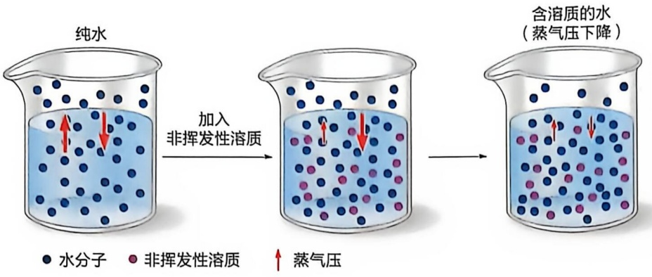

flowchart

图1-16 水溶液的依数性特征

## 1.7.4 溶质分子对水溶液某些物理参数的影响表现出依数性特征

1890 年代，德国学者威廉·奥斯特瓦尔德（Wilhelm Ostwald，1853—1932）等通过设计精确的温度测量设备和恒温槽等，就溶质对水溶液的几种物理参数的影响进行了细致分析。他们观察到，在溶液中加入电解质或者其他组分后将产生蒸气压降低、沸点升高、熔点降低等现象，而且这种影响呈现出依数性（colligative）特征，而且范托夫提出的渗透压参数也具依数性特征。

具体而言，依数性特征的定义如下。加入溶质导致水溶液上述物理参数的变化与所加入溶质的化学本质无关，而仅仅取决于所加入溶质的浓度，即“数量”，或更准确地说是溶质与溶剂分子之间的数量比例。

## (1) 水溶液的依数性特征是溶质的加入导致水分子浓度下降所致

总体看，无论是沸点的升高，还是熔点的下降，都是水溶液表面的蒸气压（vapor pressure）下降所致（图 1-16）。蒸气压可被简单定义为:当一个封闭系统处于给定温度时，一种与系统中的凝聚相（即水溶液）处于热力学平衡状态时的水蒸气给液体表面所施加的压力。它反映液体表面水分子的蒸发速率，后者则与水分子逃离液体的趋势相关:蒸气压越高，表明水分子脱离液相的趋势越强，蒸发速率越快。当有溶质分子存在时，水分子逃离的趋势下降，蒸气压也随之下降。这同时也使水分子逃离液体所需的温度——沸点上升。溶质的加入将导致水的浓度（与纯水相比）下降，水分子之间更加相互远离，其中的水分子之间也就更难形成规则排列的固态，因此熔点随之下降。

## (2) 水分子跨越半透膜从高浓度区向低浓度区运动的趋势产生渗透压

渗透现象对认识生命现象至关重要，此处重点介绍。

如果将红细胞（或其他细胞）置于纯水中，水将净流入细胞，细胞发生膨胀；而如果将红细胞置于含高浓度溶质（如蔗糖）的溶液中，水将净流出细胞，细胞发生皱缩。上述现象表明，红细胞膜允许水分子但不允许溶质分子自由通过，这样的膜被称作半透膜（semipermeable membrane）。具体而言，半透膜被定义为一种允许水分子但非溶质分子自由扩散通过的膜结构。扩散的最终结果是达到一种平衡状态，即半透膜两侧的水浓度相等，溶质浓度也相等。这种水分子经过半透膜从高浓度区域往低浓度

---

046

1 生命的化学基础

图 1-17 利用人工半透膜可直接观察渗透现象并测定渗透压

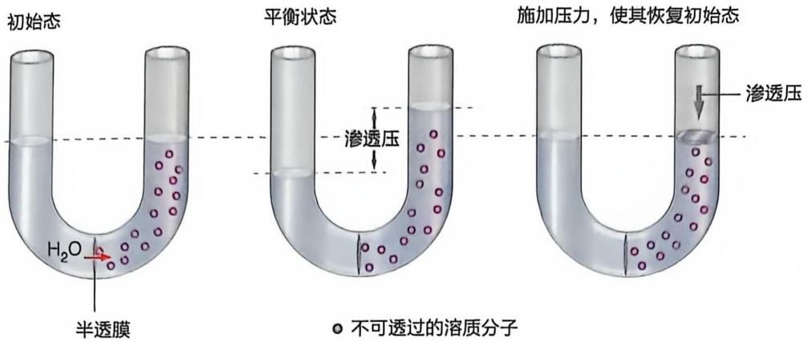

text_image

初始态
平衡状态
施加压力，使其恢复初始态
H₂O
半透膜
渗透压
○ 不可透过的溶质分子
渗透压

区域发生自由净扩散的过程被称作渗透（osmosis）。

1740 年代，法国学者让-安托万·诺莱（Jean Antoine Nollet，1700—1770）等利用猪膀胱作为封闭材料时意外发现了渗透现象。他观察到，当膀胱被置于水中一段时间后，将发生充水膨胀现象。这表明水可有效通过膀胱。通过 19 世纪针对其他动植物材料（包括青蛙皮肤和植物液泡等）开展的系统研究，证实渗透现象普遍发生于生物体内，为正常生命活动所必需。

人们逐渐认识到，包括细胞质膜在内的生物膜均为半透膜，并研发出人工半透膜，如亚铁氰化铜膜、再生纤维素膜和聚氨酯膜等。利用人工制造的半透膜，人们不仅可以对渗透现象进行更直接的观察，还可对这样的过程进行定量分析。如图1-17所示，如果将U形管中央用半透膜隔开，使之一侧含纯水另一侧含加入了溶质的水，即可观察到水向含有溶质一侧的U形管发生净流动。这将导致U形管左侧的液面下降，而右侧的液面升高。这是含纯水一侧水的浓度高，且水可自由扩散通过半透膜而导致的结果。当两侧的水分子浓度相等时，一定时间内流向右侧和左侧的水量相等，这时不再发生水分子净移动现象，两侧液面不再移动。

定量分析结果表明，液体平面的升降幅度与 U 形管右侧所含溶质的浓度成正比，即溶质浓度越高，右侧液体平面上升幅度越大（左侧液体平面则下降相同幅度）。据此，人们建立了渗透压（osmotic pressure）概念:水（溶剂）分子通过半透膜被从低浓度溶质区推向高溶质浓度区的力。具体而言，一种溶液的渗透压，等于为阻止水分子从纯水通过半透膜净扩散到溶液中所需施加的最小压强。实际上，渗透压的高低可通过含溶质侧液面的最终升高（或纯水侧的降低）幅度直接反映。

## (3) 生物大分子的分子量可通过测定其水溶液的渗透压而计算

荷兰学者雅各布斯·范托夫等经过对前人实验数据的理论分析，特别是通过将渗透现象与在气体中观察到的类似扩散现象进行比较，于1880年代建立了针对理想状态下非挥发性的非电解质稀溶液渗透压的定量描述方程式:

$$
\Pi = i c R T \tag {1-9}
$$

其中， $\Pi$  为一种含溶质的溶液相对于纯水的渗透压（kPa）；i 为溶质的范托夫因子（不发生解离的溶质为 1，可解离成两个离子的为 2；以此类推）；c 为溶质的浓度

---

1.7 生命过程以水为介质

047

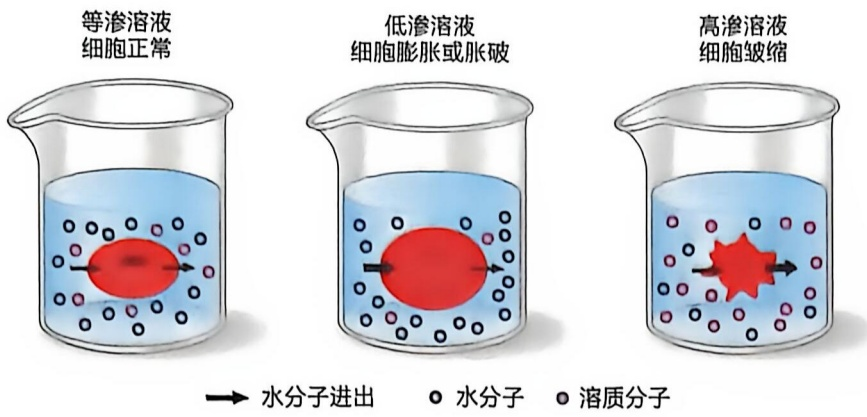

flowchart

图1-18 置于等渗、低渗和高渗溶液中细胞的不同状态

(mol/L); $R$ 为理想气体常数; $T$ 为绝对温度。也就是说, 在恒温条件下, 一种溶液所产生的渗透压与其所含溶质的浓度成正比, 即与所含溶质分子的数目相关。可见, 溶质对水溶液渗透压的影响也具依数性特征, 这与溶质对水溶液蒸气压、沸点和熔点等的影响机制类似。

因此，可以通过测定溶质溶解后溶液的渗透压值来计算溶质的摩尔浓度，进而确定其分子量。所依据的公式为:浓度 = 质量 / (分子量 × 体积)；即分子量 = 质量 / (浓度 × 体积)。这是在层析、电泳和离心等技术被建立之前用于测定蛋白质等生物大分子分子量的一种重要方法。

## (4) 细胞在高渗环境中失水皱缩, 而在低渗环境中则吸水膨胀

对于那些被具有半透膜特征的生物膜包围的细胞或细胞器而言，需置之于合适渗透压（即合适溶质浓度）的环境中才可维持其形态。与胞质渗透压相等的外部溶液称作等渗（isotonic）溶液。比胞质渗透压更高（即溶质浓度更高）的外部溶液则称作高渗（hypertonic）溶液，反之称作低渗（hypotonic）溶液。处于高渗环境中的细胞，胞质中的水分子将向外净流动，导致细胞皱缩；相反，处于低渗环境中时，环境中的水分子将向细胞内净流动，导致细胞膨胀甚至破裂（图1-18）。

因此，当分离细胞或细胞器时，一般都需使用等渗溶液（通过加入蔗糖等溶质实现），以避免细胞或细胞器的膨胀或皱缩。

对于动物细胞而言，其周围的细胞外液通常是等渗的，这对于维持细胞形态至关重要。而植物、细菌等具有细胞壁的细胞，则常常适应于低渗环境，并利用细胞壁来抵抗由此产生的渗透压。基于此，不同生物演化出了一定的机制（典型的如植物和细菌细胞壁的形成等）以避免其细胞被胀破。值得注意的是，由于溶液渗透压的依数性特征，当葡萄糖以糖原或淀粉等多聚体形式存在时，对细胞胞质渗透压的影响甚微。如果葡萄糖分子都以游离形式存在，则会使细胞胞质处于高渗透压条件（将导致水的净流入）。这也是葡萄糖以多聚体形式储存的生物学意义之一。

近年研究表明，广泛存在于细胞质膜中的水通道蛋白（aquaporin）形成特异性的水通道，协助水分子有效通过细胞膜。这为认识细胞膜的半通透性特征提供了新的视角。

---

048

1 生命的化学基础

## 1.7.5 水分子也作为反应物等广泛参与生物体内的化学反应

作为生命产生和演化的介质，生物体中的水分子并非仅仅作为溶剂发挥作用，还作为反应物、产物、中间物、辅因子等直接参与大量代谢反应。例如，生物大分子可通过水解反应降解为基本的组成单位；反之，由组成单位缩合形成生物大分子的过程常伴随水分子的产生。通过对生物体内发生的所有化学反应进行仔细分析，人们认识到，在生物体内发生的几千种酶促化学反应中，大约有三分之一都涉及水分子以某种形式的参与。也就是说，在代谢过程中，水是一种参与广泛的化学分子。这不难理解，毕竟生命的一切特征都是在水环境中演化形成的。

## 1.8 很多生物分子表现出弱酸特征

人类对酸性物质的认识开始于对酸性食物的接触，故历史悠久。酸味是人类五种基本味觉之一。长期以来，人们鉴定到多种遇到酸物质即发生颜色变化的物质，即所谓的酸碱指示剂，如石蕊、酚酞、甲基橙等，这大大方便了对酸性物质的鉴定和分析。相比之下，早期认识的碱性物质则是作为“抗酸”物质而被鉴定，所以人们对碱性物质的认识是伴随着对酸性物质的认识而推进的。

1830 年代，德国学者李比希等将酸类物质定义为含有可以被金属替换的氢元素的化合物，将碱定义为可以将酸中和并产生盐的物质。1880 年代，瑞典学者斯万特·阿累尼乌斯（Svante Arrhenius，1859—1927）等根据电解理论将酸定义为能为水溶液提供  $H^{+}$ （即质子）的物质；而碱则是可以提供  $OH^{-}$ 的物质。这样的酸和碱可相互中和产生水和某种盐。

1920 年代，丹麦学者约翰尼斯·布朗斯特德（Johannes Bronsted，1879—1947）和英国学者托马斯·劳里（Thomas Lowry）各自独立提出对酸的简单定义——酸是可以提供质子的物质，这个定义延续使用至今。在此基础上，他们将碱定义为可以结合质子的物质。

## 1.8.1 生物体内的酸大多为弱酸

根据释放质子能力的强弱，酸可被区分为强酸和弱酸。简单说，强酸（如盐酸和硫酸等）是指那些在水溶液中可发生 $100\%$ 解离的酸，而弱酸则是那些在水溶液中无法发生 $100\%$ 解离的酸。或者说，强酸的解离是不可逆反应，而弱酸的解离是可逆反应。

后续研究表明，生物体内存在的酸大多为弱酸。它们对于维持生命现象不可或缺，包括维持生物体内的溶液环境处于合适的 $\mathrm{pH}$ 。弱酸物质脱去质子后的产物即为

---

1.8 很多生物分子表现出弱酸特征

049

该弱酸的共轭碱，由此出现了酸和碱以共轭对形式存在的概念。

## (1) 弱酸溶液中的质子浓度一般较低, 故通过 $\mathrm{pH}$ 表征

一种酸的酸性强弱可通过其解离后所产生质子的多少，即溶液中质子浓度的高低反映。为此，赫尔曼·能斯特（Hermann Nernst，1864—1941）等在1880年代建立的电化学理论为利用电极电势（通常提供pH电极）测定溶液中质子的浓度提供了重要基础。鉴于弱酸解离所产生质子的浓度一般都较低，为描述方便，丹麦生物化学家索伦·索伦森（Soren Sorensen，1868—1939）于1900年代提出了将酸性以氢离子浓度负对数（即pH）进行表征的建议:

$$
\mathrm{pH} = - \lg [ \mathrm{H} ^ {+} ] \tag {1-10}
$$

这个概念提出后，在很长时间里很少得到化学家们的关注，毕竟，这么低的质子浓度对常规化学反应的意义有限。但是，对于研究酶动力学的生物化学家而言，却具有非凡的重要性。例如，生物体内溶液环境的 pH 必须维持在特定范围内，否则将产生严重后果。

## (2) 弱酸分子的解离程度可通过其 $\mathrm{pK}_{\mathrm{n}}$ 表征

与强酸可发生彻底且不可逆解离不同，弱酸只可部分解离，且解离过程可逆。所有弱酸的解离过程都可通过以下反应式表示:

$$
\mathrm{HA} \rightleftharpoons \mathrm{H} ^ {+} + \mathrm{A} ^ {-} \tag {1-11}
$$

式中，HA 代表弱酸，A $^{-}$  代表弱酸去质子化后形成的共轭碱。式（1-11）清晰反映了弱酸与弱碱之间的共轭特征:脱去质子的弱酸成为弱碱，而结合质子的弱碱则成为弱酸（这与氧化还原反应中的氧化剂-还原剂共轭对概念高度可比）。

如前所述，可逆反应均可通过平衡常数  $K_{eq}$  进行表征:

$$
K _ {\mathrm{eq}} = \frac {[ \mathrm{H} ^ {+} ] [ \mathrm{A} ^ {-} ]}{[ \mathrm{HA} ]} = K _ {\mathrm{a}} \tag {1-12}
$$

人们通常将弱酸的解离常数表示为  $K_{a}$  (a 代表 acid)。弱酸的解离程度都不高，所以  $K_{a}$  一般都较低。仿照通过 pH 表征质子浓度的做法，索伦森提议将弱酸的解离常数也转换为其负对数后进行表征，即:

$$
\mathrm{p} K _ {a} = - \lg K _ {a} \tag {1-13}
$$

因此，一种弱酸的  $pK_{a}$  越低，其解离常数  $K_{a}$  反而越高，即酸性越强。每种弱酸都具特征性的  $pK_{a}$ ，它反映弱酸分子达到解离平衡状态时，产物浓度积与反应物浓度积的比值。

## (3) 弱酸的 $\mathrm{p}K_{\mathrm{a}}$ 可通过滴定实验测定

为确定一种弱酸的  $pK_{a}$ ，理论上我们可以测定达到平衡后各种形式产物和反应物的浓度，然后通过式（1-12）计算。但更为简单可行的测定  $pK_{a}$  的方法是滴定法（titration method）。简言之，这是利用已知浓度的强碱溶液（通常为氢氧化钠）去逐步中和一定体积的弱酸溶液:每步加入等量小体积的强碱溶液，并在每次加入后用 pH 计（或指示染料）测量溶液的 pH，直到全部弱酸物质均被中和；这时溶液的 pH 会突然大幅升高，而前面的每次加人都只导致小幅升高。将每次测量的 pH 对添加强碱

---

050

1 生命的化学基础

contour

| Species | pH | Concentration (ppm) |
| :--- | :--- | :--- |
| NH3 | 9.25 | 10.25 |
| HPO4^2- | 9.25 | 8.25 |
| NH4+ | 6.86 | 7.86 |
| [H2PO4^-] | 6.86 | 5.86 |
| CH3COO^- | 6.86 | 5.76 |
| H2PO4^- | 4.76 | 3.76 |
| [CH3COOH] | 4.76 | — |

图 1-19 三种生物体内常见弱酸的滴定曲线

的体积作图，即得到该酸的滴定曲线（图1-19）。对滴定曲线进行观察，会发现其中间位置均存在一个转折点，代表一半的弱酸已经发生质子解离，即此时 $\left[A^{-}\right]=\left[HA\right]$ 。该转折点处的pH即为该弱酸的 $pK_{a}$ 。

同样，也可使用强酸对弱碱进行滴定，测定弱碱的 $pK_{a}$ ，操作过程与上述用强碱滴定弱酸的过程类似。

尽管不同弱酸的滴定曲线各具独特性，但不同曲线的基本形态相似。生物体内三种常见弱酸——乙酸、磷酸和铵离子——被强碱滴定的曲线如图1-19所示。尽管反映三种弱酸 $pK_{a}$ 的滴定曲线的中间转折点位置的pH不同，但三条曲线的形状高度相似，皆为S形；这表明所有弱酸被强碱滴定的过程遵循类似的规律。

此外，这些滴定曲线在其中间转折点两边的附近区域都表现出 pH 变化相对平缓的特征。对此的简单解释是，在此平缓区段内，加入一定量的强碱并不会引起溶液 pH 的大幅增加。总体而言，每种弱酸均在其  $pK_{a}$  的上下各 1 个 pH 单位范围内具抵抗或缓冲 pH 变化的能力。

（4）弱酸溶液的 pH 缓冲效应可通过亨德森-哈塞尔巴尔赫方程进行定量描述

早在 19 世纪早期，人们就观察到弱酸盐可减弱强酸酸性的现象，但并未给予任何解释。20 世纪初，随

着 pH 概念被生物化学研究人员广泛使用且溶液的 pH 可以被有效测定，人们观察到，包括血液在内的动物体液的 pH 均维持在中性附近（即质子浓度约为  $10^{-7}$  mol/L）。为了解释生物体内存在的这种“酸碱平衡”现象，人们提出了 pH 缓冲效应的概念。

最早对生物体内酸碱平衡现象提出解释的是美国学者劳伦斯·亨德森（Lawrence Henderson，1878—1942）。他为了定性和定量解释血液中的磷酸盐和碳酸盐等弱酸系统如何维持血液 $\mathrm{pH}$ 的稳定，于1900年代建立了一个数学公式，以描述质子浓度与弱酸（HA）及其共轭碱（A⁻，当时被称为弱酸盐）浓度比之间的关系。1910年代，丹麦学者卡尔·哈塞尔巴尔赫（Karl Hasselbalch，1874—1962）基于 $\mathrm{pH}$ 概念将亨德森提出的数学公式转换成了对数形式（即在公式两边取对数），这就产生了后来以两人名字命名的亨德森-哈塞尔巴尔赫（Henderson-Hasselbalch）方程:

$$
\mathrm{pH} = \mathrm{p} K _ {\mathrm{n}} + \lg \frac {[ \mathrm{A} ^ {-} ]}{[ \mathrm{HA} ]} \tag {1-14}
$$

该方程其实就是将式（1-12）左右两边取负对数后转换而成。它可被用于描述图 1-20 中的弱酸滴定曲线。曲线上的一个特殊点是当  $[A^{-}]$  和  $[HA]$  浓度相等时的 pH；这也正好是滴定曲线平缓段的中间点。代入式（1-14），则可得到: $pH = pK_{a} +$

---

1.8 很多生物分子表现出弱酸特征

051

$\lg 1 = \mathrm{p}K_{\mathrm{n}}$；即此时溶液的 $\mathrm{pH}$ 等于弱酸的 $\mathrm{p}K_{\mathrm{n}}$。更为重要的是，这个公式同时也对由弱酸及对应的弱酸盐（即其共轭碱）所组成的体系如何能在弱酸的 $\mathrm{p}K_{\mathrm{n}}$ 附近维持 $\mathrm{pH}$ 稳定进行了如下有效解释。

具体而言，如图1-19所示滴定曲线表明，当弱酸系统处于 $\mathrm{pH} = \mathrm{pK}_{\mathrm{o}}$ （即 $[\mathrm{A}^{-}] = [\mathrm{HA}]$ ）条件时，加入少量强碱时并不引起 $\mathrm{pH}$ 的大幅提高。根据式（1-14），这种 $\mathrm{pH}$ 缓冲效应可解释如下（图1-20A）:当加入少量强碱时，可被体系中存在的HA中和，这仅使 $[\mathrm{A}^{-}] / [\mathrm{HA}]$ 的比值变为稍大于1。类似地，当加入少量强酸时，则可被存在的$\mathrm{A}^{-}$ 中和，仅使 $[\mathrm{A}^{-}] / [\mathrm{HA}]$ 的比值变为稍小于1。取以10为底数的对数后（即 $\lg [\mathrm{A}^{-}] / [\mathrm{HA}]$ ，其变化就很小了；如 $\lg 1.5 = 0.178$ ，而 $\lg 0.5 = -0.30$ ；这就解释了为什么加入少量强碱或强酸后，溶液 $\mathrm{pH}$ 的增加或降低幅度都不大。

在一种  $H_{2}PO_{4}^{-}/HPO_{4}^{2-}$  共轭酸碱对缓冲体系中加入一定量酸或碱时的 pH 变化与在纯水中加入同样量的酸或碱时的 pH 变化比较如图 1-20B 所示。

## (5) 生物内环境的 pH 由特定的共轭酸碱对维持恒定

一般认为，碳酸、蛋白质分子中的组氨酸侧链及磷酸等可能对于生物维持中性 $\mathrm{pH}$ 环境发挥了重要作用。例如，$\mathrm{H}_2\mathrm{PO}_4^- / \mathrm{HPO}_4^{2-} (\mathrm{pK}_{\mathrm{n}} = 6.86)$ 和 $\mathrm{H}_2\mathrm{CO}_3 / \mathrm{HCO}_3^-(\mathrm{pK}_{\mathrm{n}} = 6.1)$ 这两种弱酸/弱碱共轭对被认为是维持血液 $\mathrm{pH}$ 处于7（中性）

图 1-20 特定弱酸在特定 pH 范围具缓冲能力

(A)  $H_{2}PO_{4}^{-}/HPO_{4}^{2-}$  共轭酸碱对抵抗加入的酸或碱所导致的 pH 改变的机制。(B) 在纯水或缓冲溶液中加入一定量强酸或强碱导致 pH 改变示意图

附近的关键缓冲剂。它们的  $pK_{a}$  分别加 1 和减 1 为其最佳 pH 缓冲范围，正好位于 pH 7 附近。需要强调的是，上述  $pK_{a}$  都是在 25℃ 和零离子强度下测定的， $pK_{a}$  受温度和离子强度影响。例如，在生理条件下，磷酸缓冲系的有效  $pK_{a}$  略低于 6.86。

其实在生物体内产生的大多是弱酸或弱碱，因此，它们对生物体内溶液环境 pH 的影响也不会很剧烈。

除动物血液等细胞外液体环境之外，细胞内不同溶液环境的 pH 都基本维持恒定。生物体内溶液环境的 pH 一般都接近中性，如血液和胞质溶胶的 pH 均为 7.4 左右。但生物体内某些局部环境的 pH 偏离中性，典型的如脊椎动物胃液的 pH 一般为 2.0 左右；真核细胞溶酶体内的 pH 一般为 4.5～6.5；线粒体基质 pH 大约为 8.0（其膜间隙 pH 则与细胞基质相同，为 7.4 左右）；正进行光合作用的叶绿体基质的 pH 通常也在 8 左右，呈弱碱性，而叶绿体类囊体腔中的 pH 则为 4.5～5.5（酸性）；等等。

生物体内蛋白质等生物大分子三维结构的维持和功能的发挥都高度依赖其所在溶液环境的 pH。稍有偏离，蛋白质等生物分子的活性可能会大幅降低甚至丧失。尽管对于试管中发生的非生物化学反应而言，pH 的影响可能微乎其微，但对于生命体而言，不同部位 pH 的有效维持却是生死攸关。例如人体血液的 pH 只要稍微偏离 7.4，

---

052

1 生命的化学基础

就会产生严重后果，甚至危及生命。因此 pH 缓冲概念尽管对非生物化学家而言可能无足轻重，但对生物化学家而言却至关重要。

生物体内存在的多种弱酸在维持其不同部位 pH 的基本恒定方面发挥重要作用。对于弱酸发挥 pH 缓冲作用而言，所需维持的 pH 须处于该弱酸的  $pK_{a}$  附近（即该值加或减 1 个 pH 单位）。

尽管一般认为生物体内中性pH的维持可能主要依赖碳酸（$\mathrm{H}_2\mathrm{CO}_3 / \mathrm{HCO}_3^-$，$\mathrm{pK_n} = 6.1$）、磷酸（$\mathrm{H}_2\mathrm{PO}_4^- / \mathrm{HPO}_4^{2-}$，$\mathrm{pK_n} = 6.86$）和蛋白质分子组氨酸残基侧链上的咪唑基团（$\mathrm{pK_n} = 6.0$）等，但是，作为pH缓冲剂，除了考虑弱酸的$\mathrm{pK_n}$之外，还需考虑弱酸的浓度；因为，只有当一种弱酸的浓度足够高，它才可有效发挥其pH缓冲作用。如果将浓度也考虑在内，则碳酸和蛋白质可能才是细胞内的主要缓冲剂；而磷酸因为浓度过低，难以产生有效的缓冲作用。

总之，生物体内须依赖特定的弱酸以维持不同局部环境的 pH 稳态。局部环境中存在的酶等蛋白质发挥功能需要处于最适 pH（如胃蛋白酶的最适 pH 为 1.5～2.5）。一旦环境 pH 无法维持在特定范围而发生大幅变化，其中的酶等蛋白质的功能也就无法有效发挥，最终可能会危及生物个体的生存。

## 1.8.2 水分子也可发生微弱解离而产生质子

水分子作为生命系统的溶剂或介质都是基于它具有  $H_{2}O$  结构状态时的特征。但水分子也可发生微弱解离（称为自解离）。水分子解离将产生带正电的质子（ $H^{+}$ ）和带负电的氢氧根离子（ $OH^{-}$ ）:

$$
\mathrm{H} _ {2} \mathrm{O} \rightleftharpoons \mathrm{H} ^ {+} + \mathrm{OH} ^ {-} \tag {1-15}
$$

值得注意的是，尽管  $OH^{-}$  可自由存在于溶液中，但  $H^{+}$  只能以水合质子  $H_{3}O^{+}$  形式存在。也就是说，水溶液中并不存在自由的质子。但为简便起见，书写时一般将  $H_{3}O^{+}$  写成为  $H^{+}$ 。据此，更准确反映水分子解离的反应式应该是: $H_{2}O + H_{2}O \rightleftharpoons H_{3}O^{+} + OH^{-}$ 。这表明  $H_{2}O$  分子本身既为弱酸也为弱碱（即既可提供质子，也可接受质子）。

水的解离也可被视为一种可逆化学反应。与其他可逆化学反应一样，它达到动态平衡状态时，其产物浓度乘积与反应物浓度乘积之比为一常数，即平衡常数:

$$
K _ {\mathrm{eq}} = \frac {[ \mathrm{H} ^ {+} ] [ \mathrm{OH} ^ {-} ]}{[ \mathrm{H} _ {2} \mathrm{O} ]} \tag {1-16}
$$

纯水在  $25^{\circ}C$  时的浓度为  $55.5 \, mol/L$  （每升水的质量为  $1000 \, g$ ， $H_{2}O$  的分子量为 18，故纯水的浓度为: $1000/18 = 55.5 \, mol/L$ ）。考虑到  $H_{2}O$  的浓度远高于解离所形成  $H^{+}$ 和  $OH^{-}$ 的浓度这一事实，纯水中  $H_{2}O$  的浓度  $55.5 \, mol/L$  一般被视作一恒定值。因此， $K_{eq} \times [H_{2}O]$  也为一恒定值，它被称作水的离子积（ion product），一般表示为  $K_{w}$ 。依据对纯水溶液的电导率（conductivity）的准确测定，水分子在  $25^{\circ}C$  时的解离平衡常数被确定为: $K_{eq} = 1.8 \times 10^{-16}$ 。因此  $K_{w} = K_{eq} \times [H_{2}O] = 1.8 \times 10^{-16} \times 55.5 = 1.0 \times 10^{-14}$ 。

---

展望

053

纯水在室温条件下发生解离时将产生等量的  $H^{+}$  和  $OH^{-}$ ，即各自为  $1.0 \times 10^{-7} \, mol/L$ 。也就是说，这时水的 pH = -lg [ $1.0 \times 10^{-7}$ ] = 7。基于此，pH = 7 被看作为非酸性和非碱性，而是中性。

据此，水溶液的 pH 范围一般被设置为 0～14。当溶液中的质子浓度为 1 mol/L（即  $10^{0}$  mol/L）时，pH 为 0，此时  $OH^{-}$ 的浓度为  $10^{-14}$  mol/L；当质子浓度为  $10^{-14}$  mol/L 时，pH 为 14，此时  $OH^{-}$ 的浓度为  $10^{0}$  mol/L，即 1 mol/L。

这里需要注意几点:一是 pH 越低，质子浓度越高；二是 pH 每相差 1 个单位，溶液的质子浓度相差 10 倍（2 个单位则相差 100 倍，以此类推）；三是尽管在大多数生物体内 pH 被定义为 0～14，但是，pH 可以低于 0，即质子浓度高于 1 mol/L，也可以高于 14，即  $OH^{-}$ 浓度高于 1 mol/L。

## ※展望

## (1) 利用化学概念认识生命现象的过程仍需不断深入

生物体由大小不一、元素组成不同、共价结构和空间结构不同的大量分子构成。认识这些分子的不同化学特征是理解它们如何发挥生物学功能的基础和前提。生物体内可能还存在尚未被鉴定的化学组分，需通过化学方法将它们进行分离和鉴定，然后认识它们在生物体内所扮演的角色。

## (2) 在体外研究的基础上需对生物分子进行更多的体内研究

从科学哲学角度看，利用化学理论和方法认识生命现象属于一种还原论研究方法（reductionism）。具体而言，就是将认识生命过程这一复杂问题简化为认识所参与的化学分子的结构、其转化所涉及的酶促化学反应、分子之间发生的特异相互作用等具体的方面。这种还原论研究方法打破了生命与非生命现象之间的鸿沟，消除了长久以来人们所信奉的二分法，即自然界的物质可分为截然不同的无机和有机两大类。的确，在原子水平，无机和有机分子是完全统一的，只是在分子水平才开始出现差异。

对生物分子的化学研究一般开始于对特定生物分子的分离纯化，然后再通过各种现有的化学方法对纯化的分子进行结构和特性分析。但需注意的是，当生物体内的分子被相互分离并处于非生物体环境时，它们就变成了毫无生命可言的化学分子，而生物体内的分子必然通过特异性识别而逐步组装成特定的生物结构。具体而言，原子之间通过共价键形成分子，分子之间通过非共价相互作用形成分子复合物，分子复合物之间再通过特异的非共价相互作用形成亚细胞器，以此类推，最终形成组织、器官乃至生命个体。

因此，基于非共价相互作用而发生的分子组装可被视作生命形成的关键分子规则。通过这样的组装，生物分子最终形成结构各异、功能复杂却高度有序的生物系统，进而表现出各种神奇的生命特征。

为认识生命的本质，我们在未来必须从传统的体外（in vitro）研究转向更多的体内（in vivo）或活细胞内的研究。同时，也需从针对单一或少数几种分子的简单研究，转向对生物体内存在的所有种类分子的系统和整体研究。这样的体内研究尚需建立新的方法和

---

054

1 生命的化学基础

理论。活体研究虽然极具挑战性，但却有望揭示新的自然规律。

## (3) 在定性研究的基础上需对生物分子进行更多的定量研究

无论宏观还是微观水平，我们对生命过程的认识大多始于定性描述，包括认识生命物质的组成元素、共价结构特征、分子合成过程、大分子空间结构形成（折叠组装）过程、发挥生物学功能的机制出现异常时导致的结果等。但是，我们对任何自然现象的认识，都存在一个从粗到细、从表面到本质的哲学递进过程。这就意味着，到更高级的认识阶段，我们需对生命的不同方面进行精确的定量数学描述。在学习生物化学课程的过程中，我们会看到不少这样的定量描述。例如，对血红蛋白和肌红蛋白与氧气可逆结合所表现出的不同特征而进行的数学描述，通过建立的数学公式对酶促化学反应的发生速率与底物浓度之间的关系进行的定量描述等。

对于生物化学而言，定量描述还需更加深入和广泛。例如，对发生于分子水平的各种调控过程（如代谢调控、基因表达调控等），对维持不同稳态（如血糖浓度的稳态、细胞中能量货币分子 ATP 的稳态等）、生物体内的能量转换过程等，均需进行定量描述。

总之，利用数学方法和数学语言描述生命过程是未来生物化学研究发展的一个重要趋势。

## ※ 本章小结

生命形式多种多样，但均表现出某些共同特征。

存在于地球表面的约 90 种元素中仅约 1/3 被选择用于形成生物分子。

生物分子形成共价键和进行可逆化学转换等可从热力学和动力学两个角度进行表征。

具多样而独特成键能力的碳元素是形成生物分子的核心元素。

碳原子因形成双键和手性结构可形成不同构型的立体异构体，因碳碳单键的自由旋转可形成不同构象的立体异构体。

生物分子三维结构的形成以及分子之间的特异性识别等主要通过四种非共价相互作用实现。

某些含碳化合物是生物能源的储存和提供者。

生物分子最初可能通过地球表面的化学反应过程产生。

地球上最早产生的生物大分子可能既非蛋白质也非 DNA，而是 RNA。

水分子的独特结构及相互作用使得水成为生命演化的不可或缺的溶剂和介质。

水分子跨越半透膜从低浓度溶质区净移向高浓度溶质区所产生的渗透压对生命过程至关重要。

很多弱酸生物分子可维持生物体溶液环境的 pH 相对恒定。

弱酸的解离过程及 pH 缓冲效应可通过 pH 和  $pK_{a}$  等参数及亨德森-哈塞尔巴尔赫公式描述。

水分子也可以进行微弱解离而产生质子。

---

推荐阅读

055

## ※ 思考题

1. 有学者认为，如果地球表面缺乏碳元素和水分子，生命就不会在地球上演化产生。请你为这样的观点提供支持性论据。
2. 在很多科学幻想小说里都描述了基于硅的生命形式。请查阅文献回答为何地球生命选择使用碳元素而非硅原子作为其核心元素。
3. 有人认为，就生命体的产生而言，从某种意义上说，非共价相互作用的重要性超过了共价键的重要性，你是支持还是反对这样的观点？请提出你的证据。
4. 生物膜是一类典型的半透膜，有人认为，这一特性对生命现象的产生至关重要，为什么？
5. pH 概念在由生物化学家提出后，长期被化学家所忽视。请解释出现这样的历史事件的原因。
6. 1920年代苏联学者奥巴林提出了原始汤假说，这一假说在1950年代由美国学者米勒等进行了实验分析。请你试着对早期地球生命的演化提出一种值得后人通过实验进行检验的假说。

## ※ 推荐阅读

1. MILLER S L. A production of amino acids under possible primitive earth conditions [J]. Science, 1953, 117: 528–529.
2. GILBERT W. The RNA world [J]. Nature, 1986, 319: 618.
3. FRENKEL-PINTER M, RAJAEI V, GLASS J B, et al. Water and life: the medium is the message [J]. J Mol Evol, 2021, 89: 2-11.
4. BÖRNER A, ZEIDLER J. The singular properties of carbon as the basis for the emergence of life. In: The Chemistry of Biology [M]. Heidelberg: Springer, 113–194.

(审修: 裴坚)
