# 7 核酸探究

原始 PDF 第 265–297 页。

## 7

## 核酸探究

核酸是由核苷酸聚合而成的生物大分子，在遗传信息的储存和表达等生命过程中发挥重要作用。我们需要对各种核酸分子进行分离和纯化，并对其物理和化学性质进行表征。这不仅是理解核酸生物学功能及其发挥机制的基础，也是解释核酸碱基序列在生物进化中的变化规律，以及这种变化如何反映物种演化过程的前提。

在核酸研究的过程中，科学家们建立和发展了多种重要的核酸分析技术。本章将介绍核酸研究中常用技术的原理和流程，涵盖以下内容:核酸分子的分离、制备和表征；基于核酸变性与复性的分子杂交技术；核酸参与的分子间相互作用研究策略；聚合酶链反应；核酸的化学合成；核酸序列测定技术；以及核酸分子的改造方法等。这些技术不仅加深了我们对核酸结构、功能和机制的理解，也是我们在生物医药、分子诊断、分子育种等生物技术领域应用核酸的基础。

需要特别指出的是，近年来核酸研究技术更新迅速，许多经典文献中的技术已经不再广泛使用。为了更好地兼顾读者在学习经典文献与实验室实践中的需求，本章在有限的篇幅中，重点讲解核酸研究技术的基本原理，尤其是如何将核酸的特性转化为我们熟悉且能够操作的物理化学过程。

---

7.1 核酸分子可通过不同方法进行分离纯化

249

## 7.1 核酸分子可通过不同方法进行分离纯化

与蛋白质等生物分子的分离纯化类似，待分离纯化的 DNA 或 RNA 分子需先从生物样品中释放。动物、植物和微生物细胞，以及病毒颗粒的结构及核酸所处环境不同，需通过不同方法将其中的 DNA 或 RNA 释放出来。被释放的 DNA 或 RNA 分子需与其他生物分子分离，以获得足够纯度的样品，以开展各种有关的物理学、化学或生物学分析。

## 7.1.1 提取核酸前需先裂解细胞

为分离来自动物、植物或微生物等不同细胞内的核酸，需先将细胞裂解释放核酸。裂解细胞的方法主要分为机械方法和非机械方法。机械方法主要包括高压匀浆法、珠磨法和超声法等。高压匀浆法利用高压泵使液体流经小孔而破碎细胞；珠磨法利用珠子之间的挤压而破碎细胞；超声法则是基于声能在液体介质中产生的密集小气泡迅速炸裂而破碎细胞。非机械方法可以分为物理法、化学法和生物法。物理法包括加热、渗透压休克等；化学法通过碱或去污剂进行裂解；生物法则主要利用不同的酶（如溶菌酶或纤维素酶）加速细胞裂解。对不同类型的生物结构，需采用合适的裂解方法，或将上述不同方法进行组合。

在裂解细胞的同时，需要避免机械剪切或酶切等造成的核酸断裂，以确保核酸的完整。例如，细胞中存在大量核酸酶，可加入蛋白质变性剂而使核酸酶失活。

核酸被释放之后则需与细胞破碎物中的其他生物分子（如蛋白质、多糖、脂质等）分离，同时也要去除提取过程中加入的有机溶剂、金属离子等小分子杂质，最后进一步分离不同类型的 DNA 和 RNA 分子，以获得可供后续分析或使用的纯净目标核酸分子。

## 7.1.2 利用核酸化学性质进行分离提取

1860 年代，弗雷德里希·米歇尔（Friedrich Miescher，1844—1895）利用乙醇、盐和酸处理人的白细胞及鲑鱼的精子细胞，沉淀出核酸并分离得到 DNA。1950 年代，马修·梅瑟尔森（Matthew Meselson）和富兰克林·斯塔尔（Franklin Stahl）建立了利用密度梯度离心分离大肠杆菌基因组 DNA 的有效方法。随着研究的发展，DNA 的分离方法被不断改进，包括核酸的抽提、固相转换、重新溶解等模块。抽提是为了将核酸与细胞裂解液中的蛋白质和脂质等分开，固相转换是为了进一步去除杂质。不同模块可以相互组合，形成多种分离纯化流程。

由于 DNA 与 RNA 的化学特征高度类似，因此除非额外说明，大部分分离过程不对二者进行区分。然而，RNA 易被降解，常规纯化所得 DNA 和 RNA 混合物中的 RNA 含量较低。若想获得更高纯度的 DNA，可外加 RNA 酶处理。同样，为获得高纯

---

250

7 核酸探究

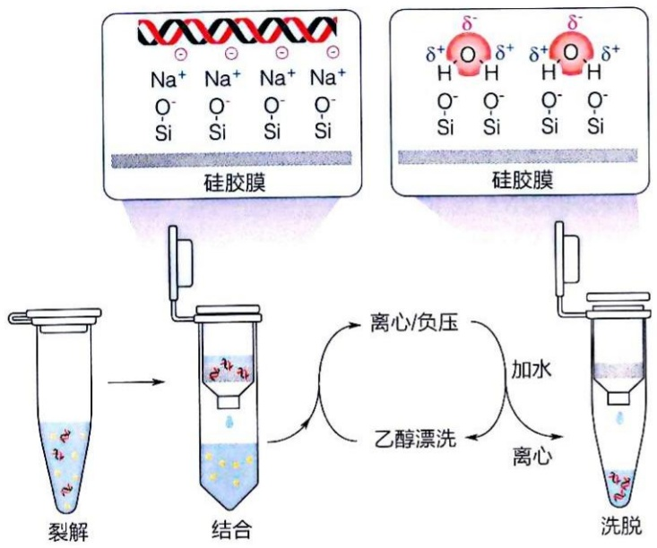

<details>
<summary>flowchart</summary>

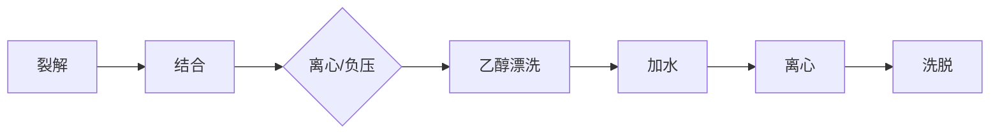
</details>

图 7-1 硅胶膜离心柱法提取核酸原理和流程

度的 RNA，可抑制 RNA 酶活性并添加 DNA 酶去除 DNA。

## (1) 乙醇可以沉淀核酸

核酸是高度极性的分子，其骨架上的磷酸基团可以通过氢键和静电吸引力与水分子相互作用，使核酸在水中高度可溶。向溶液中加入乙醇时，溶液的极性降低，削弱了水分子与核酸的相互作用，导致核酸分子之间更加容易结合或聚集，最终形成沉淀。需要注意的是，乙醇也可以沉淀蛋白质，因此该方法只可获得较为粗制的核酸，其中往往含有其他物质。通过其他方法先行分离核酸与其他物质，再通过乙醇沉淀进行二次纯化，是目前广泛使用的核酸分离纯化方法。

## (2) 硅醇基团可以吸附核酸

硅胶表面的硅醇基团（Si-OH）呈弱酸性，其水化后带负电荷。在高浓度盐溶液中，阳离子桥能够中和核酸与硅醇基团之间的负电荷排斥作用，从而使核酸牢固地吸附在硅胶表面（图7-1），而其他分子可以被 $70\% \sim 80\%$ 乙醇清洗去除。之后使用低盐溶液进行洗脱，由于与硅醇基团的静电排斥力增强，核酸会从硅胶上释放。为了简化固液分离操作流程，硅胶往往以膜的形式固定在离心柱中，因此也被称为柱纯化。

## (3) 磁珠吸附提高核酸纯化效率

类似于硅醇基团在高盐条件下吸附核酸，磁性微球表面的羧基在聚乙二醇和盐的作用下也可以结合核酸。其中，聚乙二醇降低核酸在水溶液中的溶解度，盐提供阳离子中和核酸表面负电荷。结合后的核酸可以通过类似硅胶吸附技术的洗涤和洗脱方式纯化。磁珠吸附法不需离心，可以通过移液机械臂自动化完成，极大提高了核酸提取效率。此外，不同长度的核酸片段在磁珠表面的结合强度取决于聚乙二醇和盐的浓度，如短片段核酸需要更高浓度的聚乙二醇和盐才能结合，由此可以实现对特定长度范围核酸的精细分离纯化。

## (4) 苯酚 - 氯仿抽提法可以区分 DNA 和 RNA

苯酚-氯仿抽提（phenol-chloroform extraction）法是1980年代建立的一种核酸分离方法。基于相似相溶原理，由苯酚-氯仿形成的有机溶剂相可与细胞裂解液中的脂质和蛋白质等疏水组分有效混合，而亲水性的核酸则保留于水相中（图7-2）。水相中的核酸可通过乙醇沉淀或固相吸附的方式进一步纯化。相比于RNA稳定存在于水相，DNA在萃取体系中的分布由pH决定:在弱碱性条件下，DNA存在于水相；在弱酸性条件下，DNA转移至有机相，从而实现DNA与RNA的分离。不同版本的苯酚-氯仿提取方案还可能添加异戊醇（减少泡沫）、异硫氰酸胍（作为蛋白质变性剂和RNA酶抑制剂）等。

---

7.1 核酸分子可通过不同方法进行分离纯化

251

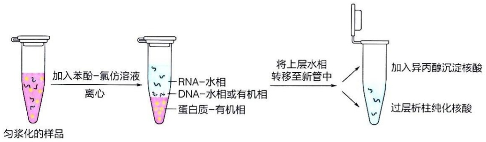

<details>
<summary>flowchart</summary>


</details>

图 7-2 苯酚-氯仿抽提法分离核酸原理和流程碱性条件下 DNA 存在于水相，酸性条件下 DNA 存在于有机相

## (5) 碱裂解法可以有效分离质粒

质粒是一种重要的 DNA 分子，其与高分子量细菌基因组 DNA 的分离是重组 DNA 技术的基础。碱裂解法利用这两种 DNA 在变性与复性过程中的性质差异实现有效分离。具体而言，使用去污剂（一般选择十二烷基硫酸钠）和碱（如氢氧化钠）使细菌细胞破裂，同时使核酸和蛋白质发生变性，核酸和蛋白质所形成的复合物也被解开。恢复中性条件后，质粒 DNA 由于其环状结构和较小分子量可迅速复性，保持溶解状态；高分子量的蛋白质和基因组 DNA 难以快速复性，形成絮状沉淀。离心后上清中的质粒 DNA 可通过乙醇沉淀或固相吸附等方法进一步纯化。

## (6) 密度梯度超速离心可精细分离不同类型 DNA

密度梯度超速离心法（density gradient ultracentrifugation）是根据不同物质之间的密度差异而进行分离的一种方法。以 DNA 的分离为例，通常使用等密度区带离心法。将含有 DNA 的粗制溶液与重金属盐氯化铯（如果分离 RNA，则可用其他重金属盐）混合，在长时间超速离心过程中，离心管中将自发形成从高到低的密度梯度。溶液中浮力密度不同的颗粒在离心力作用下会下沉（密度高）或上浮（密度低），直至移动至与颗粒自身浮力密度正好相等的密度梯度位置（即等密度点）。不同形式的 DNA 分子因其密度差异而被分离，如超螺旋 DNA、线性 DNA 和开环 DNA 可通过这一方法精确分离（图 7-3）。

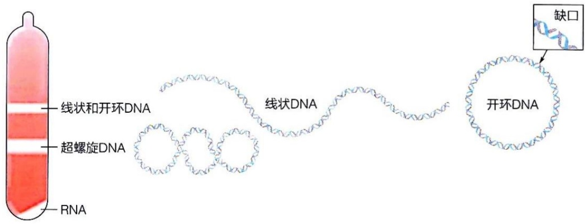

<details>
<summary>flowchart</summary>


</details>

图 7-3 密度梯度超速离心分离不同类型 DNA 分子

---

252

7 核酸探究

## 7.2 核酸的基础表征依赖其物理化学性质

生命分子被纯化后（甚至在纯化前）需要进行各种表征，以增进对它们结构和生物学功能的认识。早期的核酸研究主要是从生命有机化学的角度进行，在上一章中介绍了核酸的化学结构、光吸收谱、极性等基础化学性质。接下来我们将以这些性质为基础，针对核酸的生物学功能表征做进一步探究。

## 7.2.1 基础物理测量是核酸分析的基础

在技术手段尚不发达的年代，核酸的数量和长度是其相对最容易被表征的性质，很多核酸分析方法的核心都是将目标特征转变为核酸的数量和长度。随着技术的发展，虽然我们有了更先进的分析技术，但其底层逻辑往往离不开对核酸数量和长度的测量。

核酸中的碱基具有芳香环，使得它们具有良好的光吸收特征，可以通过紫外光吸收法对核酸进行检测。此外，还可以对核酸进行标记或染色，提高核酸定量的准确性。磷酸基团使得核酸在中性 pH 时带有大量负电荷，电泳分析可以对核酸分子进行尺寸和形态表征。

## (1) 基于碱基光吸收特性的核酸定性和定量

生命分子在特定波长范围的光吸收特性可用于对其进行定性和定量表征。核酸中嘌呤和嘧啶碱基具有光吸收特征，这使得核酸在 200～300 nm 波长范围表现出明显的光吸收，260 nm 波长处的吸收最强、最具代表性（见 6.2.2 节）。类似于蛋白质，核酸浓度可基于比尔-朗伯定律通过 260 nm 波长处的吸光度（ $A_{260}$ ）测定。

通过  $A_{260}$  来测定核酸浓度需要注意以下两点。首先， $A_{260}$  反映的是溶液中的所有碱基组分，包括各种核酸（如双链 DNA、单链 DNA 或 RNA 等）、核苷酸和核苷等。单凭  $A_{260}$  无法判断样品中的具体成分，需要借助其他方法（如凝胶分析）进一步确

认。其次，不同类型的含碱基分子的摩尔吸光系数（ $\varepsilon$ ）是不同的，在计算核酸浓度时，必须使用对应的  $\varepsilon$  值。

蛋白质的最大吸收峰在 280 nm，所以可以通过  $A_{260}/A_{280}$  的值来反映溶液中核酸的相对纯度（图 7-4）。一般而言，如果该比值高于 1.8，则表明核酸较纯（核酸在 280 nm 处也具有一定的光吸收）。此外还可以测定  $A_{260}/A_{230}$  的比值，如果该值低于 2.0，则表明溶液中可能含有胍盐、乙醇等试剂。

## (2) 核酸标记用于核酸链定量

放射性同位素标记曾经是最主要的核酸可视化方法，通过末端标记策略向每个核酸分子引入1个放射性同位素原子，再通过测定放射性强度推断核酸分子数量。出于安全考虑，目前放射性同位素标记已经很少出现在常规核酸

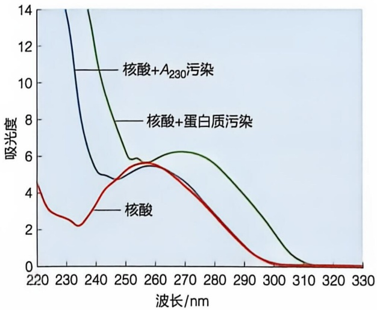

<details>
<summary>line</summary>

| 波长/nm | 核酸+A230污染 (吸光度) | 核酸+蛋白质污染 (吸光度) | 核酸 (吸光度) |
| --- | --- | --- | --- |
| 220 | >14 | ~4.5 | ~4.5 |
| 230 | ~10 | ~2.8 | ~2.8 |
| 240 | ~6 | ~5 | ~2.2 |
| 250 | ~6 | ~5 | ~4.5 |
| 260 | ~5.5 | ~5.5 | ~5.5 |
| 270 | ~6.2 | ~5.5 | ~5.5 |
| 280 | ~5.5 | ~4 | ~4 |
| 290 | ~4 | ~2 | ~2 |
| 300 | ~2 | ~0.5 | ~0.5 |
| 310 | ~0.5 | ~0 | ~0 |
| 320 | ~0 | ~0 | ~0 |
| 330 | ~0 | ~0 | ~0 |
</details>

图 7-4 光吸收曲线反映核酸样品纯度

---

7.2 核酸的基础表征依赖其物理化学性质

253

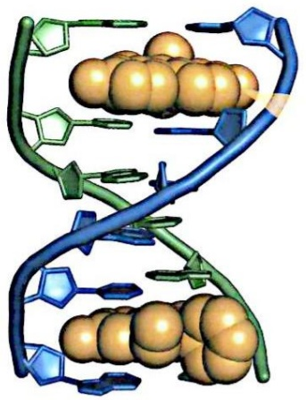

<details>
<summary>chemical</summary>

3D molecular structure of a DNA double helix with highlighted active sites and ligands
</details>

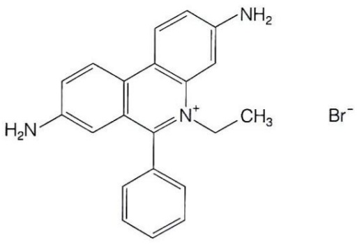

<details>
<summary>chemical</summary>

Chemical structure of a brominated heterocyclic compound with piperazine, piperidine, and piperidone substituents
</details>

图 7-5 溴化乙锭分子结构及其插入 DNA 双链模式

研究中，取而代之的是一系列荧光分子，常规策略仍使每个核酸分子带有1个荧光分子。无论是放射性同位素还是荧光分子，都需要通过反应添加到核酸中，使用起来不够便捷，而且二者的信号强度仅与核酸链的条数相关，不反映总碱基量，因此在应用时需匹配具体核酸定量需求。

## (3) 核酸染色用于总碱基定量

有些染料分子在游离状态下荧光效率较低，与核酸结合后荧光效率显著增强，并且它们与核酸的结合不具有明显的序列偏好性，可以用作核酸总碱基定量分析。以溴化乙锭（ethidium bromide）为例，它是一种含有三环平面共轭结构的分子，最初作为治疗牛锥虫病的药物被开发，1960年代通过X射线衍射分析发现它的三环平面可以嵌入DNA双链中的堆叠碱基对之间（图7-5）。进一步研究表明，溴化乙锭结合核酸后可在紫外光激发下发出橘色荧光，效率是游离溴化乙锭的20\~30倍。在溴化乙锭过量的情况下，与核酸结合的溴化乙锭分子数与核酸长度成正比，因此可用于核酸定量。尽管溴化乙锭的灵敏度较放射性标记有所降低，且具有遗传诱变性，但因使用方法简便而成为常用的核酸可视化试剂。近年来SYBR Green等更安全的荧光染料被研发出来，它们往往结合在核酸双链的沟区，灵敏度较溴化乙锭略有降低，但具有更低的毒性，逐渐成为核酸可视化的主流选择。

## (4) 基于凝胶电泳的核酸长度测量

核酸凝胶电泳技术开发于 1960 年代初。在此之前，核酸分子的表征需通过密度梯度离心法进行，例如，以 Svedberg 单位（S）区分核糖体中的 23S 和 16S rRNA 等，不仅相关设备复杂昂贵，而且样品需要量大、过程耗时、操作复杂。1970 年代以来，随着琼脂糖（agarose）及聚丙烯酰胺（polyacrylamide）等凝胶电泳技术的开发和成熟，通过电泳技术表征核酸成为了简单可行的实验室常规操作。

核酸分子含有大量磷酸基团，使其在中性或碱性溶液中带净负电荷，在电场中总是从负极向正极迁移。因为每个核苷酸残基皆携带1个净负电荷，所以一个核酸分子的总电荷与其所含核苷酸残基的总数（即核酸的质量）成正比，即核酸分子的荷质比是恒定的。

---

254

7 核酸探究

图 7-6 凝胶电泳分离不同形态和长度的核酸分子

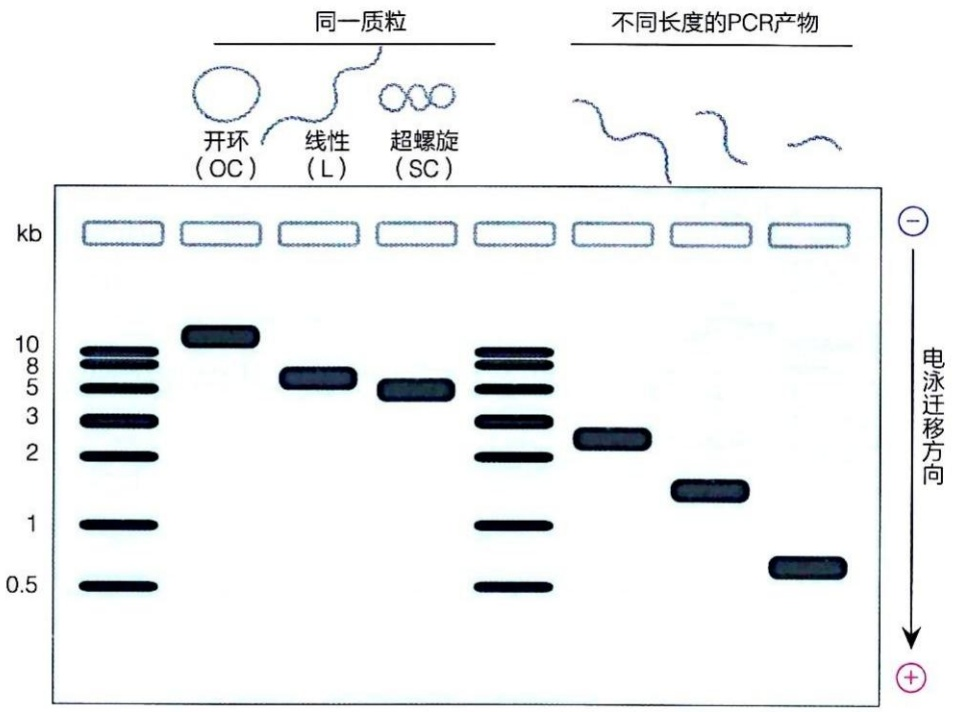

<details>
<summary>text_image</summary>

同一质粒
同
断
线性
超螺旋
(SC)
不同长度的PCR产物
10 kb
8
5
3
2
1
0.5
电泳迁移方向
- 
+
</details>

类似于被 SDS 完全包裹的蛋白质，线性核酸分子在凝胶电泳中的迁移主要取决于其大小，三维结构也存在一定影响:分子量越大的核酸在泳动时受到的阻力越大，泳动速度越慢，从而实现基于分子尺寸的分离；超螺旋的核酸分子因高度压缩，泳动时阻力较小，因此比相同分子量的线性核酸泳动更快，反之开环结构的核酸因结构松散，阻力大，泳动更慢（图 7-6）。线性核酸分子在凝胶电泳中的迁移率与其分子量的对数值呈负线性关系。因此，电泳是一种可以对核酸分子进行有效分离、纯化和鉴定的常用技术。

处于变性的伸展状态时，DNA 和 RNA 分子比蛋白质分子体积更大，而琼脂糖凝胶的孔径（直径 100～500 nm）比聚丙烯酰胺凝胶的孔径（直径 10～200 nm）更大且更不均匀。琼脂糖凝胶制备简单，能满足常规分析需求，但分辨率相对较低。在进行 DNA 测序时，由于测序片段较小，并且需要对仅相差一个碱基的片段实现分离，因此，分辨率更高的聚丙烯酰胺凝胶成为首选。

## 7.2.2 修饰改变碱基的化学性质

## (1) 核酸化学修饰的发现

新型核酸修饰往往因为其基础物理化学性质的异常表现而在常规表征过程中被发现。6.2.4节简述了基于纸层析在牛胸腺DNA的水解产物中发现5-甲基胞嘧啶的过程。在这之后不久，杰拉德·怀亚特（Gerard Wyatt，1925—2019）等在噬菌体DNA水解产物的纸层析过程中发现了另一种碱基，其在3种不同pH环境下的紫外最大吸收波长存在明显差异（图7-7A）。通过查阅已知嘧啶类碱基的光吸收谱，研究人员发现，只有胞嘧啶和5-甲基胞嘧啶存在类似现象，说明该碱基具有胞嘧啶的基本结构，

---

7.2 核酸的基础表征依赖其物理化学性质

255

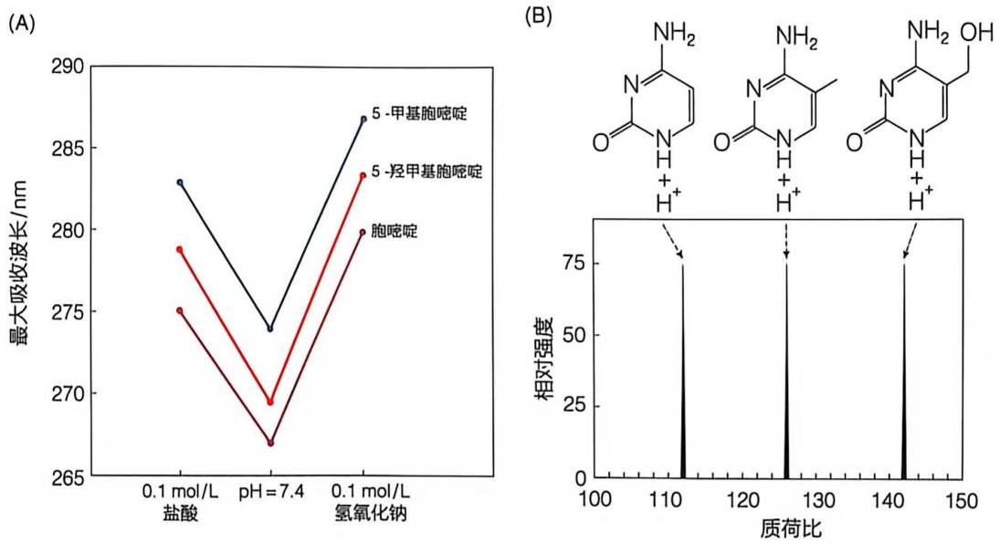

图 7-7 修饰导致 5-羟甲基胞嘧啶化学性质的改变

并且 5 号位存在修饰。考虑到该碱基在不同 pH 和极性层析流动相中的表现差异，其修饰应是亲水基团。在进一步排除了 5-羟基胞嘧啶（酚羟基离子化对应明显不同的光吸收谱）后，研究人员将怀疑重点落在 5-羟甲基胞嘧啶上，并通过人工合成的标准物质比对完成了验证。

随着科技的发展，如今我们可以更高效地发现新型核酸化学修饰。化学修饰导致的最直接变化中，碱基分子量的改变可以通过质谱检测有效识别（图 7-7B）。结合核磁、红外、紫外等波谱技术，如今已经发现了100余种碱基修饰，它们在基因调控的各个层面起着关键作用。

## (2) 核酸修饰的转换

理论上，核酸中的任何化学修饰都可以使用抗原-抗体反应检测。以胞嘧啶甲基化检测为例，甲基化 DNA 免疫共沉淀法利用抗体特异性识别和结合 5-甲基胞嘧啶，通过免疫共沉淀富集甲基化的 DNA 片段，再对这些片段进行测序或芯片分析。这种方法操作简单，但无法识别具体发生甲基化修饰的位点。

为了解决上述问题，科学家们开发出亚硫酸氢盐处理法（bisulfite conversion）。亚硫酸氢根在弱酸性条件下能够与胞嘧啶 C6 位的双键发生加成反应，生成亚硫酸氢盐加成物。这种加成物改变了胞嘧啶的化学性质，使其不再稳定，容易发生脱氨反应，进一步在碱性环境下脱去亚硫酸氢根，从而将胞嘧啶转换为尿嘧啶（图 7-8）。上述反应在胞嘧啶 C5 位存在甲基或羟甲基修饰的情况下无法发生，因此可以用于胞嘧啶修饰的识别。胞嘧啶到尿嘧啶的转化可以进一步通过各类序列识别方法鉴定。若想进一步区分 5-甲基胞嘧啶和 5-羟甲基胞嘧啶，可以使用过钌酸盐将 5-羟甲基胞嘧啶氧化为 5-甲酰基胞嘧啶，进而可以通过亚硫酸氢盐被转换为尿嘧啶，在此过程中 5-甲基胞嘧啶不受影响。

---

256

7 核酸探究

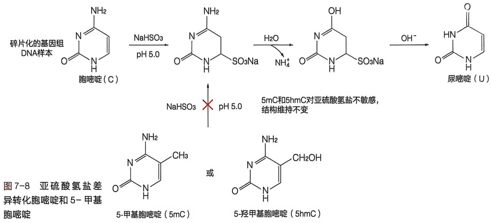

<details>
<summary>flowchart</summary>

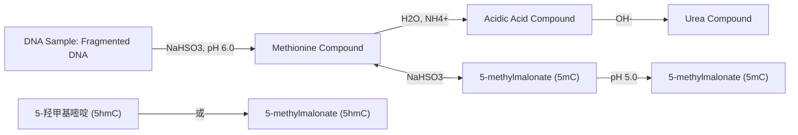
</details>

## 7.2.3 二级结构影响 RNA 链稳定性

单链 RNA 分子内可形成局部的双链螺旋结构（见 6.5 节），识别形成双链结构的序列可以帮助我们解析 RNA 的高级结构，进而理解 RNA 的功能。在偏碱性条件下，RNA 分子中的磷酸二酯键可自发裂解，因为 2' 位氧原子对邻近磷原子的亲核进攻，取代了相邻核糖中的 5' 位氧原子（见 6.6.2 节）。这一化学反应的速度取决于磷酸二

(A)

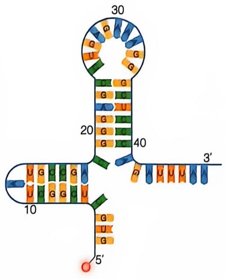

<details>
<summary>chemical</summary>

Diagram of DNA nucleotide structure with labeled positions and color-coded base pairs
</details>

图 7-9 RNA 二级结构解析

(B)

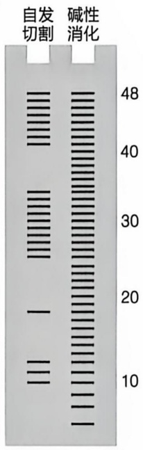

<details>
<summary>text_image</summary>

自发
切割
碱性
消化
48
40
30
20
10
</details>

酯键的具体构象。单链 RNA 因为缺少二级结构的约束，可以在多种构象间变换，其中就包括利于发生亲核取代反应的构象；处在双链区域的磷酸二酯键则被锁定在不利于发生反应的构象，更不容易断裂。将单端同位素或荧光标记的 RNA 分子置于弱碱性环境中进行低程度自发裂解（图 7-9A），所得产物进行高分辨率凝胶电泳。因为大多数 RNA 链最多只发生 1 次断裂，所以断裂位置信息被转换为片段的长度信息，单链区域 RNA 都可以发生断裂，电泳后展示出均匀分布的阶梯条带；双链区域不容易发生断裂，故在凝胶中出现一个无核酸片段的空白区，片段长度即为双链区域距离起始片段端点的距离（图 7-9B）。这是一个典型的将待测核酸特征转换为核酸片段长度的分析策略，后面我们将探讨更多案例。

---

7.3 核酸参与多种分子间相互作用

257

## 7.3 核酸参与多种分子间相互作用

细胞中的核酸链并不是孤立存在的，与其他核酸链以及蛋白质之间的相互作用是核酸行使其生物学功能的基础。通过对核酸参与的分子间相互作用进行研究，不但增进了对相关生物学机制的理解，也能够帮助开发新型核酸研究技术。

## 7.3.1 双链核酸分子可发生变性和复性

## (1) DNA 双链分子变性和复性改变其光吸收特征

在 DNA 双螺旋结构尚未被提出之前，勒内·托马斯（René Thomas，1928—2017）等就发现天然 DNA 在 260 nm 波长处的紫外吸收值低于其水解所产生核苷酸组分计算出的“理论”值。如果将天然 DNA 置于酸性或碱性条件下或经高温等条件处理后，这种差异则会消失。考虑到这些处理并未破坏 DNA 分子中的共价连接，说明核酸分子内部具有某种易断开的弱键，如氢键和范德瓦耳斯力等。通过与蛋白质分子相似过程进行类比，这样的弱键遭破坏的过程被称作 DNA 的变性过程。

在此基础上，保罗·多提（Paul Doty，1920—2011）等观察到 DNA 的复性现象，即通过加热而分开的 DNA 双链可以在合适的温度下（一般比变性温度低  $25^{\circ}$ C 左右）以及较高的盐浓度（如 0.3 mol/L NaCl）存在时，经过一定时间，可以完全恢复其双链结构。

## （2）实现一半分子变性的温度被称作解链温度

通过逐渐提高溶液的温度并同时检测 $260\mathrm{nm}$ 光吸收的变化，可有效跟踪DNA双链的变性过程（图7-10）。随着解链过程的发生，核酸对 $260\mathrm{nm}$ 波长的紫外光吸收也随之增强，这一现象被称作增色效应（hyperchromic effect），这是由于DNA双链碱基之间的堆叠降低了它们吸收紫外光的能力。当DNA分子解链时，碱基之间不再堆叠，相对分开的碱基可以更加有效地吸收紫外光。

实现一半分子变性的温度被称作解链温度（melting temperature），记作 $T_{m}$ 。这是

紫外吸光度随温度变化最快时对应的转折点温度。处于解链温度时，半数的 DNA 分子已经解开成单链，统计上也可以理解为所有 DNA 分子都有一半的区域已经解开成单链而另外一半维持双链。

解开成单链形式的两条 DNA 分子的复性是一个更为复杂的过程，需要经过多个步骤:单链之间通过扩散而发生非特异碰撞，形成特异接触的成核，以及最后的拉锁。非特异碰撞可能导致随机非特异接触位点之间的碱基配对，这样的配对可能是动态的，直到找到了正确特异配对的区域才会启动成核和快速拉锁等过程的发生。对于较短的 DNA 分子而言，上述步骤可以较快完成，但对于长的 DNA 分子而言，需要相当长的时间才可完成。

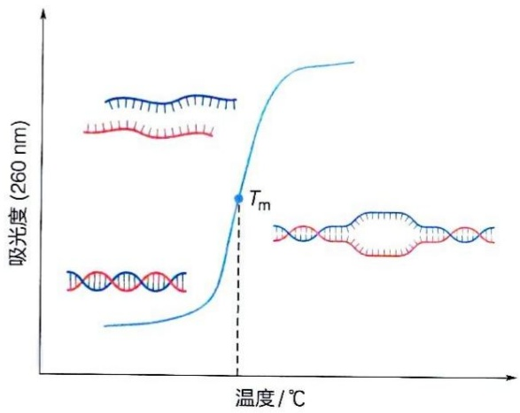

<details>
<summary>line</summary>

| Temperature \(({}^{\circ}C)\) | Absorbance (260 nm) |
| --- | --- |
| Tm | ~Medium |
</details>

图 7-10 双链 DNA 分子吸光度随温度的变化过程

---

258

7 核酸探究

图 7-11 不同 DNA 分子因序列特异性而具有不同的解链温度

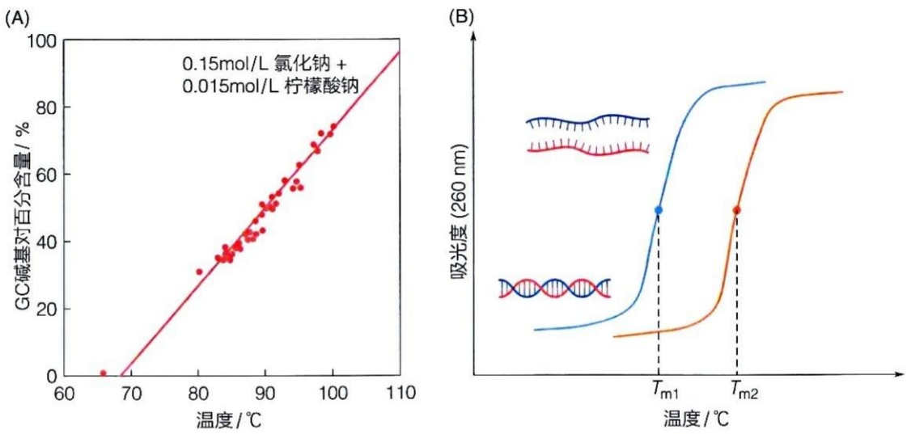

## (3) 每种 DNA 分子都具有特征性的解链温度

由于 AT 碱基对之间的相互作用弱于 GC 碱基对，在加热过程中，双链 DNA 分子的解链过程将先发生于富含 AT 碱基对的区域。研究表明，DNA 分子的  $T_{m}$  与其 GC 碱基对的百分含量呈正相关（图 7-11A）。同时，连续的 AT 碱基对比间隔的 AT 碱基对更容易打开。不同 DNA 分子的序列差异使他们具有不同的  $T_{m}$ （图 7-11B），这一特征性参数反映了 DNA 分子的稳定性， $T_{m}$  越高，则 DNA 分子越稳定。DNA 的复制起始点和转录起始点等皆为富含 AT 碱基对的区域，在同等环境下更容易解链。

具体测定的  $T_{m}$  还会受到盐离子和 pH 的影响。较高浓度的正电离子可以中和磷酸基团所带的负电荷，从而减少两条链之间的静电排斥，有助于提高 DNA 双链的稳定性，导致  $T_{m}$  的升高。酸性条件可导致 DNA 解链，而弱碱性条件有助于 DNA 双链的稳定，因此，pH 的升高也可导致  $T_{m}$  的升高。

## 7.3.2 分子杂交技术可检测特定序列的核酸分子

根据核酸的变性和复性现象，科学家们开发出了几种核酸分子杂交（molecular hybridization）技术。其基本原理是，如果两种不同来源的核酸分子之间可以形成稳定的双链杂交分子（即复性），则说明两种核酸分子之间存在可以发生局部或全部碱基序列的配对。

## (1) 分子印迹技术可定量检测特定序列的核酸分子

在对某种核酸样品（如某物种的基因组或转录组等）进行分析时，通常需要回答的问题是该样品中是否存在某种特异序列（如编码某种蛋白质的基因）。1970年代，埃德温·萨瑟恩（Edwin Southern）等基于分子杂交原理建立了DNA印迹（blotting）技术。为纪念他的贡献，该方法也被称为Southern印迹技术，可用于回答DNA样品中特定序列存在与否及存在数量等问题。

Southern 印迹的基本流程是，先将待测的 DNA 分子（一般为很长的 DNA 序列）

---

7.3 核酸参与多种分子间相互作用

259

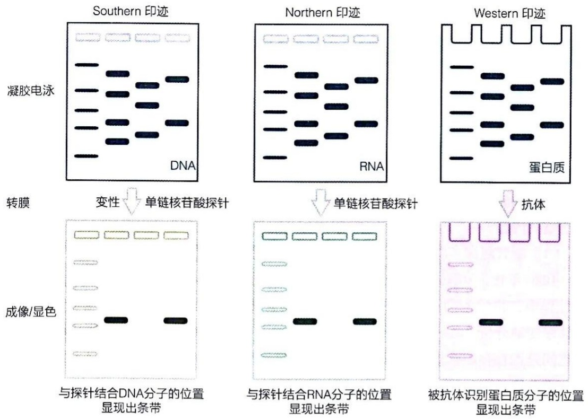

图 7-12 核酸和蛋白质分子印迹技术比较

切割成小片段，并将切割产物通过琼脂糖凝胶电泳分离成条带；将凝胶中的 DNA 条带进行变性处理，转化成单链 DNA，再通过与凝胶平面垂直的电场将单链 DNA 转移至硝酸纤维素等材料制成的固体膜上；将放射性同位素或荧光标记的单链核酸探针与硝酸纤维素膜上的单链 DNA 分子进行分子杂交。如果某 DNA 条带中存在可与核酸探针进行互补配对的序列，则探针可以与其结合，并通过放射性自显影或荧光方法检测（图 7-12）。

基于 DNA 印迹技术的原理，科研人员又建立了一种对特定 RNA 序列进行定性和定量检测的方法，即 RNA 印迹技术。其流程与 DNA 印迹非常相似，只是 RNA 样品在转膜前一般无须进行变性处理。为了与 Southern 印迹对应，人们创造了 Northern 印迹这一术语（后来也将蛋白质印迹称作 Western 印迹）。

## (2) 核酸原位杂交可保留形态信息

原位杂交（in situ hybridization）是一种用于检测组织或细胞中特定核酸序列的技术。它可以提供分子水平的定位信息，帮助研究基因组结构和基因表达。约瑟夫·高尔（Joseph Gall，1928—2024）和玛丽·露·帕杜（Mary-Lou Pardue，1933—2024）利用放射性同位素标记的核酸探针，成功检测并定位了细胞中的核酸序列。荧光标记策略进一步提升了原位杂交的应用价值。原位杂交允许使用多重荧光探针，在单一实验中同时检测多个靶点。这一技术在医学诊断（如染色体异常检测、癌症诊断等）和基因功能研究中应用广泛。

原位杂交仍然是基于分子杂交，“原位”体现在待测核酸位于组织或细胞中原来的位置，而不是经过分离纯化的凝胶电泳条带。原位杂交样品可以是切片组织、细

---

260

7 核酸探究

胞、染色体制备物等，通常需使用甲醛进行固定以保持细胞结构和核酸稳定。经过通透性处理和核酸变性后，再进行探针杂交和信号检测。

## 7.3.3 核酸-蛋白质相互作用可被有效检测

大约自 20 世纪中期开始，DNA 与蛋白质之间的联系成为了科学家们研究的重点。细胞内 DNA 的复制、转录、重组及对这些过程的调控过程都需在特异蛋白质的参与下完成。因此，对核酸片段与蛋白质分子之间相互作用的识别是开展核酸和蛋白质研究的重要内容。

## (1) 凝胶阻滞实验可验证核酸与其他分子的相互作用

1980 年代，在探究大肠杆菌中乳糖操纵子序列与其特异阻遏蛋白之间的相互作用过程中，科学家们基于蛋白质凝胶电泳实验建立了凝胶阻滞实验，也被称作电泳迁移率变动分析（electrophoretic mobility shift assay，EMSA）。这是一种对 DNA 与蛋白质之间是否存在相互作用进行定性检测的简单有效方法。类似原理的技术还包括滤纸结合实验等。

凝胶阻滞实验的核心原理是通过非变性凝胶电泳测定一种 DNA 探针是否因为与蛋白质结合而发生电泳迁移率明显变慢的现象。这里探针与蛋白质之间的特异结合通过以下实验证明:被标记的特异 DNA 探针与蛋白质之间的结合随着蛋白质投入量的增加而增加，此结合可被无标记的特异探针竞争物破坏（图 7-13）。

## (2) 共沉淀技术可鉴定核酸 - 蛋白质复合物中的成分

凝胶阻滞实验的局限在于只能对具体的核酸-蛋白质复合物进行体外重构验证，鉴于细胞内的核酸分子可以与各类蛋白质发生相互作用，科学家需要对体内可能存在的未知核酸-蛋白质相互作用进行探究，例如某个具体蛋白质结合基因组 DNA 的哪个区域，某个具体的核酸序列结合什么蛋白质等。

免疫共沉淀不仅可用于研究蛋白质-蛋白质相互作用（见第5章），也可以用于研究核酸-蛋白质相互作用，例如1990年代建立的染色质免疫沉淀（chromatin

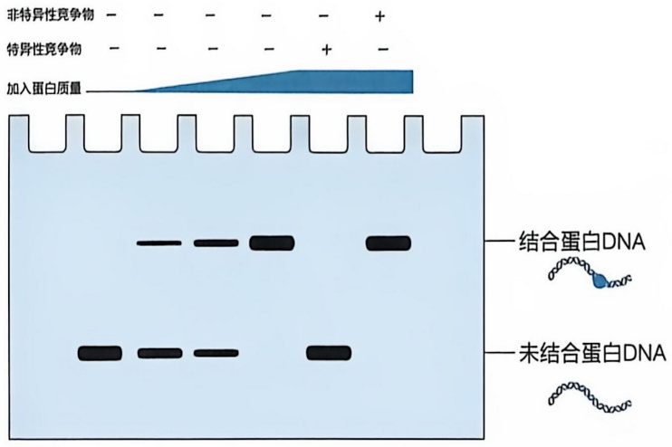

<details>
<summary>text_image</summary>

非特异性竞争物 — — — — — — + 
特异性竞争物 — — — — — + — 
加入蛋白质量——
结合蛋白DNA
未结合蛋白DNA
</details>

图 7-13 凝胶阻滞实验结果示意

immunoprecipitation, ChIP）技术。该技术的主要过程如图 7-14 左侧流程所示:首先，在活细胞水平通过甲醛处理使染色质上的 DNA 与蛋白质（包括组蛋白、转录因子等）之间以及蛋白质与蛋白质之间形成非特异性共价交联；然后破碎细胞并分离染色质；利用超声或核酸酶将染色质断裂成小片段；之后利用靶向特定蛋白质（如特殊修饰的组蛋白或转录因子等）的抗体将 DNA-蛋白质复合物分离富集；消化蛋白质后所得核酸片段可通过分子印迹、PCR、基因芯片、测序等方式进行分析鉴定，其中测序法可用于鉴定一种蛋白质

---

7.3 核酸参与多种分子间相互作用

261

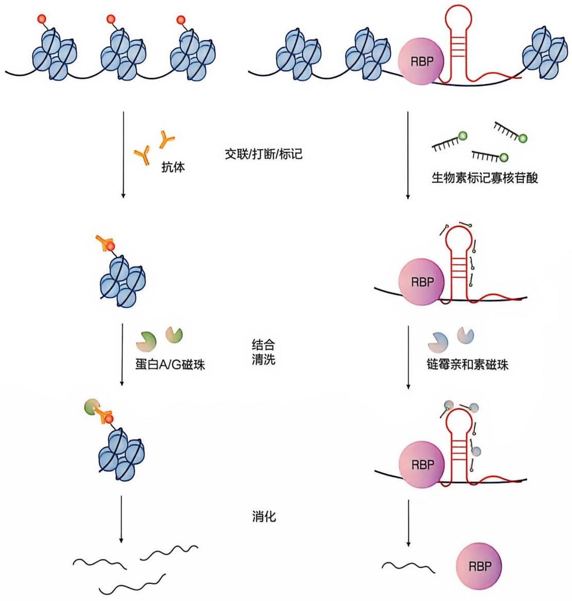

<details>
<summary>flowchart</summary>

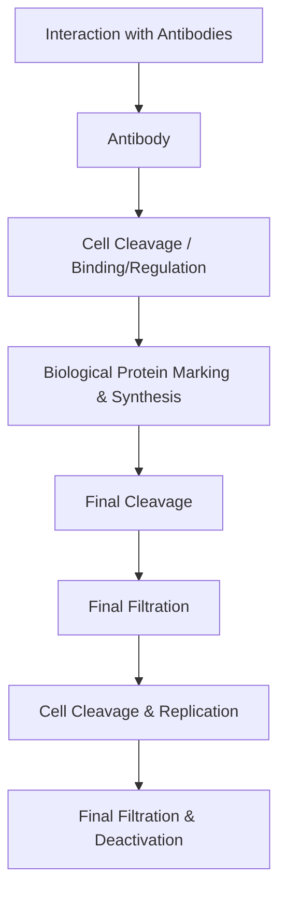
</details>

图7-14 染色质靶向富集技术基本原理RBP:RNA结合蛋白

在基因组范围所结合的所有 DNA 序列，大大提高了相互作用研究的效率。

除通过抗体对核酸-蛋白质复合物进行靶向富集外，分子杂交也可以用于研究核酸-蛋白质相互作用，例如仿照染色质免疫沉淀策略开发的 RNA 分离纯化染色质技术 ChiRP，针对染色质复合物中可能存在的 RNA 成分，利用带有亲和修饰的单链核酸探针进行杂交，可以分离得到所在染色质复合物中的蛋白质（包括组蛋白、转录因子、RNA 结合蛋白、RNA 聚合酶等）和 DNA，分别利用质谱和测序技术进行分析即可鉴定参与互作的具体分子（图 7-14 右侧流程）。

综上，分子间相互作用分析的底层策略是针对感兴趣的互作复合物成分进行靶向富集，蛋白质可以选择抗体，核酸可以选择杂交探针，通过共沉淀将复合物中的其他组分分离富集后鉴定相应的成分。

(3) 足迹实验可确定核酸与蛋白结合的精确位置

上述复合物共沉淀策略可以发现未知的核酸-蛋白质相互作用，凝胶阻滞实验可以进一步验证具体的相互作用，但这两种策略都无法精确指出蛋白质在核酸片段上结

---

262

7 核酸探究

合的位置。脱氧核糖核酸酶Ⅰ足迹试验（DNase I footprinting assay）是1970年代建立的一种可直接测定蛋白质所结合核酸区域的方法，它将核酸片段分析与蛋白质结合保护现象进行了巧妙结合，可以对直接结合蛋白质的核酸区域进行精确鉴定。其底层逻辑与7.2.2节中所介绍的RNA二级结构分析方法类似，通过DNase I对核酸进行有限的随机切割，识别出因蛋白质结合而被保护的区域，即蛋白质的“足迹”（图7-15）。

DNase I 足迹试验是一个典型的将待测核酸特征转换为核酸片段长度的技术。后面我们还会学习桑格测序法，它也是基于核酸片段长度获得核酸信息的技术。如果使用相同的单末端标记对足迹实验中的核酸片段进行桑格测序，则可以借助片段长度信息获得蛋白质结合处的碱基序列。

受 DNase I 自身体积影响，与蛋白质结合位点非常邻近的核酸区域会因为位阻效应而被间接保护，这使得所观察到的足迹区比实际蛋白质结合区要外延几个碱基对，此外蛋白质结合区域内局部暴露的核酸片段也无法被识别。将 DNase I 更换为更小体积的切割试剂可以提高分辨率。

图 7-15 脱氧核糖核酸酶 I 足迹试验基本原理

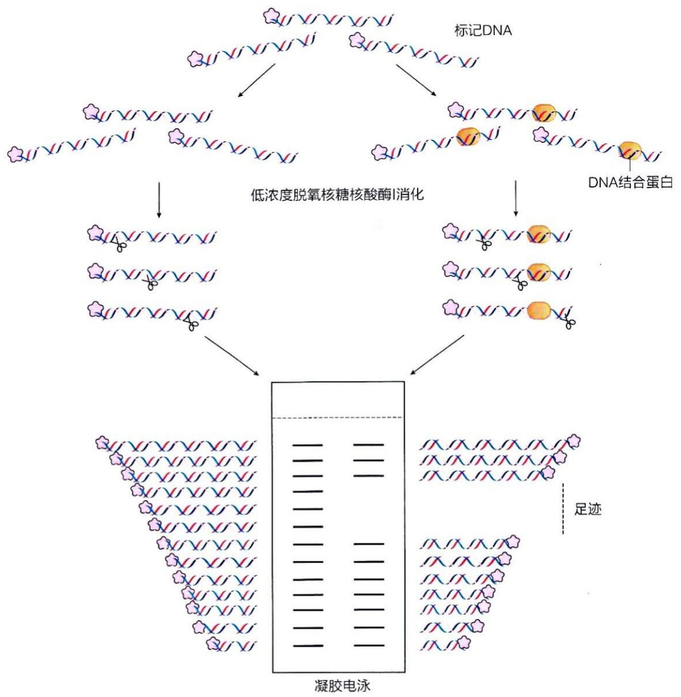

<details>
<summary>flowchart</summary>

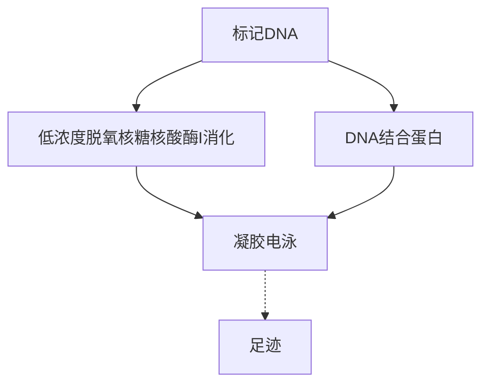
</details>

---

7.4 核酸分子链可通过酶法和化学法延伸

263

## 7.4 核酸分子链可通过酶法和化学法延伸

通过对从生物体中提取到的天然核酸进行研究，科学家们掌握了核酸的基本性质。在此过程中，科学家们也逐渐意识到合成特定序列核酸链的能力对核酸研究至关重要。细胞可以通过生物化学反应合成核酸链，同时核酸链又是一种高分子聚合物，因此，科学家们发展了两种不同的核酸链延伸策略。

## 7.4.1 DNA 聚合酶

DNA 聚合酶是一种负责催化 DNA 分子合成的酶类，它在 DNA 复制过程中将游离的脱氧核苷三磷酸（dNTP）按碱基配对原则添加到新生的 DNA 链上。这是遗传信息从一代细胞传递到下一代细胞的分子基础。DNA 聚合酶工作时通常要求两个基本条件:DNA 聚合酶需要一个单链 DNA 作为模板，才能在其基础上合成新的互补 DNA 链；DNA 聚合酶无法直接从头开始合成 DNA 链，它需要一个带有游离 3'-OH 基团的引物作为起点，然后从引物的 3' 端延伸新的核苷酸（图 7-16）。

某些特殊的 DNA 聚合酶可以在不完全满足上述两个要求的情况下工作，如逆转录酶（reverse transcriptase）能够以 RNA 分子为模板合成 DNA，末端转移酶（terminal transferase）可以在没有模板的情况下随机将 dNTP 延伸到引物的 3' 端。除 5'→3' 聚合酶活性外，DNA 聚合酶还可能具有 3' 核酸外切酶活性和 5' 核酸外切酶活性等，以应对核酸合成时的不同需求。

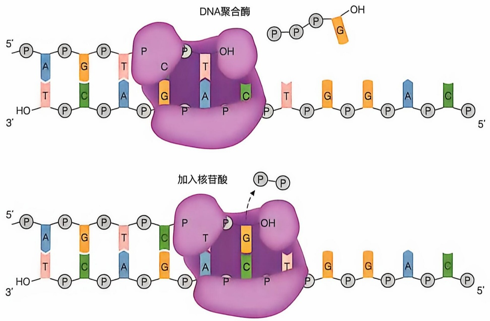

图 7-16 DNA 聚合酶
5'→3'延伸核酸链

---

264

7 核酸探究

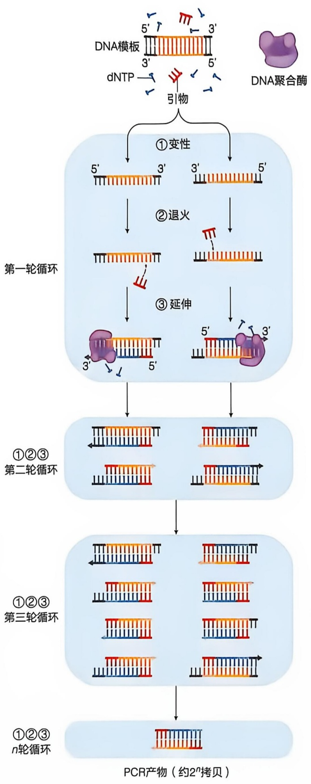

<details>
<summary>flowchart</summary>

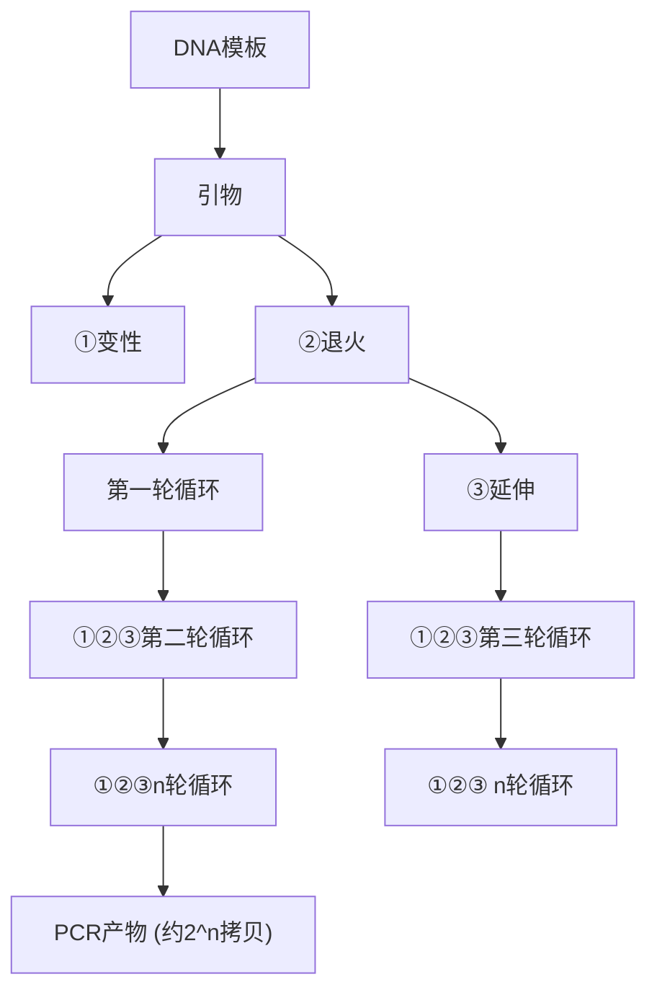
</details>

图 7-17 PCR 的基本原理和过程

## 7.4.2 聚合酶链反应

细胞内 DNA 的半保留复制是一个利用解开的单链 DNA 作为模板合成其互补链的过程，由 DNA 聚合酶将脱氧核苷三磷酸添加到正在延伸的互补链末端，每一轮反应将 DNA 复制一遍，随细胞周期周而复始。基于这一策略，凯利·穆利斯（Kary Mullis，1944—2019）发明了聚合酶链反应（polymerase chain reaction，PCR），可在体外对特定 DNA 片段进行大幅扩增。模板可以是含有拟扩增目标片段的任何 DNA 样本，如质粒、基因组 DNA、病原体 DNA 等。拟扩增目标片段的两侧起始点由一对人工设计的引物决定。理论上，从一个 DNA 模板分子开始，经过多轮扩增就可以产生上千亿份拷贝，这为核酸研究领域带来了一场革命。

如图 7-17 所示，PCR 中的每一轮 DNA 复制可以分为模板热变性、引物与模板退火和引物延伸三步反应。首先，在  $95^{\circ}$ C 甚至更高温度将双链 DNA 模板解开成单链；然后，在  $55 \sim 65^{\circ}$ C 范围，过量的单链核酸引物通过碱基配对竞争结合到已经解链的模板 DNA 上；最后，DNA 聚合酶根据模板链的碱基序列，将四种 dNTP 结合到引物的 3' 端，实现 DNA 复制。延伸是从两条引物的 3' 端同时发生的，即每条单链 DNA 皆被用作模板；这与细胞内发生的半保留复制过程类似。在新一轮的变性-退火-延伸过程中，前一轮合成的 DNA 链也被用作模板进行半保留复制。经过 n 次循环后，特定 DNA 片段就被扩增了 2" 倍；完成一个循环仅需几分钟，所以 1～2 h 即可获得大量目标 DNA 片段。

需要注意的是，DNA 聚合酶延着模板向前延伸的过程只会因自身稳定性而终止，与对向引物的设计位置无关。因此在最初的两轮反应中会产生单侧超出引物设计范围的 PCR 产物，只有等到第三轮结束时才会出现两端都与引物设计对应的 PCR 产物。此外，上述指数扩增并不是无限的，随着引物和 dNTP 转变成目标 DNA 分子链，反应效率会不断降低，最终不再生成新的 DNA 分子。

PCR 技术被认为是 20 世纪最重要的技术发明之一，也是基因工程与分子生物学等学科的核心支撑技术之一

---

7.4 核酸分子链可通过酶法和化学法延伸

265

## 知识延展 7- 1

## PCR 技术广泛用于多个领域

PCR 技术可用于特异性检测患者体内存在的极其微量的某种病原体的 DNA（或 RNA 的逆转录产物），为人类防控传染病（如新冠病毒感染）提供了一种高效手段。

PCR 技术也是常用的法医鉴定技术。基因组中的某些特定位点在不同个体中存在显著的长度差异，这使得每个个体的 DNA 图谱皆具有独特性。利用 PCR 技术将这些高度差异化位点的 DNA 进行扩增并分析其长度，不仅可以用来鉴定个体之间的亲子关系，也可用于案发现场遗留生物样品与嫌疑人的匹配。

PCR 技术还为古生物学研究提供了前所未有的支持。古生物体或古人类标本中残留的微量 DNA 通过 PCR 技术扩增后，便可用于碱基序列测定和遗传学分析。一个著名的例子是通过 PCR 技术扩增已经灭绝的尼安德特人 DNA，使科学家可以对该人种与现代人种之间的演化关系进行分子水平的研究。

(知识延展 7-1)。早期使用的 DNA 聚合酶多来自大肠杆菌，在高温下会变性失活，每一轮反应都需要重新添加聚合酶，非常烦琐。华裔学者钱嘉韵等于 1970 年代从水生嗜热杆菌（Thermus aquaticus）中分离鉴定出耐热的 Taq DNA 聚合酶，其最适工作温度为 72℃且可以长时间耐受 100℃的高温，在 PCR 的发展中起了至关重要的作用。

## 7.4.3 荧光定量 PCR 可对微量核酸进行定量

PCR 可以对指定 DNA 片段进行指数扩增，所得产物可通过紫外光吸收或荧光染色进行定量分析。通过对各个样品经相同循环扩增所得产物的定量比较，理论上可以推测扩增前各样品中相应 DNA 模板的定量关系，用于染色信号低于检测限的微量样品的定量。此策略虽然简单易懂，但 PCR 过程中扩增效率是不断降低的，对于不同起始量的 DNA，经过相同循环所得到的相对扩增倍数是不同的，起始量越高，相对扩增倍数越低，导致定量结果不准确。

## (1) 荧光扩增曲线实时监测扩增效果

为了解决扩增效率变化的问题，科学家们决定对 PCR 扩增产生的片段数量进行实时监测，一方面可以定量解析 PCR 效率，另一方面通过比较不同样品扩增产生相同数量片段所需要的循环数进行核酸定量（越早达到目标说明起始核酸量越多）。这便是荧光定量 PCR 的底层逻辑。

通过向 PCR 体系中添加过量的双链 DNA 特异性荧光染料，如溴化乙锭或 SYBR Green，可从荧光信号的强度推测双链 PCR 产物的数量。将每个 PCR 循环结束时的荧光信号强度对循环数作图，可以得到一条呈 S 形的荧光扩增曲线。扩增早期，DNA 数量少，荧光强度低于检测限；随着产物的增多，荧光信号相应增强；反应过程中反应

---

266

7 核酸探究

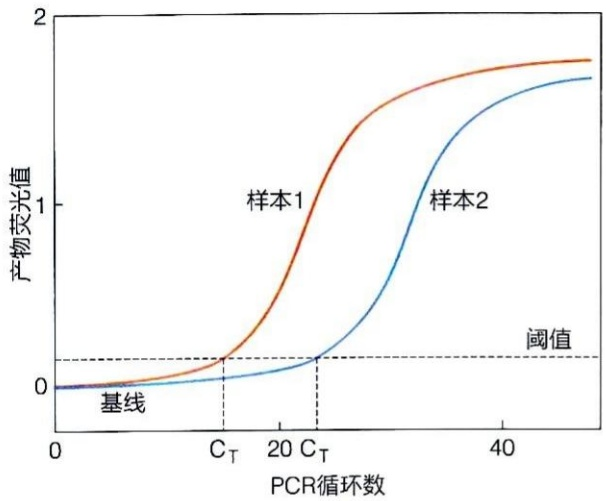

<details>
<summary>line</summary>

| PCR循环数 | 样本1 (产物荧光值) | 样本2 (产物荧光值) |
| --- | --- | --- |
| 0 | ~0 | ~0 |
| CT | ~0.2 | ~0.1 |
| 20 | ~0.8 | ~0.2 |
| CT | ~1.3 | ~0.3 |
| 40 | ~1.7 | ~1.5 |
</details>

图 7-18 荧光扩增曲线与 ${\mathrm{C}}_{\mathrm{T}}$ 值

物消耗、聚合酶活性下降、产物积累产生的抑制作用导致扩增效率下降，最终荧光强度进入平台期（图 7-18）。

根据荧光扩增曲线选定一个荧光值，其对应的扩增产物足够多且扩增效率未显著降低，根据曲线获得此荧光值对应的循环数，即该样品扩增产生指定数量片段所需的循环数，记作此样品的 $C_{T}$ 。 $C_{T}$ 越低，则样品的DNA模板含量越高。借助已知DNA含量的样品可以绘制标准曲线，确定未知样品中的DNA含量（图7-18）。

## (2) 荧光探针可提高检测特异性

荧光染料虽然适用于任何 DNA 序列的检测，但扩增中可能产生的其他序列双链 DNA（如引物二聚体或非特异扩增产物）也会导致荧光信号增强，从而影响定量的准确性。为

了增强荧光信号的特异性，科学家们设计了一种 Taqman 核酸探针，其两端分别标记荧光基团和淬灭基团，因此不会产生荧光信号。在 PCR 过程中，Taqman 探针通过碱基互补配对结合到模板的待扩增区域，DNA 聚合酶利用自身的外切酶活性，像破冰船一样将挡在前方的探针切碎，荧光基团和淬灭基团分离并发出荧光。因此，荧光信号只反映探针对应 DNA 片段的含量，提高了荧光信号的特异性。

## 7.4.4 PCR 引物和探针通常来自化学合成

无论是 PCR 引物还是分子杂交探针，都会用到各种可能的序列，因此不依赖任何模板的从头合成是最理想的策略。

## (1) 核酸的固相亚磷酰胺合成

1980 年代，马文·卡鲁瑟斯（Marvin Caruthers）等建立了基于亚磷酰胺的核酸合成策略（phosphoramidite approach），并将其发展成一种沿用至今的固相合成方法。其底层原理是醇羟基与亚磷酰胺在四氮唑等激活剂存在下形成亚磷酸酯键。为避免与亚磷酰胺发生反应，核苷酸中其他活泼羟基（核糖 2' 和 5' 羟基）和氨基（腺嘌呤、鸟嘌呤和胞嘧啶上的氨基）需要被保护起来，其中 5' 羟基因后续还需要进行反应，需使用较好离去的保护基，如二甲氧基三苯甲基（dimethoxytrityl，DMT），其他基团选择更稳定的保护基。从化学反应性角度考虑，固相亚磷酰胺合成法通常按照 3'→5' 方向进行，这与聚合酶的延伸方向是相反的。

如图 7-19 所示，合成时先将固相载体或 5' 羟基上的保护基脱去；再加入已妥善保护好的脱氧核苷 3' 亚磷酰胺进行偶联；考虑到偶联效率不可能达到 100%，未反应的 5' 羟基需加入乙酸酐进行封闭，以免造成序列中的碱基缺失；最后，需将亚磷酸酯氧化为更稳定的磷酸酯。合成按照脱保护、偶联、加帽和氧化的顺序循环进行，每个循环增加一个碱基。完成预定序列碱基的偶联后，可以使用浓氨水将产物从固相载体上释放，同时脱去其他保护基，最终获得寡聚核酸。

---

7.4 核酸分子链可通过酶法和化学法延伸

267

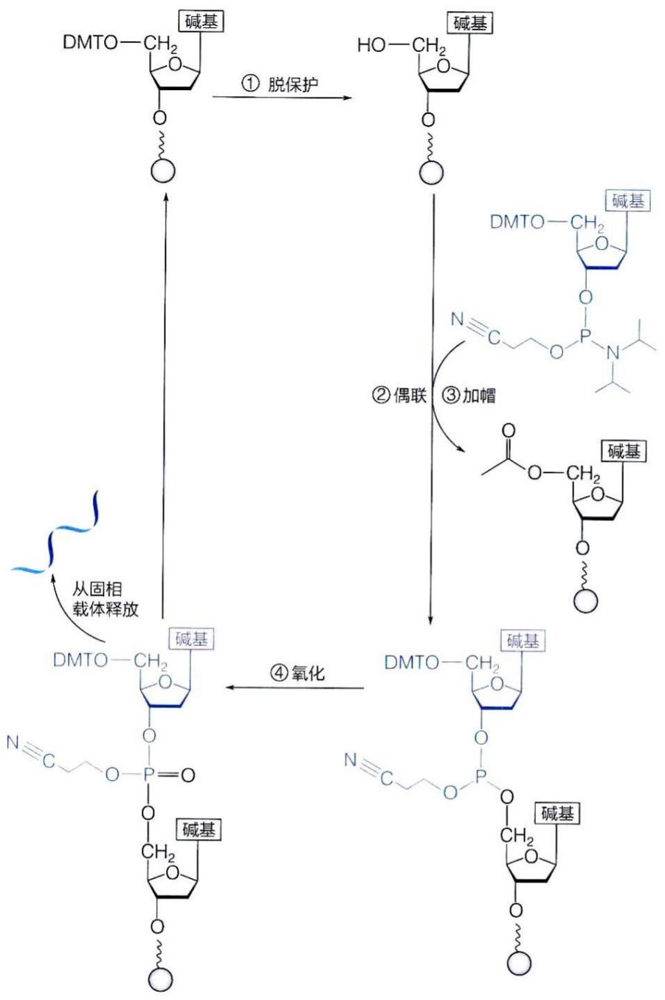

<details>
<summary>flowchart</summary>

This flowchart illustrates the biochemical pathway of a peptide chain, showing steps from deprotection and addition to formic acid and phosphate, followed by oxidation.
</details>

图7-19 固相亚磷酰胺法化学合成核酸链

尽管固相亚磷酰胺合成法是一种高效的化学合成法，但可合成的核酸链长度无法与生物体内所合成的比拟，一般不超过200 nt。此外，亚磷酰胺合成法常规合成的核酸分子5'端没有磷酸基团修饰，这与某些酶法获得的核酸不同。为了更好地适用于后续的反应，可在最后一个循环后增加一轮不带碱基的亚磷酰胺反应，经氧化后得到磷酸基团。

## （2）化学合成适用于制备带修饰的核酸

生物体内的各类 DNA 和 RNA 分子上都可能发生多种不同的化学修饰。要认识这些化学修饰的功能，需要先获得具有特定化学修饰的核酸分子。各种修饰碱基的亚磷酰胺单体都可以与上述固相合成策略适配。

---

268

7 核酸探究

类似于 5' 磷酸基团的添加，在化学合成的过程中还可以向核酸骨架添加其他类型的化学基团，如氨基、羧基、巯基等各类常规化学基团，荧光修饰，以及用于正交偶联反应的叠氮和炔基等。

## 7.5 核酸分子的碱基序列可被精确测定

在明确核酸是遗传物质之后，科学家们对核酸的兴趣从其物理化学性质转移到其储存的信息，即核酸的序列。蛋白质的序列测定工作在1950年代就已经由弗雷德里克·桑格（Frederick Sanger，1918—2013）等学者完成，而DNA序列的测定方法大约20年后才得以建立。华裔学者吴瑞（1928—2008）建立了一种利用DNA聚合酶及放射性同位素标记的“位点特异性引物延伸法”，以测定噬菌体单链DNA的碱基序列。后来桑格等学者对此法进行了改进，引入双脱氧核苷酸使DNA链的合成终止，使引物延伸法的效率大为提高，并沿用至今。此后，科学家们又进一步发明了可逆终止测序法，为高通量测序奠定了基础。目前核酸测序已经发展到了单分子水平，并在持续发展中为核酸研究提供支持。

## 7.5.1 双脱氧核苷酸链终止法实现核酸精准测序

双脱氧核苷酸链终止法又被称为桑格法，其以待测 DNA 序列的反向互补链为模板，通过引物延伸合成正向序列，其间利用双脱氧核苷酸将延伸中的核酸链终止在对应的碱基位置，从而将碱基序列信息转换为核酸长度信息，之后通过高分辨电泳进行测定。

## (1) 经典链终止法

早期的桑格测序通过放射性同位素实现核酸可视化，在延伸反应中除了 DNA 模板、与待测区域对应的引物、DNA 聚合酶和四种 dNTP 外，还添加了少量放射性同位素标记的 dATP 对延长中的核酸链进行标记。此反应被分为四组，每组再额外少量添加 2',3'-双脱氧核糖核苷三磷酸（ddATP、ddTTP、ddGTP 或 ddCTP）中的一种。因为双脱氧核糖核苷三磷酸的浓度足够低，DNA 链延长时大部分时间掺入的都是正常核糖核苷酸，不影响后续延伸。而当 2',3'-双脱氧核糖核苷酸偶尔被添加到 DNA 链之后，由于缺乏 3'羟基，核酸链的延伸被终止。每个反应中的核酸链只会终止在双脱氧核糖核苷对应的碱基位置，因此可以获得序列信息。反应结束后的 DNA 单链在聚丙烯酰胺凝胶中进行高分辨分离，依据每组反应体系中所加入的双脱氧核糖核苷酸，以及所合成的核酸链的长度，就可以直接拼接出待测核酸的序列（图 7-20）。

## (2) 荧光标记和毛细管电泳提高测序效率

经典链终止法虽然解决了核酸测序的基本问题，但在两方面的设计限制了其广泛

---

7.5 核酸分子的碱基序列可被精确测定

269

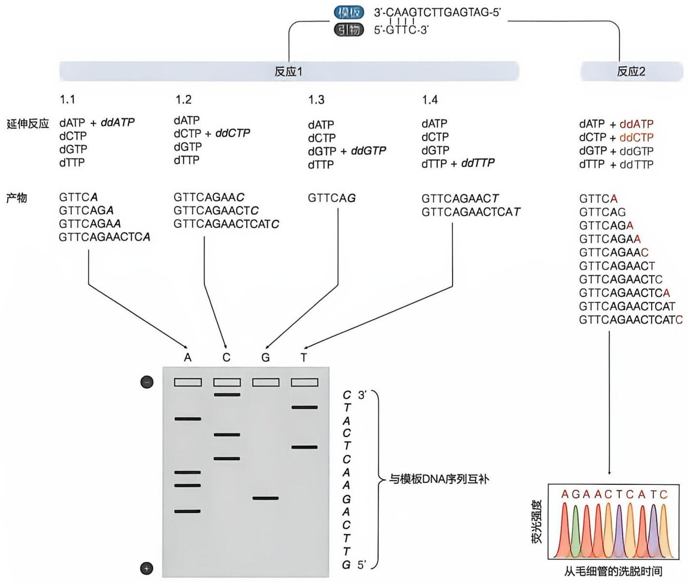

<details>
<summary>flowchart</summary>

```mermaid
graph TD
  A["模板 3'-CAAGTCTTGAGTAG-5'"] --> B["反应1"]
  C["引物 5'-GTTC-3'"] --> B
  
  subgraph sg_1["\"反应1\""]
    direction TB
  A1["1.1\n延伸反应 dATP + ddATP\ndCTP\ndGTP\ndTTP"] --> A2["1.2\n延伸反应 dATP\ndCTP + ddCTP\ndGTP\ndTTP"] --> A3["1.3\n延伸反应 dATP\ndCTP\ndGTP + ddGTP\ndTTP"] --> A4["1.4\n延伸反应 dATP\ndCTP\ndGTP\ndTTP + ddTTP"] --> B
  end
  
  subgraph sg_2["\"反应2\""]
    direction TB
  B1["dATP + ddATP\ndCTP + ddCTP\ndGTP + ddGTP\ndTTP + ddTTP"] --> B2["dATP + ddATP\ndCTP + ddCTP\ndGTP + ddGTP\ndTTP + ddTTP"]
  end
  
  subgraph sg["\"产物\""]
    direction TB
  A1["GTTCA\nGTTCAGA\nGTTCAGAA\nGTTCAGAACTCA"] --> A2["GTTCAGAAC\nGTTCAGAACTC\nGTTCAGAACTCATC"]
  A2 --> A3["GTTCAG"]
  A3 --> A4["GTTCAGAACT\nGTTCAGAACTCAT"]
  A4 --> A5["GTTCAGAACT\nGTTCAGAACTCAT"]
  A5 --> A6["GTTCAGA\nGTTCAGA\nGTTCAGA\nGTTCAGAA\nGTTCAGAACT\nGTTCAGAACTC\nGTTCAGAACTCA\nGTTCAGAACTCAT\nGTTCAGAACTCATC"]
  end
  
  B -->|"与模板DNA序列互补"| G1["A C G T"]
  G1 -->|"与模板DNA序列互补"| G2["C 3'"]
  G2 -->|"与模板DNA序列互补"| G3["T A C T C A A A G A C T T G 5'"]
  G3 -->|"与模板DNA序列互补"| G4["C 3'"]
  
  style A fill:#fff,stroke:#333
  style B fill:#fff,stroke:#333
  style C fill:#fff,stroke:#333
  style D fill:#fff,stroke:#333
  style E fill:#fff,stroke:#333
  style F fill:#fff,stroke:#333
  style G fill:#fff,stroke:#333
  style H fill:#fff,stroke:#333
  style I fill:#fff,stroke:#333
  style J fill:#fff,stroke:#333
  style K fill:#fff,stroke:#333
  style L fill:#fff,stroke:#333
  style M fill:#fff,stroke:#333
  style N fill:#fff,stroke:#333
  style O fill:#fff,stroke:#333
  style P fill:#fff,stroke:#333
  style Q fill:#fff,stroke:#333
  style R fill:#fff,stroke:#333
  style S fill:#fff,stroke:#333
  style T fill:#fff,stroke:#333
  style U fill:#fff,stroke:#333
  style V fill:#fff,stroke:#333
  style W fill:#fff,stroke:#333
  style X fill:#fff,stroke:#333
  style Y fill:#fff,stroke:#333
  style Z fill:#fff,stroke:#333
  style AA fill:#fff,stroke:#333
  style AB fill:#fff,stroke:#333
  style AC fill:#fff,stroke:#333
  style AD fill:#fff,stroke:#333
  style AE fill:#fff,stroke:#333
  style AF fill:#fff,stroke:#333
  style AG fill:#fff,stroke:#333
  style AH fill:#fff,stroke:#333
  style AI fill:#fff,stroke:#333
  style AJ fill:#fff,stroke:#333
  style AK fill:#fff,stroke:#333
  style AL fill:#fff,stroke:#333
  style AM fill:#fff,stroke:#333
  style AN fill:#fff,stroke:#333
  style AO fill:#fff,stroke:#333
  style AP fill:#fff,stroke:#333
  style AQ fill:#fff,stroke:#333
  style AR fill:#fff,stroke:#333
  style AS fill:#fff,stroke:#333
  style AT fill:#fff,stroke:#333
  style AU fill:#fff,stroke:#333
  style AV fill:#fff,stroke:#333
  style AW fill:#fff,stroke:#333
  style AX fill:#fff,stroke:#333
  style AZ fill:#fff,stroke:#333
  style BA fill:#fff,stroke:#333
  style BC fill:#fff,stroke:#333
  style BD fill:#fff,stroke:#333
  style BE fill:#fff,stroke:#333
  style BF fill:#fff,stroke:#333
  style BG fill:#fff,stroke:#333
  style BH fill:#fff,stroke:#333
  style BI fill:#fff,stroke:#333
  style BJ fill:#fff,stroke:#333
  style BK fill:#fff,stroke:#333
  style BL fill:#fff,stroke:#333
  style BM fill:#fff,stroke:#333
  style BN fill:#fff,stroke:#333
  style BO fill:#fff,stroke:#333
  style BP fill:#fff,stroke:#333
  style BR fill:#fff,stroke:#333
  style BB fill:#fff,stroke:#333
  style BC fill:#fff,stroke:#333
  style BCII fill:#fff,stroke:#333
  style BCIII fill:#fff,stroke:#333
  style BCIV fill:#fff,stroke:#333
  style BCVI fill:#fff,stroke:#333
  style BCV fill:#fff,stroke:#333
  style BCVII fill:#fff,stroke:#333
  style BCVII fill:#fff,stroke:#333
  style BCVIII fill:#fff,stroke:#333
  style BCVIII fill:#fff,stroke:#333
  style BCVIIII fill:#fff,stroke:#<nl>
```
</details>

应用。其一是放射性同位素标记的射线对人体有害，而且因放射性信号只能分辨有无，需要按碱基分成4个反应进行。荧光标记有效解决了安全性和多通道的问题，用4种不同荧光对4种双脱氧核糖核苷酸进行标记，4个链延伸反应集中在同一管中进行，之后通过荧光颜色区分4种碱基。其二是聚丙烯酰胺凝胶电泳，对样品量要求较高且条带分离效果不稳定。毛细管电泳的发明有效解决了样品量和分离稳定性的问题，同时便于荧光检测。人类基因组测序就是依靠大量96通道毛细管电泳自动DNA测序仪实现的（图7-20）（知识延展7-2）。

图 7-20 双脱氧核苷酸链终止法测定 DNA 碱基序列

## 7.5.2 核苷酸可逆终止子是高通量测序的基础

利用双脱氧核苷酸链终止法固然可以产生高质量的核酸序列，但对样品量和试剂量的要求导致成本居高不下，每条毛细管单次产生一条序列的通量也无法满足大规

---

270

7 核酸探究

## 知识延展 7- 2

## 全基因组碱基序列的从头组装

自从 1990 年代人类基因组计划启动以来，人们对涉及细菌、单细胞真核生物、动物和植物的多种模式生物的基因组碱基序列进行了测定。这为我们提供了这些模式生物的全部遗传信息，为进一步认识它们在生命过程中所表现出来的统一性和多样性提供了重要基础。经过 30 多年的发展，测定各种生物基因组 DNA 碱基序列的方法已经相当成熟。

对于一个大的 DNA 分子而言，必须将它分割成很多小片段后才可进行碱基序列测定。测定完所有小片段后，再依据所有小片段的序列拼接出最初的大片段 DNA（如一个细菌的环状基因组或真核生物的一条染色体）的完整序列。这里的关键是判断不同小片段之间的相对位置和方向。如果一个 DNA 小片段的 5' 端与另外一个 DNA 小片段的 3' 端序列之间存在完全相同的重叠序列，那它们在原来的 DNA 分子中可能就是前后邻近的序列。这是根据很多读长拼接出最初 DNA 序列的基本原则（图 7-21）。显然在这个过程中长读长具有明显的优势，既可以更有效地找到相邻片段，也可以区分同源序列之间存在的局部相似。当测定一个大型基因组的碱基序列时，可能需要进行多轮逐级的分割和拼接过程，先将基因组分割成大型片段后，然后对每一个大型片段进行分割测序和拼接，再将拼接好的各个大型片段进行组装，形成基因组序列。

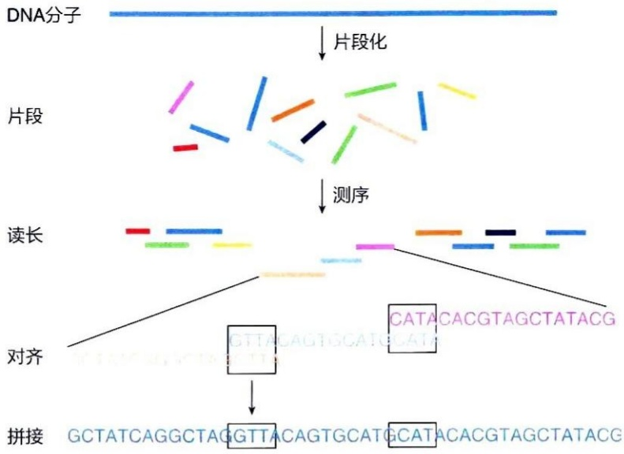

<details>
<summary>flowchart</summary>

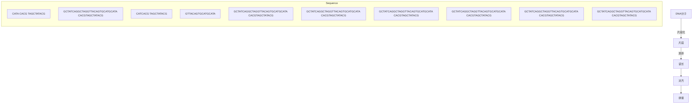
</details>

图 7-21 大型基因组分级组装示意图

模测序的需求。上述问题的本质在于双脱氧核苷酸链终止法的分子利用效率过低，每条延伸链只有在终止时才获得一个碱基的信息，之前延伸的碱基都不能提供有效信息。为此，科学家们在荧光标记双脱氧核苷酸链的基础上开发出核苷酸可逆终止子，其逻辑与核苷亚磷酰胺类似，即利用3'羟基被保护基封闭的核苷酸进行聚合酶延伸，延伸后再脱去保护基恢复3'羟基（图7-22）。这使得每一步延伸都可以实现

---

7.5 核酸分子的碱基序列可被精确测定

271

链终止并通过荧光颜色获得碱基信息，每一次终止之后又都可以恢复延伸活性，使得每条延伸链的每个碱基都可以被测序，大大提高了测序效率。目前的高通量测序基本都是基于类似的方式实现。

## 7.5.3 单分子核酸测序突破传统技术限制

当前的高通量测序技术尽管在效率和成本方面已经非常先进，但在研究核酸的生物学功能时往往面临读长不足的问题。常见的基因和功能元件往往有几千甚至几百万碱基的长度，差异剪切、点突变的单倍型、结构变异等现象都需要长读长测序的技术支持。双脱氧核苷酸链终止法受限于电泳分辨率，读长难以突破1000碱基。核苷酸可逆终止子法一方面因为碱基化学修饰导致双链结构不稳定，另一方面因为每一步延伸效率无法达到 $100\%$ 导致链延伸不同步，最终无法有效识别出碱基荧光。目前主流的可逆终止子法单端读长一般不超过300碱基。为了解决上述问题，科学家们开始关注单条核酸分子的实时序列解析。一方面单分子测序从本质上避免了进度异质性问题，另一方面实时序列解析可以有效避免对碱基化学修饰的依赖。

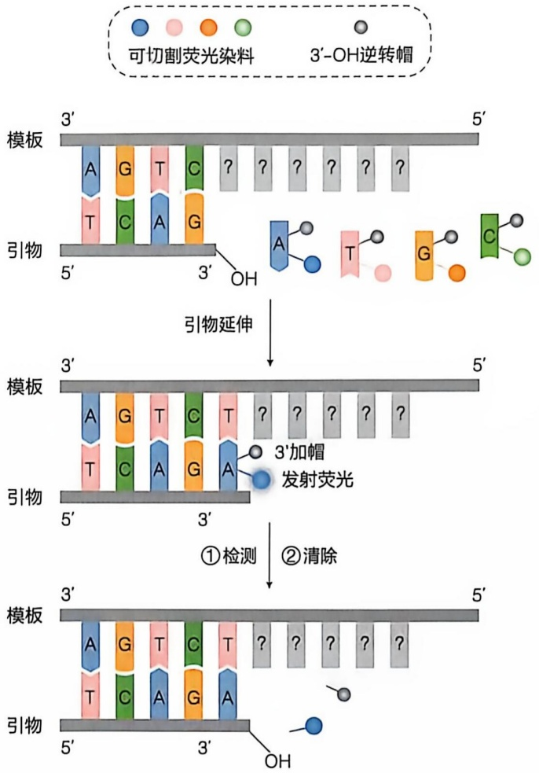

<details>
<summary>flowchart</summary>

This diagram illustrates the DNA sequencing workflow for a sample using a 3'-OH逆转帽, showing how an intracellular probe binds to a target sequence and subsequently reads into a target sequence.
</details>

图 7-22 核苷酸可逆终止子法测定 DNA 碱基序列

早期的单分子核酸测序技术整体沿用了“边合成、
边测序”的逻辑，即通过观察不同荧光标记的核苷酸被 DNA 聚合酶延伸到引物 3' 端时的信号来分辨碱基序列。为了解决化学修饰的影响，荧光分子被标记在 γ 磷酸而不是碱基上，随着磷酸二酯键的形成，荧光分子随焦磷酸离去，留下无化学修饰的碱基（图 7-23）。这一策略对光学检测要求极高，目前主要通过光在几十纳米孔径处的近场能量衰减现象来避免背景溶液中游离核苷酸荧光信号的干扰。

单分子光学检测对仪器的要求极高，通常仪器庞大且不稳定。相比之下，电子学技术经过数十年的发展，目前已经高度成熟。由于核酸分子在中性环境下带有负电荷，在电场的驱动下会通过电阻膜上的孔洞从一侧转移到另一侧。如果这个孔洞足够小，只能允许单条核酸链上碱基的依次通过，那么不同碱基就会对孔内空间产生不同的影响。纳米孔测序技术的设计原理就是检测 DNA 分子穿过纳米孔时穿孔电流的变化，这与前几种核酸研究方法都不同。电学信号经过各种电子学和数学转换，最终被解析成碱基序列（图 7-23）。

单分子核酸测序不需要 PCR 扩增，测序读长往往只受限于样品核酸链的长度，可以达到几万甚至几十万碱基。同时，因为可以进行实时观测，单分子测序还可以通过每一步延伸所需要的时间或者穿孔电流的细微变化检测碱基上可能存在的修饰。

---

272

7 核酸探究

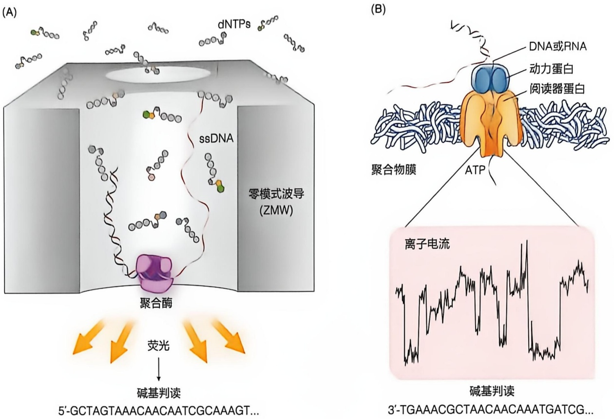

图7-23 单分子核酸测序原理

（A）单分子“边合成、边测序”策略。（B）纳米孔测序策略。两种策略读取核酸序列的方向是不同的

## 7.6 多种技术可对核酸分子进行改造

在对 DNA 和 RNA 有了基本认识之后，人们期望能对它们进行人工操控。这不仅是认识核酸结构和功能的重要途径，也为我们利用核酸提供了可能性。这里介绍几种对 DNA 和 RNA 分子进行操作的技术，重点介绍这些技术的基本原理。

## 7.6.1 重组 DNA 技术实现 DNA 片段重新组合

1970 年代，保罗·伯格（Paul Berg，1926—2023）等基于限制性内切酶和 DNA 连接酶建立起重组 DNA 技术，使我们对 DNA 分子进行操控的能力显著增强。

## (1) 限制性内切酶可对 DNA 序列进行精确切割

核酸酶是一类能催化磷酸二酯键水解断裂的酶，DNase I 即是一种核酸酶（见7.3.3节）。相对于随机切割的 DNase I，Ⅱ型限制性内切酶是一类具有较强序列专一性的脱氧核糖核酸酶，可对双链 DNA 分子中特定碱基序列进行切割。在探究细菌抵御噬菌体侵染时，沃纳·亚伯（Werner Arber）、汉密尔顿·史密斯（Hamilton Smith）和丹尼尔·内森斯（Daniel Nathans，1928—1999）等推测并发现了第一个Ⅱ型限制性内切酶 Hind II，并展示了利用限制性内切酶对 DNA 的分析和改造。很多限制性内切酶的活性会被 DNA 甲基化阻碍，细菌以此来保护自身 DNA 不被切割。

目前生物学实验最常用到的是ⅡP型限制性内切酶，如图7-24所示，每种ⅡP

---

7.6 多种技术可对核酸分子进行改造

273

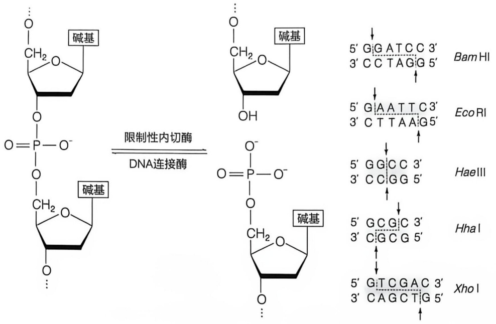

<details>
<summary>flowchart</summary>

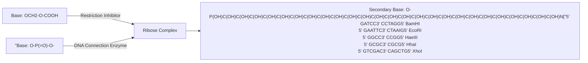
</details>

图 7-24 限制性内切酶

型限制性内切酶都识别一种回文序列（即双链中两条单链的  $5'\rightarrow3'$  碱基序列是相同的）。酶对该序列进行对称切割，产生两个相同的平末端或单链末端（黏性末端）。每个末端的  $5'$  端有磷酸化修饰， $3'$  端是羟基。这使得任何被某种特定限制性内切酶切割形成的两个 DNA 末端都是拓扑结构互补的，对于重组 DNA 技术的建立是极为关键的。

## (2) DNA 连接酶催化形成磷酸二酯键

1967 年，马丁·盖勒特（Martin Gellert）发现大肠杆菌抽提物可以将  $\lambda$  噬菌体线性 DNA 由非共价环形构型转变为共价环状构型。之后包括盖勒特实验室在内的 4 个实验室几乎同时纯化出大肠杆菌 DNA 连接酶，并证明其可以催化形成磷酸二酯键。T4 DNA 连接酶也在同一时期被发现。二者的酶活性非常相似，都可以催化双链 DNA 分子切口处的 5' 磷酸基团与 3' 羟基形成磷酸二酯键。上述含有切口的双链结构既可以由原生双链 DNA 发生单链断裂产生，也可以由两个相对独立的末端通过杂交形成，前者对应 DNA 修复，后者为重组 DNA 技术提供了基础。T4 DNA 连接酶还可以额外通过平末端或黏性末端连接两个 DNA 分子，应用更加广泛。

## (3) 质粒载体确保外源 DNA 在细胞内稳定存在

理论上通过对不同来源的 DNA 进行切割和重新拼接就可以构建重组 DNA，但要想重组 DNA 在细胞内发挥生物学功能，还需要引入载体这一概念。载体是帮助外源 DNA 在细胞（主要是细菌）内稳定存在的 DNA 序列，通常包含复制起始位点和抗生素抗性基因。1973 年，斯坦利·科恩（Stanley Cohen，1922—2020）和赫伯特·伯耶（Herbert Boyer）等首次完成了细菌质粒的体外构建。他们利用 Eco RI 限制性内切酶切割两种抵抗不同抗生素的质粒，再利用连接酶重新组合，将产物转入大肠杆菌中，使一部分细胞能同时抵抗两种抗生素。这一结果不但首次证明体外构建的质粒可以在细胞内起作用，也是首个将质粒作为载体的报道。

---

274

7 核酸探究

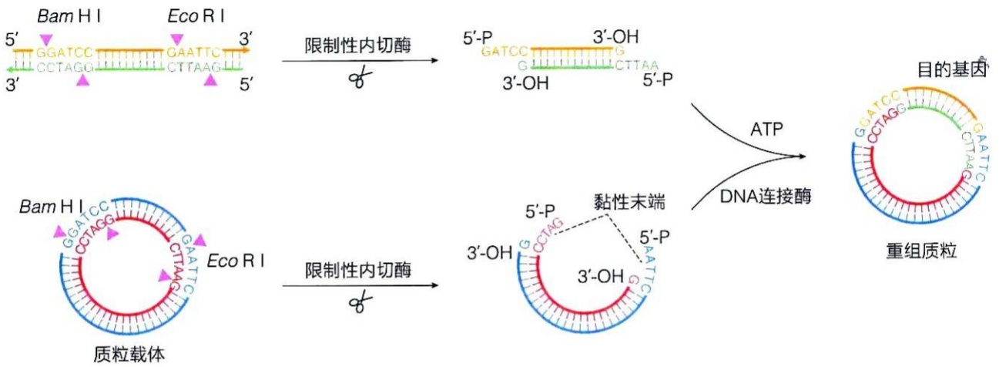

<details>
<summary>flowchart</summary>

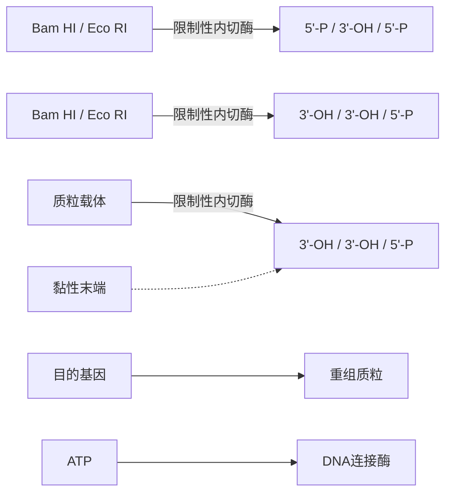
</details>

图 7-25 重组 DNA 技术的典型过程

## (4) DNA 通过切割和连接实现重组

以上述基本要素为基础，基本的重组 DNA 技术主要涉及以下 3 个步骤（图 7-25）。第一步，利用特定的限制性内切酶切割感兴趣的 DNA 分子，以获得含有特殊末端结构的目标 DNA 片段。第二步，利用相同的限制性内切酶将选定的载体 DNA 进行切割，以产生相同的末端结构。第三步，将上述两种 DNA 片段通过 DNA 连接酶整合为一个重组 DNA 分子。重组 DNA 可用于后续分子克隆或其他生物学研究。

DNA 分子中的特定碱基序列决定着特定蛋白质分子的氨基酸序列，重组 DNA 技术自然成为探究蛋白质的一种重要方法。重组 DNA 技术还是在细胞水平进行基因敲除或基因敲入，进而构建转基因生物（包括微生物、动物和植物）或进行基因治疗等的重要基础。

## 7.6.2 特异或随机突变实现 DNA 局部改造

除重组 DNA 技术外，科学家们还建立了多种特异或非特异精细改变 DNA 碱基序列等的方法，在揭示蛋白质结构和功能等研究中发挥着重要作用。

## (1) 定点诱变技术替换一个或多个碱基

迈克尔·史密斯（Michael Smith，1932—2000）等在桑格实验室研究核酸测序的过程中开发了一种对核酸特定位点进行单碱基突变的方法。他们以一条中间带有单碱基突变的12 nt寡聚核酸作为引物，噬菌体单链环形基因组DNA作为模板，利用大肠杆菌DNA聚合酶、激酶和连接酶合成环形互补链，最终可以得到突变型基因组，但突变效率较低。后续研究提高了突变效率并将改造对象扩展到质粒DNA。

目前，常用的定点诱变技术是设计一对反向互补引物，并将拟替换、添加或删除的碱基置于两条引物的中间位置，通过加热和退火使引物结合到待改造的野生型质粒DNA上，在DNA聚合酶的催化作用下延伸形成互补链，再利用激酶和连接酶封闭切口。再次加热变性和退火处理质粒，使新合成的带有突变的两条单链DNA互补配对，最终形成在特定位点发生突变的双链质粒。可利用只针对甲基化DNA

---

7.6 多种技术可对核酸分子进行改造

275

的 Dpn I 限制性内切酶去除野生型质粒，留下不含有甲基化的突变质粒（图 7-26）。

定点诱变技术通过改变基因的 DNA 序列而改变所编码蛋白质的氨基酸序列，将蛋白质中特定的一个或几个氨基酸残基进行替换、添加或删除，进而鉴定蛋白质分子中对功能（如活性、定位、相互作用等）起关键作用的氨基酸残基。也可以利用定点诱变技术，在蛋白质分子中引入特定的信号肽序列，改变蛋白的亚细胞部位；或者引入多肽标签，使重组蛋白可以通过亲和层析等方法被高效纯化。

## (2) DNA 随机突变技术可用于构建突变体文库

定点诱变技术对单个位点进行突变时非常精准，但对多个位点进行突变分析时明显效率不足。为克服此缺点，弗朗西丝·阿诺德（Frances Arnold）等在1990年代设计出一套对DNA进行随机突变的流程，构建出编码某种蛋白质的随机突变体基因文库，然后再筛选出具有某种特征的突变体。此过程被称作蛋白质的定向演化。

DNA 随机突变技术的本质上是通过化学诱变剂或易错 PCR 在 DNA 片段中引入低频随机突变。碱基容易受到氧化损伤或发生脱氨反应产生突变，化学诱变剂可加速这一反应，进而改变碱基配对偏好。镁离子是 DNA 聚合酶的辅助因子，但高浓度的镁离子会提高聚合时碱基错配的发

生率，也可以通过向反应体系中添加8-oxo-dGTP（8-氧化脱氧鸟苷三磷酸）或dITP等碱基类似物引入突变。

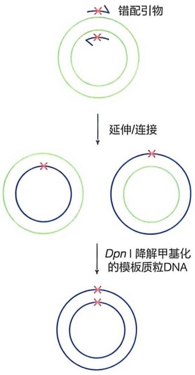

<details>
<summary>flowchart</summary>

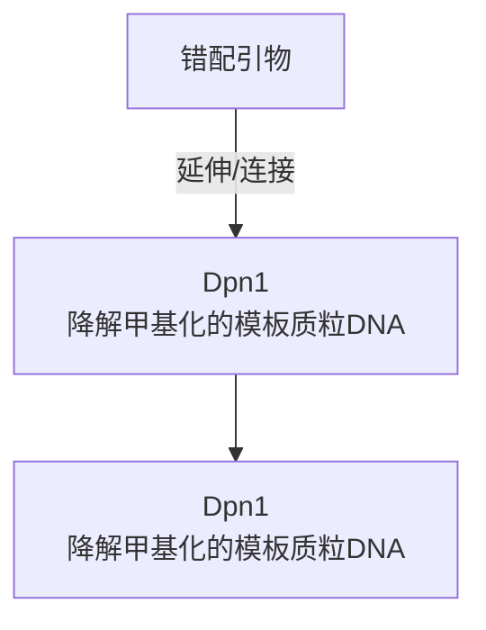
</details>

图 7-26 DNA 定点诱变的原理示意

## 7.6.3 基因组编辑技术为细胞内 DNA 改造提供有效手段

传统的重组 DNA 技术或位点特异突变技术主要在体外针对较小的 DNA 分子（如质粒）进行操作，无法对细胞内的基因组 DNA 进行改造。基因组编辑技术是指对植物、动物和细菌等的基因组进行精确改造的技术，其更具挑战性和应用价值。

1980 年代，马里奥·卡佩奇（Mario Capecchi）等建立了基因打靶技术，主要基于同源重组现象对基因组中的特异序列进行替换。但细胞内自发同源重组的频率很低，难以用于对基因组 DNA 进行有效编辑。通过对同源重组机制的研究，科学家们发现双链 DNA 断裂是同源重组发生的必要条件，提高位点特异性双链 DNA 断裂发生率成为基因组编辑技术发展的主要策略。

## (1) 转录激活因子样效应蛋白核酸酶可进行精确切割

科学家们在研究黄单胞菌侵染机制时发现其转录激活因子样效应蛋白（transcription activator-like effector，TALE）内部含有一个串联重复多肽序列，每个重复单元折叠后通过内部两个氨基酸残基结合宿主基因组 DNA 中的一个碱基，多个重复单元的串联使其可以结合一个具体的 DNA 序列。若要结合不同序列的 DNA，只需改变每个重复单元中对应的两个氨基酸残基即可。

---

276

7 核酸探究

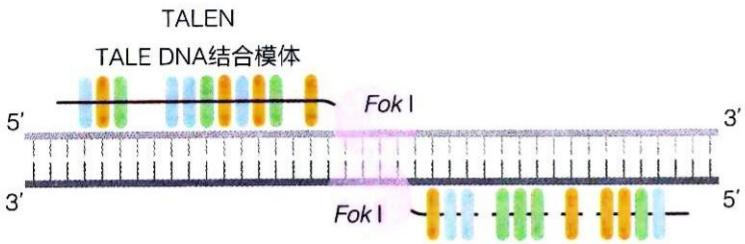

<details>
<summary>text_image</summary>

TALEN
TALE DNA结合模体
Fok I
5'
3'
Fok I
5'
</details>

图 7-27 TALEN 靶向切割 DNA 双链

在此基础上，将靶向具体 DNA 序列的转录激活因子样效应蛋白与序列非特异单链 DNA 酶 Fok I 融合，便得到一个可特异结合并切割 DNA 序列的转录激活因子样效应物核酸酶（transcription activator-like effector nuclease, TALEN）。一对靶向特定序列上下游区域且方向相对的 TALEN 即可在该序列处产生特异性双链断裂（图 7-27），显著提

高编辑效率。

## (2) RNA 可以引导切割特异 DNA

TALEN 固然可以对基因组进行特异性切割，但编码串联重复多肽序列的质粒构建却非常困难，使得 TALEN 所能靶向的 DNA 序列难以快速扩展。1993 年，弗朗西斯科·莫伊卡（Francisco Mojica）等在古菌和细菌基因组中发现了一些串联序列，并且每个物种的序列也存在于侵染该物种的噬菌体中。莫伊卡推测这是一种获得性免疫机制，并将其命名为成簇规律间隔短回文重复（clustered regularly interspaced short palindromic repeat, CRISPR）。

既然细菌可以通过限制性内切酶破坏入侵的噬菌体 DNA，它们大概也可以通过获得性免疫机制破坏入侵的噬菌体 DNA。2012 年，多个实验室几乎同时独立报道了利用 CRISPR 编码的 RNA 引导实现双链 DNA 切割的实验结果。这种由 RNA 引导的 DNA 切割机制主要涉及两种寡聚 RNA 分子和一种核酸酶，其中，从 CRISPR 位点转录并加工而成的 crRNA 与从另外一个位点转录而成的 tracrRNA 通过部分序列之间的互补配对形成向导 RNA（guide RNA），再与从另外一个位点转录翻译产生的 Cas 核酸酶形成复合物。基于向导 RNA 与基因组中靶向 DNA 链的互补配对结合，以及目标 DNA 结合区旁边的原型间隔序列邻近基序（protospacer adjacent motif，PAM），该复合物稳定结合靶向 DNA，并依靠 RuvC 和 HNH 两个活性中心对基因组 DNA 进行切割（图 7-28）。在后续的优化中，科学家们将 crRNA 与 tracrRNA 通过茎环结构合并成 sgRNA，形成了目前普遍使用的 CRISPR 基因编辑体系。由于被切割的 DNA 序列仅由 sgRNA 中大约 20 个碱基序列决定，每次改变编辑位点时只需更换此 20 个碱基即可，极大降低了基因组编辑的时间和经济成本。

图 7-28 sgRNA-Cas9复合物靶向切割 DNA 双链

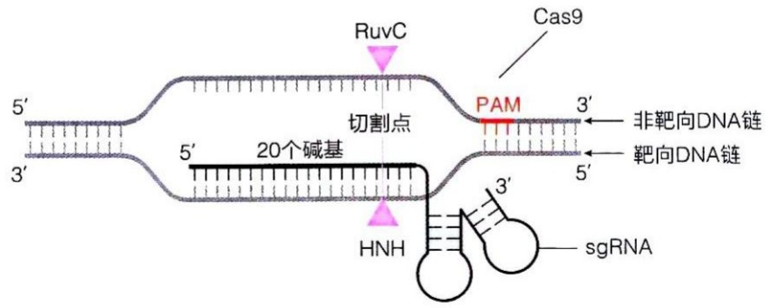

<details>
<summary>text_image</summary>

RuvC
Cas9
PAM
3'
非靶向DNA链
靶向DNA链
5'
20个碱基
5'
3'
sgRNA
HNH
</details>

---

7.6 多种技术可对核酸分子进行改造

277

## 7.6.4 碱基编辑无须产生 DNA 断裂

尽管 TALEN 和 CRISPR 技术已经展示出很高的编辑效率，并在科学研究中发挥了重要作用，但科学家和伦理学家对双链断裂在临床应用中的安全风险感到担忧。细胞中含有多种碱基修饰酶，这些酶在基因调控的各个方面发挥着重要作用（见 6.2.4 节）。例如脱氨酶可以将胞嘧啶转换为尿嘧啶，从而引发 C-G 到 T-A 的点突变；腺嘌呤脱氨后转变为次黄嘌呤，优先与胞嘧啶配对，从而实现 A-T 到 G-C 的编辑。科学家们将 TALEN 中的 Fok I 核酸酶替换成脱氨酶，或者将核酸切割位点突变失活后得到的 dCas9 与脱氨酶融合，便可以在不产生双链核酸断裂的情况下对指定位点进行碱基编辑（base editing），大大提高了编辑的安全性（图 7-29）。为了防止脱氨后的碱基被清除，科研人员将尿嘧啶糖基化酶抑制剂（UGI）与 dCas9 融合，降低了尿嘧啶糖基化酶（UNG）参与的碱基切除修复；为了进一步提高编辑效率，研究人员将 dCas9

图 7-29 碱基编辑

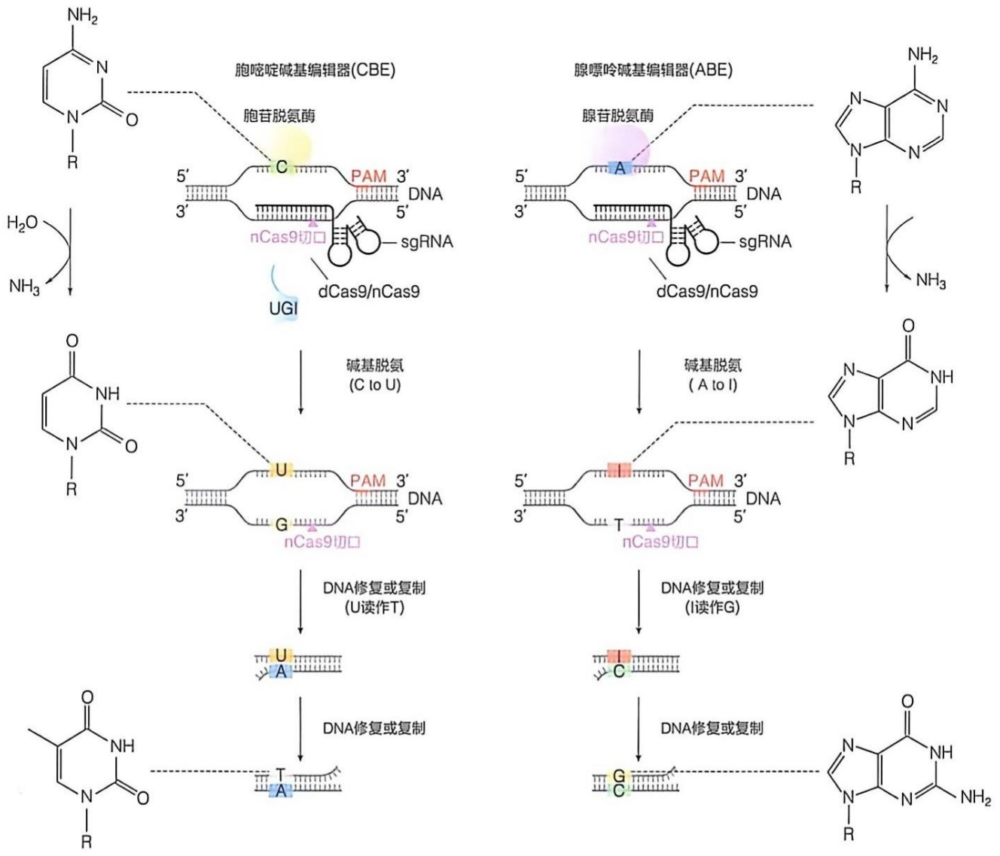

<details>
<summary>flowchart</summary>


</details>

---

278

7 核酸探究

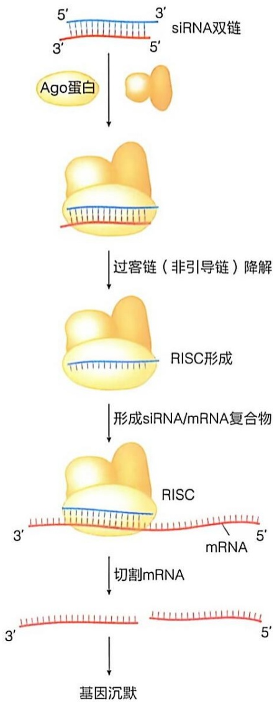

<details>
<summary>flowchart</summary>

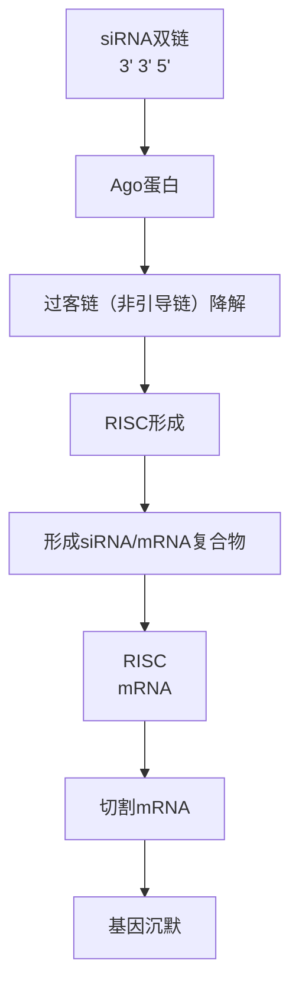
</details>

图 7-30 RNA 干扰

更换为只切割未编辑 DNA 链的 nCas9，以编辑后的 DNA 链作为模板来修复未编辑 DNA 链，从而将碱基编辑的效果复制到互补 DNA 链上。

## 7.6.5 RNA 分子也可实现精准改造

大多数生物的基因信息以 DNA 形式储存，并通过 RNA 传递到蛋白质，对 DNA 的改造可以从底层满足生物改造的要求。然而，生物进化规律告诉我们，DNA 作为遗传物质最重要的是稳定，调控主要针对 RNA 层面。事实上自然界确实已经进化出多种在细胞内改造 RNA 的机制，如 RNA 的剪切、切割、编辑等。

1990 年代，科学家们普遍使用反义 RNA 来对特定基因进行沉默，但在实验中意外观察到正义 RNA 也可以产生同样的沉默效果。经过反复研究，安德鲁·法尔（Andrew Fire）和克雷格·梅洛（Craig Mello）最终发现基因沉默的关键并非正义或反义 RNA，而是在制备单链 RNA 时产生的低含量双链 RNA。核糖核酸酶复合物（Dicer）和 RNA 诱导沉默复合物（RISC）接力将 siRNA RNA 双链处理为与 RNA 靶分子序列互补的单链 RNA，RISC 在此单链 RNA 的引导下结合并切割 RNA 靶分子（图 7-30）。这个过程被称为 RNA 干扰（RNAi）。

随着对 CRISPR 系统的深入研究，科学家们也发现了一些可以靶向切割 RNA 分子的 CRISPR 和 Cas 蛋白，例如，Ⅲ型 CRISPR 系统可以对 RNA 进行长度为 6bp 的整倍数的切割。此外，细胞内的 RNA 连接酶 RTCB 可以对被切割的 RNA 进行修复，相当于在 RNA 分子内引入缺失突变。

碱基编辑对 RNA 同样适用。事实上，目前已发现的天然腺嘌呤脱氨酶都只能作用于 RNA 碱基，针对 DNA 碱基的腺嘌呤脱氨酶是通过随机突变体文库筛选得来的。

## ※展望

随着高通量测序技术的迅速发展，核酸研究已步入大数据时代。这一时代不仅为我们提供了大量的基因组、转录组和表观组数据，也极大地推动了组学研究的深化。现代测序技术能够在短时间内生成数百万甚至数十亿个序列数据，助力我们对复杂生物系统进行全面的解析。通过对这些海量数据的深入分析，我们能够揭示基因的功能、表达调控机制，以及其在不同生理和病理状态下的变化。

人工智能（AI）在数据处理中的应用为这一领域带来了革命性的变革。特别是机器学习和深度学习等 AI 算法，可以高效地处理和分析庞大的组学数据，识别潜在的模式和关系。这些技术能够自动化完成数据清理、特征选择和模型构建，显著提升了分析的速度和准确性。此外，AI 还能够帮助研究人员预测基因功能、疾病风险及药物反应，进而加速新

---

思考题

279

药开发和个性化医疗的进程。

然而，数据量的激增也带来了新的挑战，传统的分析方法已经无法满足需求，迫使科学家们开发出更高效的算法和工具。这一过程不仅需要深厚的生物学基础，还要求研究人员具备数据科学的能力，以便更好地利用 AI 技术处理和解读复杂的数据。

因此，核酸研究的未来不仅仅依赖于实验室中的操作，更需要跨学科的协作和创新，推动生物学、计算机科学和统计学的紧密结合。这一趋势预示着未来的研究将更加依赖数据驱动的方法，助力生物医学领域实现突破性的进展。

## ※ 本章小结

常见的核酸提取方法包括乙醇沉淀法，固相吸附法、苯酚-氯仿抽提法等。

核酸的基础物理性质包括含量和长度，吸光度检测可对不同核酸分子进行定性与定量，标记和染色可进一步提高定量准确性，电泳在标记染色的基础上进一步提供长度信息。

双链核酸分子可发生变性和复性，这个过程涉及吸光度的变化，变性和复性的温度与核酸的序列有关。

分子杂交技术主要通过核酸分子的变性与复性来探测不同核酸单链间的相互作用。

核酸与蛋白质的互作分析是探究其生物学功能的有效手段。可利用共沉淀技术发现参与互作的分子，通过凝胶阻滞实验验证具体分子间的互作，通过足迹实验解析蛋白质结合核酸的精确位置。

聚合酶链反应可在短时间内实现对特定 DNA 片段的大量扩增，荧光定量 PCR 技术通过监测扩增过程对微量核酸进行定量。

核酸链终止法使人类基因组测序得以实现。核苷酸可逆终止子法提高了测序效率，单分子核酸测序突破了传统技术的限制。

重组 DNA 技术可实现不同核酸片段的自由组合，定点诱变和随机突变可实现核苷酸序列的精细改造。

细胞内基因组编辑技术包括 TALEN、CRISPR 等，RNA 分子也可通过类似技术实现精准改造。

## ※ 思考题

1. 在细菌细胞中，均以环状形式存在的基因组 DNA 和质粒 DNA 在质粒提取过程中发生了什么变化？这种变化对质粒的提取有什么利用价值？
2. PCR 结束之后是否可以通过  $A_{260}$  数值判断扩增是否成功？
3. 为什么双链 DNA 分子的 ${T}_{\mathrm{m}}$ 不会随分子长度持续增加？
4. 为什么不能直接从荧光定量 PCR 的 $C_T$ 值直接推算核酸的绝对量？
5. 对一个杂合 DNA 片段样品分别进行桑格测序和高通量测序，反映杂合信息的方式

---

280

7 核酸探究

会有什么不同？

6. 相比于 TALEN，CRISPR 在哪方面的提升对于生物医学应用更重要？

## ※ 推荐阅读

1. WYATT G R, COHEN S S. The bases of the nucleic acids of some bacterial and animal viruses: the occurrence of 5-hydroxymethylcytosine [J]. Biochem J, 1953, 55: 774-782.

本文通过碱基的物理化学特征发现了 5-羟甲基胞嘧啶。

2. SOLOMON M J, LARSEN P L, VARSHAVSKY A. Mapping protein-DNA interactions in vivo with formaldehyde: evidence that histone H4 is retained on a highly transcribed gene [J]. Cell, 1988, 53: 937-947.

本文最早报道了染色质免疫共沉淀技术。

3. HIGUCHI R, FOCKLER C, DOLLINGER G, et al. Kinetic PCR Analysis: real-time monitoring of DNA amplification reactions [J]. Nature Biotech, 1993, 11: 1026-1030.

本文最早报道了荧光定量 PCR 技术。

4. BALASUBRAMANIAN B. Solexa sequencing: decoding genomes on a population scale [J]. Clinical Chemistry, 2015, 61: 21-24.

本文简要回溯了高通量 DNA 测序技术的早期发展历程。

5. YI D, MERTZ J M. Paul Berg and the origins of recombinant DNA [J]. Cell, 2024, 187: 1019-1023.

本文总结了重组 DNA 技术的早期发展史。

(撰写: 王建斌, 冯雁; 审修: 季雄, 邹鹏, 方晓峰, 梁如冰)
