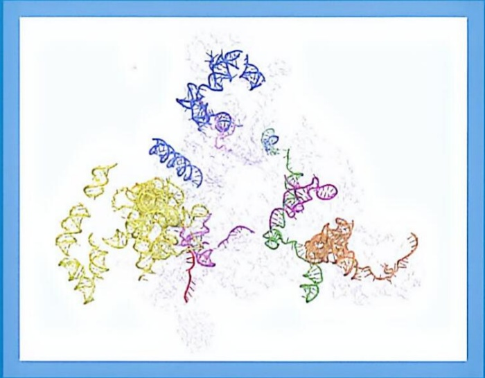

# 第II篇 遗传信息的传递与表达·分篇页

原始 PDF 第 298–299 页。

natural_image

Colorful abstract molecular or protein structure visualization with no visible text or labels

## 第Ⅱ篇

## 遗传信息的传递与表达

遗传信息的存储、传递与表达构成了生命延续与功能的核心。这一过程的核心分子是脱氧核糖核酸（DNA）、核糖核酸（RNA）和蛋白质（protein），它们共同构成了分子生物学“中心法则”的基石。对遗传物质化学本质的认知经历了曲折历程:1869年，弗雷德里希·米歇尔首次从白细胞核中分离出富含磷的“核素”，但此后数十年间，结构复杂且功能多样的蛋白质更被普遍认为是遗传信息的载体，而DNA则因其看似简单的化学组成而被忽视。直到20世纪中期，奥斯瓦尔德·埃弗里（Oswald Avery）等人的关键性实验才确凿无疑地证明了DNA才是真正的遗传物质。这一认识的转变为后续革命性发现铺平了道路。

1953年，沃森和克里克基于前人的数据（特别是罗莎琳德·富兰克林的X射线衍射图），提出了划时代的DNA双螺旋结构模型。该模型揭示了遗传信息存储与传递的分子基础:两条反向平行的核苷酸链通过严格的碱基互补配对（A-T，C-G）形成稳定的螺旋结构。基因信息以特定的核苷酸序列编码于其中，并通过精确的复制传递给后代。这一发现标

---

志着生物学正式迈入分子时代，成为现代分子生物学诞生的里程碑。1958年，克里克进一步提出“中心法则（central dogma）”，系统阐述了遗传信息的主流导向:DNA通过复制实现自我延续，通过转录生成RNA，再由RNA通过翻译指导蛋白质的合成。这一简洁而深刻的法则，奠定了理解遗传信息传递与表达的理论基石。

后续研究揭示，生命体系的运作比“中心法则”最初描述的单向流动更为精妙和复杂。例如，逆转录病毒和逆转座子中存在逆转录过程（RNA → DNA）；RNA 病毒能以 RNA 为模板进行复制；RNA 分子（尤其是非编码 RNA）的功能远不止信息传递中介，还广泛参与基因表达的调控。这些发现极大地拓展了“中心法则”的内涵，凸显了生命过程的灵活性与调控网络的复杂性，但并未动摇 DNA 作为核心遗传信息库、转录与翻译作为核心信息流的主干地位。

本篇将围绕“中心法则”的核心框架，系统阐述遗传信息流动的分子机制及其精密调控。通过解析这一信息传递链的每个环节及其调控网络，我们将深入理解生命体如何精确地存储、复制和解读其遗传指令，并最终将其转化为功能性的蛋白质机器，实现生命活动的精妙运转。这不仅是分子生物学的核心，也是理解生命本质的关键，
