# 8 DNA复制、修复与重组

原始 PDF 第 300–372 页。

# DNA 复制、修复与重组

DNA 的复制、修复与重组是生命延续的重要环节，共同维持基因组稳定性并推动生物演化。

1950 年代提出的 DNA 双螺旋结构奠定了 DNA 复制研究的基础。DNA 复制以半保留方式将遗传信息精确传递给子代，维持遗传信息的稳定性。在随后的几十年里，DNA 复制过程和精确调控逐步被深入揭示。

DNA 修复是维持基因组稳定性的重要机制。面对体内外环境因素造成的 DNA 损伤如氧化、烷基化及 DNA 断裂等，生物体可通过多种途径恢复基因组完整性并保持遗传信息稳定。修复缺陷可导致突变积累和染色体异常，进而诱发多种疾病。

DNA 重组促进生物体适应性提升与遗传多样性形成，包括同源重组、位点特异性重组等多种类型。DNA 重组不仅参与 DNA 修复，还在真核生物细胞减数分裂中通过染色体交叉保障遗传多样性，在免疫系统中通过 V(D)J 重组产生抗体多样性，并在细菌转化和病毒整合中促进基因水平转移。DNA 重组加速了基因交流和进化速率，提高了生物体对环境变化的适应性。

DNA 复制、修复和重组彼此紧密关联。复制过程中产生的错误依赖修复机制加以纠正，重组过程则借助复制传递新的基因组合。三者协同作用，既维系遗传信息的稳定，又引入适度变异，构成“稳定-变异”的辩证统一。深入理解这些过程有助于阐明细胞的增殖、生物体的生长、发育与遗传变异的根本原理。

8

---

284

8 DNA复制、修复与重组

## 8.1 经典实验揭示 DNA 的复制方式

当一个细胞分裂成两个子代细胞时，它必须尽可能精确地将遗传物质复制并均分给两个子代细胞。1953年，沃森和克里克提出了DNA双螺旋结构模型，指出DNA双螺旋的两条链是互补结构，这为人们思考和研究DNA复制指明了方向:DNA两条亲代链中任意一条都可以作为模板进行子代链的合成。事实上，也正是DNA结构所揭示的自我互补的性质使大多数生物学家最终接受了艾弗里在肺炎链球菌致病性转化研究中得出的结论，即DNA是遗传信息的载体。因此，DNA复制其实就是细胞遗传信息的复制和稳定维持的方式，DNA存储的基因组信息会通过精准复制传递给下一代，所以生命体的遗传信息在亲代和子代之间的传递实际上依赖于染色体DNA的自我复制。

然而，作为以实验为基础的生命科学，这个合理的推测仍然需要实验数据的支持。在DNA双螺旋结构提出后的5年内，负责DNA复制的酶以及DNA复制中互补双链分离作为模板进行子链合成的过程陆续被强有力的实验结果所证实。1957年，阿瑟·科恩伯格（Arthur Kornberg，1918—2007）发现了DNA聚合酶。1958年，梅塞尔森和斯塔尔揭示了DNA复制的半保留方式，证明了DNA本身就是合成新DNA链的模板。

## 8.1.1 DNA 通过半保留方式复制

基于 DNA 双链反向互补的结构，沃森和克里克推测，在 DNA 复制过程中双螺旋被解开，每条亲本 DNA 链都被用作模板，从而合成两个新的子代双链，每个子代双链都保留一条亲本 DNA 链和一条全新合成的 DNA 单链。这种复制模式被称为半保留复制（图 8-1）。除此之外，也有另外两种不同的可能方式——全保留复制和分散保留复制。全保留复制是假设在复制后两条亲本链仍保持在一起，而分散保留复制中，复制后的双链将以随机方式拼凑在一起。

梅塞尔森和斯塔尔利用同位素示踪加氯化铯密度梯度离心的方法确定了DNA复

图 8-1 DNA 复制方式的三种不同假设

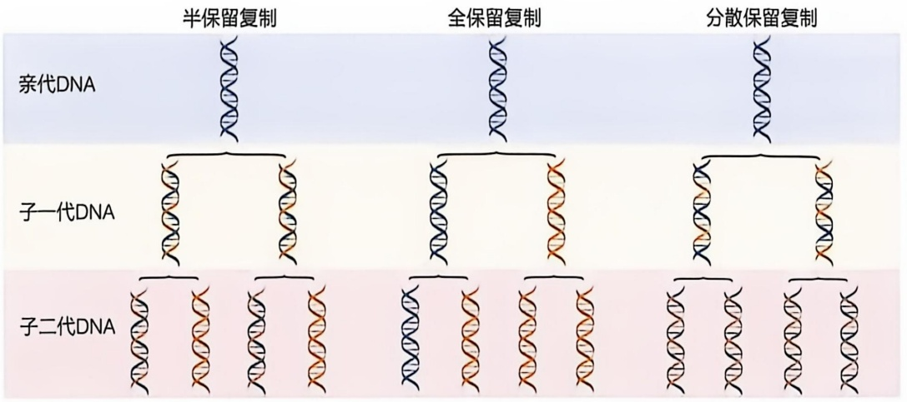

<details>
<summary>flowchart</summary>

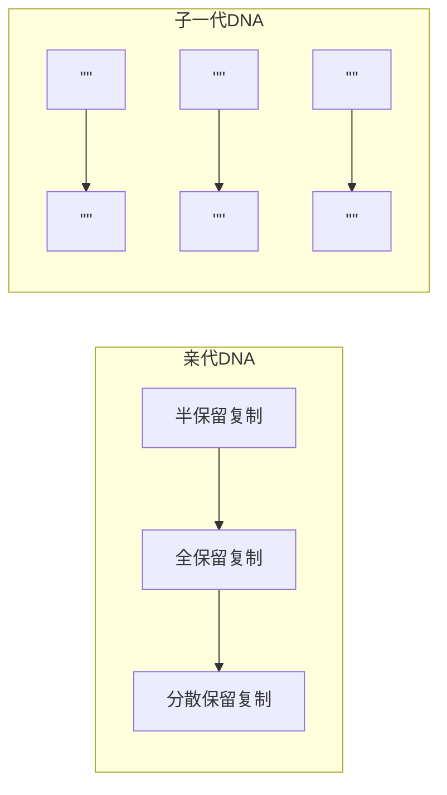
</details>

---

8.1 经典实验揭示 DNA 的复制方式

285

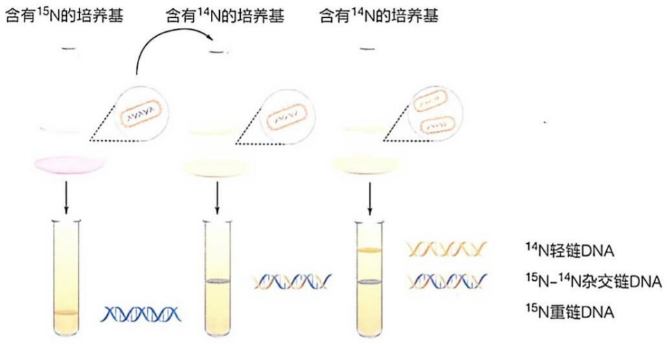

<details>
<summary>flowchart</summary>

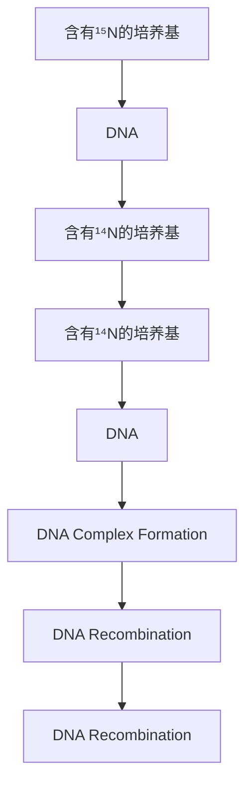
</details>

图8-2 梅塞尔森-斯塔尔实验:半保留复制的证明

制的半保留方式。他们首先将大肠杆菌在以  ${}^{15}NH_{4}Cl$  作为唯一氮源的培养基中培养若干代，使重氮同位素  ${}^{15}N$  均匀标记细胞 DNA。之后，将被  ${}^{15}N$  标记的大肠杆菌再转移到普通的以  ${}^{14}N$  为氮源的培养基中继续培养，并分别提取不同子代大肠杆菌的 DNA 进行氯化铯密度梯度离心。由于  ${}^{15}N$  标记的 DNA 具有更大的密度，其在氯化铯密度梯度介质中离心后将富集在更靠近试管底部的位置，而普通  ${}^{14}N$  标记的 DNA 则会富集在更靠近试管顶部的位置（图 8-2）。梅塞尔森和斯塔尔发现，在分裂后子一代的菌体中只有一条 DNA 的条带，其密度介于含  ${}^{15}N$  和  ${}^{14}N$  标记的 DNA 之间。这一结果排除了 DNA 复制的全保留方式，但还不能够区分半保留方式和分散保留方式。他们进一步检测了转移至  ${}^{14}N$  标记培养基中培养的子二代细菌，发现子二代细菌的 DNA 在密度梯度离心后产生了两个条带，一个条带对应全部为  ${}^{14}N$  标记的轻链组成的双链 DNA，另一个条带则对应的是一条  ${}^{15}N$  标记重链和一条  ${}^{14}N$  标记轻链组成的双链 DNA（图 8-2）。这些结果证实了 DNA 的半保留复制方式。

## 8.1.2 DNA 复制起始于特异位点并向双向延伸

DNA 复制以半保留方式进行，那么复制最初从哪里开始呢？DNA 复制时双链最初解开形成单链模板开始复制的位置被称为 DNA 复制起点（DNA replication origin）。细菌中 DNA 复制起点具有特定的 DNA 序列，但真核细胞中的复制起点较为复杂，尤其是哺乳动物细胞复制的起点是否有序列特异性还未知。

E. coli 的环形染色体具有单一的复制起始区，称为 “OriC”，其最小长度为 245 bp。E. coli 的 OriC 序列中有两类特殊的子区域，一类是包含 5 个九聚核苷酸（9-mer）的重复序列，称为 R 位点，其共有序列为 TTATNCACA。该九聚核苷酸序列与 E. coli 的复制起始蛋白 DnaA 具有特异性的高亲和力，DnaA 也是复制起始过程中唯一与 DNA 序列特异结合的蛋白质。另一类是三个富含 AT 的十三聚核苷酸的同向重复序列 GATCTNTTNTTTT，称为 DNA 解旋元件，该元件是 DNA 复制起始时起始蛋白 DnaA 结合后最先发生解链的区域（图 8-3）。

---

286

8 DNA 覆制、修复与重组

图8-3 大肠杆菌DNA复制起始区Or/C的结构组成示意图

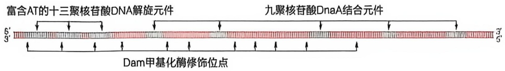

<details>
<summary>text_image</summary>

富含AT的十三聚核苷酸DNA解旋元件
九聚核苷酸DnaA结合元件
Dam甲基化酶修饰位点
</details>

图 8-4 酵母中复制起始点 ARS 的结构示意图

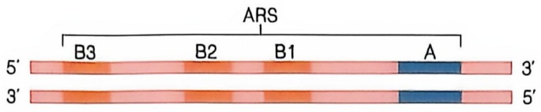

<details>
<summary>text_image</summary>

ARS
B3	B2	B1	A
5'	3'
3'	5'
</details>

复制起始区 DNA 解链后会形成一个眼状或枣核样的泡状结构，称为复制泡 (replication bubble)。DNA 解链形成的两条单链与尚未解链的亲代 DNA 形成一个 Y 形结构，称为复制叉 (replication fork)。复制叉是要进行子代 DNA 链合成的位置。人们通过放射自显影技术结合电子显微镜对细菌中环形质粒复制的观察发现，随着复制叉分别向两侧推进，复制泡逐渐增大，形成类似于希腊字母  $\theta$  的复制中间体，因而这种复制模式也被称为  $\theta$  型复制。

真核生物染色体的复制也起始于一些特异位点，但人们对绝大多数真核细胞复制起点的序列特点未能清晰地表征，仅在简单的单细胞真核生物酿酒酵母中发现了其复制起始点较明确的序列特征。酵母的复制起点被称为自主复制序列（autonomously replicating sequence, ARS），其长度为 100～200 bp，包含四种元件:高度保守的 A 序列，以及 B1、B2 和 B3 元件（图 8-4）。

细菌染色体 DNA 相对较短，只具有单一的复制起点，但是真核细胞染色体 DNA 较长，并且其复杂的包装压缩方式使真核细胞复制叉移动的速度远低于细菌。为了在一定的时限内完成基因组 DNA 的复制，每个真核细胞染色体上都演化出了多个复制起点来形成多对复制叉同时进行复制（图 8-5）。在人细胞染色体上，复制起点相隔 10～40 kb，一个大的染色体上可能有数千个复制起点。一方面，细胞在每个复制

图 8-5 真核细胞中多对复制叉起始于多个复制起点

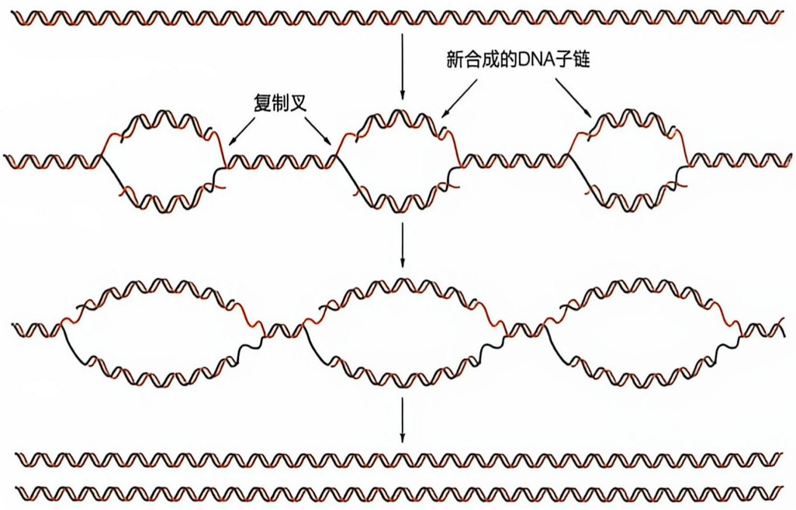

<details>
<summary>flowchart</summary>

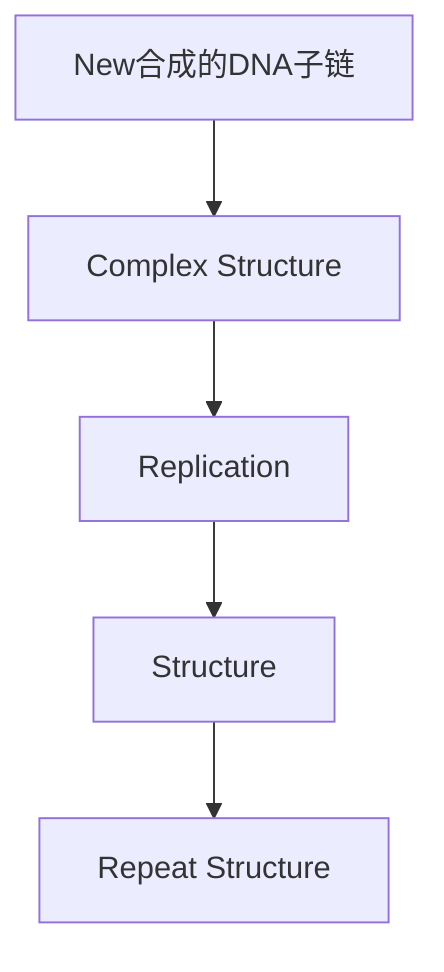
</details>

---

8.1 经典实验揭示 DNA 的复制方式

287

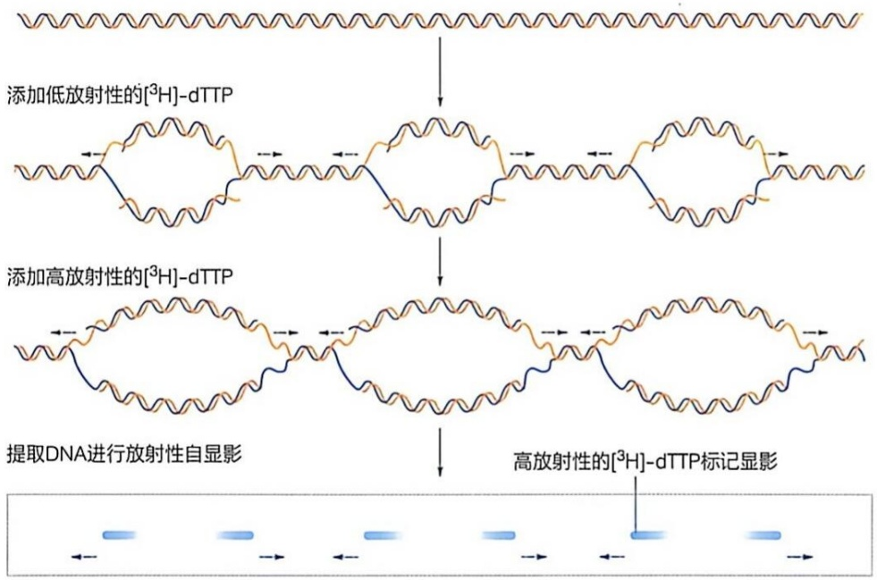

<details>
<summary>flowchart</summary>

```mermaid
graph TD
  A["&quot;添加低放射性的[3H"]-dTTP"] --> B["&quot;添加高放射性的[3H"]-dTTP"]
  B --> C["提取DNA进行放射性自显影"]
  C --> D["&quot;高放射性的[3H"]-dTTP标记显影"]
```
</details>

图 8-6 真核细胞中复制
叉从复制起点双向移动

周期中必须激活足够多的复制起点，才能保证每条染色体在 S 期内被完全复制；另一方面，数千个潜在的复制起点在一个细胞周期内并不会全部被激活。值得注意的是，一个复制起点的序列一旦被复制，无论是由于其自身被激活引起的主动复制，还是由于相邻复制起点起始的复制叉推进而引起的被动复制，其在这一细胞周期中都不会再被用作复制起点。

真核细胞复制起点形成的复制叉在多数情况下也是双向推进。1973年前后，多个研究团队通过 $\left[^{3}H\right]$ 胸腺嘧啶核苷脉冲标记，结合DNA放射性自显影技术阐释了哺乳动物细胞中DNA合成的方向和速度（图8-6）。研究人员先用低放射性的 $\left[^{3}H\right]$ 胸苷标记新合成的DNA，再用高放射性的 $\left[^{3}H\right]$ 胸苷标记新合成的DNA。由此产生的放射自显影图像显示，放射性显影的密度以复制起点为中心在两侧相反方向对称分布，这表明复制叉是从每个复制起点双向移动。

## 8.1.3 DNA 复制时两条新链分别以连续和非连续方式合成

DNA 复制起始后，复制泡的两端会分别形成一个 Y 形的复制叉，其由亲代 DNA 双链和解离的两条单链组成。DNA 复制时，由于 DNA 聚合酶具有  $5'\rightarrow3'$  合成的方向性，核苷酸只能在 DNA 的  $3'$  端添加。作为复制模板的两条亲代 DNA 单链的方向相反，因此，两条新生的子链无法全部按照复制叉移动的方向进行合成。如图 8-7 所示，复制叉从左向右解开亲代 DNA 双链，当一条亲代 DNA 单链（橙色标记）作为模板时，新生子代链可以按照  $5'\rightarrow3'$  的方向连续合成；但当另

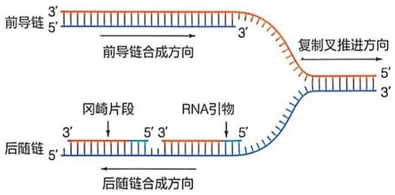

<details>
<summary>flowchart</summary>

This diagram illustrates the directional and sequence of DNA replication processes, specifically showing how pre- and post-translation sequences combine to form a copy-and-repair process.
</details>

图 8-7 DNA 的半不连续复制模型

---

288

8 DNA 复制、修复与重组

一条亲代 DNA 单链（蓝色标记）作为模板时，新生子代链就需要通过多段不连续合成的方式进行复制（图 8-7）。这种复制模式被称为半不连续复制（semidiscontinuous replication），模型中可以连续合成的子链称为前导链（leading strand），而那条需要逐段不连续合成的子链称为后随链（lagging strand）。

半不连续复制方式是由冈崎令治（Reiji Okazaki，1930-1975）和他的同事发现的。1958年，冈崎令治使用 $\left[{ }^{3} \mathrm{H}\right]$ -脱氧胸苷脉冲标记和脉冲追踪的方法，在感染了T4噬菌体的大肠杆菌细胞中发现大约一半DNA是连续合成的大片段，另外一半由 $1 \sim 2 \mathrm{~kb}$ 的小片段组成，从而证明了DNA复制的半不连续性。这些DNA复制中不连续合成的小片段也因此被称为冈崎片段（Okazaki fragment）。细菌中冈崎片段为$1 \sim 2 \mathrm{~kb}$，但真核生物中的冈崎片段通常只有 $100 \sim 200$ 个核苷酸。1972年，冈崎令治又发现，每个冈崎片段在 $5^{\prime}$ 端由一个短的RNA作为引物启动合成，从而进一步完善了DNA复制的半不连续合成模型。

图8-8 大肠杆菌（A）和哺乳动物细胞（B）中引物的去除和冈崎片段的连接

在将冈崎片段连接在一起形成完整的DNA链之前，还需要将引导每一段冈崎片段合成的RNA引物去除。大肠杆菌中，核糖核酸酶H（RNase H）水解去除绝大部分的RNA引物。但因其只能水解核糖核苷酸之间的磷酸二酯键，因而附着在DNA上的最后一个核糖核苷酸要依靠DNA聚合酶I（DNA Pol I）的 $5^{\prime} \rightarrow 3^{\prime}$ 核酸外切酶活性去除（图8-8A）。哺乳动物细胞中的DNA聚合酶没有 $5^{\prime} \rightarrow 3^{\prime}$ 核酸外切酶活性，其RNA引物的去除主要依赖瓣状核酸内切酶FEN1（flap endonuclease 1）蛋白。当后一

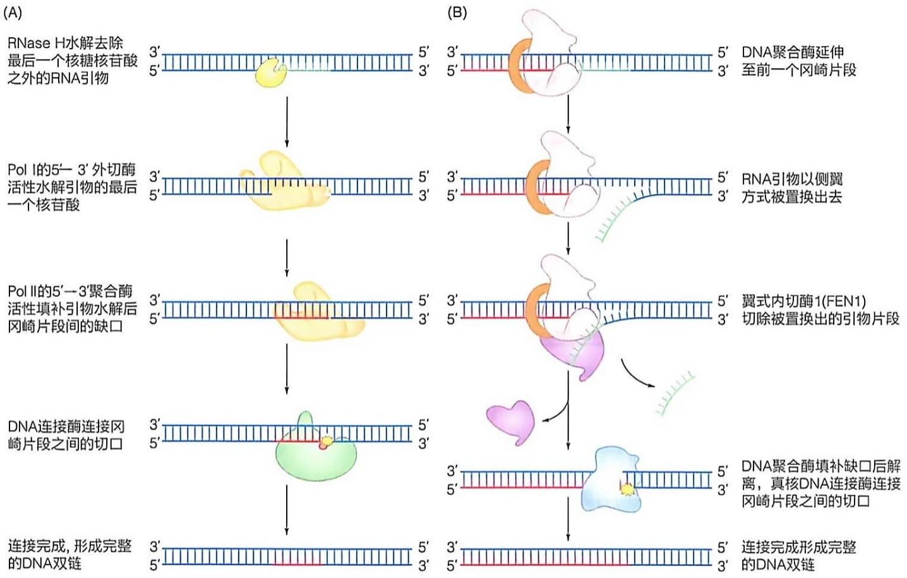

<details>
<summary>flowchart</summary>

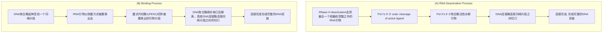
</details>

---

8.2 DNA 复制由高保真性的 DNA 聚合酶复合物催化

289

个冈崎片段的合成取代前一个冈崎片段的 RNA 引物与 DNA 模板结合时，RNA 引物部分会以侧翼的方式被置换出去。FEN1 蛋白通过其核酸内切酶活性将被置换出的引物部分切掉（图 8-8B）。

随着 RNA 引物的去除和 DNA 聚合酶对冈崎片段之间缺口的填补，两个冈崎片段间 DNA 骨架链上的一个未被连接的磷酸单酯键切口由 DNA 连接酶连接在一起，形成一条完整的 DNA 双链。这个反应需要 ATP 提供能量。而在细菌和一些病毒中，烟酰胺腺嘌呤二核苷酸（NAD）依赖的 DNA 连接酶可以发挥这一作用。DNA 连接酶只作用于 DNA 末端，而不作用于 RNA。这种特异性也确保了在冈崎片段末端所有的 RNA 引物被移除之前，切口不会被连接起来。

## 8.2 DNA 复制由高保真性的 DNA 聚合酶复合物催化

DNA 复制依赖于 DNA 聚合酶。1957 年，阿瑟·科恩伯格与其博士后罗伯特·雷曼（Robert Lehman）发现了第一个 DNA 聚合酶，开创了 DNA 复制酶学研究领域。他们当时将所发现的酶简单地称为 “DNA 聚合酶”，但后续的研究陆续发现细胞中存在多种 DNA 聚合酶，因而将第一个被发现的大肠杆菌 DNA 聚合酶称为 DNA 聚合酶 I（DNA Pol I）。DNA 聚合酶有些主要参与 DNA 的复制，有些主要在 DNA 损伤修复与重组过程中发挥作用。对于 DNA 聚合酶的活性及其催化机制的理解，很大程度上来源于对 DNA 聚合酶 I 的研究。这里先来了解一些 DNA 聚合酶的共性特征。

## 8.2.1 DNA 聚合酶催化依赖模板指导

DNA 聚合酶是一种以 DNA 单链为模板的聚合酶。DNA 聚合酶在添加新的脱氧核糖核苷酸（dNTP）时，通过检测进入合成催化活性中心的 dNTP 与模板链形成沃森-克里克碱基配对的能力来决定是否该将其加入新生 DNA 链中。值得注意的是，DNA 聚合酶无法从头开始合成 DNA 单链，只能够在已经存在的核酸单链的 3' 羟基端上添加新的 dNTP，因而细胞内 DNA 合成时首先需要一小段能够与模板链互补配对的核酸单链，即引物（primer）。引物与模板链配对结合形成一个称为模板-引物接头的结构，而 DNA 聚合酶必须在模板-引物接头的结构基础上，才能在引物的 3' 羟基上添加新的 dNTP。模板链和引物都是 DNA 复制的必要条件，模板链为 DNA 的复制提供信息指导，而引物是 DNA 复制的化学反应底物之一。

1985 年，托马斯·施泰茨（Thomas A. Steitz，1940—2018）等获得了第一个 DNA 聚合酶即大肠杆菌 DNA Pol I 水解大片段——Klenow 片段的结构，使人们首次看到 DNA 合成机制的结构生物学证据。1998 年，西尔维·杜布利（Sylvie Doublé）等获得了 T7 噬菌体的 DNA 聚合酶高分辨率晶体结构。2008 年，沃森等将 DNA 聚合酶的核心结构描述为一只右手的模型（图 8-9），其具有“手掌”“手指”和“拇指”三个主

---

290

8 DNA 复制、修复与重组

(A)

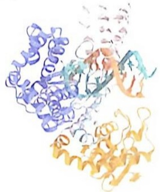

<details>
<summary>natural_image</summary>

3D protein structure visualization with alpha helices and beta sheets (no labels or text)
</details>

(B)

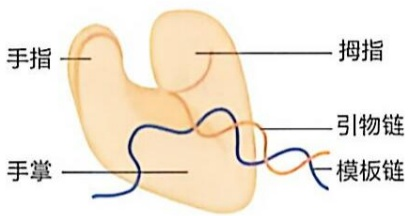

<details>
<summary>text_image</summary>

手指
拇指
引物链
模板链
手掌
</details>

图 8-9 DNA 聚合酶核心酶的三维结构

（A）芽孢杆菌DNA聚合酶I Klenow片段（PDB编号:1LV5）。

(B) DNA 聚合酶的核心酶右手样结构示意图

要的结构域。其中模板-引物接头位于掌心的位置，DNA双链部分“躺”在手掌上，模板链指向（但并未穿过）手的虎口位置，在手指结构域的指根部分发生了一个急速的扭转，使得即将被添加新核苷酸的位点所对应的模板链暴露在合成中心上。

## 8.2.2 DNA聚合酶催化由RNA引发的 $5^{\prime} \rightarrow 3^{\prime}$ 方向的DNA链合成

由于DNA聚合酶只能在已有的引物 $3^{\prime}$ 羟基上添加新的dNTP，因此，在细胞中每段DNA的合成都需

要先合成一小段 RNA 引物。RNA 引物由一类特殊的 RNA 聚合酶——引发酶（primase）合成。大肠杆菌中的引发酶是 DnaG，其可以合成 11～13 nt 的 RNA 引物。引发酶根据模板链的序列合成一小段 RNA 引物后会从 DNA 上解离，DNA 聚合酶则结合在形成的模板-引物接头上，在引物链的 3' 端沿着 5'→3' 的方向添加新的 dNTP。

需要特别说明的是，尽管细胞内每段 DNA 合成的起始依赖于引发酶合成的 RNA 引物，但 “引物” 一词并不仅指这一小段 RNA。DNA 聚合酶在 RNA 引物的 3' 羟基端添加第一个 dNTP 后，后续的 DNA 合成是在新生成的 DNA 链基础上继续进行的，此时该新生的 DNA 片段则作为后续 dNTP 添加的引物。

## 8.2.3 DNA 聚合酶以 dNTP 为底物催化形成磷酸二酯键

在最初形成的 RNA 引物 3' 端，DNA 聚合酶根据模板链的序列添加相应的脱氧核苷酸。但参与 DNA 合成反应的底物事实上是四种带有 3 个磷酸基团的 dNTP (dATP、dGTP、dTTP、dCTP)，其中直接连接在 2'-脱氧核糖的 5' 羟基上且最靠近 5' 羟基的磷酸基团称为 α-磷酸，而中间和远端的磷酸基团分别称为 β-磷酸和 γ-磷酸。

对 DNA Pol I 的研究发现，不同的 dNTP 会结合在 DNA 聚合酶的同一个活性位点。即一种 DNA 聚合酶就可以完成全部四种核苷酸的添加。DNA 聚合酶通过检测进入合成催化活性中心的核苷酸与模板链形成沃森-克里克碱基配对的能力来选择要添加的 dNTP 种类。如果新进入活性中心的 dNTP 能够与模板链正确配对，此时手指的结构域会向掌心方向回握，在活性中心附近形成一个与正确碱基对形状相适应的内部空间，A-T 和 G-C 碱基对具有相似的形状，均可以适应这一闭合形式的内部空腔。手指下握的过程也会使指腹部分向掌心面的氨基酸侧链与活性中心上 dNTP 的碱基环之间形成碱基堆积力，进一步稳定 dNTP 与 DNA 模板的相对位置。此时，子链的 3'羟基端能够有效地与 dNTP 的 α-磷酸之间形成磷酸单酯键，从而将其添加在子代链的 3' 端（图 8-10A）。不正确配对的碱基对由于不能很好地适应活性中心的封闭

---

8.2 DNA 复制由高保真性的 DNA 聚合酶复合物催化

291

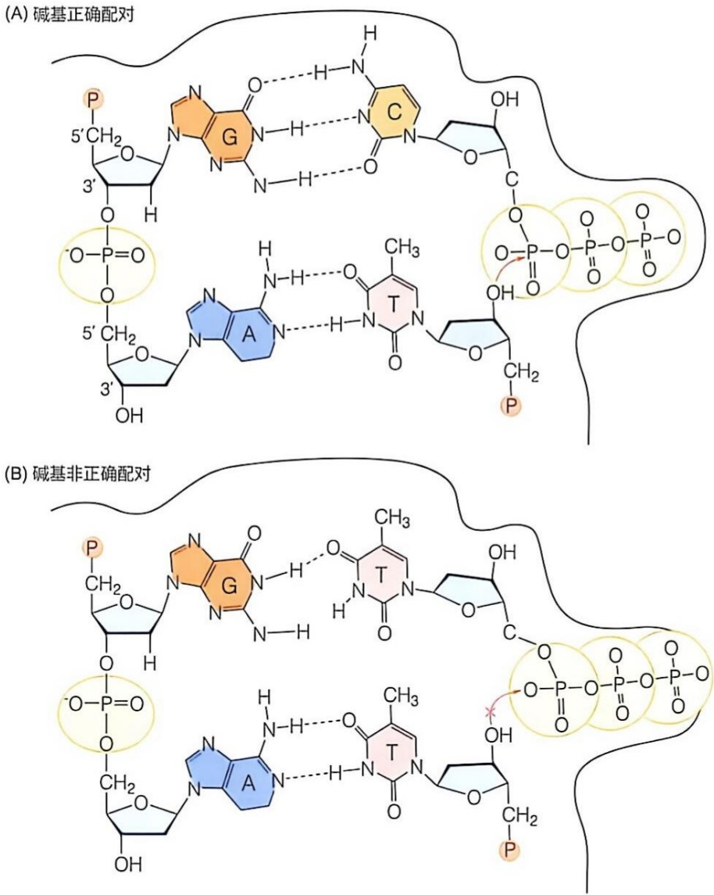

图 8-10 DNA 聚合酶催化的核苷酸加成需要碱基的正确配对

构象，导致 DNA 聚合酶无法有效地催化 3' 羟基和错误核苷酸的  $\alpha-$  磷酸之间形成磷酸单酯键（图 8-10B）。

DNA 聚合酶通过识别与模板链精确互补配对的 dNTP 底物来执行其功能。然而，细胞内 dNTP 浓度大约仅为 NTP 浓度的 1/10，这一现象引发了对 DNA 聚合酶如何在复制过程中特异性选择 dNTP 作为底物的疑问。尽管 dNTP 与 NTP 在结构上仅在戊糖环的二位碳上存在一个羟基的差异，但这一微小差异使得 NTP 进入 DNA 聚合酶活性中心时，其戊糖环二位碳上的羟基会与活性中心附近的一个“分辨器”氨基酸残基的亲水侧链发生空间排挤作用，这一空间位阻效应导致 NTP 的三磷酸尾发生偏移，进而增加了引物末端 3' 羟基和 α- 磷酸之间的距离，显著降低 DNA 聚合酶的催化效率，从而阻碍了磷酸酯键的形成。因此，DNA 聚合酶通过识别这一空间排挤作用，利用特定的“分辨器”氨基酸残基来区分 dNTP 与 NTP 底物（图 8-11）。

---

292

8 DNA 复制、修复与重组

图8-11 DNA聚合酶“分辨器”氨基酸残基排除NTP作为底物

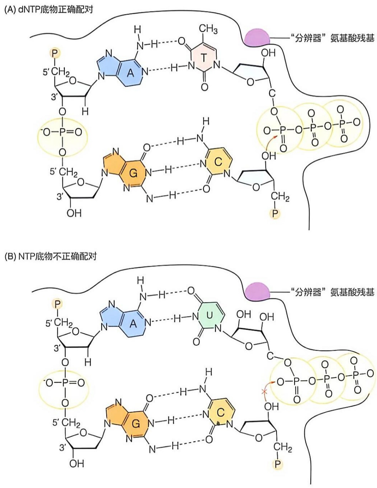

## 8.2.4 部分DNA聚合酶具有独特的校正功能

DNA聚合酶通常通过其选择机制确保添加正确的核苷酸，但即便如此，每合成$10^{4}\sim 10^{5}$个核苷酸，仍有可能有一个错误的核苷酸掺入。一旦发生错误的核苷酸配对，DNA聚合酶具有的 $3^{\prime}\rightarrow 5^{\prime}$ 外切酶活性便能发挥作用，水解去除错误合成的核苷酸。

DNA聚合酶右手样结构中，“小鱼际”部分具有 $3^{\prime} \rightarrow 5^{\prime}$ 核酸外切酶活性。当模板-引物接头处碱基不匹配时，会造成引物和模板的结合不稳定，进而使得引物 $3^{\prime}$ 端错配碱基对附近的几个碱基对也失去配对状态，形成几个未配对的游离单链DNA。DNA聚合酶的合成活性中心与这种不配对的模板-引物接头的结合能力较差，而其$3^{\prime} \rightarrow 5^{\prime}$ 核酸外切酶活性位点对单链 $3^{\prime}$ 端的亲和力要高10倍。因此，未配对的引物 $3^{\prime}$

---

8.2 DNA 复制由高保真性的 DNA 聚合酶复合物催化

293

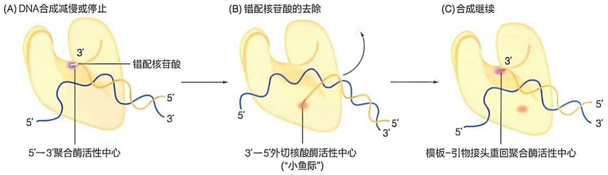

<details>
<summary>flowchart</summary>

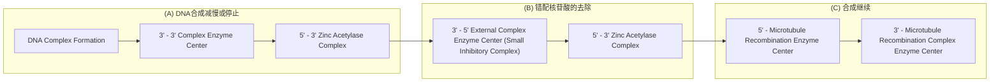
</details>

图 8-12 具有校对功能的外切酶从不匹配 DNA 的 3' 端移除碱基

端从聚合酶活性位点移动到核酸外切酶活性位点，使得错误掺入的 dNMP 被核酸外切酶水解去除（有时相邻的另一个 dNMP 也可能被去除）（图 8-12）。通过去除错误配对的 dNMP，模板-引物接头能够重新形成规则的双螺旋结构，其与核酸外切酶活性位点的亲和力降低，重新与 DNA 聚合酶的合成活性中心结合，DNA 聚合酶再次开始添加正确的核苷酸，降低复制过程中的错配率。DNA 聚合酶的这种纠正错误的功能被称为校对（proofreading）。

参与核基因组复制的 DNA Pol I 和 DNA 聚合酶Ⅲ（Pol Ⅲ）都具有校对功能。阿瑟·科恩伯格在研究 DNA Pol I 时发现，从细胞中纯化的 DNA Pol I 似乎总伴随着核酸外切酶的“污染”，但无法分离出所谓“污染”的核酸外切酶，于是他得出了一个看似矛盾的结论，即参与 DNA 合成的酶同样具有核酸外切酶降解 DNA 的能力。后续的研究证实 DNA Pol I 具有两种核酸外切酶活性——3'→5'核酸外切酶活性和5'→3'核酸外切酶活性，前者对于酶的校对功能至关重要，而后者则在 DNA 复制过程中扮演着其他角色，这一点将在后续章节中进一步阐述。此外，DNA Pol I 的两种 DNA 外切酶活性位点彼此不同，并且与 DNA 聚合酶的活性位点也有所区别。

## 8.2.5 DNA 复制依赖几种分工不同的 DNA 聚合酶

在阿瑟·科恩伯格发现DNA Pol I之后不久，冷泉港实验室的科学家们在1969年发现，即使编码Pol I的基因polA突变导致Pol I失活，突变的E.coli仍能正常生长繁殖，表明Pol I不是E.coli中主要的复制酶。这也激起了DNA Pol I发现者阿瑟·科恩伯格的儿子托马斯·科恩伯格（Thomas Kornberg）对E.coli中主要复制酶的研究兴趣。1970年代，托马斯·科恩伯格和马尔科姆·盖特（Malcolm Gegter）在哥伦比亚大学利用polA-的E.coli突变株发现了DNA聚合酶Ⅱ（Pol II）和Pol III。通过利用N-乙基马来酰亚胺对Pol III的特异性抑制作用，他们证明Pol III对DNA的复制是至关重要的，它才是E.coli中主要负责染色体复制的DNA聚合酶。

数十年的研究表明，大肠杆菌中存在五种不同的 DNA 聚合酶，而真核细胞中 DNA 聚合酶的种类更多。基因组复制的过程中需要多种分工不同的 DNA 聚合酶参与。下文分别介绍原核细胞与真核细胞中参与 DNA 复制的聚合酶。

---

294

8 DNA 复制、修复与重组

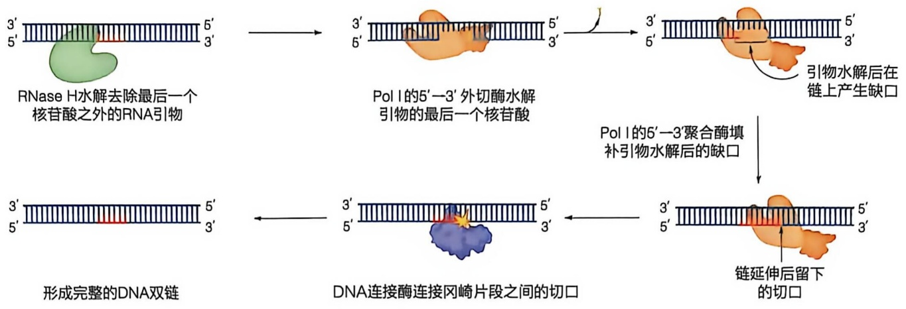

<details>
<summary>flowchart</summary>

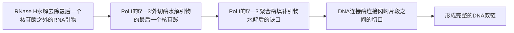
</details>

图 8-13 从原核细胞新合成的 DNA 链中去除 RNA 引物

E. coli 中主要负责 DNA 复制的是 PolⅢ。随着研究的深入，人们逐渐认识到具有 DNA 合成及校对功能的“神奇的右手”是 PolⅢ 的核心酶部分，由  $\alpha$ 、 $\varepsilon$ 、 $\theta$  三个亚基构成。阿瑟·科恩伯格等发现纯化的  $\alpha$  亚基合成 DNA 的活性与等量的核心酶的活性几乎相同，确定了  $\alpha$  亚基具有催化 DNA 合成的聚合酶活性。其他科学家同样利用过表达并纯化重组蛋白的策略，证明了核心酶中的  $\varepsilon$  亚基负责执行  $3'\rightarrow5'$  核酸外切酶的校对功能。并且， $\varepsilon$  亚基只对错配 DNA 具有特异性亲和力，而对正确配对的 DNA 双链没有外切酶活性。除复制外，DNA PolⅢ 也在 DNA 损伤修复中发挥作用，这在后续章节中会进一步介绍。

细菌中参与 DNA 复制的另一个重要的 DNA 聚合酶是 Pol I。尽管 Pol I 是 E. coli 中第一个被发现且含量最多的 DNA 聚合酶，但其在复制中主要进行后随链上冈崎片段之间空缺核苷酸的填充，这也与 Pol I 延伸能力不强的特点相匹配，它一次只能合成 15～20 个核苷酸。Pol I 同样具有 3'→5' 核酸外切酶活性，可以将新合成链 3' 端

错误配对的 dNMP 水解去除，在 DNA 合成中发挥校对功能。此外，与 PolⅢ不同，Pol I 还具有  $5'\rightarrow3'$  核酸外切酶活性，负责冈崎片段上 RNA 引物中最后一个核糖核苷酸的切除（图 8-13）。

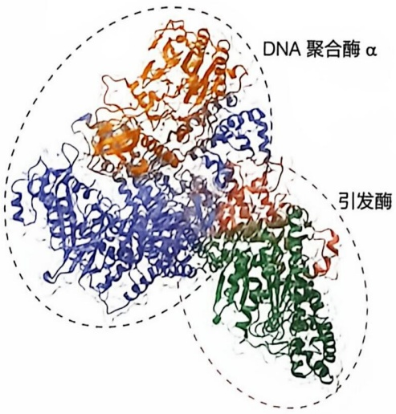

<details>
<summary>text_image</summary>

DNA 聚合酶 α
引发酶
</details>

图 8-14 DNA 聚合酶 α / 引发酶 (PDB 编号: 5EXR)

真核细胞的 DNA 聚合酶至少有 15 种，每种都由多个亚基组成。其中三种 DNA 聚合酶是复制染色体 DNA 所必需的:DNA 聚合酶 α（Pol α）/引发酶、DNA 聚合酶 δ（Pol δ）和 DNA 聚合酶 ε（Pol ε）。Pol α 通常与引发酶结合在一起，形成一个四亚基复合物（图 8-14），负责启动新 DNA 链的合成，其中两个亚基构成 Pol α，另外两个亚基具有引发酶活性。引发酶负责 DNA 复制开始时 RNA 引物的合成，产生的模板-引物接头随即传递给与之结合的 Pol α，使其继续在 RNA 引物的基础上开始 DNA 的合成。

DNA Pol  $\alpha$  的持续合成能力不强，通常 Pol  $\alpha$ /引发酶复合物只能持续合成 50～100 个核苷酸。之后，Pol  $\alpha$  将被持续合成能力更强的 Pol  $\delta$  或 Pol  $\varepsilon$  所取代，这个过程被称为 DNA 聚合酶的替换

---

8.2 DNA 复制由高保真性的 DNA 聚合酶复合物催化

295

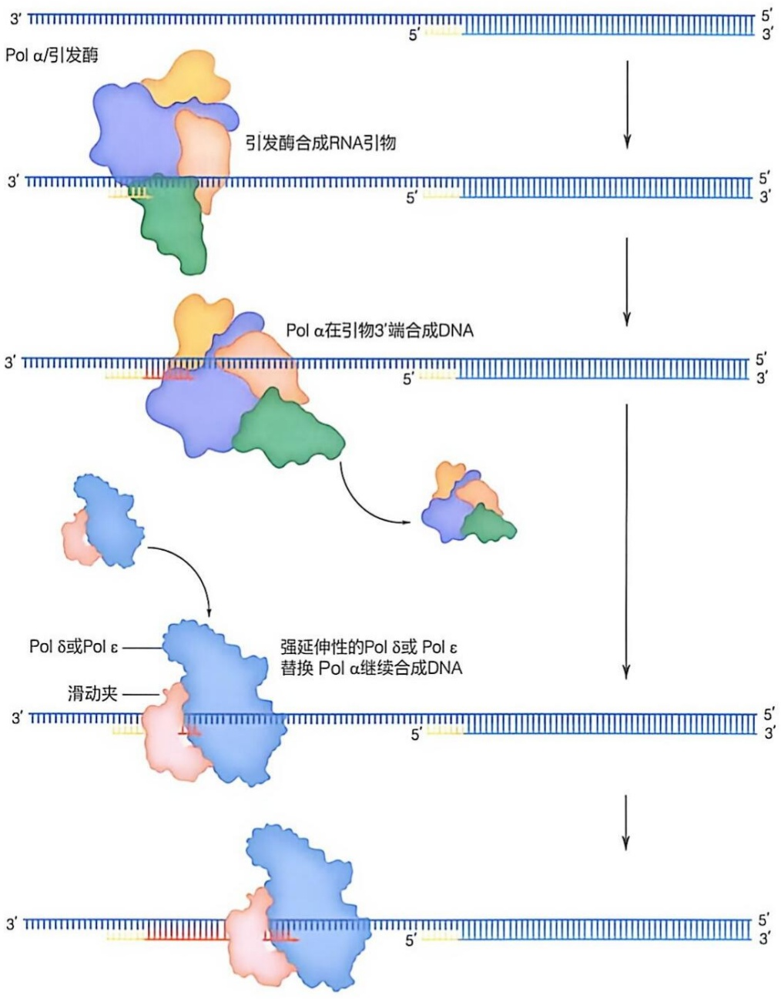

<details>
<summary>flowchart</summary>

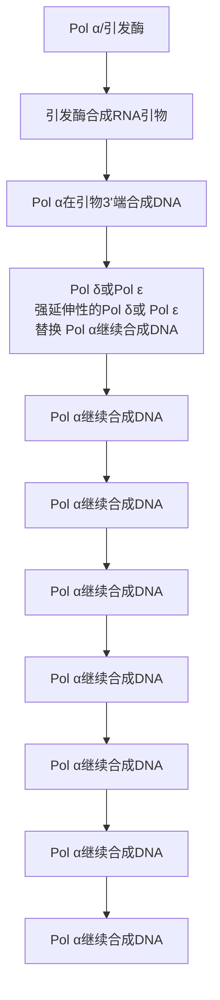
</details>

图 8-15 真核生物 DNA 复制过程中 DNA 聚合酶的替换

(图 8-15)。在复制叉处，DNA Pol ε 负责合成前导链，而 Pol δ 负责合成后随链。与细菌细胞一样，其余的大多数真核 DNA 聚合酶主要参与 DNA 的修复。

## 8.2.6 DNA 聚合酶通过滑动夹与 DNA 模板持续结合而表现出高进行性

DNA 聚合酶的进行性（processivity）是指其一旦开始工作便能够持续复制的能力。事实上无论是大肠杆菌 Pol Ⅲ 的核心酶，还是真核细胞中的 Pol δ 或 Pol ε，都无法在 DNA 上结合后一直持续不断地进行合成。在细胞中，DNA 聚合酶的高进行性主

---

296

8 DNA 复制、修复与重组

要依赖将核心酶与 DNA “绑定” 在一起的滑动夹蛋白。

在 E. coli 中，DNA 聚合酶的两个  $\beta$  亚基构成的滑动夹形成一个甜甜圈样的结构，其在复制中会被滑动夹装载复合物套在 DNA 模板-引物接头上，使其能够沿着 DNA 滑动而不与之分离（图 8-16A、B）。同时，滑动夹与 Pol III 紧密结合，将其锁定到引物-模板接头处，从而有效提升 Pol III 的进行性。真核细胞中的滑动夹是由一种称作增殖细胞核抗原（proliferating cell nuclear antigen，PCNA）的蛋白质构成，该蛋白因发现于活跃复制 DNA 的增殖细胞中而得名。一个完整的真核滑动夹由 3 个 PCNA 蛋白首尾相连组成的环状蛋白质，套在 DNA 上（图 8-16C）。Pol δ 与滑动夹结合后，其合成 DNA 的进行性能够提高 40 倍。

事实上，右手样的DNA聚合酶核心酶除与滑动夹结合之外，其在复制叉上工作时还需要许多其他蛋白质亚基协助。包括核心酶在内的共同完成DNA复制的蛋白质复合物被称为DNA聚合酶全酶。在大肠杆菌中，PolⅢ全酶包含10种亚基，除构成核心酶的 $\alpha$ 、 $\delta$ 、 $\varepsilon$ 亚基和两个构成滑动夹的 $\beta$ 亚基之外，还包含负责装载滑动夹的$\gamma$ 复合物（由 $\gamma$ 、 $\delta$ 、 $\delta^{\prime}$ 、 $\chi$ 和 $\psi$ 五种亚基构成）以及连接核心酶和 $\gamma$ 复合物的 $\tau$ 亚基（图8-17）。

图 8-16 滑动夹与 DNA 聚合酶结合并提高 DNA 聚合酶的进行性

（A）滑动夹与DNA聚合酶Ⅲ核心酶在模板-引物接头上结合的示意图。（B）E.coli DNA聚合酶β亚基二聚体构成的滑动夹（PDB编号:2POL）。  
（C）酵母细胞PCNA三聚体构成的滑动夹（PDB编号:4YHR）

(A)

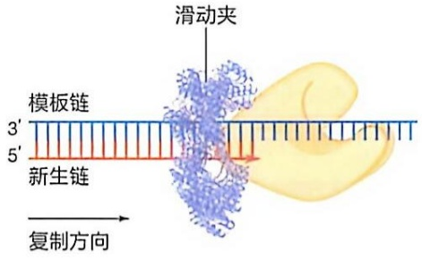

<details>
<summary>text_image</summary>

滑动夹
模板链
3'
5'
新生链
复制方向
</details>

(B)

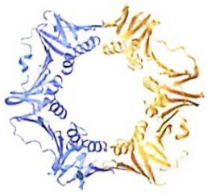

<details>
<summary>chemical</summary>

Molecular structure diagram showing a ring with blue and gold atoms, likely representing a protein or molecular complex.
</details>

(C)

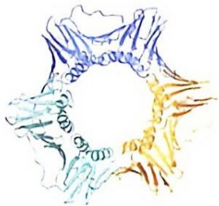

<details>
<summary>natural_image</summary>

Abstract star-shaped decorative pattern with blue, yellow, and teal segments (no text or symbols)
</details>

图 8-17 DNA Pol III 全酶的组成示意图

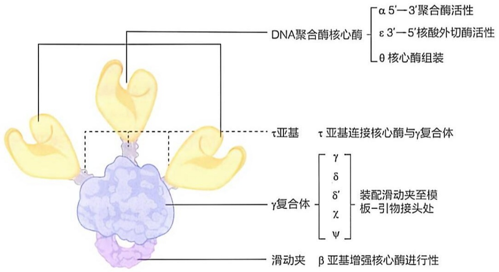

<details>
<summary>text_image</summary>

DNA聚合酶核心酶
α 5'—3'聚合酶活性
ε 3'—5'核酸外切酶活性
θ 核心酶组装
τ亚基
τ 亚基连接核心酶与γ复合体
γ复合体
[γ]
δ
δ'
χ
ψ
装配滑动夹至模
板-引物接头处
滑动夹
β 亚基增强核心酶进行性
</details>

---

8.3 DNA 复制分为起始、延伸和终止三个阶段

297

## 8.3 DNA 复制分为起始、延伸和终止三个阶段

前文介绍了 DNA 复制起始点、半保留复制方式和 DNA 聚合酶等，接下来详细介绍 DNA 复制的起始、延伸和终止三个阶段的具体过程。

## 8.3.1 DNA 复制起始由复制起始区双链解链、RNA 引物合成和 DNA 聚合酶结合共同驱动

DNA 复制的起始过程涉及起始区互补配对的 DNA 双链被解开，解链后的单链作为模板首先进行 RNA 引物合成，之后 DNA 聚合酶被招募并正确结合在模板-引物接头处，在此基础上才能开始进行 DNA 的合成。

在 E. coli 中，复制起始蛋白 DnaA 在复制起始过程中发挥着重要作用。首先 DnaA 识别并结合 OriC 中的 9-mer 的 R 位点序列片段。DnaA 是一种 ATP 结合蛋白，其与 OriC 结合后形成寡聚体，并将复制起点 OriC 的 DNA 缠绕在 DnaA 寡聚体的周围（图 8-18①）。在 ATP 存在的情况下，DnaA 进一步使得富含 AT 的 13 bp 区域解链，形成单链 DNA 泡。一种小的碱性组蛋白样的 HU 蛋白可以刺激单链 DNA 泡的形成。DnaA-ATP-OriC-HU 结合形成的复合物称为复制开放复合物。

此后，复制泡两侧双链DNA依赖DNA解旋酶进一步解旋。E.coli中的解旋酶DnaB是一个六聚体环状复合物，其在解旋酶装载蛋白DnaC的协助下组装到开放复合体中的单链DNA上（图8-18②）。DnaC也是一种ATP结合蛋白，其在结合ATP的情况下会与DnaB紧密结合并抑制其解旋酶活性，DnaC打开DnaB的六聚体环，进而使其结合单链DNA。随ATP的水解，DnaC从DnaB上解离，DnaB恢复了解旋DNA的活性。DnaB与DnaA的相互作用有助于将DnaB靶向定位至复制起始点。复制泡中每条单链DNA上各有一个DnaB。此时，装配了DnaB的OriC上的蛋白质复合物被称为引发体前体（preprimosome）。

ATP 水解所提供的能量使解旋酶 DnaB 易位逐步解开 DNA 双链，并使 DnaA 蛋白从 R 位点解离（图 8-18 ③）。当解旋的单链 DNA 达 100～200 bp 时，引发酶 DnaG 开始进行第一个 RNA 引物的合成。每条链上的 RNA 模板-引物接头指导滑动夹的加载及 DNA Pol Ⅲ核心酶滑动夹复合物的组装（图 8-18 ④）。待后随链的 RNA 引物被合成时，此复制叉上 Pol Ⅲ的另一个核心酶也会在滑动夹的引导下结合至后随链的模板-引物接头处（图 8-18 ⑤）。至此，OriC 上两个双向推进的复制叉上的复制复合体完成组装，复制进入延伸阶段。

真核细胞的复制起始同样包含起始蛋白与复制起始区的结合、DNA双链的解开、RNA引物的合成以及聚合酶的招募等步骤，但真核细胞的DNA复制起始受到精密调控，DNA复制仅发生于细胞周期的S期中。第9章将结合复制调控详述真核细胞DNA复制起始的过程。

---

298

8 DNA 复制、修复与重组

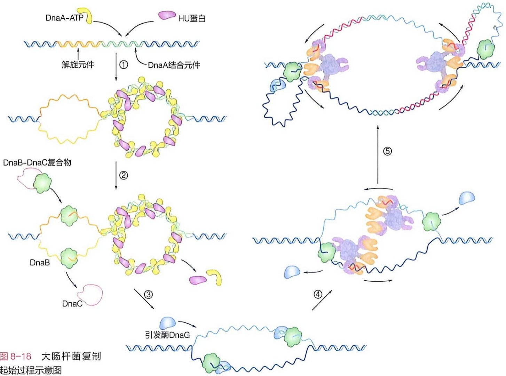

## 8.3.2 DNA 复制的延伸阶段涉及 DNA 聚合酶催化的前导链的连续合成和后随链的非连续合成协同进行

复制起始后，复制叉上 DNA 双链解开形成两条单链作为模板。DNA 聚合酶只能按照  $5'\rightarrow3'$  的方向添加新的核苷酸，因而前导链和后随链分别以连续和不连续的方式合成。前导链和后随链的合成必须协同进行。为了协调两条 DNA 链的复制，多个 DNA 聚合酶会在复制叉上分别催化 DNA 的合成，同时还需要许多其他蛋白质共同发挥作用。这里以 E. coli 为例，介绍 DNA 复制延伸过程中前导链和后随链如何协同复制。

在复制叉上参与复制的蛋白质组成的复制复合体称为复制体（replisome），是一个被精细调节的DNA合成工厂。复制体中各组分的功能及活性通过分子间的相互作用来协同调控，共同保证复制叉上两条DNA链的协同合成。其中，前导链的合成方向与复制叉的推进方向一致，DNA聚合酶核心酶结合在模板上持续地合成，这也使前导链的合成相对比较简单。而复制叉上后随链的合成是以非连续的方式进行，其要等

---

8.3 DNA 复制分为起始、延伸和终止三个阶段

299

待足够长的 DNA 被解旋为单链后才能以与复制叉推进方向相反的方向进行合成。

后随链的模板被解旋为单链后与单链结合蛋白（single-strand binding protein, SSB）迅速结合（图 8-19A）。一个 SSB 与单链 DNA 的结合能够促进另一个 SSB 与相邻单链 DNA 的结合，这也是生物分子间协同效应的一个例子。这种协同效应一方面可以使解开的单链 DNA 迅速被 SSB 分子完全结合，保护单链 DNA 免受核酸内切酶的攻击；另一方面，SSB 还有助于消除单链 DNA 中局部可能形成的发夹结构，使 DNA 链保持伸展的状态，有助于其作为新生 DNA 链或 RNA 引物合成的模板。

由于后随链的合成是以冈崎片段的形式不连续进行的，因而负责引物合成的引发酶也需要间隔性地按照后随链模板的互补序列合成RNA引物。与大多数复制叉上工作的蛋白质不同，大肠杆菌中的引发酶DnaG并不是总与复制叉紧密结合，而是间歇性地与复制叉上的解旋酶相互作用并被激活，进而在后随链模板上合成新的RNA引物（图8-19B）。虽然DnaG和解旋酶之间的相互作用相对较弱，但这种相互作用能够强烈地激活DnaG的引发酶活性，从而使其高效地进行引物的合成。引发酶和解旋酶之间相互作用的强度对于调节冈崎片段的长度很重要。大肠杆菌中，引发酶和解旋酶之间的相互作用相对较弱，使得后随链上更稀疏的引物合成，从而导致更长的冈崎片段。由此产生的后随链上的模板-引物接头被滑动夹装载器识别并在此位置装配滑动夹和另一个DNA PolⅢ核心酶，启动后随链上冈崎片段的合成（图8-19C、D）。

当后随链上 DNA Pol Ⅲ核心酶合成冈崎片段时，解旋酶进一步产生更长的单链DNA，新产生的后随链模板上又可以合成新的 RNA 引物。与先前的后随链引物一样，新的 RNA 引物被滑动夹装载器识别，进而引导第三个 DNA Pol Ⅲ核心酶与滑动夹共同结合在新的 RNA 引物-模板接头处，在前一个冈崎片段合成完成之前即可启动新的冈崎片段的合成。第二个 DNA Pol Ⅲ核心酶在完成前一个冈崎片段合成后从后随链上释放，继续在下一个新的引物-模板连接处起作用。这种释放是通过改变 DNA 聚合酶和滑动夹之间的亲和力来完成的。当 DNA 聚合酶合成一个冈崎片段后遇到上一个已经合成好的片段时，双链 DNA（dsDNA）在其活性位点的出现会导致聚合酶构象的变化，降低其与滑动夹和 DNA 的亲和力，并从滑动夹中释放出来（图 8-19E），进而可以再被引导至新解开的后随链模板上新合成的 RNA 引物处。因此，后随链上两个 Pol Ⅲ核心酶与 β 滑动夹复合物是间歇性地交替在 DNA 上结合、移动和离开，在引发酶合成的 RNA 引物上交替进行逐个冈崎片段的合成。

DNA Pol Ⅲ全酶组分之间的连接并不是复制叉上复制复合体之间发生的全部的相互作用。复制叉上各种蛋白质之间的相互作用也极大地影响着不同蛋白质和酶的活性，共同促进复制叉的快速推进。除了刚提到过的引发酶需要与解旋酶结合才能被激活之外，DNA 解旋酶 DnaB 蛋白和 DNA Pol Ⅲ全酶之间的相互作用对复制叉的推进也极为重要。DnaB 单独存在时，其解旋作用缓慢，约为 35 bp/s。但在复制叉上，DnaB 与 DNA Pol Ⅲ全酶中的 τ 亚基相结合，进而提高解旋酶的活性，使其解旋速度达到约 700 bp/s。前导链上的 Pol Ⅲ核心酶与 β 滑动夹复合物随着 DnaB 解旋酶解链而连续移动，从而使解旋酶解链的速度与聚合酶复制的速度相匹配。

---

300

8 DNA 复制、修复与重组

(A)

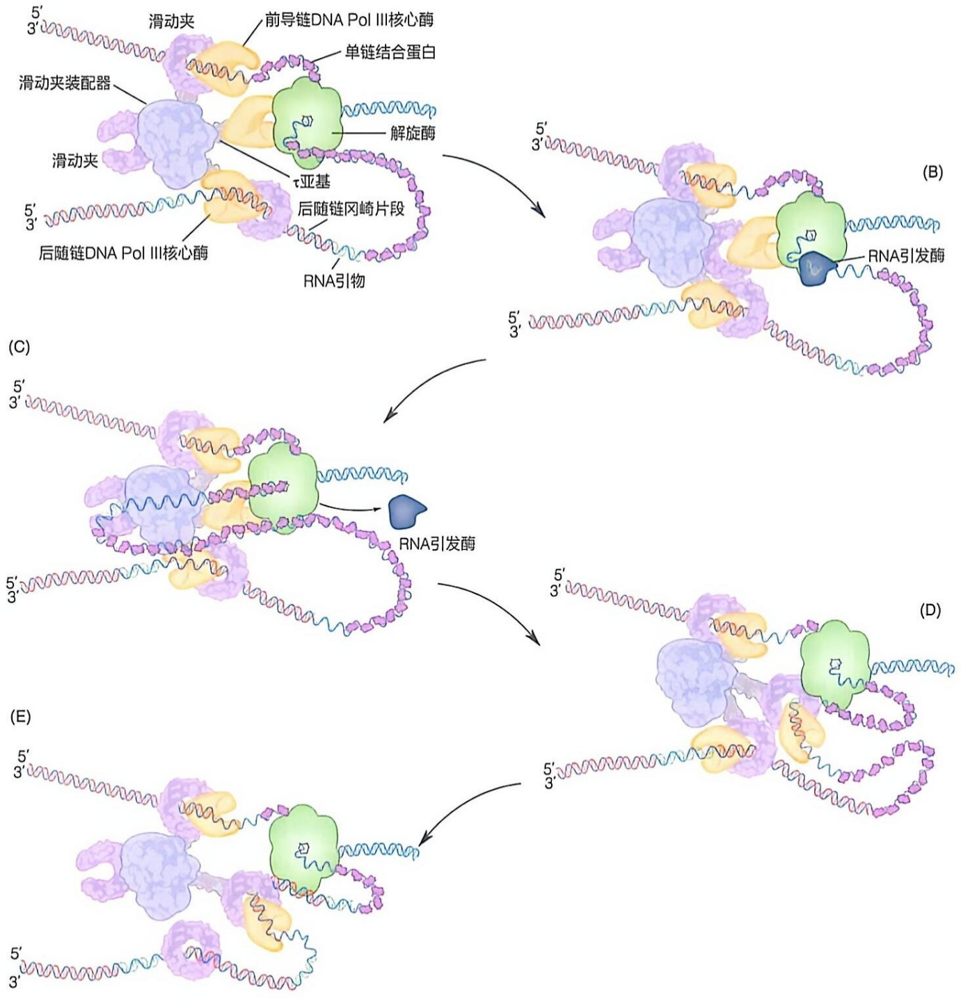

<details>
<summary>flowchart</summary>

This diagram illustrates the molecular mechanism of RNA synthesis, showing how various proteins (like Pol III core) and their downstream complexes interact with RNA引发 enzymes to form a final protein structure.
</details>

图 8-19 大肠杆菌复制
叉上三个 DNA Pol Ⅲ 核心酶的协同复制示意图

这些相互作用在大肠杆菌细胞中研究得较为清楚，对噬菌体和真核细胞 DNA 复制机制的研究也表明，在各种生物体细胞中，DNA 复制都涉及复制体中多个组分之间类似的协同作用。

## 8.3.3 真核细胞 DNA 复制发生在染色质环境

真核生物的细胞核 DNA 以染色质的形式存在，因此，真核生物复制叉上复制体

---

8.3 DNA 复制分为起始、延伸和终止三个阶段

301

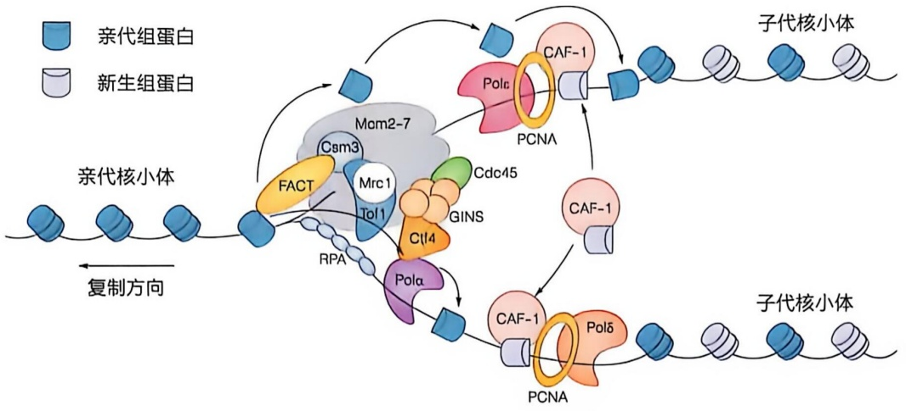

<details>
<summary>flowchart</summary>

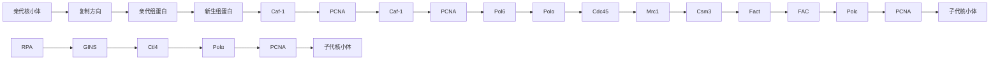
</details>

图 8-20 真核细胞复制体在染色质环境中的复制

进行 DNA 复制的过程也必然要适应染色质的环境，其具有更高的复杂性。染色质由 DNA、蛋白质以及 RNA 组成，折叠成高级的组织形式。染色质的基本组成单元是核小体（nucleosome），其由约 147 bp 的双链 DNA 缠绕组蛋白八聚体（包含 2 个 H2A-H2B 二聚体和 1 个 H3-H4 四聚体）组装形成，两个核小体之间由长度不等的双链 DNA 连接。DNA 复制时，复制体将亲代双链 DNA 解旋以产生单链 DNA 模板。因此，当沿亲代 DNA 推进的复制叉遇到核小体时，首先要将前方的亲代核小体解聚，然后将拆分后的亲本组蛋白回收，并分配到后方新合成的前导链和后随链双链 DNA 上。回收的亲代组蛋白和新生组蛋白共同在子代双链 DNA 组装形成新的核小体。亲代核小体的解聚和子代核小体的重新组装这一循环过程与 DNA 复制过程紧密偶联。一方面，执行核小体解聚和重组装的主要蛋白因子直接或间接地结合在复制体上:组蛋白分子伴侣 FACT 复合物通过与真核生物复制体组分 FPC（复制叉保护复合物，包含 Mrc1、Tof1、Csm3 三个亚基）结合定位到复制叉前端，促进亲代核小体的解聚；组蛋白分子伴侣 CAF-1（染色质组装因子 -1）通过与 PCNA 的结合定位到复制叉的后方，将新合成组蛋白 H3-H4 四聚体呈递、组装到子代核小体中。另一方面，复制体的多个组成因子（包括复制解旋酶亚基 Mcm2、DNA 聚合酶 Pol ε、引物酶 Pol α 及复制叉保护复合物 FPC 等）直接参与组蛋白的回收过程，并决定亲代组蛋白在新生前导链和后随链中的分配（图 8-20）。组蛋白氨基末端的多个氨基酸残基可以受调控地进行多种形式的翻译后修饰，如乙酰化和甲基化等。这些组蛋白翻译后修饰是表观遗传信息的主要呈现形式之一。在复制偶联的核小体的解聚和组装过程中，随着亲代组蛋白的回收和重新组装到子代核小体中，亲代细胞的表观遗传信息也被一同转移到子代细胞中，实现了表观遗传信息的传递，构成了表观遗传记忆维持的分子基础。

## 8.3.4 环形 DNA 复制的终止发生于具有特定序列的区域

复制的延伸过程随着复制叉的推进而持续进行，直至其完成整个染色体的复制。在大肠杆菌中，其环状染色体复制的终止发生于复制起始区 OriC 对侧的一段特殊区

---

302

8 DNA 复制、修复与重组

域。这个区域具有两簇称为终止位点（termination site，Ter 位点）的特殊序列，每个 Ter 位点的序列长度约为 23 bp（图 8-21A）。Ter 位点的序列具有方向性，每个簇所包含的多个 Ter 位点的方向相同，但是两个 Ter 位点簇具有相反的极性。Ter 位点可以被单体 Tus（termination utilization substance）蛋白识别并紧密结合。Tus 蛋白具有非对称的结构域，因而可以以特定的方向结合在 Ter 位点上。Tus 蛋白可以阻止从单一方向移动过来的复制叉上的 DnaB 解旋酶，进而使该方向上移动过来的复制叉被阻断在 Tus-Ter 复合物的位置上。但 Tus 蛋白对从另一个方向上移动过来的复制叉上的解旋酶没有作用，也就是说 Tus-Ter 复合物对复制叉的阻断作用也是具有方向性的。当复制起点形成的向右侧移动的复制叉按顺时针方向推进遇到右半侧染色体上的 Tus-Ter 复合物时（与表示 Tus-Ter 复合物极性的箭头方向相同），其可以通过该位点而不会被阻断（图 8-21B）；而若其继续移动遇到左半侧染色体上的 Tus-Ter 复合物时（与表示 Tus-Ter 复合物极性的箭头方向相反），复制叉将被 Tus-Ter 复合物阻断，从而停止前进（图 8-21C）。

Ter 位点的排列和方向使得来自 OriC 的双向复制叉遇到的第一组 Ter 位点是同向的，可以顺利通过，但如果该复制叉继续推进，遇到的第二组 Ter 位点是反向的，其无法继续通过而被阻断。这种安排在两个复制叉等速移动的时候似乎作用不大，但当双向推进的两个复制叉速度不同时，其能够将复制叉迎面相遇结束复制的位置限定在两簇 Ter 位点集群之间的区域。事实上，Tus 蛋白对大肠杆菌的生长不是必需的，那么通过 Tus-Ter 系统对复制结束位置限定的意义何在呢？

图 8-21 大肠杆菌中 Ter 位点控制 DNA 复制的结束

快速分裂的细菌进行着快速的生长和代谢，在整个染色体上时刻进行着大量基因的活跃转录。基因转录需要 RNA 聚合酶结合在启动子处，并以 DNA 为模板沿着 DNA 链进行 RNA 的合成。这意味着转录中的 RNA 聚合酶和复制叉之间的冲突是不可避免的。研究表明，RNA 聚合酶与复制叉移动方向相同时，这种同向碰撞不会阻碍复制

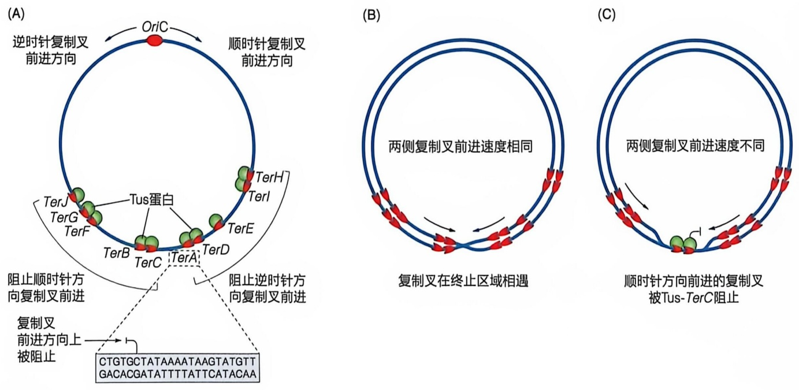

---

8.3 DNA 复制分为起始、延伸和终止三个阶段

303

叉推进，而如果两者正面碰撞则会导致复制叉停滞。当双侧推进的复制叉都不超过染色体的一半时，细菌基因组中大多数的基因转录与复制叉移动的方向是相同的，可以保证复制过程中大多数复制叉与 RNA 聚合酶的碰撞是同向的（图 8-22）。因此可以推测，也许 Tus-Ter 系统的存在就是为了防止双侧复制叉移动速度不相等时，一侧的复制叉复制超过环状染色体一半后还继续推进，从而与转录中的 RNA 聚合酶发生正面碰撞。

## 8.3.5 真核生物线性染色体末端的独特结构（端粒）需通过独特方式进行复制

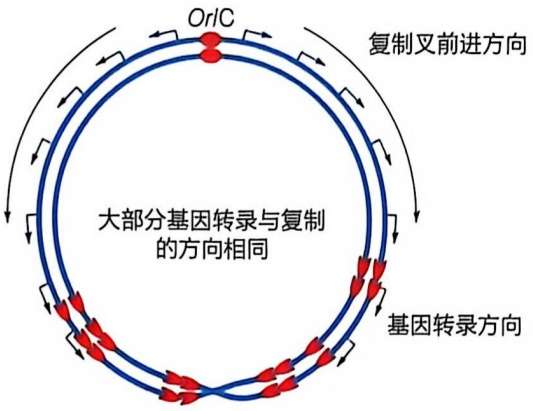

<details>
<summary>flowchart</summary>

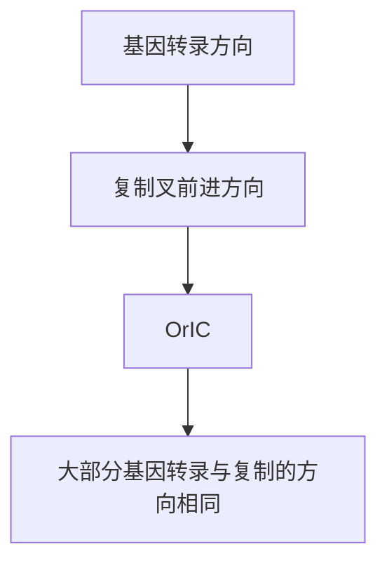
</details>

图 8-22 Tus-Ter 复合物可以避免复制中 DNA Pol 与转录中 RNA Pol 的正面碰撞

真核生物的染色体 DNA 是线性的，复制叉向两侧推进最终会进行到线性 DNA 的末端。在了解 DNA 复制的机制和过程后，你可能也会意识到线性染色体末端的复制是存在问题的。由于 DNA 新链的合成都需要 RNA 引物，而位于后随链上最后一个冈崎片段末端的 RNA 引物被水解之后，这一小段 8～12 个核苷酸的区域将无法被复制。因此，每经过一轮复制，染色体末端都会缩短一点，并会保留一个未复制的 ssDNA 的短区域。虽然这种缩短只会发生在子代 DNA 分子的两条链中的一条上，但如果这种情况在每一轮复制中都发生，这意味着每一轮 DNA 复制都会导致两个子 DNA 分子中的一个从其 5' 端缩短。显然，如果没有什么机制能够解决这一问题的话，随着 DNA 复制和细胞分裂，染色体末端的序列肯定会慢慢丢失，细胞就会死亡。真核细胞线性染色体的末端进化出了特殊的端粒（telomere）结构，端粒的存在能够保护染色体在一轮轮的复制过程中不丢失重要的遗传信息。

端粒结构的发现远早于对其功能的认识，直到20世纪末期，科学家们才真正揭示出端粒是如何被添加和维持的（知识延展8-1）。不同生物体的端粒DNA都是由串联排列的富含鸟苷酸的短重复序列组成。四膜虫中的端粒序列为TTGGGG，而人细胞端粒序列为TTAGGG。端粒的长度因生物种类不同而具有很大差异，从单细胞真核生物的几百个碱基对到高等真核生物的 $10\mathrm{kb}$ 以上不等。端粒DNA末端不是平头，而是两条链中3'端游离出的单链悬突（图8-23），这契合线性DNA末端复制问题的假说。

图 8-23 端粒结构及序列示意图

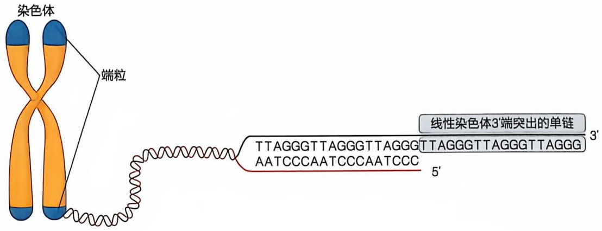

<details>
<summary>text_image</summary>

染色体
端粒
线性染色体3'端突出的单链
TTAGGGTTAGGGTTAGGGTTAGGGTTAGGGTTAGGGT
AATCCCAATCCCAATCCC
5'
</details>

---

304

8 DNA 复制、修复与重组

## 知识延展 8- 1

## 端粒及端粒酶的发现

端粒的发现要比线性染色体末端复制问题的提出早很多年。1938年，因发现X射线诱导突变而获得1946年诺贝尔生理学或医学奖的赫尔曼·米勒（Hermann J. Müller，1890—1967）发现果蝇染色体末端存在一个对X射线不敏感的特殊结构，命名为端粒。1978年，伊丽莎白·布莱克本（Elizabeth H. Blackburn）在单细胞纤毛虫四膜虫中发现了其端粒DNA是由许多重复序列TTGGGG构成。1980年，杰克·绍斯塔克（Jack Szostak）和布莱克本共同进行了一项关键实验，发现线性质粒进入酵母细胞后，要么被降解，要么被整合到基因组中；但如果将四膜虫端粒序列克隆在线性质粒末端，线性DNA则像微小染色体一样稳定保留在细胞中。酵母利用外来端粒DNA就像自己的端粒DNA一样。更有趣的是，随着细胞分裂增殖，端粒DNA会变长，且测序结果显示酵母还在来自四膜虫的端粒DNA上添加了自己的端粒 DNA 序列。这些研究表明细胞进化出了维持端粒的机制。

1985年，布莱克本和她的博士生卡罗尔·格雷德（Carol Greider）发现了一种能够在端粒DNA末端添加端粒重复序列的末端转移酶，命名为端粒酶（telomerase）。1989年端粒酶的RNA组分被鉴定，同年还报道了人类细胞中也有端粒酶存在。十年之后，端粒酶的蛋白质催化亚基被纯化并鉴定，并证实端粒酶是一种依赖于RNA模板进行DNA合成的逆转录酶。因此，某一物种中端粒DNA的序列拷贝了端粒酶中的RNA模板序列。绍斯塔克后来在酵母中的研究还表明，端粒酶活性的丧失会导致细胞过早衰老和细胞死亡，这是端粒缩短与衰老相关最早的实验证据。布莱克本、绍斯塔克和格雷德也因他们对端粒和端粒酶的研究而获得了2009年诺贝尔生理学或医学奖。

## 8.3.6 细菌质粒、线粒体、叶绿体及某些病毒的 DNA 通过其他方式进行复制

前面介绍的生物体基因组 DNA 的复制过程是最常见的复制形式，但并非所有生物都以相同的方式复制基因组。细菌中的某些质粒、线粒体、叶绿体以及某些病毒的 DNA 还可以采用完全不同的滚环复制方式。大肠杆菌中的 Col E1 质粒和  $\Phi X174$  噬菌体的复制就是滚环复制的典型例子。Col E1 质粒具有一个确定的复制起点，且该质粒从复制起点起只向一个方向进行复制。而另一些生物的基因组是单一线性的双链 DNA（如  $\Phi 29$  噬菌体和腺病毒），其 DNA 复制从其末端起始。

这里以 $\Phi X174$ 噬菌体基因组DNA的复制为例说明滚环复制的过程（图8-24）。$\Phi X174$ 噬菌体基因组是一个单链环状DNA分子，这条链称为正 $(+)$ 链。其复制时首先合成与正链互补的负 $(-)$ 链，从而形成一个环状闭合DNA双链分子。随后，噬菌体基因组编码产生的A蛋白会在双链DNA分子正链的特定位置上产生一个切口，切口处形成的正链 $3^{\prime}$ 端在DNA聚合酶的作用下延伸形成一条新链。这条新链围绕着环状

---

8.4 DNA 复制受到严格调控

305


<details>
<summary>flowchart</summary>

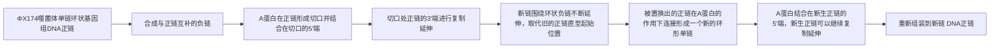
</details>

图 8-24 ΦX174 噬菌体基因组 DNA 的滚环复制方式

的负链不断延伸，取代旧的正链并直至到达起始位置置换起始的位点。而此时 A 蛋白可以从之前产生切口处的正链 5' 端再次结合至复制起点并产生切割，被置换出的旧的正链也会在 A 蛋白的作用下连接形成一个新的环形单链。通过这样的滚环复制方式，ΦX174 噬菌体就可以产生大量基因组拷贝。

## 8.4 DNA 复制受到严格调控

所有生物都必须保证自己的染色体数目和细胞数量相对平衡，因此，复制起始是被严格调控的。换句话说，对 DNA 复制的调控也主要是指对复制起始的调控。一旦 DNA 复制启动，细胞便会全力完成复制和分裂。同时，在染色体 DNA 复制起始后的一段时间内，复制起点不会再重新开始复制，最终保证 DNA 复制与细胞分裂协调进行。以下分别介绍原核和真核细胞是如何调控 DNA 复制起始的。

## 8.4.1 原核细胞复制起始的调控

E. coli 中复制起始调控的核心环节是起始蛋白 DnaA 在 OriC 上的结合，而 DNA 甲基化修饰控制 DnaA 能否在 OriC 上的 R 位点结合。E. coli 的基因组序列中存在许多散在分布的 GATC 序列，这一回文序列中的两条链都可以被 DNA 腺嘌呤甲基转移酶（Dam）识别，并将 GATC 位点两条链上 A 残基的 N6 位置甲基化。GATC 序列随

---

306

8 DNA复制、修复与重组

机出现的平均频率是每 256 bp 一次，然而在 OriC 序列中其出现的频率极高，245 bp 的 OriC 序列中含有 11 个 GATC 位点（图 8-3）。

染色体DNA发生复制前，GATC位点两条链上的A碱基都有甲基化修饰（图8-25A）。当GATC位点被复制一轮后，新合成链上的A还没有被甲基化，此时GATC位点是半甲基化状态（图8-25B）。这种新合成DNA上的半甲基化状态只是暂时的，最终被Dam再次修饰。但在Dam发挥作用之前，这些半甲基化的GATC位点可以被另一种称为SeqA的蛋白特异性结合（图8-25C）。SeqA蛋白和半甲基化GATC位点的结合有两种作用:一方面，这种结合可以使新复制的OriC区域被隔离，阻止DnaA蛋白对复制起点的再次结合并引发新一轮复制事件；另一方面，这种结合能够极大地降低Dam对该位点的甲基化作用（图8-25D）。

生物大分子之间的相互作用是一个动态的过程，SeqA蛋白与半甲基化位点的结合也存在结合-解离的动态过程。Dam可以在SeqA蛋白与半甲基化位点解离的间隙将半甲基化的GATC位点甲基化，从而阻断SeqA的结合（图8-25E）。通过Dam在SeqA解离再结合的循环之间发挥作用，最终使得OriC区域的GATC位点全部被甲基化修饰，也使得DnaA能够与OriC区域的9-mer R位点结合（图8-25F），再次打开复制起点。

此外，DnaA 的活性也取决于其结合核苷酸的状态。DnaA 利用结合的 ATP 水解的能量在 OriC 形成开放复合物。复制叉开始移动后，E. coli 中与 β 滑动夹结合的 Had 蛋白可刺激 DnaA 水解 ATP，从而使 DnaA 变为结合 ADP 的失活状态。当复制叉推进将 DnaA 从 OriC 上移除时，DnaA-ADP 可以重新结合在此区域，但不能打开 DNA 双链形成开放复合物，从而阻止引发新一轮复制。值得指出的是，游离 ATP 与 DnaA-ADP 上 ADP 的交换过程很慢，可能需要长达半小时的时间，这也可以保证 OriC 上结合的 DnaA-ADP 不能快速转换为有活性的 DnaA-ATP 而引发新一轮复制起始。

细胞中DnaA结合位点的数量也对复制起始的频次有调控作用。DnaA也是一种转录调节因子，在 $E.$ coli染色体许多基因的启动子中都存在DnaA的结合位点。总体而言，这些DnaA结合位点的数量远远超过了复制起点上的DnaA结合位点。因此，随着染色体DNA的复制，DnaA结合位点的总数翻了一番，从而降低了可与OriC结合的游离DnaA的数量。

虽然上述机制都会阻止一轮复制起始后复制起点被再次快速重新启动，但这些抑制作用可能无法持续到大肠杆菌细胞分裂完成。特别是当环境中养分充足，细胞进入对数生长期时，E. coli 细胞可以每 20 min 分裂一次，但完成大肠杆菌基因组 DNA 的复制至少需要 40 min。事实上，当大肠杆菌细胞以最大的速度分裂增殖时，在前一轮复制完成之前，复制起始位点上就启动了下一轮的复制（图 8-26）。细胞分裂时，分配到子代细胞中的染色体也处在复制中。在如此快速的生长条件下，细胞分裂的周期与 DNA 复制的周期虽不完全吻合，但对于每一轮细胞分裂，也只对应一轮来自 OriC 的复制起始。

---

8.4 DNA 复制受到严格调控

307


图 8-25 SeqA 与半甲基化 DNA 结合抑制复制起点的重新启动

---

308

8 DNA 复制、修复与重组

图 8-26 快速生长的细胞中复制起点在细胞分裂前即可重新启动复制


<details>
<summary>flowchart</summary>

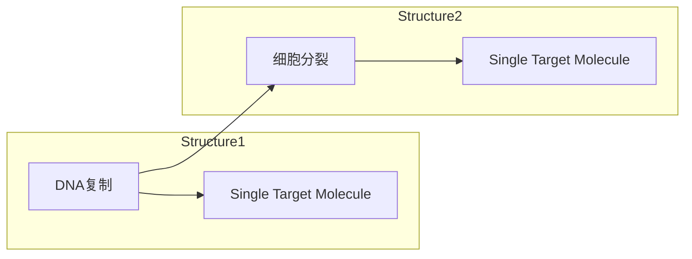
</details>

## 8.4.2 真核细胞中基因组 DNA 的复制在特定细胞阶段发生且每个细胞周期中只能复制一次

与大肠杆菌不同，真核细胞有明确的细胞周期，且细胞周期会明确划分为不同阶段。其中，DNA复制发生在真核细胞周期中的S期。在此期间，细胞中所有的DNA必须精确复制一次。一方面，一个复制周期中染色体任何部分的不完全复制都会导致子代染色体之间的不正常连接，连接染色体的分离可能导致染色体断裂或丢失。而另一方面，即使是极少量的真核DNA在一个细胞周期中的重复复制也会导致难以修复的DNA损伤，对其修复的尝试很可能引起相关的DNA扩增，进而可能导致相关基因表达的异常升高，这对于细胞的生存或增殖很可能是灾难性的。因此，真核细胞的每个细胞周期中，每个染色体中的每个碱基对都要复制且只能复制一次，这至关重要。对真核细胞来说，这无疑也是一个极大的挑战。下面介绍真核细胞如何精确控制其DNA的复制。

真核细胞复制起始与原核细胞一样的是，其也涉及起始蛋白对复制起点的识别和复制起点激活两个环节，但也有不同。在原核细胞中，复制起点的识别和DNA的解旋及聚合酶的招募是内在偶联的，即复制起始与否主要取决于复制起点上起始蛋白的结合。而在真核细胞中，复制起始区域上复制起始复合体的组装和起始位点的激活这两个环节发生在细胞周期的不同时期。

## （1）真核细胞复制起始复合体的组装

DNA复制发生于细胞周期的S期，复制后的姐妹染色单体分离发生在M期，但真核细胞复制起始相关的过程却是在S期前就已经开始。真核细胞的复制起始蛋白是一种被称为复制起点识别复合物（origin recognition complex，ORC）的六聚体复合物。ORC在细胞周期的 $G_{1}$ 期后期与染色质DNA结合。ORC在染色质DNA上的组装标识

---

8.4 DNA 复制受到严格调控

309

了 S 期可用于复制起始的位置。

ORC 与 DNA 结合后，Cdc6 蛋白与 ORC 结合。然后 ORC 在 Cdc6 和 Cdt1 两个分子的帮助下，将两个拷贝的微小染色体维持蛋白 2-7（Mcm2-7）复合物装载到 DNA 的双链上。Mcm2-7 复合物是一种环状六聚体，是后续发挥解旋活性的解旋酶复合物的重要组分。两个 Mcm2-7 复合物以头对头的二聚体形式，环绕包围在复制起点处的 DNA 上。这些事件仅发生在 G₁ 期，由此产生的 ORC、Cdc6、Cdt1 和 Mcm2-7 复合物称为复制前复合物（prereplication complex, preRC）（图 8-27）。


<details>
<summary>flowchart</summary>

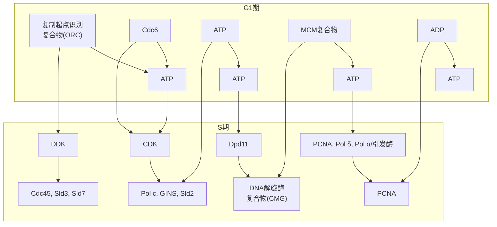
</details>

图 8-27 真核细胞复制起点上复制前复合物的组装及其激活过程示意图

---

910

8 DNA 复制、修复与重组

## (2) 真核细胞复制起点的激活

preRC 的组装发生在细胞周期 $G_{1}$ 期，但 ORC 的结合与 Mcm2-7 的组装并不会自发地导致 DNA 解旋和 DNA 聚合酶的招募。preRC 组装后需要静待细胞周期进入 S 期后，才会被激活以解开 DNA 双链形成复制泡，进而招募 DNA 聚合酶启动 DNA 的复制。

细胞周期蛋白依赖性激酶（cyclin-dependent kinase，CDK）是细胞周期转换的关键激活因子。它们通过磷酸化特定蛋白质上的特定丝氨酸和苏氨酸残基，从而调控相关蛋白质的活性来推动细胞周期转换。进入S期后，两种重要的DNA复制起始相关激酶——CDK和DDK（Dbf4依赖性激酶）激活复制起点的复合物（图8-27）。DDK催化Mcm2-7复合物亚基磷酸化使两个Mcm2-7复合物相互分离。CDK则作用于另外两种参与复制的蛋白质Sld2/Sld3，使其磷酸化。磷酸化的Sld2和Sld3结合到Dpb11上，进一步招募Cdc45和GINS蛋白与Mcm2-7结合，组装形成具有解旋酶活性的DNA解旋酶复合物（Cdc45-Mcm-GINS helicase complex，CMG），Cdc45和GINS能够极大地激活Mcm2-7的ATP酶和解旋酶活性，其共同形成的CMG是真核细胞DNA复制过程中形成和维持复制叉的主要复合物。

虽然 Mcm2-7 最初是以头对头二聚体的形式装载在 dsDNA 周围，但在复制起点被激活后，单个 Mcm2-7 六聚体被认为环绕在复制叉处的 ssDNA 上。因此，在复制起点激活过程中，Mcm2-7 六聚体必须从每个解旋酶的中心通道中排出一条 DNA 单链，这个过程也需要破坏两个 Mcm2-7 复合物之间的相互作用。

对 preRC 装载和激活的调控使得在每个细胞周期中复制起点仅可被激活一次。真核细胞染色体 DNA 上含有数百甚至数千个复制起点，如何保证这些复制起点在一个细胞周期中仅可被激活一次？秘密就在于 CDK 对 preRC 的组装和激活所进行的严密调控。如上所述，解旋酶的装载和激活发生在细胞周期的不同阶段，而每个细胞周期仅发生一次解旋酶的装载和激活。在  $G_{1}$  期，细胞处于解旋酶的装载阶段，此时细胞内的 CDK 活性很低，允许解旋酶在复制起点上装载，但不激活。一旦进入 S 期，CDK 的活性升高，并激活  $G_{1}$  期装载的解旋酶。由于 CDK 在整个 S、 $G_{2}$  和 M 期内保持高活性的状态，所以在  $G_{1}$  期形成的 preRC 要么被激活，要么在 S 期 DNA 复制过程中被复制叉破坏。尽管 DNA 复制后，新生链上的复制起点可以迅速被 ORC 所识别，但高水平的 CDK 活性阻碍了复制起点上新的解旋酶的组装，无法形成 preRC（图 8-28）。解旋酶装载和激活的条件彼此不相容，因此，在每个细胞周期中，只有一次机会将解旋酶装载到复制起点（在  $G_{1}$  期），并且也只有一次机会激活已装载的解旋酶（在 S 期）。只有在细胞完成染色体的复制并随细胞分裂将其分离后，子代细胞进入 CDK 活性较低的  $G_{1}$  期时，复制起点上才能再次装载一组新的 Mcm 2-7 复合物。

需要特别说明的是，染色体 DNA 中的复制起点多而冗余，这意味着一轮复制中并非所有复制起点都需要激活才能完成复制。在胚胎发育的早期，当胚胎细胞快速增殖分裂时，绝大部分复制起点被激活。而随着胚胎发育成熟，细胞分裂减慢，这个阶段就不需要全部的复制起点都被激活，即一些复制起点被选择性地激活，而另一些则

---

8.5 细胞内 DNA 可被多种因素损伤进而导致遗传突变

311


<details>
<summary>flowchart</summary>

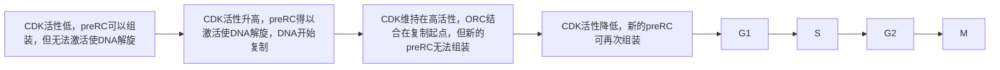
</details>

图 8-28 细胞周期依赖的 CDK 活性变化调控解旋酶的装载与激活

被抑制。细胞似乎能很好地平衡激活和抑制的复制起点的数量，因为如果激活的复制起点太少，基因组的某些区域将无法在一定的细胞周期时间内完成复制。对于生物体如何调控从最初大量激活复制起点到后续激活特定复制起点的机制尚不清楚，但这可能与染色质结构的变化以及起始蛋白与 DNA 的比例变化等有关。

了解 DNA 复制的保真性是生物体遗传稳定性的关键所在，而其调控机制确保了遗传信息在正确的时期内完成复制过程，从而维护了细胞周期的正常运作和基因组的完整性。然而生命体在维持遗传信息稳定传递的同时，也会因 DNA 的损伤或通过遗传重组而导致不同程度的变异。下面两节将分别介绍 DNA 损伤修复和 DNA 遗传重组的分子机制，以及它们如何影响生物体的进化和适应性。

## 8.5 细胞内 DNA 可被多种因素损伤进而导致遗传突变

前面介绍了细胞如何通过精确的 DNA 复制将遗传信息传递给子代。当细胞增殖分裂时，染色体 DNA 被准确地复制，细胞内的遗传信息尽可能以最大的精确性和最小的错误率传递给下一代。尽管 DNA 聚合酶有严格的底物选择机制和校对功能，但在复制过程中仍会存在一定的错配概率。此外，尽管 DNA 是一种相对稳定的分子，但对它的损伤和破坏仍是不可避免的。生物体对氧气和水的依赖使细胞内的生物分子

---

312

8 DNA复制、修复与重组

容易受到氧化和水解反应的攻击，包括DNA在内的各种生物分子都可因氧化和水解反应而被损伤。此外，环境中许多其他天然或人工合成的化学物质，以及各种类型的电磁辐射等物理因素也会造成DNA的损伤或破坏。

无论是外界因素造成的 DNA 损伤，还是 DNA 复制过程中的错误，通常都会被细胞很快修复，而未经及时修复的 DNA 损伤会对基因组的稳定性和完整性构成持续的威胁。DNA 复制和环境损伤而导致的遗传物质结构改变或信息错误是不可避免的。复制错误和 DNA 损伤可以引起 DNA 中遗传信息的永久改变，即突变（mutation），这会改变编码基因或其调控区域的序列。当突变发生在生殖系细胞或单细胞生物体内时，便具有了遗传性，即子代细胞或个体的 DNA 序列会发生改变。突变其实并不完全是绝对的坏事，事实上，某种频率的突变是产生变异所必需的，自然选择正是在这种变异体产生的基础上来推动生物进化的。然而，必须承认赋予细胞或机体特定优势的突变罕见。某些关键基因的突变对细胞或个体而言可能是灾难，积累了多种突变的细胞通常会死亡。癌细胞通常是积累了防止细胞死亡的突变，导致细胞周期控制的丧失和不受调节的细胞分裂。此外，DNA 损伤引起其化学结构的改变还可能导致 DNA 无法作为复制或转录的模板，阻碍复制或转录，对细胞功能和生存产生即刻且不可估量的影响。

## 8.5.1 物理化学因素可以导致 DNA 错配、插入、删除和断裂等不同形式的损伤

DNA 可以受到多种因素的损伤。细胞内正常代谢过程中产生的反应性化学物质会破坏 DNA，甚至是细胞内的水都可能通过水解作用造成 DNA 的自发损伤。此外，DNA 的高负电性也使其容易受到烷化剂和活性氧的亲电攻击，而多种活性氧分子也是存在于正常细胞内环境中的。外界环境中的多种物理和化学因素同样容易造成 DNA 的破坏，包括 X 射线和紫外线等在内的各种类型的辐射可以引起 DNA 的结构改变甚至是骨架链的断裂。同样，多种天然或合成的化学物质也可以直接损伤 DNA 或通过代谢间接产生能够损伤 DNA 的物质。我们把能够增加 DNA 突变频率的化学物质称为诱变剂（mutagen），把那些由外界物理或化学因素导致 DNA 损伤而产生的突变称为诱发突变（induced mutation）。不同因素引起 DNA 损伤的形式也可以大不相同，下面就一些常见的 DNA 损伤形式及可能导致这些损伤的因素进行介绍。

## (1) DNA 可因水解作用自发损伤

即使外界不存在任何有害因素，DNA也会由于水解造成自身的损伤。DNA水解可以导致核苷酸碱基的脱氨基，甚至是由糖苷键的水解而造成DNA脱碱基。

脱氨基作用是从化合物中除去氨基，所有含有氨基的分子都可能成为水解攻击的目标。DNA中有三种核苷酸——胞嘧啶、腺嘌呤和鸟嘌呤，它们的碱基中含有氨基，都可以通过水解作用发生脱氨基反应（图8-29）。

胞嘧啶的水解脱氨基作用是最常见和最重要的水解损伤。在正常生理条件下，胞

---

8.5 细胞内 DNA 可被多种因素损伤进而导致遗传突变

313

嘧啶经历自发脱氨基作用，产生天然 DNA 中不存在的碱基尿嘧啶，尿嘧啶优先与腺嘌呤配对。因此，如果在复制前胞嘧啶脱氨基形成的尿嘧啶没有被修复，这个位点将在复制时由 C≡G 碱基对替换为 U=A 碱基对，形成 C≡G 到 T=A 的转换突变。然而，由于正常情况下 DNA 中并不存在尿嘧啶，尿嘧啶很容易被识别为异常位点而被修复。因而基因组 DNA 在长期演化中，细胞为了避免突变而在 DNA 中使用 T 而非 U。

在高等真核细胞中，约有 5% 的胞嘧啶残基会被甲基化形成 5-甲基胞嘧啶（5mC），这是一种与基因表达调控相关的 DNA 修饰。胞嘧啶甲基


<details>
<summary>flowchart</summary>

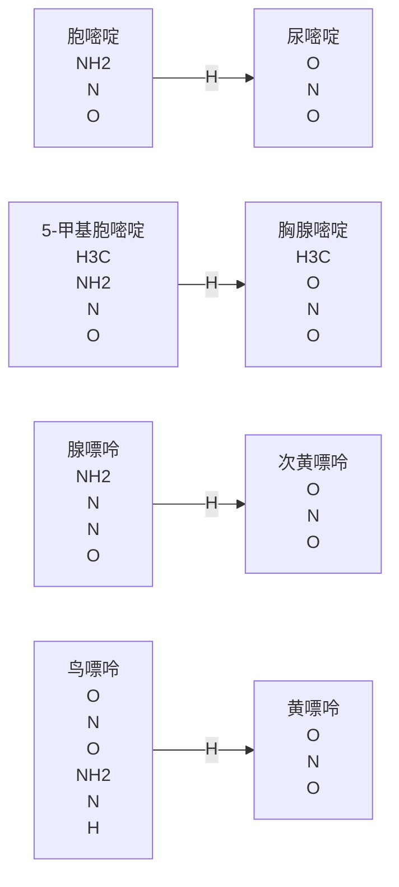
</details>

图 8-29 几种嘌呤和嘧啶的脱氨基产物

化最常见于 CpG 序列中的 C。CpG 序列的甲基化则会在 DNA 的两条链上对称地产生 5mCpG。5mC 的脱氨基作用产生的是 T 而不是 U。T 是 DNA 中天然存在的碱基，因而 5mC 脱氨基作用产生的 T 不会被认为是 DNA 中的异常碱基，但这会导致基因组该位点的碱基配对从 5mC-G 变为 T-G 的错配位点。

腺嘌呤和鸟嘌呤也可以发生脱氨基作用，但概率仅为胞嘧啶的百分之一。腺嘌呤和鸟嘌呤的脱氨基作用产物分别是次黄嘌呤和黄嘌呤，它们也是在天然 DNA 中不存在的核苷酸。次黄嘌呤会与胞嘧啶而不是胸腺嘧啶配对，而黄嘌呤仍可通过两个氢键继续与胞嘧啶配对。

除了碱基的水解脱氨基，另一个相对频繁的水解反应是水对核苷酸中碱基和戊糖之间的 $N-\beta-$ 糖苷键的攻击，这会导致核苷酸残基上整个碱基的丢失，从而留下一个去碱基的位点。嘌呤碱基的 $N-\beta-$ 糖苷键水解速度远高于嘧啶碱基（图8-30），嘌呤碱基被水解形成无嘌呤位点的过程又被称为脱嘌呤作用（depurination）。事实上，哺乳动物细胞中每天每 $10^{5}$ 个嘌呤中就有1个会因脱嘌呤作用而丢失（相当于每个细胞每天会产生10000个无嘌呤位点）。单链DNA中的无嘌呤位点使得复制时模板链中该位点的信息丢失，DNA聚合酶在遇到无嘌呤位点时常常会插入错误的核苷酸来形成子代DNA链，导致突变。此外，碱基丢失还容易引起DNA链部分自发解链，或使得DNA骨架链变得脆弱从而容易发生链的断裂。

## (2) 氧化、烷化及碱基类似物可导致碱基错配

在生理条件下，DNA 带有大量的负电荷，很容易受到烷化剂（alkylating agent）和活性氧（reactive oxygen species，ROS）（如过氧化氢、羟自由基和超氧自由基等）的亲电性攻击。

氧化损伤是 DNA 损伤的最常见类型，而碱基氧化最为普遍。羟自由基与嘌呤碱基和嘧啶碱基都可以发生反应。在嘧啶碱基中，C-5 和 C-6 之间的双键非常容易受到氧化攻击，而在嘌呤碱基中，其 8 位碳原子的氧化最为常见（图 8-31）。氧化后碱基与其原先配对的碱基不再完美互补。更糟糕的是，当其作为模板链进行复制时，这

---

314

8 DNA复制、修复与重组

图 8-30 水解脱碱基形成的无嘌呤位点


图 8-31 碱基的氧化损伤

些氧化损伤的碱基很可能与错误碱基配对，从而改变子代DNA中该位点的遗传信息导致突变。

氧化损伤也可以造成碱基脱氨基，亚硝酸诱导的氧化脱氨基就是最常见的例子。硝酸钠（$\mathrm{NaNO_3}$）是一种常见的食品防腐剂，但其在胃中可转化为亚硝酸（$\mathrm{HNO_2}$）。亚硝胺和硝酸盐也可转化为亚硝酸，亚硝酸作为诱变剂与A和C碱基反应，使其脱氨基分别转化为尿嘧啶和次黄嘌呤，改变其碱基配对能力（图8-32）。此外，用作食品防腐剂的亚硫酸氢盐（$\mathrm{HSO_3^-}$）也具有类似的作用，但使用浓度较低，对DNA损伤较小。

另一种容易引发碱基错配的因素是DNA的烷基化修饰。将烷基添加到核苷酸碱基或磷酸二酯骨架上的现象称为烷基化（alkylation）。碱基的烷基化，有些对碱基配对

---

8.5 细胞内 DNA 可被多种因素损伤进而导致遗传突变

315


<details>
<summary>chemical</summary>

Chemical reaction pathway showing nucleophilic attack and deprotection steps for a heterocyclic compound
</details>

不产生任何影响，有些会完全妨碍烷基化碱基与另一个碱基的配对，这取决于烷基化位置和修饰的烷化基团的性质。根据烷化剂种类的不同，四种核苷酸碱基中的许多位置以及 DNA 的糖磷酸骨架都可以被修饰（图 8-33A），其中腺嘌呤的 N-3 和鸟嘌呤的 O6 是常见的烷基化位点。烷基化最脆弱的位点之一是鸟嘌呤 6 位碳原子上的酮基甲基化的产物——O6-甲基鸟嘌呤，通常与胸腺嘧啶发生错配，导致受损 DNA 复制时原本的 C≡C 碱基对变成 A=T 碱基对（图 8-33B）。

与特定碱基结构相似的一些碱基类似物也可以导致 DNA 错配，例如胸腺嘧啶的类似物——5-溴尿嘧啶。碱基类似物与正常碱基的结构非常相似，因而可以被细胞吸收转化为相应的核苷三磷酸，并在复制过程中被掺入 DNA 中。但是，这些碱基类似物与正常碱基之间仍存在一定的结构差异，这使得其作为模板时会形成错误的碱基对，导致遗传信息的改变。例如 5-溴尿嘧啶在配对时，溴取代基的存在使得其更易形成烯醇式互变异构体进而与鸟嘌呤配对（图 8-34）。这会使得原本的 T=A 碱基对变为 C≡G 碱基对。

图 8-32 亚硝酸诱导的 C 和 A 氧化脱氨基改变其碱基配对能力

图 8-33 碱基的不同烷基化位点和烷化损伤引起的错配


---

316

8 DNA 复制、修复与重组

图8-34 碱基类似物5-溴尿嘧啶及其与鸟苷酸的配对结构


<details>
<summary>chemical</summary>

Chemical structures of three nucleotide analogs: thymidine, 5-methylaminobutyrate, and guanine
</details>


<details>
<summary>chemical</summary>

Three chemical structures: 乙锭, 原黄素, and 吖啶橙, each with a benzene ring and amine substituent.
</details>

图 8-35 常见嵌入剂乙锭、原黄素和吖啶橙的结构

## （3）嵌入剂导致碱基的插入或删除

除了引起 DNA 中碱基的错配之外，一些损伤 DNA 的因素还可引起碱基的插入或删除，其中与碱基对结构相似的嵌入剂就会导致这样的损伤。嵌入剂是具有多环结构的平面分子，其虽然并不像碱基类似物一样会被掺入 DNA 中，但它们可以通过这些多环平面与 DNA 中同样平坦的碱基平面相互作用，就像双螺旋中碱基对的堆积一样被嵌入碱基平面之间。乙锭、原黄素和吖啶橙等都是常见的嵌入剂（图 8-35）。复制

过程中嵌入剂的存在会导致一个或几个碱基对的缺失或增加。这可能是由于一个嵌入剂分子的插入大约会使两个碱基对之间的典型距离加倍，复制中嵌入剂在模板链中碱基之间的存在可以导致DNA聚合酶在嵌入剂分子的对面插入额外的核苷酸。此外嵌入剂分子引起的模板变形，也可能会使DNA聚合酶跳过模板链上的核苷酸，进而导致合成的子代链中缺失核苷酸。在基因的编码区出现一个或几个核苷酸的缺失或增加，可导致DNA的移码突变，将会对其所编码的mRNA的翻译产生极大的影响。

## (4) 辐射造成 DNA 相邻碱基的交联或骨架链的断裂

除化学物质可以造成 DNA 损伤之外，包括各种辐射在内的物理因素也会引起 DNA 结构和功能的改变。几乎所有形式的生命都会暴露于不同能量的辐射下，普通人也会接触到日光中的紫外线或者医学检查或治疗中使用的 X 射线。据估计，紫外线和其他电离辐射造成的 DNA 损伤约占环境因素所致 DNA 损伤的 10%。辐射除了可以通过产生 ROS 造成生物分子的氧化损伤之外，紫外线和以 X 射线为代表的电离辐射还可以通过不同的机制引起 DNA 损伤。

嘧啶二聚体（pyrimidine dimer）是同一条 DNA 单链上相邻的两个嘧啶碱基在紫外线的作用下共价交联形成的异常结构。紫外辐射可以诱导相邻的两个 T 残基之间形成环丁烷环（图 8-36），即胸腺嘧啶二聚体，导致双链 DNA 的结构畸变。含有嘧啶二聚体的 DNA 链在复制时不能再与另一个核苷酸进行碱基配对，因此 DNA 聚合酶在遇到嘧啶二聚体时会停止复制，这对细胞而言是致命的威胁。相邻的 T 残基或相邻的 C 残基还可以反应形成 6-4 光产物（6-4 photoproduct，6-4PP）（图 8-36）。尽管 6-4 光产物产生的概率较嘧啶二聚体的低，但近来的研究发现，其可以更有效地激活 DNA 损伤修复途径。

---

8.5 细胞内 DNA 可被多种因素损伤进而导致遗传突变

317


<details>
<summary>chemical</summary>

Chemical reaction diagram showing the synthesis of 6-4 fluorescent light from cyclohexane and pyridine derivatives via an ultraviolet excitation.
</details>

图 8-36 紫外辐射可以导致相邻的嘧啶碱基形成环丁烷环或 6-4 光产物

γ射线和X射线的光子能量远远高于紫外线，属于典型的电离辐射，它们不仅可以直接导致DNA单链或双链的断裂，还会通过活性氧的增加而损伤DNA。

## 8.5.2 未修复的 DNA 损伤可导致遗传突变、生物功能紊乱甚至死亡

DNA 损伤如果不被及时修复，会引起小到单个核苷酸位点，大到整个染色体片段的遗传突变，有一些突变可能不会带来明显的生物体表型变化，但严重的突变会导致生物功能的紊乱，甚至个体的死亡。

例如 5mC 脱氨基产生的 T，会使得基因组该位点从 5mC-G 变为 T-G 的错配位点。碱基对的错配可能成为一个过渡突变，如果其不能被有效识别并及时修复，在下一轮复制后，其中一个子代 DNA 中原来的 C≡G 碱基对就会突变为 T=A 碱基对。事实上，真核生物 DNA 中 5mC 残基确实是 DNA 自发突变的热点。又如，由鸟嘌呤氧化损伤产生的 8-氧代鸟嘌呤（8-oxoG）也具有极强的致突变性。如果 8-oxoG 不被及时修复，复制时其可以与 A 配对从而引起该位点的错配，这种错配在下一轮复制后会导致一条子代 DNA 中原来的 G≡C 碱基对发生颠换突变，形成 T=A 碱基对（图 8-37）。这种 G≡C 到 T=A 的颠换突变是人类癌症中最常见的突变。通常，人们可以采用艾姆斯试验对某种化学物质的诱变性或致癌性进行初步测试（知识延展 8-2）。

## (1) 点突变

上述这两个例子中所产生的突变都是简单的单个碱基的替换，这种单个碱基的替换又被称为点突变（point mutation）。点突变并非一定会导致表型或功能的变化，这要取决于点突变所发生的位置是否在关键的基因调控区域、是否改变功能 RNA 分子或

---

318

8 DNA 复制、修复与重组

图 8-37 8-氧代鸟嘌呤复制中引起 G≡C 到 T=A 的颠换突变


<details>
<summary>chemical</summary>

Chemical reaction pathway showing oxidation damage and replication of 8-oxoG derivatives
</details>

## 知识延展 8- 2

## 潜在致癌剂可通过艾姆斯试验测试其对细菌 DNA 的诱变效应

许多致癌剂都是通过诱变作用导致基因突变而致癌。自然界存在的或人工合成的化学物质不计其数，如何识别这些化学物质的诱变性或致癌性显得非常重要。直接用动物实验来研究和确定化学物质的潜在致癌作用无疑既耗时又昂贵。是否有更便捷的方法进行初步筛选呢？加州大学伯克利分校的布鲁斯·艾姆斯（Bruce Ames, 1928—2024）设计了一个简单的测试方法，即通过评估化学物质对鼠伤寒沙门菌的诱变能力来测试化学物质潜在致癌作用，这个技术又被称为艾姆斯试验（Ames test）。

艾姆斯试验采用一种鼠伤寒沙门菌营养缺陷型（auxotroph）菌株，该菌株在组氨酸生物合成途径中的突变使其需要在含有组氨酸的培养基中才能生长。在缺乏组氨酸的培养基上培养时，该组氨酸营养缺陷型的鼠伤寒沙门菌细胞不能存活。但由于自发突变的存在，极少数细胞可能获得功能上逆转原始突变的突变，具有这种回复突变（reverse mutation，或称为逆转突变）的细胞就可以合成组氨酸，并在不含组氨酸的培养基上存活下来，形成少量菌落（8-38A）。

利用这一性质可以进行潜在诱变剂与潜在致癌物的初步筛选。将待测化合物吸附在滤纸片上并放置在涂布有组氨酸缺陷型鼠伤寒沙门菌的培养基平板中心（8-38B）。由于某些化合物是在肝中羟基化后才具有诱变活性，因此根据需要也可以将待测化合物首先与肝提取物孵育反应后再用于艾姆斯试验。

滤纸片上吸附的化合物会扩散到周围的培养基中，在滤纸片周围形成一定的浓度梯度。该化合物在紧邻滤纸片的区域浓度最高，具有细胞毒性的化合物可以杀死细胞，从而在滤纸片周围形成一定大小的无细胞生长的致死区域（图8-38C）。在致死区域之外，具有诱变能力的化合物可以在一些细胞中诱导产生回复突变，从而观察到部分细胞生长形成菌落的现象。根据致死区域的大小、外围菌落生长区域的大小及形成菌落的个数可以判断该化合物的细胞毒性和诱变性。

艾姆斯建立的这种筛选技术为化学诱变剂提供了一种快速、廉价的检测方法。在艾姆斯试验中，大多数已

---

8.5 细胞内DNA可被多种因素损伤进而导致遗传突变

319


<details>
<summary>flowchart</summary>

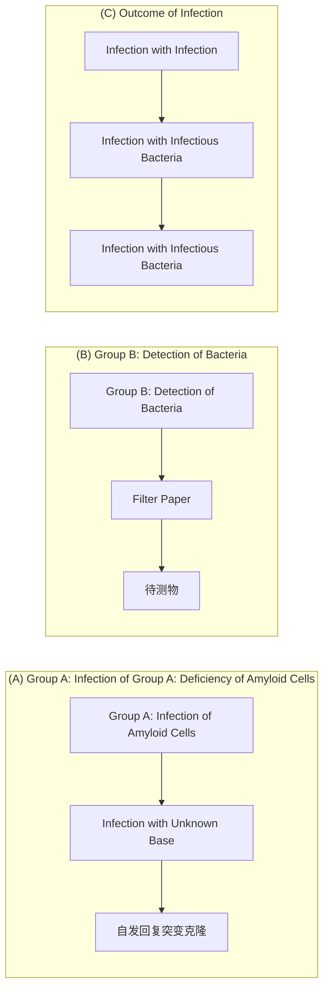
</details>

图8-38 基于艾姆斯试验检测化合物的致突变性

知的人类致癌物都会导致回复突变增加。事实上，许多常见的工业化学品和天然产物在测试中也可以产生许多突变。因此，艾姆斯试验仅仅是一种初筛手段，通过艾姆斯试验发现的诱变剂还需要在动物中进一步测试，以确定其是否是真正的致癌物。

蛋白质编码区中的关键位点。根据蛋白质编码区的点突变对蛋白质序列和功能造成的影响，点突变又可以分为沉默突变、错义突变或无义突变。

## ① 沉默突变

蛋白质编码区的核苷酸发生替换后，不一定会改变编码蛋白质的氨基酸。这是因为氨基酸是由被称为密码子（codon）的三个连续排列的核苷酸所编码的，而许多氨基酸可以由不止一个密码子编码，这些编码同一个氨基酸的不同密码子称为同义密码子（synonymous codon）。当蛋白质编码区中的核苷酸替换后不改变其所编码的氨基酸时，即突变后的密码子与原密码子是同义密码子时，突变不会改变蛋白质产物的氨基酸序列，也不会对蛋白质产物的性质或生理功能造成明显影响，这种突变称为沉默突变（silent mutation）或同义突变。互为同义密码子的三联核苷酸通常前两位是相同的，第三位核苷酸可以不同，因此沉默突变通常发生在密码子的第三位核苷酸上。这种突变可以在子代保留，并以变异体基因或等位基因的形式出现在群体中，是形成蛋白质遗传多态性的主要原因。

## ② 错义突变

如果蛋白质编码区的核苷酸替换，导致原来编码某一氨基酸的密码子变为编码另一种氨基酸的密码子，相应地会引起蛋白质中该位点氨基酸的变化。这种可以引起编码蛋白质中氨基酸变化的核苷酸替换称为错义突变（missense mutation）。不同的氨基

---

320

8 DNA 复制、修复与重组

酸之间可能性质相似，也可能性质迥异，若突变密码子所编码的氨基酸正好与原密码子所编码的氨基酸性质相似，那么很可能突变后蛋白质的性质和生理功能不会发生明显的改变，此时错义突变不产生表型上的结果。但是在更多情况下，突变密码子所编码的氨基酸与原密码子所编码的氨基酸性质迥异，可能对所编码的蛋白质产物的结构或功能造成极大影响，导致该蛋白质失活或持续激活，造成有害甚至致死性的后果。错义突变的一个典型例子是镰状细胞贫血症。镰状细胞贫血症中血红蛋白编码基因中T到A的颠换使多肽链第6位谷氨酸突变为缬氨酸（E6V），这两个氨基酸的性质具有较大差异:谷氨酸带有极性的亲水侧链，而缬氨酸是疏水性氨基酸。在正常氧浓度条件下，该突变对血红蛋白形成高级结构的影响不大；但在低氧条件下，脱氧血红蛋白暴露出的一些疏水区域可与缬氨酸相互作用，使异常血红蛋白聚集成纤维状。

## ③ 无义突变

如果蛋白质编码区的核苷酸突变使得本来编码氨基酸的密码子变成终止密码子，其转录出的 mRNA 被翻译到此突变位点时提前终止蛋白质的合成，造成截短的蛋白质产物，这种由于碱基对的改变而使决定某一氨基酸的密码子变成一个终止密码子的突变称为无义突变（nonsense mutation）。其中密码子改变为 UAG 的无义突变又称琥珀突变（因其发现者的姓伯恩斯坦（Bernstein）在德语中意为“琥珀”而得名），密码子改变成 UAA 的无义突变又称赭石突变。无义突变会导致蛋白质合成过程中被过早终止，剩余的多肽片段几乎总是缺失正常生理功能的。因此，无义突变通常是有害的，其产生的表型结果也往往较为恶劣。

## (2) 核苷酸的插入或缺失可以导致移码突变

嵌入剂的存在或复制中 DNA 聚合酶在模板上的滑动可能会造成一个或多个碱基对的插入或缺失。一个或多个碱基对添加到野生型序列中的突变称为插入突变 (insertion mutation)，而一个或多个碱基对的丢失引起的突变称为缺失突变 (deletion mutation)。

在讨论这类插入或缺失突变对功能产物，特别是蛋白质合成的影响之前，我们需要先知道，当基因被转录形成成熟的 mRNA 后（真核细胞的基因转录后需要进行剪接去除内含子才能形成成熟的 mRNA），蛋白质中的氨基酸序列是由一系列连续排列的密码子编码的。蛋白质的编码区以起始密码子 AUG 开始，以三个终止密码子（UAA、UAG、UGA）之一结束，从起始密码子到终止密码子的 DNA 序列称为一个开放阅读框（open reading frame, ORF）（8-39A）。密码子要以三联体的形式进行解码，可想而知，蛋白质编码序列中一个或两个核苷酸插入或缺失的突变会导致突变位点后开放阅读框的混乱，从而导致突变位点下游的所有氨基酸序列发生改变，这种情况称为移码突变（frameshift mutation）（8-39B）。移码突变通常会产生一个截短的蛋白质，特别是当基因较大且突变发生在野生型编码序列靠近 5' 端时，这种移码突变常会导致蛋白质功能丧失。

---

8.6 细胞内存在多种 DNA 损伤修复系统

321

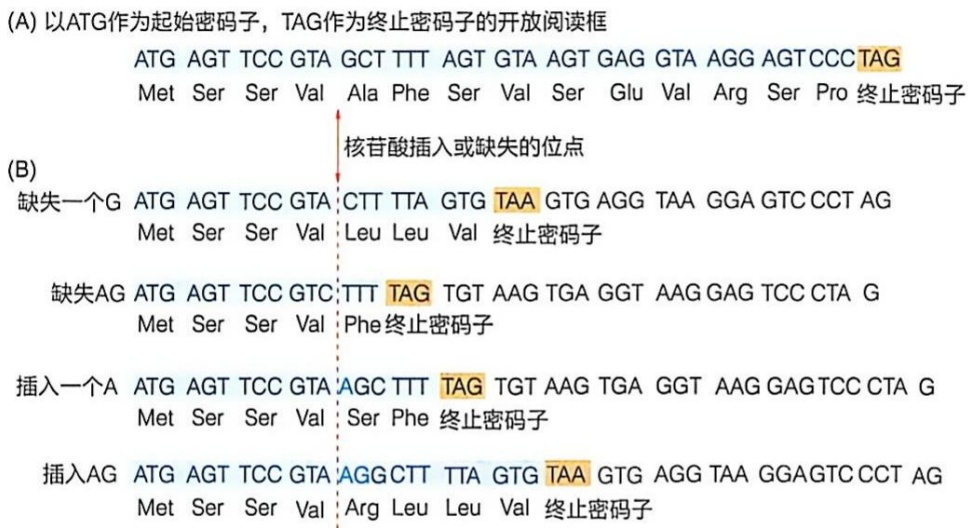

<details>
<summary>text_image</summary>

(A) 以ATG作为起始密码子，TAG作为终止密码子的开放阅读框
ATG AGT TCC GTA GCT TTT AGT GTA AGT GAG GTA AGG AGT CCC TAG
Met Ser Ser Val Ala Phe Ser Val Ser Glu Val Arg Ser Pro 终止密码子
核苷酸插入或缺失的位点
(B)
缺失一个G ATG AGT TCC GTA CTT TTA GTG TAA GTG AGG TAA GGA GTC CCT AG
Met Ser Ser Val Leu Leu Val 终止密码子
缺失AG ATG AGT TCC GTC TTT TAG TGT AAG TGA GGT AAG GAG TCC CTA G
Met Ser Ser Val Phe终止密码子
插入一个A ATG AGT TCC GTA AGC TTT TAG TGT AAG TGA GGT AAG GAG TCC CTA G
Met Ser Ser Val Ser Phe 终止密码子
插入AG ATG AGT TCC GTA AGG CTT TTA GTG TAA GTG AGG TAA GGAGTC CCT AG
Met Ser Ser Val Arg Leu Leu Val 终止密码子
</details>

图 8-39 1\~2 个核苷酸的插入或缺失会导致移码突变

## 8.6 细胞内存在多种 DNA 损伤修复系统

为了解决 DNA 损伤的问题，细胞面临着双重挑战:一方面，细胞必须能够及时监测和发现 DNA 合成的错误或受到的损伤；另一方面，它需要能够修复错误或损伤的 DNA，尽可能恢复其原始序列信息。随着生物演化，细胞发展出多种 DNA 修复系统。大多数 DNA 修复过程在不同物种中都相对保守，细菌、古菌和真核细胞的主要 DNA 修复途径较相似。然而，真核细胞的 DNA 修复的确在许多方面不同于细菌的 DNA 修复。本节将介绍针对 DNA 复制错误或不同类型 DNA 损伤的修复系统和修复过程。

## 8.6.1 DNA 复制中的错配主要通过错配修复系统进行纠正

引起核苷酸发生错配的原因之一是 DNA 复制过程中引入的错误核苷酸，尽管 DNA 聚合酶具有校对功能，但不能保证万无一失。如果一些错误掺入的核苷酸逃脱校对，成为子代 DNA 中的错配位点且在下一轮复制前没有被检测到并被纠正的话，那么在第二轮复制时，错误掺入的核苷酸将作为模板链的一部分指导与其互补的核苷酸掺入新合成的链中，后果是该位点上核苷酸序列的变化将永久留存在基因组中。所幸生物体进化出了一套专门用于检测复制后逃过校对机制的错配位点，并修复它们的错配修复系统（mismatch repair system, MMR）。从 E. coli 到人类，错配修复机制的基本特征都较为保守。这套修复系统会在一轮复制后到下一轮复制前扫描整个基因组来寻找碱基错配位点，然后准确地纠正错配的核苷酸。由于错配修复系统的存在，DNA 合成的精确性可以在校对后再提高 2\~3 个数量级，达到十亿到百亿分之一的出错率。错配修复系统需要在 DNA 复制后快速发现并修复基因组中的错配位点。同时，错配修复系统还必须确保替换的是新合成链中错误掺入的核苷酸，而不是亲本链中正确

---

322

8 DNA 复制、修复与重组

的核苷酸。错配修复系统的缺陷会导致细胞基因突变率增加和对某些癌症的易感性增加。

在 $E.$ coli中，错配修复系统主要由MutS二聚体、MutL和MutH组成，其中MutS二聚体负责检测DNA上的碱基错配位点。碱基错误配对会引起DNA骨架链扭曲变形，MutS则通过扫描DNA双链骨架的局部扭曲变形而找到它们（图8-40A、B）。由于错配的DNA比正确配对的DNA更容易扭曲，MutS二聚体与错配位点结合后会通过自身构象的改变诱导DNA产生一个明显的纽结。此时MutS二聚体能够与错配修复

图 8-40 E. coli 的错配修复系统对复制产生的错配位点的修复过程

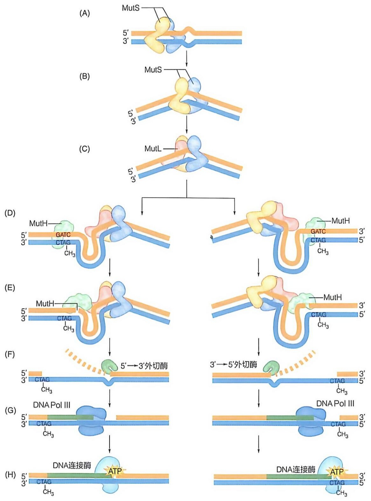

<details>
<summary>flowchart</summary>


</details>

---

8.6 细胞内存在多种 DNA 损伤修复系统

323

系统中的 MutL 结合（图 8-40C），进而 MutS-MutL 复合物利用其 MutS 的 ATP 酶活性水解 ATP 提供能量向两侧扫描 DNA（图 8-40D）。当 MutS-MutL 复合物遇到基因组中复制后形成的半甲基化 GATC 位点时，招募并激活 MutH 蛋白（图 8-40E）。MutH 是一种位点特异性内切酶，可切割半甲基化 GATC 位点上未被甲基化的子代 DNA 链。在链断裂后，MutS-MutL 招募特异的 DNA 解旋酶 II（UvrD）从切口位点开始向碱基错配位点解开 DNA 双链，核酸外切酶进而将解旋的单链降解，直到越过错配位点（图 8-40F）。根据 MutH 产生切割的半甲基化 GATC 位点与错配位点的相对位置，具有 $5' \rightarrow 3'$ 或 $3' \rightarrow 5'$ 方向活性的核酸外切酶会降解错配的子代链。要注意的是，在碱基错配修复过程中，所消化的核苷酸并不仅仅只有错配位点的核苷酸。核酸酶会将从错配位点附近的 GATC 半甲基化位点到包含错配核苷酸在内的一段 DNA 切除。这个过程产生了一个从切口到错配位点之间的 DNA 单链的缺口，形成的单链间隙首先会被 SSB 包裹，再由 DNA Pol III 填充，并最终被 DNA 连接酶连接成完整的一条链，从而完成对错配核苷酸的修复（图 8-40G、H）。

在错配修复过程中，E. coli 是通过利用基因组中 GATC 序列在复制后短暂的半甲基化特性，来判断碱基错配位点的两条 DNA 链中哪一条是存在错误掺入核苷酸的新合成链。错配修复系统的修复与 DNA 的复制同期进行。那些半甲基化状态的 GATC 序列可以被具有内切酶活性的 MutH 结合，并且只有当 MutH 与识别了碱基错配位点的 MutS 二聚体和 MutL 接触时，其内切酶活性才会被激活，选择性地切割没有被甲基化的子代 DNA 链，这样就保证了被修复的是含有配错的核苷酸的子代链。当 DNA 复制完成后，基因组中 GATC 序列可以逐步被甲基化酶 Dam 甲基化。当 Dam 将子代 DNA 链上 GATC 序列中的 A 全部甲基化后，错配修复系统就无法再进行有效的修复了。

就能量消耗而言，错配修复对于大肠杆菌来说是一个昂贵的过程。有的错配位点与 GATC 位点之间的距离很远，甚至超过 1 000 bp。为了修复一个错误配对的核苷酸，降解并重新合成这么长的 DNA 链无疑需要消耗很多 dNTP。但相对于发生突变而言，这个代价还是可以接受并且值得的。在所有细胞中都存在这样一个高成本的修复系统也很好地说明了维持基因组 DNA 序列的稳定对细胞的重要性。

除错配的核苷酸之外，大肠杆菌错配修复系统还可以识别复制过程中由模板滑动造成的4 bp以下的未配对核苷酸小环。这些模板滑动形成的DNA小环可以导致缺失或插入的突变。错配修复系统无法识别超过4 bp的更大的环，同时目前尚未发现有其他机制来识别这样的错误。E. coli中参与错配修复的蛋白质汇总见表8-1。

表 8-1 E. coli 中参与错配修复的蛋白质汇总表

| 参与蛋白质 | 主要功能 |
| --- | --- |
| MutS | 识别单碱基错配位点 |
| MutL | 与 MutS 结合辅助修复 |
| MutH | 切割半甲基化 DNA 位点 |

---

324

8 DNA 复制、修复与重组

续表

| 参与蛋白质 | 主要功能 |
| --- | --- |
| DNA 解旋酶 II UvrD | 解旋 DNA |
| SSB | 结合未损伤的单链 |
| 核酸外切酶 I /X | 3'→5'方向核酸外切去除 |
| 核酸外切酶VII/RecJ | 5'→3'方向核酸外切去除 |
| DNA 聚合酶III全酶 | 填补修复切除产生的缺口 |
| DNA 连接酶 | 将 DNA 链切口连接完整 |

在真核细胞中，对错配核苷酸的修复机制和酶系与原核细胞类似，但似乎只有MutS和MutL蛋白的同源物被保留下来（表8-2）。真核细胞MutS同源物以异二聚体形式发挥作用，不同的异二聚体功能有所差异。例如，在酵母中，MSH2-MSH6的异二聚体通常识别单个碱基对的错配并与之结合，而与稍长的错配环的识别结合则是由MSH2-MSH3异二聚体完成的。真核细胞MutL的同源物MLH1-PMS1也是一种异二聚体，与MutS同源物结合。

表 8-2 酵母和人类的错配修复蛋白

<table><tr><td>酵母</td><td>人类</td><td>主要功能</td></tr><tr><td>MSH2/MSH6</td><td>MSH2/MSH3</td><td>MutS/L/H</td></tr><tr><td>MSH2/MSH3</td><td>MSH2/MSH3</td><td>DNA糖苷酶</td></tr><tr><td>MLH1/PMS1</td><td>MLH1/PMS2</td><td>DNA光解酶</td></tr><tr><td>MLH1/MLH2</td><td>MLH1/MLH2</td><td>UvrA/B/C/D</td></tr><tr><td>MLH1/MLH3</td><td>MLH1/MLH3</td><td>RecA重组酶;Ku70/80-Artemis</td></tr><tr><td colspan="2">RPA</td><td>结合未损伤的单链</td></tr><tr><td colspan="2">核酸外切酶I</td><td>5&#x27;→3&#x27;方向核酸外切去除</td></tr><tr><td colspan="2">DNA聚合酶/PCNA</td><td>填补修复切除产生的缺口</td></tr><tr><td colspan="2">DNA连接酶</td><td>将DNA链切口连接完整</td></tr></table>

尽管真核细胞在错配位点的识别方面与细菌非常相似，但在选择哪条链进行切割修复的问题上两者却有很大差别。真核细胞中缺乏细菌MutH和Dam的同源物，也不通过识别DNA的甲基化状态来区分新旧链。在真核生物中，新旧链的区分主要依赖于后随链上冈崎片段间尚未完成连接的缺口。真核细胞中冈崎片段的长度较短，为$100\sim 200\mathrm{bp}$，因此未完成连接的冈崎片段间的缺口在后随链上很常见。真核细胞的错配修复系统可以以错配位点附近的冈崎片段间的缺口为起点，将存在错配核苷酸的新链水解切除，然后通过聚合酶填补单链缺口并最终完成连接，就像在细菌错配修复中一样。上述方式在解释真核生物如何利用缺口来区分后随链上的新旧DNA链是有效的，但对于连续合成的前导链上存在的错配位点并不适用。关于前导链中如何识别错

---

8.6 细胞内存在多种 DNA 损伤修复系统

325

配位点，并在新生链上产生缺口的机制仍不是十分清楚。但最近的研究表明，与细菌 MutL 不同，人类 MutL 同系物具有依赖于 PCNA（真核细胞中的滑动夹）的内切酶活性，这显示出新生链上缺口的产生可能与 DNA 复制相协调。PCNA 有明显的 “正面” 和 “背面”，复制过程中 PCNA 与 DNA 结合后的方向可能会将核酸内切酶的定位指向新合成的链。

无论是利用后随链上冈崎片段间的缺口，还是在前导链上产生的切口，核酸外切酶 EXO1 会从切口开始消化掉切口到错配位点之间的一长段含有错配核苷酸的新生 DNA 链。后续填补 DNA 单链缺口的任务由 DNA 聚合酶 δ 在滑动夹 PCNA 和复制因子 C（RFC）的协助下完成。最终，DNA 连接酶 I/IV 将修复合成的 DNA 片段与相邻 DNA 单链连接，完成错配位点的修复。

真核细胞的错配修复系统也负责修复复制过程中由于模板滑动而引起的错误。基因组中常存在大量短重复序列构成的微卫星 DNA，这些区域在复制中很可能会发生模板链的滑动，导致复制后新合成的子链与模板链配对时形成部分突起的单链环（图 8-41）。如其未被修复，会导致重复序列的扩张。这些突起的单链环也是被真核细胞的错配修复系统所识别并进行修复的。

## 8.6.2 碱基切除修复机制依赖 DNA 糖苷酶和无碱基位点内切酶等的作用

除了 DNA 复制中的错配问题需要被纠正，细胞中的 DNA 还会面临自发的或者是环境中物理或化学因素对其的损伤，这些不同类型的损伤也需要通过不同的方式进行修复。细胞中存在一系列各具特色的修复系统来应对不同类型的 DNA 损伤。其中，比较常见的方式是通过切除修复系统将受损的核苷酸从 DNA 中移除。切除修复又包

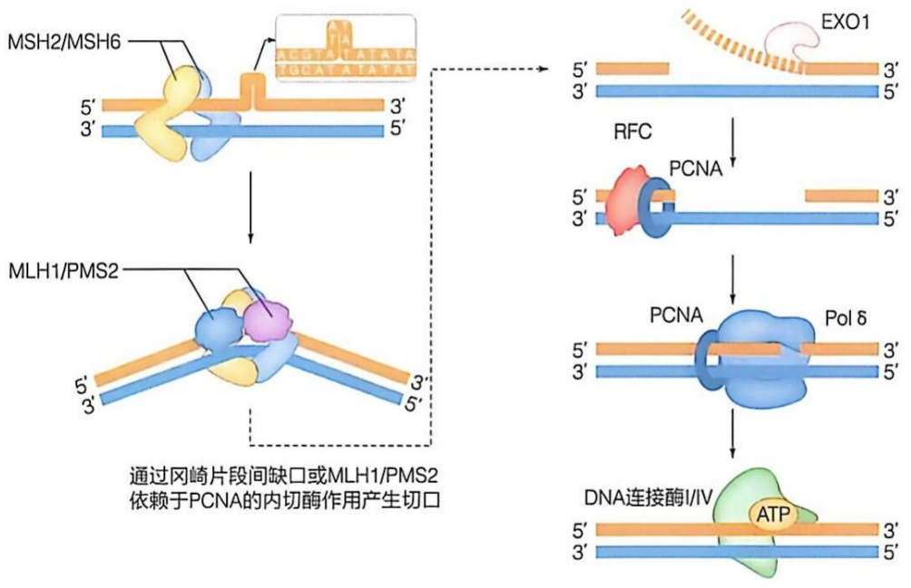

<details>
<summary>flowchart</summary>


</details>

图 8-41 真核错配修复系统对模板滑动形成的单链小凸起环的识别与修复

---

326

8 DNA 复制、修复与重组

括碱基切除修复（base excision repair，BER）和核苷酸切除修复（nucleotide excision repair，NER），是细胞内清除DNA中受损核苷酸最普遍的方法，在修复DNA碱基损伤、嘧啶二聚体及碱基类似物嵌入等类型的DNA损伤中均可发挥作用。碱基切除修复和核苷酸切除修复的名称，很容易让人误解为碱基切除修复只是切除受损位点的碱基，核苷酸切除修复是切除损伤的核苷酸，然而事实并非如此。这两种切除修复系统在发挥功能时都涉及对受损位点糖磷酸骨架的水解。那么这两种切除修复系统有什么不同呢？它们能否相互取代呢？

碱基切除修复系统通常通过检测受到特定损伤的碱基来识别要修复的对象，其主要作用于单个的存在损伤的碱基，但对 DNA 双螺旋结构不造成显著扭曲的位点。此外，BER 也是修复缺乏可连接接头的单链 DNA 断裂的主要途径。

碱基切除修复由一组称为DNA糖苷酶（DNA glycosylase）的酶识别受损碱基。DNA糖苷酶可以水解受损碱基和脱氧核糖之间的 $N - \beta-$ 糖苷键，从而使碱基从DNA骨架上脱落，留下一个无碱基位点。这里需要注意的是，后续的修复过程并非将正确的碱基直接添加到这个无碱基位点来实现。由糖苷酶切除受损碱基留下的无碱基位点和由DNA自发水解形成的无碱基位点一样，都会被AP核酸内切酶（apurinic/apyrimidinic endonuclease）识别，并在无碱基位点处的戊糖 $5^{\prime}$ 端进行切割，产生一个带有 $3^{\prime}$ 羟基和 $5^{\prime}$ 脱氧核糖磷酸（$5^{\prime}-\mathrm{dRP}$）的缺口。在大肠杆菌中，这个缺口会被DNA Pol I的缺口平移活性移除，再由DNA连接酶将最终的切口连接起来，形成完整的DNA链从而完成修复（图8-42）。

真核细胞的BER中，前两步由糖苷酶切除受损碱基形成无碱基位点和由AP核酸

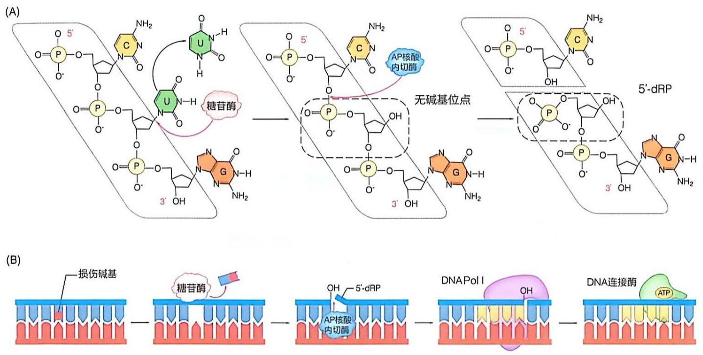

图8-42 E.coli中的碱基切除修复

---

8.6 细胞内存在多种 DNA 损伤修复系统

327

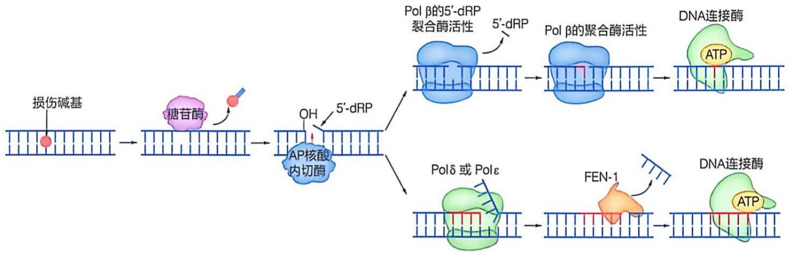

<details>
<summary>flowchart</summary>

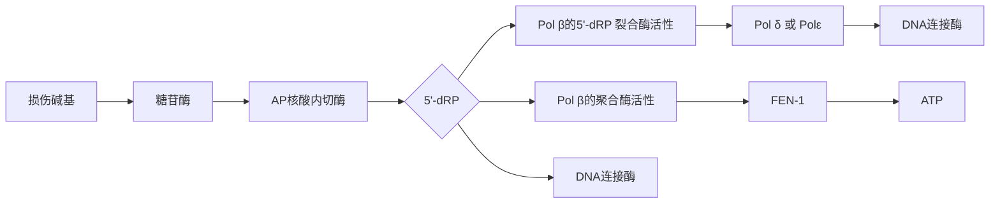
</details>

图 8-43 真核细胞中的碱基切除修复

内切酶在无碱基位点切割糖磷酸骨架链的步骤与细菌相同。但在后续的  $5'$  脱氧核糖磷酸的去除和空缺的填补上有两种不同的方式——短补丁修复（short patch repair，单个核苷酸残基位点缺失的修复）和长补丁修复（long patch repair，2～10个核苷酸残基切除的修复）（图 8-43）。

真核细胞的长补丁碱基切除修复与细菌中的 BER 类似。糖苷酶切除受损碱基后，AP 核酸内切酶在无碱基位点的  $5'$  端产生切口。然后，DNA Pol δ 或 DNA Pol ε 以及 PCNA 在此合成一段 2～10 个核苷酸的片段。由于 DNA Pol δ 或 DNA Pol ε 并不像 E. coli 中的 DNA Pol I 一样具有  $5' \rightarrow 3'$  核酸外切酶的作用，因此不能形成切口平移，这一段包含  $5'dRP$  的瓣状 DNA 单链可以通过翼式内切酶 FEN-1 切除。最后，DNA 连接酶 I 会将修复后的 DNA Pol 新合成链  $3'$  端和下游 DNA 链  $5'$  端的核苷酸连接起来，从而完成长补丁修复。

短补丁修复是真核生物碱基切除修复过程中使用最多的修复方式。糖苷酶切除受损碱基后，AP内切核酸内切酶同样在无碱基位点的5'端产生切口，但在无碱基位点的3'端，可以由糖苷酶相关的β-裂合酶在此产生切口，将无碱基位点的糖磷酸基团切除下来，形成仅去除了一个核苷酸残基的缺口。然后，DNA Pol β会在这个单核苷酸缺口的3'端填补上一个新的正确的核苷酸。有趣的是，DNA Pol β也具有5'-dRP裂合酶活性，能够除去5'-dRP的部分，即在AP核酸内切酶切割无碱基位点的5'端后，可由DNA Pol β直接去除5'-dRP而不需要糖苷酶相关的β-裂合酶去除无碱基位点的糖磷酸基团。除Pol β外，其他几种低保真DNA聚合酶，如Pol 1和Pol λ也可以参与真核生物的碱基切除修复。这些酶都具有5'-dRP裂合酶活性。在糖苷酶去除碱基和AP核酸内切酶切割主链后，这些低保真聚合酶去除5'-dRP并填补缺口。由于合成的DNA长度很短（通常只有一个核苷酸），突变频率被最小化。当单核苷酸缺口被DNA Pol β或其他聚合酶填充后，DNA连接酶Ⅲ（XRCC1复合物）将新添加的核苷酸残基的3'端和下游DNA链5'端的核苷酸连接起来，形成完整的DNA链，从而完成修复。

---

328

8 DNA 复制、修复与重组

## 8.6.3 核苷酸切除修复机制涉及一段包含被损伤碱基 DNA 单链的切除和重新合成

除了碱基切除修复系统，另一种相对更为直接的切除修复系统是核苷酸切除修复（nucleotide excision repair，NER）系统。

与碱基切除修复系统不同，核苷酸切除修复系统不识别任何特定种类的损伤核苷酸或碱基，其所识别的目标是损伤导致的 DNA 双螺旋结构的扭曲和畸变，如胸腺嘧啶二聚体、6-4 光产物或碱基上的大体积加合物引起的 DNA 结构扭曲。这些扭曲的结构会触发核苷酸切除修复系统将包括损伤位点在内的一段短单链 DNA 切除。NER 系统的核酸切除活性较为特殊，是在一条 DNA 单链上产生两个切口，切除损伤位点及其两侧的几个核苷酸，这种独特的核酸酶活性也被称为切除核酸酶（excinuclease）。NER 所产生的单链缺口再进一步由 DNA 聚合酶以未受损伤的链为模板进行填充，并由 DNA 连接酶连接从而恢复原始的核苷酸序列。

在 E. coli 中，核苷酸切除修复主要由四种蛋白质完成:UvrA、UvrB、UvrC 和 UvrD。首先，UvrA 与 UvrB 结合形成蛋白复合物共同扫描 DNA，其中 UvrA 负责检测 DNA 双螺旋结构中的扭曲位点。检测到扭曲位点后，UvrA 从 UvrA-UvrB 蛋白复合物中解离下来，留下 UvrB 二聚体将损伤位点附近的 DNA 解旋产生单链，并进一步招募 UvrC。UvrC 在损伤位点所在的单链上切割产生两个切口:一个位于损伤位点 3' 端 4 或 5 个核苷酸处，另一个位于损伤位点 5' 端 8 个核苷酸处。UvrC 在这两个位置的切割产生了一条包含损伤位点的 12～13 个核苷酸残基长的 DNA 单链。在 DNA 解旋酶 UvrD 的作用下，包含损伤位点的 DNA 单链被解离并释放，这会在染色体中形成一段 12～13 个核苷酸的间隙缺口。这个缺口进一步被 DNA Pol I 填补并被 DNA 连接酶连接（图 8-44）。

图 8-44 大肠杆菌中核苷酸切除修复过程

真核细胞NER的原理与大肠杆菌的非常相似，但其机制更为复杂。人类细胞

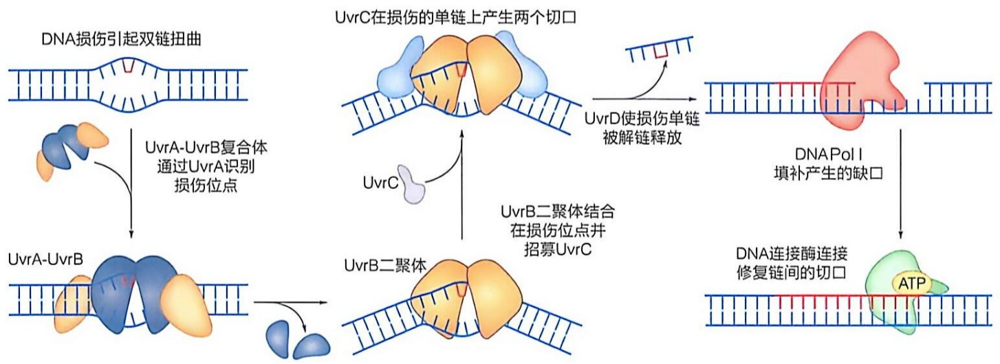

<details>
<summary>flowchart</summary>

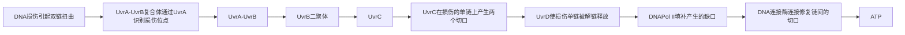
</details>

---

8.6 细胞内存在多种 DNA 损伤修复系统

329

中 NER 的主要参与因子是在对一种遗传性的着色性干皮病（xeroderma pigmentosum, XP）的研究中发现的，患有 XP 的人因暴露在阳光下而患皮肤癌的可能性要比正常人高几千倍。对这些患者的研究已经确定了至少 7 种不同的基因，这些基因的编码产物都参与 NER，其中任何一种基因产生缺陷，都会导致 XP。

真核细胞 NER 过程中负责检测识别损伤位点的是 XPC 蛋白，其作用类似于细菌中的 UvrA。XPC 识别损伤位点，启动修复过程，损伤位点周围的 DNA 双链在 XPA、XPB 和 XPD（相当于大肠杆菌中的 UvrB）的作用下解链，形成的单链被真核细胞单链结合蛋白 RPA 结合，进而在损伤位点的两侧分别招募两个核酸酶 XPF 和 XPG。XPF 和 XPG 分别在损伤位点 3' 端距离损伤位点约 6 个核苷酸处和 5' 端距离损伤位点约 20 个核苷酸处进行切割（执行类似于细菌中 UvrC 的功能），使得包含损伤位点在内的一段 24～32 个核苷酸长的 DNA 单链被释放出来，形成的缺口再通过 PCNA 招募 DNA Pol δ 或 DNA Pol ε 来填补，并最终由 DNA 连接酶 I 连接新合成链与下游 DNA 片段（图 8-45）。

NER 不仅能够广泛地检测整个基因组中的受损 DNA 并对其进行修复，还能够与基因转录过程相偶联。通过将 NER 相关的酶招募至因模板链损伤而被阻止的 RNA 聚合酶上，可以拯救因模板损伤导致的基因转录停滞，这种现象被称为转录偶联修复（transcription-coupled repair, TCR）。

转录偶联修复的意义在于它针对的是当前活跃转录的基因区域的 DNA 损伤，而不是纠正位于基因组其他庞大的未转录区域的可能损伤，从而更有效地减少 DNA 损伤对细胞生存和功能的影响。在转录偶联修复中，RNA 聚合酶发挥了损伤感应蛋白的作用。RNA 聚合酶识别转录中 DNA 模板链上的损伤而停滞在损伤处，并招募 NER 修复的酶（图 8-45）。真核生物中转录偶联修复的核心是通用转录因子 TF II H。我们将在真核细胞基因转录的章节中详细了解到，TF II H 是真核细胞 RNA 聚合酶 II 的基础转录因子，其功能是在转录开始时解开 DNA 双链。TF II H 的亚单位包括真核细胞 NER 过程中负责解开损伤位点处 DNA 双螺旋的蛋白 XPB 和 XPD。由此可见，TF II H 具有的解旋酶活性不仅在基因转录过程中打开 DNA 双链模板，而且也在核苷酸切除修复（包括转录偶联修复）过程中解开损伤位点周围的 DNA 双链。后续通过 XPB、XPD、XPA 和 RPA 进一步招募 NER 的其他蛋白质直至完成损伤位点的修复。

原核生物中也存在将修复与转录偶联的系统。当细菌 RNA 聚合酶在 DNA 模板损伤处停滞时，它被转录修复偶联因子（transcription repair coupling factor, TRCF, 又称 Mfd 解旋酶）取代，TRCF 进而招募 UvrABC 蛋白进行损伤的修复。

## 8.6.4 当 DNA 损伤导致其不可作为模板时可通过跨损伤合成维持基因组基本完整

在 BER 或 NER 过程中，当 DNA 损伤位点被切除后会使用未受损的另一条链作为模板进行再合成。但有时这些修复系统并不能非常及时地将基因组中所有损伤位点

---

330

8 DNA 复制、修复与重组

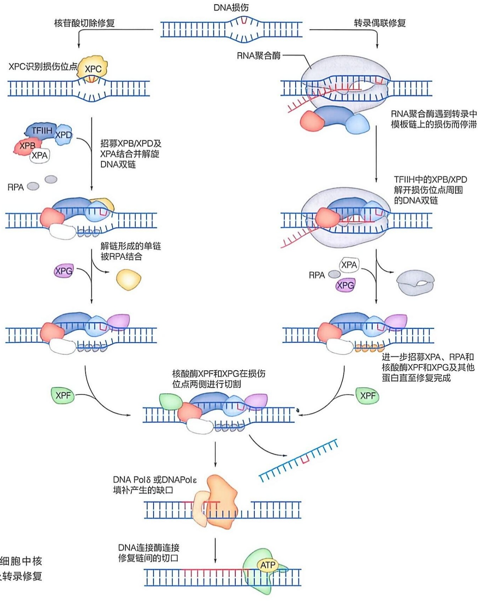

<details>
<summary>flowchart</summary>

```mermaid
graph TD
  A["核苷酸切除修复"] --> B["XPC识别损伤位点"]
  B --> C["DNA损伤"]
  D["转录偶联修复"] --> E["RNA聚合酶"]
  E --> F["RNA聚合酶遇到转录中模板链上的损伤而停滞"]
  F --> G["TFIIH中的XPB/XPD解开损伤位点周围的DNA双链"]
  H["解链形成的单链被RPA结合"] --> I["XPG"]
  I --> J["进一步招募XPA、RPA和核酸酶XPF和XPG及其他蛋白直至修复完成"]
  K["核酸酶XPF和XPG在损伤位点两侧进行切割"] --> L["DNA Polδ或DNAPolε填补产生的缺口"]
  M["细胞中核转录修复"] --> N["DNA连接酶连接修复链间的切口"]
  O["XPF"] --> K
  P["ATP"] --> N
  Q["XPC结合并解旋DNA双链"] --> R["XPB、XPA"]
```
</details>

图 8-45 真核细胞中核苷酸切除修复及转录修复偶联

一一修复。当诸如嘧啶二聚体和无碱基位点这类影响 DNA 作为模板使用的损伤没有在下一轮复制前被及时修复时，在复制开始后，这样的损伤位点势必会阻碍 DNA 聚合酶的合成，使得复制叉推进到模板损伤位点时，DNA 聚合酶无法继续向下游合成子代链。又或者有时在复制中 DNA 双链被解开后，复制叉处的模板链会发生损伤。在这种情况下，DNA 聚合酶也将在损伤处停滞。复制叉的停滞导致细胞不能完成基因组

---

8.6 细胞内存在多种 DNA 损伤修复系统

331


<details>
<summary>flowchart</summary>

```mermaid
graph LR
  A["损伤位点"] --> B{"损伤被修复"}
  B --> C["5'"]
  B --> D["3'"]
  E["损伤位点被保留"] --> F{"跨损伤合成"}
  F --> G["5'"]
  F --> H["3'"]
  I["损伤尚未修复\n便已开始复制"] --> J{"正常合成"}
  J --> F
  G --> K["修复损伤"]
  K --> L["5'"]
  L --> M["3'"]
```
</details>

图 8-46 细胞通过跨损伤合成耐受复制前损伤且不可用模板

的复制，这对细胞而言是致命性的。在这种情况下，细胞往往会通过一种称为跨损伤合成（translesion synthesis，TLS）的途径帮助复制酶越过模板的受损部位，防止因复制无法完成而导致的细胞死亡。这种跨损伤合成的方式并没有修复模板链上的损伤，其可以看作是细胞为了避免染色体不能完全复制而采用的一种对 DNA 损伤的耐受方式，当然这也为修复损伤的模板链争取了更多的时间和机会（图 8-46）。

跨损伤合成过程需要有细胞中特殊的 TLS 聚合酶替代复制中的 DNA 聚合酶来完成。TLS 聚合酶是一类特化的、低保真的 DNA 聚合酶。TLS 聚合酶的合成需要模板链的存在，但其可以不依赖于与模板链上的碱基配对而添加核苷酸。TLS 聚合酶的活性位点空间结构比正常聚合酶催化中心更宽，且缺失部分封闭底物通道的氨基酸残基区域（图 8-47），这也解释了 TLS 聚合酶如何能够在模板链被损伤不可用的情况下合成 DNA。正是由于 TLS 聚合酶并不从模板中“读取”序列信息，因而这种合成方式通常非常容易出错，极易引入突变。TLS 聚合酶通常也不具有  $3' \rightarrow 5'$  核酸外切酶的校对功能，但其可以有效帮助 DNA 链延伸，直至跨过模板链上损伤的位点。

复制中处于延伸中的 DNA 聚合酶遇到不可用的模板时会被迫停下，离开复制叉并被 TLS 聚合酶所取代，待 TLS 聚合酶将子代链延伸至越过 DNA 模板上的损伤位点

后，DNA 聚合酶重新结合到复制叉上，按照模板链继续复制直到复制完成或再次遇到不可使用的 DNA 模板。在 E. coli 中，DNA Pol IV（DinB）或 DNA Pol V（UmuC 和 UmuD' 的复合物）发挥跨损伤合成的功能。其中 DNA Pol V 是主要的跨损伤聚合酶（图 8-48）。

目前，在其他细菌、古菌和真核生物中都发现了能够跨损伤合成的DNA聚合酶家族成员，科学家们将其统称为DNA聚合酶Y家族。酿酒酵母中rad30基因编码的DNA聚合酶 $\eta$ 是Y家族的TLS聚合酶。人类细胞中至少有10种不同的TLS聚合酶。Pol $\xi$ 是一种极易错配的TLS聚合酶，主要在非编码的损伤位点复制时随机添加核苷酸。相反，当Pol $\eta$ （XPV）遇到模板链上的胸腺嘧啶二聚体时，其能够特异性地在


图8-47 TLS聚合酶（A）与T7噬菌体DNA聚合酶（B）的活性部位结构

(A)(B)PDB 编号分别为 1JX4、1T7P

---

332

8 DNA 复制、修复与重组


<details>
<summary>flowchart</summary>

```mermaid
graph TD
  A["DNAPol III"] --> B["损伤不可用的模板"]
  B --> C["DNAPol IV 或 DNAPol V"]
  C --> D["Interaction with DNAPol IV or DNAPol V"]
  D --> E["Interaction with DNAPol IV or DNAPol V"]
  E --> F["Interaction with DNAPol IV or DNAPol V"]
```
</details>

图 8-48 复制中跨损伤聚合酶与复制性 DNA 聚合酶的替换

子代链上添加两个 A 残基，以一种无错误添加的形式跨越模板链中的胸腺嘧啶二聚体。不过 Pol η 跨损伤合成的范围仅限于嘧啶二聚体，之后需要另一种 DNA 聚合酶将子代链延伸至复制性的 Pol δ 或 Pol ε 可以使用的长度。这也可能是由于 Pol η 对未受损 DNA 模板链复制的保真度非常低，因而其在胸腺嘧啶二聚体的对侧添加两个 A 残基后，需要另一种聚合酶来延伸 DNA。也可以说，Pol η 是细胞进化出的用于特异性和准确跨越胸腺嘧啶二聚体的酶，因此，Pol η 的存在能够更好地保护细胞免受紫外线伤害，而 Pol η 的缺失则同样容易引起着色性干皮病。

尽管具有“易错配倾向”的TLS聚合酶能够在受损的DNA模板处进行复制，可以避免复制被强行终止而导致的染色体不能完全复制的严重后果，但也因为TLS聚合酶的低保真度和高错误率，这种DNA跨损伤合成方式只能是细胞求生存的最后备选方式，因此细胞内并不会储备大量的TLS聚合酶。E.coli中在通常情况下并不储备TLS聚合酶，只有遭遇DNA损伤才能被诱导产生。哺乳动物细胞中存在少量储备性的TLS聚合酶。当DNA模板受损不可使用时，滑动夹PCNA被泛素化并触发TLS的信号。TLS聚合酶具有识别和结合泛素化修饰的结构域，可以结合至DNA模板损伤处，取代复制性DNA聚合酶继续延伸子代链至跨过损伤部位。

## 8.6.5 DNA 双链断裂及导致模板链不可用的损伤可通过多种途径进行修复

尽管有多种修复机制保护细胞 DNA 免于损伤带来的突变，但细胞复制时模板链中仍有可能存在未被修复的损伤，这可能会导致复制叉的停滞或引入错误的核苷酸。与核苷酸或碱基的损伤相比，DNA 双链断裂（double-strand break，DSB）无疑是所有 DNA 损伤中最危险的，这些断裂的 DNA 如果不被及时修复，会阻断复制并引起染色体片段丢失等，从而导致细胞死亡或肿瘤发生。

细胞可通过非同源末端连接（non-homologous end joining，NHEJ）和同源重组（homologous recombination，HR）两条途径使断裂的双链重新连接在一起，但两者在修复的精准程度和发挥作用的时期上有很大差别。真核细胞中，DNA 的同源重组修复是细胞在细胞周期 S 期和  $G_{2}$  期首选的 DSB 修复途径，损伤染色体的同源染色体或是

---

8.6 细胞内存在多种 DNA 损伤修复系统

333

复制后新产生的姐妹染色单体都可以为重组修复提供同源的双链 DNA，作为恢复断裂 DNA 的模板来指导重组修复过程。但对于处在细胞周期的  $G_{1}$  期和静止的  $G_{0}$  期的细胞而言，如果此时染色体发生了断裂，细胞则会通过 NHEJ 的方式进行 DSB 的修复。

下面将先介绍 NHEJ 途径对 DNA 双链断裂损伤的修复。之后再详细介绍 HR 的具体机制和 HR 途径对双链断裂及不可用的模板损伤的修复过程。

## 8.6.6 哺乳动物体细胞中的很多 DNA 双链断裂损伤通过非同源性末端连接而修复

NHEJ 是所有真核生物中 DSB 修复的一个重要途径。NHEJ 在酵母中是 DSB 修复的后备系统，但在高等细胞中，NHEJ 是修复 DSB 的主要途径。在一些细菌中也检测到了 NHEJ 的修复方式，但似乎只有少数细菌具有 NHEJ 系统。总的来说，NHEJ 的重要性随着基因组的复杂性增加而增加。

NHEJ 修复过程依赖多种专一性蛋白质的参与。当处于 $G_{1}$ 期和 $G_{0}$ 期的细胞中发生 DSB 时，负责 NHEJ 的酶会被迅速激活。目前在真核生物中发现的参与 NHEJ 途径的蛋白质和酶包括:Ku70、Ku80、DNA 依赖的蛋白激酶 DNA-PKcs、Artemis 蛋白、DNA Pol μ、DNA Pol λ、XRCC4、XLF（又称为 Cernunnos）和 DNA 连接酶 IV（表 8-3）。

表 8-3 参与 NHEJ 途径的相关蛋白和酶

| 参与蛋白和酶 | 功能 |
| --- | --- |
| Ku70/80 | 结合 DNA 末端 |
| DNA-PKcs | 蛋白激酶催化亚基 |
| Artemis | 核酸酶 |
| Pol μ/Pol λ | 填补修复中的单链缺口 |
| XRCC4/XLF/DNA 连接酶IV | 将 DNA 上的切口连接完整 |

NHEJ 反应由 Ku70 和 Ku80 蛋白组成的异源二聚体启动。Ku70/80 复合体能在断裂的 DNA 末端迅速组装，并充当一种分子支架，进一步招募 DNA-PKcs 与 Artemis 蛋白形成起始复合物。一旦起始复合物组装好，两个断裂的 DNA 末端就会结合在一起，DNA-PKcs 的蛋白激酶活性被激活，进而使 Artemis 磷酸化以激活其核酸酶活性。Artemis 既具有  $5'\rightarrow3'$  的核酸外切酶活性，又是潜在的核酸内切酶。DNA 末端在解旋酶的帮助下分离，Artemis 对断裂的 DNA 末端进行消化加工，在断裂端两侧的 DNA 链上产生一个 1\~6 bp 的微互补序列，以备进行非同源末端连接。此时微互补序列两侧短的 DNA 间隙被真核 DNA 聚合酶 Pol μ 或 Pol λ 填充。最后 DNA 连接酶 IV、XRCC4 和 XLF 三者组成的蛋白复合物负责连接双链 DNA 的断裂切口，完成非同源末端的连接（图 8-49）。

---

334

8 DNA 复制、修复与重组


<details>
<summary>flowchart</summary>

```mermaid
graph TD
  A["Ku70/80"] --> B["DSB末端被Ku70/80识别结合"]
  B --> C["Ku70/80招募DNA-PKcs和Artemis结合组成NHEJ起始复合物"]
  C --> D["DNA-PKcs"]
  D --> E["Artemis"]
  E --> F["DNA-PKcs激活Artemis的核酸酶活性，加工断裂DNA末端形成微互补序列"]
  F --> G["P"]
  G --> H["XLF/XRCC4/DNA链接酶IV加入复合物"]
  H --> I["P"]
  I --> J["DNA连接酶IV"]
  J --> K["XLF/XRCC4/XRCC4"]
  K --> L["DNA-PKcs自磷酸化并离开NHEJ复合物，微互补序列两侧间隙被Polμ或Polλ填充"]
  L --> M["P"]
  M --> N["DNA链接酶IV先后连接两条链上的切口，完成双链断裂的非同源末端连接修复"]
```
</details>

图8-49 非同源末端连接对DSB的修复过程

## 8.6.7 断裂的 DNA 双链可通过同源重组进行修复

如果 DNA 双链断裂发生在 S 期和  $G_{2}$  期，细胞则更倾向于通过 HR 途径进行断裂 DNA 的修复。相对于 NHEJ 的非特异性及其可能造成的遗传信息的丢失，HR 途径在维持基因组的完整性方面更具优势，因而也是细胞在 DNA 复制期间首选的 DSB 修复途径。HR 是在两个序列高度相似的 DNA 分子之间发生的重组，其存在于所有细胞中。以下介绍 HR 的基本过程及其在 DNA 链断裂或模板链不可用时所介导的修复过程。损伤染色体的同源染色体或复制后新合成的 DNA 都可以作为恢复断裂 DNA 的模板来指导 HR 修复过程。

DNA双链断裂的HR修复途径由三个酶促反应启动，这三个反应是其他同源重组过程中的通用步骤。第一个反应是断裂的DNA末端的加工处理，即断裂位置 $5^{\prime}$ 端游离的链被选择性地降解，形成 $3^{\prime}$ 端突出的单链（图8-50①）。第二个反应是 $3^{\prime}$ 端突出的单链入侵同源染色体，这一过程由重组酶进行催化。这一DNA单链入侵的过程是同源重组和与之相关的所有过程的典型步骤。入侵的单链和另一条序列互补的链形成配对结合，取代完整同源染色体中与之序列相同的一条链，被取代的那条链游离出来形成D环（图8-50②）。在图8-50中，步骤②和③显示了两个连续的链侵入。第三个决定性反应是入侵链的复制延伸，入侵链的 $3^{\prime}$ 端正好可以作为DNA合成的引物发挥作用。DNA聚合酶在入侵链的 $3^{\prime}$ 端持续进行链的

延伸（图 8-50 ④），使用被侵入的染色体作为模板忠实地恢复断裂位点丢失的遗传信息。两次链的入侵会产生两个 DNA 单链的交叉点。

后续的修复过程仍需要若干步骤来完成 DNA 双交叉中间体的分离。DNA 双交叉中间体看起来很复杂，但实际上细胞至少可以通过两种方式使其分离。第一种，经过延伸的已经变长的入侵链可以在解旋酶的作用下与延伸时使用的模板链解离，然后与原本所在的染色体中的另一条 DNA 链退火配对（图 8-50⑤），这条染色体上剩余的空缺区域都可以被 DNA 聚合酶填补并经过 DNA 连接酶的连接而完成修复（图 8-50⑥）。这

---

8.6 细胞内存在多种 DNA 损伤修复系统

335


<details>
<summary>flowchart</summary>

```mermaid
graph TD
  A["①断裂末端加工形成3'端突出的单链"] --> B["被取代的链形成D环"]
  B --> C["②3'端突出的单链入侵同源染色体"]
  C --> D["③断裂的另一个3'端单链入侵同源染色体"]
  D --> E["④3'端单链作为引物开始链的延伸"]
  E --> F["⑤入侵链解离并与原断裂的链退火结合"]
  F --> G["⑥断裂的双链完成合成并被连接修复"]
  G --> H["合成依赖的链退火 (SDSA)"]
```
</details>

图 8-50 DNA 双链断裂的 SDSA 修复过程

种简单且常见的途径被称为合成依赖的链退火（synthesis-dependent strand annealing, SDSA）。

第二种方式相对更为复杂。在这种情况下，入侵的链被持续复制并与下游的 DNA 链连接起来（图 8-51），形成两个具有四分支交叉连接的结构，这种特殊的结构被称为 Holliday 中间体或 Holliday 连接（Holliday junction）——这是以最初提出这个重组模型的遗传学家罗宾·霍利迪（Robin Holliday，1932—2014）的名字命名的。Holliday 连接可以沿着 DNA 不断移动，并且在它移动过程中也不断伴随着配对碱基之间氢键的断裂和重新形成。即在 Holliday 连接移动的过程中，亲代双链 DNA 分子互补配对的碱基之间的氢键被破坏，继而在同源重组中间体的异源双链 DNA 区域中，再重新

---

336

8 DNA 复制、修复与重组

图 8-51 通过形成并切割 Holliday 连接进行 DNA 双链断裂修复的过程


<details>
<summary>flowchart</summary>

```mermaid
graph TD
  A["双链断裂"] --> B["Step 5-32: Step 1 & 4"]
  B --> C["Step 5-32: Merge & Connection"]
  C --> D["Complete Linking & Connection,伴Holliday Connection via Mobile"]
  D --> E["X direction (补丁) Exchange"]
  D --> F["Y direction (交叉拼接式交换)"]
```
</details>

形成氢键而实现与之前相同碱基对的互补配对。Holliday 交叉移动的结果是发生交换的 DNA 长度增加。

Holliday 连接解离酶（Holliday junction resolvase）是细胞中一种特殊的核酸内切酶，可以识别 Holliday 连接，并通过两种不同方式中的一种对 Holliday 连接进行切割。如图 8-51 所示，如果两个 Holliday 中间体都在标记为 X 的位点被切割，或者都在标记为 Y 的位点被切割，结果会出现如图中左下方的“补丁”式交换的情况，即两条染色体中只有两个 Holliday 连接之间的一段 DNA 单链被交换。而如果一个 Holliday 中间体在 X 位点被切割，另一个在 Y 位点被切割，则会出现图中右下方“交叉拼接”的情况，即两条染色体会从修复位点起产生染色体臂的交换，从而引起遗传交叉。无论是哪种切割方式，被解离酶切割产生的两条 DNA 都是具有完整基因序列的产物，而通过切割 Holliday 中间体将重组 DNA 分子分开从而实现 DSB 修复的过程也就称为双链断裂修复（double-strand break repair，DSBR）途径。切割后形成的切口断点会被 DNA 连接酶连接。

## 8.6.8 DNA 修复功能缺陷可能会导致疾病

DNA修复机制是维持和保护细胞基因组稳定的精密过程，各种修复机制的存在

---

8.7 细菌细胞 DNA 的同源重组及细菌接合过程

337

很大程度上确保了 DNA 损伤能够被及时并准确地修复，防止突变的发生和累积。当 DNA 损伤修复机制失效或受到干扰时，易积累 DNA 损伤，进而增加癌症等疾病的发病风险。

目前已经发现不同损伤修复机制的功能障碍与多种癌症的发生密切相关。例如，人类遗传性非息肉性结肠癌（hereditary non-polyposis colorectal cancer, HNPCC，也被称为 Lynch 综合征）的发生就与错配修复机制的功能障碍有密切关系。Lynch 综合征约占所有结肠癌的 15%，其特征之一是微卫星 DNA 的不稳定性。微卫星 DNA 是 1\~4 bp 的串联重复序列。一个特定微卫星 DNA 的重复次数因个体而异，但在同一个体中，所有组织中的微卫星 DNA 长度应该是相同的，且在一生中保持不变。微卫星序列的不稳定性来源于错配修复机制的功能障碍。错配修复系统负责识别和修复由 DNA 复制过程中短重复序列模板滑移而产生的“泡状”单链凸起。错配修复系统功能障碍或彻底缺失时，这种滑移产生的凸起无法被修复从而引发突变。当突变导致致癌基因或肿瘤抑制基因的功能异常时，则很可能造成癌症的发生。此外，Lynch 综合征还被报道与碱基切除修复的功能障碍有关。着色性干皮病患者则是由于核苷酸切除修复缺陷而增加了其基底细胞癌、鳞状细胞癌和恶性黑色素瘤等皮肤癌的发生风险。在 DNA 双链断裂修复和同源重组中发挥重要功能的 BRCA1 和 BRCA2 基因也是重要的肿瘤易感基因，BRCA 基因突变或失活会导致乳腺癌、卵巢癌等癌症的发病风险增加。

## 8.7 细菌细胞 DNA 的同源重组及细菌接合过程

对于同源重组机制的研究及其相关酶的发现最早来自对细菌的研究。细菌是单倍体细胞，其每个细胞中存在一条环形染色体。尽管细菌没有同源染色体，其在复制中遭遇模板链损伤或断裂时，要通过同源重组机制进行修复，其一般过程在上一节8.6.7已经介绍。值得一提的是，一些细菌携带的质粒可以在细胞之间转移。这些被称为F质粒的DNA有时会将自己整合到受体细菌染色体中。无论是单倍体的染色体复制中遭遇损伤的模板，或者是细菌接受F质粒后将其携带的DNA插入自身的染色体，这些过程都需要通过同源重组来完成。本节以大肠杆菌为例，介绍参与重组过程的相关酶以及由同源重组介导的细菌接合过程。

## 8.7.1 细菌同源重组修复过程依赖核酸酶、解旋酶、重组酶及 DNA 聚合酶等的参与

在大肠杆菌中，同源重组相关蛋白质主要包括 RecA、RecB/C/D 异源三聚体、RecF/O/R 复合物、RuvA/B 复合物以及 RuvC 蛋白，其各自负责催化不同的重组步骤。细菌中的重组酶是 RecA 蛋白，其主要负责重组过程中同源单链的入侵。在 RecA 发挥作用之前，必须通过其他蛋白来对断裂的 DNA 末端进行处理，并将 RecA 装载到

---

338

8 DNA 复制、修复与重组

DNA 上。表 8-4 中列出了一些参与细菌 DNA 重组修复的相关蛋白和酶。以下结合同源重组的过程详细介绍这些蛋白质所发挥的作用。

表 8-4 细菌 DNA 重组修复中的酶和蛋白

<table><tr><td>酶和蛋白质</td><td>作用形式</td><td>功能</td></tr><tr><td>RecA</td><td>形成缠绕DNA的细丝</td><td>细菌重组酶</td></tr><tr><td>RecB</td><td rowspan="3">形成RecB/C/D异源三聚体</td><td>3&#x27;→5&#x27;解旋酶,加工断裂处DNA链的3&#x27;端</td></tr><tr><td>RecC</td><td>结合chi位点,调节RecB核酸酶活性</td></tr><tr><td>RecD</td><td>5&#x27;→3&#x27;解旋酶,加工断裂处DNA链的5&#x27;端</td></tr><tr><td>RecF</td><td rowspan="3">形成RecF/O/R复合物</td><td rowspan="3">结合DNA,将RecA加载到断裂处DNA单链上</td></tr><tr><td>RecO</td></tr><tr><td>RecR</td></tr><tr><td>RuvA</td><td>形成四聚体</td><td>结合Holliday中间体,与RuvB协同作用</td></tr><tr><td>RuvB</td><td>形成六聚体</td><td>DNA移位酶,促进分支迁移</td></tr><tr><td>RuvC</td><td>形成二聚体</td><td>Holliday中间体解离酶</td></tr><tr><td>SSB</td><td>形成四聚体</td><td>结合单链DNA</td></tr><tr><td>DNA Pol I</td><td>单体</td><td>填充DNA缺口</td></tr><tr><td>DNA连接酶</td><td>单体</td><td>将DNA链切口连接完整</td></tr></table>

## 8.7.2 细菌接合过程可将 DNA 片段单向转移并通过位点特异性重组使两个 DNA 分子进行融合

1940 年代末，乔舒亚·莱德伯格（Joshua Lederberg，1925—2008）和爱德华·塔特姆（Edward Tatum，1909—1975）分析了两株多重营养不良的大肠杆菌菌株，发现

基因似乎可以从一种大肠杆菌细胞转移到另一种大肠杆菌细胞。这两种菌株都不能在最低限度的葡萄糖矿物培养基上生长。菌株A需补充甲硫氨酸和生物素；菌株B需要补充苏氨酸、亮氨酸和硫胺素（维生素 $B_{1}$ ）。莱德伯格和塔特姆将这两种菌株混合后接种于基础培养基中，发现大约每 $10^{7}$ 个混合的细胞中就有1个可以生长，并形成可见的菌落（图8-52）。

进一步实验证实，这种被称为细菌接合的现象是由供体菌株中的接合质粒引起的从供体菌株向受体菌株的单向 DNA 转移。许多质粒可以启动接合过程，其中 F 质粒是最早发现的接合质粒。带有 F 质粒的供体细菌被称为  $F^{+}$  细菌，而不带有 F 质粒的受体细菌被称为  $F^{-}$  细菌。


<details>
<summary>flowchart</summary>

```mermaid
graph LR
  A["营养缺陷型菌株A"] --> C["混合"]
  B["营养缺陷型菌株B"] --> D["不生长"]
  C --> E["生长"]
  D --> F["不生长"]
  E --> G["葡萄糖矿物培养基"]
```
</details>

图8-52 两种营养缺陷型菌株混合培养后产生缺陷表型的恢复

---

8.7 细菌细胞DNA的同源重组及细菌接合过程

339


<details>
<summary>flowchart</summary>

```mermaid
graph LR
  A["F+细菌\n供体"] -->|菌毛| B["细胞染色体"]
  B --> C["①F+细菌的菌毛结合\nF-细菌的细胞壁"]
  C --> D["受体"]
  D --> E["②F+细菌的菌毛收缩，两个细菌接触"]
  E --> F["③F+细菌进行滚环复制，并转移至F-细菌"]
  F --> G["④接合转化完成，形成两个F+细菌，可以分别与其他F-细菌进行转化"]
  G --> H["F+细菌"]
  H --> I["⑤3'-OH"]
```
</details>

图 8-53 细菌 F 质粒通过菌毛进行接合转化的过程示意图

F 质粒携带许多 DNA 转移所需的基因，包括形成菌毛的基因，以及编码在特定位点切割 F 质粒使其开始转移的内切酶的基因。

一旦供体菌通过菌毛接触到受体菌，菌毛的收缩将供体和受体拉近。然后，F 质粒 DNA 被切割，并使一条单链穿过两个细胞之间的通道进入受体菌。F 质粒一条 DNA 单链进入受体细胞的同时，留在供体菌内的另一条 DNA 单链在供体菌中作为模板合成新的双链 DNA。而进入受体细胞后的 DNA 单链也会形成一个环状结构，并在受体细胞中合成其互补的 DNA 链（图 8-53）。这样，在接合过程后，供体细胞依然是 F$^{+}$细菌，而受体细胞也变成了 F$^{+}$细菌。当在菌群中有少量 F$^{+}$细菌时，F 质粒能够很快在整个群体中扩散，最终所有细胞都会变成 F$^{+}$细菌。

F 质粒既能以游离的环状形式存在，也可作为线性序列整合到细菌染色体中。染色体携带整合质粒的细胞被称为 Hfr 细菌。F 质粒可以整合到大肠杆菌染色体的许多位点，通常是通过宿主染色体和 F 质粒上都存在的某些序列的重组而实现。在 Hfr 细菌增殖过程中，整合质粒是细菌染色体的一部分，与细菌染色体一起复制。但整合的 F 质粒仍然具有通过接合启动 DNA 转移的能力，甚至它可以促进部分或全部细菌染色体的转移（图 8-54）。

从 Hfr 细菌到 $\mathrm{F}^{-}$细菌的 DNA 转移起始于整合的 F 质粒转移起点中的单链缺口。通常，接合过程在整个染色体被转移之前就会终止。一旦供体菌的 DNA 被转移到受体菌中，供体 DNA 和受体菌染色体之间就会发生重组，因而靠近转移起点的基因更有可能被转移并重组到受体菌染色体中。

---

340

8 DNA复制、修复与重组


<details>
<summary>flowchart</summary>

```mermaid
graph LR
  A["F因子整合进细菌染色体"] -->|菌毛| B["Hfr供体菌"]
  B --> C["① Hfr细菌的菌毛结合F⁻细菌的细胞壁"]
  D["F⁻细菌"] --> E["受体"]
  C --> F["② F⁺细菌的菌毛收缩，两个细菌接触"]
  F --> G["③ Hfr细菌从F⁺区域开始滚环复制，并转移至F⁻细菌"]
  G --> H["④ 转化结束，两个细菌分开，F⁻细菌中含部分Hfr细菌的染色体及部分F⁺区域"]
  H --> I["⑤ 转入F⁻细菌的Hfr细菌的染色体与F⁻细菌发生同源重组，整合进F⁻细菌的染色体中（未整合进F⁻细菌的其他DNA片段被核酸酶降解）"]
  I --> J["F⁻细菌 (携带Hfr细菌染色体部分片段)"]
  J --> K["⑥ 转化结束，两个细菌分开，F⁻细菌中含部分Hfr细菌的染色体及部分F⁺区域"]
```
</details>

图 8-54 Hfr 供体菌和 F⁻ 受体菌之间的基因转移

## 8.8 真核生殖细胞发生减数分裂过程中进行 DNA 同源重组

在复制过程中发生的双链断裂修复是所有细胞同源重组机制的关键功能。然而，随着更复杂的细胞和生物体的进化，同源重组在真核生物中还发挥着其他一些重要的作用。其中，伴随真核生物生殖细胞减数分裂过程的同源重组对生物体而言就是至关重要的。在减数分裂过程中，同源重组是染色体正确配对以及维持基因组完整性所必需的。这种重组也会使亲本染色体之间的基因重新组合，确保传递给下一代的基因组的多样性。

## 8.8.1 真核生殖细胞发生减数分裂时姐妹染色体之间的同源重组是必要的

二倍体初级生殖母细胞带有两套完整的染色体。真核生物的两条同源染色体上通常以相同的顺序排布着相同的基因。然而，这两个等位基因的序列并不完全相同。在减数分裂过程中，细胞将全部染色体复制一次，并进行两次细胞分裂。在第一次减数分裂中，同源染色单体被分离至两个次级生殖母细胞中，进而在第二次减数分裂中，每条染色体复制产生的两条姐妹染色单体分离，最终产生四个单倍体的配子，每个配子带有一套完整的单倍体染色体（图 8-55）。

在为第一次减数分裂做准备时，复制后的同源染色体必须成对地排列在细胞中心的赤道板上，这一过程称为联会。同源染色体的联会对于其能够正确地分配至次级生殖母细胞是必要的，而这一过程恰恰是通过两条同源染色体之间的同源重组机制来保证的。真核细胞分裂时，染色体的正确分离需要纺锤体纤维附着在着丝粒上，

---

8.8 真核生殖细胞发生减数分裂过程中进行 DNA 同源重组

341


<details>
<summary>flowchart</summary>

```mermaid
graph LR
  A["间期\n2n二倍体细胞\n4条染色体\n2对同源染色体"] -->|"S期"| B["4n四倍体细胞\n8条染色体\n4对同源染色体"]
  B -->|"第一次减数分裂"| C["单克隆 DNA"]
  B -->|"第一次减数分裂"| D["双克隆 DNA"]
  C -->|"第二次减数分裂"| E["单克隆 DNA"]
  D -->|"第二次减数分裂"| F["双克隆 DNA"]
```
</details>

图 8-55 真核细胞减数分裂的概貌

然后将染色体拉向相反的两极，最终分配至两个子代细胞中。当相反两极的纺锤丝附着在一对相连染色体的着丝粒上并开始牵拉时，张力就产生了。这种张力的存在说明要分离的两条染色体是正确排列的，此时，染色体之间的连接就会逐渐被移除，这样分离就可以进行了。而要分离的染色体之间存在物理连接是产生这种张力的必要条件。在有丝分裂和第二次减数分裂中，复制产生的姐妹染色单体通过参与着丝粒形成的黏连蛋白连接在一起。但在第一次减数分裂中，两条要被分离的同源染色体的着丝粒之间并没有任何物理连接，因而需要一些其他的方式来确保只有同源染色体连接在一起。真核生物正是依赖两条染色体中的同源序列，通过同源重组的方式为两条同源染色体提供了物理连接，使其在第一次减数分裂中精确地排列在一起，从而让纺锤丝感知到张力并启动后续的分裂过程。

同源重组的一系列事件是严格安排的，保证重组过程必须在第一次核分裂之前完成，然后启动细胞分裂。减数分裂重组经常可以引起两个亲本同源染色体上的基因交换（图 8-56），这种基因交换在对细胞染色体进行标记和染色后可以在显微镜下被观察到。这种基因交换会引起亲本 DNA 分子上的等位基因在子代细胞中的重新组合。而重组机制的缺陷往往导致同源染色体不能在第一次减数分裂时正确排列，进而导致染色体丢失。

## 8.8.2 真核生殖细胞发生减数分裂时的 DNA 同源重组过程可能也通过形成双链断裂和 Holliday 连接进行

进行减数分裂的细胞在 S 期完成 DNA 复制之后，同源染色体聚集在一起。减数分裂期间，同源染色体的染色单体上会由特定的核酸酶切割 DNA 产生多个位点的双


<details>
<summary>flowchart</summary>

```mermaid
graph LR
  A["姐妹染色单体"] --> B["同源重组"]
  C["同源染色体"] --> D["同源染色体"]
```
</details>

图 8-56 同源染色单体之间的减数分裂重组可以引起基因片段的交换

---

342

8 DNA 复制、修复与重组

链断裂而启动重组。酵母中的 Spo11 蛋白是这类酶的代表。Spo11 只能在减数分裂过程中同源染色体配对期间发挥作用，在染色体上的多个位置切割 DNA，其切割位点虽然没有明显的序列选择性，但通常发生于 DNA 可及性高的染色质区域，例如活跃转录的基因启动子区域，这些区域也被称为重组的热点。

所有真核细胞都具有这种减数分裂特异的切割双链的酶，同源重组中 Spo11 蛋白与Ⅱ型 DNA 拓扑异构酶及位点特异性重组酶在切割 DNA 双链的机制上非常相似。Spo11 以二聚体形式，利用 Tyr 残基在酯交换反应中对 DNA 骨架链进行亲核攻击，每个亚基切割一条链，形成交错的 DSB，并使 Spo11 与被切断的 DNA 链 5' 端之间形成共价连接。这一 Spo11 与 DNA 单链连接的位点，是后续加工产生能够使重组酶结合的 ssDNA 末端所必需的。

一旦 Spo11 催化 DSB 位点形成，由 Mre11、Rad50 和 Xrs2 组成的 MRX 复合物进一步加工 DNA 末端。MRX 结合 Spo11 并切割 DNA，产生 3' 端突出的单链 DNA。形成的单链首先被 RPA 结合，随后 RPA 被与 RecA 同源的真核重组酶 Dmc1 和 Rad51 取代。其中 Rad51 在所有细胞周期中表达，而 Dmc1 仅在减数分裂时表达。Dmc1 介导的重组优先在非姐妹染色单体间发生。Dmc1 和 Rad51 形成蛋白丝，并在 Rad52 等重组蛋白的促进下开启链入侵。DNA 链入侵后形成 Holliday 连接，发生分支迁移，最终在 Rad51C 和 XRCC3 蛋白复合物等的作用下 Holliday 中间体解离，完成减数分裂中的同源重组（图 8-57）。

## 8.8.3 基于 DNA 同源重组的基因敲除和基因敲入等技术被用于改造生物的基因组

除了理解遗传交换的过程和 DNA 双链断裂修复机制之外，同源重组分子机制的阐明也为人们操纵和改造基因组提供了手段和工具。同源重组的过程需要借助同源DNA 分子作为模板，因而可以实现精确可控的基因序列的敲除或敲入。在酵母等简单的生物体中，同源重组介导的基因编辑相对简单，将与目的基因同源的选择性标记DNA 转化到酵母中，通过使用 40 bp 左右的同源序列即可使引入的标记基因有效地替换靶基因。哺乳动物细胞中同源重组机制的存在为通过同源重组进行基因敲除奠定了理论基础。1980 年代初，胚胎干细胞（embryonic stem cell，ES 细胞）分离和体外培养的成功奠定了在胚胎干细胞中进行基因敲除的技术基础。马里奥·卡佩奇（Mario Capecchi）于 1990 年报道了使用这种基因靶向方法的第一代“敲除”小鼠。从那时起，基于同源重组机制的许多遗传工程技术被开发出来，成为科学家们建立转基因生物的强大工具，在基因功能研究方面发挥了巨大的作用。例如，为探寻某个基因的功能，最有效的办法是去除该基因并观察由此产生的表型。正如卡佩奇最初的工作中所显示的那样，int-1 原癌基因缺失的纯合子小鼠在中脑和小脑的发育中表现出严重的异常。科学家们通过对模式细胞或模式生物进行同源重组操作，除了可以将靶基因敲除，还可以将目的基因敲入或将靶基因进行“敲低”的操作。

---

8.9 位点特异性重组可使 DNA 发生精确的重排

343


<details>
<summary>flowchart</summary>

```mermaid
graph TD
  A["SpO11"] --> B["MRX复合物"]
  B --> C["MRX复合物与SpO11结合并将与之连接的一小段DNA切割下来，产生3'端突出的单链DNA"]
  C --> D["真核重组酶Dmc1和Rad51在入侵链末端组装形成蛋白丝"]
  D --> E["链入侵后形成两条染色单体间的Holliday连接"]
```
</details>

图 8-57 真核细胞减数分裂中的同源重组过程示意图

这里简要介绍基于同源重组机制构建基因敲除小鼠的基本流程（图 8-58）。进行基因敲除通常首先要构建针对目的基因的靶向载体，载体中的目的基因通常被编码新霉素磷酸转移酶的 $neo^{r}$ 基因的插入所破坏，$neo^{r}$ 基因则可以作为标记，表明载体DNA已整合到小鼠染色体中。$neo^{r}$ 基因的两侧是与要敲除的小鼠目的基因两端同源的DNA序列。这两段DNA序列为靶向载体在细胞内与相应的小鼠内源基因重组提供了同源区域。接着，通过化学转染或电穿孔的方法将靶向载体转染至胚胎干细胞中，再筛选出成功发生同源重组的胚胎干细胞。同源重组在哺乳动物细胞中非常罕见，约1000个细胞中会有1个细胞成功进行同源重组，因而这一步骤需要大量的细胞。在获得阳性胚胎干细胞克隆后，将它们注射到受孕小鼠的囊胚腔中，待嵌合体小鼠出生后，再进一步通过繁育获得纯合的基因敲除小鼠。

## 8.9 位点特异性重组可使 DNA 发生精确的重排

保守位点特异性重组（conservative site-specific recombination，CSSR）是在两个特定序列之间通过重组将 DNA 序列插入、删除或反转的过程。一个最为熟知的例子是

---

344

8 DNA 复制、修复与重组

图 8-58 基于同源重组机制构建基因敲除小鼠的流程示意图


<details>
<summary>flowchart</summary>

```mermaid
graph TD
  A["棕毛小鼠的胚胎"] --> B["分离培养ES细胞"]
  B --> C["转染ES细胞"]
  D["靶向载体\nneo基因\n与目的基因同源的序列"] -.-> C
  C --> E["利用新霉素筛选成功\n重组的ES细胞"]
  E --> F["将重组的ES细胞注射\n到黑毛小鼠囊胚中"]
  F --> G["植入孕母体内"]
  G --> H["分娩"]
  H --> I["嵌合体小鼠"]
  I --> J{"×"}
  J --> K["25% +/+"]
  J --> L["50% +/-"]
  J --> M["25% -/-"]
  M --> N["纯合的基因\n敲除小鼠"]
```
</details>

噬菌体 DNA 插入大肠杆菌宿主 DNA 中，然后再将噬菌体 DNA 切除的过程。CSSR 反应几乎发生在每个细胞中，作用机制相同，结果是使 DNA 发生重排，但在不同的物种中 CSSR 发挥着不同的作用。CSSR 反应也需要有 DNA 链的断裂、交换和重新连接，但 CSSR 过程中除了特异性的 DNA 短序列之外，不需要重组位点的 DNA 具有很长的

同源序列。一些病毒、质粒和细菌 DNA 复制周期中的特定事件、某些病毒生命周期中的关键环节以及某些基因的表达调节都依赖于 CSSR。

## 8.9.1 位点特异性重组依赖特定 DNA 序列及专一性重组酶的存在

每个 CSSR 系统由一个特异性的 DNA 短序列（2 000 bp）和一个重组酶构成。在某些系统中，还需要额外的蛋白质来促进或调节这一过程。位点特异性重组酶识别的重组位点通常由两个倒置的重复序列组成，两个倒置的重复序列之间是一段短的非对称核心序列。图 8-59 显示了两个经典的位点特异性重组的位点序列，它们分别是噬菌体 Cre-Lox 系统和酵母 Flp-FRT 系统的重组位点。重组酶会识别含有核心序列的特定位点，并特


<details>
<summary>flowchart</summary>

```mermaid
graph TD
  subgraph LoxP["LoxP Complex"]
    direction TB
  A["重组酶结合位点1"] --> B["3' ATAACTTCGTATAGCATACATTATACGAAGTTAT"]
  C["3' TATTGAAGCATATCGTATGTAATATGCTTCAATA"] --> D["5'"]
    E["核心序列\nLoxP重组位点"] -.-> D
  B --> F["重组酶结合位点2"]
  D --> G["3'"]
  H["重组酶结合位点1"] --> I["5' GAAGTTCCTATTCTCTAGAAAGTATAGGAACTTC"]
  J["3' CTTCAAGGATAAGAGATCTTTCATATCCTTGAAG"] --> K["5'"]
  I --> L["重组酶结合位点2"]
  K --> M["3'"]
  L --> N["3'"]
  M --> O["FRT重组位点"]
  N --> P["核心序列\nFRT重组位点"]
  end
```
</details>

图8-59 位点特异性重组位点LoxP和FRT的序列

---

8.9 位点特异性重组可使 DNA 发生精确的重排

345


<details>
<summary>flowchart</summary>

```mermaid
graph LR
  A["重组酶"] --> B["5'-O-CH2-O-H"]
  B --> C["碱基"]
  C --> D["重组酶S/Y-OH"]
  D --> E["重组酶S/Y残基切割重组位点"]
  E --> F["重组酶-DNA共价连接的中间产物"]
  F --> G["5'-O-CH2-O-H"]
  G --> H["重组酶"]
  H --> I["5'-O-CH2-O-H"]
  I --> J["重组酶S/Y-OH"]
  J --> K["DNA重新连接，重组酶被释放"]
```
</details>

异性地与核心序列两侧的重复序列结合。在大多数 CSSR 系统中，重组酶并不直接结合核心序列，因此核心序列的改变并不影响重组酶的作用，但要注意的是，只有当两个重组位点的核心序列完全相同时，CSSR 才会发生。

催化 CSSR 的重组酶分为两个家族:丝氨酸重组酶和酪氨酸重组酶，两者分别以 Ser 和 Tyr 残基作为活性位点的关键亲核基团。Cre 和 Flp 重组酶是研究和应用最多的位点特异性酪氨酸重组酶。当重组酶切割 DNA 时，Ser 或 Tyr 残基攻击重组位点上的特定磷酸二酯键，并与切割位点处的磷酸基团之间产生共价连接，形成重组酶-DNA 共价连接的中间产物。这一中间产物的形成保存了 DNA 骨架链中裂解的磷酸二酯键的能量，便于后续另一 DNA 单链上的羟基基团攻击重组酶-DNA 之间的共价键，使 DNA 重新连接起来并释放重组酶（图 8-60）。

## 8.9.2 位点特异性重组通过 DNA 链断裂、交换和重新连接完成

CSSR 通常发生在两个重组位点之间。在重组过程中，四条 DNA 单链先后被切割，然后与另一条配对链重新连接，以产生重新排列的 DNA。CSSR 过程中重组酶和 DNA 在结构上要经历一个非常精巧的变化。

酪氨酸重组酶催化的 CSSR 过程主要包含以下步骤。首先，四个重组酶分子分别结合在两个重组位点中的每一个重复序列上，并使两个重组位点靠近，形成一个包

---

346

8 DNA 复制、修复与重组

图 8-61 酪氨酸重组酶介导的 CSSR 反应


<details>
<summary>flowchart</summary>

```mermaid
graph LR
  subgraph Panel_A["(A) Activate Enzyme"]
  A1["Activated Enzyme"] --> A2["Ligand Cleavage"]
  A2 --> A3["Activated Enzyme"]
  end

  subgraph Panel_B["(B) With Side Chain Connection"]
  B1["Hydrolyzed Complex"] --> B2["Hydrolyzed Complex"]
  B2 --> B3["Hydrolyzed Complex"]
  B3 --> B4["Hydrolyzed Complex"]
  end

  subgraph Panel_C["(C) Form Holliday Sample"]
  C1["Holliday Sample Intermediate Body"] --> C2["Holliday Sample Intermediate Body"]
  C2 --> C3["Holliday Sample Intermediate Body"]
  C3 --> C4["Holliday Sample Intermediate Body"]
  end

  subgraph Panel_F["(F) Hybrid Complex"]
  F1["Hydrolyzed Complex"] --> F2["Hydrolyzed Complex"]
  F2 --> F3["Hydrolyzed Complex"]
  F3 --> F4["Hydrolyzed Complex"]
  end

  subgraph Panel_D["(D) Cut DNA Chain"]
  D1["Cut DNA Chain"] --> D2["Cut DNA Chain"]
  D2 --> D3["Cut DNA Chain"]
  end
```
</details>

含四个重组酶亚基和两条双链 DNA 的复合物（图 8-61A）。复合物中两个重组位点的核心序列是对齐的。接下来，结合每条 DNA 的两个重组酶中位置相对的重组酶亚基（图 8-61B 中蓝色亚基）首先激活，切割各自所结合的 DNA 分子的一条单链。切割后产生的 DNA 链上的 3' 羟基进而发挥亲核基团的作用，切割对侧 DNA 链后形成磷酸-酪氨酸连接，释放重组酶上的酪氨酸残基，并与对侧 DNA 单链形成新的磷酸二酯键（图 8-61C）。此时，两个 DNA 重组位点之间会形成 Holliday 中间体。之后，重组酶复合物发生构象变化，使得先前没有活性的两个重组酶亚基能够与其底物 DNA 正确定位，从而产生单链切割活性（图 8-61D）。进而后激活的两个重组酶亚基（图 8-61E 中蓝色亚基）切割 DNA 单链，并重复上述两步磷酸化转移反应，最终使两个 DNA 分子间重组位点上的另一条链也产生交换，完成 CSSR 的重组过程（图 8-61F）。

丝氨酸重组酶催化 CSSR 反应过程中，每个重组位点上 DNA 的两条链同时被切割，通过两个丝氨酸重组酶二聚体之间的旋转，将 DNA 链交换位置后再重新连接到新的 DNA 链上（图 8-62），这个过程中不形成 Holliday 中间体。所有四个重组酶亚基都参与其中，在裂解位点形成一个磷酸丝氨酸共价中间体。

## 8.9.3 位点特异性重组可导致 DNA 片段反转、删除或插入等

核心序列的非对称性（即非回文序列）使重组位点具有方向性。CSSR 过程中发生重组的两个位点所在的位置和其相对方向决定了 CSSR 所产生的结果。同一 DNA 分子上两个方向相反的重组位点之间的 CSSR 使位点间 DNA 片段产生反转（图 8-63A）；而同一 DNA 分子上方向相同的两个位点之间的重组会导致位点间的 DNA 片段被删除（图 8-63B）；如果这些位点位于不同的 DNA 分子上，两个位点之间 CSSR 会使得其中

---

8.9 位点特异性重组可使 DNA 发生精确的重排

347


图 8-62 丝氨酸重组酶介导的 CSSR 反应


图 8-63 保守位点特异性重组的不同形式及其导致的结果

一个 DNA 片段插入另一个 DNA 分子中（图 8-63C）。利用这一特性，科学家们也开发出了位点特异性重组技术，用于基因敲除或敲入的基因组改造。

---

348

8 DNA 复制、修复与重组

## 8.10 转座子 DNA 可从染色体一个位点转移至另外一个位点

除了位点特异性重组可以引起 DNA 片段在染色体中的位置变化之外，另一种称为转座重组（transposition）的非同源重组机制同样会造成 DNA 片段在染色体中的位置变化。大多数基因在基因组内的位置是固定的，但这类称为转座元件（transposable element）或转座子（transposon）的 DNA 片段可以从染色体一个位点移动到另一个位点。而且，与位点特异性重组不同的是，在转座子移动的过程中，它们在选择插入位点时并没有很强的序列特异性，这也意味着转座子可能插入染色体的任何区域。如果转座子插入基因的内部或基因表达的调控序列中，将可能导致基因表达状态的变化。也正是这些对基因功能和表达的破坏促成了转座子的发现。可想而知，转座是许多生物体中突变最常见的来源，也是导致人类遗传疾病的重要原因。

1940 年代，芭芭拉·麦克林托克在玉米中发现了转座子具有在基因组内移动的能力。乍听起来这似乎违背了孟德尔遗传学，让遗传学家们感到震惊甚至抗拒。然而，麦克林托克以及其他研究人员的大量细致耐心的研究所提供的证据，最终打消了科学家们最初的怀疑。现在已经发现，在所有生物体的基因组中都存在转座子和转座重组事件。不同种生物基因组中的转座子数量并不相同，例如人类和玉米基因组的一半以上都是由转座子相关序列构成，而在果蝇和酵母中转座子的数量就少得多。可以在染色体上随意跳跃插入的特性使得转座子成为生物技术中极为重要的工具之一，为探索基因功能和构建转基因模式生物提供了宝贵的遗传技术。

## 8.10.1 转座子转座途径有三种主要的类型

根据转座子转座的具体途径，转座子可以分为三种不同的类型，其转座的不同方式如图 8-64 所示。第一类转座子通过简单的剪切-粘贴机制进行移动，即转座子从 DNA 供体位点上被切割下来，然后插入目标位点（图 8-64A）。第二类转座的方式称为复制转座，即转座子在 DNA 供体位点切割，向目标位点重组插入，进而通过自我复制，使得在供体位点和目标位点上产生两个完整的转座子拷贝（图 8-64B）。利用上述两种途径的转座子都属于 DNA 转座子。而第三类转座子的转座途径是以 RNA 作为中间体，通过将供体位点转座子产生的 RNA 逆转录成 DNA 后再插入目标位点（图 8-64C），又被称为逆转录转座子（retrotransposon）。

## 8.10.2 真核细胞中除了存在细菌中类似的 DNA 转座子之外还存在依赖 RNA 中间体的转座方式

细菌中的转座子基本是 DNA 转座子，根据其结构组成可以分为插入序列（insertion sequence, IS）、复合转座子（composite transposon）和复杂转座子（complex transposon）。

---

8.10 转座子 DNA 可从染色体一个位点转移至另外一个位点

349


图 8-64 三种主要的转座子转座途径

(A)剪切-粘贴转座。(B)复制转座。(C)逆转录转座

真核细胞中同样存在与细菌中类似的 DNA 转座子，但其更多的是以 RNA 作为中间体的逆转录转座子。例如，人类基因组中超过 46% 的 DNA 是由转座子序列构成，而其中超过 90% 的转座子属于逆转录转座子。逆转录转座子插入宿主细胞基因组新位点的 DNA 切割和 DNA 链转移步骤与细菌中的 DNA 转座子基本相同，但与 DNA 转座子不同，逆转录转座子需要转座子序列先被细胞 RNA 聚合酶转录成 RNA 中间体。根据逆转录转座子末端是否存在长末端重复序列（long terminal repeat, LTR），逆转录转座子又可以分为 LTR 型逆转录转座子和非 LTR 型逆转录转座子。

这里以来源于酵母的 Ty 逆转录转座子为例，说明 LTR 型逆转录转座子的转座过程（图 8-65）。整合在宿主细胞染色体上的 Ty 转座子首先会从其一个 LTR 内的启动子序列开始转录，形成具有真核 mRNA 特征的 poly(A) 尾的单链 mRNA 分子，mRNA 从细胞核转运到细胞质，被翻译并产生逆转录酶、整合酶和 Gag 结构蛋白等 Ty 蛋白。然后，mRNA 被包裹在由 Gag 蛋白形成的病毒样颗粒（virus like particle，VLP）中，被逆转录酶分两步合成为线性双链 DNA，并在 VLP 的帮助下被运送回细胞核。在细胞核内，由 Gag 蛋白组成的 VLP 外壳脱落，双链 DNA 在整合酶的作用下插入宿主染色体中，完成其转座过程。事实上，也有一些逆转录病毒可以通过类似的过程产生含有 LTR 的双链 DNA 产物，并通过整合酶整合到宿主细胞的染色体中（知识延展 8-3）。

非 LTR 型逆转录转座子也依赖于逆转录酶，但其转座途径和 LTR 型转座子不尽相同。以人类基因组中常见的一类非 LTR 型逆转录转座子——长散在核元件（long interspersed nuclear element，LINE）为例（图 8-66），LINE 首先在细胞核内被转录成

---

350

8 DNA 复制、修复与重组

图 8-65 酵母中 Ty 元件的逆转录转座过程


<details>
<summary>flowchart</summary>

```mermaid
graph LR
  subgraph Transcription
  A["DNA"] -->|转录| B["mRNA"]
  C["Ty元件"] --> B
  D["整合至目标DNA中"] --> E["VLP “感染”"]
  end

  subgraph Translation
  F["核糖体"] --> G["mRNA翻译产生VLP"]
  H["Gag"] --> I["蛋白酶"]
  J["逆转录酶"] --> K["逆转录酶"]
  L["整合酶"] --> M["在VLP中包装mRNA"]
  end

  subgraph Transformation
  N["逆转录"] --> O["细胞质"]
  end

  B -->|"转运出核"| F
  F --> M
  M --> N
  N -->|"逆转录"| O
```
</details>

## 知识延展 8- 3

## 逆转录病毒的逆转录重组

逆转录病毒是一种 RNA 病毒，其基因组为正链 RNA。在感染细胞后，逆转录病毒的 RNA 借助逆转录酶逆转录成 DNA，产生的病毒 DNA 可以进一步以逆转录重组的方式整合进宿主细胞的基因组中，伴随宿主基因组一起复制。

人类免疫缺陷病毒（human immunodeficiency virus, HIV）是典型的逆转录病毒。以 HIV-1 为例，逆转录病毒发挥逆转录重组的功能主要依赖于逆转录酶（reverse transcriptase, RT）和整合酶（integrase, IN）的共同作用。HIV-1 基因组的编码序列中包含 3 个结构基因，其中 pol 基因编码逆转录酶、整合酶和蛋白酶。

逆转录酶具有 DNA 聚合酶活性和核糖核酸酶 H 活性。首先，逆转录酶以病毒的单链 RNA 为模板、tRNA为引物，合成与模板配对的负链 DNA；其次，逆转录酶以其核糖核酸酶 H 活性水解 DNA-RNA 杂交链中的 RNA，暴露出单链 DNA；最后，逆转录酶以该单链 DNA 为模板，合成互补的正链 DNA，得到两端含有 LTR 的双链 DNA 产物。

整合酶随后将双链 DNA 整合到宿主细胞的染色体中。首先，整合酶特异性地在 LTR 的 3' 端各切掉 2 个核苷酸，暴露出高度保守的 3'-CA 末端；其次，整合酶切割宿主基因组 DNA 双链产生交错的切口，并将病毒 DNA 的 3' 端与基因组 DNA 的 5' 端连接起来；最后，借助细胞内的 DNA 聚合酶、连接酶等将病毒 DNA 的 5' 端与基因组 DNA 相连，最终实现病毒 DNA 的整合。

---

展望

351

mRNA 并被运送到细胞质中。这段 mRNA 编码两种蛋白质，一种具有逆转录酶和核酸内切酶的功能，另一种有助于这两个蛋白质与编码它们的 LINE mRNA 结合形成核糖核蛋白复合物。这一核糖核蛋白复合物被转运回细胞核内，其中具有逆转录酶和核酸内切酶活性的蛋白质会在染色体 DNA 中引入一个切口，并以切口处产生的 DNA 链的 3'-OH 端作为引物进行 LINE RNA 的逆转录。因此，这种机制被也称为目标位点引发的逆转录。其转座过程的后续步骤目前尚不十分清楚，但最终合成的双链 DNA 能够被整合到基因组中，插入位点的 DNA 间隙也会被连接修复。

LINE 逆转录转座子在人类基因组中非常常见，其中最常见的一种名为 L1，长约 6 000 bp。L1 在基因组中约有 52 万个拷贝，约占整个人类基因组的 17%。非 LTR 型逆转录转座子中除了 LINE 之外，短散在核元件（short interspersed nuclear element，SINE）也很常见，与 LINE 不同，SINE 中并不含有编码自身转座所需要的两种蛋白质，因而其转座需要依赖于基因组中存在的 LINE 所编码的酶。像 SINE 这样依赖于其他转座元件编码的酶才能进行转座的转座子被称为非自主转座元件。


<details>
<summary>flowchart</summary>

```mermaid
graph TD
  A["LINE DNA"] --> B["5'UTR"]
  B --> C["ORF1"]
  C --> D["ORF2"]
  D --> E["3'UTR"]
  
  F["LINE mRNA"] --> G["5'UTR"]
  G --> H["3'UTR"]
  H --> I["翻译、结合\nORF1、ORF2蛋白"]
  
  J["5'"] --> K["+"]
  K --> L["AAAAA 3'"]
  
  M["5'"] --> N["AAAAA TTTT"]
  N --> O["结合"]
  
  P["5'"] --> Q["AAAAA TTTT"]
  Q --> R["切割目标位点,形成DNA-RNA杂交链"]
  
  S["5'"] --> T["AAAAA TTTT"]
  T --> U["合成第一条cDNA链"]
  
  V["5'"] --> W["LINE cDNA"]
  W --> X["合成第二条链\nRNA降解并合成DNA连接修复"]
  
  Y["LINE DNA"] --> Z["AAAAA TTTT"]
```
</details>

图8-66 LINE逆转录转座子通过目标位点引发逆转录的方式进行转座的过程

## ※展望

本章深入探讨了 DNA 的复制、损伤修复和重组三个核心过程。这些过程不仅体现了生命遗传信息传递的基本机制，而且蕴含着生命进化动力的深刻意义。

DNA 复制是生命延续的基础，它确保了遗传信息在世代间的稳定传递。这个过程犹如生命的源泉，维持着物种的连续性。在这个过程中，我们看到了精确与高效的完美结合，每一个碱基对的复制都经过严格的校验，尽可能地确保了遗传信息的准确性。

然而，生命的延续不仅依赖于稳定遗传，还需要遗传多样性来适应不断变化的环境，这就是变异和重组的意义。无论是复制错误、化学损伤还是其他外部因素所造成的变异，都为自然选择提供了可遗传的原材料，使得物种能够进化并适应新的环境，或在新环境下更具有生存优势。而遗传重组则通过染色体的交换和重新排列产生了新的遗传组合，进一步增加了遗传多样性。

---

352

8 DNA 复制、修复与重组

DNA 复制、损伤修复和重组这三个过程，体现了生命遗传信息传递过程中的辩证和统一。稳定与变化、连续性与多样性，这些看似矛盾的概念在这一过程中和谐共存。生命的奥秘不仅仅在于其复杂的生物化学过程和分子机制，更在于这些机制所体现的深刻哲学内涵。我们在学习中不仅要了解这些生物学过程的具体细节，更要从中思考生命存在和演化的意义，探索科学背后的哲学智慧。这不但会帮助我们更深刻地理解生命的本质，更好地欣赏生命的奇妙，还可以启发我们去深入探索生命现象背后更深入的机制，并利用我们的所学所知去开发新的技术和工具，造福人类、造福生命，让世界更美好。

## ※ 本章小结

DNA 的复制是遗传信息传递的关键过程，以半保留方式进行。DNA 聚合酶依赖模板在引物 3' 端以 dNTP 为底物合成 DNA。真核细胞与原核细胞都具有多种 DNA 聚合酶，绝大多数 DNA 聚合酶具有 5'→3' 聚合酶活性，部分参与复制的 DNA 聚合酶还具有 3'→5' 核酸外切酶活性，可发挥校对功能以提高复制准确性。复制过程中未被清除的错配则通过错配修复系统进一步纠正。

DNA 复制的起始阶段由起始蛋白（原核细胞中的 DnaA 及真核细胞中的 ORC 复合体）识别复制起点，随后解旋酶打开双链 DNA 形成复制叉。在复制叉处，两条子链分别通过前导链和后随链方式合成。原核细胞环形染色体复制通常终止于起始点对侧的终止区域。真核细胞通过端粒酶延长线性染色体末端的端粒序列，以补偿常规 DNA 复制过程中无法完全合成末端区域的问题。

DNA 复制起始受到严格调控，确保遗传信息的准确传递。原核细胞通过基因组中 GATC 序列甲基化-半甲基化状态影响 DnaA 结合复制起点，从而调控起始频率。真核细胞 DNA 复制与细胞周期紧密协调， $G_{1}$  期中可组装 preRC 但保持其非活化状态，进入 S 期后高活性的 CDK/DDK 激活复制复合体启动 DNA 复制。在进入下一个细胞周期前，起始位点上的 preRC 重新组装受到抑制，由此保证所有染色体在每个细胞周期中复制且仅复制一次。

细胞存在多种DNA修复系统以应对各种内源或外源性因素引起的DNA损伤。通过碱基切除修复（BER）、核苷酸切除修复（NER）等途径去除受损的碱基或核苷酸并修复DNA，通过非同源末端连接或同源重组途径修复DNA双链断裂。未修复的DNA损伤可导致突变，进而引起基因改变及其产物功能紊乱。DNA突变通常对生物体有害，但同时也为个体变异的产生和生物进化提供动力。

同源重组不仅参与DNA断裂修复，而且在遗传信息交换及转移中也发挥重要作用。在大肠杆菌中，RecA、RecBCD及RuvAB复合物等蛋白参与同源重组的关键步骤。真核细胞减数分裂过程中，同源重组通过形成交叉稳定同源染色体联会，从而促进其准确分离，同时增加子代的遗传多样性。

遗传重组还包括不依赖于同源序列的位点特异性重组和转座重组。位点特异性重组通过重组酶识别特定 DNA 短序列，催化 DNA 切割、链的交换和重新连接，从而实现 DNA

---

推荐阅读

353

片段的反转、删除或插入。转座重组不依赖于特定的序列即可实现 DNA 片段在染色体上不同区域之间的转移，其随机插入特性是遗传变异与疾病发生的重要成因之一。

## ※ 思考题

1. 原核生物和真核生物中参与核基因组复制的主要 DNA 聚合酶是哪些？它们主要发挥什么作用？
2. 细胞在增殖过程中如何保证遗传信息被最大限度地精确复制并稳定遗传？
3. 细胞中同时存在碱基切除修复、核苷酸切除修复和同源重组修复等多种 DNA 损伤修复机制。为什么细胞需要这些不同的修复途径？它们同时存在于细胞中的必要性是什么？
4. 原核细胞和真核细胞中都存在同源重组机制，但原核细胞中并不存在同源染色体，其同源重组过程中的同源序列来自哪里？同源重组机制在原核细胞和真核细胞中各自发挥什么功能？
5. 转座重组区别于同源重组和位点特异性重组的重要特征是什么？人类基因组中的逆转录转座子是如何发生转座重组的？

## ※ 推荐阅读

## DNA 复制

1. MESELSON M, STAHL F W. The replication of DNA in Escherichia coli [J]. Proc Natl Acad Sci U S A, 1958, 15: 671-682.
本文通过同位素标记和离心技术，首次直接证实DNA通过半保留方式复制，亲代链作为模板被保留并传递给子代，为分子遗传学奠定了实验基础，并推动了后续对DNA复制机制的深入研究。
2. GANAI R A, JOHANSSON E. DNA replication: a matter of fidelity [J]. Mol Cell, 2016, 2: 745-755.

本文综述了DNA复制保真度的分子机制及其在基因组稳定性中的作用，有助于深入理解DNA复制高保真度的多层次调控及其与疾病（如癌症）的关联。

3. KURAT C F, YEELES J T P, PATEL H, et al. Chromatin controls DNA replication origin selection, lagging-strand synthesis, and replication fork rates [J]. Mol Cell, 2017, 5: 117-130.

本文通过纯化蛋白重建染色质复制系统，揭示了染色质结构如何动态调控 DNA 复制的分子机制，以及多因子协同在维持复制保真性中的作用，能帮助读者进一步理解染色质环境下的 DNA 复制。

4. LANGSTON L D, O'DONNELL M. DNA replication: keep moving and don't mind the gap [J]. Mol Cell, 2006, 23: 155-160.

---

354

8 DNA 复制、修复与重组

本文介绍了DNA复制过程中后随链的不连续合成机制，以及复制叉在遇到模板损伤时如何通过跳跃损伤继续前进，从而避免复制叉停滞或崩溃，能够帮助读者深入浅出地理解DNA复制叉上复制及应对模板损伤的动态过程。

5. CORN J E, BERGER J M. Regulation of bacterial priming and daughter strand synthesis through helicase-primase interactions [J]. Nucleic Acids Res, 2006, 34: 4082-4088.

本文介绍了细菌复制体中解旋酶和引物酶之间的相互作用及其如何调节引物与后随链的合成，有助于读者理解复制叉上蛋白质的协同作用。

## DNA 损伤修复

6. DE LAAT W L, JASPERS N G, HOEIJMAKERS J H. Molecular mechanism of excision nucleotide repair [J]. Genes Dev, 1999, 13: 768–785.

本文详细阐述了核苷酸切除修复（NER）的分子机制，并探讨了其与转录偶联修复的关系，揭示了 NER 缺陷相关疾病的分子基础，有助于深入理解 NER 的复杂性和重要性。

7. SCULLY R, PANDAY A, ELANGO R, et al. DNA double-strand break repair-pathway choice in somatic mammalian cells [J]. Nat Rev Mol Cell Biol, 2019, 20: 698-714.

本文详细介绍了哺乳动物细胞中 DNA 双链断裂修复途径的选择机制，以及这些机制如何影响基因组稳定性，对于深入理解 DNA 修复机制和基因组稳定性的重要性及理解癌症等疾病的分子基础具有重要作用。

8. CHANG H H Y, PANNUNZIO N R, ADACHI N, et al. Non-homologous DNA end joining and alternative pathways to double-strand break repair [J]. Nat Rev Mol Cell Biol, 2017, 18: 495-506.

本文介绍了哺乳动物细胞中非同源末端连接（NHEJ）途径在 DNA 双链断裂（DSB）修复中的作用，以及不同 DNA 末端结构如何影响 NHEJ 蛋白的活性，能帮助读者深入理解哺乳动物细胞中 DNA 双链断裂修复机制的细节。

9. PUTNAM C D. Evolution of the methyl directed mismatch repair system in Escherichia coli [J]. DNA Repair (Amst), 2016, 38: 32-41.

本文介绍了大肠杆菌中甲基化指导的错配修复系统的进化历程，揭示了其通过获得 Dam 甲基化酶和 MutH 核酸酶，同时丢失 MutL 内切酶活性的独特机制，能启发读者理解错配修复系统的起源及其进化适应性。

## 遗传重组

10. WRIGHT W D, SHAH S S, HEYER W D. Homologous recombination and the repair of DNA double-strand breaks [J]. J Biol Chem, 2018, 293: 10524-10535.

本文系统阐述了同源重组修复 DNA 双链断裂的分子机制，详细介绍了从 DNA 末端切除、Rad51 核蛋白丝形成、同源搜索、链侵入到最终染色体恢复的全过程，强调了拓扑结构和动态中间体在修复高保真性中的作用，能够帮助读者深入理解同源重组修复的核心机制。

---

推荐阅读

355

- 11. CECCALDI R, RONDINELLI B, D'ANDREA A D. Repair pathway choices and consequences at the double-strand break [J]. Trends Cell Biol, 2016, 26: 52-64.
- 本文全面综述了 DNA 双链断裂修复的四种主要途径，解析了修复路径选择的调控机制及其对基因组稳定性的影响，有助于理解 DNA 双链断裂修复的分子机制与临床应用的关联，尤其是在癌症治疗中的潜力。
- 12. WELLS J N, FESCHOTTE C. A field guide to eukaryotic transposable elements [J]. Annu Rev Genet, 2020, 54: 539–561.
- 本文全面综述了真核生物转座元件的分类、进化起源、传播机制及其对基因组演化的影响，揭示了转座元件的多样性与宿主基因组的复杂互动关系。

（撰写:卢晓云，陈佳，高宁；审修:周金秋，陈玲玲，徐彦辉）
