# 9 基因、染色质与表观遗传

原始 PDF 第 373–423 页。

## 9

## 基因、染色质与表观遗传

1953 年 DNA 双螺旋结构模型的提出和 2001 年人类基因组 DNA 序列蓝图的公布是生命科学研究的两大里程碑，似乎预示着人类已经揭开了生命奥秘的神秘面纱。然而，许多生物学现象至今仍然无法得到合理解释。例如，为何具有相同 DNA 序列的同卵双胞胎在成年后会出现相貌、体型和性格上的显著差异？同一片树叶上为何会出现颜色不同的斑块？由 Agouti 单基因控制的小鼠毛色为何会表现出颜色差异？这些生物学表型现象无法用经典遗传学理论加以解释。康拉德·沃丁顿（Conrad Waddington，1905—1975）早在 1939 年就提出了表观遗传学（epigenetics）的概念，用于解释发育过程中从相同基因型转化为不同表型的现象。其中，“epi-”在希腊语中意为“在……之上或之外”。因此，表观遗传学从字面上可以理解为探究“超越遗传学”的一门学科。经过长期的研究和总结，2007 年科学家们从分子层面将表观遗传学定义为:“在同一基因组上建立并传递基因表达调控（转录）模式和基因沉默的染色质模式变化的总和”。这些染色质模式的调控机制包括 DNA 甲基化、组蛋白修饰、组蛋白变体、染色质重塑及非编码 RNA 等。归根结底，染色质结构的动态变化是影响生物表型的关键因素。本章将围绕各种表观遗传机制，阐释染色质结构的动态调控过程，以帮助读者理解染色质生物化学在转录调控中的作用。

---

9.1 不同生物体的基因组具有复杂性和特异性

357

## 9.1 不同生物体的基因组具有复杂性和特异性

生物体的全部遗传物质称为基因组，其组成在不同物种之间存在显著差异，主要体现在以下几个方面:①基因数量和基因组大小。在细菌等原核生物中，基因数量一般为几千个，基因组大小通常不超过10 Mb（百万碱基对）。相比之下，高等真核生物的基因组要大得多。人类基因组大约有3 Gb（十亿碱基对），包含2万多个编码基因和更多的非编码基因。植物的基因组大小和基因数量则具有更大的变异性，例如水稻约为0.4 Gb，而玉米则可达2.3 Gb。②基因的长度在不同物种间差异显著。原核生物的基因往往较短且连续，即编码区是无间隔的单一序列。而真核生物的基因长度通常较长，因为它们含有大量的内含子。③重复序列的比例。在高等真核生物中，基因组中包含大量的重复序列，这些重复序列分为散在重复和串联重复。散在重复通常包括转座子，能够在基因组中转移，这些序列在植物和动物中含量丰富。人类基因组中约50%的DNA是重复序列，而在植物如玉米中这一比例高达85%。重复序列虽然不直接编码蛋白质，但可能在调控基因表达、基因组结构维持和进化中起到重要作用。这些差异反映了生物进化的多样性和遗传信息的复杂性，也为生物体功能的基础研究提供了重要线索。

在人类基因组中，只有约 $1.5\%$ 是真正的蛋白质编码区，其他都是非编码区（图9-1）。这种非编码区曾一度被认为是“垃圾DNA”，但近年来的研究表明，非编码DNA在基因组稳定性和基因表达调控中具有重要作用。非编码区域包括许多调控元件，例如增强子、沉默子和启动子等，这些序列通过与转录因子相互作用，决定基因的时空表达模式，还有一些长链非编码RNA（long non-coding RNA，lncRNA）在基因调控中也可能发挥作用。基因的非编码区在进化中往往比编码区更具可变性，适应

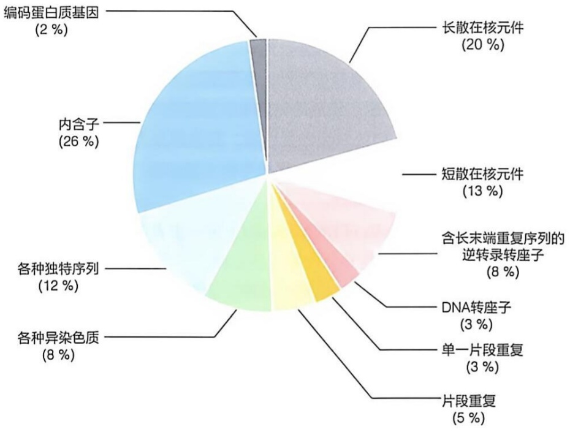

pie

| Category | Percentage |
| --- | --- |
| 编码蛋白质基因 | 2% |
| 长散在核元件 | 20% |
| 短散在核元件 | 13% |
| 含长末端重复序列的逆转录转座子 | 8% |
| DNA转座子 | 3% |
| 单一片段重复 | 3% |
| 片段重复 | 5% |
| 各种异染色质 | 8% |
| 各种独特序列 | 12% |
| 内含子 | 26% |

图9-1 人类基因组中不同组成成分的差异比较

---

358

9 基因、染色质与表观遗传

环境变化的生物体可以通过对非编码区的改变，调整基因表达水平。此外，重复序列和转座子也为基因组变异提供了来源，影响基因组结构和功能的多样性。

1953 年，克里克和沃森提出了 DNA 双螺旋结构模型，解释了遗传信息的复制机制，为遗传学和基因组学奠定了分子基础。1961 年，克里克和悉尼·布伦纳（Sydney Brenner，1927—2019）提出了分子生物学的“中心法则”，揭示了编码基因的本质，即基因组中部分序列可以翻译成蛋白质。1977 年，理查德·罗伯茨（Richard J. Roberts）和菲利普·夏普（Phillip Sharp）分别独立发现了基因上的内含子—外显子结构，为编码基因复杂性的研究开启了新篇章。他们提出 mRNA 的前体 pre-mRNA 通过“剪接”过程，切除内含子，形成成熟的 mRNA 指导蛋白质合成。

1960年代，科学家们发现了一些不能转录为蛋白质的RNA分子（如rRNA和tRNA）。尤其是弗朗索瓦·雅各布（François Jacob，1920—2013）和雅克·莫诺（Jacques Monod，1910—1976）提出的“操纵子模型”，首次揭示了非编码基因在表达调控中的作用，为非编码基因概念的提出奠定了基础。1993年，维克托·安布罗斯（Victor Ambros）和加里·鲁夫昆（Gary Ruvkun）等在秀丽隐杆线虫中首次发现了微RNA（miRNA），揭示了小RNA在基因表达调控中的功能。近年来，长链非编码RNA（lncRNA）的功能逐渐被揭示，显示它们在细胞分化、发育及疾病中的作用，进一步加深了我们对非编码基因的理解。

1948 年，麦克林托克在玉米中发现了一类能够在基因组中移动的基因片段，并称其为 “控制因子”，后被命名为转座子（transposon）。然而，这一发现最初未引起广泛关注。麦克林托克的研究为基因组动态性的探索奠定了基础，她因此获得了 1983 年诺贝尔生理学或医学奖。到 1990 年代，科学家发现转座子广泛存在于哺乳动物基因组中，其比例在不同物种间差异显著，在植物基因组中数量尤为庞大。转座子不仅是基因组的重要组成部分，还能促进基因组的进化多样性。转座子的插入可能导致基因功能的丧失或创新，这在哺乳动物和植物基因组的进化过程中起到了重要作用。

原核生物与真核生物的基因组在大小、结构和功能上存在显著差异。原核生物基因组通常较小，基因密度高；而真核生物的基因组则较大，具有更多非编码区及复杂的调控机制。2001年，人类基因组计划的完成是基因组学领域的里程碑事件。研究表明，人类基因组中仅约1.5%的区域编码蛋白质，其余部分为非编码区域，这揭示了基因组非编码区域的复杂性。此后，多种真核生物（如植物、动物）的基因组相继完成测序，揭示了基因组结构的多样性。

ENCODE 项目（encyclopedia of DNA element）进一步表明，人类基因组的非编码区域包含大量功能性元件，这些元件在基因表达调控中发挥重要作用（图 9-1）。在原核生物中，基因表达调控主要集中在转录水平；而在真核生物中，调控机制更加复杂，依赖于染色质的组成和结构。过去 30 年来，表观遗传学（如 DNA 甲基化和组蛋白修饰）逐渐成为研究热点。表观遗传修饰不仅能够影响基因表达，还可以遗传给后代细胞，成为调控研究的重要方向之一。

---

9.2 真核生物的基因组以染色质形式存在

359

## 9.2 真核生物的基因组以染色质形式存在

在真核生物中，遗传信息 DNA 并非以裸露形式存在，而是以染色质（chromatin）的形式储存于细胞核中。一切与 DNA 相关的生命活动都在染色质这一结构平台上进行。染色质为真核生物的基因转录、DNA 复制和重组等基本生命活动提供了必需的信息整合平台。

染色质的概念最早由华尔瑟·弗勒明（Walther Flemming，1843—1905）于1879年提出，用以描述细胞核内能够被碱性染料染色的物质。根据染色质的形态特点，着色较浅且呈伸展状态的区域被称为常染色质（euchromatin），而着色较深且呈凝缩状态的区域被称为异染色质（heterochromatin）（图9-2A）。基于电镜观察结果（图9-2B），奥林斯夫妇（Donald Olins与Ada Olins）及皮埃尔·尚邦（Pierre Chambon）等提出了染色质结构的串珠模型。而罗杰·科恩伯格（Roger Kornberg）在1974年发现，染色质的基本结构单元是形状类似于扁珠的核小体（nucleosome）。核小体由一段DNA缠绕四种特定序列的组蛋白（histone）组成的八聚体（octamer）构成（图9-3A）。

染色质的组织结构可以划分为多个层次:由 DNA 链缠绕在核小体上形成 “串珠状” 结构，直径约 11 nm。两核小体之间由长 10～90 bp 的 DNA 连接；在连接组蛋白（linker histone）H1 或 H5 的作用下，“串珠状” 结构进一步压缩为直径约 30 nm 的染色质纤维；染色质纤维进一步螺旋化和蜷缩，形成直径约 400 nm 的超螺线体；超螺线体再进一步折叠，最终形成染色体（chromosome，图 9-3B）。通过多层次的有序压缩，线性长度达 2 m 的基因组 DNA 被折叠压缩约 8 400 倍，储存于微米级别的细胞核中。

染色质作为真核细胞遗传信息的载体，不仅储存 DNA，还充当调控基因转录的重要平台。核小体中的 DNA 和组蛋白可以接收和传递各种信号信息，包括 DNA 修饰和组蛋白上的多种翻译后修饰，这些信号被整合并输出特定指令，通过动态调控染色质结构影响基因转录。当染色质高度凝聚形成异染色质时，基因转录被沉默；而当染色质局部解聚并转换为常染色质时，各种转录调控因子及转录机器能够接近染色质并启

(A)

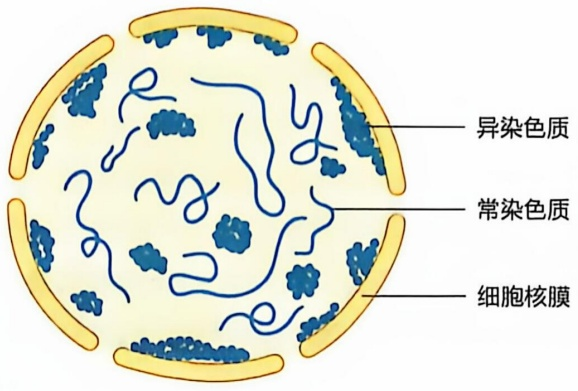

text_image

异染色质
常染色质
细胞核膜

(B)

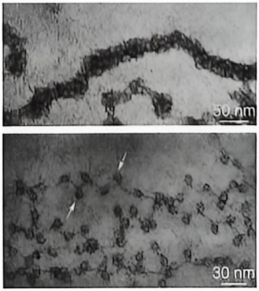

图 9-2 细胞核内染色质的不同存在形式

(A) DNA 染料染色后显示细胞核内不同的染色质形态。
(B) 高分辨率电镜下观察到由一串核小体相连组成的染色质形态图。上图为异染色质，下图为常染色质。(B) 引自 OLINS D E, et al. Nat Rew Mol Biol, 2003, 4: 809-814.

---

360

9 基因、染色质与表观遗传

图9-3 以核小体为基本结构单元组成的不同层次的染色质结构

（A）核小体是147 bp的DNA缠绕在四种核心组蛋白形成的八聚体上而组成的最基本结构单元。（B）不同层次的染色质结构示意图

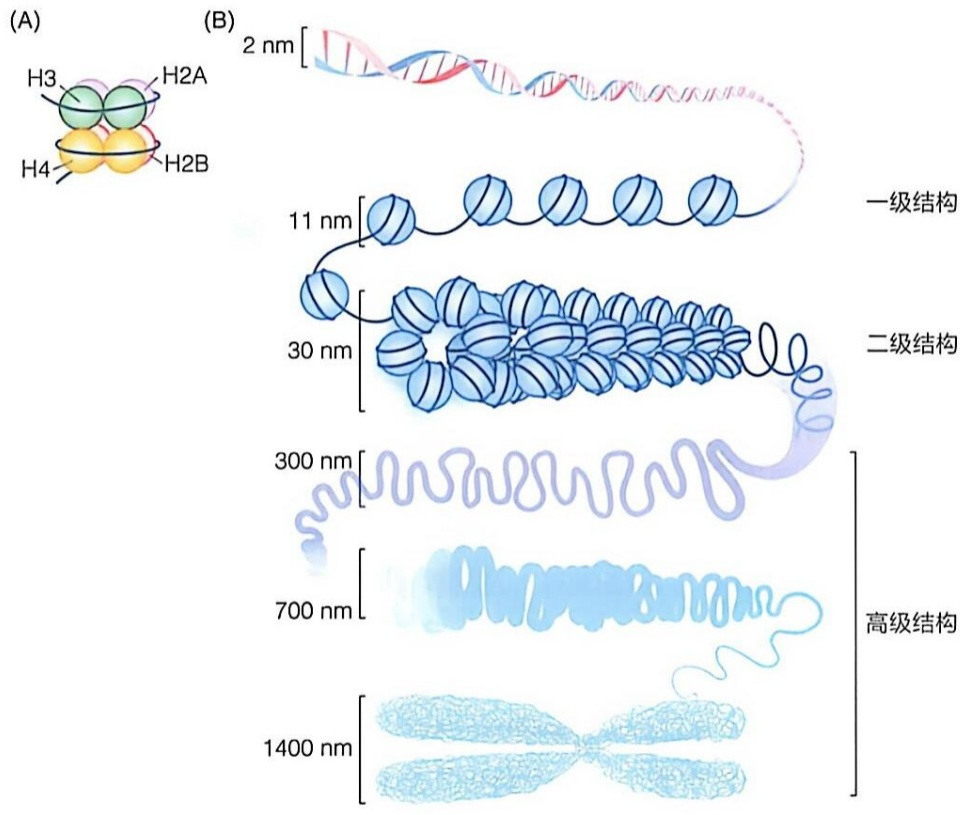

text_image

(A)
H3
H2A
H4
H2B
(B)
2 nm
11 nm
1
二级结构
30 nm
300 nm
700 nm
高级结构
1400 nm

动基因转录，促进特定基因的表达。

## 9.2.1 核小体是由组蛋白八聚体和缠绕在上面的 DNA 组成的扁珠状结构

核小体作为染色质基本组成结构单元的确立可以追溯到 1974 年。当时，科恩伯格和奥林斯夫妇通过实验和清晰的电镜照片分别得出了相同的结论。1997 年，卡洛琳·鲁格尔（Karoline Luger）和蒂莫西·里士满（Timothy Richmond）首次解析了体外重组且成分均一的单个核小体晶体结构（分辨率为 2.8Å），揭示了核小体形成的分子基础（图 9-4A）。完整的单个核小体（即染色质小体，chromatosome）主要由三部分组成:核小体核心颗粒（nucleosome core particle，NCP）、连接 DNA 和连接组蛋白 H1 或 H5。核小体核心颗粒由 147 bp 的 DNA 以左手负超螺旋方式缠绕组蛋白八聚体约 1.65 圈形成，呈现直径约 11 nm、高约 5.5 nm 的扁珠状颗粒结构。

在真核生物中，组蛋白八聚体由四种核心组蛋白（H2A、H2B、H3和H4）组成，这些组蛋白的分子质量为11～15 kDa，序列高度保守。四种组蛋白的结构相似，包括由三个 $\alpha$ 螺旋组成的稳定组蛋白折叠结构域（histone fold domain）。该结构域主要负责组蛋白的二聚化，分别形成H2A-H2B和H3-H4两种异源二聚体。H3-H4异源二聚体通过H3与H3间“头碰头”的方式进一步形成更为稳定的H3-H4异源四聚体结构。随后，H3-H4异源四聚体通过H4与H2B之间的相互作用，与两对H2A-H2B二聚体共同构建了组蛋白八聚体（图9-4B）。此外，在组蛋白折叠结构域以外，四种组

---

9.2 真核生物的基因组以染色质形式存在

361

(A)

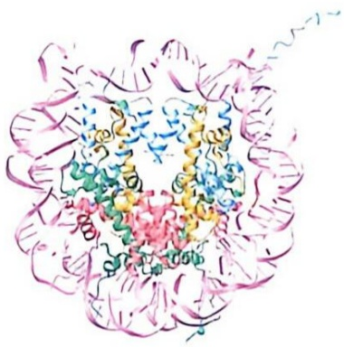

natural_image

Molecular docking visualization showing protein binding site with colored active sites (no text or labels)

(B)

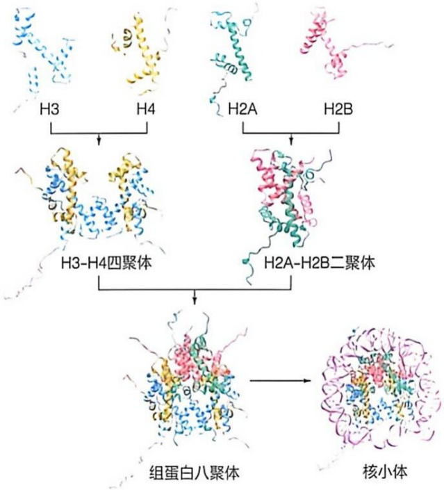

flowchart

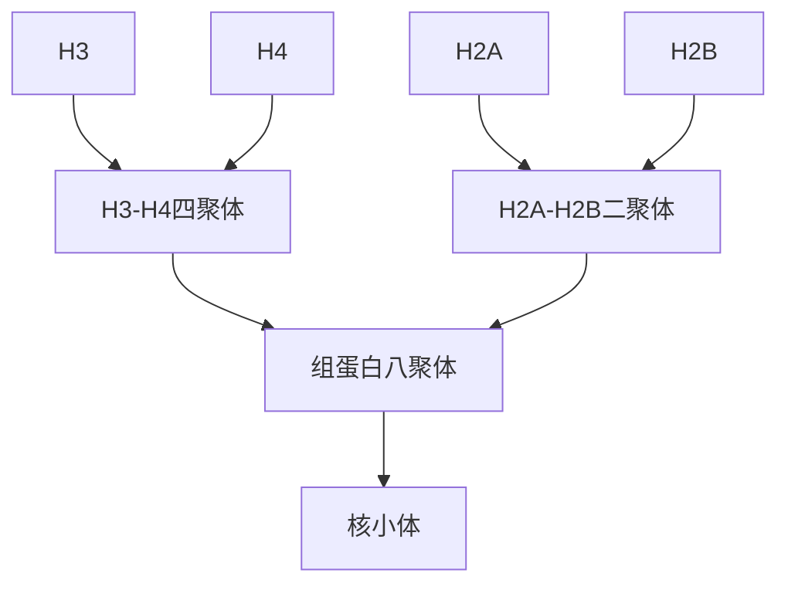

图 9-4 核小体的基本结构组成

（A）重组单核小体的整体结构图。（B）组蛋白逐步组装成核小体的示意图（PBD 编号:1AOI）

蛋白的氨基酸肽段以“尾巴”形式延伸至核小体外部，这些“尾巴”和组蛋白翻译后修饰在核小体的组装与解离过程中发挥重要作用。

连接组蛋白主要为 H1 家族的成员。与进化过程中高度保守的核心组蛋白不同，H1 家族的序列可变性较大，例如在鸟类红细胞中，H1 被组蛋白 H5 所替代。连接组蛋白通常由三部分组成:短的 N 端结构域、长的 C 端结构域以及中间相对保守的球

形结构域（图9-5）。连接组蛋白H1/H5结合在靠近核小体核心进出口处的连接DNA区域（约 $10\mathrm{bp}$ ），从而稳定核小体结构，并促进核小体的折叠及染色质高级结构的形成。

为什么与基因组 DNA 结合并组装成核小体的是组蛋白，而不是其他蛋白质呢？这与组蛋白的氨基酸组成密切相关。所有组蛋白都富含带正电荷的精氨酸和赖氨酸等碱性氨基酸，可以通过电荷相互作用与带负电荷的 DNA 紧密结合，从而实现基因组 DNA 的包装与压缩。当紧密折叠的染色质需要被打开以进行基因转录或 DNA 复制时，组蛋白上的赖氨酸和精氨酸残基侧链的氨基基团会发生多种翻译后修饰，包括甲基化、乙酰化和泛素化等。这些修饰或者改变组蛋白的局部电荷性，或者作为分子标签被“阅读器”蛋白识别，从而招募不同的调控蛋白，动态调控染色质的结构和功能。

(A)

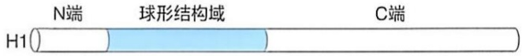

text_image

N端
球形结构域
C端
H1

(B)

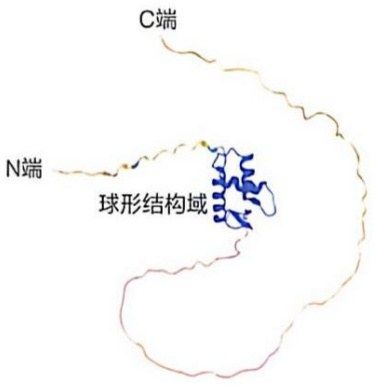

text_image

C端
N端
球形结构域

图9-5 组蛋白H1的结构示意图

(A) H1 蛋白的线性结构。(B) AlphaFold3 预测的三维结构。蓝色代表预测准确度高的球形区域，黄色代表预测准确度较低的柔性区域

---

362

9 基因、染色质与表观遗传

(A) 螺线管结构

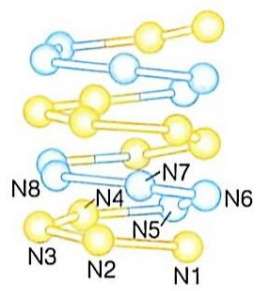

chemical

Molecular structure diagram showing labeled nitrogen atoms (N1–N8) in blue and yellow spheres connected by bonds

(C) "Z"字结构

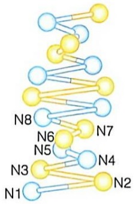

chemical

Molecular structure diagram showing a DNA double helix with labeled nitrogen atoms (N1–N8)

(B)

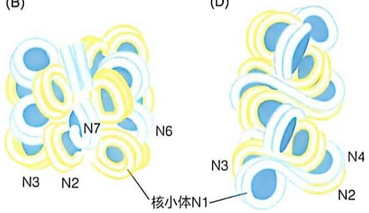

(D)

图 9-6 两种 30-nm 染色质的结构模型图

(A)、(B): 螺旋管结构模型。(C)、(D): “Z” 字结构模型。
N1 代表第 1 个核小体，以此类推

## 9.2.2 通过“Z”字结构和30纳米染色质纤维形成了染色质高级结构

在生理条件下，核小体“串珠”状结构在连接组蛋白H1/H5的帮助下，通过核小体之间的相互作用进一步压缩，形成更加致密的染色质结构——30纳米（30-nm）染色质纤维。早期，科学家从细胞核中分离并纯化天然状态下的染色质纤维，结合生物化学和生物物理技术的研究，提出了两种具有代表性的30-nm染色质纤维结构模型:螺线管（solenoid）结构和“Z”字（Zig-Zag）结构（图9-6）。螺线管模型认为，每6\~7个核小体单元组成一圈，相邻的核小体连续排列，连接DNA呈弯曲状态，相邻核小体在空间上紧密相邻，整体呈现螺旋缠绕的上升形式。而在“Z”字模型中，相邻的核小体以“Z”字形螺旋排列，连接DNA呈拉直状态，导致空间上非相邻的核小体相互靠近。需要指出的是，尽管分离得到的染色质接近天然状态，但复杂生理条件下细胞内染色质的高度异质性仍然阻碍了染色质纤维精细结构的确定。

近年来，越来越多的实验支持“Z”字模型。2005年，里士满等利用电镜和X射线晶体学方法观察并构建了不含连接组蛋白H1的30-nm染色质纤维结构模型，支持“Z”字结构的假说。2014年，李国红和朱平合作解析了体外组装的包含12个核小体和连接组蛋白H1的30-nm染色质纤维冷冻电镜结构，分辨率为11Å（图9-7）。冷冻电镜显示，30-nm染色质纤维以“四核小体”（tetranucleosome）为结构单元，依赖于组蛋白H1形成左手双螺旋结构。相邻核小体之间的连接DNA呈拉直状态，这一结果与“Z”字模型的特征一致。实验还发现，核小体DNA长度不同（如177bp和187bp）并不影响染色质纤维的整体结构，但会改变其直径。该团队进一步解析了包含12个核小体和连接组蛋白H5的冷冻电镜结构（图9-8A，分辨率为3.6Å），揭示了连接组蛋白H5与核小体结合的分子基础（图9-8B）。结果显示，连接组蛋白H5以1:1的比例非对称地结合在核小体上，这种非对称定位使得四核小体单元内部的H5-H5之间没有相互接触，而结构单元之间的H5-H5通过相互作用形成固定角度的扭转，进而构成左手超螺旋结构（图9-8）。

30-nm 染色质纤维长期以来被认为是染色质进一步折叠为高级结构的基础。然而，与体外重构染色质纤维相比，细胞核内的天然染色质纤维存在固有的局部差异性，例如核小体重复长度、组蛋白的化学修饰与变体替换以及 DNA 的甲基化修饰等。这些差异可能赋予天然染色质更加多样化且动态的三维结构。由于活细胞高分辨率染色质成像技术的限制，细胞内是否存在规则的 30-nm 染色质纤维二级结构仍存有争议。然

---

9.2 真核生物的基因组以染色质形式存在

363

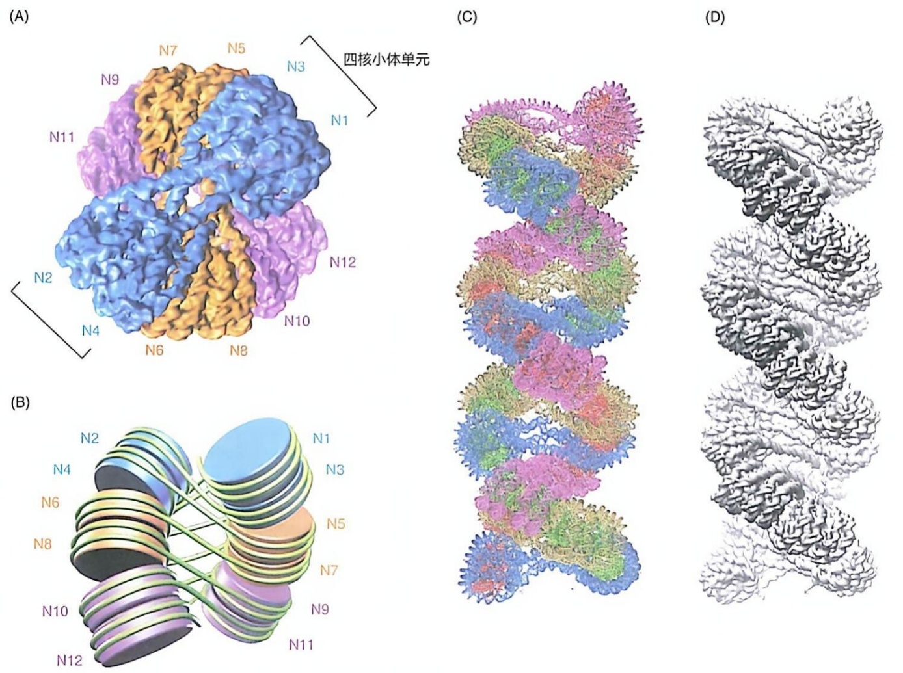

图 9-7 30-nm 染色质纤维的冷冻电镜左手双螺旋结构模型

$12 \times 187$ bp 染色质纤维冷冻电镜结构（A）和模型（B）； $48 \times 187$ bp 染色质纤维的假原子模型（C）和电子密度图（D）

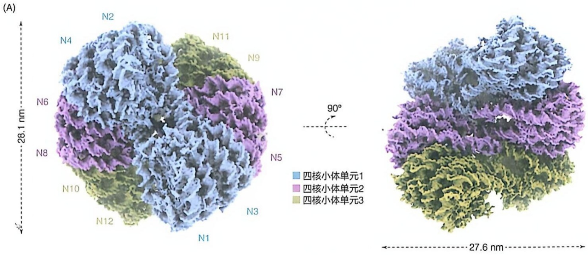

text_image

(A)
28.1 nm
N2
N4
N6
N8
N10
N12
N1
N3
N5
N7
N9
N11
90°
27.6 nm
四核小体单元1
四核小体单元2
四核小体单元3

---

364

9 基因、染色质与表观遗传

(B)

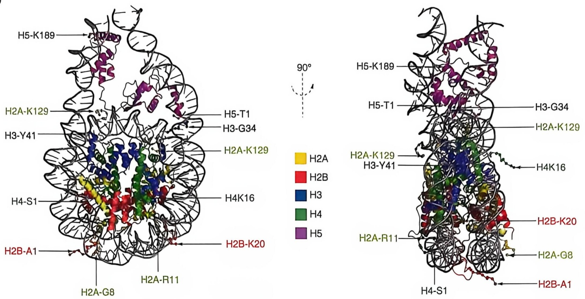

图 9-8 30-nm 染色质纤维内的各种相互作用

(A) 高分辨率的 H5- 染色质纤维的冷冻电镜结构 (3.6 Å)。(B) H5- 染色质小体结构。参与相互作用的氨基酸残基在图中标出

而，大量体内外实验结果表明，细胞核内的天然染色质纤维与体外重构染色质具有类似的结构特征。未来成像技术的突破将是解开体内染色质纤维结构奥秘的关键所在。

## 9.3 DNA 甲基化修饰是承载表观遗传信息的重要方式之一

DNA 甲基化是一种关键的表观遗传修饰，通过直接阻碍转录因子与 DNA 的结合，抑或通过招募其他蛋白质促使染色质形成紧密结构抑制基因转录。作为一种稳定存在的表观遗传修饰，DNA 甲基化在细胞分化、哺乳动物胚胎发育及维持基因组稳定性等过程中发挥重要作用。本节重点阐述经典与新型 DNA 甲基化修饰的生化特征及其生物学功能。

## 9.3.1 5mC 是最经典和最主要的 DNA 甲基化修饰形式

DNA 甲基化是由一系列 DNA 甲基转移酶（DNA methyltransferase，DNMT）催化完成的过程（图 9-9A）。在此过程中，S-腺苷甲硫氨酸（S-adenosyl methionine，SAM）作为甲基供体，其包含的甲基基团可被转移到 DNA 的碱基上。真核生物基因组 DNA 上广泛存在 C$^{5}$-甲基化（5-甲基胞嘧啶，5mC，胞嘧啶 C 的第五位碳原子上发生甲

---

9.3 DNA 甲基化修饰是承载表观遗传信息的重要方式之一

365

基化），是最为重要的甲基化修饰。目前已知的其他 DNA 甲基化类型包括腺嘌呤 A 的 N$^{6}$-甲基化（N$^{6}$-甲基腺嘌呤，6mA）和胞嘧啶 C 的 N$^{4}$-甲基化（4-甲基胞嘧啶，4mC）。表观遗传学研究中提到的 DNA 甲基化通常特指 5mC。本节主要介绍 5mC。

5mC 于 1925 年首次在结核杆菌中发现，并于 1948 年在小牛胸腺 DNA 中得到证实，随后被发现广泛存在于动物、植物和真菌中。5mC 修饰在基因组 DNA 链上的分布具有偏好性，在动物细胞中，DNA 甲基化主要发生在胞嘧啶-鸟嘌呤（CpG）二核苷酸的 C 位，其中 p 代表 C 和 G 之间的磷酸基团（图 9-9B）。而在植物细胞中，CG 甲基化占主导，但 CHG 和 CHH 甲基化也较为常见（H 表示除 G 外的任意碱基）。真菌细胞中，CG 甲基化与 CHH 甲基化的比例大致相等。

在哺乳动物细胞中，70%\~80%的CpG位点被甲基化，且其分布有特定的规律。总体而言，基因组中的重复序列区域通常被高度甲基化，尤其是异染色质区域内的重复序列，如卫星DNA、长散在核元件（LINE）、短散在核元件（SINE）以及包含长末端重复序列的逆转录转座子（LTR-RT）。此外，基因编码区内（即外显子）的

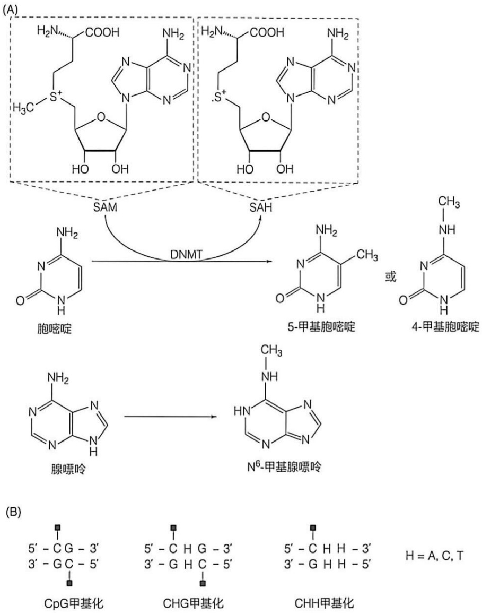

图 9-9 DNA 甲基化修饰示意图

（A）不同碱基在DNMT的作用下，将一分子甲基基团共价转移到相应位置上的反应。（B）DNA上三种甲基化类型

---

366

9 基因、染色质与表观遗传

## 知识延展9-1

## CpG 岛排斥 DNA 甲基化的可能原因

尽管大多数 CpG 位点会发生 DNA 甲基化，但位于基因启动子和 5' 端非翻译区的 CpG 岛却不受整体 DNA 甲基化的影响。可能的解释包括:①一些富集在 CpG 岛上的结合因子（如转录因子和 RNA 聚合酶等）会排斥 DNA 甲基转移酶的结合；②存在 DNA 去甲基化酶，可以主动去除 CpG 岛区的 DNA 甲基化。特别是在胚胎发育早期，DNA 会经历两次大规模的去甲基化过程。去甲基化后的 CpG 岛由于需要快速响应基因转录，因此保持非甲基化状态；③有研究表明，CpG 岛是 DNA 复制的源头，因此该区域具有较高的 DNA 代谢活动，这种高活性可能会排斥 DNMT 招募。需要注意的是，在癌细胞中，许多正常情况下非甲基化的 CpG 岛发生了甲基化，表明维持 CpG 岛的非甲基化状态对正常细胞活动至关重要。

甲基化也很常见，尤其是外显子中的 CpG 位点，甲基化程度通常较高。有趣的是，CpG 岛区域中的 CpG 位点多数处于非甲基化状态（知识延展 9-1）。CpG 岛一般长 300～3 000 bp，主要位于基因的启动子和 5' 端非翻译区。这表明 DNA 甲基化不仅受

序列的影响，还与其在基因组中的位置密切相关。

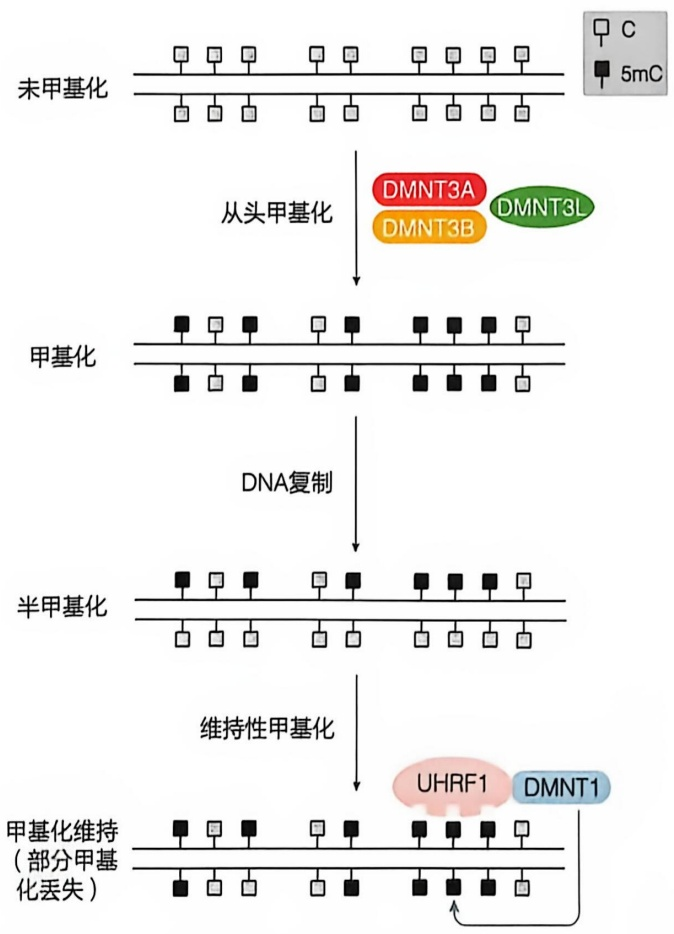

flowchart

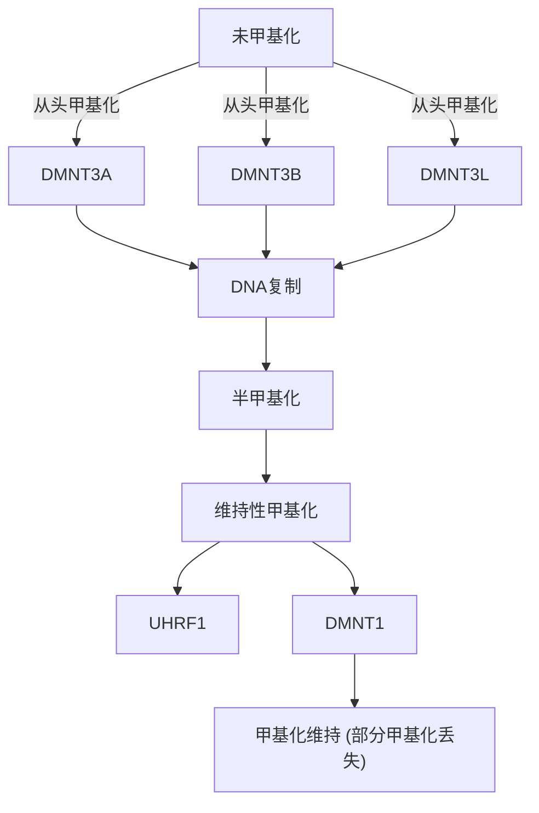

图9-10 DNA的从头甲基化和维持性甲基化黑色方格代表甲基化的碱基，灰色方格代表未甲基化的碱基

DNA 甲基化的建立至少需要两种酶活性:一种是从头甲基化，即催化非甲基化的 CpG 位点从头建立甲基化模式；另一种是维持性甲基化，即在细胞分裂过程中将亲本链上的甲基化模式复制到新生链上（图 9-10）。这两种模式在哺乳动物胚胎发育中缺一不可。

## (1) 细胞基因组 DNA 上甲基化以半保留复制的方式得以维持

基于 DNA 双链上对应的 CpG 二核苷酸的自我互补性，1975 年两个实验小组分别提出，甲基化模式可能通过半保留方式在细胞分裂时得以维持。这一假说认为，在 DNA 复制过程中，某种 DNA 甲基转移酶能够利用甲基化的亲本 CpG 模板，对新生链上的对应 CpG 位点进行甲基化修饰，而非甲基化的 CpG 则无法成为新生链的甲基化模板。该假说为 DNA 甲基化模式在细胞分裂时稳定遗传提供了理论支持。1983 年，具有维持性甲基化功能的 DNA 甲基转移酶 1（DNMT1）的发现证实了这一观点。DNMT1 对半甲基化（DNA hemimethylation，即双链中一条链的 CpG 发生甲基化，而与其互补的另一条链的 CpG 未发生甲基化）CpG 位点的活性远远高于对非甲基化 CpG 位点的活性，这符合维

---

9.3 DNA 甲基化修饰是承载表观遗传信息的重要方式之一

367

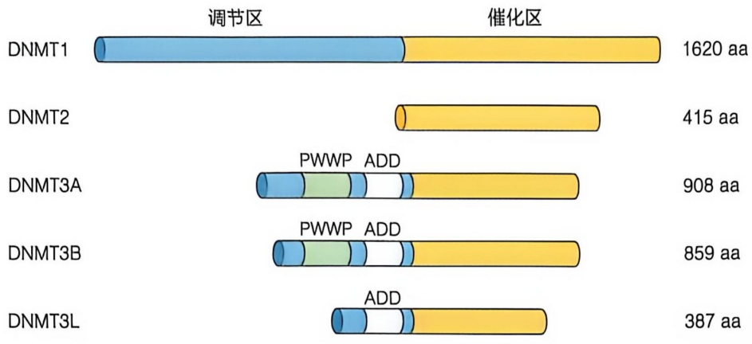

bar

| Protein | Target Region | Length (aa) |
| :--- | :--- | :--- |
| DNMT1 | 调节区 | 1620 |
| DNMT2 | 催化区 | 415 |
| DNMT3A | 调节区 | 908 |
| DNMT3B | 调节区 | 859 |
| DNMT3L | 催化区 | 387 |

图 9-11 DNA 甲基转移酶家族蛋白的比较图

特性 DNA 甲基转移酶的性质。DNMT1 在增殖细胞中广泛表达，特别是在 S 期 DNA 复制时，DNMT1 可被调节因子 UHRF1(ubiquitin-like with PHD and RING finger domains 1) 招募到复制区域，通过 DNA 复制偶联的方式促进新生链上的甲基化。UHRF1 蛋白中含有能够识别 DNA 半甲基化修饰和组蛋白修饰的结构域，因此它能帮助 DNMT1 在染色质特定区域（如异染色质区）正确定位。朱冰等发现，在卵细胞中，DNMT1 也具备从头甲基化（de novo methylation）的酶活性，该功能受到 STELLA 蛋白的抑制。因此，在细胞分裂时，DNMT1 通过半保留方式维持 DNA 甲基化模式，是细胞记忆并传承该模式的关键机制。

## (2) 早期胚胎中的 DNA 甲基化依赖特定甲基转移酶进行从头合成

原核细胞中的 DNA 甲基转移酶包含相同的结构域，因此研究人员通过蛋白质数据库搜寻真核生物中与 DNMT1 具有相似序列特征的成员，发现了其他潜在的 DNA 甲基转移酶，包括 DNMT2、DNMT3A、DNMT3B 以及 DNMT3L（图 9-11）。DNMT2 尽管保留了 C 端的催化序列，但它似乎不具备 DNA 甲基转移酶活性。与 DNMT1 类似，DNMT3A 和 DNMT3B 也包含 N 端调节区和 C 端催化区。N 端调节区包含 PWWP 结构域和 ADD 结构域，可以作为组蛋白修饰的“阅读器”识别特定的组蛋白修饰，发挥调节作用（见 9.5.2 节）。更为重要的是，这两种甲基转移酶通过其 C 端催化结构域修饰非甲基化的 CpG 位点，从头建立 DNA 甲基化模式，因此被称为从头合成 DNA 甲基转移酶（de novo DNMT）。DNA 从头甲基化对胚胎发育至关重要。敲除早期胚胎中高表达的 Dnmt3a 和 Dnmt3b 基因将导致小鼠胚胎致死。此外，虽然 DNMT3L 因缺失某些关键催化序列而失去酶活性，但它仍能作为辅助因子与 DNMT3A 或 DNMT3B 形成复合体，促进 DNMT3A 或 DNMT3B 的催化功能。缺乏 DNMT3L 的卵细胞甲基化水平显著降低，包括印记基因（imprinted gene）区域，表明其对从头合成 DNA 甲基化至关重要。

## 9.3.2 DNA 甲基化修饰抑制基因表达

在高等生物中，DNA 甲基化的最主要功能是调控基因表达。多方面实验证据表明，基因启动子区的 DNA 甲基化与转录抑制密切相关。例如:人为构建的 DNA 甲基化腺病毒报告基因在注入蛙卵母细胞核后表达受到抑制；DNA 载体转染小鼠

---

368

9 基因、染色质与表观遗传

胚胎干细胞后发生了甲基化，其表达也被抑制。相反，核苷类似物5-氮杂胞苷（5-azacytidine）可以代替胞嘧啶整合到DNA上，但因其不可逆地竞争性结合DNMT $_{6}$ 经其处理的细胞能够恢复病毒基因组和失活X染色体上的基因表达。此外，利用向导RNA（guide RNA）介导的dCas9-DNMT3A融合蛋白靶向技术，可使特定基因启动子区发生甲基化而抑制基因表达，进一步证实了基因启动子甲基化与转录抑制之间的因果关系。

DNA 甲基化主要通过两种机制抑制转录（图 9-12）:一种是直接干扰转录因子与启动子（或其他顺式调控序列）的结合；另一种是通过 5mC 结合蛋白招募转录阻遏物间接发挥作用。从结构上看，5mC 上的甲基基团位于 DNA 双螺旋的大沟内，因此不会影响 DNA 的碱基配对。但由于甲基基团具有疏水性，并可能改变局部 DNA 结构和染色质构象，DNA 甲基化可能会影响蛋白质与 DNA 之间的结合。许多转录因子识别富含 CG 的 DNA 序列，而 CpG 甲基化可抑制它们识别 DNA（图 9-12A）。另一种抑制模式是甲基化吸引偏好结合 5mC 的结合蛋白（methyl cytosine-binding protein, MBP）招募转录阻遏物（图 9-12B）。MBP 既含有识别 5mC 的 MBD 结构域（methyl-CpG-binding domain），也含有介导蛋白质之间相互作用的其他结构域。这些结构域可以招募其他蛋白复合物，通过改变染色质的紧密程度或重塑染色质结构，从而抑制基因转录。

但是当甲基化发生于绝缘子区域时，导致的结果是激活转录。一个非常典型的例子是锌指蛋白 CTCF（CCCTC-binding factor）对 Igf2 印记基因的表达调控。CTCF 可与未甲基化的绝缘子（insulator）结合，从而抑制母源 Igf2 基因的转录；而父源 Igf2 基因上的绝缘子区域发生 DNA 甲基化，CTCF 无法结合该区域，导致下游增强子（enhancer）可以激活父源基因的转录。

第一个被克隆和纯化的MBD蛋白是MeCP2（methyl-CpG-binding protein 2），它对甲基化CpG位点两侧富含AT的DNA序列具有高度亲和力。同时，其C端的转录抑制结构域（transcription repression domain，TRD）可以招募如mSin3a的共抑制复合物（corepressor complex），该复合物中的组蛋白去乙酰化酶能够去除组蛋白乙酰化，使染色质浓缩，抑制基因转录。此外，其他MBD家族蛋白如MBD1、MBD2和MBD4也被证明具有识别和结合甲基化CpG的能力。其中，MBD2可与染色质重塑复合物Mi-2/NuRD结合，抑制转录。MeCP2基因突变会导致一种严重的神经系统疾病——雷特综合征（Rett syndrome），其表现包括运动技能受损、呼吸异常和头小畸形等症状。

需要指出的是，DNA甲基化也常见于基因体（gene body）内，即转录起始位点

图9-12 DNA甲基化抑制基因转录的两种可能机制

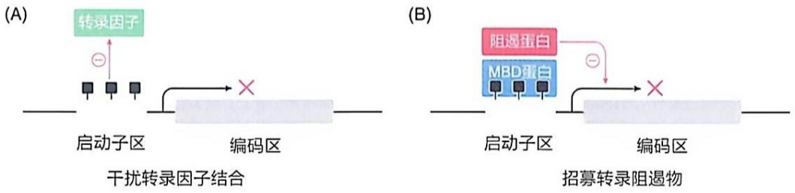

---

9.3 DNA 甲基化修饰是承载表观遗传信息的重要方式之一

369

与终止位点之间。与启动子上甲基化的效应相反，基因体内的甲基化通常与基因表达呈正相关，但具体原因和功能尚不明确。有研究表明，在小鼠胚胎干细胞中，基因体甲基化主要由DNMT3B催化。DNMT3B含有的PWWP结构域可与基因体内高度富集的组蛋白H3K36me3结合（见9.5.1节），从而将DNMT3B招募到转录活跃的基因上。在敲除Dnmt3b基因的小鼠胚胎干细胞中，RNA聚合酶Ⅱ与基因体的结合显著增加，导致基因体内多个不同位点起始转录。因此，基因体内的甲基化可能有助于防止RNA聚合酶Ⅱ异常定位于基因体内，从而避免异常转录本（cryptic transcript）的产生。

## 9.3.3 DNA 去甲基化酶可以将 DNA 上的 5mC 转变为其他甲基化形式

DNA 甲基化和去甲基化是生物体内一种重要的动态平衡过程。哺乳动物在受精后以及配子形成过程中会经历大规模的 DNA 去甲基化，这两次事件在胚胎发育和细胞命运决定中发挥了关键作用。DNA 去甲基化过程可分为被动去甲基化（passive DNA demethylation）和主动去甲基化（active DNA demethylation）。被动去甲基化是指由于 DNMT1 或 UHRF1 功能缺失，原本甲基化的位点在 DNA 复制过程中逐渐被胞嘧啶 C 取代，从而实现 DNA 的去甲基化，这一过程依赖于 DNA 复制的逐步稀释。而主动去甲基化是指在去甲基化酶催化下，5mC 逐步转变为胞嘧啶 C 的过程，该过程不依赖 DNA 复制。小鼠受精后，雄原核中 5mC 丰度快速下降，这提示哺乳动物体内可能存在主动去甲基化的机制，因为此时几乎没有发生 DNA 复制。

从分子水平理解 DNA 去甲基化机制，得到了 DNA 氧化酶研究的启发。早期研究发现，布氏锥虫中的 JBP 蛋白可以通过氧化反应将胸腺嘧啶 T 氧化为 5-羟甲基尿嘧啶（5hmU）。JBP 蛋白属于依赖 Fe(Ⅱ) 和 2-酮戊二酸（α-KG）的双加氧酶（dioxygenase）家族。在粗糙链孢菌中，JBP 家族蛋白还可进一步将 5hmU 氧化为 5-醛基尿嘧啶（5fU）和 5-羧基尿嘧啶（5caU）。5caU 上的羧基可以通过脱羧酶直接切除，从而实现 DNA 链上的 T 转变为 U。由于胞嘧啶 C 和胸腺嘧啶 T 在化学结构上比较相似，这种通过连续氧化反应实现碱基转换的方式，为研究 5mC 去甲基化提供了重要线索。

2009 年，安雅娜·拉奥（Anjana Rao）等基于对 JBP 蛋白功能的理解，利用同源序列比对，发现了哺乳动物中存在三个同源家族蛋白（ten-eleven translocation，TET），分别为 TET1、TET2 和 TET3 蛋白（图 9-13）。这些蛋白能够将 5mC 氧化为 5-羟甲基胞嘧啶（5hmC）。TET 家族蛋白也是 Fe(II) 和 α-KG 依赖的双加氧酶，广泛存在于动物、真菌和藻类中。2011 年，徐国良和张毅团队同时发现 TET1-3 蛋白不仅能够将 5mC 氧化为 5hmC，还可以进一步将其氧化为 5-醛基胞嘧啶（5fC）和 5-羧基胞嘧啶（5caC）。后两种产物可以被胸腺嘧啶 DNA 糖基化酶（thymine-DNA glycosylase，TDG）识别并切割，最终通过碱基切除修复（base-excision repair，BER）途径转变为胞嘧啶 C。这一过程无须依赖 DNA 复制即可实现 5mC 向 C 的转换（图 9-14）。TET 催化的 5mC 氧化产生 5hmC、5fC 和 5caC 三种新型 DNA 修饰形式，其本质是逐步氧化的过程。

---

370

9 基因、染色质与表观遗传

(A)

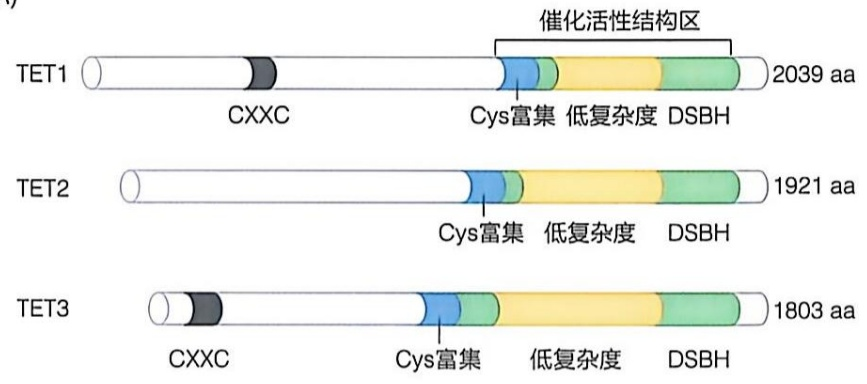

text_image

催化活性结构区
TET1 2039 aa
CXXC Cys富集 低复杂度 DSBH
TET2 1921 aa
Cys富集 低复杂度 DSBH
TET3 1803 aa
CXXC Cys富集 低复杂度 DSBH

(B)

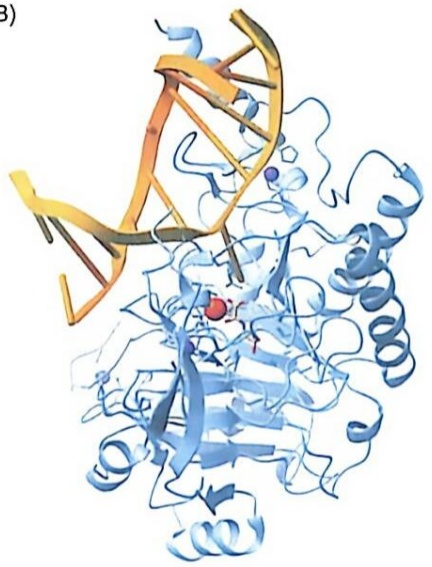

natural_image

3D protein structure visualization with alpha helices and beta sheets (no text or labels)

图 9-13 TET 蛋白家族结构

(A) TET 蛋白家族成员线性结构; (B) TET2 催化活性结构区三维结构示意图 (PDB 编号: 4NM6)。黄色代表 DNA 片段, 紫色代表 $Zn^{2+}$, 红色代表 $Fe^{2+}$, 红黄色代表 2-酮戊二酸

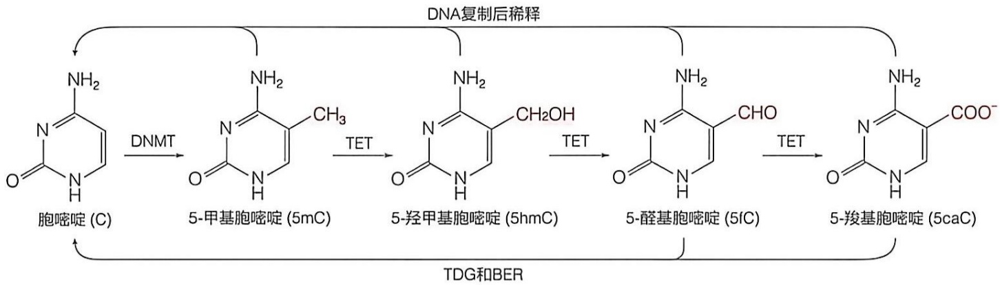

flowchart

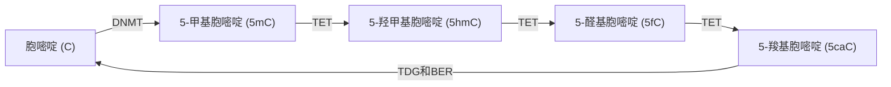

图 9-14 DNA 去甲基化修饰的化学反应通路

能够催化 5mC 的 TET1-3 蛋白依赖于位于 C 端的 Cys 富集区和 DSBH（double-stranded β-helix）结构域进行氧化反应。DSBH 结构域与 Fe(II) 及 α-KG 结合，并以氧分子为底物氧化 α-KG，形成 Fe(IV)-O 中间态。该中间态能够逐步氧化 5mC，实现 5mC → 5hmC → 5fC → 5caC 的转变，并释放副产物琥珀酸和 CO₂。

5hmC、5fC 和 5caC 能够稳定存在于生物体内，暗示其除作为 DNA 去甲基化的中间产物外，可能具有潜在的生物学功能。在成年小鼠中，5hmC 在中枢神经系统中的含量较高，例如在浦肯野（Purkinje）神经细胞中，5hmC 可占 5mC 的 40%。在人类基因组中，5hmC 占 5mC 的 1%\~5%，在肾和心脏等器官中水平中等，为中枢神经系统的 25%\~50%；在脾和胸腺等器官中含量较低，仅为中枢神经系统的 5%\~15%。相比之下，5fC 和 5caC 的丰度比 5hmC 低几个数量级，可能的原因是 TDG 切除 5fC 和 5caC 的效率较高，或 TET 氧化 5hmC 生成 5fC/5caC 的效率较低。在小鼠中，每  $10^{6}$  个 C 约含 20 个 5fC 和 3 个 5caC。在小鼠胚胎干细胞中敲除 TDG 会导致 5fC 水平升高 5.6

---

9.3 DNA 甲基化修饰是承载表观遗传信息的重要方式之一

371

倍，这证实了 TDG 能够有效切除 5fC。这些新型 DNA 甲基化修饰的生物学功能仍需进一步深入研究。

## 9.3.4 DNA 甲基化具有多种重要的生物学功能

除了调节基因表达和影响胚胎发育，DNA 甲基化还在基因组印记（genomic imprinting）、X 染色体失活（X chromosome inactivation）以及维持基因组稳定性等方面发挥关键作用。异常的 DNA 甲基化水平和分布模式与癌症等多种人类疾病密切相关（知识延展 9-2）。以下仅简要介绍其生物学功能。

## (1) 基因组印记基因上的 DNA 甲基化调控对应基因的选择性表达

哺乳动物基因组中存在一类印记基因。与同时表达等位基因的情况不同，这类基因仅表达一个等位基因，并严格根据亲代来源表达父本或母本的一方（图9-15）。印记基因的数量较少，但其功能至关重要，参与胚胎发育、胎盘形成、胎儿和产后生长，以及成年动物的行为调控。印记基因表达异常可能导致生殖障碍（如不育症、葡萄胎）及一些先天性疾病。在癌细胞中，常观察到印记缺失（loss of imprinting），即印记基因双等位表达或双等位沉默的现象。超过80%的印记基因成簇存在于基因组上，每个基因簇通常由一个印记控制区（imprinting control region）调控。该控制区的DNA甲基化仅存在于父源或母源DNA一方，从而决定了单等位基因的选择性表达。

## 知识延展 9-2

## DNA 甲基化与人类疾病及应用

DNA 甲基化异常与多种人类遗传疾病及癌症密切相关。5mC 是单碱基突变的热点，因其可自发脱氨基形成胸腺嘧啶（T）。T 是 DNA 中的天然碱基，因此不会被细胞修复系统有效识别和修复，导致 C-T 转换被遗传至后代细胞，从而引发遗传性疾病。此外，编码 DNA 甲基转移酶的基因突变与多种遗传疾病密切相关，包括遗传性感觉和自主神经病变伴痴呆及耳聋（Hereditary Sensory and Autonomic Neuropathy Type IE, HSAN IE）、Tatton-Brown-Rahman 综合征（过度生长疾病）、ICF 综合征（免疫缺陷）及雷特综合征等。

DNMT3A 和 TET2 基因突变常见于急性骨髓性白血病及其他血液肿瘤。癌细胞的 DNA 甲基化水平与模式明显不同于正常细胞，通常表现为全基因组范围的低甲基化以及局部 CpG 岛的异常高甲基化，这些变化可能导致基因组不稳定和染色体非整倍性。监测 DNA 甲基化水平变化可用于癌症等疾病的诊断及治疗。全基因组甲基化分析有助于发现特异性和敏感性的 DNA 甲基化癌症检测标志物。目前，已有两种 DNA 甲基化抑制剂 5-aza-cytidine（临床药名 Vldaza）和 5-azadeoxycytidine（临床药名 Dacogen），被美国食品药品监督管理局批准用于治疗骨髓增生异常综合征（myelodysplastic syndrome, MDS）。未来开发直接抑制 DNMT 或其他调控因子的药物具有广泛的临床治疗前景。

---

372

9 基因、染色质与表观遗传

图 9-15 父/母本中不同印记基因的等位基因表达差异

蓝色区代表母本和父本染色质中都表达的等位基因；绿色、黄色区分别代表只在父本或母本来源的一条染色质上表达的印记基因

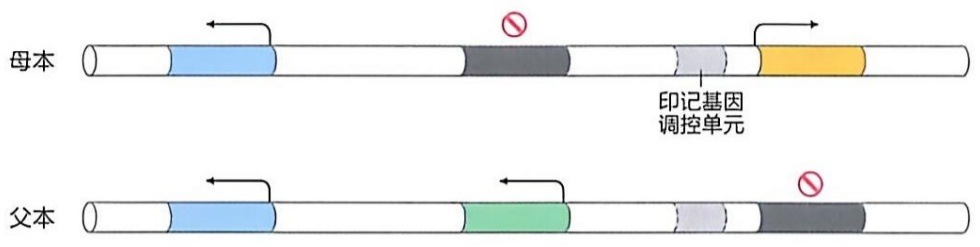

text_image

母本
印记基因
调控单元
父本

## (2) 一条 X 染色体上的高度 DNA 甲基化保障了基因表达沉默状态

X 染色体失活是指雌性动物两条 X 染色体中的一条失去活性，从而使 X 连锁基因的表达水平在雌雄个体之间保持平衡的现象。失活的 X 染色体（X-inactivation, Xi）上包含一个称为 X 染色体失活中心（X-inactivation center, Xic）的区域，该区域内可以转录生成一条 15～17 kb 的长链非编码 RNA，称为 Xist（X-inactive-specific transcript）。它通过包裹 Xi，导致整体染色体表达沉默。而在激活状态的 X 染色体（X-activation, Xa）上，Xist 基因 5' 端的 CpG 岛高度甲基化，从而抑制 Xist 表达。Xi 染色体上大多数基因启动子区域的高度甲基化进一步保证了其表达沉默状态。

## （3）逆转座子区域的DNA甲基化抑制转座元件的活性以维持基因组稳定性

人类和小鼠基因组中约 50% 的 DNA 来自进化过程中逆转录转座子的复制，其中部分逆转录转座子仍具有转座活性，对基因组稳定性构成潜在威胁。DNA 甲基化修饰通过抑制转座元件的活性来维持基因组稳定。在胚胎发育中，DNMT1 介导逆转录转座子的 DNA 甲基化，并将这一沉默状态维持到分化的体细胞中。此外，小鼠 Dnmt3a 或 Dnmt3l 的缺失会导致精子发育过程中逆转录转座子的转录显著增加，从而引起基因组不稳定和无精症。DNA 甲基化抑制剂对癌症的疗效与激活逆转录转座子有关，再次揭示了 DNA 甲基化在抑制转座元件中的作用。

## 9.4 组蛋白上的赖氨酸残基可以发生多种类型的酰基化修饰

作为核小体的重要组成成分，组蛋白不仅具有稳定核小体结构的作用，还能通过其八聚体上的多种翻译后修饰调控基因表达。这些修饰尤为集中在核小体核心折叠结构域之外的“尾巴”上。不同的修饰类型和修饰位点形成不同的组合，类似编码系统，其编辑与解读依赖“书写器（writer，添加修饰的酶）”“阅读器（reader，识别和结合修饰的大分子）”和“擦除器（eraser，去除修饰的酶）”的协同，共同调控染色质结构和基因表达。这是表观遗传修饰的核心组成，贯穿染色质调控机制的多个方面。组蛋白的化学修饰类型主要包括甲基化、乙酰化、泛素化、磷酸化及多种新型酰基化修饰（图9-16）。不同修饰的分布和功能各异，相互之间还可能产生交互作用，与基因表达调控、DNA损伤修复及基因组稳定性等过程密切相关。本节从生化本质出发，

---

9.4 组蛋白上的赖氨酸残基可以发生多种类型的酰基化修饰

373

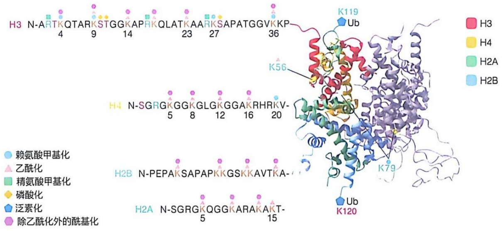

text_image

H3 N-ARTKQTARKSTGGKAPRKQLATKAARKSAPATGGVKKP
4 9 14 23 27 36
K119 Ub
H4 K56
N-SGRGKGGKGLGKGGAKRHRKV-
5 8 12 16 20
H2B N-PEPAKSAPAPKKGSKKAVTKA-
5
H2A N-SGRGKQGGKARAKAKT-
15
H3 H4 H2A H2B
赖氨酸甲基化 乙酰化 精氨酸甲基化 磷酸化 泛素化 除乙酰化外的酰基化
K79 Ub K120

图9-16 组蛋白“尾巴”上的各种化学修饰

探讨组蛋白酰基化修饰的机制及其主要功能。

## 9.4.1 组蛋白上不同的酰基化修饰具有相似的生化特征

组蛋白酰基化修饰是组蛋白上最广泛分布的翻译后修饰类型。它是指在组蛋白乙酰转移酶（histone acetyltransferase，HAT）的催化下，以酰基辅酶（acyl-CoA）作为辅因子，在组蛋白赖氨酸残基侧链 $\varepsilon-$ 氨基氮原子上共价连接一个酰基基团（acyl group）的过程。赖氨酸侧链上的正电荷在修饰后失去一个质子，导致电荷和侧链大小同时改变（图9-17A）。组蛋白的酰基化修饰是可逆的，在去乙酰化酶（deacetylase，HDAC）的催化下，酰基基团可以从赖氨酸侧链上移除，从而恢复为未修饰的状态。

乙酰化修饰（acetylation，ac）是最早发现的酰基化修饰类型。早在1964年，文森特·阿尔弗雷（Vincent Allfrey，1921—2002）等首次报道了组蛋白的乙酰化修饰，并大胆推测这一修饰可能通过动态且可逆的方式激活或抑制RNA合成，从而调控基因表达。然而，由于当时缺乏高效的实验技术，科学家未能验证出该修饰的功能。直到查尔斯·戴维·阿利斯（Charles David Allis，1951—2023）和斯图亚特·施莱伯（Stuart L. Schreiber）先后鉴定到四膜虫中的组蛋白乙酰转移酶和哺乳动物细胞中的去乙酰化酶，并证实了组蛋白乙酰化在基因转录调控中的重要作用。阿利斯等以四膜虫中转录活跃的巨细胞核（macronucleus）作为实验材料，并设计了一种胶内反应（in-gel assay）的实验方法，纯化得到了分子量为55 kDa、与酵母Gcn5蛋白同源的乙酰转移酶p55蛋白（知识延展9-3）。施莱伯等通过添加去乙酰化酶抑制剂——曲美毒素（Trapoxin），结合亲和层析技术，从牛胸腺组织中纯化出一个分子质量大约为61 kDa，与酵母Rpd3p同源的组蛋白去乙酰化酶HDAC1（histone deacetylase 1）。这两项开创性的研究为表观遗传领域的蓬勃发展奠定了基础。

组蛋白上含有多个赖氨酸残基，乙酰化主要发生在组蛋白 H3 的 9、14、18、23、

不同颜色代表组成核小体的不同组蛋白。图左侧为不同组蛋白N端“尾巴”上的氨基酸序列，右侧为核心组蛋白构成的核小体球状结构区。图中数字代表氨基酸的位置，不同形状代表不同的化学修饰

---

374

9 基因、染色质与表观遗传

## 知识延展 9- 3

# 冷库里的男孩与乙酰转移酶的发现

1988年，迈克尔·格伦斯坦（Michael Grunstein，1946—2024）及其同事在Cell杂志上发表了一篇论文，报道在酵母细胞中缺失组蛋白H4的N端4\~28位高度保守的氨基酸残基并不会对酵母生长造成明显影响。由于这一段序列包含大量乙酰化修饰位点，这项研究似乎对阿利斯长期以来倾注心血的“组蛋白乙酰化修饰调控基因转录”的假说提出了挑战。阿利斯希望通过发现HAT来证明组蛋白乙酰化修饰的重要性，但上面论文的结果似乎推翻了他的假说。甚至长期作为他坚强后盾的美国贝勒医学院的同事们也开始对他的学术前景产生质疑。就在这个时候，吉姆·布朗内尔（Jim Brownell），一位被阿利斯称为他实验室里“最具天赋”的研究生加入了他的课题小组。布朗内尔主动请缨，要求承担“寻找组蛋白乙酰转移酶”这一艰巨的任务。阿利斯被这位年轻人的勇气深深感染，师生两人决定协同合作，继续挖掘组蛋白乙酰转移酶的秘密。

利用四膜虫的独特细胞结构——包含一个巨细胞核（macronucleus，转录激活区）和一个微细胞核(micronucleus，转录抑制区）——吉姆开始了艰苦的实验。他每天戴着厚厚的针织帽、穿着实验服，在长期4℃恒温的冷库中使用不同类型的层析柱反复纯化蛋白样品。经过四年的不懈努力，吉姆从200升巨细胞核抽提物中成功提纯出含有HAT活性的蛋白提取液。随后，他们设计了一种创新的实验方法，称为“active in-gel assay”。这一方法将组蛋白与聚丙烯酰胺胶均匀混合后加入SDS-PAGE中，再将具有HAT活性的蛋白提取液上样于电泳板中进行电泳。电泳完成后，胶经过多步处理后与含有 $^{3}$ H同位素标记的SAM辅因子共孵育，再进行放射自显影检测。最终，他们在X射线胶片上惊喜地观察到一个分子质量约为55 kDa的蛋白质条带。经过一系列蛋白质序列分析，他们最终确认该蛋白与酵母转录激活因子Gcn5p高度同源，从而首次建立了乙酰化修饰与基因转录激活之间的联系。这一重大研究成果于1996年3月22日发表在Cell杂志上，而“巧合”的是，这一天正好是阿利斯45岁的生日。

27、56位，以及H4的5、8、12、16位的赖氨酸残基上。不同位点上的乙酰基团可以被不同的HAT添加，也可以被不同的HDAC去除，取决于修饰酶与底物之间的相互识别和契合程度。总体而言，HAT可以乙酰化四种核心组蛋白，但不同的酶具有不同的底物特异性。几乎没有一种酶专门作用于单一位点，这表明HAT的特异性是有限的。尽管HAT在结构上差异显著，但它们均包含一个保守的HAT催化结构域和不同的调节结构域。催化结构域通过识别辅因子乙酰-CoA（acetyl-CoA），将乙酰基团转移到不同的底物上。而不同的调节结构域可通过识别不同的底物分子而赋予一定的底物选择性。此外，HAT还可以通过与其他调节亚基形成复合物来实现对核小体底物的乙酰化。例如，乙酰转移酶Gcn5本身只能乙酰化游离组蛋白，但与Ada2和Ada3形成SAGA异源三聚体后，能够催化天然形式核小体中的H3和H2B的乙酰化；而由12个亚基组成的NuA4复合物则倾向于乙酰化核小体中的组蛋白H4和H2A。相对应地，去乙酰化酶的种类较多，且均包含一个去乙酰化结构域。一部分去乙酰化酶需要$\mathrm{Zn^{2+}}$作为辅因子发挥活性；而另一部分去乙酰化酶属于Sirtuin家族蛋白，依赖于辅因

---

9.4 组蛋白上的赖氨酸残基可以发生多种类型的酰基化修饰

375

(A)

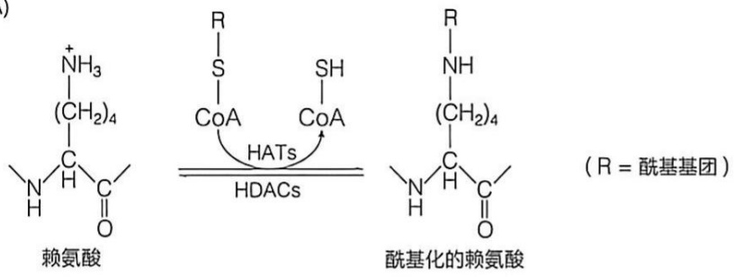

chemical

Reaction mechanism showing cleavage of amine to form a glycosylated amine, with R group as catalyst

图9-17 组蛋白的酰基化修饰

(A) 酰基化修饰的化学反应式。(B) 可被添加到赖氨酸上的酰基基团及其性质分类

(B)

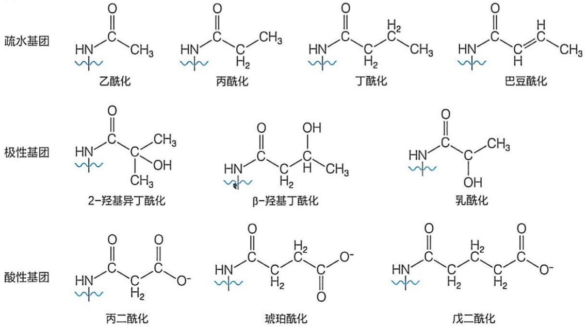

chemical

五种不同基团（疏水、极性、酸性）的化学结构式，包括乙酰化、丙酰化、丁酰化、巴豆酰化、2-羟基异丁酰化、β-羟基丁酰化、乳酰化、丙二酰化、琥珀酰化和戊二酰化

子烟酰胺腺嘌呤二核苷酸（nicotinamide adenine dinucleotide，NAD $^{+}$ ）发挥作用。这些酶通过将赖氨酸上的乙酰基团转移到 NAD $^{+}$ 上，生成 O-乙酰-ADP-核糖和烟酰胺，而后者作为负反馈抑制剂抑制乙酰转移酶的活性。

除乙酰化修饰外，与乙酰基团结构相似的酰基基团也可以被添加到赖氨酸上。由于这些修饰的含量较低，直到21世纪初，随着质谱技术的进步，科学家们才逐渐鉴定出多种新型组蛋白酰基化修饰，包括丙酰化（propionylation）、丁酰化（butyrylation）、2-羟基异丁酰化（2-hydroxyisobutyrylation）、β-羟基丁酰化（β-hydroxybutyrylation）、琥珀酰化（succinylation）、丙二酰化（malonylation）、戊二酰化（glutarylation）、巴豆酰化（crotonylation）及乳酰化（lactylation）等（图9-17B）。这些新型酰基化修饰在结构、功能和调节机制上与传统的乙酰化修饰既密切相关又有所不同，但其生化机制非常相似。这些修饰的生成和去除同样依赖于酰基转移酶和去酰基化酶的催化作用。尽管目前尚未发现专一作用于新型酰化修饰的酰基转移酶，但许多已知的乙酰转移酶和去乙酰化酶可以催化这些新型修饰的发生。

与乙酰化类似，新型酰基化修饰具有一定的底物选择性。通常情况下，底物的化

---

376

9 基因、染色质与表观遗传

图9-18 活性酶的催化口袋大小决定了其催化某种酰基化反应的能力（A）Gcn5的活性口袋仅能容纳乙酰-CoA（PDB编号:1Z4R），很难容纳更大的其他酰基基团，包括巴豆酰-CoA（PDB编号:5H86）。(B) p300的活性口袋较大，可以容纳多种酰基-CoA（PDB编号:5LKT）

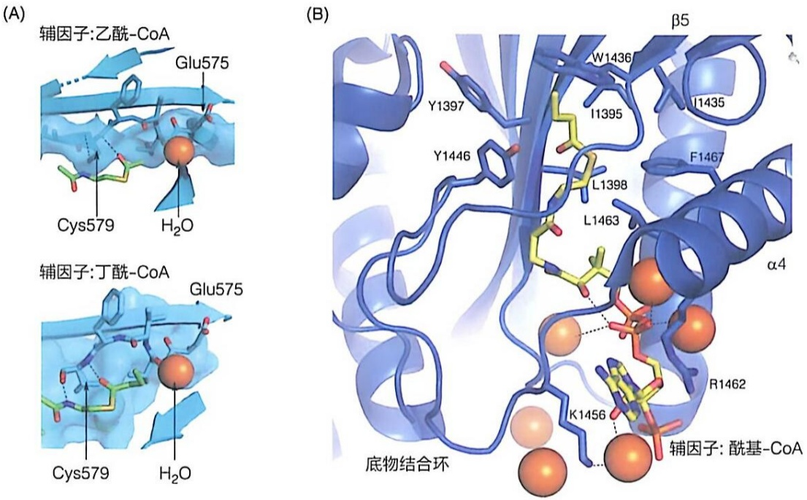

学链越长，酶的催化效率越低。这种差异由酶和底物的空间结构决定。例如，Gcn5的活性位点区域空间较小，无法容纳巴豆酰-CoA较大的刚性结构，因此不能催化巴豆酰化修饰（图9-18A）；而p300在其活性位点形成了一个较深的“脂肪酸口袋”，可以容纳更大的酰基基团，因此能够催化多种酰基化反应（图9-18B）。由此可见，酰基-CoA的体积越大，进入活性口袋的难度越大，其相应的催化速率也越低。由于酰基化反应中酶对酰基-CoA的识别特异性不高，发生何种类型的酰基化修饰主要取决于酰基-CoA的局部浓度。在多细胞真核生物中，乙酰-CoA主要来自柠檬酸代谢，而柠檬酸又来自葡萄糖代谢。因此，在高葡萄糖浓度条件下，细胞内乙酰-CoA充足（见第18章），其他酰基-CoA的水平相对较低，从而抑制了其他酰基化修饰的发生。反之，在低葡萄糖浓度或存在充足短链脂肪酸的情况下，非乙酰化的酰基-CoA水平增加，导致其他酰基化修饰的增强。例如，在低血糖或肝糖原含量较低的条件下，肝的脂肪酸在线粒体中通过氧化生成酮体提供能量（见第22章）。在酮体合成过程中，肝和肾中β-羟基丁酸大量积累，最终导致组蛋白β-羟基丁酰化修饰水平的增加。因此，组蛋白酰基化修饰会随细胞内代谢状态的改变而动态变化。

## 9.4.2 组蛋白酰基化改变染色质结构，进而激活基因转录

不同修饰基团的共价偶联能够改变蛋白质的理化性质和局部结构，这是翻译后修饰发挥生物学功能的化学基础。根据酰基化修饰基团的化学结构和性质，可以将酰基化修饰分为三类:疏水性修饰、极性修饰和酸性修饰（图9-17B）。

第一类疏水性修饰包括乙酰化、丙酰化、丁酰化和巴豆酰化。这些基团具有不同长度的疏水性碳氢链。第二类极性修饰包括2-羟基异丁酰化和 $\beta-$ 羟基丁酰化，它们

---

9.4 组蛋白上的赖氨酸残基可以发生多种类型的酰基化修饰

377

的修饰链上都含有一个羟基基团，能够与其他分子形成氢键。第三类酸性修饰包括丙二酰化、琥珀酰化和戊二酰化，其共同特点是含有酸性羧基基团，这使得赖氨酸残基由正电荷转变为负电荷，类似于磷酸化引起的电荷变化。

组蛋白酰基化修饰通过改变染色质结构发挥功能。酰基化修饰可以中和赖氨酸残基侧链的正电荷，从而减弱组蛋白与带负电荷的 DNA 链之间的亲和性。这种作用减弱了 DNA 与其围绕的组蛋白八聚体之间的亲和力，也可减弱核小体之间的相互作用（一个核小体上组蛋白的 N 端尾巴可以结合另外一个相互作用核小体的 DNA 或组蛋白的酸性区），导致染色质更为松散，有助于参与转录调控的各种蛋白因子结合到 DNA 的特异序列上，进而激活转录。

## 9.4.3 组蛋白酰基化修饰通过蛋白质“阅读器”行使功能

组蛋白酰基化修饰不仅通过改变组蛋白与 DNA 的相互作用来调控基因转录，还能直接招募识别酰基化修饰的蛋白质 “阅读器”，调控基因表达。目前发现三种结构域能够识别酰基化修饰。

## (1) BRD 结构域

人体内已发现 61 种布罗莫结构域（bromodomain，BRD），存在于 46 种蛋白质中。BRD 由约 110 个氨基酸组成，进化上高度保守。BRD 可识别组蛋白赖氨酸乙酰化、丙酰化或丁酰化基团（图 9-19A），但尚未发现其能识别巴豆酰化或酸性酰基化修饰基团。BRD 存在于多种表观遗传调控蛋白中，包括转录激活因子、组蛋白乙酰化转移酶和染色质重塑蛋白。BRD 蛋白不仅单独存在，还常与其他蛋白质结构域（如 PHD）相连。上述识别机制有助于染色质重塑因子和转录因子等蛋白富集于特定基因转录位点，调控基因表达。多种人类疾病与含有 BRD 的蛋白质表达或功能异常相关。例如，BRD2 在 B 细胞淋巴瘤中过表达；BRD3/BRD4 的编码区与 NUT 基因染色体易位形成 BRD-NUT 融合基因，导致癌症发生。含 BRD 的 BET 蛋白家族在抗炎和抗肿瘤方面具有潜在价值，已成为表观遗传领域的重要靶标，受到制药公司和科研机构的高度关注。

## (2) DPF 结构域

DPF 结构域（double PHD finger domain）首先在染色质重塑相关蛋白 Dpf3 和乙酰转移酶 KAT6A/6B 中被发现（图 9-19B）。Dpf3 优先结合 H3K14ac，而 KAT6A/6B 的 DPF 可结合 H3K9ac 或 H4K14ac，这些蛋白被招募至染色质上。相比于乙酰化修饰，

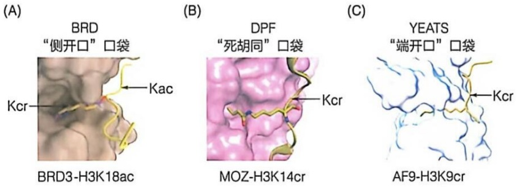

图9-19 三种可识别不同酰基化修饰的蛋白结构域
(A) \~ (C) PDB 编号分别为 5HJC、5B76 和 5HJB

---

378

9 基因、染色质与表观遗传

DPF 结构域对长链酰基化修饰具有更强的结合能力，特别是对巴豆酰化修饰的结合强度是乙酰化的 4～8 倍。

## (3) YEATS 结构域

与BRD不同，YEATS结构域更倾向于识别体积较大的丙酰化、丁酰化和巴豆酰化修饰。晶体结构显示，YEATS结构域的结合部位呈开放的口袋结构，能够容纳较大的酰基基团（图9-19C）。YEATS结构域对巴豆酰化的结合能力最强，比乙酰化高2\~4倍。这种强结合力源于巴豆酰化的刚性平面结构与YEATS中两个芳香族残基之间的紧密相互作用。YEATS结构域存在于多种蛋白质中，在巴豆酰化介导的表观遗传和转录调控中发挥重要作用。

由上可知，在三个主要的酰基化修饰“阅读器”蛋白家族中，有一个倾向于识别乙酰化修饰，而另外两个倾向于识别新型酰基化修饰，这与两类修饰在功能上的差异相吻合。总体上，酰基化修饰通过调控基因转录，在代谢、肿瘤和生殖发育等多种生理病理过程中发挥重要的作用。

## 9.5 组蛋白甲基化修饰是另一种承载表观遗传信息的重要方式

甲基化修饰是发生在组蛋白上的一种常见但功能复杂的化学修饰。这种修饰与DNA甲基化修饰一起被认为是最具承载表观遗传信息的表观修饰类型。与酰基化修饰可以改变局部核小体的电荷不同，组蛋白的各种甲基化修饰本身对核小体整体结构没有很大的影响，但可以作为表观遗传标签，被染色质“阅读器”蛋白或其他染色质蛋白识别并结合，从而调控核小体或染色质高级结构。组蛋白甲基化通过不同机制影响基因转录、染色质结构及基因组稳定性，广泛参与细胞生命活动中的各个重要生理或病理过程。

## 9.5.1 组蛋白甲基化主要发生在赖氨酸和精氨酸残基上，通过不同的修饰酶动态调控

甲基化修饰主要发生在赖氨酸和精氨酸残基上。1959年，理查德·安布勒（Richard P. Ambler，1933—2013）首次报道了鞭毛蛋白上的赖氨酸甲基化修饰。1964年，阿尔弗雷等首次报道了组蛋白上的甲基化修饰，并推测其可能在基因转录中发挥作用。此后几十年间，由于未能有效鉴定出组蛋白甲基转移酶，组蛋白甲基化修饰的生物学功能研究进展缓慢。直到1999年，CARM1蛋白（coactivator-associated arginine methyltransferase 1，后被命名为PRMT4，protein arginine methyltransferase 4）被报道可在体外甲基化组蛋白，并激活报告基因的转录。同年，阿利斯团队在四膜虫的巨细胞核抽提物中发现组蛋白H3第4位赖氨酸上可发生甲基化修饰。该修饰在酵母

---

9.5 组蛋白甲基化修饰是另一种承载表观遗传信息的重要方式

379

和人类细胞中高度保守，其活性与转录激活相关。虽然人们认识到组蛋白甲基化的重要性，但真正将组蛋白甲基化研究推向新高度的事件是第一个赖氨酸甲基转移酶SUV39H1以及高度保守的SET催化结构域的发现。SET命名来源于该结构域存在于果蝇遗传筛选中发现的三个基因编码的蛋白质，分别为Su(var)3-9、E(Z)和trithorax，因取其首字母而得名。2000年，托马斯·杰努温（Thomas Jenuwein）团队报道了SUV39H1能够催化组蛋白H3第9位赖氨酸的三甲基化（H3K9me3），并鉴定出SET结构域是组蛋白甲基化的催化结构域。通过氨基酸序列比对，科学家们迅速找到了数十种含有SET结构域的蛋白质或蛋白质复合物，并发现它们具有催化不同组蛋白上赖氨酸甲基化的能力，从而开启了组蛋白甲基化修饰的研究热潮。

与 DNA 甲基化修饰相似，组蛋白甲基化是以 SAM 为供体，在 “书写器” 甲基转移酶的作用下，将甲基基团添加至组蛋白赖氨酸侧链氨基或精氨酸侧链胍基氮原子上的过程。该过程中，S-腺苷甲硫氨酸将失去甲基基团，转变为 S-腺苷高半胱氨酸（S-adenosylhomocysteine）。氨基或胍基可作为质子受体，因此它们均可形成带有正电荷的分子。当发生甲基化反应时，与氮原子共价相连的氢可以被甲基基团取代。与 DNA 甲基化只能在一个位点上添加一个甲基基团不同，赖氨酸甲基化可以在单个侧链氨基（ $-NH_{3}^{+}$ ）位点上添加一个、两个或三个甲基基团，分别称为单甲基化（me1）、二甲基化（me2）和三甲基化（me3）修饰（图 9-20A）。由于空间位阻效应，一个精氨酸侧链胍基位点上最多只能添加两个甲基基团。同样，添加一个甲基称为单甲基化（Rme1）；而添加两个甲基时取决于它们的相对位置，连接在同一个氮原子上称为非对称二甲基化（Rme2a），分别连接在不同氮原子上称为对称二甲基化（Rme2s）

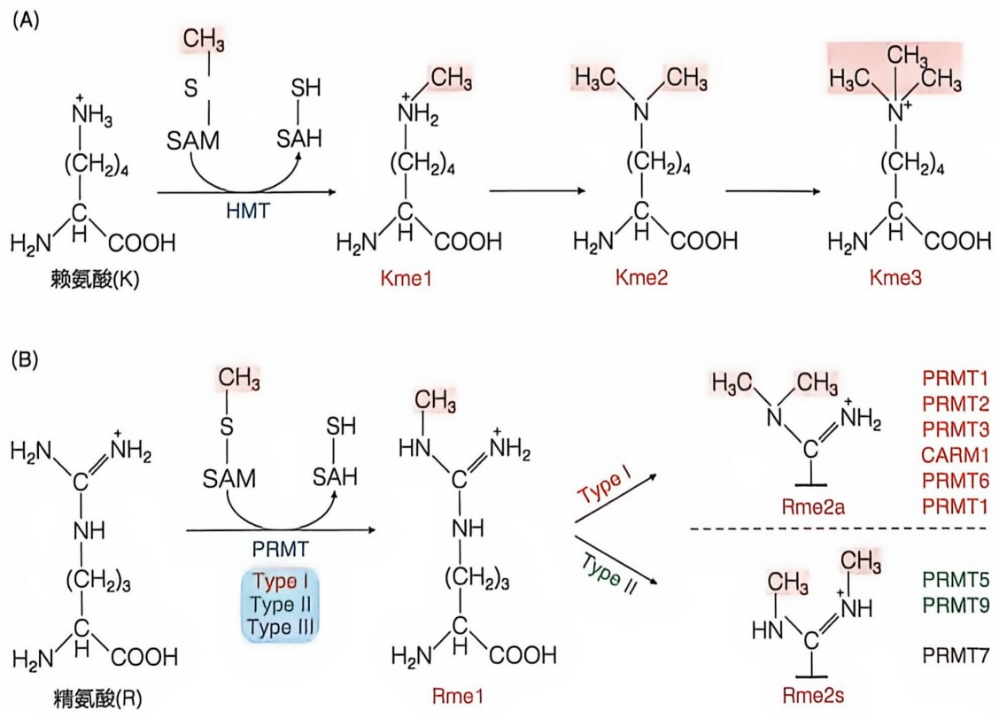

图9-20 组蛋白赖氨酸（A）和精氨酸（B）甲基化反应方程式精氨酸的甲基化修饰分别由三种不同类型甲基转移酶（用颜色区分）催化

---

380

9 基因、染色质与表观遗传

(A)

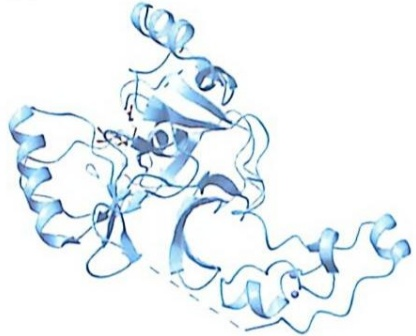

natural_image

3D ribbon diagram of a protein structure, showing alpha helices and beta sheets (no labels or text)

(B)

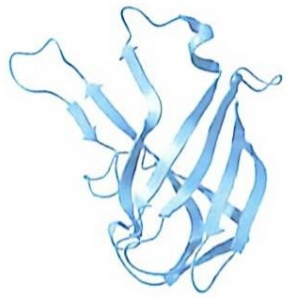

natural_image

3D ribbon diagram of a protein structure with alpha helices and beta sheets (no labels or text)

图 9-21 组蛋白甲基转移酶中的保守催化结构域

（A）以SETD2为代表的SET结构域示意图（PBD编号:5JLE）。

（B）以PRMT1为代表的由7个β折叠组成的催化结构域示意图（PDB编号:1ORH中216-353aa）

(图 9-20B)。

到目前为止，根据催化结构域的不同，赖氨酸甲基转移酶（lysine methyltransferase，KMT）主要分为两类:一类为占大多数的含SET结构域的酶，另一类是非SET结构域蛋白DOT1L（酵母中的同源蛋白为Dot1）。SET结构域一般含有130～140个氨基酸残基，在进化上高度保守（图9-21A）。目前在哺乳动物中发现了超过50个包含SET结构域的蛋白质，它们负责催化绝大多数组蛋白赖氨酸甲基化修饰，包括经典的组蛋白H3上第4位赖氨酸（简写为H3K4，后续写法类似）、H3K9、H3K27、H3K36及组蛋白H4第20位赖氨酸（H4K20）等位

点。甲基转移酶催化甲基化修饰具有位点特异性和修饰类型专一性。在单细胞真核生物酿酒酵母中，组蛋白上一个特定赖氨酸位点上所有三种甲基化修饰主要由一个特定的甲基转移酶负责催化；而在更高等的多细胞生物中，同一赖氨酸位点上的三种甲基化往往由不同的KMT催化。例如Set1是酵母中唯一催化H3K4甲基化的“书写器”，而在哺乳动物细胞中则发现了7个Set1同源蛋白，其中MLL3和MLL4负责催化单甲基化修饰（H3K4me1），而SET1A和SET1B主要负责催化三甲基化修饰（H3K4me3）。对于目前发现的负责催化H3K79三种甲基化的DOT1L而言，它是唯一已知的非SET赖氨酸甲基转移酶。从其结合SAM分子的结构基序上看，它更类似于精氨酸甲基转移酶（PRMT）。根据催化底物不同，PRMT可以分为，催化Rme1、Rme2a和Rme2s三种不同类型的修饰酶，但它们都含有一个由七个β-strand构成的催化结构域（图9-21B）。常见的组蛋白精氨酸甲基化修饰发生在组蛋白H3第2位精氨酸（简写为H3R2，后续写法类似）、H3R8、H3R17、H3R26、H2AR3及H4R3位点上。

组蛋白甲基化修饰反应同样具有可逆性。与DNA去甲基化酶的发现类似，组蛋白去甲基化酶的寻找持续了40多年的漫长历程。由于甲基化键能较高，所以早期很多学者认为蛋白酶介导的去甲基化反应难以达到足够的活化能而破坏N—C键。因此，在去甲基化酶被发现前，科学家们提出过多种去除甲基化的可能模式和机制。2004年，施扬团队在研究CtBP转录抑制复合体时意外发现了一个称为KIAA060的蛋白。虽然这个蛋白包含一个多胺氧化酶结构域，但他们发现它的底物并不是多胺，而是与多胺有着类似化学结构的甲基化赖氨酸，最终确认其底物是组蛋白H3K4me2，并将此酶命名为LSD1（lysine-specific demethylase1）。这首次证明了组蛋白甲基化修饰可以被蛋白酶催化去除，开创了组蛋白甲基化动态调控的新纪元。

胺基氧化酶 LSD1，依赖黄素腺嘌呤二核苷酸（FAD）和  $O_{2}$ ，通过氨氧反应去除组蛋白上的甲基化基团，并释放一分子甲醛（图 9-22A）。由于这个催化反应需要氮原子接受一个质子作为反应过渡态，因此 LSD1 及其同源物只能催化单甲基和二甲基修饰的底物，即 LSD1 只能去除 H3K4me2/me1。在某些特定条件下也可去除

---

9.5 组蛋白甲基化修饰是另一种承载表观遗传信息的重要方式

381

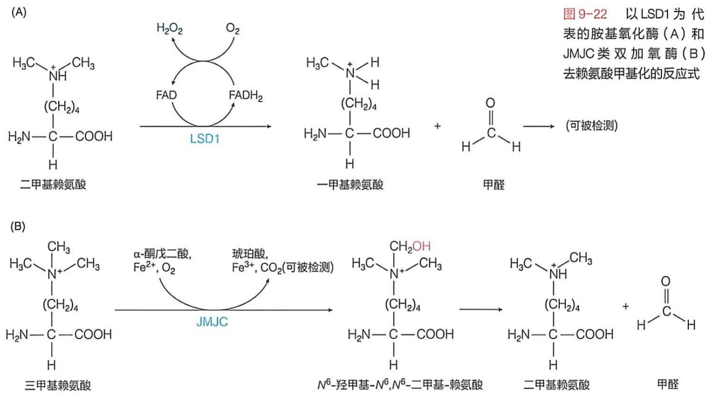

H3K9me2/me1 和 H4K20me2/me1 修饰。有趣的是，研究发现 LSD1 在脑组织中存在一类增加了 8 个氨基酸的变体形式（在编码多胺氧化酶结构域的第 8 和第 9 个外显子之间插入了 24 个碱基），导致该变体丢失了 H3K4me2 的去甲基化活性，但是当它与某些特定蛋白质因子结合时，却转变为 H3K9me2 的去甲基化酶。

研究人员同样希望利用搜寻保守催化结构域的方式发现更多的组蛋白赖氨酸去甲基化酶（lysine demethylase，KDM）。但上述催化机制决定了LSD1及其同源蛋白无法去除三甲基化修饰，并且各个物种中的同源基因数不超过3个（哺乳动物中只有LSD1和LSD2），这意味着还存在着其他类型的去甲基化酶。2005年，张毅团队通过传统的生物化学分离纯化方法，从哺乳动物细胞抽提物中发现一类含有JmjC（Jmj是日文“Jumonji十文字”的缩写形式，意思是“十字形”）结构域的双加氧氧化酶，它同样具有赖氨酸去甲基酶活性。与DNA去甲基化酶类似，这类蛋白酶的去甲基化也需要$\mathrm{Fe}^{2+}$及α-酮戊二酸的参与，但是其催化结构域的结构却大不相同（图9-22B）。他们首先发现了FBXL11（KDM2A）和FBXL10（KDM2B）可以去甲基化H3K36me2，随后又发现JMJD1A（KDM3A）和JMJD1B（KDM3B）可以去甲基化H3K9me2。更为重要的是，目前发现共有6大家族20多个蛋白质含有JmjC结构域。2006—2007年间，多个团队先后报道了JMJD2（KDM4）家族、JARID1（KDM5）家族和UTX（KDM6）家族蛋白质均具有去除赖氨酸三甲基化的活性，基本构建了组蛋白赖氨酸的去甲基化酶体系。到目前为止，除了H3K79me1/me2/me3及H4K20me3的去甲基化酶未被确定之外，其他主要的组蛋白赖氨酸甲基化修饰都有对应的去甲基化酶。值得注意的是，在JmjC结构域家族蛋白之后鉴定出来的DNA的5mC去甲基化酶TET1/2/3和RNA的

---

382

9 基因、染色质与表观遗传

## 知识延展9-4

## 组蛋白赖氨酸甲基转移酶和去甲基化酶的命名原则

组蛋白赖氨酸甲基修饰酶的最初名称是基于其最早发现时的传统命名，一般是基于其功能进行的命名，因此名称较为混杂，不利于学术界的交流。2007年，学术界根据以下基本原则对它们进行了重新命名:①赖氨酸甲基转移酶（lysine methyltransferase）以KMT开头；②赖氨酸去甲基化酶（lysine demethylase）以KDM开头；③根据发现酶活性的先后时间在各个亚家族间进行排序；④根据组蛋白底物位点进行排序。例如，H3K9甲基转移酶最早发现，因此被命名为KMT1；H3K4甲基转移酶在其后被发现，被命名为 KMT2。KMT2 包含 7 个人类同源蛋白，包含 SETD1A/1B、MLL1\~MLL5。MLL（mixed-lineage leukemia）家族成员中，按照排序分别命名为 KMT2A，KMT2B，…，KMT2E，SETD1A 和 SETD1B 则被命名为 KMT2F 和 KMT2G。赖氨酸去甲基化酶 LSD1 最早被发现，因此称为 KDM1A，其同源物 LSD2 称为 KDM1B。JmjC 结构域家族的去甲基化酶中最先报道的是 H3K36 的去甲基化，因此它们被命名为 KDM2。

m6A 去甲基化酶 FTO 及 ALKBH5 都是双加氧酶，它们的催化机制相似。基于这些酶催化组蛋白赖氨酸修饰位点的不同，科学家后期对其进行了统一命名（知识延展 9-4）。

目前已知的组蛋白去甲基化酶都是赖氨酸去甲基化酶，精氨酸去甲基化酶尚未可知。克里斯托弗·斯科菲尔德（Christopher J. Schofield）团队曾经进行过一个巧妙的实验，将已知的 KDM 底物上甲基化的赖氨酸替换成精氨酸，然后与 KDM 进行体外酶活反应。令人惊讶的是，多种赖氨酸去甲基化酶都能催化相应位点精氨酸的去甲基化。随后，他们发现在体外 KDM 同样具有催化已知的天然精氨酸甲基化底物的能力。在生理条件下是否 KDM 同样具有去除精氨酸甲基化的能力以及特异性如何，仍有待进一步研究。

## 9.5.2 组蛋白甲基化修饰可以被形形色色的“阅读器”所识别，产生不同的生物学功能

与组蛋白酰基化修饰直接改变赖氨酸侧链电荷不同，赖氨酸或精氨酸上的甲基化修饰不会对侧链氨基氮原子上的电荷性产生影响。因此，组蛋白甲基化修饰更像是带有不同颜色且大小不一的“小旗子”，负责招募形形色色的染色质结合蛋白（称之为“阅读器”）到特定的修饰位点，不同的“阅读器”通过读取修饰位点的特定信息产生不同的生物学效应。2001年，杰努温和托尼·库扎里德斯（Tony Kouzarides）两个团队分别发现HP1（heterochromatin protein 1）可以通过chromo结构域特异性识别并结合H3K9me3，在异染色质形成中发挥重要功能。从2001年发现第一个组蛋白赖氨酸甲基化修饰的“阅读器”——HP1蛋白至今，至少有5个广泛存在的识别结构域被报道，包括PHD（plant homeodomain）、chromo、串联Tudor、MBT（malignant brain

---

9.5 组蛋白甲基化修饰是另一种承载表观遗传信息的重要方式

383

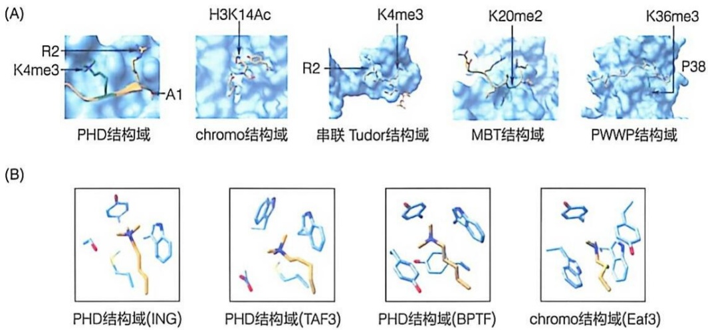

图 9-23 组蛋白甲基化修饰的各种识别结构域和识别模式

（A）各种识别结构域的局部结构展示图（PDB编号依次为2K17、2R0Y、2GFA、2PQW和2X4X）。（B）不同结构域中芳香族氨基酸与甲基化侧链的笼状图比较（PDB编号依次为2G6Q、2K17、2F6J和2K3Y）

tumor）和 PWWP 结构域（图 9-23A）。这些结构域由数目不等的氨基酸残基组成，少则含 40～60 个氨基酸残基（如 chromo 结构域），多则含 150 个氨基酸残基（如 PWWP 结构域）。这些结构域在人源蛋白质中的数量多少不一，类型也差异较大，展现出组蛋白甲基化修饰“阅读器”的复杂性和功能多样性。

虽然上述结构域在氨基酸序列上相似度不高，但它们在识别甲基化的氨基酸侧链上具有较为保守的机制。通常来说，甲基化的赖氨酸侧链插入由识别结构域内2\~4个芳香族氨基酸残基组成的笼状结构中（aromatic cage，“芳香笼”），形成较为稳定的相互作用（图9-23B）。其中，芳香基团通过芳香环之间的 $\pi-\pi$ 堆积、范德瓦耳斯力与甲基化的赖氨酸的侧链氨基相互作用。根据芳香笼的氨基酸组成和空间大小的不同，它们可以选择性地识别赖氨酸的单甲基、二甲基或三甲基状态。如果芳香笼中存在带负电的残基，则结构域更偏向于识别单甲基或二甲基赖氨酸。如果芳香笼中存在天冬氨酸，则其侧链羧基可以与单甲基和二甲基赖氨酸形成额外的氢键，但不能与三甲基赖氨酸形成氢键。另一方面，内部较小的芳香笼由于空间障碍而排斥与三甲基赖氨酸结合，而较大的口袋则偏好更高的甲基化状态。除此以外，芳香笼周围的氨基酸残基通常也能提供氢键和疏水相互作用，这为两者之间的稳定结合提供了序列特异性和调控作用。因此，不同的蛋白质或蛋白质复合物通过其包含的特定结构域识别不同位点和修饰状态的赖氨酸，行使不同的生物学功能。

## 9.5.3 组蛋白不同位点上的甲基化修饰具有特定的生物学功能

与酰基化修饰促进基因转录不同，不同的组蛋白甲基化修饰可能会发挥截然相反的转录调控功能，这完全取决于修饰位点和甲基化状态的差异。除此之外，不同位点和类型的修饰富集于不同的染色质区域，在异染色质形成、DNA损伤修复、RNA剪接、胚胎发育及干细胞分化等方面发挥不同的生物学功能。这里重点对研究较为透彻的组蛋白H3K4、H3K9、H3K27、H3K36、H3K79及H4K20等位点上的修饰功能进行阐述。

---

384

9 基因、染色质与表观遗传

## (1) H3K4 甲基化与基因转录激活相关

H3K4 甲基化广泛参与基因转录调控，通常富集于常染色质区域，在基因转录激活中发挥重要作用。具体来说，H3K4me1 是基因组上活跃增强子区域的显著标记之一、被认为在哺乳动物中调控增强子的活化过程（见 9.10.5 节）；而 H3K4me2/3 富集在转录活跃基因的启动子和转录起始位点，增强基因转录水平，但对启动基因转录不是必需的。

## (2) H3K9 甲基化促进异染色质的形成, 与转录抑制相关

H3K9 甲基化主要富集在异染色质区域，特别是 H3K9me3，广泛富集于各种转座元件、旁着丝粒区、卫星重复序列及端粒区等，抑制这些区域的转录。而 H3K9me3 的富集又会被 HP1 蛋白的 chromo 结构域识别，进一步促进异染色质区域的浓缩。另外，H3K9me1/2 甲基化通常发生在常染色质上，起到转录抑制的作用。敲除 H3K9 甲基转移酶会导致严重的胚胎发育异常和胚胎干细胞的干性缺失。

## (3) H3K27 甲基化在兼性异染色质区域参与转录抑制的维持

H3K27 甲基化也是一种抑制性修饰，但与 H3K9 甲基化不同，H3K27 甲基化修饰富集于兼性异染色质上（见 9.10.3 节）。H3K27 甲基化的丰度非常高，在小鼠胚胎干细胞中，H3K27 位点上约 4% 的位置发生单甲基化、70% 的位置发生二甲基化、5% \~ 10% 的位置发生三甲基化。三种修饰的分布也不尽相同，在小鼠胚胎干细胞以及果蝇细胞中，H3K27me1 只富集在转录激活的基因上，H3K27me2 几乎富集在所有的基因间区和非转录区，而 H3K27me3 特异性富集在表达沉默的基因上。目前认为，H3K27 参与维持而不是建立转录抑制，因此它富集的染色质区域具有可塑性，在发育相关基因的转录调控中发挥重要作用。

## (4) H3K36 甲基化存在于基因组的不同区域, 发挥多种生物学功能

H3K36me2/me3 修饰富集在活跃基因的编码区内，与基因转录延伸相关。这种修饰的作用不是促进转录延伸，而是在转录延伸后抑制隐藏于编码区中的内含起始位点处发生异常转录（cryptic transcription）和反义转录（antisense transcription）。在这个过程中，H3K36 甲基化为去乙酰化酶复合物 Rpd3S 中 EAF3 亚基的 chromo 结构域提供了识别位点，进而招募 Rpd3S 复合物，降低基因编码区的乙酰化修饰程度，压缩染色质，抑制基因编码区内的异常转录发生。另一方面，DNMT3A 蛋白上的 PWWP 结构域能够与 H3K36me2 特异性结合。因此，H3K36me2 介导了基因间区的 DNA 甲基化建立，维持表达沉默。小鼠中敲除 H3K36me2 甲基转移酶 NSD1 和 NSD2 会导致 DNMT3A 错误地被招募到 H3K36me3 更富集的基因编码区，而基因间区的 DNA 甲基化程度下降。NSD1 的相关突变与儿童发育遗传病相关，包括塔顿-布朗-拉赫曼综合征（Tatton-Brown-Rahman syndrome，TBRS）和儿童巨脑畸形综合征（Sotos syndrome），它们均表现出儿童期过度生长、智力障碍及面部特征异常等临床表型。

## (5) H3K79 甲基化具有多种生物学功能

与其他大多数修饰位于组蛋白尾巴上不同，H3K79甲基化位于核小体的核心区域。H3K79me3主要分布在活跃基因的编码区，可能与基因转录延伸相关。在酿酒酵

---

9.6 组蛋白上还存在多种其他类型的蛋白质翻译后修饰

385

母细胞中，H3K79 甲基化还富集在端粒处的异染色质区与常染色质区的边界附近，通过阻碍端粒沉默复合体向常染色质区的扩散维持异染色质的沉默。另外，H3K79 甲基化还可以通过调控其他组蛋白甲基化，如 H3K4me3，参与基因转录调控。

## (6) H4K20 甲基化参与维持基因组稳定性

H4K20me2 是哺乳动物表观基因组中最为丰富的组蛋白甲基化修饰形式，在小鼠胚胎成纤维细胞中约有 85% 的 H4 上有 H4K20me2 修饰，而 H4K20me1 和 H4K20me3 分别约占 5% 和 10%。该修饰在转录调控中的作用认识很少。目前认为，H4K20me1 与基因组稳定性相关，H4K20me3 主要分布在着丝粒周边异染色质区域，可能与转录抑制相关，H4K20me2 则在 DNA 复制和损伤修复中发挥作用。

## 9.6 组蛋白上还存在多种其他类型的蛋白质翻译后修饰

组蛋白上除了可以发生甲基化和酰基化修饰外，还存在其他种类的翻译后修饰，常见的类型包括磷酸化、泛素化和ADP核糖基化等。这些修饰在转录调控、染色质凝集、细胞周期调控、DNA损伤修复和基因组稳定性等多个方面发挥重要作用。本节围绕研究较为清晰的组蛋白磷酸化和泛素化修饰进行阐述。

## 9.6.1 组蛋白上的丝氨酸、苏氨酸和酪氨酸残基上可以发生磷酸化修饰

磷酸化是研究最广泛的蛋白质翻译后修饰类型。四种核心组蛋白及连接组蛋白的不同丝氨酸、苏氨酸和酪氨酸位点上都存在磷酸化修饰（图 9-16），这些修饰同样受到各种蛋白激酶和磷酸酶的动态调控。蛋白质磷酸化也能够被具有结合磷酸基团结构域的蛋白质识别并结合，影响不同的生物学进程。由于涉及的方面较多，在此仅围绕功能重要的几个生物学过程进行介绍。

## (1) 组蛋白 H3 上的磷酸化与有丝分裂和染色质凝集相关

组蛋白 H3 磷酸化最初被发现参与有丝分裂或减数分裂中染色质凝集的过程。其中，组蛋白 H3 第 10 位丝氨酸（H3S10）是最重要的磷酸化修饰位点之一，该修饰从酵母到人类高度保守。H3S10 磷酸化修饰发生在有丝分裂早期，一旦细胞核膜破裂，Aurora B 激酶迅速磷酸化该位点，因此该修饰被认为是细胞进入有丝分裂期的典型“标志”。当细胞进入有丝分裂末期，H3S10 磷酸化则会被蛋白磷酸酶 PP1 快速移除。Aurora B 还可以磷酸化组蛋白第 28 位丝氨酸（H3S28）。H3S10 和 H3S28 磷酸化都是染色质凝集的标志物。有趣的是，H3S10 邻侧位点是 H3K9，该位点甲基化可以招募 HP1 蛋白，促进异染色质的形成。但有丝分裂早期的 H3S10 磷酸化从空间上阻碍了 H3K9 甲基化对 HP1 的招募，促进异染色质从核纤层上解离和有丝分裂进程。丝氨酸突变为丙氨酸（H3S10A）会导致染色体分离异常及染色体丢失。

---

386

9 基因、染色质与表观遗传

另外，组蛋白 H3 上第 3 位和第 11 位的苏氨酸磷酸化同样在有丝分裂期的染色质凝集中发挥作用。组蛋白 H3 苏氨酸 T3（H3T3）被蛋白激酶 Haspin 磷酸化。与 H3S10 磷酸化类似，H3T3 磷酸化在有丝分裂前期分布于染色质上，而在进入细胞中期时高度富集在着丝粒区，随后其水平随着有丝分裂完成和染色质解凝聚而逐渐消失。敲除 Haspin 会造成姐妹染色单体的形成异常。另一种 H3 苏氨酸位点 T11 磷酸化修饰主要出现在有丝分裂前期到后期，与着丝粒的形成相关。

## (2) 组蛋白 H2A.X 变体磷酸化响应 DNA 损伤

DNA损伤修复需要多种DNA损伤修复蛋白、染色质重塑因子及组蛋白分子伴侣等蛋白质的参与，其中组蛋白H2A变体H2A.X（见9.7节）的磷酸化是损伤修复机制响应的早期信号，它负责招募修复蛋白并启动损伤修复过程。在DNA损伤发生后，人源中H2A.X第139位丝氨酸被蛋白激酶ATM、ATR磷酸化后快速募集到损伤位点，替换常规组蛋白H2A，并向附近扩散，形成覆盖几兆碱基的磷酸化形式的H2A.X斑点。该现象最初是在哺乳动物中利用 $\gamma$ 射线照射后发现，故称为 $\gamma \mathrm{H}2\mathrm{A.X}$ 斑点。$\gamma \mathrm{H}2\mathrm{A.X}$ 斑点随即招募染色质重塑复合体INO80和SWR1（见9.8节）到损伤位点，重塑染色质结构，增强损伤修复蛋白对损伤区域DNA的可及性，促进修复以维持基因组完整性。一旦DNA损伤修复完成，$\gamma \mathrm{H}2\mathrm{A.X}$ 从染色质上移除，以阻止修复蛋白在DNA上的长期滞留。同时，$\gamma \mathrm{H}2\mathrm{A.X}$ 也会被蛋白磷酸酶去磷酸化，且损伤位点处的核小体会被常规组蛋白H2A替换，恢复因DNA损伤造成的细胞周期停滞。因此，H2A.X被认为是基因组的损伤感应器和守护者。

## (3) 组蛋白 H3.3 变体磷酸化参与转录调控

除了 H2A.X 上的磷酸化修饰，组蛋白 H3 变体上的磷酸化修饰也具有重要功能。与常规组蛋白 H3.1 和 H3.2 相比，组蛋白变体 H3.3 第 31 位上丝氨酸（S31）代替了丙氨酸。这种独特的变化赋予了 H3.3 特殊的功能。在小鼠免疫细胞和原代皮层神经细胞中，外界刺激可以诱导 H3.3S31 发生磷酸化。磷酸化的 H3.3S31 富集在某些特定基因上，进一步促进甲基转移酶 SETD2 的活性及基因编码区的 H3K36me3 水平，拮抗 ZMYND11 蛋白对 H3K36me3 的识别结合，从而抑制 ZMYND11 作为转录共抑制因子的功能。同时，H3.3S31 磷酸化还能促进 p300 的乙酰转移酶活性，提高基因启动子区的 H3K27ac 水平，协同调控上述特定基因的转录激活进程。在胚胎干细胞中，H3.3S31 磷酸化还发现富集在旁着丝粒和端粒区，可能在异染色质沉默中发挥作用。

## (4) 组蛋白变体 CENP-A 磷酸化促进着丝粒组装

着丝粒是一个特殊的染色质区域，负责动粒组装和染色体的正确分配。作为着丝粒区染色质的组蛋白 H3 特异变体 CENP-A（centromere protein A），其对着丝粒区域染色质高级结构的形成至关重要。李国红团队发现， $G_{2}$  后期和有丝分裂早期发生的 CENP-A 第 68 位丝氨酸磷酸化精确控制该变体组装到着丝粒上的时机。高度磷酸化的 CENP-A 抑制分子伴侣蛋白 HJURP（Holliday Junction Recognition Protein）与其结合，而在有丝分裂末期磷酸酶 PP1α 介导的去磷酸化则释放了“通行”信号，允许 HJURP 将新合成的 CENP-A 装配到着丝粒区域，维持着丝粒正常功能和着丝粒区域

---

9.7 组蛋白变体具有与常规组蛋白不同的序列和功能

387

染色质的稳定性。

## 9.6.2 组蛋白上的单泛素化修饰参与基因转录

蛋白质泛素化是真核生物中重要的蛋白质翻译后修饰之一。泛素化修饰是指蛋白质在一系列酶的作用下将泛素分子（ubiquitin，Ub）共价连接到蛋白质赖氨酸残基上的过程。泛素化的具体生化机制和生物学功能详见第12章，在此不赘述。需要强调的是，与其他蛋白质上通过发生多泛素化修饰不同，组蛋白上主要发生单泛素化修饰，并集中在H2A的第119位赖氨酸（H2AK119ub）和H2B的第120位赖氨酸（H2BK120ub）两个位点上，它们在转录中发挥了截然相反的作用。

H2AK119ub 修饰与基因沉默相关。催化这一修饰的 E3 泛素连接酶 RING1B 存在于 PRC1（polycomb repressive complex 1）复合物中，负责将泛素分子连接到 H2AK119 位上。PRC1 与 PRC2 协同作用，促进常染色质向兼性异染色质的转变。由此可见，H2AK119ub 发挥了转录抑制的作用。H2AK119ub 还通过抑制 H3K4me2 和 H3K4me3 而抑制转录起始。从核小体空间结构上看，H2A 的 C 端与 H3 的 N 端靠近，因此 H2A 泛素化可造成甲基转移酶对 H3K4 的识别受阻，进而影响 H3K4 甲基化。而 BAP1（BRCA1-associated protein 1）和 USP21（ubiquitin-specific protein 21）作为 H2A 去泛素化酶，去除 H2A 泛素化会解除这种空间位阻，使 H3K4 能够再次被甲基转移酶识别修饰，进而招募相关转录因子激活转录。

与 H2AK119ub 相反，H2BK120ub 修饰主要存在于高表达的基因转录区域，它与 H3K4 和 H3K79 甲基化之间存在反式（trans）相互作用。当破坏 H2B 单泛素化时，H3K4me2/me3 及 H3K79me3 消失，而 H3K4 单甲基化及 H3K79 二甲基化水平也严重降低。H3K4me2/me3 和 H3K79me3 主要富集在基因启动子区和基因编码区上，与基因转录激活或转录延伸相关（见 9.5 节）。因此，H2BK120ub 与转录激活紧密相关。

## 9.7 组蛋白变体具有与常规组蛋白不同的序列和功能

组蛋白在进化过程中衍生出一系列组蛋白变体（histone virant），替换常规组蛋白组装形成结构功能各异的核小体，发挥重要的生物学功能。4种核心组蛋白中除H4外，其他组蛋白都存在多种变体形式。连接组蛋白H1也变异较大，目前已经发现10多种变体。本节将概述组蛋白变体的序列特征及特殊的生物学功能。

## 9.7.1 组蛋白变体在一级序列上与常规组蛋白具有差异性

组蛋白变体是编码常规组蛋白基因的同源基因产物。除常规组蛋白 H4 外，其余三种组蛋白在进化过程中都出现了具有不同结构和功能的变体（图 9-24）。

---

388

9 基因、染色质与表观遗传

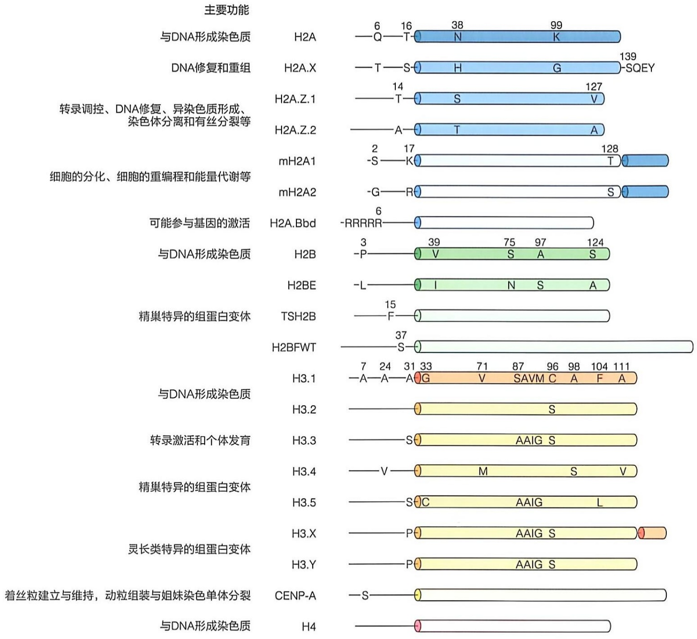

bar

| 主要功能 | Protein Name | Domain Structure |
| --- | --- | --- |
| 与DNA形成染色质 | H2A | 6, 16, 38, 99 |
| DNA修复和重组 | H2A.X | T, S, H, G, 139, SOEY |
| 转录调控、DNA修复、异染色质形成、染色体分离和有丝分裂等 | H2A.Z.1 | 14, T, S, V, 127 |
| 细胞的分化、细胞的重编程和能量代谢等 | mH2A1 | 2, 17, -S, K, 128, T |
| 细胞的分化、细胞的重编程和能量代谢等 | mH2A2 | -G, R, S |
| 可能参与基因的激活 | H2A.Bbd | 6, -RRRRR |
| 与DNA形成染色质 | H2B | 3, 39, V, S, A, S, 124 |
| 精巢特异的组蛋白变体 | H2BE | -L, I, N, S, A |
| 精巢特异的组蛋白变体 | TSH2B | 15, F |
| 精巢特异的组蛋白变体 | H2BFWT | 37, S |
| 与DNA形成染色质 | H3.1 | 7, 24, 31, 33, G, V, SAVM, C, A, F, A |
| 转录激活和个体发育 | H3.2 | — |
| 精巢特异的组蛋白变体 | H3.3 | — |
| 精巢特异的组蛋白变体 | H3.4 | — |
| 精巢特异的组蛋白变体 | H3.5 | — |
| 灵长类特异的组蛋白变体 | H3.X | — |
| 灵长类特异的组蛋白变体 | H3.Y | — |
| 着丝粒建立与维持，动粒组装与姐妹染色单体分裂 | CENP-A | — |
| 着丝粒建立与维持，动粒组装与姐妹染色单体分裂 | — | — |
| 着丝粒建立与维持，动粒组装与姐妹染色单体分裂 | — | — |
| 着丝粒建立与维持，动粒组装与姐妹染色单体分裂 | — | — |
| 着丝粒建立与维持，动粒组装与姐妹染色单体分裂 | — | — |
| 着丝粒建立与维持，动粒组装与姐妹染色单体分裂 | CENP-A | — |
| 着丝粒建立与维持，动粒组装与姐妹染色单体分裂 | — | — |
| 着丝粒建立与维持，动粒组装与姐妹染色单体分裂 | — | — |
| 着丝粒建立与维持，动粒组装与姐妹染色单体制分裂 | — | — |
| 着丝粒建立与维持，动粒组装与姐妹染色单体制分裂 | — | — |
| 着丝粒建立与维持，动粒组装与姐妹染色单体制分裂 | — | — |
| 着丝粒建立与维持，动粒组装与姐妹染色单体制分裂 | — | — |
| 着丝粒建立与维持，动粒组装与姐妹染化单体制分裂 | — | — |
| 着丝粒建立与维持，动粒组装与姐妹染化单体制分裂 | — | — |
| 着丝粒建立与维持，动粒组装与姐妹染化单体制分裂 | — | — |
| 着丝粒建立与维持，动粒组装与姐妹染化单体制分裂 | — | — |
| 着丝粒建立与维持，动粒装与姐妹染色单体制分裂 | — | — |
| 着丝粒建立与维持，动粒装与姐妹染色单体制分裂 | — | — |
| 着丝粒建立与维持，动粒装与姐妹染色单体制分裂 | — | — |
| 着丝粒建立与维持，动粒装与姐妹染色单体制分裂 | — | — |

图9-24 高等真核生物中组蛋白变体及其生物学功能图中数字代表氨基酸残基位置

H2A 蛋白有多种变体形式，包括 H2A.X、H2A.Z、macroH2A、H2A.Bbd（Barr body-deficient）、精巢特异的变体 TH2A 和一些其他异构体。与其他组蛋白家族相比，H2A 变体与常规组蛋白 H2A 的氨基酸序列差异更大，这种结构上的显著差异决定了其在生物学功能上的多样性。例如:虽然 H2A.Z 在真核生物中高度保守（序列相似性约为 90%），但与常规组蛋白 H2A 相比仅有约 60% 的序列相似性，暗示 H2A.Z 行使着 H2A 不可替代的功能。H2A.Bbd 比 H2A 更短，且缺失 C 端结构域及部分锚定域，可能参与基因的激活。有趣的是，H2B 蛋白变体形式较少，目前在进化过程中只出现了三种精巢特异的变体 TH2B、TSH2B 和 H2BFWT，但其生物学功能研究较少。

近些年，对组蛋白H3变体的研究越来越受到重视，特别是H3变体的功能、装

---

9.7 组蛋白变体具有与常规组蛋白不同的序列和功能

389

配到染色质上的模式和基因组上的分布等。目前为止，人体中共发现了8种常见组蛋白H3变体:H3.1、H3.2、H3.3、H3.4、H3.5、H3.X、H3.Y和CENP-A。H3.1和H3.2是细胞内表达丰度最高的蛋白，因此也被定义为常规组蛋白H3；H3.4和H3.5是精巢特异的组蛋白变体；H3.X和H3.Y是灵长类特异的组蛋白变体。目前研究最广泛的是参与转录调控的组蛋白变体H3.3和着丝粒特异的变体CENP-A。与常规组蛋白H3相比，H3.3与它们分别仅有4或5个氨基酸的差异，但它的基因组分布和功能却十分独特。CENP-A是高度特异的组蛋白H3变体，与常规组蛋白H3整体相比只有约$46\%$ 的序列相似性。它定位于着丝粒区域，是着丝粒特异的表观遗传标签。同时，CENP-A还拥有一个独特的N端结构域。但CENP-A的组蛋白折叠结构域高度保守，与H3有 $60\%$ 以上的序列相似性。

相对于四种常规组蛋白，连接组蛋白 H1 及其变体在真核生物中的保守性较差。哺乳动物已发现 11 种连接组蛋白 H1 的变体，其中 5 种变体 H1.1～H1.5 广泛分布在体细胞中，其余几种具有组织和细胞特异性，如精巢特异的 H1T 和 H1T2、已分化细胞中特异表达的 H1.0 等。

## 9.7.2 组蛋白变体具有不同于常规组蛋白的染色质时空分布特征

与常规组蛋白形成的核小体广泛分布于基因组各个区域不同，组蛋白变体常常分布在特定的基因组区域及特定的组织内，行使独特的生物学功能。这里重点介绍核心组蛋白中几个典型变体的基因组分布特点和生物学功能（表9-1）。

表 9-1 重要组蛋白变体的基因组分布及主要生物学功能

| 重要组蛋白变体(人源) | 基因组分布 | 主要功能 |
| --- | --- | --- |
| H3.3 | 转录因子结合位点、活跃转录基因区和端粒区 | 增强基因的转录、细胞命运决定和个体发育 |
| CENP-A | 着丝粒区 | 动粒的组装,着丝粒身份的建立和维持 |
| H2A.Z | 基因启动子区、增强子、常染色质与异染色质边界 | 转录调控、DNA修复、异染色质的形成、染色体分离、胚胎发育、细胞分化 |
| macroH2A | 失活X染色体 | 维持X染色体失活 |
| H2A.X | DNA损伤位点 | DNA损伤修复 |

首先介绍 H2A 变体的特点。H2A.X 是一种特定富集于 DNA 损伤位点的组蛋白变体，其功能主要是招募染色质重塑蛋白和 DNA 损伤修复因子，帮助 DNA 修复以维持基因组稳定性。在高等生物中，H2A.Z 大量富集在基因启动子区和基因调控区，如 DNA 复制起始点和增强子区。变体 TSH2B 和 H2BFWT 分布具有组织特异性:前者分布于精子的整个基因组上以及体细胞的端粒区域，在精子形成过程中帮助组蛋白替换为鱼精蛋白；而后者主要分布在精子的头部和端粒染色质区域。H2BE 变体则分布在

---

390

9 基因、染色质与表观遗传

图 9-25 组蛋白 H3 变体的差异及基因组 - 分布比较

（A）常规组蛋白 H3（H3.1/H3.2）和变体 H3.3 之间氨基酸差异。（B）H3.3 在 HIRA 复合物或者 DAXX/ATRX 的帮助下装配到染色质不同区域:HIRA 复合物负责装配 H3.3 到活跃启动子区、静息状态下的启动子区和基因转录区；H3.3 对于静息状态下的启动子区 H3K27me3 的维持是必需的；ATRX/DAXX 负责装配 H3.3 到着丝粒周边区域，重复元件（repetitive element）单元和端粒区

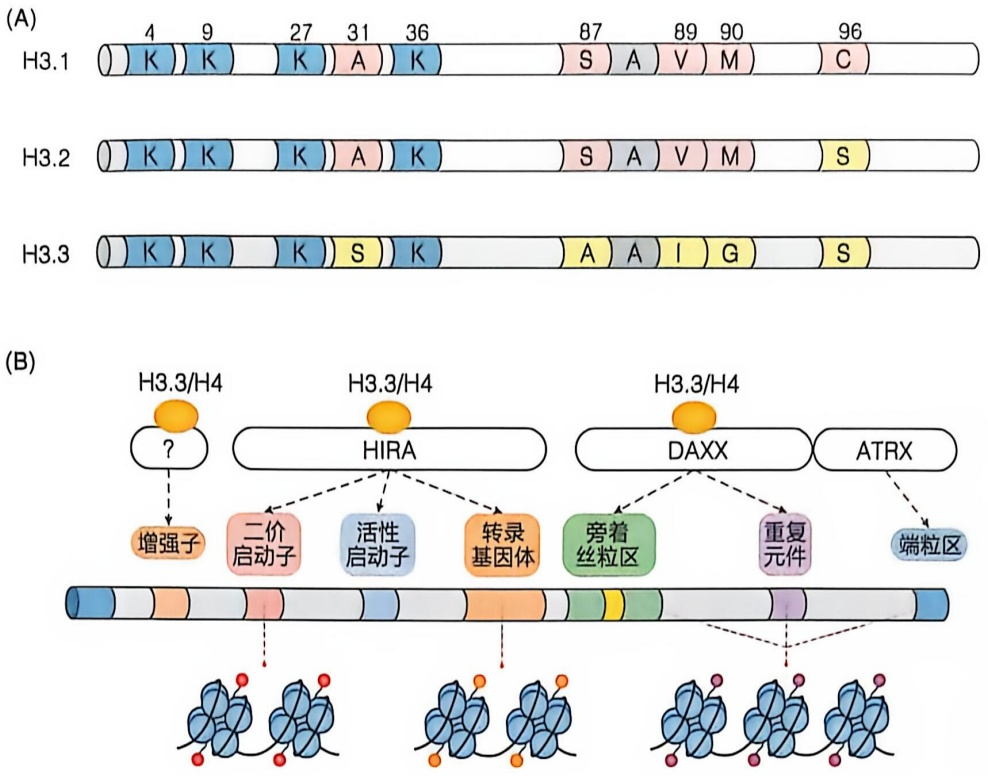

神经元细胞中突触相关基因的启动子区，可增加染色质可及性，对上述基因的表达和长期记忆十分重要。而变体 macroH2A 最早被发现大量聚集在失活的 X 染色体上。

H3.3 和 CENP-A 是研究最广泛的组蛋白 H3 变体。与 CENP-A 只富集于着丝粒区域不同，H3.3 在基因组上的分布非常广泛，包括转录因子结合位点、活跃转录基因区和端粒区等，表明 H3.3 与基因的转录活性呈正相关。需要指出的是，H3.3 变体上 Ala-Ala-Ile-Gly 的基序（与常规组蛋白 H3 差异最大的氨基酸序列）是分子伴侣的结合区域。不同分子伴侣复合体通过与该基序结合，将其装配到不同的基因组区域（图 9-25）。H3.3 分布情况决定了其生物学功能的多样性。

## 9.7.3 组蛋白变体具有独特的生物学功能

组蛋白变体是染色质结构动态调控中的关键因子，呈现出异于常规组蛋白的独立于DNA复制的表达和装配模式。整体来说，组蛋白变体通过替换常规组蛋白来调控核小体的稳定性并影响染色质结构松散程度，进一步影响细胞的生命活动如DNA修复和基因转录活性等过程。例如:含有组蛋白变体H2A.Z的核小体比含常规组蛋白H2A的核小体拥有酸性更强的H2A.Z/H2B区域，使得染色质折叠为更紧密的高维结构，抑制基因转录。H2A.Z还能进一步与异染色质蛋白HP1协同作用，使染色质高维结构更加紧密。与此相反，组蛋白变体H2A.Bbd与H2B形成的酸性区域相较于常规组蛋白的酸性更弱，形成的染色质结构比较松散，参与基因转录的激活过程。另外，组蛋白变体H3.3可以拮抗H2A.Z对染色质结构的压缩作用，使得染色质结构处于较为松散的状态，有利于基因转录激活。macroH2A对失活X染色体中异染色质的形成

---

9.7 组蛋白变体具有与常规组蛋白不同的序列和功能

391

非常重要，但它在高级结构形成中的作用目前仍不清楚。上面提到 CENP-A 对着丝粒区域染色质高级结构的形成至关重要，这是因为相对常规组成核小体，含有 CENP-A 核小体的进出口两端 DNA 具有更强的柔性，与 H1 的结合能力也较弱。但是有研究发现，CENP-A 可以使染色质折叠为更紧密的高级结构。

## (1) 组蛋白 H2A 变体参与多个生物学进程

H2A.Z 参与了多种生物学过程（见表 9-1）。H2A.Z 似乎同时调控了基因的激活与抑制:一方面 H2A.Z 可以稳定核小体的结构，促使染色质折叠更紧凑，从而抑制基因的表达；另一方面 H2A.Z 在全基因组上可以拮抗 DNA 甲基化，同时富集在目的基因的转录起始位点来维持该基因的静息状态以方便其被快速激活。李国红团队发现 H2A.Z 可以通过促进组蛋白甲基转移酶 SUV420H1 活性，调控早期 DNA 复制起始点的选择和激活。此外，H2A.Z 在异染色质的形成中扮演重要角色。定位于常染色质和异染色质边界的 H2A.Z 可以阻止异染色质向常染色质区域扩散；与异染色质蛋白 HP1α 共定位的 H2A.Z 通过改变核小体表面结构促进 HP1α 介导的染色质纤维折叠。细胞内 H2A.Z 的缺失会导致兼性异染色质形成紊乱以及染色体分离缺陷等。在哺乳动物发育过程中，敲除 H2A.Z 的纯合子无法发育成囊胚，在胚胎干细胞中敲除 H2A.Z 后细胞无法完成分化。这些研究表明 H2A.Z 在细胞分化和发育过程中发挥着重要作用。H2A.Z 是一个致癌性的组蛋白变体，其在多种癌症中表达水平上升。被原癌基因或乙酰化修饰所激活的 H2A.Z 会正反馈调控 c-Myc 或其他原癌基因的表达，进一步促进肿瘤的形成。

组蛋白变体 macroH2A 被发现大量聚集在雌性哺乳动物失活的 X 染色体上。与 H2A 家族其他成员最大的不同是，其 C 端含有一个约 30 kDa 的 macro 结构域。macroH2A 在细胞分化、细胞重编程和能量代谢等过程中发挥重要作用。在 X 染色体失活过程中，macroH2A 与 PRC2 共定位促进 H3K27me3 形成，维持 X 染色体的失活状态。macroH2A 在干性基因上大量存在，通过抑制干性因子表达调控细胞分化。macroH2A 在多种肿瘤中低表达，被认为是肿瘤形成的抑制因子。

另外，在9.6.1节中提到的变体H2A.X在DNA修复和维持DNA稳定性方面具有重要功能。H2A.X/γH2A.X被用作早期癌症预测和治疗的标记。在人B细胞慢性白血病和T细胞幼淋巴细胞白血病中，H2A.X应答缺失。在头部和颈部鳞状细胞癌、非霍奇金淋巴瘤和胃肠道间质瘤等肿瘤中，H2A.X出现不同程度的基因缺失、突变或表达上调，这可能是基因组不稳定性增强的原因。另外，在许多人源癌细胞系中、γH2A.X被检测到表达量上升。因此，许多治疗策略是通过引起癌细胞中DNA损伤并破坏其修复机制来启动癌细胞的凋亡，以达到杀伤肿瘤细胞的目的。

## (2) 组蛋白 H3 变体调控染色质结构并决定细胞命运和个体发育

H3.3 的功能主要集中在两个方面:H3.3 对染色质动态结构的调控以及 H3.3 在细胞命运决定和个体发育中的作用。H3.3 被认为是转录激活的标记。在鼠的胚胎成纤维细胞中发现增强子和启动子区域的 H3.3 核小体经历着快速转换，使染色质处于一种未成熟、非紧凑的状态，从而使该区域的 DNA 具有高度可及性，有利于 DNA 复制

---

392

9 基因、染色质与表观遗传

机器和转录因子结合 DNA。H3.3 参与个体发育的多个阶段，包括配子形成、受精、早期胚胎发育等。在不同物种中，H3.3 的缺失会使得配子发生中的精卵细胞不能正常形成，导致不育，或者胚胎发育停滞在某一时期，严重的则出现胚胎致死。因此，H3.3 在个体发育过程中扮演非常重要的角色。特别需要指出的是，H3.3 中的几个重要氨基酸在多形性胶质母细胞瘤（glioblastoma multiforme，GBM）和弥漫内生性脑桥胶质瘤（diffuse intrinsic pontine glioma，DIPG）中发生了突变。已经报道的 H3.3 氨基酸突变包括 K27M、G34R/W/V/L 以及 K36M。这些突变体影响了组蛋白 H3K27 或 H3K36 的整体甲基化修饰水平，引起基因表达水平异常，导致上述预后极差的恶性肿瘤发生。

CENP-A 是着丝粒区域特异的组蛋白变体，其主要有两方面的功能:一是指导着丝粒身份的建立和维持；二是在着丝粒区域替换常规组蛋白 H3，形成更为紧凑的核小体并启动动粒的组装。在细胞分裂时，CENP-A 参与形成的动粒组装平台能够帮助纺锤丝牵引动粒，指导姐妹染色单体正确均等地分配到子代细胞中，确保遗传物质在亲子代间传递的完整性。CENP-A 在染色体上的错误定位，一方面影响了着丝粒的正常功能，导致异倍体或细胞周期紊乱；另一方面还可能改变细胞内基因的表达或者染色质活性，从而引发癌症。

## 9.8 染色质重塑是调控表观遗传信息正确传递的重要方式

染色质状态的调控方式多种多样，主要包括 DNA 甲基化、组蛋白翻译后修饰以及 ATP 依赖的染色质重塑（chromatin remodeling）等。其中，染色质重塑对染色质状态的调控最为显著。染色质重塑复合物（chromatin remodeler）通过水解 ATP 提供能量打破 DNA 与组蛋白之间的相互作用，利用核小体滑移调控染色质组装，并通过组蛋白八聚体或者 H2A/H2B 二聚体的剔除及经典组蛋白与组蛋白变体的交换，改变染色质的组成（图 9-26），从而封闭或暴露基因组调控位点，影响下游因子的招募，以保证染色质相关生命过程有序进行。

## 9.8.1 染色质的重塑通过多种染色质重塑复合物进行

染色质重塑复合物中包含一个属于超级家族2（superfamily 2，SF2）的解旋酶催化亚基，其ATPase结构域由两个大小相似的RecA结构域（lobe1与lobe2，或称N-lobe与C-lobe）组成，这两个结构域之间包含一段长短不一的插入序列。根据其功能及催化亚基结构域的差异，染色质重塑复合物可分为四大类:SWI/SNF（switching defective/sucrose non-fermenting）家族、ISWI（imitation switch）家族、CHD（chromodomain helicase DNA binding protein）家族和INO80（inositol requiring 80）家族（图9-27）。除

---

9.8 染色质重塑是调控表观遗传信息正确传递的重要方式

393

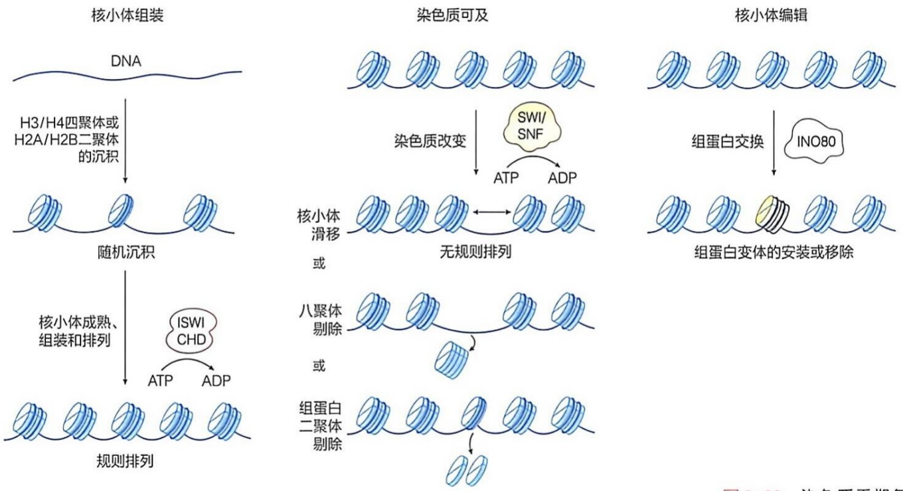

图 9-26 染色质重塑复合物的功能

催化亚基外，这些复合物还包含不同的结构维持性亚基和功能调节亚基，负责识别核小体 DNA 及组蛋白化学修饰，或与转录因子等调节因子相互作用，参与多种生命过程。

四大家族的染色质重塑复合物功能各异:总体而言，ISWI 和 CHD 复合物具有核小体滑移功能，能促进核小体成熟；INO80 复合物主要负责组蛋白变体的替换；SWI/SNF 家族具有最复杂的重塑功能，包括 H2A/H2B 二聚体剔除、组蛋白八聚体剔除及核小体滑移。除上述四大家族外，还存在一些其他的重塑因子，例如人源的 ALC1（也

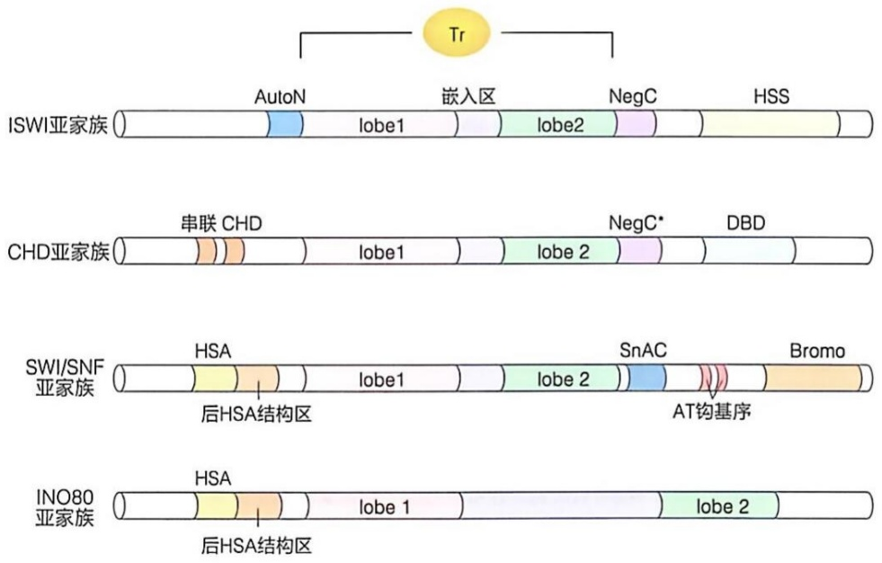

text_image

Tr
ISWI亚家族
AutoN
嵌入区
NegC
HSS
lobe1
lobe2
CHD亚家族
串联 CHD
lobe1
lobe 2
NegC*
DBD
SWI/SNF
亚家族
HSA
后HSA结构区
lobe1
lobe 2
SnAC
AT钩基序
Bromo
INO80
亚家族
HSA
后HSA结构区
lobe 1
lobe 2

图 9-27 四大家族染色质重塑复合物催化亚基结构域分析

AutoN:自动抑制 N 端结构域；NegC:负调控 C 端结构域；HSA:蛋白质招募结构域；DBD:DNA 结合结构域；SnAC:ATP 酶耦合器结构域

---

394

9 基因、染色质与表观遗传

称为 CHD1L）、SMARCAD1、ATRX 蛋白以及 Cockayne 综合征 B(CSB)-ERCC6 亚家族成员。此外，酵母中也发现了具有染色质重塑功能的 Fun30 蛋白。

## 9.8.2 不同的染色质重塑复合物具有不同的组成与高级结构

SWI/SNF 和 INO80 重塑复合物是大型复合物，包含 10 个以上的亚基，采用模块化方式组装并共享某些亚基，分子量达到 1 000。例如，肌动蛋白（actin）和肌动蛋白相关蛋白（actin-related protein，ARP）分别与酵母 INO80 或 SWI/SNF 复合物中的 INO80 或 SNF2 催化亚基的 HSA（helicase-SANT associated domain）结构域组装成 ARP 模块。有研究推测，ARP 模块可能调节 ATP 水解和 DNA 转位的偶联效率。相比之下，ISWI 和 CHD 复合物通常较小，但在多细胞真核生物中也可能具有复杂组成。例如，酵母的 ISWI 复合物每种仅包含 1～3 个非催化亚基，而人源 ISWI 重塑复合物可由催化亚基 SNF2L 或 SNF2H（也称为 SMARCA1 或 SMARCA5）与不同的亚基组装成至少 16 种类型。

（1）SWI/SNF 家族重塑复合物在物种间高度保守，行使核小体滑移、组蛋白交换等功能

SWI/SNF复合物最早于1984年在酿酒酵母中被鉴定。研究发现，SWI1-5基因可激活转录应答，包括交配型开关（mating-type switching，SWI）和蔗糖发酵（sucrose fermentable，SNF）。1992年起，SWI/SNF复合物与核小体的关系逐渐被关注。真核生物通常存在两种SWI/SNF家族染色质重塑复合物，例如酵母中的SWI/SNF与RSC（remodels the structure of chromatin），果蝇中的BAP（brahma-associated protein）与PBAP（polybromo-associated,BAP），以及哺乳动物中的BAF（BRG-/BRM-associated factor）、PBAF（polybromo-associated BAF）和GBAF（non-canonical GLTSCR1/1L-containing BAF）。SWI/SNF复合物从酵母到哺乳动物具有高度保守性，具有核小体滑移、H2A/H2B二聚体剔除及八聚体剔除等功能。

（2）ISWI（imitation switch）家族重塑复合物包含两个亚家族，参与核小体滑移和染色质组装

染色质重塑复合物最早是在果蝇中被发现的。科学家在研究 SWI/SNF 家族时，发现了一些具有相似结构域但功能不同的复合物。与其他家族相比，ISWI 复合物的组成相对简单，通常由 2～4 个亚基组成。这一类复合物可以进一步分为两个亚家族:ACF（ATP-utilizing chromatin assembly and remodeling factor）/CHRAC（chromatin accessibility complex）和 NURF（nucleosome remodeling factor）。ISWI 家族的催化亚基具有高度同源性，尤其是其 C 端的 HSS 结构域（由 HAND、SANT 和 SLIDE 三个相连的结构域组成），能够帮助 ATPase 结构域特异性识别并结合核小体。ACF/CHRAC 亚家族的复合物从酵母到人类都高度保守。在人类中，还存在多种 ACF 亚家族的复合物，包括 RSF 复合物、NoRC 复合物、WICH 复合物及 WCRF 复合物。这些复合物共享相同的催化亚基 SNF2H，但在不同组织、器官或发育阶段中发挥功能。ISWI 家族染色质重塑复合

---

9.8 染色质重塑是调控表观遗传信息正确传递的重要方式

395

物的主要功能是核小体滑移。在体外，它们能够将定位于 DNA 边缘的八聚体移动至 DNA 双链的中央。在染色质环境中，这种作用结果是产生规律排列的串珠状染色质结构。ISWI 复合物主要参与染色质的组装，在基因表达调控中主要发挥转录抑制作用。

## (3) CHD 家族重塑复合物由三个亚家族组成, 均含有保守的 chromo 结构域

CHD 家族的催化亚基组成相对简单，按其结构域的不同可以分为三个亚家族:第一个是 CHD1/CHD2 亚家族，从酵母到人类都高度保守，包含一个 DNA 依赖的 SF2 类型 ATPase/解旋酶结构域、两个 chromo 结构域和一个 DNA 结合结构域。单独 CHD1 即可执行染色质重塑功能。CHD3/CHD4/CHD5 是第二个亚家族，其中 CHD3 和 CHD4 是 NuRD（nucleosome remodeling and deacetylase）复合物的重要组成部分，它们除了包含上述结构域外，还具有两个 PHD 结构域。NuRD 复合物在转录抑制染色质区域中同时发挥染色质重塑因子和组蛋白去乙酰化酶的作用。CHD6/CHD7/CHD8/CHD9 是第三类亚家族。这类家族是脊椎动物特有的染色质重塑复合物，是果蝇 Kismet 蛋白的同源物，结构上包括两个 chromo 结构域、一个 SANT 结构域和一个 C 端 BRK 结构域。CHD 家族染色质重塑复合物的主要功能是核小体滑移，与 ISWI 家族类似，它们主要参与染色质的组装。

## （4）INO80 家族重塑复合物形成了多亚基超大分子量的结构，在 H2A/H2B 二聚体交换中发挥作用

INO80 染色质重塑复合物最初在酵母中被发现。通过研究酵母基因突变，科学家鉴定出与染色质结构和基因表达调控相关的基因，这些基因编码的蛋白质组成了 INO80 复合物。INO80 家族复合物的分子量较大，亚基组成复杂，可进一步分为两个亚家族:SWR1（sick with Rat8）和 INO80。SWR1 复合物能够将核小体中的 H2A/H2B 二聚体剔除并替换为 H2A.Z/H2B 二聚体；而 INO80 复合物则执行相反的功能，将 H2A.Z/H2B 二聚体替换为常规 H2A/H2B 二聚体。这些功能在基因组稳定性、DNA 修复和转录调控等过程中具有重要作用。INO80 家族复合物因其亚基数量多、结构复杂，已成为染色质重塑领域的重要研究对象。

超螺旋位置（superhelical location，SHL）是研究核小体与 DNA 相互作用时引入的概念。SHL 是指 DNA 缠绕在核小体上的特定位置，即 DNA 双螺旋在核小体表面缠绕时，每个碱基对相对于核小体中心轴的位置。SHL 的暴露程度直接影响 DNA 的可及性，从而影响基因的转录、复制和修复等过程。例如，SHL0 指核小体双对称轴的中心位置。染色质重塑复合物可以结合在不同的 SHL 位置，与其功能密切相关。

## 9.8.3 染色质重塑复合物滑移 DNA 的作用方式可通过异位循环模型解释

染色质重塑复合物功能多样，核小体滑移是多个重塑家族复合物所共有的性质，也是执行染色质重塑的基础。目前研究认为，重塑复合物的 DNA 滑移可通过异位循环模型解释。ATP 驱动的 N-lobe 和 C-lobe 之间的相对重新定位会导致 DNA 易位、结

---

396

9 基因、染色质与表观遗传

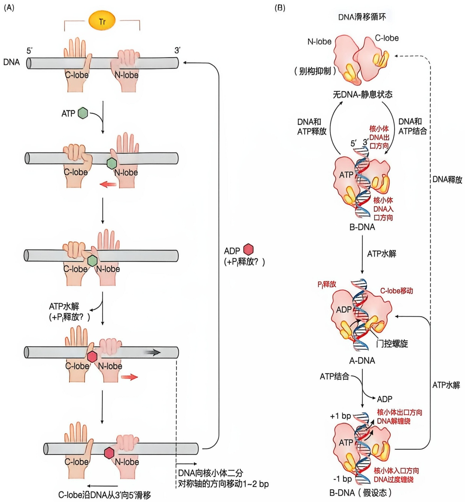

图 9-28 重塑复合物滑移 DNA 的作用方式

合-释放循环，或核酸底物的变形（图9-28）。染色质重塑因子的催化亚基ATPase结构域在缺乏DNA底物的情况下呈抑制状态。当ATP缺失时，ATPase结构域与DNA呈松散结合状态。一旦ATP结合，N-lobe和C-lobe相互靠近并与DNA紧密结合。随后，ATP水解触发C-lobe顺时针旋转，其螺旋结构插入DNA小沟，导致轨道链（track chain）发生 $5^{\prime} \rightarrow 3^{\prime}$ 方向的运动，此时DNA发生形变，并在轨道链中形成一个核苷酸的凸起。随后ADP释放，新的ATP结合，C-lobe螺旋与DNA的紧密结合被打开，C-lobe发生构象变化，推动引导链（guide chain）跟随轨道链移动，最终导致DNA相对组蛋白八聚体发生一个核苷酸的易位。有研究猜测，染色质重塑因子对组蛋白的重塑作用是通过诱导DNA形变实现的，而非直接破坏组蛋白-DNA相互作用。

---

9.9 细胞内染色质形成高维结构

397

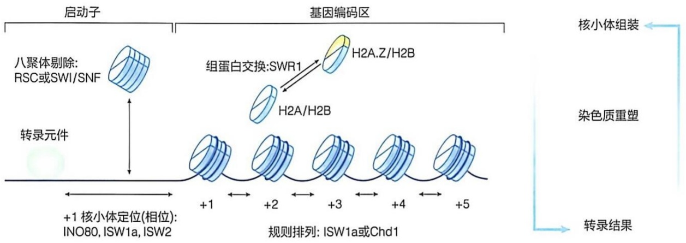

flowchart

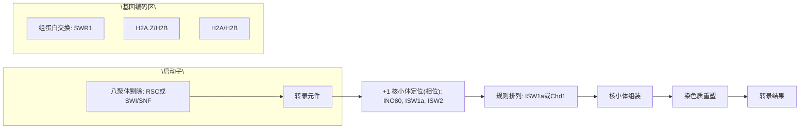

图9-29 染色质重塑参与转录调控

## 9.8.4 染色质重塑参与转录调控

重塑因子与其他染色质调控因子和转录因子的协同作用在酿酒酵母中被研究得最为深入（图9-29）。SWI/SNF家族染色质重塑复合物能够在基因启动子区域剔除核小体，从而暴露更多的转录活性区域，促进转录的进行。INO80或ISWI家族（如ISW1a或ISW2）的重塑复合物通常位于+1核小体附近。这些复合物可能通过协同定位+1核小体和调节其上游DNA的裸露程度来调控转录起始。INO80家族中的SWR1能够催化组蛋白H2A/H2B二聚体与H2A.Z/H2B变体二聚体的交换，尤其是在+1核小体处。这种二聚体交换机制尚不完全清楚，但其在真核生物中高度保守，可能与转录起始或转录起始位点（transcription start site，TSS）的选择有关。ISW1a和其他可能具有间距调控功能的重塑因子能够将下游核小体规则排列。然而，这种排列可能会因RNA聚合酶的通过而被扰乱，产生间距不规则或部分解体的核小体，如缺失一个H2A/H2B二聚体的非典型六聚小体（hexasome）。CHD家族成员Chd1可以重新排列这些被扰乱的核小体。其他重塑因子（如ISW1a或INO80）也可能参与这一过程。研究表明，INO80在体外能够重塑六聚小体，并可能在体内重塑由转录诱导的六聚小体。此外，ISW1b和Chd1还能够解离由核小体碰撞形成的双核小体堆叠颗粒。

## 9.9 细胞内染色质形成高维结构

结构决定功能这一第一性原理在真核生物的细胞核内也得以充分体现，染色质以复杂且高度有序的动态方式折叠，并以此精准地调控细胞核内基因转录、DNA 复制及修复等功能。近年来的研究揭示了关键的染色质特征，阐明了基因组三维结构（three-dimensional genome, 3D genome）在多种生物学过程中的重要作用。过去科学家们通常使用 DNA 原位荧光杂交（DNA fluorescence in situ hybridization, DNA-FISH）来研究细胞核中的 DNA。该方法首先通过甲醛固定细胞，然后使用带有荧光标记的 DNA

---

398

9 基因、染色质与表观遗传

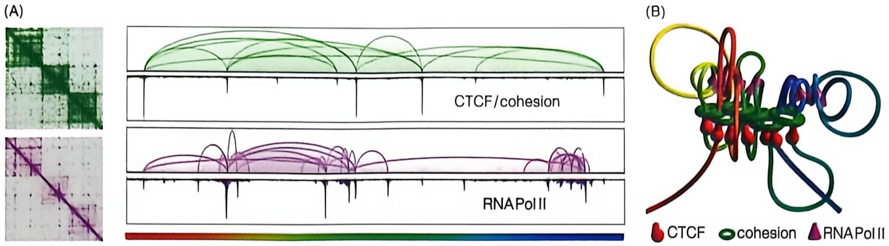

图 9-30 由结构蛋白 CTCF/cohesion（黏连蛋白）和 RNA聚合酶 II 介导的染色质远程相互作用（A）二维交互图谱中，基于浏览器展示的染色质交互环以及蛋白结合峰值位点。（B）染色质远程相互作用的三维模型

探针与基因组中相应的目标区域结合，从而标记目标 DNA 区域，使得研究人员能够利用显微镜观测这些特定区域。通过 DNA-FISH，研究者可以测量两个 DNA 片段之间的相对距离以及它们在细胞核中的空间分布和相对位置。2002 年，研究人员开发了一种名为 3C 技术（chromosome conformation capture）的方法，同样通过甲醛固定由蛋白质介导的染色质空间结构，随后使用限制性内切酶（restriction enzyme）将染色质片段化，并利用 DNA 连接酶（DNA ligase）将空间上邻近的 DNA 片段连接。这样，由连接产生的新 DNA 片段可以通过 PCR 进行扩增，并与对照（未进行甲醛固定的样本）比较，以推测它们之间的空间距离。但是 3C 只能检测单个位点的染色质交互作用。随着高通量 DNA 测序技术的兴起，Hi-C（high-through put 3C）和 ChIA-PET（chromatin interaction analysis by paired-end tag sequencing）技术同时在 2009 年被开发，开启了研究全基因组范围内的染色质相互作用的新时代。与 Hi-C 技术无偏差地捕获全局染色质相互作用不同，ChIA-PET 专注于特定蛋白介导的染色质相互作用（图 9-30）。这两项开创性的技术为三维基因组学这一新兴领域奠定了基础，并标志着三维基因组这个全新学科的建立。

## 9.9.1 染色质的三级结构呈现层级性

目前最广为接受的认知是，染色质的三维折叠结构呈现层级性（图9-31）。其中，每条染色体占据特定的核内空间，称为染色质疆域（chromosome territory）。染色质还进一步被组织为A、B两类区室（compartment），其中A区室包含转录活跃、染色质状态开放的常染色质区域，常定位于细胞核中心；而B区室通常是转录受抑制的异染色质，染色质处于关闭状态，常定位于核外周。在百万DNA碱基范围内，染色质可以形成拓扑结构域（topologically associated domain，TAD），其内部基因组区域的相互作用频率高于域外区域，从而形成不同的转录调控单元。此外，拓扑结构域内部的DNA位点（如启动子和增强子，见9.10节）可以进一步在特定蛋白（如RNA聚合

---

9.9 细胞内染色质形成高维结构

399

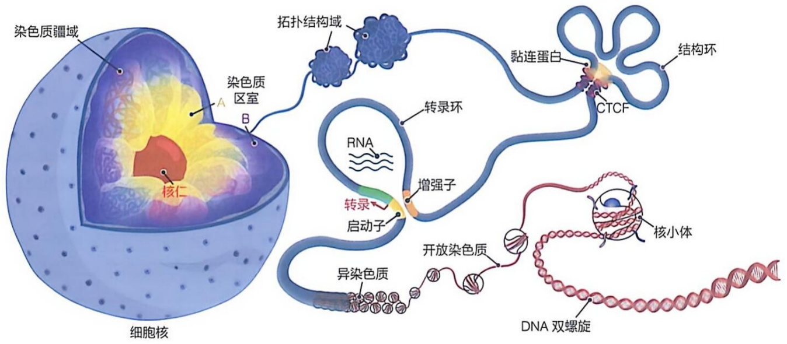

text_image

染色质疆域
染色质
区室
A
B
核仁
细胞核
拓扑结构域
转录环
RNA
增强子
转录
启动子
黏连蛋白
CTCF
结构环
核小体
异染色质
开放染色质
DNA 双螺旋

图 9-31 染色质的不同层级的三维折叠结构

酶Ⅱ、转录因子、CTCF、黏连蛋白等）的介导下形成染色质环（chromatin loop）。这些染色质环包括由 CTCF（CCCTC-binding factor）/黏连蛋白介导的结构环以及由 RNA 聚合酶介导的基因转录功能环，是组成染色质三维折叠高级结构的基本单元。

目前，通常用“环挤压”模型来解释染色质环的形成。在该模型中，处于有丝分裂间期的细胞内，黏连蛋白复合体（cohesin complex）可以在NIPBL（Nipped-B-like protein）蛋白的帮助下结合到DNA上，在促使DNA滑动的同时使DNA呈现“U”形被挤出。当DNA滚动遇到结合有结构蛋白CTCF的区域（拓扑结构域边界）时，滑动过程停止。这一过程将“U”形结构内外的DNA区域物理隔离，进而形成拓扑结构域。研究表明，急性降解CTCF9或黏连蛋白复合体中的RAD21亚基可以使全基因组范围内的拓扑结构域消失。

## 9.9.2 染色质的三维结构调控基因转录

基因表达的精确调控在细胞分化、发育及疾病进程中至关重要。染色质的三维构象在这一过程中起着关键的调控作用，直接影响正常细胞功能的维持。

在人类和小鼠早期胚胎发育过程中，染色质最初缺乏拓扑结构域和明确的染色质区室。随着发育过程的进行，染色质拓扑结构域和区室逐渐形成，染色质整体结构变得更为有序。

研究表明，染色质结构调控蛋白质的编码基因是人类癌症中突变最频繁的一类基因，这表明染色质构象异常与疾病发生密切相关。2015年的一项研究表明，与疾病相关的基因组结构变异可以破坏拓扑结构域的边界，导致染色质之间的异常相互作用

---

400

9 基因、染色质与表观遗传

和基因的错误表达，这些异常表达最终引起了人类和小鼠的多种肢体畸形。在另一项基于急性 T 淋巴细胞白血病模型的研究中，研究人员同样证明了拓扑结构域边界的破坏，可以造成致癌基因与异位增强子的错误结合，导致致癌基因的错误激活。

## 9.9.3 染色质三维结构变化影响细胞衰老

细胞在衰老过程中伴随着多种变化，包括染色质状态的重塑、基因表达的改变，以及细胞功能逐渐减弱的特征。最近，研究人员发现，在人类和小鼠的小脑颗粒神经细胞中，随着年龄增长，染色质相互作用的距离逐渐变长。

## 9.9.4 在生物演化中人类形成了特有的三维基因组特征

在生物演化过程中，基因组非编码区域的序列分化被认为是物种特异性特征形成的重要驱动力。通过对比人类与恒河猴脑神经细胞的三维基因组结构，科学家们发现它们在某些方面具有相似性，但也揭示了人类特有的三维基因组特征。例如，人类独有的拓扑关联域和染色质环展现出特殊的基因调控模式。这些特有的结构在调节大脑发育关键基因表达方面发挥重要作用，尤其是在神经回路的形成以及大脑复杂功能的建立过程中。这些独特的基因组结构帮助解释了人类在认知能力和神经功能方面的进化优势。

## 9.9.5 三维基因组面临更多技术和科学上的挑战

大量研究表明，染色质高级结构在基因转录调控中发挥重要作用。然而，有研究显示，敲除结构蛋白CTCF或黏连蛋白复合体亚基RAD21虽然会导致染色质结构发生显著变化，但基因整体表达的变化却相对较小。这一现象引发了关于染色质高级结构与转录调控之间因果关系的广泛争论，已成为当前染色质研究领域的关键科学问题。

2013 年开发的单细胞 Hi-C（scHi-C）技术为研究单个细胞及不同细胞类型间的染色质结构异质性提供了重要工具。自 2019 年起，具有多组学检测能力的单细胞三维基因组解析技术（如同时进行 scHi-C 和单细胞转录组 / 单细胞甲基化组）能够将三维染色质结构与基因表达或表观基因组联系起来，极大地推动了我们对转录调控中染色质结构基础的理解，并揭示了细胞类型特异性的染色质特征。此外，具备多组学检测能力的高通量显微成像技术也为我们提供了另一种独特的视角来理解染色质在细胞核中的构象。未来，随着三维基因组研究技术的进一步发展，我们将更深入地关联基因组的三维结构与其在不同生物学过程中的功能，进而推动对基因调控、细胞分化和疾病机制的理解。

---

9.10 染色质上的多种序列元件在基因转录中发挥重要作用

401

## 9.10 染色质上的多种序列元件在基因转录中发挥重要作用

染色质结构在基因转录中发挥了决定性的作用。染色质上含有多种顺式作用元件，包括启动子、增强子、沉默子和绝缘子等。开放的染色质状态更有利于多种调控因子与基因组上的顺式作用元件共同作用，促进基因转录；反之，压缩的染色质状态会使得这些顺式元件难以被调控因子触及，导致转录抑制。在一系列表观遗传机制的作用下，这些调控元件不仅确保基因在特定时空条件下表达，还能响应外部信号或环境变化，精确调控基因转录活性，以保证细胞功能的正常运行。本节将围绕染色质状态和部分重要顺式元件的表观特征阐述它们与基因转录的关系。

## 9.10.1 根据染色质的松散程度，染色质可分为常染色质和异染色质两种类型

通过染料对细胞核进行染色，生物学家发现 DNA 在细胞核的不同区域富集，且呈现深浅两种染色形态，由此将染色质分成常染色质和异染色质两种类型。常染色质呈现松散的状态，散落分布于细胞核的中心区域。它常以一种开放的（非浓缩的）、对核酸酶更为敏感的形式存在，即便它有时仍处于非转录状态，也能随时开启基因表达模式。异染色质则呈现高度致密的形态，更倾向富集于核膜周围，也有部分散落在细胞核中心附近。异染色质与转录沉默相关，根据其沉默状态，又可分为组成型异染色质（constitutive heterochromatin）和兼性异染色质（facultative heterochromatin）两种形式。组成型异染色质区域的基因转录处于永久沉默状态；而兼性异染色质则是一类动态变化的染色质结构，它在不同的细胞类型或不同的发育阶段可能会被打开或关闭。与组成型异染色质不同，兼性异染色质具有可塑性，能够在特定条件下转变为活跃的染色质状态。哺乳动物基因组中，常染色质只占不到 4% 的编码区，而由非编码序列和重复序列组成的 96% 基因组均处于异染色质状态。

## 9.10.2 组成型异染色质具有特定的表观修饰特征

组成型异染色质主要位于各种转座子、端粒和着丝粒区域，通常富含重复 DNA 序列。组成型异染色质区域具有较高水平的 DNA 甲基化水平和特定的组蛋白修饰，这些标记有助于招募 HP1 蛋白，促使染色质高度凝集，维持这些区域内绝大多数基因的沉默状态。组成型异染色质上的标记在不同物种中具有保守性。在哺乳动物和果蝇中，组成型异染色质的显著表观修饰标记为 H3K9me3 和 H4K20me3；而在拟南芥中，H3K9me2/H3K9me3 和 H3K27me3 是常见的标记（图 9-32）。组成型异染色质通过抑制转座子活性，防止重复序列扩增，维持基因组稳定性。它也可以在着丝粒区域

---

402

9 基因、染色质与表观遗传

图 9-32 哺乳动物中基因组重要区域的表观修饰分布

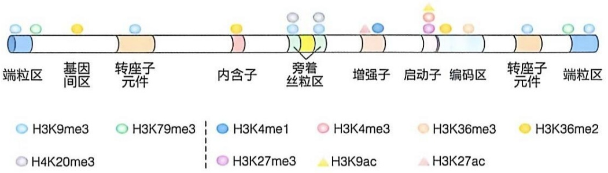

text_image

端粒区
基因间区
转座子元件
内含子
旁着丝粒区
增强子
启动子
编码区
转座子元件
端粒区

维持染色质的物理结构，确保在细胞分裂时染色质可以精准分离。另外，在某些物种中，非编码 RNA（如 Xist）参与异染色质的形成和维持，保证性别相关基因的平衡表达。因此，组成型异染色质在基因组稳定性、染色体结构维护、转录沉默及细胞分化过程中发挥功能。虽然它们的具体机制可能因物种而异，但其在生物体的功能维持中发挥着至关重要的作用。

## 9.10.3 兼性异染色质具有不同于组成型异染色质的表观修饰特征

兼性异染色质主要出现在基因组的编码区、沉默的X染色体以及常染色体的印记基因上。调控兼性异染色质状态的表观遗传修饰涉及多种机制，主要包括组蛋白修饰、非编码RNA和染色质重塑。不同的表观特征展现在不同的兼性异染色质区域上。PRC2介导的H3K27me3和PRC1介导的H2AK119单泛素化是兼性异染色质区域的表观标记，它们常常结伴富集于X染色体的去活化区域以及表达沉默的基因启动子区。对于失活的X染色体，调控其处于兼性染色质状态的关键元件是Xist。前面9.3.4节已经详细描述了Xist导致X染色体失活的机制，在此不再赘述。另外，通过特定的重塑因子，如SWI/SNF复合物，核小体发生动态重塑，促进或抑制兼性异染色质区域的开放或关闭，影响兼性异染色质的状态。

## 9.10.4 调控染色质转录的不同基因启动子区具有相似的表观修饰特征

启动子（promoter）是基因表达调控的核心元件，它位于基因的转录起始点 TSS 的 5' 端，长度几百到上千碱基不等。启动子的核心作用是确定基因转录的起始位置，是 RNA 聚合酶与转录因子结合的主要部位。启动子区还存在多种转录因子结合元件序列，转录激活或抑制因子可以序列依赖性地结合在不同序列的启动子区域动态调控基因转录进程。其中，启动子元件上的表观修饰可以表征基因所处的转录状态。如 H3K9ac 在基因启动子区的富集表征基因处于转录激活状态；而 H3K4me3 是转录起始位点处的典型标记，它的存在会通过招募转录共激活因子和染色质重塑因子增强转录水平（图 9-32）。另一方面，启动子区的去甲基化状态也是基因转录活化的标志，因为高 DNA 甲基化程度会抑制转录因子在启动子区的结合。只有当该区域的 DNA 甲基

---

圆圆

403

化被去除后，这些区域变为易于结合转录激活蛋白的开放状态，允许转录因子和 RNA 聚合酶结合，激活转录。许多启动子区域的去甲基化是细胞分化和发育过程中必需的。启动子元件在细胞类型、发育阶段及环境刺激等条件下具有高度的时空特异性。不同类型的细胞会通过不同的启动子元件调控基因的表达，这对于细胞功能的多样性至关重要。

## 9.10.5 促进染色质转录的增强子元件上具有特定的表观修饰特征

增强子（enhancer）也是基因组中的重要调控元件之一，它是指一类能够增强目标基因转录活性的 DNA 序列。增强子可以位于靶基因的上游或下游，或存在于基因的内含子区内，甚至远离靶基因的区域。增强子的功能是通过与启动子的空间物理接触，增强启动子区域的活性，达到在特定时空条件下激活目标基因转录的目的。鉴于增强子位于距离启动子线性距离较远的位置，因此染色质折叠及基因组三维结构的变化对于实现空间上增强子与启动子的物理接触具有重要意义。

一个增强子往往同时调控多个目标基因，因此早期鉴定增强子序列元件的方法是用比较基因组学来系统地寻找基因组中非编码区域中的保守区域。目前大多数已发现的增强子都具有组织和细胞特异性，可在特定细胞类型和发育阶段调节不同基因的时空表达。因此，即便利用这种方法找到了大量在进化上保守的增强子元件，也并不能提供这些元件发挥功能的具体时空信息。近些年来，通过表观遗传组学描绘增强子序列图谱的方法被广泛应用，即特定的组蛋白修饰和转录因子结合位点可以作为增强子序列的标记。

H3K4me1 是首个被发现的增强子标记（图 9-32）。在胚胎干细胞中，静态增强子在未分化状态下具备 H3K4me1 和 H3K27me3 双标记，使得其调控的分化相关的目标基因处于一种随时可以被开启的静息状态。分化起始后，这些增强子上的组蛋白修饰转换为 H3K4me1 和 H3K27ac 标记的激活状态。因此，H3K27ac 可以用作鉴定活化增强子的标记。此外，负责催化 H3K27ac 的乙酰转移酶 p300、CBP 的结合位点以及染色质的开放区域也用于预测增强子位点。

近年来，科学家们又鉴定出一类特殊的增强子，被称为超级增强子（super-enhancer）。它们通常是由多个增强子序列组成的高效调控区域，在细胞内与多个关键转录因子和调控因子紧密结合，调控细胞命运决定基因（如干细胞干性基因）或细胞特异性基因（如T细胞分化基因）的转录，对维持细胞的特定身份或发育过程具有决定性作用。

## ※展望

近 20 多年来，表观遗传学研究取得了迅猛的发展，人们在表观遗传机制的各个层面对调控染色质的结构和功能均有了较为深入的理解，但仍然有很多问题有待研究和探索。

---

404

9 基因、染色质与表观遗传

例如，新的表观遗传调控分子机制的解析，包括精氨酸甲基化修饰的生物学功能及动态调控机制、新“阅读器”的分子识别机制、体内30-nm染色质纤维结构及染色质三维结构的动态变化等。另外，HI-C和ChIA-PET等基于DNA测序的三维基因组解析技术揭示了染色质折叠的基本规律，但这些信息主要来自细胞群体，难以准确反映单个细胞的染色质结构。随着基因组学进入单细胞与空间解析时代，三维基因组学的研究重点也逐渐从细胞群体的染色质组织转向探索细胞类型或组织特异性的染色质结构。这一转变不仅推动了技术的进步，也为我们更深入地理解细胞功能和多样性提供了新的视角。

表观遗传调控异常与多种人类疾病的发生发展紧密相关，整合单细胞、高通量、多组学及人工智能等技术，将其应用于疾病样本检测和研究中，有助于获得更为全面深入的信息来理解病理条件下表观遗传调控的重要作用，为开发预防、诊断和治疗相关疾病的新方法奠定基础。

## ※ 本章小结

真核生物的基因组以染色质形式存在。作为真核生物遗传信息的载体，一切有关DNA的生命活动都在染色质层面上进行。

核小体是染色质的基本组成单元，它是 147 bp 长度的 DNA 以左手负超螺旋方式缠绕组蛋白八聚体形成的“扁珠”结构。在连接组蛋白 H1 的作用下，核小体之间由长度不等的 DNA 连接，通过“Z”字结构凝缩成直径约 30 nm 的染色质纤维。

与双链 DNA 形成右手双螺旋结构不同，体外的 30-nm 染色质纤维形成左手双螺旋结构。30-nm 结构是染色质折叠形成更高维结构的基础。

染色质结构的松散程度在一定程度上调控基因表达的水平:高度凝聚的染色质形成异染色质，该状态阻止转录因子结合，导致基因沉默；松散的染色质形成常染色质，该状态使得转录激活因子可接近 DNA，促进基因转录。

染色质结构受到多种因素的动态可逆调控，包括 DNA 修饰、组蛋白修饰、组蛋白变体和染色质重塑因子等。

表观遗传修饰发生在构成染色质的某些 DNA 区域或组蛋白的特定残基上。发生的化学小分子修饰类型众多，包括甲基化、乙酰化、泛素化、磷酸化及其他酰基化修饰等。

表观遗传修饰的类型和修饰位点组成了一个精密复杂的编码系统，依赖于“书写器”、“阅读器”和“擦除器”等多种染色质修饰酶和结合因子的协同作用，动态调控染色质结构和基因表达。

组蛋白变体可以替换常规组蛋白组装成含不同成分的核小体，发挥特异的生物学功能。

染色质可以在 ATP 的帮助下，被多亚基组成的染色质重塑复合物进行重塑，改变染色质的组成和结构，影响染色质相关生命活动进程。

将高通量的三维基因组学技术用于解析染色质的高维结构对于深入理解染色质结构在基因转录调控中的功能具有重要意义。

---

推荐阅读

405

构成染色质的基因组上含有多种顺式作用元件，DNA 序列和表观遗传修饰特征决定了它们在转录调控中的功能。

深入了解表观遗传的调控机制对于理解非基因突变导致的各种人类疾病及开发表观遗传因子相关的药物具有重要意义。

## ※ 思考题

1. 高等真核生物基因组中仅有少于 $2\%$ 的区域编码蛋白质，而其他大部分为非编码区域。如何理解这些非编码区域存在的意义。
2. 高等真核生物的 DNA 以核小体形式存在的必要性是什么？其他物种中 DNA 是如何存在的？请举例说明。
3. 30-nm 染色质纤维形成 “Z” 形折叠结构的分子基础和潜在的生物学意义是什么？
4. 思考胞嘧啶 C 比其他碱基更容易发生 DNA 甲基化修饰的生化特性。
5. 组蛋白上有哪些常见的蛋白质翻译后修饰？它们都有哪些生化特征？它们介导生物学效应的生化基础存在哪些差异？
6. 组蛋白修饰“阅读器”依赖哪些作用力来实现特异性识别底物的效应？
7. 组蛋白变体多样性的生物学意义是什么？
8. 如何理解组蛋白序列在进化中的高度保守性？
9. 染色质重塑复合物都有哪些种类？它们在功能上的异同点有哪些？
10. 常染色质和异染色质有哪些表观修饰特征？简述这些表观修饰特征在基因组上如何分布。

## ※ 推荐阅读

1. LUGER K, MÄDER A W, RICHMOND R K, et al. Crystal structure of the nucleosome core particle at 2.8 Å resolution [J]. Nature, 1997, 389: 251–260.

本文首次在原子水平上揭示单核小体的三维结构，具有里程碑意义。

2. BROWNELL J E, ZHOU J, RANALLI T, et al. Tetrahymena histone acetyltransferase A: a homolog to yeast Gcn5p linking histone acetylation to gene activation [J]. Cell, 1996, 4: 843-851.

本文首次揭示组蛋白修饰在基因转录激活中的表观调控机制，开启了表观遗传修饰的研究方向。

3. REA S, EISENHABER F, O'CARROLL D, et al. Regulation of chromatin structure by site-specific histone H3 methyltransferases [J]. Nature, 2000, 406: 593–599.

本文阐释了多种组蛋白修饰协同调控染色质高级结构的机制，奠定了表观修饰维持染色质状态的基础。

4. TAHILIANI M, KOH K P, SHEN Y, et al. Conversion of 5-methylcytosine to

91

---

406

9 基因、染色质与表观遗传

5-hydroxymethylcytosine in mammalian DNA by MLL partner TET1 [J]. Science, 2009, 324: 930-935.

本文首次报道哺乳动物中DNA去甲基化酶的功能。

5. SONG F, CHEN P, SUN D, et al. Cryo-EM study of the chromatin fiber reveals a double helix twisted by tetranucleosomal units [J]. Science, 2014, 344: 376–380.

本文首次解析染色质纤维的双螺旋结构和四核小体单元的相互作用模式，为理解表观遗传调控提供了新视角。

6. SHI Y, LAN F, MATSON C, et al. Histone demethylation mediated by the nuclear amine oxidase homolog LSD1 [J]. Cell, 2004, 119: 941–953.

本文首次发现了组蛋白甲基化修饰的可逆性，是表观遗传学领域革命性工作之一。

7. TSUKADA Y, FANG J, ERDJUMENT-BROMAGE H, et al. Histone demethylation by a family of JmjC domain-containing proteins [J]. Nature, 2006, 439: 811-816.

本文首次报道了 JmjC 家族成员催化组蛋白去甲基化，与 LSD1 共同构建了组蛋白甲基化动态调控的分子基础。

8. TAN M, LUO H, LEE S, et al. Identification of 67 histone marks and histone lysine crotonylation as a new type of histone modification [J]. Cell, 2011, 146: 1016-1028.

本文首次在哺乳动物细胞中系统地鉴定出67种新型组蛋白翻译后修饰。

（撰写:李国红，杜海宁，阮一骏，柴皓曦，徐彦辉；审修:朱冰，陈玲玲）
