# 10 RNA的生成

原始 PDF 第 424–478 页。

## RNA 的生成

在 “中心法则” 中，转录（transcription）是遗传信息从 DNA 流向 RNA 的过程，即以双链 DNA 中的一条链为模板，以 ATP、UTP、CTP、GTP 四种核糖核苷酸为原料，按碱基配对的原则（dT-A、dA-U、dG-C、dC-G），在 RNA 聚合酶催化下合成 RNA。双链 DNA 分子中在 5' 端到 3' 端方向上携带可翻译编码的链称为非模板链（non-template strand）或有义链（sense strand）。另一条互补链能作为模板转录出 RNA，称为模板链（template strand）或反义链（antisense strand）。虽然在不同的物种中可能存在一些差异（如逆转录），但上述转录的定义中基本原则和机制从细菌到人都高度保守。在本章中，我们将概述 DNA 转录成 RNA 的过程，阐明行使转录功能的生物大分子机器 RNA 聚合酶的组成和催化机制，讲解转录的三个步骤及其生成的转录本的加工和修饰，并揭示作为基因表达调控主要环节的 RNA 生成过程，最后介绍 RNA 分子作为模板指导合成 DNA（即逆转录）和 RNA 的分子机制。

## 10

---

408

10 RNA 的生成

## 10.1 基因和基因表达调控

基因和基因表达调控是近一个世纪以来生命科学最核心的研究范畴之一，其不仅揭示了生物体如何将遗传信息转化为具体功能，还为现代医学、生物技术和进化研究奠定了基础。本小节将介绍基因调控研究的历史脉络，阐释关键概念，并搭建基因表达调控的基本框架。

## 10.1.1 “中心法则”和转录

克里克和沃森于1953年发表在Nature杂志《核酸的分子结构——DNA的一种可能结构》的文章中，提出了DNA双螺旋结构模型并推测了遗传信息半保留复制的机制。克里克后来对于RNA与蛋白质合成的关系尤其感兴趣，其中一个关键的科学问题是:蛋白质的氨基酸序列是否被RNA控制？1955—1956年的几项研究指出，RNA可以携带遗传信息并作为模板指导蛋白质的合成。在此基础上，克里克于1957年在题为“关于蛋白质的合成”的报告中首次提出“中心法则”假说，即RNA可能是在DNA和蛋白质之间的中介物。在最初的版本中，RNA被克里克假想为把DNA携带的遗传密码传递到蛋白质的信息载体，位于中心法则的中心。1958年，克里克在将该报告整理成论文正式发表时，进一步提出“适配器猜想”（adaptor hypothesis），提出RNA分子一头连接蛋白质的氨基酸，另一头通过类似DNA双螺旋结构中的碱基配对方式和模板RNA（即信使RNA）相连，从而将从DNA传递到mRNA上的遗传信息翻译成蛋白质。由此，克里克猜想存在两种RNA，其中“适配器”被称为可溶性RNA（soluble RNA）即转运RNA（tRNA），而从DNA获得遗传信息的“模板”RNA（template RNA）即信使RNA（mRNA）。

## 10.1.2 mRNA是遗传信息流动的载体

1960 年，法国科学家弗朗索瓦·格罗斯（François Gros，1925—2022）和马修·梅塞尔森（Matthew Meselson）发现在细胞核里的染色体和细胞质中的核糖体之间存在一种不稳定的“短寿命”（short-lived）RNA 分子作为联系的桥梁，将细胞核里的遗传信息转移到细胞质。法国巴斯德研究所的弗朗索瓦·雅各布（François Jacob，1920—2013）和雅克·莫诺（Jacques Monod，1910—1976）提出“操纵子学说”（operon theory），推测存在某种短寿命的 RNA 分子，它可以携带遗传信息以指导蛋白质的合成。雅各布提出“信使 RNA 假说”，认为细胞内存在一种特殊的 RNA 是直接以 DNA 为模板合成的，然后被运输到细胞质与核糖体结合，为蛋白质合成提供模板。1961 年，格罗斯在哈佛大学沃森的实验室证实了信使 RNA（messenger RNA，mRNA）的存在。悉尼·布伦纳（Sydney Brenner，1927—2019）、雅各布和梅塞尔森在加州理工学院的实验室里完成了一个关键的实验，他们使用噬菌体感染大肠杆菌后不久，就有一种病

---

10.1 基因和基因表达调控

409

毒特异性的 RNA 能够与核糖体短暂结合，而不作为核糖体的永久性成分，从而证实了假说中 mRNA 的存在。

那么 mRNA 是如何从 DNA 获得遗传信息的呢？1963 年，朱利叶斯·马穆尔（Julius Marmur，1926—1996）和他的同事利用侵染枯草杆菌的噬菌体 SP8 为材料进行 DNA 和 RNA 杂交技术实验证实 DNA 通过转录生成 RNA。他们发现 SP8 侵染枯草杆菌后新生成的噬菌体 RNA 只与噬菌体 DNA 双链中富含嘌呤的重链（H strand）形成 DNA-RNA 杂合分子，表明 mRNA 是噬菌体 DNA 双链中的一条链在宿主体内转录产生的。值得注意的是，尽管分离出的噬菌体 DNA 双链在体外均能被大肠杆菌 RNA 聚合酶催化生成 RNA，但在体内仅有一条链被转录为 mRNA。几乎同时，索尔·斯皮格尔曼（Sol Spiegelman，1914—1983）及其同事同样利用 RNA-DNA 杂交技术在大肠杆菌噬菌体 φX174 中证实，分离得到的 mRNA 只与噬菌体 DNA 复制得到的双链 DNA 中的一条互补。上述实验确认了 DNA 双链中只有一条链可以通过转录传递给 mRNA，而转录传递由一种 DNA 依赖的 RNA 聚合酶完成。

## 10.1.3 基因和基因表达调控概述

产生 mRNA 的 DNA 模板称为基因（gene），是生物体遗传信息的基本单位，决定生物体的性状、功能及行为等特性。在生物学史上，“基因”这个术语的确立标志着对生命遗传现象的理解进入了分子水平。基因的名称源于希腊语“genos”，意为“后代”或“繁殖”，首次被提出是为了解释生物体性状在世代之间的遗传现象。在 20 世纪初，科学家发现生物体的许多特性是通过染色体上的某些离散因子遗传的，便将这些因子命名为基因。随后，随着 DNA 双螺旋结构模型的提出和分子生物学技术的进展，基因逐渐被确认为 DNA 分子上的特定序列，负责编码蛋白质或功能性 RNA。

基因表达调控是生物体控制特定基因在特定时间和条件下产生 RNA（称为基因表达，gene expression）的过程，它对于生物体的生长、发育、代谢及环境适应等至关重要。在生物体内，基因表达的过程分为多个阶段，包括转录、RNA 加工及翻译等，而基因表达调控则贯穿于这些过程中，以确保细胞在适当的时间和条件下选择性地激活或抑制基因的表达。本章主要阐述转录阶段的基因表达调控。

## 10.1.4 基因的组成和功能

基因主要涉及以下几个部分（图 10-1）。①编码区:编码区是基因中含有编码遗传信息的部分，这些信息可以翻译成蛋白质的氨基酸序列。②调控区:调控区位于编码区的上下游，负责控制基因的转录过程，包含启动子、增强子和沉默子等元件，通过与特定的转录因子结合来调控基因的表达强度和时间。例如，启动子是 RNA 聚合酶识别并结合的部位，决定了基因是否被转录和转录效率。③内含子和外显子:在真核生物中，基因的编码区往往包含内含子和外显子。外显子是最终被保留在 mRNA

---

410

10 RNA 的生成

图 10-1 真核生物基因结构及遗传信息从 DNA 到蛋白质的流动


<details>
<summary>flowchart</summary>

```mermaid
graph LR
  subgraph Control ["调控区"]
    direction TB
  A["增强子/沉默子"] --> B["启动子 5'非翻译区"]
  B --> C["起始"]
  C --> D["开放阅读框"]
  D --> E["终止"]
  E --> F["3'非翻译区"]
  F --> G["增强子/沉默子"]
  end

  subgraph Transcription ["转录"]
    direction TB
    H["DNA"] -.-> I["近端核心"]
  I --> J["起始"]
  J --> K["外显子"]
  K --> L["内含子"]
  L --> M["外显子"]
  M --> N["内含子"]
  N --> O["外显子"]
  O --> P["终止子"]
  end

  subgraph Post_Transcription["Post-Transcription [\"转录后修饰\"]"]
    direction TB
    Q["mRNA 前体"] -.-> R["成熟 mRNA"]
  R --> S["翻译"]
  S --> T["蛋白质编码区"]
  T --> U["Poly(A)尾"]
  end

  subgraph Final ["蛋白质"]
    direction TB
    V["蛋白质"] -.-> W["翻译"]
  W --> X["5'端帽"]
  X --> Y["Poly(A)尾"]
  end
```
</details>

中的部分，内含子则在 RNA 加工过程中被剪切掉。④非编码 RNA 基因:除了蛋白质编码基因，许多基因并不编码蛋白质，而是转录成功能性 RNA，包括核糖体 RNA（rRNA）、转运 RNA（tRNA）以及小分子 RNA（如 miRNA 和 siRNA）。这些非编码 RNA 在基因表达调控、转录后加工和细胞内信息传递中起到重要作用。

## 10.2 细菌基因转录和调控

细菌的基因组织方式和表达调控理论起源于乳糖操纵子（lactose operon）研究。莫诺发现乳糖转运代谢相关基因（lacZ、lacY、lacA）在大肠杆菌基因组上相邻排列，在培养基中葡萄糖为主要碳源时，上述基因表达均受到阻遏蛋白 Lac I 抑制。而当培养基中乳糖为主要碳源时，乳糖代谢物——异乳糖结合阻遏蛋白 Lac I，促使其从 DNA 上解离，促进乳糖转运和代谢的基因同步表达。据此，莫诺提出操纵子（operon）的概念，指出细菌以操纵子形式组织功能相关基因，其表达受转录因子（transcription factor）同步调控。

乳糖操纵子的发现开启了细菌基因表达调控研究的篇章（图 10-2）。Lac I 通过结

图 10-2 以乳糖操纵子为代表的细菌基因结构


<details>
<summary>flowchart</summary>

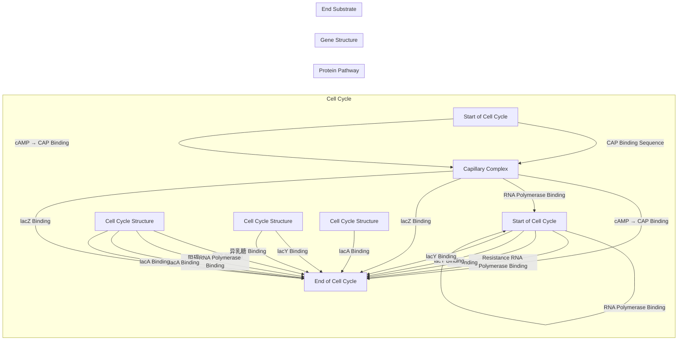
</details>

---

10.2 细菌基因转录和调控

411

合乳糖操纵子核心启动子区域下游，阻碍 RNA 聚合酶结合 DNA 从而抑制基因表达，代表了绝大多数转录抑制因子（transcription repressor）的作用机制。针对乳糖操纵子的后续研究发现，除受到 Lac I 的负向转录调控之外，乳糖操纵子还受到代谢产物活化蛋白（catabolite activator protein，CAP）的正向转录调控，CAP 结合第二信使环腺苷酸（cyclic adenosine monophosphate，cAMP）后，结合到乳糖操纵子的启动子区域上游，促进 RNA 聚合酶结合启动子 DNA，激活基因表达，因此该蛋白又被称为环腺苷酸受体蛋白（cAMP receptor protein，CRP）。

## 10.2.1 细菌基因转录的基本过程

细菌基因的启动子包含两种类型:$\sigma^{70}$ 启动子和 $\sigma^{54}$ 启动子。$\sigma^{70}$ 启动子通常包含两个核心元件:-10区和-35区。-10区（-10 box）序列位于转录起始位点上游约10个碱基处，长度为6碱基对（base pair, bp），保守序列特征为TATAAT；-35区（-35 box）序列位于转录起始位点上游约35个碱基处，长度为6bp，保守序列特征为TTGACA（图10-3）。细菌启动子-10区和-35区的序列保守程度与基因转录强度呈一定相关性。-10区和-35区之间的距离十分重要，一般为 $16\sim 18$ bp，小于$16\mathrm{bp}$ 或大于 $18\mathrm{bp}$ 的启动子一般转录活性较弱。核糖体RNA基因的启动子还存在UP元件（UP element），其序列富含A/T，能显著促进RNA聚合酶与启动子结合，增强其基因表达活性。部分基因还具有-10延长区（extended -10 element, EXT），鉴别区（discriminator element, DISC），核心酶识别区（core recognition element, CRE）。$\sigma^{54}$ 启动子包含-24区（-24 box）和-12区（-12 box），其保守序列特征分别为GGCA和TTGC。

细菌 RNA 聚合酶（RNA polymerase，RNAP）起始基因转录需要  $\sigma$  因子协助（有关细菌 RNA 聚合酶的发现过程见知识延展 10-3）。科学家在鉴定 RNA 聚合酶亚基组成的过程中，发现阴离子磷酸纤维素（phosphocellulose）层析方法能大大提高 RNA 聚合酶纯度，然而高纯度的 RNA 聚合酶却丧失了体外转录活性。随后发现该纯化步骤去掉了一个关键蛋白，将这个关键蛋白补充到体外转录实验可恢复 RNA 聚合酶转

录活性，因此这个蛋白被命名为 $\sigma$ 因子（sigma factor）。在后续研究中，科学家陆续鉴定出不同类别的 $\sigma$ 因子，例如大肠杆菌 $\sigma$ 因子包括 $\sigma^{70}$ 家族和 $\sigma^{54}$ 家族。$\sigma^{70}$ 家族成员包括 $\sigma^{70}$、$\sigma^{38}$、$\sigma^{32}$、$\sigma^{28}$、$\sigma^{24}$ 和 $\sigma^{19}$，而 $\sigma^{54}$ 家族只有一个成员，即 $\sigma^{54}$，它们通过识别不同的启动子各自分工大肠杆菌中的基因表达。

在转录起始阶段，RNAP 和  $\sigma$  因子组装成 RNAP- $\sigma$  全酶形式，识别启动子 DNA 起始 RNA 合成。 $\sigma^{70}$  家族因子具有 3 个保守结构域， $\sigma_{2}$ 、 $\sigma_{3,2}$  和  $\sigma_{4}$ 。 $\sigma_{2}$  和  $\sigma_{4}$  结构域结合在 RNA 聚合酶表


<details>
<summary>flowchart</summary>

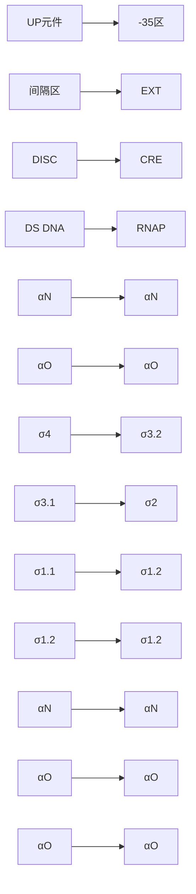
</details>

图 10-3 细菌核心启动子结构和序列识别方式

---

412

10 RNA 的生成

面， $\sigma_{3,2}$  深入 RNA 聚合酶内部。除保守结构域外，细菌看家  $\sigma$  因子（如大肠杆菌  $\sigma^{70}$ ）还包括  $\sigma_{1}$  和  $\sigma_{3,1}$  等区域（图 10-3）。RNAP 和  $\sigma$  因子共同负责识别启动子 DNA 序列。RNAP- $\alpha$ CTD 识别 UP 元件， $\sigma_{4}$  结构域识别 -35 区， $\sigma_{3,1}$  识别 EXT， $\sigma_{1,2}$  识别 DISC，RNAP 核心酶识别 CRE 区（图 10-3）。

RNAP- $\sigma$  全酶起始转录的过程可以分为 5 个阶段。① RPc（RNAP-promoter DNA closed complex）阶段:RNAP- $\sigma$  全酶通过  $\sigma_{4}$  结构域识别并结合启动子 -35 区，从而定位到基因启动子区域，在该阶段 RNAP- $\sigma$  全酶结合闭合形式的启动子双链 DNA。② RPi（RNAP-promoter DNA intermediate complex）阶段:RNAP- $\sigma$  全酶通过  $\sigma_{2}$  结构域在 -10 区逐渐解链启动子 DNA，并且将解链的部分核苷酸碱基（非模板链 -11A、-7T、+2G）结合在蛋白口袋中，一方面实现序列特异性识别，一方面稳定解链的单链 DNA。③ RPo（RNAP-promoter DNA open complex）阶段:RNAP- $\sigma$  全酶将启动子 DNA 解链约 13 bp（-11 到 +2）形成稳定的转录泡（transcription bubble），将单链模板链 DNA 置于催化中心，等待三磷酸核糖核苷酸（NTP）结合，起始 RNA 合成。④ RPitc（RNAP-promoter DNA initial transcribing complex）阶段，RNAP 聚合酶利用 NTP 起始 RNA 合成并逐渐延伸新生 RNA 链，在该过程中大量短片段 RNA（abortive transcript）被不断合成和释放。⑤ 当新生 RNA 延长至几个到十几个碱基后，RNAP 脱离启动子 DNA 往前行进，进入转录延伸阶段。

## 10.2.2 细菌转录起始调控

细菌主要通过 $\sigma$ 因子和转录因子调控基因转录起始。一个细菌基因组平均编码约10个 $\sigma$ 因子。细菌基因组 $\sigma$ 因子的编码数量与其生存环境复杂性呈正相关，例如生殖支原体基因组编码1个 $\sigma$ 因子，大肠杆菌基因组编码7个 $\sigma$ 因子，天蓝色链霉菌编码65个 $\sigma$ 因子。$\sigma$ 因子具有严谨的DNA序列识别特异性，因此每个 $\sigma$ 因子负责转录不同的基因操纵子。细菌基因组除了通过多个 $\sigma$ 因子调控基因表达之外，每个细菌基因组平均编码几百个转录因子，如大肠杆菌编码300多个转录因子。大多数转录因子具有DNA结合域（DNA-binding domain，DBD）和调节域（regulatory domain，RD）。转录因子在上游信号的调控下，通过改变自身构象或聚合状态，改变和DNA以及RNA聚合酶的相互作用能力，从而激活或抑制转录。

转录因子激活基因转录的机制复杂多样（图 10-4）。调控乳糖操纵子的 CRP 作为代表性转录因子，其转录激活机制被深入研究。CRP 的转录激活机制大概分为两种类型:在第一种类型中（class I activation），CRP 结合位于 -35 区上游的顺式元件，通过与 RNA 聚合酶 α 亚基的 C 端结构域（RNAP-αCTD）相互作用招募 RNA 聚合酶，激活基因转录。在第二种类型中（class II activation），CRP 结合位于与 -35 区部分重叠的顺式元件，同时与 RNAP-αCTD 和 σ 因子相互作用，激活基因转录。细菌大多数转录激活因子通过上述两类经典机制发挥作用。除此之外，研究者近年来发现转录因子还可以通过多种非经典方式激活基因转录:大肠杆菌 MerR 家族转录因子识别 -35/-10 区

---

10.2 细菌基因转录和调控

413

(A)


<details>
<summary>flowchart</summary>

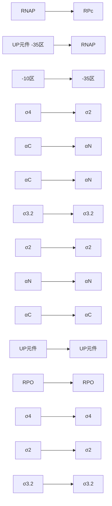
</details>

(B)


<details>
<summary>chemical</summary>

RNA polymerase II (RNA polymerase II) TAC structures showing CAP, αC, and αN subunits with 3.2σ regions and 35区 distances
</details>

(C)


<details>
<summary>flowchart</summary>

This diagram illustrates the interaction between UP elements and RNAP in a CueR-TAC model, showing interactions with stress states (σ2, σ3.2) and receptor subunits (αC, αN).
</details>


<details>
<summary>chemical</summary>

Diagram of RNA polymerase II (RNA polymerase II) showing transcriptional modification sites and restriction enzyme activity
</details>


<details>
<summary>chemical</summary>

Diagram of RbpA-CarD-TAC protein interaction showing transcriptional subunits and regulatory regions
</details>


<details>
<summary>chemical</summary>

Diagram of DksA-TraR-TAC protein structure showing alpha helices, sigma regions, and RNAP binding sites
</details>


<details>
<summary>flowchart</summary>

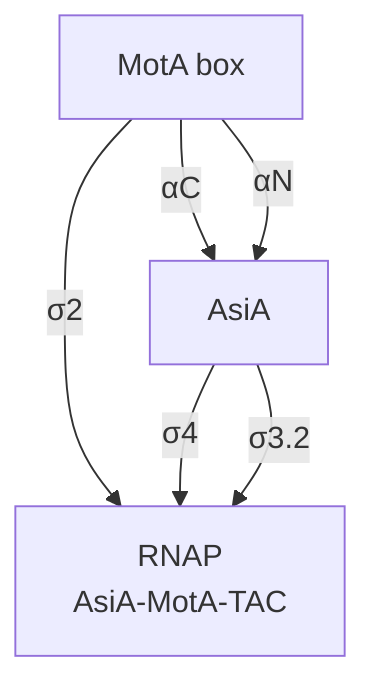
</details>


<details>
<summary>chemical</summary>

Diagram of PspF-σ54-TAC protein complex showing alpha-coupled and beta-sheets with labeled domains and interactions
</details>

图 10-4 细菌的转录激活机制示意图

（A）细菌转录起始过程中闭合复合物向开放复合物的转变（PDB 编号:6PSQ，4XLN）。（B）细菌经典的 Class I 和 Class II 激活模型（PDB 编

号:6B6H，5I2D)。(C)细菌的非经典激活模型（PDB编号:6LDI, 6KJ6, 6EDT, 7KHI, 6K4Y, 7QV9）。A, B改绘自Fang C, et al. Acta Biochim Biophys Sin (Shanghai), 2022, 54(1): 25-36.

---

414

10 RNA 的生成

中间区域的顺式元件，通过改变 DNA 构象激活转录；结核分枝杆菌 RbpA 和 CarD 等转录因子结合 RNAP- $\sigma$  全酶后，通过序列非特异性结合启动子 DNA，稳定转录起始复合物激活转录；大肠杆菌 Crl、DksA、TraR 和土拉弗朗西斯菌的 MglA-SspA 等转录因子不结合 DNA，而是通过稳定 RNAP- $\sigma$  活性构象激活转录；还有部分转录因子与  $\sigma_{4}$  结构域竞争结合 RNAP，引导 RNAP 特异性转录自身调控基因（如耻垢分枝杆菌的 PafBC，噬菌体 T4 编码的 AsiA/MotA）。调控  $\sigma^{54}$  家族的转录因子一般呈六聚体形式，其结合在核心启动子上游区域，在宿主整合因子（integration host factor，IHF）帮助下，利用 ATP 水解酶活性激活转录。转录因子抑制基因转录的机制相对简单，其主要通过序列特异性结合 DNA，阻遏 RNA 聚合酶结合启动子 DNA 或阻止 RNA 聚合酶前进。

## 10.2.3 细菌基因转录延伸

细菌基因转录延伸主要受到 NusG、GreA/B 和 NusA 等延伸因子调控，它们通过与 RNA 聚合酶及其他蛋白相互作用，共同影响 RNA 的延伸过程（图 10-5）。

NusG 在结构和功能上与真核生物中的 SPT5 因子类似。NusG 含有两个功能结构域:NGN 和 KOW 结构域。NGN 结构域与 RNA 聚合酶和上游 DNA 相互作用。在大肠杆菌中，NusG 单独作用时促进 RNA 聚合酶转录延伸。NusG 与转录终止因子  $\rho$  相互作用促进转录终止，与核糖体相互作用促进转录延伸和蛋白质翻译，NusG 的 KOW 结构域负责和核糖体、 $\rho$  因子相互作用。

NusA 是细菌和古菌特有的转录延伸因子，具有多个结构域。在大肠杆菌中，NusA 单独作用能够稳定转录暂停复合物，促进转录终止。NusA 也能与 NusG 协同作用促进转录与翻译偶联。

GreA/B 是转录校正因子，其功能与真核生物中的 TFII S 类似。在转录延伸过程中，RNA 聚合酶因碱基掺入错误而发生停滞时，GreA/B 结合到 RNA 聚合酶 NTP 通道激活其 RNA 水解活性，切除错配碱基，帮助 RNA 聚合酶重新启动转录延伸。

在转录延伸过程中，细菌 RNA 聚合酶以约 50 nt/s 的速度高效延伸 RNA 链，但遇到特定 DNA 序列、RNA 错配或 DNA 损伤时会发生转录暂停。细菌转录暂停过程包括序列诱导暂停（elemental pausing）和回溯暂停（backtracking pausing）。


<details>
<summary>text_image</summary>

RNAP
上游dsDNA
3'
5'
3'
NusG
NGN
3'
下游dsDNA
3'非模板链
5'模板链
DNA-RNA
杂合双链
GreA
NTP通道
5'
RNA
RNA
退出通道
核糖体
抗终止复合物
p因子
</details>

图10-5 细菌的转录延伸复合物

序列诱导暂停是 RNA 聚合酶转录延伸时自然发生的短暂停顿，不需要外部因素或调控因子介入，是由 RNA 聚合酶转录到具有特殊 DNA 序列时诱导发生。转录暂停的序列特征为  $G_{-10}Y_{-1}G_{+1}$  （其中 -1 对应于 RNA 3' 端，Y 代表 C 或 T）。

回溯暂停是指 RNA 聚合酶转录延伸过程中，遭遇 DNA 损伤、行进障碍或需要校正 RNA 合成错误时在 DNA 模板上后退导致的暂停。回溯暂停的 RNA 聚合酶如果不重新激活，会影响基因

---

10.2 细菌基因转录和调控

415

表达和 DNA 复制。细菌利用多种机制解除回溯暂停:Gre 因子切除错配 RNA 片段重新启动延伸；Mfd 蛋白将 RNAP 从受损的 DNA 上移除，UvrD 蛋白招募 DNA 损伤修复复合物促进 DNA 损伤修复。

细菌基因转录和蛋白质翻译紧密偶联（图10-6）。1970年，米勒等通过电子显微镜，首次观察到大肠杆菌mRNA链上同时存在RNA聚合酶和核糖体，并将与RNA聚合酶最接近的核糖体命名为前导核糖体（leading ribosome）。随后发现RNA聚合酶合成mRNA的速度与前导核糖体


<details>
<summary>flowchart</summary>


</details>

图10-6 细菌的转录翻译偶联调控

翻译蛋白质的速度保持一致，证明转录与翻译相互偶联。转录翻译偶联能够促进 RNA 聚合酶转录延伸，防止  $\rho$  因子提前与 RNA 聚合酶结合造成转录提前终止（premature transcription termination），保护 mRNA 不被核酸内切酶（RNase E）降解。近年来，多国科学家同步解析了细菌转录翻译偶联复合物的冷冻电镜结构，揭示了转录翻译偶联过程的复杂机制。

## 10.2.4 细菌基因转录终止

基因转录终止是 RNA 聚合酶停止 RNA 延伸、释放 RNA 并从 DNA 上解离的过程（图 10-7）。转录终止异常会干扰下游基因表达，阻碍 RNA 聚合酶循环利用，破坏基因组稳定性。细菌基因转录终止主要有两种方式:一种是固有转录终止（intrinsic termination），也称为  $\rho$  因子非依赖型转录终止；另一种是  $\rho$  因子依赖型转录终止（ $\rho$ -dependent termination）。此外，在一些特定的情况下，基因转录终止还可以通过 Mfd 蛋白移位，以及 RNA 聚合酶碰撞等方式实现。

细菌 RNA 聚合酶转录至固有终止子序列后自发终止转录的方式，称为固有转录终止。固有终止子由富含 G/C 的反向重复序列（inverted repeat sequence）和紧随其后的富含 T 的序列（U tract 序列）组成，转录出的 RNA 在 U tract 序列上游能够形成发卡结构。固有转录终止过程可分为 4 个步骤:① RNA 聚合酶转录至终止位点时，U tract 序列诱导转录暂停；②富含 G/C 的反向重复序列形成 RNA 发卡结构，撑开 RNA


图 10-7 细菌转录终止机制模型

PDB 编号:7YPA，8E6X，8E6W。改绘自 SANTANGELO T, et al. Nat Rev Microbiol, 2011, 9: 319-329.

---

416

10 RNA 的生成

聚合酶的 RNA 退出通道，诱导 RNA 聚合酶发生构象变化；③ RNA 发卡破坏 RNA 聚合酶催化中心的 RNA-DNA 杂合双链，诱导 RNA 解离；④ RNA 聚合酶从基因组 DNA 解离。

RNA聚合酶在 $\rho$ 因子帮助下终止基因转录的方式称为 $\rho$ 因子依赖型转录终止。 $\rho$ 因子通过识别结合rut（Rho-utilization）RNA，并利用其ATP依赖的 $5^{\prime}\rightarrow 3^{\prime}$ RNA转位酶活性终止转录。 $\rho$ 因子形成同源六聚体发挥以下功能:①处于开环状态的 $\rho$ 六聚体识别并结合rut RNA序列，每一个 $\rho$ 因子单体识别的保守序列特征为AAACCCAAUC；② $\rho$ 六聚体闭环并将下游RNA结合在六聚体通道中央；③ $\rho$ 因子水解ATP沿RNA $5^{\prime}\rightarrow 3^{\prime}$ 方向移动；④ $\rho$ 因子利用其RNA转位酶的活性将RNA从RNA聚合酶催化中心解离。在上述过程中，NusG发挥桥梁作用稳定RNA聚合酶和 $\rho$ 因子的相互作用，并同时促进 $\rho$ 因子的ATP水解活性。

## 10.3 真核生物 RNA 聚合酶

真核细胞中的细胞核基因转录由3个保守的RNA聚合酶分工完成:Pol I、Pol II和Pol III，高等植物还额外编码两个RNA聚合酶——Pol IV和Pol V。在细胞核中，Pol I负责转录核糖体RNA（ribosomal RNA，rRNA），包括5.8S rRNA、18S rRNA和28S rRNA。Pol II负责转录信使RNA（messenger RNA，mRNA）、小核仁RNA（small nucleolar RNA，snoRNA）、核内小RNA（small nuclear RNA，snRNA）、微RNA（microRNA），长非编码RNA（long non-coding RNA，lncRNA）等。Pol III负责转录转运RNA（transfer RNA，tRNA）、5S rRNA、U6 snRNA、7SL RNA及7SK RNA等短片段RNA。高等植物Pol IV合成24-nt siRNA前体，Pol V合成lncRNAs。

## 10.3.1 RNA聚合酶的发现和功能

1959 年，塞缪尔·韦斯（Samuel B. Weiss，1926—1997）将大鼠肝细胞核提取物与放射性  $\alpha-^{32}P-CTP$  和其他三种 NTP 共孵育，发现能够产生带有  ${}^{32}P$  标记的 RNA，并且该反应需要四种 NTP 参与，缺少任何一种 NTP 都会显著减少 RNA 的合成。他们进一步用碱将这些放射性标记的 RNA 产物水解成单核苷酸，发现所产生的四种单核苷酸都有一部分带放射性标记，说明在这个过程中， $\alpha-{}^{32}P-CTP$  是参与 RNA 链合成的，类似于 DNA 的合成过程，而不仅仅是添加到已有 RNA 链的末端。随后，杰拉德·赫维茨（Jerard Hurwitz，1928—2019）、奥黛丽·史蒂文斯（Audrey Stevens，1932—2010）以及詹姆斯·邦纳（James Bonner，1910—1996）分别在大肠杆菌和豌豆中也发现了类似的 RNA 合成活性，表明在原核生物和真核生物中均存在 RNA 聚合酶。1961 年韦斯和赫维茨几乎同时发现，当加入 DNase 或 RNase 后，RNA 合成被完全抑制，并且各种外源的 DNA 都能支持 RNA 的合成，首次证明了 RNA 合成依赖 DNA，DNA 为 RNA 合成提供了模板。到了 1962 年，赫维茨以及保罗·伯格（Paul Berg，

---

10.3 真核生物 RNA 聚合酶

417

1926—2023）成功从大肠杆菌中分离纯化出了大肠杆菌 RNA 聚合酶，并以大肠杆菌噬菌体  $\Phi X174$  复制期间双链 DNA 为模板在体外实现了 DNA 指导的 RNA 聚合酶催化合成 RNA。

真核生物中 RNA 聚合酶和染色质结合得非常紧密，溶解度很低，这使得分离纯化非常困难。直到 1969 年，罗伯特·罗德（Robert G. Roeder）利用高盐溶液在海胆胚胎核抽提物中首次分离纯化了三种形式的真核生物 RNA 聚合酶。罗德通过高盐破坏细胞核并将组蛋白解聚，随后通过超声打碎 DNA，释放出结合在 DNA 上的 RNA 聚合酶，并利用组蛋白溶解度低的特点，用低盐溶液使组蛋白沉淀，获得的上清

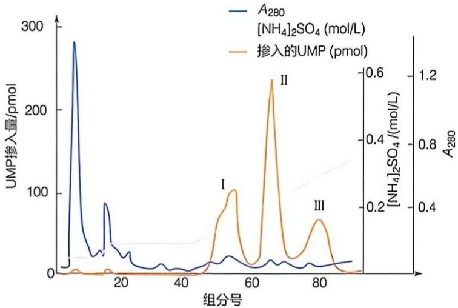

<details>
<summary>line</summary>

| 组分号 | A280 [NH4]2SO4 (mol/L) | 掺入的UMP (pmol) |
| --- | --- | --- |
| ~10 | ~0.28 | 0 |
| ~15 | ~0.08 | 0 |
| ~55 | ~0.02 | ~0.25 |
| ~65 | ~0.01 | ~0.6 |
| ~80 | ~0.01 | ~0.2 |
</details>

图10-8 真核生物三种RNA聚合酶（数据自ROEDER R G, et al. Nature, 1969, 224 (5216): 234-237.)

液经过 DEAE-Sephadex 离子交换柱分离，各个组分进行活性检测，最后分离得到三个具有 RNA 合成活性的蛋白洗脱峰，根据从柱上洗脱的顺序，将其依次命名为 RNA 聚合酶 I（Pol I）、RNA 聚合酶 II（Pol II）和 RNA 聚合酶 III（Pol III）（图 10-8）。随后他们进一步分离纯化了核仁和核质中的 RNA 聚合酶，发现 Pol I 主要定位在核仁，Pol II 和 Pol III 则存在于核质中。

这三种 RNA 聚合酶在功能上有什么区别呢？罗德发现，三种真核生物 RNA 聚合酶对一种从毒伞蘑菇中提取的药物  $\alpha-$  鹅膏蕈碱（ $\alpha-$  amanitin）的敏感性不同:低浓度的  $\alpha-$  鹅膏蕈碱会完全抑制 Pol II 的活性，此时，Pol I 和 Pol III 的活性不受影响；将  $\alpha-$  鹅膏蕈碱浓度提高 1000 倍后，Pol III 被抑制，而 Pol I 仍不受影响（图 10-9）。他们利用这个特性，用不同浓度的  $\alpha-$  鹅膏蕈碱与分离的细胞核孵育，检测所转录出来的 RNA，初步确认了三种 RNA 聚合酶主要负责转录的基因。这些结果的解析还比较初步，结合后续更为精确的体外转录实验，罗德证实了三种 RNA 聚合酶的功能:

Pol I 主要负责 rRNA 转录，Pol II 负责转录前体信使 RNA（pre-mRNA）、大多数 lncRNA 和 snRNA，Pol III 负责较小的 RNA，如 5S rRNA 和 tRNA 等的转录（表 10-1）。

高等植物 Pol IV 和 Pol V 的发现较晚。2000 年拟南芥基因组测序完成后，科学家意外发现植物细胞核基因组中还存在不属于 Pol I \~ III 的 RNA 聚合酶亚基基因，这些额外的 RNA 聚合酶亚基组成了植物特有的两种 RNA 聚合酶:Pol IV 和 Pol V。这两个 RNA 聚合酶在植物 RNA 介导的 DNA 甲基化（RNA-directed DNA methylation，RdDM）途径中发挥核心作用。Pol IV 与 RNA 依赖的 RNA 聚合酶 2（RNA-dependent RNA polymerase 2，RDR2）组成一个稳定的双 RNA 聚合酶复合物，在基因组特定区域以 DNA

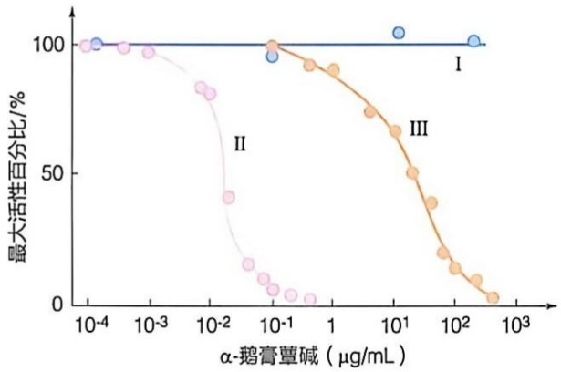

<details>
<summary>scatter</summary>

| \(\alpha-\beta-\)Glcucosamine (µg/mL) | Series I (Blue) | Series II (Pink) | Series III (Orange) |
| --- | --- | --- | --- |
| 10^-4 | 100 | 100 | — |
| ~3x10^-4 | — | 100 | — |
| ~10^-3 | — | 98 | — |
| ~6x10^-3 | — | 82 | — |
| ~7x10^-3 | — | 80 | — |
| ~2x10^-2 | — | 40 | — |
| ~4x10^-2 | — | 15 | — |
| ~6x10^-2 | — | 8 | — |
| ~8x10^-2 | — | 5 | — |
| ~10^-1 | 95 | 3 | 100 |
| ~2x10^-1 | — | 2 | 92 |
| ~4x10^-1 | — | — | 90 |
| ~8x10^-1 | — | — | 75 |
| ~10^1 | 105 | — | 65 |
| ~2x10^1 | — | — | 50 |
| ~4x10^1 | — | — | 38 |
| ~8x10^1 | — | — | 20 |
| ~1.5x10^2 | — | — | 15 |
| ~3x10^2 | 102 | — | 8 |
| ~4x10^2 | — | — | 2 |
</details>

图 10-9 三种 RNA 聚合酶对  $\alpha-$  鹅膏蕈碱的敏感性（数据自 ROEDER R G. Proc Natl Acad Sci U S A, 1974, 71(5): 1790-1794.）

---

418

10 RNA 的生成

表 10-1 真核生物 RNA 聚合酶转录产生的 RNA 产物

<table><tr><td>RNA 聚合酶</td><td>合成的细胞 RNA</td><td>成熟的 RNA(脊椎动物)</td></tr><tr><td>I</td><td>大的 rRNA 前体</td><td>28S、18S 和 5.8S rRNA</td></tr><tr><td rowspan="5">II</td><td>hnRNA</td><td>mRNA</td></tr><tr><td>snRNA 前体</td><td>snRNA</td></tr><tr><td>pri-miRNA</td><td>miRNA</td></tr><tr><td>snoRNA 前体</td><td>snoRNA</td></tr><tr><td>lncRNA 前体</td><td>lncRNA</td></tr><tr><td rowspan="5">III</td><td>5S rRNA 前体</td><td>5S rRNA</td></tr><tr><td>tRNA 前体</td><td>tRNA</td></tr><tr><td>U6 snRNA 前体</td><td>U6 snRNA</td></tr><tr><td>7SL RNA 前体</td><td>7SL RNA</td></tr><tr><td>7SK RNA 前体</td><td>7SK RNA</td></tr></table>

为模板合成双链 siRNA 前体，这些双链 siRNA 前体经过 Dicer 蛋白加工后形成 24-nt siRNA，随后被装配到 Argonaute 蛋白。Pol V 在含有类似序列的区域转录 lncRNA，通过 lncRNA 与 siRNA 的序列配对，将 Argonaute 蛋白招募到 Pol V 转录延伸复合物，随后进一步招募 DNA 甲基化酶完成该区域的 DNA 甲基化。

## 10.3.2 RNA Pol II 的组成、结构与催化机制

RNA 聚合酶核心酶的各个亚基归属于一种双桶型聚合酶家族（double-barrel RNA polymerase family），该家族在所有生物中都存在。核心酶的结构特征为两个较大的亚基共同构成的双桶型活性中心，每个亚基都包含一个由  $\beta$  折叠构成的桶状结构域，用来结合 DNA 模板并催化核糖核苷酸形成磷酸二酯键，从而合成 RNA。在真核生物中，Pol I、Ⅱ和Ⅲ分别含有 14、12 和 17 个亚基，结构较为复杂。Pol Ⅱ合成 pre-mRNA，在基因表达调控中发挥核心作用，因此成为研究的重点。

1990年，理查德·杨（Richard Young）等通过在聚合酶亚基上引入表位标签（epitope tagging）并结合亲和层析技术，确定了Pol II的10个亚基成分。到1992年，罗杰·科恩伯格（Roger Kornberg）等利用免疫共沉淀法进一步分离并纯化了酵母的Pol II全酶，鉴定出12个亚基，即Rpb1～Rpb12（人的Pol II全酶由POLR2A～POLR2L组成，常用“RPB1～RPB12”表示）。在大亚基Rpb1的羧基端存在一个特殊结构域，称为羧基端结构域（carboxyl-terminal domain，CTD），由高度保守的七肽重复序列（Tyr1-Ser2-Pro3-Thr4-Ser5-Pro6-Ser7，$\mathrm{Y}^{1}\mathrm{S}^{2}\mathrm{P}^{3}\mathrm{T}^{4}\mathrm{S}^{5}\mathrm{P}^{6}\mathrm{S}^{7}$）组成。这一结构在真核生物中高度保守，且其重复数量通常与物种进化程度呈正相关。CTD序列含有多种翻译后修饰位点，尤其是Tyr1、Ser2、Thr4、Ser5和Ser7位点的磷酸化状态与转录阶段密切相关，参与协调转录与共转录过程。

---

10.3 真核生物 RNA 聚合酶

419

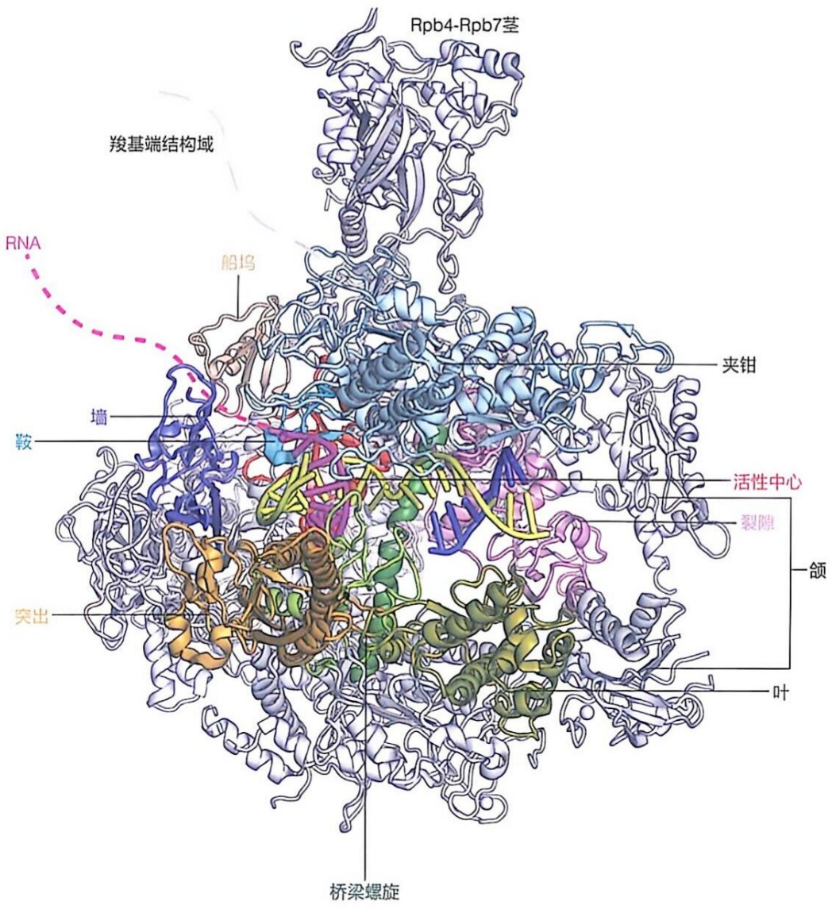

<details>
<summary>text_image</summary>

Rpb4-Rpb7茎
羧基端结构域
RNA
船坞
夹钳
墙
鞍
活性中心
裂隙
颌
突出
叶
桥梁螺旋
</details>

图 10-10 酵母 RNA Pol II 的结构模型

酵母RNA聚合酶Ⅱ延伸复合

物结构（PDB 编号:1Y1W）

2000 年和 2001 年，科恩伯格等解析了酵母 RNA Pol II 的晶体结构（图 10-10）。结果显示，Pol II 的核心酶由大亚基 Rpb1 和 Rpb2 组成，这两个亚基位于带正电的裂隙的两侧，其转录活性位点位于裂隙底部，并结合两个  $Mg^{2+}$ 。活性口袋大量正电荷区域帮助 Pol II 结合酸性 DNA 模板链。Rpb1 的夹钳（clamp）和 Rpb2 的叶（lobe）与突出（protrusion）结构域共同抓取 DNA。活性中心接近孔（pore）结构域，孔结构通向 Pol II 表面，形成一个倒置漏斗状结构，允许转录底物 NTP 进入活性位点，这与细菌 RNA 聚合酶的“第二通道”相似。其他亚基围绕核心酶起支撑和稳定作用。

2001年，科恩伯格团队报道了酵母PolⅡ结合DNA-RNA的晶体结构，提出了PolⅡ催化RNA合成的分子机制。RNA PolⅡ以DNA双链中的模板链为模板，利用NTP作为原料，根据碱基互补配对原则，从 $5^{\prime} \rightarrow 3^{\prime}$ 方向催化生成RNA链。催化中心活性氨基酸及 $\mathrm{Mg}^{2+}$ 促进RNA链末端的 $3^{\prime}-\mathrm{OH}$ 基团攻击新进入的NTP的 $\alpha-$ 磷酸，与核糖的 $3^{\prime}-\mathrm{OH}$ 形成磷酸二酯键，焦磷酸根释放后，聚合酶沿模板链前移一个碱基，打开下游DNA双链，继续下一轮反应。

---

420

10 RNA 的生成

在此过程中，进入转录腔的 DNA 在桥梁螺旋（bridge helix）上方解链，使得单链 DNA 穿过活性位点并在上游重新配对成双链（图 10-11）。活性中心中，Rpb1 的天冬氨酸环（aspartate loop）、桥梁螺旋和触发环（trigger loop）共同形成一个高度活动的棘轮结构，其中桥梁螺旋在直线和弯曲构象之间切换，完成对 RNA-DNA 杂交链的转位（图 10-12）。夹钳和墙（wall）之间的盖（lid）和鞍（saddle）结构域形成一个狭窄的通

图 10-11 RNA Pol II 催化 RNA 合成的分子机制  
(A) Pol II 活性中心结构 (PDB 编号: 1Y1W)。(B) 转录泡与 Pol II 中参与维持转录泡的关键元件。B, 改绘自 GNATTAL, et al. Science, 292 (5523): 1876-1882.

(A)

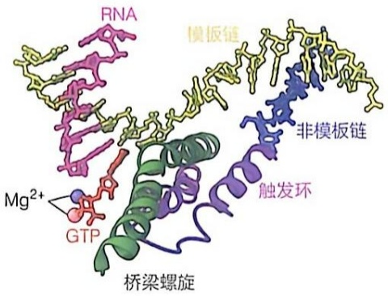

<details>
<summary>text_image</summary>

RNA
模板链
Mg²⁺
GTP
桥梁螺旋
非模板链
触发环
</details>

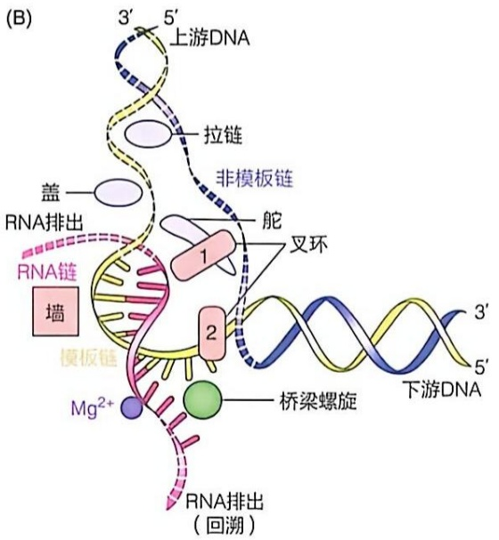

<details>
<summary>text_image</summary>

(B)
3' 5'
上游DNA
拉链
非模板链
盖
RNA排出
RNA链
墙
模板链
Mg²⁺
1
2
舵
叉环
桥梁螺旋
RNA排出
(回溯)
下游DNA
3'
5'
</details>

(A)

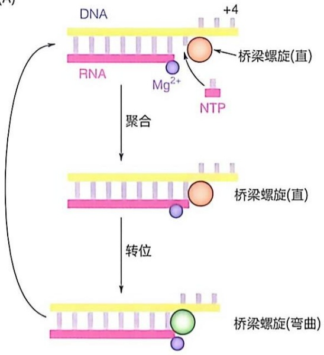

<details>
<summary>flowchart</summary>

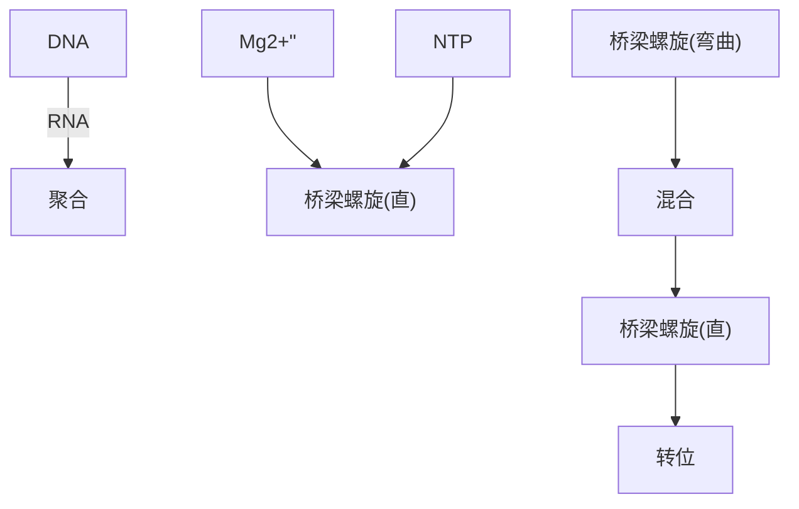
</details>

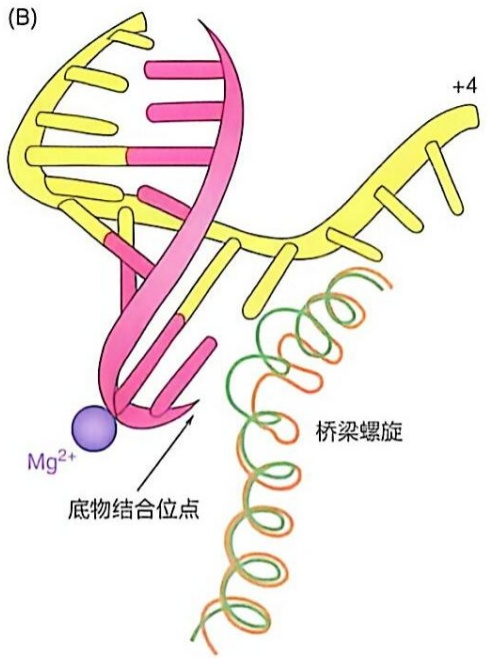

<details>
<summary>text_image</summary>

(B)
Mg²⁺
底物结合位点
+4
桥梁螺旋
</details>

图 10-12 转位机制

（A）转位机制模式图，桥梁螺旋最初处于直线构象状态（橙黄色圆点），为核苷酸进入活性位点（紫色圆点表示的 $\mathrm{Mg}^{2+}$ ）空出一个空隙。在合成步骤中，核苷酸（NTP）添加到正在生长的RNA链的3'端，填充RNA链的3'端与处于直线构象状态的桥梁螺旋之间的空隙；在转位步骤中，DNA-RNA杂交链向左移动一个碱基的距离，使

模板链的下一个核苷酸进入活性位点。同时，桥梁螺旋发生弯曲（绿色圆点），与RNA链的3'端相接触。当桥梁螺旋恢复到直线构象状态时，再次打开核苷酸入口，使活性位点允许下一个核苷酸进入。（B）桥梁螺旋的直线构象和弯曲构象。橙色螺旋代表直线构象，绿色螺旋代表弯曲构象。弯曲的桥梁螺旋与正在生长的RNA链的3'端靠近。A，B改绘自GNATT A L, et al. Science, 292 (5523): 1876-1882.

---

10.3 真核生物 RNA 聚合酶

421

道，允许单链 RNA 穿过，5' 端从此 RNA 出口通道（RNA exit channel）排出。触发环、桥梁螺旋以及催化活性位点的氨基酸与新进入的底物 NTP 形成相互作用网络，辨别出错误的 NTP、dNTP，并将正确的 NTP 置于反应中心（图 10-13）。α-鹅膏蕈碱与 Pol II 的共结晶结构显示，α-鹅膏蕈碱可以通过束缚桥梁螺旋抑制 DNA-RNA 杂交链的转位，从而抑制 RNA 合成。

如果 RNA 的 3' 端掺入了错配核苷酸，聚合酶能够感知错配并沿 DNA 模板链反方向回溯，引发聚合酶校正机制。聚合酶本身有较低的固有切割（intrinsic cleavage）活性，能够通过金属离子活化的水分子直接进攻磷酸二酯键切割掉错误掺入的核苷酸。转录延伸因子 TF II S 结合 Pol II 后，其发夹结构伸入 Pol II 活性中心激活 Pol II 的切割活性。当转录遇到 DNA 模板链损伤时，也会触发 Pol II 的回溯和校正机制。

## 10.3.3 RNA 聚合酶的进化

细菌、古菌和真核生物的多亚基 RNA 聚合酶起源于一个 30 多亿年前的共同祖先，因此它们的亚基组成和三维结构高度相似（图 10-14）。所有

多亚基 RNA 聚合酶都包含构成催化中心的两个催化亚基（细菌 RNA 聚合酶的  $\beta'$  和  $\beta$  亚基，Pol II 的 RPB1 和 RPB2 亚基），两个负责组装功能的装配亚基（细菌 RNA 聚合酶的两个  $\alpha$  亚基，Pol II 的 RPB3 和 RPB11 亚基），以及一个辅助亚基（细菌 RNA 聚合酶的  $\omega$  亚基，Pol II 的 RPB6 亚基）。这些亚基共同折叠成一个类似蟹钳的结构。随着古菌和真核生物在进化过程中逐渐分化，为了适应更加复杂的环境和更多层次的基因表达调控，古菌-真核生物的祖先招募了多个辅助亚基，演化成至少包含 12 个亚基的复杂结构（如 Pol II 的 RPB1～RPB12 亚基）。在约 20 亿年前，古菌和真核生物的谱系进一步分化，导致真核生物的 RNA 聚合酶分化为三种功能特化类型——Pol I、Pol II 和 Pol III。除了功能相似的 12 个亚基外，Pol I 和 Pol III 还进化出专属亚基，这些专属亚基与调控 Pol II 的转录因子具有同源性。

植物细胞的 RNA 聚合酶仍然在持续发生演化。被子植物从 Pol II 演化形成两个植物专属的 RNA 聚合酶:Pol IV 和 Pol V。系统发育分析结果表明，编码 Pol IV 和 Pol V 的特有亚基基因起源于编码其祖先 Pol II 对应亚基基因的基因重复；其中，产生 Pol IV / V 特异亚基（NRPD1/E1、NRPD2/E2 和 NRPD7/E7）的关键基因重复发生在陆地

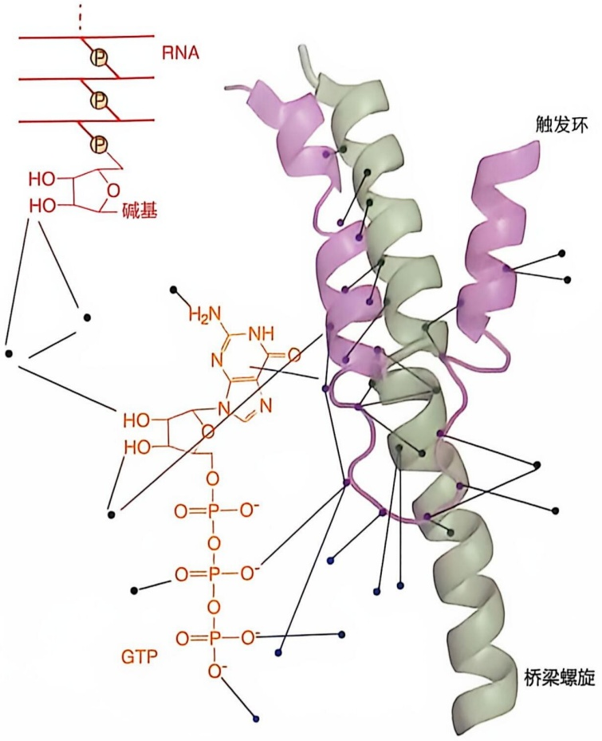

<details>
<summary>chemical</summary>

Molecular structure diagram of a nucleic acid derivative with labeled components including RNA, phosphate groups, and GTP, and a structural representation of the protein's structural domains.
</details>

图 10-13 RNA Pol II 催化中心与底物 NTP 形成的相互作用网络圆点表示 Pol II 中与底物和 RNA 相互作用的氨基酸，黑色和蓝色分别表示 RPB1 亚基和 RPB2 亚基中非触发环 / 桥梁螺旋的氨基酸。改绘自 WANG D, et al. Cell, 2006, 127 (5): 941-954.

---

422

10 RNA 的生成

(A)

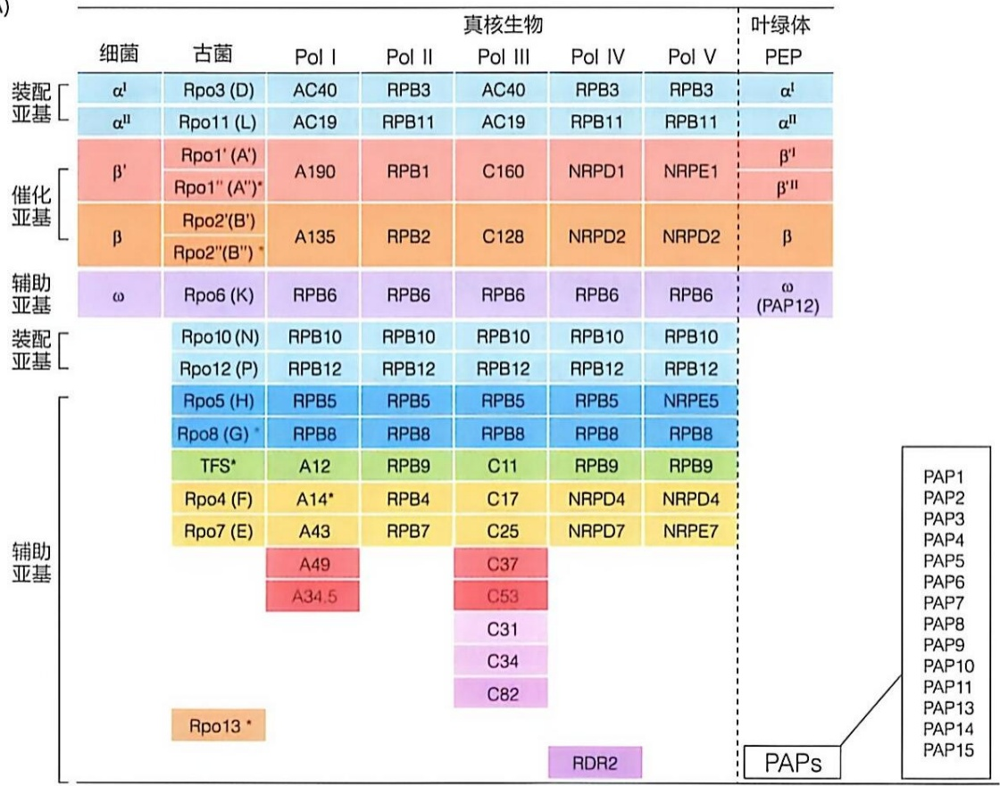

<details>
<summary>heatmap</summary>

| Group | Strain | Gene | Pol I | Pol II | Pol III | Pol IV | Pol V | PEP |
| --- | --- | --- | --- | --- | --- | --- | --- | --- |
| 装配亚基 | 细菌 | \(\alpha^{1}\) | Rpo3 (D) | AC40 | RPB3 | AC40 | RPB3 | \(\alpha^{1}\) |
| 装配亚基 | 细菌 | \(\alpha^{II}\) | Rpo11 (L) | AC19 | RPB11 | AC19 | RPB11 | \(\alpha^{II}\) |
| 催化亚基 | 细菌 | \(\beta'\) | Rpo1' (A') | A190 | RPB1 | C160 | NRPD1 | \(\beta^{I}\) |
| 催化亚基 | 细菌 | \(\beta\) | Rpo1'' (A'')* | A190 | RPB1 | C160 | NRPD1 | \(\beta^{II}\) |
| 辅助亚基 | 细菌 | \(\omega\) | Rpo6 (K) | RPB6 | RPB6 | RPB6 | RPB6 | \(\omega\) (PAP12) |
| 装配亚基 | 细菌 | — | Rpo10 (N) | RPB10 | RPB10 | RPB10 | RPB10 | — |
| 装配亚基 | 细菌 | — | Rpo12 (P) | RPB12 | RPB12 | RPB12 | RPB12 | — |
| 辅助亚基 | 细菌 | — | Rpo5 (H) | RPB5 | RPB5 | RPB5 | RPB5 | — |
| 辅助亚基 | 细菌 | — | Rpo8 (G)* | RPB8 | RPB8 | RPB8 | RPB8 | — |
| 辅助亚基 | 细菌 | — | TFS* | A12 | RPB9 | C11 | RPB9 | — |
| 辅助亚基 | 细菌 | — | Rpo4 (F) | A14* | RPB4 | C17 | NRPD4 | — |
| 辅助亚基 | 细菌 | — | Rpo7 (E) | A43 | RPB7 | C25 | NRPD7 | — |
| 辅助亚基 | 细菌* | — | — | A49* | — | C37* | — | — |
| 辅助亚基 | 细菌* | — | — | A34.5* | — | C53* | — | — |
| 辅助亚基 | 细菌* | — | — | — | — | C31* | — | — |
| 辅助亚基 | 细菌* | — | — | — | — | C34* | — | — |
| 辅助亚基 | 细菌* | — | — | — | — | C82* | — | — |
| 辅助亚基 | 细菌* | Rpo13* | — | — | — | — | — | PAPs |
| 辅助亚基 | 细菌 | 古菌 | Pol I | Pol II | Pol III | Pol IV | Pol V | 叶绿体 PEP |
| 辅助亚基 | 细菌 | 古菌 | Pol I | Pol II | Pol III | Pol IV | Pol V | 叶绿体 PEP |
| 辅助亚基 | 细菌 | 古菌 | Pol I | Pol II | Pol III | Pol IV | Pol V | 叶绿体 PEP |
| 辅助亚基 | 细菌 | 古菌 | Pol I | Pol II | Pol III | POLIV | POLV | 叶绿体 PEP |
</details>

\*表示只存在于一些物种中

(B)

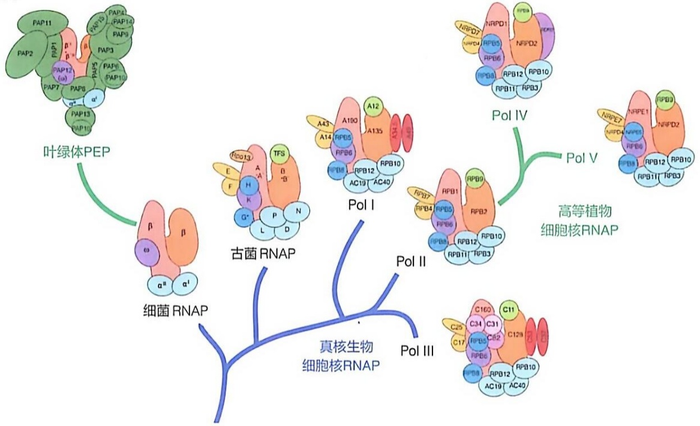

<details>
<summary>flowchart</summary>

```mermaid
graph LR
  A["叶绿体PEP"] --> B["细菌 RNAP"]
  B --> C["真核生物细胞核RNAP"]
  D["Pol I"] --> E["Pol II"]
  F["Pol IV"] --> G["Pol V"]
  H["Pol III"] --> I["高等植物细胞核RNAP"]
  
  subgraph Leaf_Green_Body["\"叶绿体\" [Leaf Green Body]"]
    direction TB
  A1["&quot;PAP2, PAP3, PAP4, PAP5, PAP6, PAP7, PAP8, PAP9, PAP10, PAP11, PAP12, PAP13"] --> B1["β-α β-β"]
  B1 --> C1["αB αA"]
  C1 --> D1["TFS"]
  D1 --> E1["A12, A135, A143, A154, A160"]
  E1 --> F1["&quot;RPB10, RPB12, RPB13, RPB14, RPB15, RPB16, RPB17, RPB18, RPB19, RPB20, RPB21, RPB22, RPB23, RPB24, RPB25, RPB26, RPB27, RPB28, RPB29, RPB30, RPB31, RPB32, RPB33, RPB34, RPB35, RPB36, RPB37, RPB38, RPB39, RPB40, RPB41, RPB42, RPB43, RPB44, RPB45, RPB46, RPB47, RPB48, RPB49, RPB50, RPB51, RPB52, RPB53<br>  end<br>  <br>  subgraph RNAP_Acute_RNA_Polymerase[&quot;\&quot;细菌 RNAP\&quot; [Acute RNA Polymerase"]"]
    direction TB
    B2["α-β β-β"]
    B3["αB αA"]
    B4["TFS"]
    B5["A-A-B-C-D-G-L-P-N"]
    B6["A12, A135, A143, A154, A160"]
    B7["RPB10, RPB12, RPB13, RPB14, RPB15, RPB16, RPB17, RPB18, RPB19, RPB20, RPB21, RPB22, RPB23, RPB24, RPB25, RPB26, RPB27, RPB28, RPB29, RPB3<nl><br>  subgraph nRNA_Polymerase_Complex[&quot;\&quot;真核生物\nRNA Polymerase Complex\&quot;"]
    direction TB
  C1 --> D1
  D1 --> E1
  E1 --> F1
  F1 --> G1["RPB10"]
  G1 --> H1["RPB12"]
  H1 --> I1["RPB13"]
  I1 --> J1["RPB14"]
  J1 --> K1["RPB15"]
  K1 --> L1["RPB16"]
  L1 --> M1["RPB17"]
  M1 --> N1["RPB18"]
  N1 --> O1["RPB19"]
  O1 --> P1["RPB20"]
  P1 --> Q1["RPB21"]
  Q1 --> R1["RPB22"]
  R1 --> S1["RPB23"]
  S1 --> T1["RPB24"]
  T1 --> U1["RPB25"]
  U1 --> V1["RPB26"]
  V1 --> W1["RPB27"]
  W1 --> X1["RPB28"]
  X1 --> Y1["RPB29"]
  Y1 --> Z1["RPB30"]
  Z1 --> AA1["RPB31"]
  AA1 --> AB1["RPB32"]
  AB1 --> AC1["RPB33"]
  AC1 --> AD["RPB34"]
  AD --> AE["RPB35"]
  AE --> AF["RPB36"]
  AF --> AG["RPB37"]
  AG --> AH["RPB38"]
  AH --> AI["RPB39"]
  AI --> AJ["RPB40"]
  end
  
  subgraph RNA_Polymerase_Complex["\"真核生物\" [RNA Polymerase Complex]"]
    direction TB
    B2 -.->|"αB αA"| C2["&quot;C-β-β-β-β-β-β-β-β-β-β-β-β-β-β-β-β-β-β-β-β-β-β-β-β-β-β-β-β-β-β-β-β-β-β-β-β-β-β-β-β-β-β-β-β-β-β-β-β-β-β- β-β-β-β-β-β-β-β-β-β-β-β-β-β-β-β-β-β-β-β-β-β-β-β-β-β-β-β-β-β-β-β-β-β-β-β-β-β-β-β-β-β-β-β-β-β-β-β-β-β-μ β - β - β - β - β - β - β - β - β - β - β - β - β - β - β - β - β - β - β - β - β - β - β - β - β - β - β - β - β - β - β - β - β - β - β - β - β - β - β - β - β - β - β - β - β - β - β - β - β - β - β |<br>  end<br>  <br>  subgraph RNA_Polymerase_Complex_2[&quot;\&quot;真核生物\&quot; [RNA Polymerase Complex"]"]
    direction TB
  C2 --> D2["&quot;C+α+α+α+α+α+α+α+α+α+α+α+α+α+α+α+α+α+α+α+α+α+α+α+α+α+α+α+α+α+α+α+α+α+α+α+α+α+α+α+α+α+α+α+α+α+α+α+α+α+α+ α + β + γ + δ + γ + δ + γ + δ + γ + δ + γ + δ + γ + δ + γ + δ + γ + δ + γ + δ + γ + δ + γ + δ + γ + δ + γ + δ + γ + δ + γ + δ + γ + δ + γ + δ + γ + δ + γ + δ + γ + δ + γ + δ + γ + δ + γ + δ + γ + δ + γ + δ + γ +δ + γ + δ + γ + δ + γ + δ + γ + δ + γ + δ + γ + δ + γ + δ + γ + δ + γ + δ + γ + δ + γ + δ + γ + δ + γ + δ + γ + δ + γ + δ + γ + δ + γ + δ + γ + δ + γ + δ + γ + δ + γ + δ + γ + δ + γ + δ + γ + δ + γ + σ +<br>  end<br>  <br>  subgraph RNA_Polymerase_Complex_3[&quot;\&quot;真核生物\&quot; [RNA Polymerase Complex"]"]
    direction TB
  C2 --> D3["&quot;C+α+α+α+α+α+α+α+α+α+α+α+α+α+α+α+α+α+α+α+α+α+α+α+α+α+α+α+α+α+α+α+α+α+α+α+α+α+α+α+α+α+α+α+α+α+α+α+α+ α+, α+, α-, α+, α-, α+, α+, α+, α+, α+, α+, α+, α+, α+, α+, α+, α+, α+, α+, α+, α+, α+, α+, α+, α+, α+, α+, α+, α+, α+, α+, α+, α+, α+, α+, α+, α+, α+, α+, α+, α+, α+, α+, α+, α+, α+, α+, α+, α+, α+, α+, α+, α+, α+, α+, α+<br>  end<br>  <br>  subgraph RNA_Polymerase_Complex_4[&quot;\&quot;真核生物\&quot; [RNA Polymerase Complex"]"]
    direction TB
  C2 --> D4["&quot;C+α+α+α+α+α+α+α+α+α+α+α+α+α+α+α+α+α+α+α+α+α+α+α+α+α+α+α+α+α+α+ α+, α+, α-, α+, α+, α+, α+, α+, α+, α+, α+, α+, α+, α+, α+, α+, α+, α+, α+, α+, α+, α+, α+, α+, α+, α+, α+, α+, α+<br>  end<br>  <br>  subgraph RNA_Polymerase_Complex_5[&quot;\&quot;真核生物\&quot; [RNA Polymerase Complex"]"]
    direction TB
  C2 --> D5["&quot;C+α+α+α+α+α+α+α+α+α+α+α+α+α+α+α+α+ α-, G-, H-, K-, L-, D-, N-, G-, H-, K-, L-, D-, N-, G-, H-, K-, L-, D-, N-, G-, H-, K-, L-, D-, N-, G-, H-, K-, L-, D-, N-, G-, H-, K-, L-, D-, N-, G-, H-, K-, L-, D-, N-, G-, H-, K-, L-, D-, N-, G-, H-, K-, L-, D-, N-, G-, h-<br>  end<br>  <br>  subgraph RNA_Polymerase_Complex_6[&quot;\&quot;真核生物\&quot; [RNA Polymerase Complex"]"]
    direction TB
  C2 --> D6["&quot;C=O-\alpha-\alpha-\alpha-\alpha-\alpha-\alpha-\alpha-\alpha-\alpha-\alpha-\alpha-\alpha-\alpha-\alpha-\alpha-\alpha-\alpha-\alpha-\alpha-\alpha-\alpha-\alpha-\alpha-\alpha-\alpha-\alpha-\alpha-\alpha-\alpha-\alpha-\alpha-\alpha-\alpha-\alpha-\alpha-\alpha-\alpha-\alpha-\alpha-\alpha-\alpha-\alpha-\alpha-\alpha-\alpha-\alpha-\alpha-\alpha-\alpha-\alpha-\beta+\gamma+\delta+\gamma+\delta+\gamma+\delta+\gamma+\delta+\gamma+\delta+\gamma+\delta+\gamma+\delta+\gamma+\delta+\gamma+\delta+\gamma+\delta+\gamma+\delta+\gamma+\delta+\gamma+\delta+\gamma+\delta+\gamma+\delta+\gamma+\delta+\gamma+\delta+\gamma+\delta+\gamma+\delta+\gamma+\delta+\gamma+\delta+\gamma+\delta+\gamma+\delta+\gamma+\delta+\gamma+\delta+\gamma+\sigma +<br>  end<br>  <br>  subgraph RNA_Polymerase_Complex_7[&quot;\&quot;真核生物\&quot; [RNA Polymerase Complex"]"]
    direction TB
  C2 --> D7["&quot;C=O-\alpha-\alpha-\alpha-\alpha-\alpha-\alpha-\alpha-\alpha-\alpha-\alpha-\alpha-\alpha-\alpha-\alpha-\alpha-\alpha-\alpha-\alpha-\alpha-\alpha-\alpha-\alpha-\alpha-\alpha-\alpha-\alpha-\alpha-\alpha-\alpha-\beta+\gamma+\delta+\gamma+\delta+\gamma+\delta+\gamma+\delta+\gamma+\delta+\gamma+\delta+\gamma+\delta+\gamma+\delta+\gamma+\delta+\gamma+\beta+\beta+\beta+\beta+\beta+\beta+\beta+\beta+\beta+\beta+\beta+\beta+\beta+\beta+\beta+\beta+\beta+\beta+\beta+\beta+\beta+\beta+\beta+\beta+\beta+\beta+\beta+\beta+\beta+\beta+\beta+\beta+\beta+\beta+\beta+\beta+\beta+\beta+\beta+\beta+\beta+\beta+\beta+\beta+\beta+\beta+\beta+\beta+\beta+\beta+\mu +<br>  end<br>  <br>  subgraph RNA_Polymerase_Complex_8[&quot;\&quot;真核生物\&quot; [RNA Polymerase Complex"]"]
    direction TB
  C2 --> D8["&quot;C=O-\alpha-\alpha-\alpha-\alpha-\alpha-\alpha-\alpha-\alpha-\alpha-\alpha-\alpha-\alpha-\alpha-\alpha-\alpha-\alpha-\alpha-\alpha-\alpha-\alpha-\alpha-\alpha-\alpha-\alpha-\alpha-\alpha-\alpha-\alpha-\alpha-\beta+\gamma+\delta+\gamma+\delta+\gamma+\delta+\gamma+\delta+\gamma+\delta+\gamma+\delta+\gamma+\delta+\gamma+\delta+\gamma+\sigma +<br>  end<br>  <br>  subgraph RNA_Polymerase_Complex_9[&quot;\&quot;真核生物\&quot; [RNA Polymerase Complex"]"]
    direction TB
  C2 --> D9["C=O-\alpha-\alpha-\alpha-\alpha-\alpha-\alpha-\alpha-\alpha-\alpha-\alpha-\alpha-\alpha-\alpha-\alpha-\alpha-\alpha-\alpha-\alpha-\alpha-\alpha-(a), a,b,c,d,e,f,g,h,i,j,k,l,k,l,k,l,k,l,k,l,k,l,k,l,k,l,k,l,k,l,k,l,k,l,k,l,k,l,k,l,k,l,k,l,k,l,k,l,k,l,k,l,k,l,k,l,k,l,k,l,k,l,k,l,k,l,k,l,k,l,k,l,k,l,k,l,k,l,k,l,k,l,k,l,k,l,k,l,k,l,k,l,k,l,k,l,k,l,k,l,k,l,k,l,k,l,k,l,k,l,kl,m,n,m,n,m,n,m,n,m,n,m,n,m,n,m,n,m,n,m,n,m,n,m,n,m,n,m,n,m,n,m,n,m,n,m,n,m,n,m,n,m,n,m,n,m,n,m,n,m,n,m,n,m,n,m,n,m,n,m,n,m,n,m,n,m,n,m,n,m,n,m,n,m,n,m,n,m,n,m,n,m,n,m,n,m,n,m,n,m,n,m,n,m,n,m,n,m,n,m,n,mn,mn,mn,mn,mn,mn,mn,mn,mn,mn,mn,mn,mn,mn,mn,mn,mn,mn,mn,mn,mn,mn,mn,mn,mn,mn,mn,mn,mn,mn,mn,mn,mn,mn,mn,mn,mn,mn,mn,mn,mn,mn,mn,mn,mn,mn,mn,mn,mn,mn,mm,r,s,r,s,r,s,r,s,r,s,r,s,r,s,r,s,r,s,r,s,r,s,r,s,r,s,r,s,r,s,r,s,r,s,r,s,r,s,r,s,r,s,r,s,r,s,r,s,r,s,r,s,r,s,r,s,r,s,r,s,r,s,r,s,r,s,r,s,r,s,r,s,r,s,r,s,r,s,r,s,r,s,r,s,r,s,r,s,r,s,r,s,r,s,r,s,r,s,r,s,r,Sr,I,rS,I,rS,I,rS,I,rS,I,rS,I,rS,I,rS,I,rS,I,rS,I,rS,I,rS,I,rS,I,rS,I,rS,I,rS,I,rS,I,rS,I,rS,I,rS,I,rS,I,rS,I,rS,I,rS,I,rS,I,rS,I,rS,I,rS,I,rS,I,rS,I,rS,I,rS,I,rS,I,rS,I,rS-I,rS-I,rS-I,rS-I,rS-I,rS-I,rS-I,rS-I,rS-I,rS-I,rS-I,rS-I,rS-I,rS-I,rS-I,rS-I,rS-I,rS-I,rS-I,rS-I,rS-I,rS-I,rS-I,rS-I,rS-I,rS-I,rS-I,rS-I,rS-I,rS-I,rS-I,rS-I,rS-I,rS-I-rS-I,rS-I-rS-I-rS-I-rS-I-rS-I-rS-I-rS-I-rS-I-rS-I-rS-I-rS-I-rS-I-rS-I-rS-I-rS-I-rS-I-rS-I-rS-I-rS-I-rS-I-rS-I-rS-I-rS-I-rS-I-rS-I-rS-I-rS-I-rS-I-rS-I-rS-I-rS-I-rS-I-rS-I-rS-I-rs,V,v,v,v,v,v,v,v,v,v,v,v,v,v,v,v,v,v,v,v,v,v,v,v,v,v,v,v,v,v,v,v,v,v,v,v,v,v,v,v,v,v,v,v,v,v,v,v,v,v,v,v,v,v,v,v,v,v,v,v,v,v,v,v,v,v,v,v,v,v,v,v,v,v,v,v,v,v,v,v,v,v,v,v,v,v,v,v,v,v,v,v.v.v.v.v.v.v.v.v.v.v.v.v.v.v.v.v.v.v.v.v.v.v.v.v.v.v.v.v.v.v.v.v.v.v.v.v.v.v.v.v.v.v.v.v.v.v.v.v.v.v.v.v.v.v.v.v.v.v.v.v.v.v.v.v.v. v.s.r.l.m.r.l.m.r.l.m.r.l.m.r.l.m.r.l.m.r.l.m.r.l.m.r.l.m.r.l.m.r.l.m.r.l.m.r.l.m.r.l.m.r.l.m.r.l.m.r.l.m.r.l.m.r.l.m.r.l.m.r.l.m.r.l.m.r.l.m.r.l.m.r.l.m.r.l.m.r.l.m.r.l.m.r.l.m.r.l.m.r.l.m.r.l.m.r.l.m.r.l.m. v.s.r.l.m.r.l.m.r.l.m.r.l.m.r.l.m.r.l.m.r.l.m.r.l.m.r.l.m.r.l.m.r.l.m.r.l.m.r.l.m.r.l.m.r.l.m.r.l.m.r.l.m.r.l.m.r.l.m.r.l.m. v.s.r.l.m.r.l.m.r.l.m.r.l.m.r.l.m.r.l.m.r.l.m.r.l.m.r.l.m.r.l.m.r.l.m.r.l.m. v.s.r.l.m.r.l.m.r.l.m.r.l.m.r.l.m.r.l.m. r.l.m. v.s.r.l.m.r.l.m. r.l.m. r.l.m. r.l.m. r.l.m. r.l.m. r.l.m. r.l.m. r.l.m. r.l.m. r.l.m. r.l.m. r.l.m. r.l.m. r.l.m. r.l.m. r.l.m. r.l.m. r.l.m. r.l.m. r.l.m. r.l.m. r.l.m. r.l.m. r.l.m. r.l.m. v.s.r.l.m.r.l.m. r.l.m. r.l.m. r.l.m. r.l.m. r.l.m. r.l.m. r.l.m. r.l.m. r.l.m. r.l.m. r.l.m. r.l.m. r.l.m. r.l.m. r.l.m. r.l.m. r.l.m. r.l.m. r.l.m. r.l.m. r.l.m., v.s.r.lm.r.s.r.o.o.o.o.o.o.o.o.o.o.o.o.o.o.o.o.o.o.o.o.o.o.o.o.o.o.o.o.o.o.o.o.o.o.o.o.o.o.o.o.o.o.o.o.o.o.o.o.o.o.o.o.o.o.o.o.o.o.o.o.o.o.o.o.o.o.o.o.o.o.o.o.o.o.o.o.o.o.o.o.o.o.o.o.o.o.o.o.o.o.o.o.o.o.o.o.o.o.o.o.OV(r,p,p,p,p,p,p,p,p,p,p,p,p,p,p,p,p,p,p,p,p,p,p,p,p,p,p,p,p,p,p,p,p,p,p,p,p,p,p,p,p,p,p,p,p,p,p,p,p,p,p,p,p,p,p,p,p,p,p,p,p,p,p,p,p,p,p,p,p,p,p,p,p,p,p,p,p,p,p,p,p,p,p,p,p,p,p,p,p,p,p,p,p,p,p,p,p,p,p,p,p,\( \chi_{\chi_{\chi_{\chi_{\chi_{\chi_{\chi_{\chi_{\chi_{\chi_{\chi_{\chi_{\chi_{\chi_{\chi_{\chi_{\chi_{\chi_{\chi_{\chi_{\chi_{\chi_{\chi_{\chi_{\chi_{\chi_{\chi_{\chi_{\chi_{\chi_{\chi_{\chi_{\chi_{\chi_{\xi}}}}}}}}}} / \(\chi_{\chi_{\chi_{\chi_{\chi_{\chi_{\chi_{\chi_{\chi_{\chi_{\chi_{\chi_{\chi_{\chi_{\chi_{\chi_{\chi_{\chi_{\chi_{\chi_{\chi_{\chi_{\chi_{\chi_{\chi_{\chi_{\chi_{\chi_{\chi_{\chi_{\chi_{\chi_{\chi_{\lambda}}}}}}}}}} / \(\Delta\)p,q,q,q,q,q,q,q,q,q,q,q,q,q,q,q,q,q,q,q,q,q,q,q,q,q,q,q,q,q,q,q,q,q,q,q,q,q,q,q,q,q,q,q,q,q,q,q,q,q,q,q,q,q,q,q,q,q,q,q,q,q,q,q,q,q,q,q,q,q,q,q,q,q,q,q,q,q,q,q,q,q,q,q,q,q,q,q,q,q,a,b,c,d,e,f,g,h,i,j,u,z,u,z,u,z,u,z,u,z,u,z,u,z,u,z,u,z,u,z,u,z,u,z,u,z,u,z,u,z,u,z,u,z,u,z,u,z,u,z,u,z,u,z,u,z,u,z,u,z,u,z,u,z,u,z,u,z,u,z,u,z,u,z,u,z,u,z,u,z,u,z,u,z,u,z,u,z,u,z,u,z,u,z,u,z,u,z,u,z,u,z,u,z,u,z,u,z,u,z,u.z,u.z,u.z,u.z,u.z,u.z,u.z,u.z,u.z,u.z,u.z,u.z,u.z,u.z,u.z,u.z,u.z,u.z,u.z,u.z,u.z,u.z,u.z,u.z,u.z,u.z,u.z,u.z,u.z,u.z,u.z,u.z,u.z,u.z,u.z,u.z.u.z.u.z.u.z.u.z.u.z.u.z.u.z.u.z.u.z.u.z.u.z.u.z.u.z.u.z.u.z.u.z.u.z.u.z.u.z.u.z.u.z.u.z.u.z.u.z.u.z.u.z.u.z.u.z.u.z.u.z.u.z.u.z.u.z.u.z.u.z.u.z.u.z.u.z.u.z.u.z.u.z.u.z.u.z.u.z.u.z.u.z.u.z.u.z.u.z.u.z.UZ(uz uz uz uz uz uz uz uz uz uz uz uz uz uz uz uz uz uz uz uz uz uz uz uz uz uz uz uz uz uz uz uz uz uz uz uz uz uz uz uz uz uz uz uz uz uz uz uz uz uz uz UZ(uz uz uz uz uz uz uz uz uz uz uz uz uz uz uz uz uz UZ(uz uz uz uz UZ(uz uz UZ(uz UZ(uz UZ(uz UZ(uz UZ(uz UZ(uz UZ(uz UZ(uz UZ(uz UZ(uz UZ(uz UZ(uz UZ(uz UZ(uz UZ(uz UZ(uz UZ(uz UZ(uz UZ(uz UZ(uz UZ(uz UZ(uz UZ(uz UZ(uz UZ(uz UZ(UZ(uZ(uZ(uZ(uZ(uZ(uZ(uZ(uZ(uZ(uZ(uZ(uZ(uZ(uZ(uZ(uZ(uZ(uZ(uZ(uZ(uZ(uZ(uZ(uZ(uZ(uZ(uZ(uZ(uZ(uZ(uZ(uZ(uZ(uZ(uZ(uZ(uZ(uZ(uZ(uZ(uZ(uZ(uZ(uZ(uZ(uZ(uZ(uZ(uZ(uZuUZUZUZUZUZUZUZUZUZUZUZUZUZUZUZUZUZUZUZAUZAUZAUZAUAZAUAZAUAZAUAZAUAZAUAZAUAZAUAZAUAZAUAZAUAZAUAZAUAZAUAZAUAZAUAZAUAZAUAZAUAZAUAZAUAZAUAZAUAZAUAZAUAZAUAZAUAZAUAZAUAZAUAZAUAZAUAZAUAZAUAZAUAZAUAZAUAZAUAZAUAZAUAZAUAZAUAZAUAZAUAZAUAZAUAZAUAZAUAZAUAZAUAZAuaZAUAZAUAZAUAZAUAZAUAZAUAZAUAZAUAZAUAZAUAZAUAZAUAZAUAZAUAZAUAZAUAZAUAZAUAZAUAZAUAZAUAZAUAZAUAZAUAZAUAZAUAZAUAZAUAZAUAZAUAZAUAZAUAZAUAZAUAZAUAZAUAZAUAZAUAZAUAZAUAZAUAZAUAZAUAZAUAZAUAZAUAZAUAZAUAZAUAZA UAEAuaEAuaEAuaEAuaEAuaEAuaEAuaEAuaEAuaEAuaEAuaEAuaEAuaEAuaEAuaEAuaEAuaEAuaEAuaEAuaEAuaEAuaEAuaEAuaEAuaEAuaEAuaEAuaEAuaEAuaEAuaEAuaEAuaEAuaEAuaEAuaEAuaEAuaEAuaEAuaEAuaEAuaEAuaEAuaEAuaEAuaEAuaEAuaEAuaEAuaEAueAAuaEAuaEAuaEAuaEAuaEAuaEAuaEAuaEAuaEAuaEAuaEAuaEAuaEAuaEAuaEAuaEAuaEAuaEAuaEAuaEAuaEAuaEAuaEAuaEAuaEAuaEAuaEAuaEAuaEAuaEAuaEAuaEAuaEAuaEAuaEAuaEAuaEAuaEAuaEAuaEAuaEAuaEAuaEAuaEAuaEAuaEAuaEAuaEAuaEAuaEuaEAuaEuaEuaEuaEuaEuaEuaEuaEuaEuaEuaEuaEuaEuaEuaEuaEuaEuaEuaEuaEuaEuaEiaEuaEuaEuaEuaEiaEuaEiaEuaEiaEuaEiaEuaEiaEuaEiaEiaEiaEiaEiaEiaEiaEiaEiaEiaEiaEiaEiaEiaEiaEiaEiaEiaEiaEiaEiaEiaEiaEiaEiaEiaEiaEiaEiaEiaEiaEiaEiaEiaEiaEiaEiaEiaEiaEiaEiaEiaEiaEiaEiaEiaEiaEiaEiaEiaEIAeiaEiaEiaEiaEiaEiaEiaEiaEiaEiaEiaEiaEiaEiaEiaEiaEiaEiaEiaEiaEiaEiaEiaEiaEiaEiaEiaEiaEiaEiaEiaEiaEiaEiaEiaEiaEiaEiaEiaEiaEiaEiaEiaEiaEiaEiaEiaEiaEiaEiaEEAueAueAueAueAueAueAueAueAueAueAueAueAueAueAueAueAueAueAueAueAueAueAueAueAueAueAueAueAueAueAueAueAueAueAueAueAueAueAueAueAueAueAueAueAueAueAueAueAueAueAieAueAueAueAueAueAueAueAueAueAueAueAueAueAueAueAueAueAueAueAueAueAueAueAueAueAueAueAueAueAueAueAueAueAueAueAueAueAueAueAueAueAueAueAueAueAueAueAAUEaUEaUEaUEaUEaUEaUEaUEaUEaUEaUEaUEaUEaUEaUEaUEaUEaUEaUEaUEaUEaUEaUEaUEaUEaUEaUEaUEaUEaUEaUEaUEaUEaUEaUEaUEaUEaUEaUEaUEaUEaUEaUEaUEaUEaUEaUEaUEaUEaUEaUEeAEaeAEaeAEaeAEaeAEaeAEaeAEaeAEaeAEaeAEaeAEaeAEaeAEaeAEaeAEaeAEaeAEaeAEaeAEaeAEaeAEaeAEaeAEaeAEaeAEaeAEaeAEaeAEaeAEaeAEaeAEaeAEaeAEaeAEaeAEaeAEaeAEaeAEaeAEaeAEaeAEaeAEaeAEaeAEaeAEaeAEaeAEaeAEaeAEaeAEaeAEaeaeeAEaeAEaeAEaeAEaeAEaeAEaeAEaeAEaeAEaeAEaeAEaeAEaeAEaeAEaeAEaeAEaeAEaeAEaeAEaeAEaeAEaeAEaeAEaeAEaeAEaeAEaeAEaeAEaeAEaeAEaeAEaeAEaeAEaeAEaeAEaeAEaeAEaeAEaeAEaeAEaeAEaeAEaeAEaeAEaeAEaeAEaeAEaeAEaeAEaeAEaaeeAOeAOeAOeAOeAOeAOeAOeAOeAOeAOeAOeAOeAOeAOeAOeAOeAOeAOeAOeAOeAOeAOeAOeAOeAOeAOeAOeAOeAOeAOeAOeAOeAOeAOeAOeAOeAOeAOeAOeAOeAOeAOeAOeAOeAOeAOeAOeAOeAOeAOeAOfEOeAOeAOeAOeAOeAOeAOeAOeAOeAOeAOeAOeAOeAOeAOeAOeAOeAOeAOeAOeAOeAOeAOeAOeAOeAOeAOeAOeAOeAOeAOeAOeAOeAOeAOeAOeAOeAOeAOeAOeAOeAOeAOeAOeAOeAOeAOeAOeAOeaoFEOeAOeAOeAOeAOeAOeaoFEOeAOeAOeaoFEOeAOeaoFEOeaoFEOeaoFEOeaoFEOeaoFEOeaoFEOeaoFEOeaoFEOeaoFEOeaoFEOeaoFEOeaoFEOeaoFEOeaoFEOeaoFEOeaoFEOeaoFEOeaoFEOeaoFEOeaoFEOfEOceADoeADoeADoeADoeADoeADoeADoeADoeADoeADoeADoeADoeADoeADoeADoeADoeADoeADoeADoeADoeADoeADoeADoeADoeADoeADoeADoeADoeADoeADoeADoeADoeAD
```
</details>

图 10-14 RNA 聚合酶的亚基组成、结构以及进化关系

多亚基RNAP的共同祖先

---

10.3 真核生物 RNA 聚合酶

423

植物分化之前。随后，谱系特异性的基因重复进一步丰富了这些复合物在不同进化物种中的多样性:Pol V特异的NRPE5仅存在于种子植物，而Pol IV/V特异的NRPD4/E4仅存在于被子植物，以上过程最终形成了具有全新功能的两个植物特异的RNA聚合酶。尽管Pol II、Pol IV、Pol V的亚基数目相同，三维结构相似，然而Pol IV/Pol V的专属亚基发生了大量氨基酸突变、片段缺失以及结构域增减，这些变化一方面改变Pol IV和Pol V的RNA合成特征，另一方面改变转录因子与其相互作用界面，从而保证和祖先Pol II相比，Pol IV/Pol V在基因组不同区域转录，与不同转录因子合作，执行不同功能。此外，植物细胞中的另一个RNA聚合酶演化事件是蓝细菌RNA聚合酶演化为叶绿体RNA聚合酶（知识延展10-1），在蓝细菌被吞噬内共生为叶绿体的过程中，蓝细菌的RNA聚合酶不断招募新的亚基，最终演化为一个由约21个亚基组成的超大叶绿体RNA聚合酶。噬菌体中与线粒体中的RNA聚合酶具有同源性，均为单亚基酶（知识延展10-2）。

综上所述，在三域生物的演化过程中，RNA 聚合酶也经历了由简至繁、由单一至多样的演化历程，实现了基因转录过程的精细化分工，为多细胞复杂生物中精准的基因调控奠定了基础。

## 知识延展 10- 1

## 质体 RNA 聚合酶

叶绿体是植物和藻类执行光合作用的特化细胞器。科学家普遍认为，叶绿体起源于约15亿年前原始真核细胞吞噬的光合蓝细菌。在长达15亿年的内共生演化过程中，蓝细菌基因组经历了显著变化，其中大部分基因逐渐被丢弃或转移到宿主细胞核基因组中，最后仅保留了约130个基因，形成了现在的叶绿体基因组。

叶绿体 RNA 聚合酶的组成比细菌更加复杂（图 10-15）。在细菌中，单个 RNA 聚合酶承担所有基因转录；然而在叶绿体中，两种来源不同的 RNA 聚合酶共同完成基因转录:质体编码 RNA 聚合酶（plastid-encoded RNA polymerase, PEP）和细胞核编码 RNA 聚合酶（nuclear-encoded RNA polymerase, NEP）。两种 RNA 聚合酶各司其职，NEP 主要在前质体向叶绿体分化的过程中发挥作用，而 PEP 则主要负责分化成熟后叶绿体的基因表达。

PEP 是一种非常特殊的 RNA 聚合酶，其由叶绿体基因组编码的五个核心亚基（ $\alpha2\beta\beta^{\prime}1\beta^{\prime\prime}$ ）和细胞核基因组编码的多个调控亚基（polymerase associated protein, PAP）组成。PEP 的核心亚基继承于蓝细菌 RNA 聚合酶，调控亚基由其他蛋白演化而来。核心亚基或调控亚基发生任何突变均会导致叶片白化或黄化表型，并导致叶绿体基因表达的严重缺陷。早期的生化分离纯化实验结果表明，叶绿体 PEP 是一个比细菌分子量大 2\~3 倍的超大复合物。这些结果暗示:PEP 的核心亚基和调控亚基可能通过组成稳定的复合物发挥功能。2024 年，张余等通过冷冻电镜技术相继解析 PEP 超大复合物结构。结构显示，PEP 是由 5 个核心亚基（ $\alpha2\beta\beta^{\prime}1\beta^{\prime\prime}$ ）和 15 种调控亚基（PAP 1\~15）共同组成一个超大的 RNA 聚合酶复合物（图 10-15）。其中，5 个核心亚基位于复合物

---

424

10 RNA 的生成

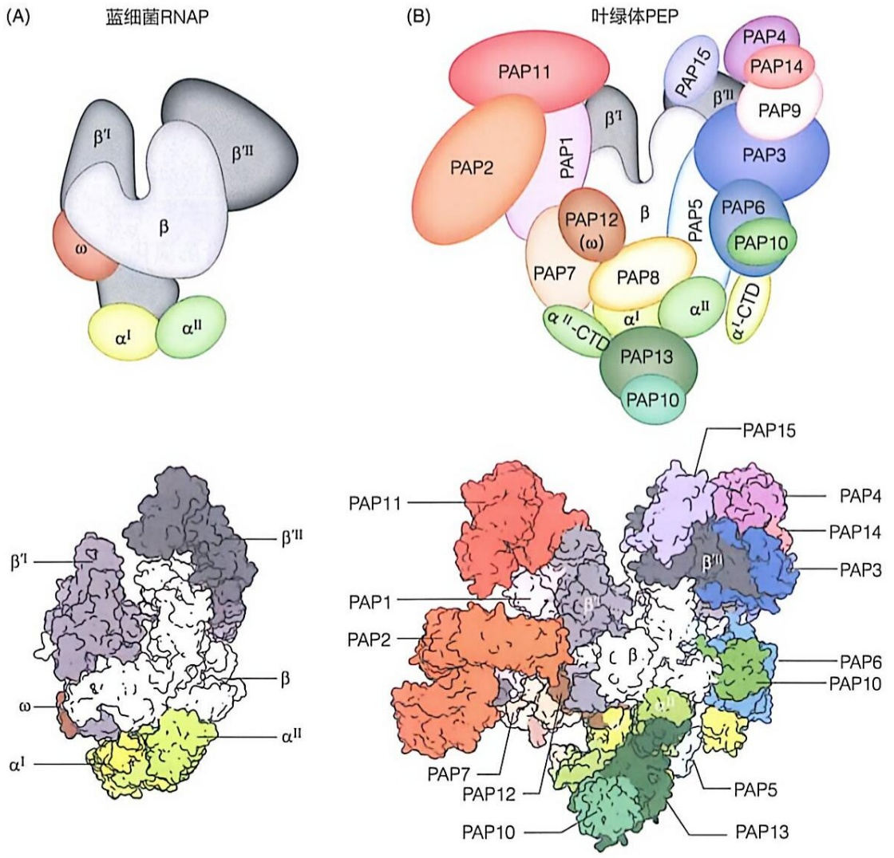

图 10-15 蓝细菌和叶绿体 RNA 聚合酶的亚基组成和三维结构比较

（A）蓝细菌 RNA 聚合酶的亚基组成和结构（PDB 编号:8GZG）。(B) 叶绿体 RNA 聚合酶 PEP 的亚基组成和结构（PDB 编号:8R6S）

中心，形成催化模块，而15种调控亚基结合在催化模块外围，增强了复合物的稳定性并赋予了PEP额外功能。例如PAP1和PAP2具有核酸结合结构域，可能进一步稳定核酸与PEP的结合；PAP4和PAP9具有超氧化物歧化酶活性，可保护 PEP 免受超氧化物攻击。综上，从蓝细菌 RNA 聚合酶出发，经过 10 多亿年的演化，PEP 演化出更加复杂的亚基组成、更加多样的功能以及更加精细的调控方式。

---

10.4 真核生物 RNA Pol II 的转录起始

425

## 知识延展 10- 2

## 线粒体 RNA 聚合酶

线粒体是细胞内重要的细胞器，在能量代谢和维持细胞稳态中起着重要作用。线粒体在进化过程中保留了自身基因组，其基因转录由线粒体 RNA 聚合酶完成。线粒体 RNA 聚合酶属于单亚基 RNA 聚合酶类别，与噬菌体单亚基的 RNA 聚合酶同源。针对酵母和人源细胞的线粒体基因转录机制研究比较充分。研究发现，与噬菌体 T7 RNA 聚合酶可以独自进行转录不同，线粒体

RNA 聚合酶需要特殊的转录起始、延伸和终止因子来协助其完成整个基因转录过程。例如人源的线粒体 RNA 聚合酶（POLRMT）需要 TFAM 和 TFB2M 转录起始因子协助才能结合和解链启动子 DNA，并启动 RNA 链的合成，POLRMT 需要转录延伸因子 TEFM 才能保证其延伸连续性，POLRMT 的转录终止依赖转录终止因子 mTERF1。

## 10.4 真核生物 RNA Pol II 的转录起始

无论是原核还是真核生物，精准的基因表达调控对于细胞的正常功能至关重要。这种调控机制被称为差异性基因表达（differential gene expression），即不同基因在特定的时间、空间和条件下表达水平不同。转录过程的调控可发生在起始、延伸和终止三个主要阶段。调控的核心集中在起始阶段，因其决定了特定基因是否启动转录、转录的强度以及在单位时间内进入转录的 RNA 聚合酶数量，从而影响 mRNA 的产量。在原核生物中，基因通常保持活跃状态，通过转录因子与目标基因的结合或释放来调节基因表达。这些抑制蛋白通过结合或释放目标基因的启动子区来控制转录的起始，从而调节基因的表达水平。相比之下，真核生物的基因组结构复杂，基因表达的调控机制也更为多层次。

首先，真核基因组 DNA 被缠绕在组蛋白上形成核小体，并进一步压缩成染色质，在一定程度上抑制了转录因子和 RNA 聚合酶的结合，使大多数基因处于非活性状态。为解除染色质的结构障碍，真核生物在进化过程中形成了包括染色质重塑等复杂的表观遗传调控机制，使启动子 DNA 处于开放状态，允许转录在启动子上起始。

其次，Pol II 具有低活性，无法识别启动子序列并打开 DNA 双链。这一特征避免了转录在 DNA 暴露的区域随机起始。为了起始转录，Pol II 需要与一系列起始因子 [如通用转录因子（general transcription factor，GTF）] 和转录共激活因子（如中介体，mediator）结合，在暴露的启动子和其周围的染色质环境下，组装成转录前起始复合物（transcriptional preinitiation complex，PIC），使 Pol II 打开 DNA 双链，开始 RNA 合成。在 Pol II 介导的转录过程中，几乎所有基因都会组装成上述复合物起始转录。基因表达的差异性由 DNA 序列、染色质环境，以及序列特异性转录因子和起始因子等的结合状态共同决定。

最后，早期转录过程还会经历起始到延伸的转换，其中一个中间阶段称为启动子

---

426

10 RNA 的生成

近端暂停，即 Pol Ⅱ 进入高效延伸之前会在启动子附近（起始位点下游 20～60 bp）滞留一段时间，完成 RNA 的 5' 加帽和转录延伸复合物的组装。没有顺利进入延伸阶段的 Pol Ⅱ 会进入早期终止，从染色质上解离，以便下一个 Pol Ⅱ 顺利进入延伸阶段。这一部分将在转录延伸章节介绍。

## 10.4.1 启动子组成

启动子（promoter）是 RNA 聚合酶识别、结合并启动转录的关键基因组区域，位于基因的上游 5' 非翻译区（5' untranslated region, 5'UTR）。启动子上与新生 RNA 链的第一个核苷酸相对应的 DNA 碱基被称为转录起始位点（transcription start site, TSS）。启动子上包含转录起始位点并能够精确引导 RNA 聚合酶启动转录的最小 DNA 序列称为核心启动子（core promoter）（图 10-16）。启动子包含核心启动子和上下游各 500～1 000 bp 范围内的 DNA 序列，是转录起始调控的关键。早期研究关注核心启动子的序列，即在核心启动子上某些特定位置高频出现的共有序列（consensus sequence），称为核心启动子元件。近 20 年来越来越多的研究关注启动子及其周围的染色质环境，即表观遗传调控对转录起始的影响。

原核生物启动子主要包含-35区和-10区两个元件（图10-3），真核生物的启动子结构要复杂得多（图10-16）。由PolⅡ转录的大部分编码基因和部分非编码基因中，转录起始发生在核心启动子区域。PolⅡ识别的启动子称为Ⅱ类启动子，核心启

图 10-16 真核生物Ⅱ类启动子的种类和调控基因改绘自 HABERLEV, et al. Nat Rev Mol Cell Biol, 2018, 19 (10): 621-637.

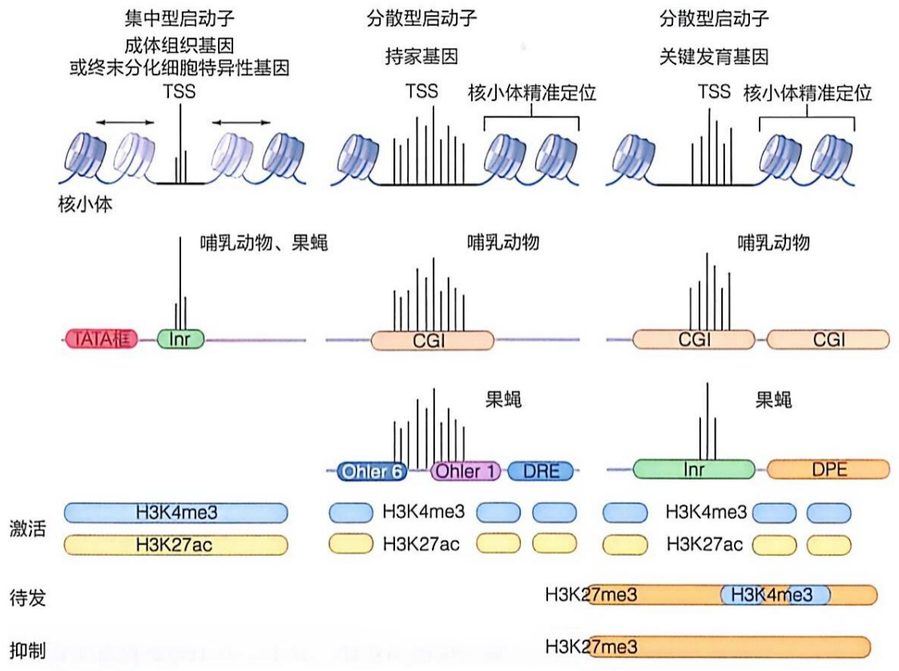

<details>
<summary>flowchart</summary>

```mermaid
graph TD
  subgraph Top_1 [Top Left]
  A["TSS"] --> B["Cytokine"]
  C["TSS"] --> D["Cytokine"]
  E["TSS"] --> F["Cytokine"]
  G["TSS"] --> H["Cytokine"]
  I["TSS"] --> J["Cytokine"]
  K["TSS"] --> L["Cytokine"]
  M["TSS"] --> N["Cytokine"]
  O["TSS"] --> P["Cytokine"]
  Q["TSS"] --> R["Cytokine"]
  S["TSS"] --> T["Cytokine"]
  U["TSS"] --> V["Cytokine"]
  W["TSS"] --> X["Cytokine"]
  Y["TSS"] --> Z["Cytokine"]
  AA["TSS"] --> AB["Cytokine"]
  AC["TSS"] --> AD["Cytokine"]
  AE["TSS"] --> AF["Cytokine"]
  AG["TSS"] --> AH["Cytokine"]
  AI["TSS"] --> AJ["Cytokine"]
  AK["TSS"] --> AL["Cytokine"]
  AM["TSS"] --> AN["Cytokine"]
  AO["TSS"] --> AP["Cytokine"]
  AQ["TSS"] --> AR["Cytokine"]
  AS["TSS"] --> AT["Cytokine"]
  AU["TSS"] --> AV["Cytokine"]
  AW["TSS"] --> AX["Cytokine"]
  A --> BB["Intracellular"]
  C --> BC["Intracellular"]
    CD["Intracellular"]
    AE["Intracellular"]
    AF["Intracellular"]
    AG["Intracellular"]
    AH["Intracellular"]
    AI["Intracellular"]
    AJ["Intracellular"]
    AK["Intracellular"]
    AL["Intracellular"]
    AM["Intracellular"]
    ANF["Intracellular"]
    AO["Intracellular"]
    APN["Intracellular"]
    AQN["Intracellular"]
    ARN["Intracellular"]
    ASN["Intracellular"]
    ATN["Intracellular"]
    AY["Intracellular"]
    AZ["Intracellular"]
  end

  subgraph Top_2 [Top Middle]
  B --> BB
  C --> BC
  D --> BC
  E --> BC
  F --> BC
  G --> BC
  H --> BC
  I --> BC
  J --> BC
  K --> BC
  L --> BC
  M --> BC
  N --> BC
  O --> BC
  P --> BC
  Q --> BC
  R --> BC
  S --> BC
  T --> BC
  U --> BC
  V --> BC
  W --> BC
  X --> BC
  Y --> BC
  Z --> BC
  end

  subgraph Top_3 [Top Right]
  A --> BB
  B --> BC
  C --> BC
  D --> BC
  E --> BC
  F --> BC
  G --> BC
  H --> BC
  I --> BC
  J --> BC
  K --> BC
  L --> BC
  M --> BC
  N --> BC
  O --> BC
  P --> BC
  Q --> BC
  R --> BC
  S --> BC
  T --> BC
  U --> BC
  V --> CC
  W --> CC
  X --> CC
  Y --> CC
  Z --> CC
  end

  subgraph Bottom_1 [Bottom Left]
    B1["H3K4me3"] -.-> BB1["Active"]
    B2["H3K4me3"] -.-> BB2["Active"]
    B3["H3K27ac"] -.-> BB3["Active"]
  end

  subgraph Bottom_2 [Bottom Center]
    A1["H3K4me3"] -.-> BB1A["Active"]
    A2["H3K4me3"] -.-> BB2A["Active"]
    A3["H3K27ac"] -.-> BB3A["Active"]
  end

  subgraph Bottom_3 [Bottom Right]
    A4["H3K4me3"] -.-> BB1B["Active"]
    A5["H3K4me3"] -.-> BB2B["Active"]
    A6["H3K27ac"] -.-> BB3B["Active"]
  end

  subgraph Bottom_4 [Bottom Row]
    A7["H3K27me3"] -.-> BB1C["Active"]
    A8["H3K4me3"] -.-> BB2C["Active"]
  end

  subgraph Bottom_5 [Bottom Row]
    A9["H3K27me3"] -.-> BB1D["Active"]
  end

  Top_1 & Top_2 & Top_3 & Top_4 & Top_5 & Top_6 & Top_7 & Top_8 & Top_9 & Top_10 & Top_11 & Top_12 & Top_13 & Top_14 & Top_15 & Top_16 & Top_17 & Top_18 & Top_19 & Top_20 & Top_21 & Top_22 & Top_23 & Top_24 & Top_25 & Top_26 & Top_27 & Top_28 & Top_29 & Top_30 & Top_31 & Top_32 & Top_33 & Top_34 & Top_35 & Top_36 & Top_37 & Top_38 & Top_39 & Top_40 & Top_41 & Top_42 & Top_43 & Top_44 & Top_45 & Top_46 & Top_47 & Top_48 & Top_49 & Top_50 & Top_51 & Top_52 & Top_53 & Top_54 & Top_55 & Top_56 & Top_57 & Top_58 & Top_59 & Top_60 & Top_61 & Top_62 & Top_63 & Top_64 & Top_65 & Top_66 & Top_67 & Top_68 & Top_69 & Top_70 & Top_71 & Top_72 & Top_73 & Top_74 & Top_75 & Top_76 & Top_77 & Top_78 & Top_79 & Top_80 & Top_81 & Top_82 & Top_83 & Top_84 & Top_85 & Top_86 & Top_87 & Top_88 & Top_89 & Top_90 & Top_91 & Top_92 & Top_93 & Top_94 & Top_95 & Top_96 & Top_97 & Top_98 & Top_99 & Top_100&Top_Cyto_Neptid_Neptid_Neptid_Neptid_Neptid_Neptid_Neptid_Neptid_Neptid_Neptid_Neptid_Neptid_Neptid_Neptid_Neptid_Neptid_Neptid_Neptid_Neptid_Neptid_Neptid_Neptid_Neptid_Neptid_Neptid_Neptic_Neptid_Neptid_Neptid_Neptid_Neptid_Neptid_Neptid_Neptid_Neptid_Neptid_Neptid_Neptid_Neptid_Neptid_Neptid_Neptid_Neptid_Neptid_Neptid_Neptid_Neptid_Neptid_Neptid_Neptid_Neptide_Neptid_Neptid_Neptid_Neptid_Neptid_Neptid_Neptid_Neptid_Neptid_Neptid_Neptid_Neptid_Neptid_Neptid_Neptid_Neptid_Neptid_Neptid_Neptid_Neptid_Neptid_Neptid_Neptid_Neptid_Neptil_Lneptid_Lneptid_Lneptid_Lneptid_Lneptid_Lneptid_Lneptid_Lneptid_Lneptid_Lneptid_Lneptid_Lneptid_Lneptid_Lneptid_Lneptid_Lneptid_Lneptid_Lneptid_Lneptid_Lneptid_Lneptid_Lneptid_Lneptid_Lneptid_Lneptid_Lneptil_Lneptid_Lneptid_Lneptid_Lneptid_Lneptid_Lneptid_Lneptid_Lneptid_Lneptid_Lneptid_Lneptid_Lneptid_Lneptid_Lneptid_Lneptid_Lneptid_Lneptid_Lneptid_Lneptid_Lneptil_Lneptid_Lneptid_Lneptid_Lneptid_Lneptil_Lneptid_Lneptil_Lneptil_Lneptil_Lneptil_Lneptil_Lneptil_Lneptil_Lneptil_Lneptil_Lneptil_Lneptil_Lneptil_Lneptil_Lneptil_Lneptil_Lneoptil_Lneoptil_Lneoptil_Lneoptil_Lneoptil_Lneoptil_Lneoptil_Lneoptil_Lneoptil_Lneoptil_Lneoptil_Lneoptil_Lneoptil_Lneoptil_Lneoptil_RNeptid_RNeptid_RNeptid_RNeptid_RNeptid_RNeptid_RNeptid_RNeptid_RNeptid_RNeptid_RNeptid_RNeptid_RNeptid_RNeptid_RNeptid_RNeptid_RNepe_Dye_Dye_Dye_Dye_Dye_Dye_Dye_Dye_Dye_Dye_Dye_Dye_Dye_Dye_Dye_Dye_Dye_Dye_Dye_Dye_Dye_Dye_Dye_Dye_Dye_Dye_Dye_Dye_Dye_Dye_Dye_Dye_Dye_Dye_Dye_Dye_Dye_Dye_Dye_Dye_Dye_Dye_Dye_Dye_Dye_Dye_Dye_Dye_Dye_Dye_DYE_Dye_Dye_Dye_Dye_Dye_Dye_Dye_Dye_Dye_Dye_Dye_Dye_Dye_Dye_Dye_Dye_Dye_Dye_Dye_Dye_Dye_Dye_Dye_Dye_Dye_Dye_Dye_Dye_Dye_Dye_Dye_Dye_Dye_Dye_Dye_Dye_Dye_Dye_Dye_Dye_Dye_Dye_Dye_Dye_Dye_Dye_Dye_Dye_Dye_Dyne_Syn_Phe_Syn_Phe_Syn_Phe_Syn_Phe_Syn_Phe_Syn_Phe_Syn_Phe_Syn_Phe_Syn_Phe_Syn_Phe_Syn_Phe_Syn_Phe_Syn_Phe_Syn_Phe_Syn_Phe_Syn_Phe_Syn_Phe_Syn_Phe_Syn_Phe_Syn_Phe_Syn_Phe_Syn_Phe_Syn_Phe_Syn_Phe_Syn_Phe_Syn_PHE_Syn_PHE_Syn_PHE_Syn_PHE_Syn_PHE_Syn_PHE_Syn_PHE_Syn_PHE_Syn_PHE_Syn_PHE_Syn_PHE_Syn_PHE_Syn_PHE_Syn_PHE_Syn_PHE_Syn_PHE_Syn_PHE_Syn_PHE_Syn_PHE_Syn_PHE_Syn_PHE_Syn_PHE_Syn_PHE_Syn_PHE_SYNPhe_Syn_Phe_Syn_Phe_Syn_Phe_Syn_Phe_Syn_Phe_Syn_Phe_Syn_Phe_Syn_Phe_Syn_Phe_Syn_Phe_Syn_Phe_Syn_Phe_Syn_Phe_Syn_Phe_Syn_Phe_Syn_Phe_Syn_Phe_Syn_Phe_Syn_Phe_Syn_Phe_Syn_Phe_SYNPhe_Syn_Phe_Syn_Phe_Syn_Phe_Syn_Phe_Syn_Phe_Syn_Phe_Syn_Phe_SYNPhe_Syn_Phe_Syn_Phe_Syn_Phe_Syn_Phe_SYNPhe_Syn_PheSNNPhe_Syn_PheSNNPhe_Syn_PheSNNPhe_Syn_PheSNNPhe_Syn_PheSNNPhe_Syn_PheSNNPhe_SYNPheSNNPheSNNPheSNNPheSNNPheSNNPheSNNPheSNNPheSNNPheSNNPheSNNPheSNNPheSNNPheSNNPheSNNPheSNNPheSNNPheSNNPheSNNPheSNNPheSNNPheSNNPheSNNPheSNNPheSNNPheSNNPheSANNPheSNNPheSNNPheSNNPheSNNPheSNNPheSNNPheSNNPheSNNPheSNNPheSNNPheSNNPheSNNPheSNNPheSNNPheSNNPheSNNPheSNNPheSNNPheSNNPheSNNPheSNNPheSNNPheSNNPheSNNPheSNSPNpeDys_ApE_Cyto_Nepe_ApE_Cyto_Nepe_ApE_Cyto_Nepe_ApE_Cyto_Nepe_ApE_Cyto_Nepe_ApE_Cyto_Nepe_ApE_Cyto_Nepe_ApE_Cyto_Nepe_ApE_Cyto_Nepe_ApE_Cyto_Nepe_ApE_Cyto_Nepe_ApE_Cyto_Nepe_BdA_Cyto_ApE_BdA_Cyto_ApE_BdA_Cyto_ApE_BdA_Cyto_ApE_BdA_Cyto_ApE_BdA_Cyto_ApE_BdA_Cyto_ApE_BdA_Cyto_ApE_BdA_Cyto_ApE_BdA_Cyto_ApE_BdA_Cyto_ApE_BdA_Cyto_ApE_Cyto_ApE_BdA_Cyto_ApE_BdA_Cyto_ApE_BdA_Cyto_ApE_BdA_Cyto_ApE_BdA_Cyto_ApE_BdA_Cyto_ApE_BdA_Cyto_ApE_BdA_Cyto_ApE_BdA_Cyto_ApE_BdA_Cyto_ApE_BdA_Glyc_H3K4me3_H3K4me3_H3K4me3_H3K4me3_H3K4me3_H3K4me3_H3K4me3_H3K4me3_H3K4me3_H3K4me3_H3K4me3_H3K4me3_H3K4me3_H3K4me3_H3K4me3_H3K4me3_H3K4me3_H3K27ac_H3K27ac_H3K27ac_H3K27ac_H3K27ac_H3K27ac_H3K27ac_H3K27ac_H3K27ac_H3K27ac_H3K27ac_H3K27ac_H3K27ac_H3K27ac_H3K27ac_H3K27ac_H3K27ac_H3K<nl>
```
</details>

---

10.4 真核生物 RNA Pol II 的转录起始

427

动子区域约覆盖 100 bp，包含转录起始位点上游约 50 bp 到下游约 50 bp 的区域。Ⅱ类启动子包含多种核心启动子元件，其位置和功能多样。最常见的元件包括 TATA 框（TATA box），位于转录起始位点上游约 31 bp（标注为 -31）处，通常出现在“集中型”启动子上。其他常见的元件还有覆盖转录起始位点、位于其上下游 2\~3 bp 的 Inr 元件（initiator），位于启动子上游的 BRE 元件（TF II B recognition element），位于转录起始位点下游的 MTE 元件（motif ten element）以及下游启动子元件 DPE（downstream promoter element）等。研究表明，这些具有保守序列的核心启动子元件可以单独存在，也可以在同一启动子中共存，但其分布较为有限，尤其在人类基因的启动子中数量较少。例如，TATA 框仅占人类基因启动子的约 15%，含有 TATA 框的启动子称为 TATA 框启动子（TATA-box promoter），不含 TATA 框的启动子称为无 TATA 框启动子（TATA-less promoter）。MTE 和 DPE 元件在人类基因启动子中非常罕见，而在果蝇基因启动子中较为常见。

与原核生物不同，基因组测序数据显示，Pol II 的核心启动子可分为两类（图 10-16）。一类为集中型启动子，具有单一且精确的转录起始位点，常存在于高度调控的细胞类型特异性基因中，其核心启动子元件的序列明确，可精确定位转录起始位点；另一类为分散型启动子，具有多个相邻、使用频率相近的转录起始位点，主要存在于广泛表达的持家基因（housekeeping gene）和形态发生、模式形成等关键发育相关基因。这类启动子上不含明确的核心启动子元件，其转录起始位点的选择依赖于邻近的染色质环境，如下游核小体的定位和核小体上的表观遗传修饰等因素。

人类基因的核心启动子元件序列普遍复杂无序。近年来，研究者利用机器学习和人工智能方法，将启动子序列和大量对应转录产物的数据结合，构建模型以预测启动子强度和转录起始位点。这些方法在预测效果上比传统的序列保守性分析更为准确。此外，许多基因的核心启动子具有较高的 GC 含量和大量 CpG 二核苷酸，形成所谓的 CpG 岛（CpG island）。这类启动子通常缺乏明确的启动子元件，但常出现在持家基因和关键发育基因的启动子区域。关于 CpG 岛调控转录起始的具体机制，目前仍不完全清楚。Pol II 转录还存在双向转录现象，正向蛋白编码基因的转录和反向的短非编码 RNA 的转录往往同时存在，这些反义转录产物称为启动子上游转录产物或上游反义 RNA（uaRNA），由在近端启动子区域上游边缘的反向转录起始位点上组装的 RNA 聚合酶起始复合物所起始，但由于缺少如 5' 剪接位点以及过早发生多腺苷酸化，反义转录产物通常并不稳定。真核生物启动子的序列和结构复杂多变，其强度与转录起始位点的位置之间没有固定规律。这种复杂无序的特性表明，真核生物的转录调控不仅依赖于 DNA 序列，还受到染色质环境等多种因素的共同影响。这种多层次的调控机制有助于多细胞生物实现对基因表达的精细调控。

与复杂的Ⅱ类启动子相比，Pol I 识别的 I 类启动子和 Pol Ⅲ识别的Ⅲ类启动子结构相对简单，这与二者所转录的基因种类较少有关。I 类启动子包含两个关键区域:一个是位于转录起始位点上游约 45 bp 至下游 20 bp（-45 到 +20）的核心元件，另一个是位于转录起始位点上游约 156 bp 到 107 bp（-156 到 -107）的上游启动子元件

---

428

10 RNA 的生成

图 10-17 真核生物Ⅰ类 (A) 和Ⅲ类 (B) 启动子

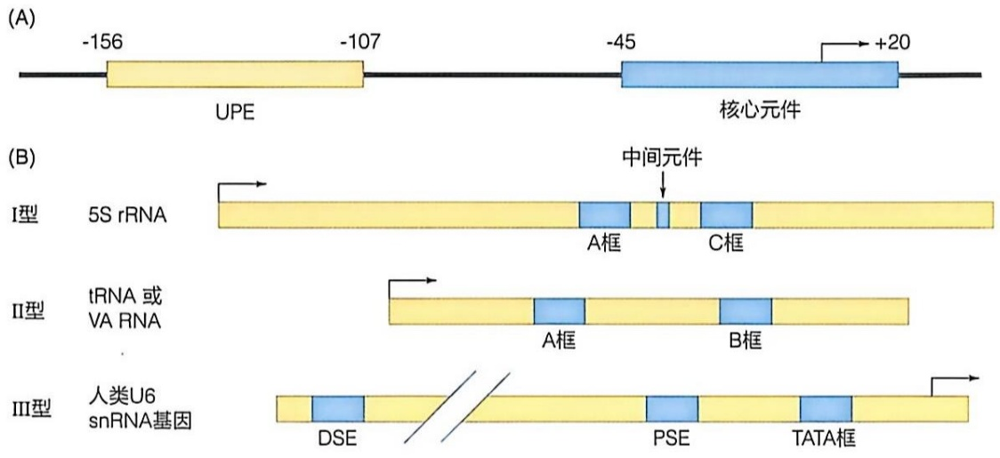

<details>
<summary>text_image</summary>

(A)
-156 -107 -45 +20
UPE 核心元件
(B)
I型 5S rRNA 中间元件
A框 C框
II型 tRNA 或 VA RNA
A框 B框
III型 人类U6 snRNA基因 DSE PSE TATA框
</details>

(图 10-17)。尽管不同物种的 I 类启动子序列保守性较低，但是这两个关键元件之间的距离在转录调控中非常重要。Ⅲ类启动子则分为三种主要类型:I 型、Ⅱ型和Ⅲ型。典型的Ⅲ类基因启动子（包括 I 型和Ⅱ型）位于转录起始位点下游的基因内部区域。I 型内部启动子分为三个区域:A 框、中间元件和 C 框。Ⅱ型内部启动子则包含 A 框和 B 框，其中绝大多数Ⅲ类启动子属于Ⅱ型启动子。此外，存在一种非典型的Ⅲ类启动子（Ⅲ型），其结构与Ⅱ类启动子相似，覆盖转录起始位点的上下游区域（图 10-17）。例如，U6 snRNA 基因的启动子包含上游邻近序列元件（proximal sequence element，PSE）和 TATA 框。

## 10.4.2 转录前起始复合物的组装

在成功分离出三种真核RNA聚合酶后，罗德等尝试在体外系统中利用这些RNA聚合酶合成RNA。然而，仅靠纯化的PolⅡ和人工合成的DNA并不足以实现精确的转录起始，只有加入细胞核粗提物后，PolⅡ才能精准地起始转录，并生成一致的转录产物。这一发现引发了一个关键问题:细胞核粗提物中的哪些成分能够帮助PolⅡ实现精准的转录起始？为此，罗德等采用离子交换柱进一步分离纯化细胞核粗提物。他们使用不同盐浓度洗脱提取各个组分，并将这些组分分别与PolⅡ和DNA孵育，检测其转录活性。经过多轮不同层析分离纯化和活性测试后，最终鉴定出六个必需的因子，即Ⅱ类通用转录因子（general transcription factor，GTF）:TFⅡD、TFⅡA、TFⅡB、TFⅡE、TFⅡF和TFⅡH（表10-2）。后续研究进一步揭示了每个通用转录因子的组成及其功能，为理解真核转录起始机制奠定了基础。在PIC中，除了PolⅡ，最关键的两个因子就是负责启动子识别的TFⅡD复合物以及打开启动子DNA双链的TFⅡH复合物。

1990—1992年，丹尼·莱因伯格（Danny Reinberg）等通过DNA足迹实验（footprinting）和电泳迁移率变动分析（electrophoretic mobility shift assay，EMSA）研究了Pol II和GTFs在TATA框启动子上的组装转录前起始复合物PIC过程，并研究了启动子结合区域（图10-18）。在体外重建实验中发现，TFII D在TFII A的协助下识别

---

10.4 真核生物 RNA Pol II 的转录起始

429

表 10-2 II 类通用转录因子的组成和功能

| 因子 | 亚基组成 | 分子量 /Da | 功能 |
| --- | --- | --- | --- |
| TF II D | TBP, TAF1 - TAF13 (6个双拷贝) | $1.2 \times 10^{6}$ | 识别并结合启动子 DNA、H3K4me3 以及乙酰化修饰的核小体,起始 PIC 组装 |
| TF II A | TF II Aα, TF II Aβ, TF II Aγ | $5.4 \times 10^{4}$ | 帮助并稳定 TF II D 与启动子的结合 |
| TF II B | TF II B | $3.5 \times 10^{4}$ | 稳定 TF II D 与启动子的结合,招募 Pol II -TF II F,转录起始位点的选择 |
| TF II F | TF II Fα (RAP74), TF II Fβ (RAP30), | $8.7 \times 10^{4}$ | 结合 Pol II 并促进其被招募至启动子,招募 TF II E,起始位点的选择 |
| TF II E | TF II Eα (p56), TF II Eβ (p34), | $8.2 \times 10^{4}$ | 招募 TF II H 至启动子 |
| TF II H | XPB, XPD, p62, p52, p44, p34, p8, CDK7, CyclinH, MAT1 | $4.9 \times 10^{5}$ | 转位酶活性:打开启动子 DNA 双链,形成转录泡;激酶活性:磷酸化 Pol II,促进转录起始 |

并稳定地结合到基因核心启动子上，形成 DA 复合物。随后，TFⅡB 与 DA 复合物结合，形成 DAB 复合物，进一步稳固 TFⅡD 与启动子的结合。此后，TFⅡB 招募预先组装的 TFⅡF-PolⅡ复合物，形成 DABPolF 复合物，最终依次招募 TFⅡE 和 TFⅡH，逐步构建出完整的 DABPolFEH 复合物。任何一个通用转录因子的缺失都会阻碍这一完整转录前起始复合物（PIC）的形成。后续进一步的研究表明，在 ATP 存在下，TFⅡH 的转位酶（translocase）活性能够打开启动子附近的 DNA 双链，形成开放 PIC（open PIC，OC），产生转录泡，为 RNA 链的合成做好准备。

对于 PIC 的组装顺序，还有不同的观点。1990 年代，有研究者从酵母和哺乳动物细胞中直接分离复合物，发现包含除 TFⅡD 以外的其他通用转录因子、中介体和 PolⅡ 的复合物，提出了全酶组装模型。在此模型中，PIC 的组装类似于原核生物的聚合酶复合物，其中 TFⅡD 优先结合到启动子上，而其余因子则以复合物的形式与 Pol Ⅱ

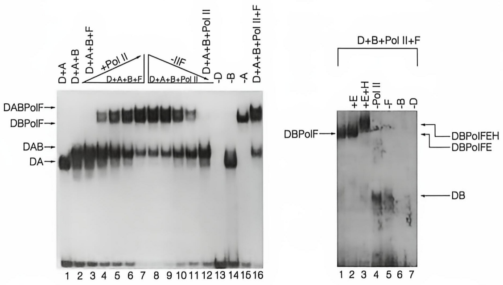

图 10-18 转录前起始复合物的顺序组装

数据自 FLORES, et al. Proc Natl Acad Sci U S A, 1991, 88 (22): 9999-10003 和 Cortes P, et al. Mol Cell Biol, 1992, 12 (1): 413-421.

---

430

10 RNA 的生成

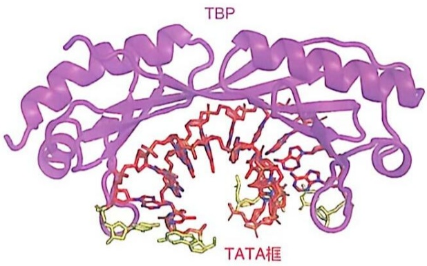

<details>
<summary>text_image</summary>

TBP
TATA框
</details>

图10-19 TBP结合TATA框的结构

酵母 TBP 蛋白结合 TATA 框的结构（PDB 编号:1YTB）

一起被招募至启动子，与 TFⅡD 共同形成完整的 PIC。究竟在细胞中 PIC 是以哪种方式组装仍有待进一步研究，但通用转录因子的具体作用，如 TFⅡE 在招募 TFⅡH 中的关键性作用，不同模型均有共识。

1990 年，钱泽南（Robert Tjian）等发现，单独的 TBP 在含有 TATA 框的启动子上能够组装 PIC 并启动转录。这一发现使得随后的转录起始结构分析中常用 TBP 代替完整的 TFⅡD，以简化实验体系。1993 年的晶体结构研究显示，TBP 能够特异性识别 TATA 框，TBP 的核心结构域呈马鞍状，与 TATA 框的小沟结合并弯曲 DNA 约 80°（图 10-19）。

在 TFⅡD 与启动子复合物中，TBP 和 TFⅡD 的 C 模块分别结合启动子的上游和下游区域（图 10-20）。2013 年，伊娃·诺加利斯（Eva Nogales）等通过冷冻电镜解析了基于 TBP 和 TATA 框启动子的 PIC 密度图，此后诺加利斯、科恩伯格和帕特里克·克拉玛（Patrick Cramer）等分别逐步提升了 PIC 结构精度，构建了基于 TBP 和 TATA 框启动子的 PIC 结构模型。

在 PIC 中，TBP 结合启动子上的 TATA 框，并使其弯曲；TFⅡB 的锌带结构域（zinc ribbon）与 Pol Ⅱ的“船坞”结构域结合，核心结构域与 TBP 和启动子相互作用，稳定 PIC；TFⅡF 的二聚体结构域与 Pol Ⅱ的“叶”相连，其翼螺旋结构域（winged helix domain，WH）结合启动子；TFⅡE 连接 Pol Ⅱ的“茎杆”与 TFⅡF 的翼螺旋结构域，共同包围一小段启动子 DNA，确保 PIC 稳定在启动子区域；TFⅡH 与 Pol Ⅱ的茎杆及 TFⅡE 结合，XPB 转位酶亚基结合于 TSS 下游的启动子区域；TSS 位于 Pol Ⅱ的活性位点上方，TSS 下游启动子区域与 Pol Ⅱ的“颌”相连（图 10-20）。Pol Ⅱ与各通用转录因子紧密结合，在通用转录因子的帮助下，Pol Ⅱ稳定结合在核心启动子上，为后续转录起始做好准备。

超过 $85\%$ 的人类基因不含有TATA框，是无TATA框启动子。并且，在细胞内TBP不会独立存在，几乎所有PolⅡ介导的转录均需要完整的TFIID。2021年，徐彦辉等体外组装了20余个包含TFIID的PIC，涵盖了不同类型启动子和不同组装

图 10-20 TF II D 结合启动子及转录前起始复合物的组装

（A）人源TFIID结合启动子DNA结构（PDB编号:7EGJ）。(B)人源转录前起始复合物结构（PDB编号:7EGB）

(A)

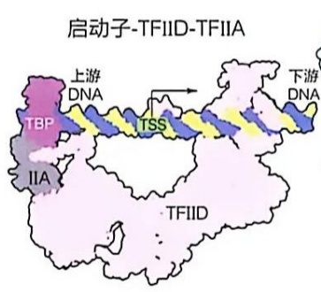

<details>
<summary>text_image</summary>

启动子-TFIID-TFIIA
上游DNA
TBP
TSS
下游DNA
IIA
TFIID
</details>

(B)

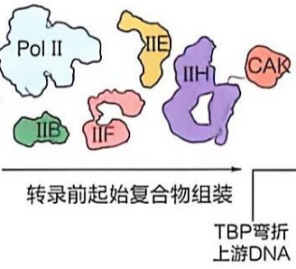

<details>
<summary>text_image</summary>

Pol II
IIE
IIH
CAIX
IIB
IIF
转录前起始复合物组装
TBP弯折
上游DNA
</details>

转录前起始复合物(PIC)

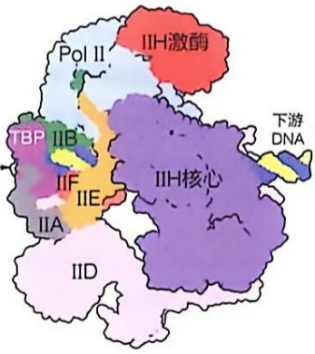

<details>
<summary>text_image</summary>

Pol II
IIH激酶
TBP IIB
IIF
LIA
IIE
IIH核心
下游
DNA
IID
</details>

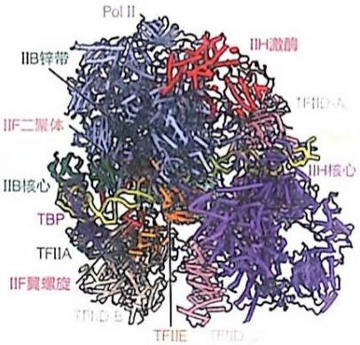

<details>
<summary>text_image</summary>

Pol II
IIB锌带
IIH激酶
IIF二聚体
TFIIA
IIIB核心
TBP
TFIIA
IIIF肾螺旋
TFIIE
TFIID
TFIID
</details>

---

10.4 真核生物 RNA Pol II 的转录起始

431

阶段的 PIC，通过结构和生化分析，提出包含 TFⅡD 的完整 PIC 组装机制模型（图 10-20）。TFⅡD 上存在多个具有较高序列包容性的 DNA 结合位点，这使其能够以相同的方式识别和结合不同类型的启动子。在 TATA 框启动子和无 TATA 框启动子中，TFⅡD 能够帮助 TBP 正确定位到启动子上游区域，伴随 PIC 组装，TBP 在 TFⅡD、TFⅡB 和 Pol Ⅱ 的帮助下弯曲启动子区域，保证 PIC 以相同的构象组装到不同类型的启动子上。虽然单独 TBP 亚基无法在体外结合并弯折无 TATA 框启动子，但在 PIC 中，TFⅡD 结合下游启动子使 TBP 和上游启动子发生作用，促进启动子弯折。这一启动子弯折对转录起始至关重要（见 10.4.3 节转录起始至早期延伸的转换过程）。在包含 TFⅡD 的 PIC 中，TFⅡH 的 CAK 激酶模块紧邻 Pol Ⅱ 的 CTD，酶和底物的靠近促进 CTD 的磷酸化。

## 10.4.3 转录起始至早期延伸的转换过程

PIC 在启动子上组装完成后，DNA 双链打开并在 RNA Pol II 的催化中心形成转录泡，指导 RNA 合成。1990 年代开始的十余年中，系列生化研究显示，转录起始早期阶段会发生显著的复合物组成和功能变化。当 RNA 合成长度达到 2\~3 nt 时，RNA 与聚合酶结合不稳定，可发生 “流产式转录”（abortive transcription）；当 RNA 长度达到 4 nt，RNA 与聚合酶相对稳定达到转录 “逃逸承诺”（escape commitment）；当 RNA 长度达到 7\~10 nt 时，转录泡会扩展至 17\~18 nt，随后伴随一个突然的转录泡崩解（bubble collapse）；最终，Pol II 与通用转录因子（GTF）断开联系，与 DNA 和新生 RNA 形成稳定复合物，实现启动子逃逸（promoter escape）。2006 年，理查德·埃布莱特（Richard Ebright）等利用体外转录体系和单分子实验研究细菌 RNA 聚合酶在转录起始阶段的动态行为，发现 DNA 并非简单地被解旋，而是被压缩到聚合酶内，进而提出了转录起始的 “蜷缩”（scrunching）模型。

2023 年，徐彦辉等在无 G 框启动子上组装 PIC 并进行转录反应，成功重构了 16 个不同状态的转录复合物，这些复合物的 RNA 长度为 2 \~ 17 nt。通过解析这些复合物的结构，揭示了转录从起始到早期延伸的转换过程（图 10-21）。在 PIC 组装完成后，TF II H 利用 ATP 水解的能量打开了 TSS 附近的 DNA 双链，并将模板链引导至 Pol II 的催化中心，形成具有 13 nt 转录泡的开放复合物（open complex, OC）。随着 NTPs 的加入，Pol II 在模板链的指导下逐步合成 RNA 链，使 OC 转变为初始转录复合物（initial transcribing complex, ITC），RNA 从 2 nt 逐步延长至 9 nt，DNA-RNA 杂交链逐渐稳定，转录泡从 14 nt 扩展到 21 nt。在此过程中，通用转录因子紧密结合在 Pol II 与启动子上，其构象与在 PIC 中的几乎一致。上游启动子在 TBP 的作用下发生弯折而保持稳定，转录泡的上缘被固定在 -12 的位置（相对于转录起始位点 TSS），而下游启动子在 TF II H 转位酶的推动下持续向 Pol II 催化中心靠近，保持转录泡的开放状态，避免在 RNA 合成早期阶段因转录泡不稳定而导致的崩塌。因此，在 TATA 框和无 TATA 框启动子上形成构象一致的 PIC，保证了 TBP 对上游启动子的弯折和 TF II H

---

432

10 RNA 的生成

图 10-21 RNA Pol II 介导的转录起始到早期延伸转换模式图

改绘自 CHEN X, et al. Science, 2023, 382 (6677): eadi 5120.

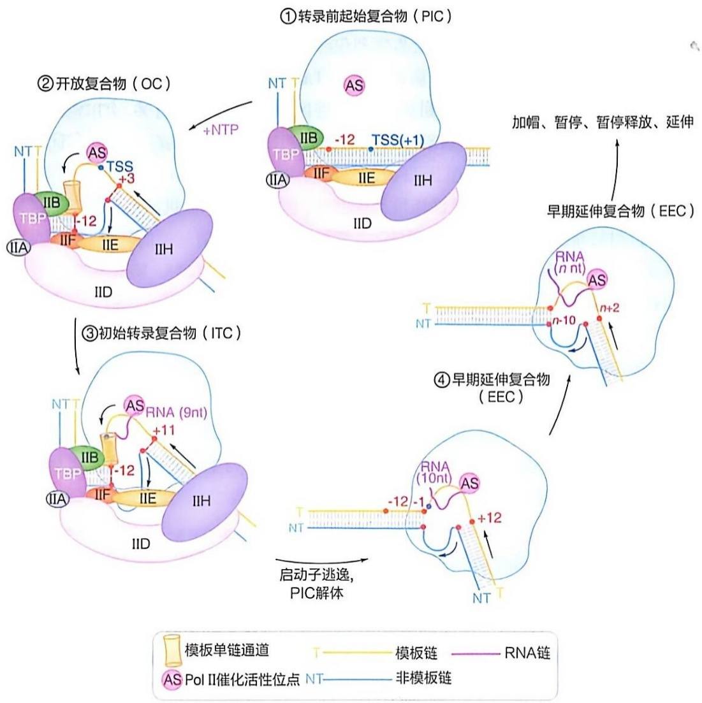

<details>
<summary>flowchart</summary>

This diagram illustrates the four stages of a biological signaling pathway involving transmembrane complexes (PIC), initial transmembrane complexes (ITC), and subsequent early extension, showing how these steps affect the role of the PIC解体.
</details>

与下游启动子的结合，这两者在启动子的打开和转录早期的稳定中都具有关键作用。

随着 RNA 链的增长，ITC 逐步转变为早期延伸复合物（early elongation complex, EEC），这一过程发生于 RNA 链合成至 10 nt 的阶段，并伴随显著的构象变化。首先，通用转录因子从启动子的上游和下游区域解离，转录泡从 21 nt 缩小至 11 nt，靠近上游的 10 个碱基对重新配对形成 DNA 双链，Pol II 脱离最初结合的启动子区域。这一转变过程的关键在于 Pol II 与 TF II B 在 ITC 中形成的单链模板 DNA 通道:随着 RNA 链延长至 9 nt，模板链逐渐在通道内堆积，活性中心的 DNA-RNA 杂交链逐渐增大并趋于稳定；当 RNA 链延长至 10 nt 时，堆积的模板链和前移的 DNA-RNA 杂交链共同“胀破”这一通道，导致 TF II B 以及其结合的其他通用转录因子脱离 Pol II 和启动子。在 EEC 中，随着 RNA 链逐步延长至 17 nt，转录延伸进入稳定的重复过程。每合成一个核苷酸，Pol II 便前移一位，新生成的 RNA 链从 RNA 通道中逐渐伸出聚合酶。

上述复杂过程的发生源于真核生物独特的转录起始设计。为了避免PolⅡ在随机位点启动并发生错误转录，真核生物进化出了复杂的转录起始机制。PolⅡ的转录起始依赖于通用转录因子的帮助，使PolⅡ精确识别和打开基因启动子。为实现稳定而

---

10.4 真核生物 RNA Pol II 的转录起始

433

高效的转录起始，PIC 内的通用转录因子、Pol Ⅱ 和启动子之间形成了稳定的相互作用。然而，这些稳定的相互作用在 Pol Ⅱ 离开启动子区域时反而会形成障碍。因此，在转录起始完成后，PIC 必须解体，解除通用转录因子的束缚，使 Pol Ⅱ 不再受限于启动子区域，从而顺利进入延伸阶段。通用转录因子与转录泡的协同作用不仅支持 Pol Ⅱ 在初始 RNA 合成阶段结合并打开启动子，还通过在转录成功起始后解离、崩塌，帮助 Pol Ⅱ 摆脱束缚，顺利进入稳定的 RNA 延伸合成阶段。

## 10.4.4 中介体及其激活转录的机制

PIC 仅具备基础的转录活性，可能是由于 PIC 的成分与启动子的联系薄弱:只有 TFⅡD 是主要的启动子结合因子，因此，PIC 的组装和多轮转录都是低效的。在细胞中，活跃基因的转录水平通常显著高于这种基础水平，这些基因的高效转录需要序列特异性转录因子（sequence-specific transcription factor，TF），也称为激活因子（activator）的调控。1989—1990 年，科恩伯格等发现一种激活因子能够抑制另一种激活因子诱导的转录活性。这种抑制作用可能是因为两种激活因子竞争结合一种稀有因子，而这个因子并不是通用转录因子。1990 年，科恩伯格从酵母中分离出一种复合物，能够解除这种抑制作用。1991 年，他进一步纯化了该复合物，并在体外实验中证实当该复合物与转录因子共存时，能够显著提高转录水平（图 10-22）。同时期，多个研究组通过生物化学和遗传学等方法，都发现了这一对转录激活作用的复合物。由于

这种复合物能够促进转录因子的作用，属于转录共激活因子（coactivator），被命名为“中介体”（Mediator）。

哺乳动物中介体复合物由26个亚基组成，是关键的转录共激活因子之一。它通过与序列特异性转录因子、Pol II及通用转录因子结合，将来自不同信号通路的转录信号传递至启动子区域的PIC，进而促进PIC在启动子的组装，激活基因转录的起始。由PIC和中介体组成的复合物称为转录起始超级复合物（PIC-Mediator），大多数转录因子和转录调控因子通过作用于PIC-Mediator来激活转录起始。由于转录因子与基因组的稳定作用，PIC-Mediator的成分可以在启动子区域富集，促进复合物的组装和多轮转录。绝大多数高度活跃的基因都依赖中介体的作用实现高水平的表达。

从 2015 年开始，科恩伯格和克拉玛等多个研究团队报道了中介体相关复合物结构。2021 年，何源等报道了基于 TBP 的 PIC-Mediator 结构，徐彦辉等报道了中介体和基于 TF II D 的 PIC-Mediator 复合物结构，共同揭示了中介体结合 Pol II，参与 PIC 组装，促进 CTD 磷酸化的机制（图 10-23）。完整的 PIC-Mediator 构成转录起始超级复合物，由 76 个蛋白亚

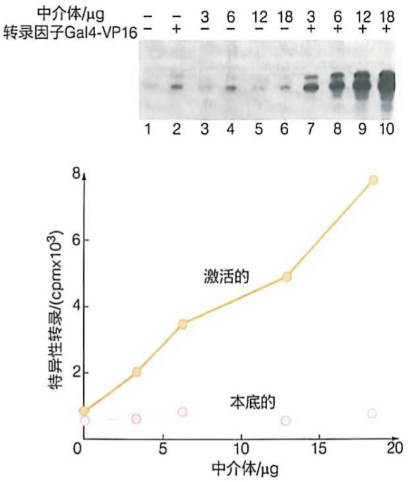

<details>
<summary>line</summary>

| 中介体/µg | 特异性转录/(cpmx10^3) |
| --- | --- |
| 0 | ~0.8 |
| 3.5 | ~2.0 |
| 6.5 | ~3.4 |
| 13 | ~4.9 |
| 18.5 | ~7.8 |
</details>

图 10-22 中介体促进转录因子和转录前起始复合物的结合产生激活的转录反应

数据自 FLANAGAN P M, et al. Nature, 1991, 350 (6317): 436-438.

---

434

10 RNA 的生成

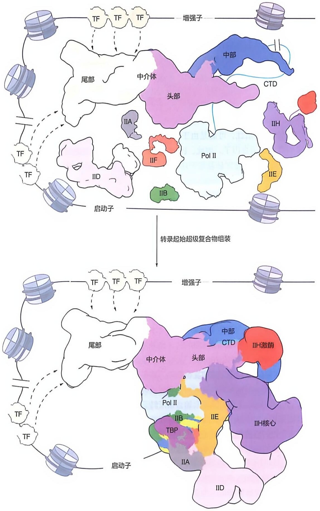

<details>
<summary>flowchart</summary>

This diagram illustrates the molecular signaling pathway of transcription factor receptor superfamily complex (TF) and receptor subunit (TF), showing how transcription factors influence receptor binding to receptors.
</details>

图 10-23 中介体促进转录前起始复合物的组装

---

10.4 真核生物 RNA Pol II 的转录起始

435

基组成，分子量达到  $4.1 \times 10^{6}$  Da。在单独的中介体中，其“头部”和“中部”模块在前端分开，在 PIC-Mediator 中，二者成类似“三明治”结构，夹住 Pol II 的 CTD。中介体与 PIC 或 Pol II 的结合是依赖于其与 Pol II 的 CTD 结合的。在 PIC-Mediator 中，TF II H 的 CDK7 结合中介体的“头部”模块顶端，靠近中介体结合的 CTD 片段，提示这一组装方式促进 CTD 的磷酸化，与中介体促进 CTD 的 Ser5 磷酸化的体外生化结果功能一致（图 10-24）。值得一提的是，在不结合中介体的 PIC 中（图 10-20），CDK7 结合在 Pol II 的表面，也是一种促进 CTD 磷酸化的位置。因此在依赖中介体的高表达基因和不依赖于中介体的低表达基因上，CTD 都可以被有效地磷酸化。

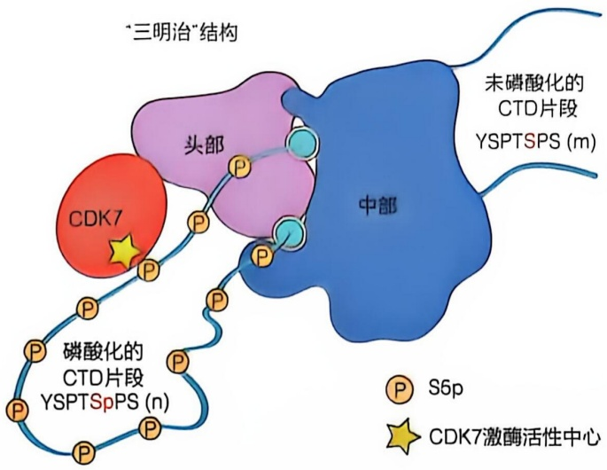

<details>
<summary>flowchart</summary>

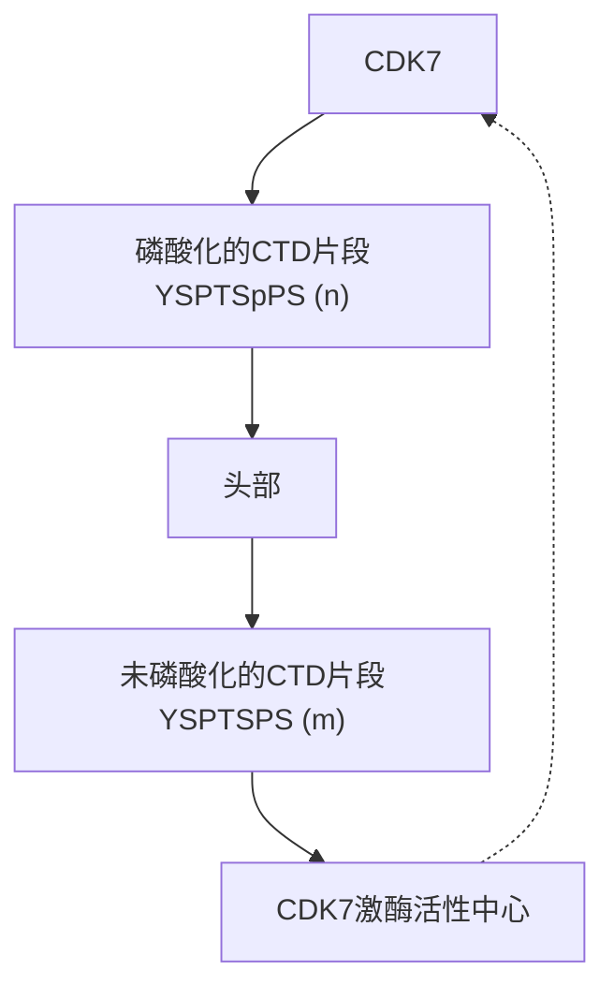
</details>

图 10-24 中介体促进 CTD 磷酸化

改绘自 CHEN X, et al. Science, 2021, 372 (6546): eabg0635.

Pol II CTD 的 Ser5 磷酸化是转录起始的标志，其功能可能是招募加帽酶等，而接近完全磷酸化的 CTD 会使中介体从 PIC-Mediator 上解离。如果中介体仍然被转录因子稳定在启动子区域，中介体就可以结合非磷酸化的 Pol II，促进下一轮的 PIC 组装。值得一提的是，中介体含有多个转录因子结合结构域，但绝大部分通过柔性区域与中介体连接，因此在结构中难以被观测到。中介体与多数转录因子的结合也呈现多价态的弱相互作用形式。近年来有人提出中介体等转录共激活因子含有内在非结构区域（intrinsically disorder region, IDR），可形成凝聚（condensation），产生相分离（phase separation），调控转录。

## 10.4.5 染色质调控转录起始

1960 年代，研究者利用裸露的 DNA 模板建立了简单的体外转录系统，探索真核基因的转录机制。1974 年，科恩伯格提出核小体是染色质的基本单位，由 DNA 环绕组蛋白八聚体（包括 H2A、H2B、H3 和 H4）形成，染色质因此呈现“串珠”结构。1980 年代，迈克尔·格伦斯坦（Michael Grunstein，1946—2024）等通过构建包含组蛋白的人工染色质模板，发现在体外转录反应中染色质抑制了 RNA 聚合酶的结合和转录。1964 年，文森特·奥尔弗里（Vincent Allfrey，1921—2002）等首次发现组蛋白赖氨酸乙酰化修饰，提出此类修饰可减弱组蛋白对 DNA 的结合力，进而促进基因转录。1996 年，戴维·阿利斯（David Allis，1951—2023）等发现组蛋白乙酰转移酶（HAT）在染色质调控中的关键作用。罗德和科恩伯格等也建立了基于多聚核小体模板的体外转录系统，揭示了表观遗传修饰、染色质重塑复合物及转录因子等能够解除染色质对转录的抑制，甚至可能激活转录。

染色质结构对真核生物基因转录有重要调控作用（图 10-25）。可能影响转录的染色质结构特征包括核心启动子的 DNA 序列、启动子周围核小体的位置及其表观遗

---

436

10 RNA 的生成

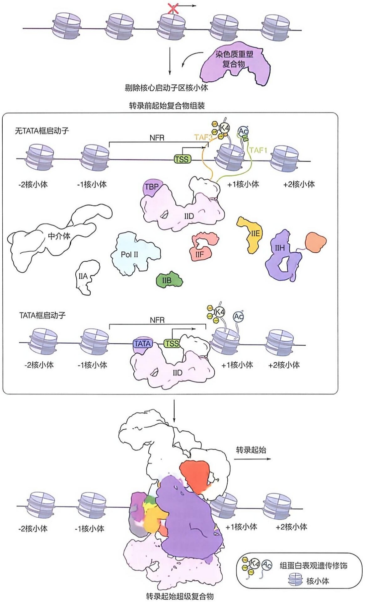

图 10-25 转录前起始复合物在染色质上的组装和 +1 核小体对转录起始位点选择的作用

---

10.4 真核生物 RNA Pol II 的转录起始

437

传修饰（如乙酰化和 H3K4me3）以及启动子和增强子的相互作用等。以上因素共同决定了转录因子、Pol II、通用转录因子和共激活因子在启动子区的招募和组装，从而调控基因转录。下面以增强子和启动子近端核小体为例介绍染色质对转录的调控作用。

增强子的概念起源于 1979 年，沃尔特·沙夫纳（Walter Schaffner）等在 SV40 病毒的研究中发现一段非编码 DNA 序列，其插入基因的上游、下游或远离区域，均可显著提升下游基因的转录。1990 年代，迈克尔·莱文（Michael Levine）等提出增强子和启动子通过染色质环结构形成空间邻近，促使增强子结合的转录因子、共激活因子及 Pol II 在启动子上形成复合物，进而激活靶基因转录。2013 年，理查德·杨（Richard Young）等提出超级增强子的概念，指出关键细胞类型或发育阶段中高度聚集的增强子群在干细胞维持、分化及癌症发生中扮演重要角色。近年来的三维基因组研究也揭示了增强子（包括超级增强子）与启动子之间的普遍相互作用及其在基因表达调控中的作用。

在核心启动子区域，核小体的存在通常会阻碍通用转录因子的结合，从而抑制基因表达。转录起始需要染色质重塑复合物（如 SWI/SNF 家族复合物的 BAF 和 PBAF）通过 ATP 水解产生的能量滑移或剔除核心启动子上的核小体，使启动子 DNA 裸露，以利于 Pol II 和通用转录因子的结合，从而组装 PIC 并启动转录（图 10-25）。有些启动子区域含有无核小体区（nucleosome-free region, NFR），通常位于转录起始位点附近，这种区域广泛存在于酵母启动子和部分哺乳动物的高表达基因启动子，尤其是 CpG 岛启动子。

转录起始位点上游和下游的核小体依次被命名为 -n 和 +n 核小体（n 表示从起始位点开始的第 n 个核小体），其中 +1 核小体因其在转录中的重要作用被广泛研究（图

10-25)。在活跃转录的基因中，+1核小体通常定位于起始位点下游约40 bp处，且含有特征性组蛋白变体（H2A.Z和H3.3）和表观遗传修饰（组蛋白乙酰化和H3K4me3）。这些表观修饰产生的酶及染色质重塑复合物往往富集于+1核小体附近，调控转录起始。

长期以来大家普遍认为，+1核小体对转录的主要贡献是其乙酰化和H3K4me3修饰可与TFIID中的TAF1和TAF3亚基结合，促进TFIID的招募。2022年，徐彦辉等研究发现，PIC-Mediator复合物中的中介体和TFIIH与+1核小体可发生直接相互作用，这种电荷相互作用允许二者在分子动态性的情况下保持结合，从而促进PIC在染色质上的组装和转录起始（图10-26）。对于无TATA框启动子，+1核小体可能参与前转录起始复合物的招募，使其按照+1核小体的位置组装，进而在复合物的框架内决定转录起始位点，这也使得转

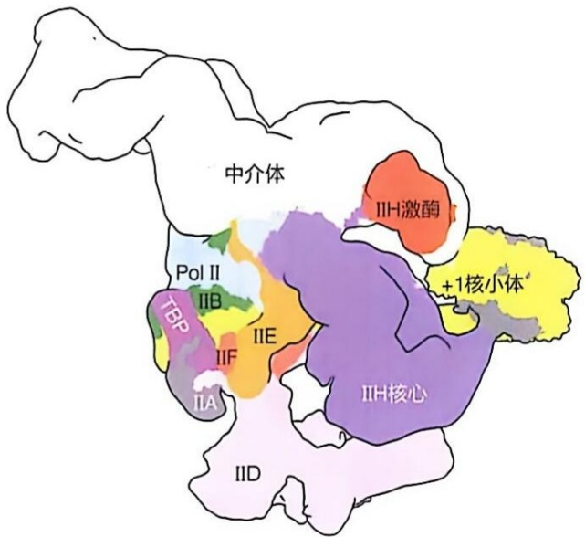

<details>
<summary>text_image</summary>

中介体
IIH激酶
+1核小体
TBP
Pol II
IIB
IIE
IIF
IIA
TIH核心
IID
</details>

图10-26 转录起始超级复合物与 $+1$ 核小体的复合物结构EMDB编号:EMD-34359；PDB编号:8GXQ

---

438

10 RNA 的生成

录起始位点和 +1 核小体之间的距离约为 40 bp（图 10-25）。而对于 TATA 框启动子，+1 核小体对转录的促进作用有限，因为 TATA 框自身已可高效结合 TFⅡD 并促进 PIC 组装。从进化的角度来看，原核生物高度依赖 DNA 序列调控转录，而真核生物则逐渐依赖染色质结构所带来的复杂性调控，以满足多细胞生物对基因表达多样化调控的需求。

## 10.4.6 真核生物基因表达调控特点

在真核生物，尤其是多细胞生物中，基因表达的时间和空间协调对细胞的分化、适应性和生理功能至关重要。这种协调是通过一系列在不同时间维度和不同基因组空间维度上发挥作用的复杂调控机制共同实现的（图10-27）。多层次的基因组组织和表观遗传修饰共同调控了基因表达的模式和强度，使得转录过程能够在适当的时间和特定细胞中开启或关闭。

染色质分为常染色质（易结合转录因子和其他调控因子）和异染色质（不利于转录因子结合），这些结构在细胞核中的位置和组织状态会影响基因的活性。染色质可形成拓扑关联结构域（topologically associating domain，TAD）的环状结构。TAD 将染色质分隔为互相独立的区域，使得同一个 TAD 内的增强子和启动子能够互相作用，

图 10-27 染色质调控转录起始

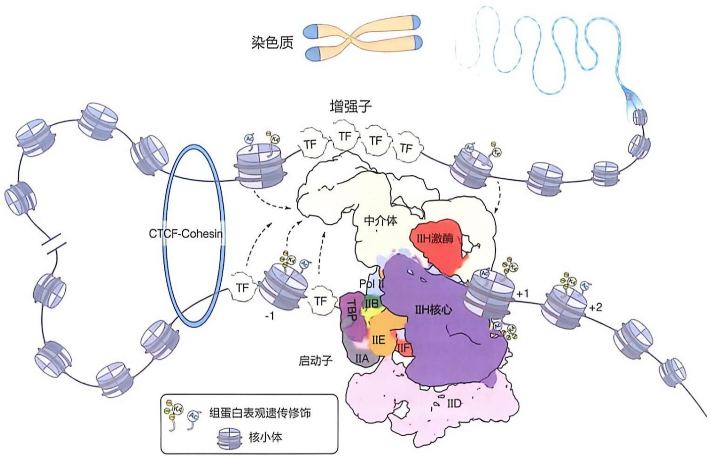

<details>
<summary>flowchart</summary>

This diagram illustrates the molecular mechanism of a protein complex involving CTCF-Cohesin, showing interactions between the receptor, ligand, and receptor subunits (interceptor, IIA, IIF, IID) with specific functional domains like TF and IIH.
</details>

---

10.4 真核生物 RNA Pol II 的转录起始

439

## 知识延展 10-3

## RNA 聚合反应的诺奖趣谈

塞韦罗·奥乔亚（Severo Ochoa，1905—1993）是一位著名的西班牙裔美国生物化学家，他在1959年与科恩伯格共同获得了诺贝尔生理学或医学奖，以表彰在核酸生物合成方面的研究，特别是奥乔亚对多核苷酸磷酸化酶（polynucleotide phosphorylase，PNPase）的发现和研究。PNPase是第一种被发现的核酸合成酶，最初被认为是 RNA 聚合酶，能够将单个核苷酸连接成 RNA 链。但该酶却不是后来发现的 DNA 指导下的 RNA 聚合酶。奥乔亚的工作使得科学家能够利用 PNPase 合成多聚核苷酸，从而进一步研究 RNA 的功能和遗传信息的翻译机制与 mRNA 如何作为遗传信息的载体，为破解遗传密码提供了重要的工具（见第 12 章）。

进而避免了不同 TAD 之间不兼容基因的相互干扰。在基因组的局部区域，DNA 甲基化、组蛋白修饰（如乙酰化、甲基化）以及染色质重塑复合物的动态调节，改变了染色质的结构和开放程度，从而决定了转录因子、RNA 聚合酶及其他表观遗传修饰酶是否能够富集在启动子区域，以有效调控基因的开启或关闭。

转录是一个既精准又随机的过程。这两种特性赋予了转录调控独特的适应性。一方面，转录调控在时间和速率上高度精确，确保特定基因在适当的环境和发育阶段被激活，对于细胞的功能和发育至关重要。一些早期反应基因如 c-Fos、c-Jun、Egr1 通常会在细胞因子刺激后迅速激活，在 5\~30 min 内即可检测到转录增加。精准的调控通过信号转导通路、转录因子网络及其与表观遗传调控的协同作用实现，使得细胞能够精确响应生理信号和环境变化。转录还具有随机性，生物分子间相互作用的偶然性导致了转录的异质性，即使在基因序列相同的细胞中，转录强度和速率也存在一定的波动，这一随机过程被称为“转录爆发”（transcriptional bursting），表现为短时间内

mRNA 的集中合成，然后进入暂停状态（图 10-28）。转录爆发的随机性为生物体提供了适应环境的灵活性和多样性，在细胞分化、应激反应和发育过程中尤为重要。转录过程的随机性使得生物体通过调控基因表达的总体模式，维持发育过程的确定性，实现复杂的生物体结构和功能。

转录调控的多层次机制和双重特性，使得基因表达具有高度的灵活性和适应性，确保在不同环境和发育阶段，细胞能够通过改变基因表达状态而适应多样化的生物需求。同时，转录过程的随机性也为细胞的发育和分化提供了潜在的表型变异性，使得生物体能更好地应对外界变化。

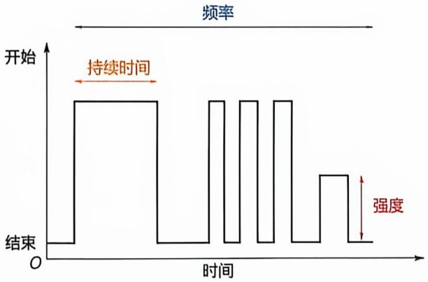

<details>
<summary>state_timeline</summary>

| Time Phase | Frequency Level |
| --- | --- |
| Start to End | High (Stable) |
| Period Duration | Continuous (Sustained) |
| Decay Phase | Decreasing (Delayed) |
</details>

图 10-28 转录爆发的特征

---

440

10 RNA 的生成

## 10.5 真核生物 RNA Pol II 的转录延伸

传统观点认为，转录起始是基因转录的限速和关键调控步骤，但最新研究表明，转录过程的调控远比传统理解更加复杂，并非所有的转录起始事件都能成功完成全长基因的转录。实际上，转录延伸的效率在RNA的产生和与转录同步的细胞过程调控中同样发挥着至关重要的作用。在转录延伸初期，PolⅡ在启动子近端暂停后，面临两个选择:要么提前终止转录，要么有效进入延伸阶段。随着转录的推进，PolⅡ需要克服一系列障碍，包括染色质结构的阻力、转录后染色质状态的恢复及基因组稳定性的维持。此外，PolⅡ还需协调RNA加工与转运，应对DNA损伤阻碍，处理与DNA聚合酶的相向碰撞，以及完成共转录的DNA修复等任务。在这一复杂调控网络中，PolⅡ大亚基Rpb1的C端结构域（CTD）起着关键作用。CTD作为重要的结合界面，招募众多转录相关因子，从而精细调控转录延伸及上述多种共转录事件。解析这些调控机制，对于深入理解基因转录的动态过程至关重要，也是当前研究前沿核心课题之一。

## 10.5.1 转录延伸过程

在真核生物中，当转录起始复合物成功组装到启动子上后，通用转录因子 TF II H 通过水解 ATP 释放能量，解开 DNA 双链，并将模板链引导至 Pol II 的催化活性中心。此后，Pol II 经历一系列复杂的结构重组和蛋白组成调整，以 NTP 为底物合成 RNA，正式进入转录延伸阶段（图 10-21）。除解开双链 DNA 外，TF II H 还在转录起始阶段催化 Pol II 的 CTD 发生磷酸化（图 10-29）。这一关键事件触发了一系列下游调控因子的招募以推动转录延伸的进行。在转录延伸初期，Pol II 需要经历多个“检查点”，并加载各种功能因子。这些因子协助 Pol II 克服染色质屏障和 DNA 模板上的损伤，确保转录后基因组的稳定性，同时协调真核生物特有的 RNA 加工与核内转运。此阶段的一个重要调控步骤是 Pol II 的“暂停检查”，通过检查之后 Pol II 才能进入高效的转录延伸（图 10-29）。这一调节过程将在下文中深入讨论。

当PolⅡ进入有效的转录延伸阶段后，DNA在其活性中心形成约10bp的转录泡。随着PolⅡ沿模板DNA前进，下游双链DNA被逐步解开，单链模板与活性中心结合，NTP不断进入活性中心，与DNA模板链配对，并由PolⅡ催化添加到新生RNA链的3'端。这个过程快速且高效，通常每秒合成20\~50个碱基。在转录泡中，新生RNA链与DNA模板链形成约10bp的RNA-DNA杂合链，其与PolⅡ稳定结合形成延伸复合物（elongation complex，EC）。随后，新生RNA链以单链形式从转录泡中释放，模板链与非模板链重新配对形成双链DNA。转录延伸过程不仅需要确保RNA的连续合成，还必须与下游的RNA加工步骤以及染色质结构的维护紧密协调，以实现高效且稳定的基因表达。

---

10.5 真核生物 RNA Pol II 的转录延伸

441

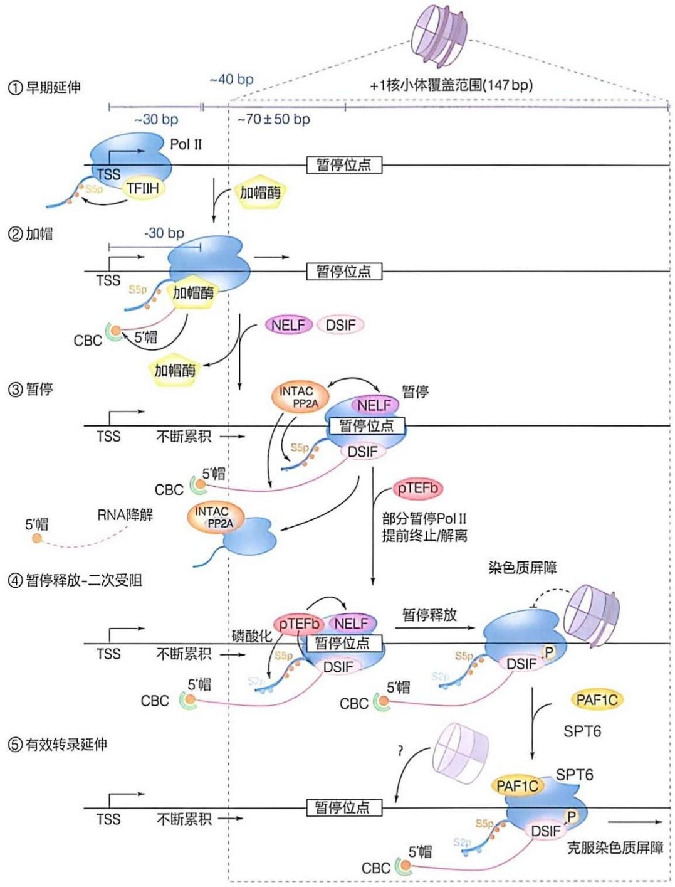

<details>
<summary>flowchart</summary>

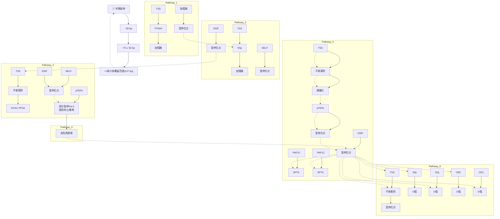
</details>

图 10-29 转录起始到有效延伸过程中的关键步骤

## 10.5.2 CTD 介导转录机器组装及功能调控

Pol II 的 CTD 并非其催化活性所必需，而是在调控转录起始、延伸、终止及 RNA 加工中扮演着关键角色。CTD 由高度保守的七肽重复序列（Tyr1-Ser2-Pro3-Thr4-Ser5-Pro6-Ser7）组成，其结构极为独特，仅存在于 Pol II 中。不同生物中，CTD 七肽重复序列的拷贝数各异，如酵母为 26 个重复，而哺乳动物则达到 52 个（图 10-30A）。CTD 作为一种灵活的延展结构，从 Pol II 的核心结构向外突出。在转录过程中，七肽中的

---

442

10 RNA 的生成

(A)

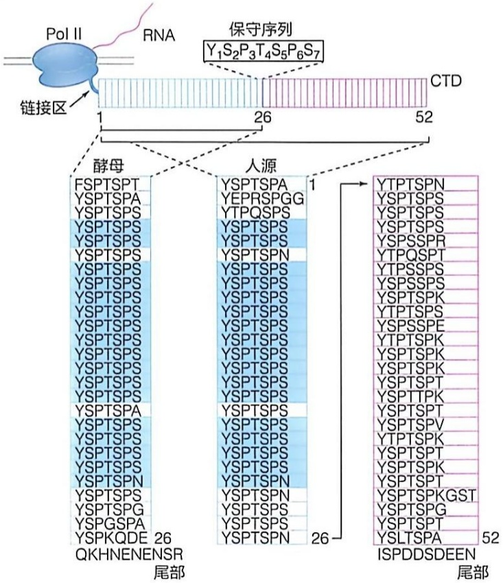

<details>
<summary>flowchart</summary>

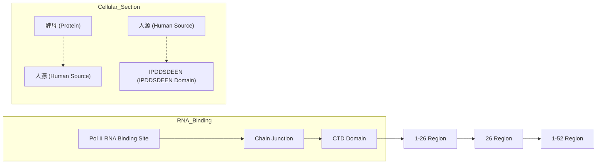
</details>

(B)

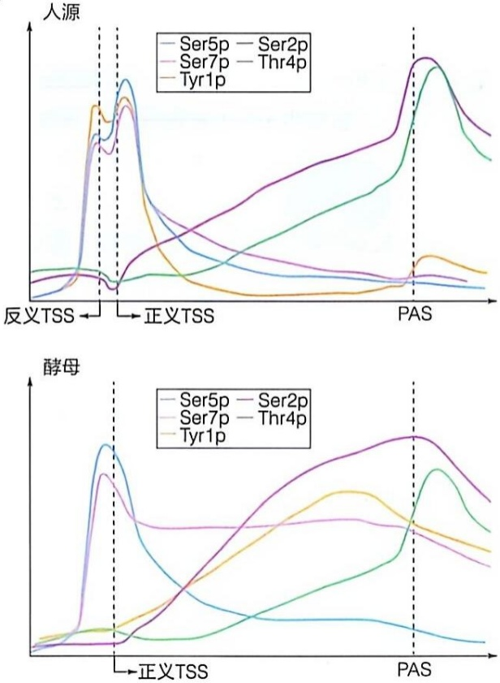

<details>
<summary>line</summary>

| Gene | Expression Profile Description |
| :--- | :--- |
| Ser5p | Peak at TSS; secondary peak at PAS |
| Ser2p | Peak at TSS; secondary peak at PAS |
| Ser7p | Peak at TSS; secondary peak at PAS |
| Thr4p | Peak at TSS; secondary peak at PAS |
| Tyr1p | Peak at TSS; secondary peak at PAS |
</details>

图 10-30 RNA聚合酶 II 的 CTD 结构与修饰模式

（A）CTD序列对比:图示展示了酿酒酵母与人类PolⅡ的CTD。每个矩形代表一个CTD重复单元，保守序列位于图的上方。酿酒酵母的CTD包含26个重复单元，而人类的CTD则包含52个重复单元；其中，前26个重复单元与酿酒酵母的CTD高度相似，剩余26个重复

单元与共识序列差异较大。图中，酿酒酵母与人类 CTD 间相同的重复序列以蓝色高亮显示，强调了这两个物种 CTD 前半部分的高度保守性。（B）CTD 修饰分布图:在蛋白编码基因上磷酸化 CTD 的平均分布模式。比较了酵母与人源 CTD 磷酸化修饰的相似性，特别指出 Tyr1（Tyr1P）的磷酸化在两种物种间有所不同

多个残基（如 Tyr1、Ser2、Thr4、Ser5 和 Ser7）会经历特异性的修饰。这些修饰的相对丰度在基因不同区域表现出显著差异（图 10-30B）。其中，Ser5 和 Ser2 的磷酸化是研究最为详细的两种修饰。Ser5 的磷酸化（Ser5P）在启动子和转录起始位点（TSS）附近达到高峰，而 Ser2 的磷酸化（Ser2P）则在编码区域逐渐增加，并在多腺苷酸化信号（polyadenylation signal，PAS）之后迅速下降。这种分布模式在包括人类在内的多种物种中高度保守。除少数情况外（如 Tyr1P 的修饰），其他残基的磷酸化在蛋白编码基因中呈现相似的分布模式。与 Ser2P 类似，Tyr1P 的分布在酵母中也从基因体内向下游增加，但在 PAS 前出现下降。相比之下，在后生动物中，Tyr1P 在启动子附近达到峰值，并与双向停滞的 Pol II 密切相关。这些修饰的时空分布与转录的不同阶段高度吻合，CTD 的磷酸化状态在转录起始、延伸和终止之间的过渡期会发生显著变化。这种有序的磷酸化模式并非随机分布，而是高度动态和精细调控的过程。它们通过调控 CTD 与 Pol II 相关因子的相互作用，协调转录的推进、染色质的修饰以及新生 RNA 的加工等多种关键步骤，从而确保转录过程的效率和精准性。

---

10.5 真核生物 RNA Pol II 的转录延伸

443

多个周期蛋白依赖性激酶（CDK）催化 CTD 的磷酸化。在转录周期的不同阶段，不同的 CDK 被招募至 Pol II 转录复合物特异性地磷酸化 CTD（图 10-31）。这些磷酸化事件具有阶段特异性，意味着它们在转录周期的不同节点发生，从而适应并推动转录机器的动态需求。CTD 磷酸化模式的变化对 Pol II 与其他转录相关因子的相互作用产生重要影响，这些因子包括转录延伸因子、RNA 加工机器以及染色质调控复合物等。这种调控机制确保了基因表达的精确性和协调性。另一方面，蛋白磷酸酶（protein phosphatase）通过去除 CTD 上的磷酸基团，在调控转录周期中同样扮演重要角色。蛋白磷酸酶的催化亚基通常通过与特定调节因子结合形成复合物，从而特异地去除转录相关复合物关键亚基的磷酸化修饰（图 10-31）。例如，PP2A 和 PP1 在转录的不同阶段通过去磷酸化调节 CTD 状态，影响转录起始、延伸及终止的动态平衡。这种磷酸化与去磷酸化的精密调控机制，是确保转录过程顺利进行的基础。

那么，CTD 如何调控 Pol II 转录机器的组装及转录功能的动态变化？在转录起始阶段，Pol II 的 CTD 主要以非磷酸化状态存在，能够与中介体相互作用，促进 PIC 组装。当 PIC 完成组装后，TF II H 中的 CDK7 亚基（酵母中为 Kin28）磷酸化 CTD 的 Ser5，降低 Pol II 与中介体的结合能力，使 Pol II 摆脱启动子的束缚（启动子逃逸），并从起始阶段向早期延伸阶段过渡，同时招募 RNA 的 5' 端加帽酶。Ser5 的磷酸化在这一过程中呈现出典型的分布模式:磷酸化水平在转录早期达到峰值，富集于转录起始位点（TSS）区域，并随着 Pol II 沿基因体前进逐渐下降。

在早期延伸阶段，Pol II通常会因延伸抑制因子（如NELF和DSIF）的结合及新生mRNA的二级结构而在启动子近端暂停。启动有效延伸的关键复合物是pTEFb（由CycT和CDK9组成）。pTEFb通过磷酸化CTD的Ser2和负调控因子NELF及DSIF，促使DSIF转变为激活状态，并使NELF从Pol II上解离，从而释放暂停的Pol II进入有效延伸阶段（图10-29和图10-31）。与Ser5磷酸化模式不同，Ser2的磷酸化主要

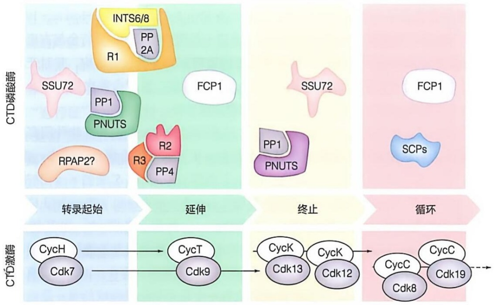

<details>
<summary>flowchart</summary>

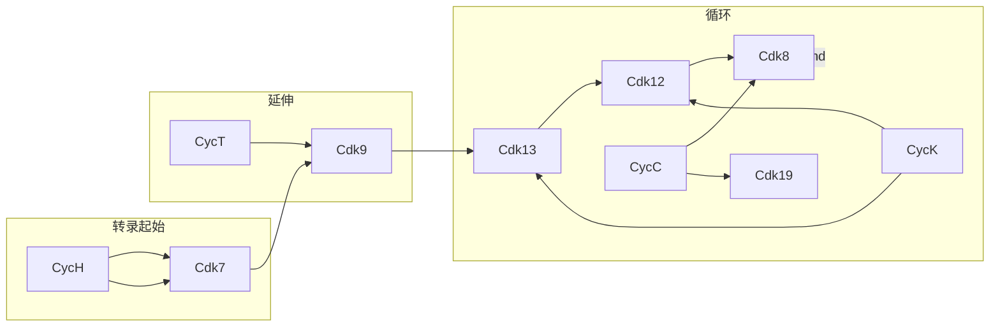
</details>

图 10-31 CTD 去磷酸酶和激酶在 RNA聚合酶 II 转录周期中的作用

与 Pol II 转录周期各阶段相关的蛋白磷酸酶和周期蛋白依赖性激酶（CDK）以及它们的调控蛋白。水平箭头展示了各个 CDK 特定的作用时间段。图中还显示了磷酸酶活动的大致分布，其中磷酸化酶系列的催化亚基用灰色表示，调节亚基则用彩色表示，以便区分

---

444

10 RNA 的生成

富集于基因体内及 3' 端，并与有效延伸同步发生。

CDK12 是转录延伸阶段的重要调控因子，它通过与延伸因子 PAFIC 的相互作用被招募至活性延伸复合物，并进一步磷酸化 CTD 的 Ser2。在多腺苷酸化信号上游，Pol II 的暂停可能提高 CDK12 活性，导致 Ser2 磷酸化水平进一步提升，从而促进多腺苷酸化因子的募集，激活 RNA 3' 端加工。

CTD 中七肽重复序列的动态修饰为 Pol II 的功能调控提供了多样化的 “编码”。这些修饰组合（如 Ser5P、Ser2P 等）被特定的功能蛋白 “阅读”，实现了转录及共转录事件的有序协调。例如，转录早期的因子（如 mRNA 5' 端加帽酶）特异识别 Ser5P，而 RNA 加工相关因子则优先结合转录后期的标记（如 Ser2P）。这些 “阅读者” 不仅与 CTD 直接相互作用，还与其他调控因子协同作用，形成复杂的动态网络，从而精确调控转录周期和共转录加工。值得注意的是，CTD 的动态修饰可能通过液-液相分离等物理机制进一步调控转录过程，促进转录机器的组装和功能分区。这些修饰的时空动态确保基因高效表达和转录的精确推进，启动了 RNA 加帽、转录延伸和 RNA 加工等下游事件。接下来，我们将按时空顺序详细解析 CTD 修饰在转录周期各阶段中的作用机制。

## 10.5.3 新生 RNA 的加帽

在原核生物中，RNA 聚合酶生成的 mRNA 可直接用于翻译，无需进一步加工，并且转录和翻译可同时进行；而在真核生物中，由 Pol II 转录产生的 pre-mRNA 需经过多重加工和修饰后才能形成具有生物学功能的成熟 mRNA，包括 5' 端加帽、3' 端加尾和内含子剪接等。1974 年，研究人员在多种真核生物和病毒的 mRNA 分子 5' 端发现了普遍存在的甲基化现象；1975 年，伯纳德·莫斯（Bernard Moss）等利用同位素 $^{32}$P 标记核苷酸，并用 $^{3}$H 标记的 S-腺苷甲硫氨酸（SAM）标记甲基化基团，在牛痘病毒中鉴定出了 mRNA 的帽结构。同年，亚伦·夏特金（Aaron Shatkin，1934—2012）等也在呼肠孤病毒中得到相似结果。为进一步明确帽结构，夏特金与古市保志（Yasuhiro Furuichi，1940—2022）通过磷酸酯酶处理 mRNA 释放帽结构，并对产物进行电泳和色谱分析，证明帽的基本结构为 m$^{7}$G；1976 年，夏特金首次将 mRNA 5' 端的这种特殊结构命名为“帽”（cap），这一称谓沿用至今。

帽结构广泛存在于真核生物和病毒中，经典的帽结构  $m^{7}GpppN$  在物种间高度保守，研究人员根据其甲基化程度将其命名为 Cap 0。Cap 0 的合成分为三步:首先，RNA 三磷酸酯酶（RNA triphosphatase，TPase）移除 pre-mRNA 5' 端的 γ-磷酸基团，生成 5'-二磷酸 RNA；接着，鸟苷酸转移酶（guanylyltransferase，GTase）以 GTP 为底物将 GMP 转移至 5'-二磷酸 RNA，形成 Cap -1；最后，鸟苷  $-N^{7}-$  甲基转移酶（guanine-N7 methyltransferase，MTase）将供体 SAM 的甲基基团共价连接到鸟嘌呤的 N7 位，生成完整的 Cap 0 结构。在酵母中，这三种加帽酶独立存在；而在高等真核生物中，RNA 三磷酸酯酶和鸟苷酸转移酶演化为一个包含双酶结构域的单一蛋白；痘

---

10.5 真核生物 RNA Pol II 的转录延伸

445

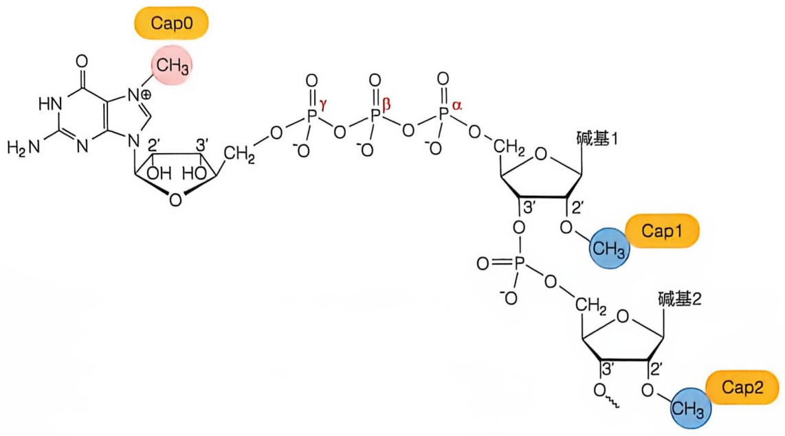

<details>
<summary>chemical</summary>

Chemical structure of a nucleotide sugar derivative with labeled bases and phosphate groups
</details>

图 10-32 Cap 2 帽结构的基本构成

病毒加帽酶则是一种多功能蛋白，可催化以上三步反应。低等真核生物（如酵母）的mRNA仅具有Cap 0，而高等真核生物则发展出更复杂的帽结构，+1和+2位核苷酸的2'羟基可进一步甲基化形成Cap 1和Cap 2（图10-32）；在哺乳动物细胞中，当+1位核苷酸为腺苷酸时，其N6位还能被甲基化，生成更为复杂的 $m^{7}Gpppm^{6}Am$ 帽结构。Pol II转录的其他RNA也具有特定的帽结构，但与mRNA的帽结构有所不同，例如miRNA在成熟过程中丢失帽结构，而snRNA和snoRNA的帽结构可进一步加工为三甲基鸟苷酸（tri-methylguanosine，TMG）。近年来，研究人员还在细菌、酵母和哺乳动物细胞中发现了包括NAD和NADH在内的多种非经典帽结构形式，这些发现进一步揭示了帽结构的多样性和功能复杂性。

5' 端帽结构在 mRNA 的整个生命周期中发挥着至关重要的作用，具有多项生理功能。首先，帽结构封闭了 pre-mRNA 的 5' 端，有效保护新生转录本免受 5'→3' 核酸外切酶的降解，从而显著提升 mRNA 的稳定性。其次，帽结构会被特异性帽结合蛋白（cap-binding protein，CBP）识别，这些蛋白不仅进一步增强了对 RNA 的保护作用，还招募与 RNA 加工、核输出和翻译相关的特定因子，使帽结构成为 mRNA 进入核糖体的“通行证”，对于维持 mRNA 的正常信息传递功能至关重要。此外，研究表明，Cap 1 是宿主细胞区分“自我”与“非我”的重要信号，新生病毒转录本因缺乏这种修饰而被宿主细胞识别为“非我”，从而激活先天性免疫应答。Cap 1 和 Cap 2 能够抑制模式识别受体（pattern recognition receptor，PRR）与 mRNA 的结合，其中 Cap 2 还能抑制内源性 RNA 诱导的先天免疫应答，减轻细胞内的免疫负担。

帽结构的首要功能是保护 RNA 免受降解，因此加帽反应必须在转录早期进行。染色质免疫共沉淀实验显示，加帽酶定位于转录起始位点（TSS）下游区域；体外利用核提取物的研究发现，当 RNA 链延伸至约 20 nt 时，加帽反应即可进行。加帽酶能够直接与 Pol II、转录因子 DSIF 和 PAF1C 相互作用，进一步确认加帽是共转录的加

---

446

10 RNA 的生成

工过程。2024年，克拉玛团队与徐彦辉团队分别解析了人类加帽酶结合PolⅡ复合物的结构，显示加帽酶结合于PolⅡ的RNA出口通道附近，这种空间定位使其能够迅速捕获从转录腔伸出的RNA5'端。这一机制与痘病毒和酵母中的加帽酶结合方式高度一致，表明加帽酶在各类生物体中具有功能保守性。

## 10.5.4 RNA 聚合酶在启动子近端暂停

在转录起始到转录延伸的过渡过程中，Pol II 的一个标志性变化是从低磷酸化状态（Pol II A）向高磷酸化状态（Pol II O）转变。转录早期延伸包括启动子逃逸和 Pol II 在启动子近端暂停两个阶段。启动子逃逸是延伸过程的第一步，其间 Pol II 从启动子及其结合的通用转录因子逐渐解离，并与新生 RNA 稳定结合。此后，Pol II 能够与一定长度的新生 RNA 牢固结合并开始转录延伸。然而，处于这个阶段的早期延伸复合物（EEC）仍不稳定，容易出现 RNA 从聚合酶脱落、暂停及回溯的现象。当 EEC 合成 30～60 个碱基后，通常会进入启动子近端暂停（promoter proximal pausing）（图 10-29 ③）。这种现象广泛存在于后生动物中，是一种重要的转录调控步骤。启动子近端暂停的主要驱动因素是负向延伸因子 NELF 和 DSIF，它们可能通过抑制核苷酸的加入限制 Pol II 的前进。NELF-DSIF 和 Pol II 及新生 RNA 形成的复合物使 Pol II 维持在暂停状态，称为暂停延伸复合物（PEC）。克拉玛等对 PEC 的结构研究表明，NELF 可能同时抑制了核苷酸的加入和聚合酶的前进，还通过结合延伸因子 TF II S 抑制聚合酶的释放。含有整合子（integrator）的 PP2A-AC 复合物（INTAC）通过其磷酸酶活性使 Pol II CTD 去磷酸化，通过其 INTS11 亚基的核酸酶活性降解新生 RNA，从而导致启动子近端的过早转录终止（promoter-proximal premature transcription termination）。启动子近端暂停的另一个调控因素是新生 RNA 和 DNA 模板链形成的 R 环（RNA-DNA 杂交结构），其高稳定性可能阻碍 Pol II 的继续延伸，诱发转录暂停。有趣的是，一些病毒（如 HIV）通过病毒蛋白 Tat 与暂停状态的 Pol II 结合，“绑架”宿主的转录机制以合成病毒蛋白。

启动子近端暂停是转录调控中的一个关键检查点和限速步骤，也是新生 RNA 加工（5' 端加帽）的重要节点。因此，暂停状态的释放受到精密调控，以确保 Pol Ⅱ 在接收到正确激活信号后能迅速过渡到高效延伸状态，并生成功能性 mRNA。在此过程中，pTEFb 是决定 Pol Ⅱ 从暂停到有效延伸的关键蛋白复合物。pTEFb 由 Cyclin T 和激酶 CDK9 组成，能够磷酸化 NELF，使其从 Pol Ⅱ 解离，同时使 Pol Ⅱ 与 PAF1C 等延伸复合物结合。pTEFb 还通过磷酸化 DSIF 的 Spt5 亚基，打开 RNA “钳子” 结构，促进转录延伸。此外，pTEFb 磷酸化 Pol Ⅱ 的 CTD Ser2 残基，为共转录因子提供了招募平台，并通过磷酸化 CTD 链接区增强 SPT6 的结合。在高等生物中，pTEFb 与 ELL、Elongin 等组成超级延伸复合物促进转录延伸。

并非所有类型的暂停都由 NELF 介导。在裂殖酵母等缺乏 NELF 的生物中，仍存在非 NELF 依赖性的暂停现象。NELF 依赖的暂停需要 pTEFb 中的激酶 CDK9 活性

---

10.5 真核生物 RNA Pol II 的转录延伸

447

来释放 Pol II，而非 NELF 依赖的暂停则不受此限制。这表明，NELF 的进化为高等真核生物提供了更精确的转录调控手段，通过对 CDK9 活性的严格调控来避免资源浪费。

Pol II 从暂停状态释放后将面临另一个 “检查点”，即位于转录起始位点下游的 +1 核小体（图 10-29④）。染色质结构限制了 Pol II 对核小体结合 DNA 的使用，进而抑制了 Pol II 的活性。然而，两个关键复合物（PAF1C 和 SPT6）的装载能够帮助 Pol II 克服这一障碍。PAF1C 复合物在 CDK9 和 SPT6 介导的 CTD Ser2 磷酸化作用下被招募到延伸复合物中，不仅促进暂停的释放，还通过与染色质重塑复合物 FACT 的结合帮助 Pol II 克服核小体障碍。冷冻电镜结构研究表明，PAF1C 的 RTF1 亚基与 Pol II 结合后促进核苷酸更高效地加入，从而加快转录速度。此外，PAF1C 还通过招募 CDK12 进一步磷酸化 CTD Ser2，增强转录延伸效率。SPT6 作为多功能转录因子，能够直接结合 Pol II 的核心和 CTD 连接区，通过招募 PAF1C 促进暂停释放，并在转录延伸中充当组蛋白伴侣，协调 Pol II 前方核小体的解离和后方核小体的重建。SPT6 对维持染色质结构、抑制基因内转录起始以及基因组稳定性具有重要作用。SPT6 还能与 Pol II 和 PAF1C 等形成相分离的聚合体，进一步促进转录延伸。加载了这些关键因子后，RNA Pol II 能以更高的速率克服染色质障碍，顺利进入高效的转录延伸步骤（图 10-29⑤）。

## 10.5.5 转录延伸因子及延伸复合物的生成

转录进入稳定的有效延伸后，需要组装一个由多种复合物协调控制的转录延伸机器，以维持 RNA 的高效生成，同时帮助聚合酶通过核小体并维持染色质的稳定性（图 10-33）。重要的延伸因子简述如下。

DSIF 是后生生物中的重要延伸因子，由 SPT4 和 SPT5 组成。其中，SPT5 亚基高度保守，广泛存在于古细菌（SPT5）、细菌（NusG）和真核生物中。在转录延伸早期，SPT5 能够招募负向延伸因子 NELF，与 Pol II 形成复合物，导致启动子近端暂停。当 SPT5 被 pTEFb 磷酸化后，DSIF 转化为正向延伸因子，稳定 Pol II 结构并促进有效延伸。

TF IIS 是经典的转录延伸因子，可以激活 Pol II 的 RNA 剪切功能，使暂停或回溯的聚合酶重新进入延伸状态。TF IIS 通过负电荷氨基酸深入活性中心并结合  $Mg^{2+}$ ，激活核酸酶切割活性，切除新生 RNA 的 3' 端 2～10 个碱基，从而使 RNA 重新定位到活性中心继续延伸。这与 DNA 聚合酶的校正机制类似，对于修正错配的 RNA 非常重要。此外，TF IIS 可促进 PAF1C 与 Pol II 的结合，在 Pol II 遇到 DNA 模板障碍或组蛋白-DNA 强相互作用时尤为关键。它帮助 RNA

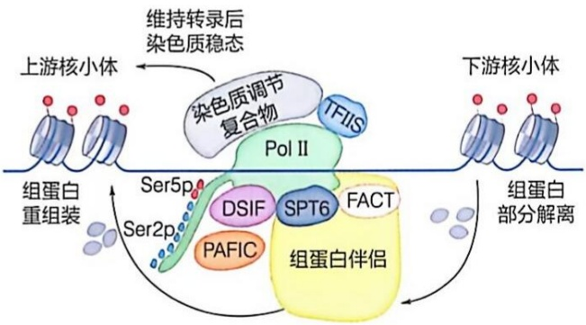

<details>
<summary>flowchart</summary>

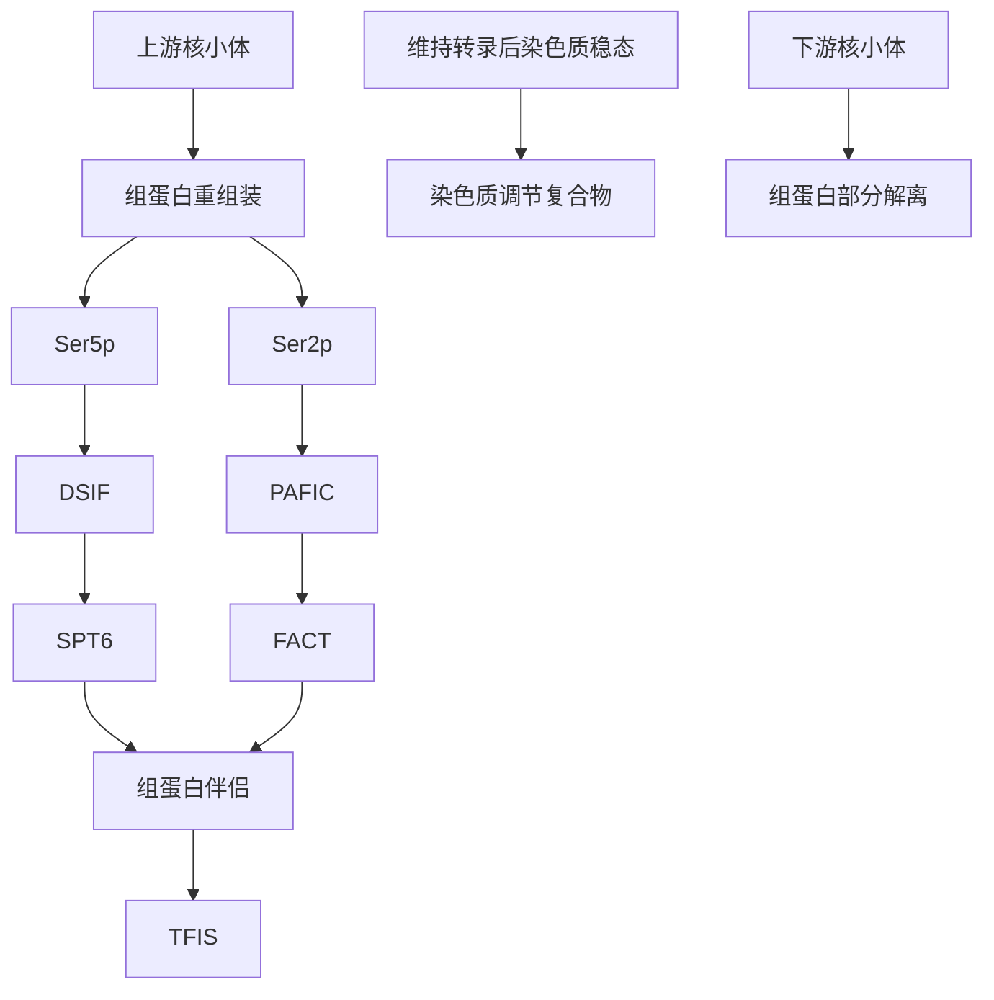
</details>

图 10-33 RNA聚合酶Ⅱ延伸复合物及结合的延伸因子

---

448

10 RNA 的生成

聚合酶克服障碍并保持转录连续性，从而维持基因表达处于正常水平。TF IIS 还参与染色质转录启动活性（chromatin transcription-enabling activity, CTEA），通过与 p300 和乙酰辅酶 A 协作促进转录通过核小体。

FACT 是一种组蛋白伴侣复合物，参与 H2A-H2B 二聚体的拆解与重新组装，在 Pol II 转录通过核小体时发挥作用。延伸过程中组蛋白可能部分丢失，但 FACT 能快速重新将组蛋白组装到 Pol II 后方的 DNA 上，从而维持染色质完整性。FACT 不仅帮助组蛋白重组，还防止 DNA 裸露导致隐蔽启动子暴露。FACT 及相关因子的突变会导致基因组隐蔽启动位点的异常转录。

染色质重塑复合物通过利用ATP改变核小体位置和组成，帮助PolⅡ穿越染色质障碍。复合物如SWI/SNF、ISWI和CHD家族可以滑动、替换或剔除核小体，开放被核小体占据的基因启动子区域。它们还能调节核小体间距，维持整体染色质稳定性。

染色质修饰酶复合物通过可逆的化学修饰，如组蛋白的甲基化、乙酰化和泛素化，控制转录活动。这些修饰通常作用于组蛋白尾部，影响组蛋白与DNA的相互作用及效应因子的招募。例如，一方面，组蛋白乙酰转移酶（HAT）通过在赖氨酸残基上添加乙酰基，减少其正电荷，减弱组蛋白与DNA的结合，使染色质松弛，从而为转录机器提供空间；另一方面，Set2-Rpd3S通路利用组蛋白甲基化信号激活特定去乙酰化酶，确保染色质在聚合酶通过后恢复至开放状态，抑制异常转录。

Pol II 的运动速度受多种因素影响，包括基因结构、RNA 后加工及染色质结构等。这些因素不仅决定转录速度，也影响基因表达效率和准确性。全基因组研究显示，不同生物体中 Pol II 的延伸速度随年龄变化。例如，在线虫和果蝇中，降低转录速度与寿命延长相关。此外，通过过表达组蛋白成分调控 Pol II 速度，可以抵消核小体定位的年龄变化，从而延长果蝇寿命并增强人类细胞的分裂潜能。这些研究揭示了转录速度可能与寿命和健康密切相关，为进一步理解老化机制及开发治疗策略提供了重要线索。

## 10.5.6 共转录事件及其调控机制

在真核生物细胞中，Pol II 不仅负责将 DNA 转录为 RNA，还介导一系列同步发生的 RNA 处理事件，这些过程被统称为共转录事件（图 10-34）。首先，转录开始时，RNA 5' 端被加帽，有助于 mRNA 的稳定、运输和翻译。接下来，RNA 剪接在转录过程中动态进行。剪接复合物与转录机器协同作用，移除内含子并连接外显子，最终形成成熟的 mRNA。在转录过程中进行 RNA 3' 端加工，包括 pre-mRNA 的 3' 端切割和多腺苷酸化，这对于 mRNA 的后续功能至关重要。此外，RNA 编辑和修饰，如 m$^{6}$A 甲基化，进一步增强了 RNA 分子的多样性与功能性，这些修饰与转录过程紧密相关。这些复杂的共转录机制表明，Pol II 不仅是一个转录工具，更是一个集成了多种功能的细胞核内加工平台，通过精确调控以上过程，保障了基因表达的高效性和准确性。转录延伸复合物在这一过程中发挥了枢纽作用，为转录机制与 RNA 处理机制的结合

---

10.5 真核生物 RNA Pol II 的转录延伸

449


<details>
<summary>flowchart</summary>

```mermaid
graph LR
  subgraph Cell_Culture ["细胞质与核"]
    direction TB
  NPC["NPC"] --> Transcription["转运\n出核"]
  Transcription --> Posttranscription["转录后加工\n内含子"]
  Posttranscription --> PreRNA["Pre-RNA\npoly(A)"]
  PreRNA --> PolII1["Pol II"]
  PolII1 --> pA["pA位点"]
  pA --> TTS["TTS"]
  TTS --> CBC["CBC"]
  CBC --> RNP["RNP"]
  RNP --> EJC["EJC"]
  EJC --> SRP["SRP"]
  SRP --> CBC
  end

  subgraph Membrane ["内含子"]
    direction TB
  TSS["TSS"] --> PolII2["Pol II"]
  PolII2 --> Out["出核受体"]
  Out --> SRP2["SRP"]
  SRP2 --> RNP3["RNP"]
  RNP3 --> EJC3["EJC"]
  EJC3 --> SRP3["SRP"]
  SRP3 --> CBC
  end

  subgraph Translation ["蛋白质翻译"]
    direction TB
  SRP4["SRP"] --> CBC
  CBC --> SRP4["SRP"]
  SRP4 --> EJC4["EJC"]
  EJC4 --> RNP4["RNP"]
  RNP4 --> SRP4
  SRP4 --> CBC
  end

  subgraph Modification ["RNA共转录加工\n加帽，剪接，Poly(A)\n加尾位点选择等"]
    direction TB
  CBC --> 5'帽["5'帽"]
  n5["5'帽"] --> CBC
  CBC --> PolII2
  PolII2 --> Out
  Out --> SRP3
  SRP3 --> EJC3
  EJC3 --> RNP3
  RNP3 --> SRP3
  SRP3 --> CBC
  CBC --> CBC
```
</details>

图 10-34 RNA 聚合酶延伸过程中的共转录事件

提供了物理和功能平台，使它们能够协同工作。此外，由于 RNA 在转录过程中与染色体结构产生复杂的相互调控，这些共转录事件也与染色质结构密切相关。

在转录延伸过程中，Pol II 不可避免地与正在复制中的 DNA 聚合酶相遇并发生碰撞。由于转录和复制共享相同的 DNA 模板，且 Pol II 在 DNA 复制阶段同样活跃，转录和复制机器在细胞内可能发生头-尾或头-头的碰撞。巨大的聚合酶及其结合的延伸因子是 DNA 复制体不可跨越的障碍，加之转录过程中 DNA 超螺旋变化或形成的 R 环结构，都会阻碍复制叉的进程，最终导致 DNA 损伤和基因组不稳定。值得注意的是，DNA 复制起点大多位于开放染色质中，且靠近活跃的转录区域，这表明转录和复制可能是被精细调控并协同进行的。一方面，一些延伸因子，如 Spt6 和 DNA 解旋酶 RECQL5，能够抑制复制压力；另一方面，DNA 聚合酶还能够利用 Pol II 产生的 mRNA 来重启复制过程。这些保护机制帮助维持了在活跃转录和复制状态下基因组的稳定性。

转录偶联修复（transcription-coupled repair，TCR）是一种专门修复转录过程中DNA损伤的机制，涉及多种蛋白质，如Cockayne综合征蛋白B（CSB）、Cockayne综合征蛋白A（CSA）和紫外线刺激蛋白质骨架A（UVSSA）（图10-35）。这些蛋白有助于识别停滞的聚合酶并移除妨碍转录的DNA损伤。当CSB或CSA功能受损时，会引发Cockayne综合征，这是一种遗传性疾病，表现为严重的神经功能退化；而当UVSSA功能受损时，会引发UV敏感综合征，其特征是轻微的皮肤光敏感，但不涉及神经系统。PolⅡ在遇到DNA损伤或与复制中的DNA聚合酶发生碰撞时停滞，进而起始TCR。首先，CSB蛋白识别并结合到停滞的聚合酶上，进而招募CSA和UVSSA等到损伤位点，稳定修复复合物并推动修复过程。接着，TCR复合物吸引TFⅡH，

---

450

10 RNA 的生成


<details>
<summary>flowchart</summary>

```mermaid
graph TD
  Start["Start"] --> PolII["Pol II\nELOF1"]
  PolII --> DNADamage["遇到DNA损伤"]
  DNADamage --> PolII
  PolII --> Transcription["转录中的Pol II"]
  
  subgraph DNA["\"与DNA复制叉对撞\""]
    direction TB
  DNAReplication["DNA聚合酶\n解旋酶"] --> ELOF1["ELOF1"]
  ELOF1 --> DNAReplication
  end
  
  Transcription -->|"CSB识别\n被阻塞的Pol II"| CSB["CSB"]
  CSB --> CSB_CRL4["CSA CRL4\nUb"]
  CSB --> CSB_CRL4
  
  subgraph IVSS_CSB_n_Pol_II_IVSS_IVSS["\"IVSS\" ->|\"CSB识别\n被阻塞的Pol II\"| IVSS[\"IVSS\"]"]
  IVSS --> CSB_CRL4
  
  Transcription -->|"TSIIH\n下游修复蛋白\nPol II被TFIIH从模板上移除\n遇到DNA损伤\n通过NER途径修复损伤DNA\n与DNA复制叉对撞\n避免R-环形成以及DNA复制胁迫"| TFIIH["TFIIH"]
  TFIIH --> CSB_CRL4
  
  subgraph TSIIH_TSIIH_nCSB_n_Pol_II_nCSB_CRL4_nUb_CSB_CRL4["\"TSIIH\" ->|\"TSIIH\nCSB识别\n被阻塞的Pol II\nCSB_CRL4\nUb\"| CSB_CRL4"]
  
  CSB_CRL4 --> CSB_CRL4
  CSB_CRL4 --> CSB_CRL4
  
  CSB_CRL4 -.->|"TSIIH" | CSB_CRL4
```
</details>

图 10-35 TCR 复合物组装模型及转录偶联修复的作用机制

利用其 XPD 亚基提供的解旋酶活性，移除停滞的聚合酶，并使得 DNA 双螺旋在损伤部位局部解开，从而允许修复机器结合并最终修复这些损伤，确保转录过程的恢复。此外，TFⅡH 在 TCR 中的功能还依赖于 Pol Ⅱ RPB1 亚基的泛素化修饰，这一修饰由 CSA 介导的环状 E3 连接酶（CRL）完成。在 DNA 损伤修复和转录恢复过程中，TFⅡH 的结构和功能发生显著变化，从一个通用转录因子转变为 DNA 修复因子。即 TFⅡH 与 XPA 和 XPG 等核苷酸切除修复（NER）因子相互作用，激活 XPD 的解旋酶活性，推动 DNA 损伤的修复。通过这些复杂的相互作用和修饰，细胞能够有效修复转录过程中的 DNA 损伤，确保基因的正常表达和细胞的健康生存。

当转录中的PolⅡ在模板上遭遇DNA损伤或DNA复制叉对撞，CSB、CSA和UVSSA逐步与其结合，并与RPB1-K1268和UVSSA-K414的泛素化共同作用，将通用转录因子TFⅡH复合物定位到被阻塞的延伸中的PolⅡ，从而将PolⅡ从DNA模板移除。

---

10.6 真核生物转录终止

451

## 10.6 真核生物转录终止

## 10.6.1 真核生物 mRNA 的转录终止

真核生物 mRNA 转录终止与新生 mRNA 前体的 3' 端加工偶联，其主要分为转录终止信号识别、RNA 切割、poly(A) 加尾、Pol II 解离几个过程。其中，新生 mRNA 前体的 3' 端加工由一个包含多个亚基的切割加工超大复合物完成（图 10-36）。该加工复合物识别多腺苷酸化信号（polyadenylation signal，PAS）以及附近序列元件，启动转录终止过程。多腺苷酸化信号序列较为保守，通常为 A[A/U]UAAA，位于 mRNA 前体切割位点上游 10\~30 nt。多腺苷酸化信号附近序列元件还包括切割位点下游的富含鸟苷酸 / 尿嘧啶信号（G/U-rich signal）。人源切割加工复合物由至少 14 个亚基组成，包括切割和多腺苷酸化特异因子（cleavage and polyadenylation specificity factor，CPSF）、切割刺激因子（cleavage stimulation factor，CstF）、切割因子 CF I 和 CF II（cleavage factors I and II）、RBBP6 等调控亚基。CPSF-CstF 复合物通过识别 RNA 序列信号和 Pol II CTD 磷酸化信号（CTD Ser2P）定位到 Pol II 转录延伸复合物。在信号识别阶段，CPSF 识别切割位点上游的 PAS 信号，CstF 识别切割位点下游的富含 G/U 信号，Pcf11 亚基识别 SPT5 和 Pol II CTD 的磷酸化修饰信号。CPSF 中保守的核酸内切酶 CPSF73 亚基完成 mRNA 前体的切割，CPSF 模块招募的 poly(A) 聚合酶 [poly(A) polymerase, PAP] 对切割后的 mRNA 前体 3' 端加 Poly(A) 尾。哺乳动物中的 Poly(A) 尾平均长约 250 nt，而在酵母中则约为 70 nt。新形成的 Poly(A) 尾被细胞核的多腺苷酸结合蛋白

图10-36 真核转录终止示意图


---

452

10 RNA 的生成

(nuclear poly(A)-binding protein, PABPN) 结合，其长度也受其控制，加尾完毕的成熟 mRNA 被运送到细胞质中翻译。

新生 mRNA 前体的 3' 端加工和 Pol II CTD 去磷酸化修饰紧密偶联。Pol II CTD 磷酸酶 PP1 和 SSU72 与 CPSF 复合物相互作用进而定位到转录终止区域，去磷酸化 Pol II CTD 的 Ser5P/Ser7P（SSU72）和 Tyr1P（PP1），上述过程在酿酒酵母细胞中的偶联更加紧密，因为酿酒酵母细胞中的两个磷酸酶（Glc7 和 Ssu72）和 CPF 组成稳定的复合物。Pol II CTD 去磷酸化促使转录延伸因子解离，诱导 Pol II 构象变化（如形成二聚体），减缓 Pol II 延伸速度。

成熟 mRNA 被运送到细胞质的同时，Pol II 仍然往下游缓慢行进并同时继续合成 RNA，当 RNA 合成一定长度之后（从酵母细胞中的几十 bp 到人源细胞的数千 bp），合成终止，Pol II 从基因组 DNA 解离。当前有三种模型用来解释该过程:异构模型（allosteric model）、鱼雷模型（torpedo model）和整合模型。异构模型认为:Pol II 通过 PAS 位点后，转录延伸因子解离，并诱导 Pol II 构象变化，减慢 Pol II 合成 RNA 速度，最终停止 RNA 合成并解离 DNA 和 RNA。鱼雷模型认为:CPSF-CstF 复合物切割前体 mRNA 后，一个保守的 RNA 外切酶（酵母 Rat1，人 XRN2、拟南芥 XRN3）捕获下游 RNA 5' 端，边降解 RNA 边追赶 Pol II，追赶上 Pol II 后引发 Pol II 解离。近年来，生物化学、结构生物学、遗传学的证据更加倾向于支持异构和鱼雷结合的整合模型，张余等解析的 Rat1-Pol II 冷冻电镜复合物结构表明，RNA 外切酶稳定结合在 Pol II 的 RNA 退出通道外侧，促使转录延伸因子解离，减慢 Pol II 转录速度，而 RNA 外切酶通过不断缩短 RNA 长度，最后将 RNA 从 Pol II 催化中心拖拽出来完全降解，同时将 Pol II 从基因组 DNA 上解离。

## 10.6.2 真核生物非编码 RNA 的转录终止

真核生物非编码 RNA 的转录终止不依赖 PAS 信号和 CPSF-CstF/XRN2 复合物。酵母非编码 RNA（snRNA 和 snoRNA）的转录终止由 NNS（Nrd1-Nab3-Sen1，NNS）复合物介导。NNS 复合物中包含两个 RNA 结合蛋白 Nrd1 和 Nab3，以及一个保守的 RNA/DNA 解旋酶 Sen1。Nrd1 和 Nab3 分别识别 RNA 的特异序列 GUAA/G 和 UCUUG。Sen1 具有依赖 ATP 的 5'→3' 解旋酶活性，能与 Nrd1 和 Pol II 相互作用。首先，Nrd1 和 Nab3 通过识别 RNA 序列信号和 Pol II CTD 磷酸化信号（Ser5P）结合到 Pol II 和 RNA，随后招募 Sen1 至 Pol II 转录延伸复合物。生物化学和结构数据表明，Sen1 转录终止机制与细菌 ρ 因子类似。Sen1 结合在 Pol II 的 RNA 退出通道外侧，利用 5'→3' 解旋酶活性将 RNA 拖拽出 Pol II 催化中心，终止转录。后生动物没有 Nrd1 和 Nab3 同源蛋白，snRNA 和 snoRNA 的转录终止主要由整合因子（Integrator）复合物介导，Integrator 复合物同样结合在 Pol II RNA 退出通道外侧，其转录终止依赖于该复合物的外切酶活性。

---

10.6 真核生物转录终止

453

## 10.6.3 真核生物 RNA Pol II 的其他转录终止机制

Pol II 也可通过其他机制终止转录。①整合因子介导的转录提前终止（pre-mature termination）:Pol II 转录 mRNA 时会在基因启动子近端发生暂停，等待信号进入转录延伸阶段。不允许通行的 Pol II 会招募整合因子，切割未成熟的 RNA，随后诱导 Pol II 释放 mRNA 并从基因组 DNA 解离，snRNA 的转录终止也依赖整合因子复合物；②DNA 损伤诱导转录终止:Pol II 转录延伸过程中遇到 DNA 损伤时，其招募相关蛋白移除 Pol II，促进 DNA 修复；③自发终止:当 Pol II 转录至富含 T 的 DNA 序列时，Pol II 在不依赖其他蛋白的情况下能够效率较低地自发完成转录终止，XRN2 可促进自发转录终止。新生 RNA 可通过多种方法分析（知识延展 10-4）。

## 知识延展 10-4

## 示踪转录活性的新生 RNA 分析方法

在现代生物分子研究中，了解 RNA 的新生与其后续的命运是极为重要的。传统的转录组学研究，如 RNA 测序（RNA-seq）为我们提供了细胞在某一时刻的基因表达快照，但这些信息仅能反映出 RNA 的稳定状态，除了转录过程本身外还受到 RNA 稳定性等的影响。因此，为了直观地分析转录活性，科学家们开发了多种专门针对新生 RNA 的测序技术，这些技术能够更精确地捕捉 RNA 合成的动态变化。

## (1) 染色质结合新生 RNA 分析 (ca-RNA-seq)

此方法利用高盐溶液来富集与染色质结合的新生RNA，并进行后续的测序分析。这种策略能够有效排除细胞质和核质中的RNA干扰，只研究转录中的基因。然而，某些RNA（如Xist）本身就有较强的染色质结合性，可能会导致这些RNA的过量富集。

## (2) Pol II 结合新生 RNA 分析 (NET-seq)

这种技术通过免疫共沉淀方法富集与 RNA聚合酶Ⅱ（Pol Ⅱ）结合的 RNA，然后进行测序。NET-seq 能够揭示转录活性位点，从而帮助研究者详细了解哪些基因在某一时间点处于活跃转录状态。尽管如此，这项技术也可能会捕获一些与延伸 Pol Ⅱ 结合的非新生 RNA，如核小 RNA（snRNA）。

## （3）正在合成中的新生 RNA 分析（GRO-seq 和 PRO-seq）

GRO-seq 利用一种称为 “run-on” 的技术，在特定条件下在细胞外促使已经暂停的 Pol II 恢复转录，并使用标记的核苷酸对新生 RNA 进行标记和测序。PRO-seq 则可以精确捕捉到 Pol II 在 DNA 上的位置，即具体在哪个核苷酸上。这两种方法能够细致地描绘出细胞内转录活跃的聚合酶位点。

## (4) 代谢法标记新生 RNA (TT-seq)

TT-seq 技术通过向活细胞中引入标记的核苷酸 4sU 来标记新合成的 RNA，然后利用基因组测序方法鉴定这些新合成的 RNA 分子。这种方法不仅能够监测新生 RNA 的合成，还能观察到 RNA 的共转录加工和降解过程，是一种动态的转录活性观测手段。

这些方法各有优势和局限，相互补充，共同构建了一个多维的转录活性分析框架。然而，这些技术目前还难以单独用于分析单一细胞内的转录异质性，这是未来研究中需要解决的问题。通过这些先进的技术，研究者可以更全面地理解基因在不同环境和条件下如何被调控，从而深入探索生物体的复杂生命活动。

---

454

10 RNA 的生成

## 10.7 以 RNA 为模板生成 RNA

病毒是自然界中一种独特的微小生物体，既是引发传染病的主要病原体之一，也是探索和发现生命科学新现象和新规律的重要模式生物。在传统病毒学概念中，根据病毒基因组类型，大体可划分为 DNA 病毒和 RNA 病毒两类。其中，RNA 病毒的转录复制以及其特有的 RNA 依赖的聚合酶催化反应，是自然界中极为独特的生物学过程。此外，在植物中也发现了 RNA 依赖的 RNA 合成。

对病毒 RNA 依赖的核酸合成研究，最早开始于对门戈病毒（mengovirus）和脊髓灰质炎病毒（poliovirus）等小 RNA 病毒的研究。抑制 DNA 依赖的 DNA 合成和 DNA 依赖的 RNA 合成，都不影响小 RNA 病毒的增殖，说明这些病毒中存在一种 RNA 依赖的 RNA 聚合酶，可以直接以 RNA 为模板完成 RNA 的复制。随后，戴维·巴尔的摩（David Baltimore）和霍华德·特明（Howard Temin）分别在对劳舍尔氏鼠白血病病毒（Rauscher mouse leukaemia virus，R-MLV）和劳氏肉瘤病毒（Rous sarcoma virus，RSV）的研究中，发现了一种能够以 RNA 为模板合成相应 DNA 的酶，由此明确了“RNA 依赖的 DNA 聚合酶”（RNA-dependent DNA polymerase，RdDp）的存在，也称“逆转录酶”（reverse transcriptase，RT）。

根据病毒基因组的特点和极性，RNA病毒主要分为单股正链RNA病毒（positive-sense single-stranded RNA virus，+ssRNA virus）与逆转录病毒、单股负链RNA病毒（negative-sense single-stranded RNA virus，-ssRNA virus）、双链RNA病毒（图10-37）。其中，单股负链RNA病毒根据基因组是否分节段又可分为分节段负链RNA病

图 10-37 RNA 病毒分类图


<details>
<summary>flowchart</summary>

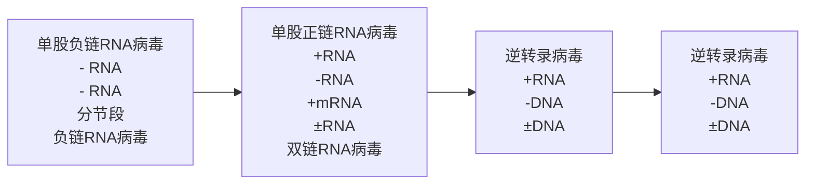
</details>

---

10.7 以 RNA 为模板生成 RNA

455

毒（segmented negative-sense RNA virus, sNSRV）和不分节段负链RNA病毒（non-segmented negative-sense RNA virus, nsNSRV）。本节主要介绍单股正链RNA病毒、单股负链RNA病毒以及逆转录病毒的聚合酶和RNA合成。

## 10.7.1 病毒 RNA 依赖的 RNA 聚合酶的分类

RNA 病毒编码的 RNA 依赖的 RNA 聚合酶主要分为三种类型，即单股正链 RNA 病毒的 RdRp、分节段负链 RNA 病毒的 RdRp 和不分节段负链 RNA 病毒的 RdRp。

单股正链 RNA 病毒的 RdRp 以丙型肝炎病毒（hepatitis C virus）、小 RNA 病毒（picornavirus）、冠状病毒（coronavirus）编码的 RdRp 最为典型，其结构相对简单，主要包含 RNA 催化合成的核心结构域。参与 RNA 合成的其他酶分子，如加帽酶和核酸酶等，均以单独编码蛋白的形式存在，并在病毒生命周期中与 RdRp 协同发挥功能。

单股负链 RNA 病毒在其生命过程中仅编码一个主要聚合酶分子（也称 L 蛋白），除包含核心 RdRp 结构域外，还包含加帽酶等用于 RNA 加工的全部催化酶结构域，其分子量大、组成形式复杂。单股负链 RNA 病毒根据其基因组是否分节段，其 RNA 加帽过程完全不同，聚合酶组成形式也呈现显著区别。其中，不分节段负链 RNA 病毒以水疱性口炎病毒（vesicular stomatitis virus, VSV）、埃博拉病毒（ebola virus, EBOV）等最为典型。此类病毒由自身聚合酶完成全部 RNA 帽结构的合成，因而其聚合酶分子中含有加帽所需的多核糖核苷转移酶结构域（PRNTase）、甲基转移酶结构域（MTase）等。

分节段负链 RNA 病毒自身不合成 RNA 帽结构，以流感病毒（influenza virus）、布尼亚病毒（bunyavirus）等最为典型。此类病毒利用 “cap snatching” 的方式，从宿主 mRNA 上抢夺成熟的帽结构，因此其聚合酶分子的组成形式与不分节段负链 RNA 病毒的聚合酶完全不同，含有帽结合结构域、内切核酸酶结构域等。

## 10.7.2 病毒 RNA 依赖的 RNA 聚合酶的结构特征

与 DNA 聚合酶类似，RNA 病毒的 RdRp 为右手结构，具有手指状域、掌状域和拇指状域，使用常见的双金属催化机制，通过手掌状域中保守的 motif A 和 motif C 上的一对天冬氨酸残基完成催化（图 10-38）。拇指和手指状域具有广泛的相互作用，围绕活性位点形成模板进入的通道，这种闭手构象（closed-hand）也是 RdRp 不同于其他聚合酶的一点。

大部分正链 RNA 病毒的聚合酶相对比较简单，只包括 RdRp 结构域，但是尼多病毒目（nidovirus）的聚合酶的 N 端则还具有一个尼多病毒 RdRp 相关的核苷酸转移酶（nidovirus RdRp-associated nucleotidyltransferase, NiRAN）结构域，能够发挥核苷酸转移的功


<details>
<summary>text_image</summary>

手指状域
拇指状域
掌状域
</details>

图 10-38 RNA 依赖的 RNA 聚合酶的结构 (PDB 编号: 1SH0)

---

456

10 RNA 的生成

能，而黄病毒（flavivirus）的聚合酶的 N 端通常会融合甲基转移酶结构域，在加帽过程中发挥功能。

负链 RNA 病毒的聚合酶分子组成则较为复杂，其中 sNSRV 的聚合酶有两种形式:一种以流感病毒为代表，由聚合酶碱性蛋白 1（polymerase basic 1，PB1）、聚合酶碱性蛋白 2（PB2）和聚合酶酸性蛋白（polymerase acidic，PA；在丙型和丁型流感病毒中被称为 P3）三个亚基组成聚合酶复合物。PB1 亚基位于复合物中心，包含 RdRp 结构域。PA 亚基的 N 端为核酸内切酶结构域，C 端与 RdRp 的拇指亚结构域结合，被称为 PA-C 结构域。PB2 亚基的 N 端与 RdRp 结构域紧密相连，被称为 PB2-N 结构域，C 端则由 CapB 结构域、Mid-link 结构域、627 结构域和 C 端核定位信号结构域构成。另一种是以沙粒病毒和布尼亚病毒为代表，其聚合酶则是由一个单一蛋白构成，被称为 L 蛋白。sNSRV 的 L 蛋白包括一个中央的 RdRp 结构域，该结构域两侧分别为 N 端的 PA-C 样结构域与 C 端的 PB2-N 样结构域，形成一个球状的聚合酶核心。该核心的 N 端为核酸内切酶结构域，C 端为延伸结构域，包括 CapB 结构域、Mid 结构域和锌结合结构域。nsNSRV 的聚合酶由单一蛋白构成，也被称为 L 蛋白。

nsNSRV 的 L 蛋白包括 N 端的 RdRp 结构域和具有多核苷酸转移酶（polyribonucleotidyl transferase，PRNTase）活性的加帽结构域，然后通过连接结构域（connector domain，CD）与同时具有  $N^{7}$ -甲基转移酶（ $N^{7}$ -MTase）和 2'-O-甲基转移酶（ $2'$ -O'-MTase）活性的结构域相连，最后是 C 端结构域（C-terminal domain，CTD）。

## 10.7.3 病毒 RNA 合成

## （1）正链RNA病毒与负链RNA病毒转录复制复合物

正链 RNA 病毒的基因组 RNA 可以直接作为 mRNA，被宿主细胞内的翻译体系识别并翻译形成自身的蛋白质，所以它的病毒颗粒里不需要携带转录复制相关的蛋白，可以拥有比较多的转录复制元件，分别负责 RNA 合成、引物起始和加帽等功能，这些转录复制元件会按照一定的时空顺序组装形成转录复制复合物（replication transcription complex, RTC），用于完成病毒的转录复制过程。而负链 RNA 病毒的基因组 RNA 无法直接翻译，所以其进入宿主细胞后的第一件事，就是要以自己的基因组 RNA 为模板，转录形成 mRNA 来翻译自身蛋白。因此负链 RNA 病毒的病毒颗粒本身就会携带一个 RNA 聚合酶，完成 RNA 合成、引物合成、加帽和加尾等功能。但负链 RNA 病毒的基因组 RNA 本身不能作为模板，需要核蛋白（nucleoprotein, NP）包裹着基因组 RNA，形成核糖核蛋白复合物（ribonucleoprotein complex, RNP）才能发挥活性，在 L 蛋白的帮助下完成转录复制过程。

## (2) 病毒 RNA 合成的引发

病毒 RNA 合成的起始主要分为两大类，第一类是依赖引物的起始方式，需要引物提供 3'-OH；第二类是不依赖引物的起始方式，第一个核苷三磷酸为反应提供 3'-OH。在第一类依赖引物的合成起始方式中，有三种常见的引物种类:①利用多肽作

---

10.7 以 RNA 为模板生成 RNA

457

为引物，这种病毒基因组的  $5'$  端会连接在病毒蛋白上（viral protein genome-linked, VPg），主要代表为小 RNA 病毒（picornavirus）、杯状病毒（calicivirus）和马铃薯病毒（potyvirus）等。②利用具有帽结构的寡聚核苷酸作为引物，病毒通过核酸内切酶将宿主 mRNA 的帽结构切割下来，作为自身 RNA 合成的引物，主要代表为流感病毒（influenza virus）、布尼亚病毒（bunyavirus）等分节段的负链 RNA 病毒。③利用寡聚核苷酸作为引物，病毒以自身 RNA 的  $3'$  模板为模板，通过从头合成的方式形成一小段短的寡聚核苷酸，随后聚合酶再在这段引物的基础上进行延伸，绝大部分 RNA 病毒都属于这一种。

## (3) 病毒 RNA 加帽

真核生物 mRNA 的 5' 端具有一个甲基化的，通过 5'-5' 三磷酸桥连接的帽结构 ( $m^{7}GpppNp-RNA$ )，能够保护 mRNA 不被核酸外切酶水解，指导 pre-mRNA 剪接，维持 mRNA 稳定性并帮助转录起始因子有效识别 mRNA。而没有帽结构修饰的 RNA 会被宿主细胞识别为外源 RNA，从而引发抗病毒先天免疫反应。因此，病毒在与宿主共同进化的过程中，通过多种方式形成了逃避宿主细胞先天免疫识别的帽结构，帮助病毒高效翻译自身蛋白。病毒形成和宿主细胞类似的帽结构的方式主要有 4 种 (图 10-39)。

① 病毒利用自身蛋白或宿主细胞内的酶，通过和真核细胞相同的四步反应形成Cap 1帽结构（见本章 mRNA 加帽部分）。主要代表有大部分 DNA 病毒、呼肠孤病毒（reovirus）和冠状病毒（coronavirus）等。
② 病毒首先利用 PRNTase 活性去除新生成 RNA 5' 端的焦磷酸（PP $_{i}$ ），并把 RNA 共价连接在自身形成中间体（PRNTase-pNp-RNA）；随后 PRNTase 把这部分 pNp-RNA 转移到 GDP 分子上，形成 GpppNp-RNA；再依次通过 N $^{7}$ -MTase 和 2'O-MTase 形成成熟的 Cap 1 结构（m $^{7}$ GpppNm2'-Op）。主要代表有不分节段的负链 RNA 病毒，包括狂犬病毒（rabies virus）、水疱性口炎病毒（vesicular stomatitis virus）、埃博拉病毒（ebola virus）等。
③ 病毒先通过 TPase 形成 ppNp-RNA，同时通过  $N^{7}$ -MTase 将一分子 GTP 进行甲基化，形成  $m^{7}Gppp$ ，再通过 GTase 将甲基化后的  $m^{7}Gp$  转移到 ppNp-RNA 上，形成 Cap 0 结构（ $m^{7}GpppNp$ ）。主要代表为甲病毒（alphavirus）等。
④ 病毒通过核酸内切酶将宿主 mRNA 5' 端帽结构 “抢夺” 过来，随后病毒聚合酶在帽结构的基础上继续合成自身的 mRNA。主要代表有分节段的负链 RNA 病毒，包括流感病毒（influenza virus）、布尼亚病毒（bunyavirus）、沙粒病毒（arenavirus）等。

## (4) 病毒 RNA 合成过程中的复制校正

相较于 DNA 而言，RNA 合成的保真性较低，为了维持基因组的稳定性，部分 RNA 病毒也具有错配校正的功能。RNA 病毒进行错配校正的方式主要有两种:第一种是通过焦磷酸解（pyrophosphorolysis）的方式，当病毒 RNA 合成发生错配时，聚合酶可以通过招募 PP $_{i}$ 来将 RNA 链模板的错配核苷酸切除，主要代表为黄病毒，包括牛病毒性腹泻病毒（bovine viral diarrhea virus）。另一种是通过 3'→5' 核酸外切酶，当

---

458

10 RNA 的生成

(A)


<details>
<summary>flowchart</summary>

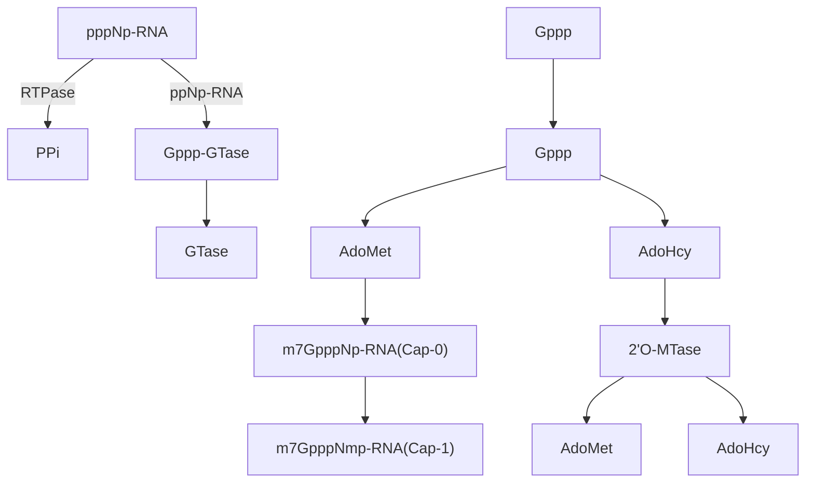
</details>

(B)


<details>
<summary>flowchart</summary>

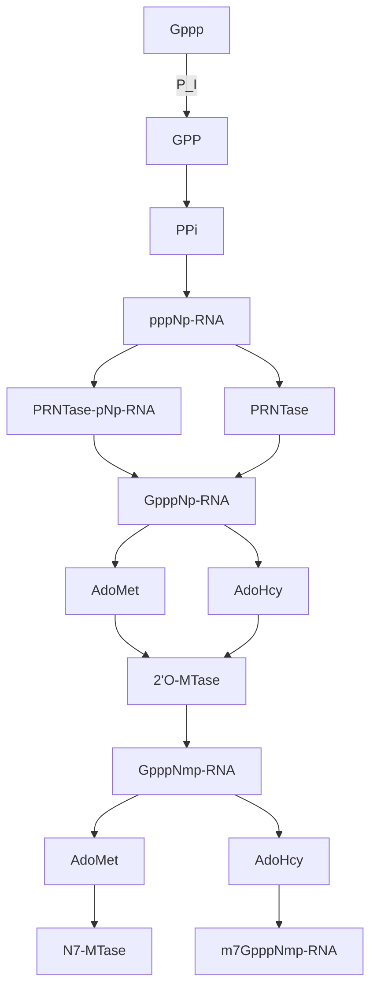
</details>

(C)


<details>
<summary>flowchart</summary>

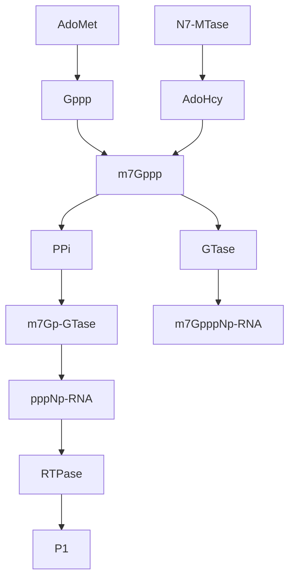
</details>

(D)


<details>
<summary>flowchart</summary>

```mermaid
graph TD
  A["m7GpppNmp-"] -->|"细胞内mRNA"| B["AAAAAAAAAA-3'"]
  C["m7GpppNmp-"] -->|"EndoN"| D["AAAAAAAAAA-3'"]
  E["m7GpppNmp-"] -->|"病毒\nRdRp"| F["病毒(-)RNA"]
  G["m7GpppNmp-"] -->|"病毒\nRdRp"| H["病毒\nRdRp"]
```
</details>

图 10-39 RNA 病毒加帽途径

Ado Met: S-腺苷甲硫氨酸;  
Ado Hcy: S-腺苷同型半胱氨酸

病毒 RNA 合成发生错配时，其 RNA 发生回退，招募核酸外切酶将错配的核苷酸切除，完成错配校正，主要代表为冠状病毒。

## 10.7.4 病毒 RNA 依赖的 DNA 合成（逆转录）

逆转录病毒的生命过程主要包括:病毒入侵、入核、逆转录、脱壳（uncoating）、整合、病毒 mRNA 转录、蛋白翻译、病毒出芽与成熟等步骤。①病毒入侵:病毒在进入宿主体内后，首先通过自身的刺突蛋白与宿主细胞的表面糖蛋白受体结合，引发一连串的构象变化，导致病毒和宿主细胞膜融合，将病毒核心（viral core）释放到细胞质中。②入核:病毒核心在进入细胞后，沿微管运动至核膜外侧聚集，导致核膜发生凹陷，病毒核心通过似核内吞途径进入细胞核。③逆转录:病毒核心中的逆转录酶（reverse transcriptase，RT）以基因组 RNA 为模板合成互补的单链 DNA，随后其发挥 RNA 酶的活性将 RNA-DNA 杂交链中的 RNA 模板水解，最后再以单链 DNA 为模板合

---

10.7 以 RNA 为模板生成 RNA

459

成病毒的双链 DNA。④脱壳:进入细胞质后，病毒核心由衣壳蛋白（capsid protein）组成的锥形外壳包裹着，保护其中的遗传物质。当病毒核心完成逆转录过程后，其外部分衣壳蛋白会逐渐脱去，将逆转录形成的双链 DNA 释放出来。⑤整合:病毒整合酶切割宿主染色体的 DNA 链，并将病毒 DNA 末端与目标 DNA 链的 5' 端连接起来，然后宿主细胞内的修复系统将病毒 DNA 与相邻 DNA 间的缺口连接起来，病毒 DNA 就整合进宿主染色体中。⑥病毒 DNA 整合进染色体后，利用宿主的转录与翻译系统生成自身的 mRNA 与病毒蛋白，最终组装形成新的病毒颗粒，并释放出细胞。

逆转录病毒的病毒颗粒中包含逆转录酶（reverse transcriptase，RT）。以人类免疫缺陷病毒（human immunodeficiency virus 1，HIV-1）的逆转录酶为例，它是由 p66 和 p51 两个亚基组成的异源二聚体，p66 的 N 端具有依赖 RNA 或 DNA 的 DNA 聚合酶活性，C 端具有核糖核酸酶（RNase H）活性，可以将 RNA-DNA 杂交链中的 RNA 链消化掉。而 p51 虽然序列上和 p66 的 N 端相同，但空间构象不同，仅发挥构象调节作用。

P66 N 端的聚合酶结构也为右手结构，包括手指状域、拇指状域、掌状域和连接区 4 个亚结构域，能够在  $Mg^{2+}$  存在的情况下，通过手掌状域上的 3 个天冬氨酸催化残基将 dNTP 连接在引物的 3'-OH 上，释放出游离焦磷酸，实现 DNA 链的延伸（图 10-40）。逆转录病毒的基因组 RNA 和 mRNA 的序列，属于正链 RNA。病毒进入宿主细胞后，细胞的 tRNA 与 HIV-1 基因组的引物结合位点配对，作为引物，在聚合酶的作用下合成互补的负链 DNA。随着负链 DNA 的合成，p66 发挥 RNase H 的功能，将基因组 RNA 消化掉。但基因组 RNA 的 5' 端的多嘌呤片段（purine-rich polypurine tract，PPT）对 RNase H 的切割有抵抗力，所以基因组不会被完全降解。剩余的基因组 RNA 又作为正链 DNA 合成的引物，在聚合酶的作用下形成双链 DNA，完成从基因组单链 RNA 到双链 DNA 的形成。

病毒聚合酶在病毒转录复制过程中发挥着核心功能，对其功能进行抑制是抗病毒药物的重要研究领域。目前，针对病毒聚合酶的抑制剂可分为核苷类抗病毒药物（nucleotide analogue inhibitor）和非核苷类抗病毒药物（non-nucleotide analogue

inhibitor）两大类。其中，核苷类抗病毒药物是一类针对聚合酶的主要抗病毒药物，其通过模拟天然核苷酸的结构形式，被病毒聚合酶“掺入”病毒核酸，进而对后续生命过程产生影响。非核苷类抗病毒药物主要作用在聚合酶某些特定位点，通过影响其RNA合成能力来抑制其功能和病毒增殖，但在针对聚合酶的抗病毒药物中所占比例很小。

核苷类抗病毒药物的最简单形式包括与天然核苷酸类似碱基（base）基团、核糖（ribose）基团，以及在这些基团上引入的各类化学修饰，被称为“前药”（prodrug）。在其进入宿主细胞后，进入宿主细胞的NTP合成途径，被一系列激酶分子陆续加入三个磷


<details>
<summary>text_image</summary>

活性位点
(聚合酶)
掌状域
拇指状域
连接区
核糖核酸酶H
手指状域
p51
引物链
模板链
</details>

图 10-40 逆转录酶的结构特征 (PDB 编号: 1RTD)

---

460

10 RNA 的生成

酸基团，最终形成活性化合物。由于加入第一个磷酸基团的反应最为困难，是决定核苷类抗病毒药物效率的最关键限制因素之一，因此发展出了在碱基和核糖基团的基础上，增加了单磷酸，以及对单磷酸进行保护的化学基团的前药形式。该前药形式的核苷类抗病毒药物进入宿主细胞后，可跳过第一步激酶反应，迅速形成活性化合物，提高了药物发挥功能的效率。

当三磷酸形式的核苷类抗病毒药物活性化合物形成后，病毒聚合酶将其“误认”为天然核苷酸，从而合成掺入子代核酸链，进而抑制病毒后续的增殖过程。但其抑制机制存在很大区别，主要包括三种机制。第一种机制是当核苷类抗病毒药物掺入子代核酸链后，其上的化学修饰阻止下一步聚合酶对NTP的催化，造成链合成立刻终止，此类化合物也成为“chain terminator”。第二种机制是当核苷类抗病毒药物掺入子代核酸链后，由于某些聚合酶特定的识别和催化机制，并不能即刻终止链合成反应，继续延伸数个核苷后，由于核苷类抗病毒药物上的化学修饰与聚合酶氨基酸产生空间阻碍，从而延迟链合成延伸。此类机制以瑞德西韦（remdesivir）在新冠病毒聚合酶上的作用最为典型。第三种机制是，核苷类抗病毒药物掺入子代核酸链后完全不影响链延伸，因此会产生含有大量药物分子的子代核酸链。当病毒聚合酶进一步以含有药物分子的子代核酸链为模板合成病毒核酸时，产生大量失活突变，从而抑制病毒的增殖。此类机制以莫努匹拉韦（molnupiravir）在新冠病毒聚合酶上的作用最为典型。

## ※展望

转录作为生命科学研究的核心领域之一，未来的研究方向充满机遇和挑战。以下是几个值得关注的趋势:①高分辨率结构研究。尽管冷冻电镜等技术已经提供了转录前起始复合物和RNA聚合酶复合物的高分辨率结构，但仍有许多动态过程无法完全解读。未来结合时间分辨技术和人工智能预测工具，科学家有望更全面地解析转录过程中各步骤的瞬态结构与动力学。②转录与表观遗传的协同调控。表观遗传修饰（如组蛋白修饰、DNA甲基化）如何影响转录起始和延伸，以及转录如何影响表观遗传修饰状态是目前研究的热点。通过单细胞组学技术，揭示这些修饰在个体细胞水平上的调控模式及其对疾病的影响。③跨学科研究与新模型。随着人工智能、系统生物学和合成生物学的发展，科学家能够重建转录网络并预测其行为，促进基因治疗、药物开发等领域的应用。

## ※ 本章小结

本章围绕“转录”这一分子生物学的核心过程展开，系统阐述了转录的基本原理、机制和调控方式。转录是基因表达的第一步，是DNA模板被RNA聚合酶转录为RNA的过程。在真核生物中，这一过程尤为复杂，需经过起始、延伸、终止等步骤，并受到转录因子、增强子、核小体和表观遗传修饰的精密调控。本章详细介绍了转录前起始复合物的组装机制、中介体复合物在调控中的关键作用，以及核小体对转录复合物动态行为的影响。

---

推荐阅读

461

近年来，利用冷冻电镜、高通量测序和单分子成像技术等研究方法，科学家们不断揭示出转录过程中的动态变化及其调控机制，加深了对基因表达机制的理解。本章学习为理解转录这一基本生命过程奠定了基础，同时为未来研究提供了启发。

## ※ 思考题

1. 请简述细菌基因转录起始和终止的序列特征。
2. 请简述真核生物基因转录起始的三个主要调控阶段。
3. 请简述 RNA聚合酶Ⅱ催化合成 RNA 的分子机制。
4. 请简述启动子、转录起始位点的概念，简述 Pol II 的核心启动子的类型及其特征。
5. 请列举Ⅱ类通用转录因子，并简述转录前起始复合物的功能及生物学意义。
6. 比较真核生物和原核生物在基因表达的转录延伸阶段的主要区别，并解释这些区别的生物学意义。
7. 请写出正链 RNA 病毒和负链 RNA 病毒加帽机制的区别。

## ※ 推荐阅读

1. CRAMER P. Organization and regulation of gene transcription [J]. Nature, 2019, 573: 45–54.
2. GIRBIG M, MISIASZEK A D, MULLER C W. Structural insights into nuclear transcription by eukaryotic DNA-dependent RNA polymerases [J]. Nature Rev Mo Cell Bio, 2022, 23: 603-622.
3. LI B, CAREY M, WORKMAN J L. The role of chromatin during transcription [J]. Cell, 2007, 128: 707-719.
4. ROEDER R G. Lasker basic medical research award. The eukaryotic transcriptional machinery: complexities and mechanisms unforeseen [J]. Nature Med, 2003, 9: 1239-1244.
5. HABERLE V, STARK A. Eukaryotic core promoters and the functional basis of transcription initiation [J]. Nature Rev Mol Cell Bio, 2018, 19: 621–637.

(撰写: 徐彦辉, 李兵, 张余, 陈曦子, 娄智勇, 麻锦彪; 审修: 陈飞, 陈玲玲)
