## 1.7.5 水分子也作为反应物等广泛参与生物体内的化学反应

作为生命产生和演化的介质，生物体中的水分子并非仅仅作为溶剂发挥作用，还作为反应物、产物、中间物、辅因子等直接参与大量代谢反应。例如，生物大分子可通过水解反应降解为基本的组成单位；反之，由组成单位缩合形成生物大分子的过程常伴随水分子的产生。通过对生物体内发生的所有化学反应进行仔细分析，人们认识到，在生物体内发生的几千种酶促化学反应中，大约有三分之一都涉及水分子以某种形式的参与。也就是说，在代谢过程中，水是一种参与广泛的化学分子。这不难理解，毕竟生命的一切特征都是在水环境中演化形成的。

## 1.8 很多生物分子表现出弱酸特征

人类对酸性物质的认识开始于对酸性食物的接触，故历史悠久。酸味是人类五种基本味觉之一。长期以来，人们鉴定到多种遇到酸物质即发生颜色变化的物质，即所谓的酸碱指示剂，如石蕊、酚酞、甲基橙等，这大大方便了对酸性物质的鉴定和分析。相比之下，早期认识的碱性物质则是作为“抗酸”物质而被鉴定，所以人们对碱性物质的认识是伴随着对酸性物质的认识而推进的。

1830 年代，德国学者李比希等将酸类物质定义为含有可以被金属替换的氢元素的化合物，将碱定义为可以将酸中和并产生盐的物质。1880 年代，瑞典学者斯万特·阿累尼乌斯（Svante Arrhenius，1859—1927）等根据电解理论将酸定义为能为水溶液提供  $H^{+}$ （即质子）的物质；而碱则是可以提供  $OH^{-}$ 的物质。这样的酸和碱可相互中和产生水和某种盐。

1920 年代，丹麦学者约翰尼斯·布朗斯特德（Johannes Bronsted，1879—1947）和英国学者托马斯·劳里（Thomas Lowry）各自独立提出对酸的简单定义——酸是可以提供质子的物质，这个定义延续使用至今。在此基础上，他们将碱定义为可以结合质子的物质。

## 1.8.1 生物体内的酸大多为弱酸

根据释放质子能力的强弱，酸可被区分为强酸和弱酸。简单说，强酸（如盐酸和硫酸等）是指那些在水溶液中可发生 $100\%$ 解离的酸，而弱酸则是那些在水溶液中无法发生 $100\%$ 解离的酸。或者说，强酸的解离是不可逆反应，而弱酸的解离是可逆反应。

后续研究表明，生物体内存在的酸大多为弱酸。它们对于维持生命现象不可或缺，包括维持生物体内的溶液环境处于合适的 $\mathrm{pH}$ 。弱酸物质脱去质子后的产物即为该弱酸的共轭碱，由此出现了酸和碱以共轭对形式存在的概念。

## (1) 弱酸溶液中的质子浓度一般较低, 故通过 $\mathrm{pH}$ 表征

一种酸的酸性强弱可通过其解离后所产生质子的多少，即溶液中质子浓度的高低反映。为此，赫尔曼·能斯特（Hermann Nernst，1864—1941）等在1880年代建立的电化学理论为利用电极电势（通常提供pH电极）测定溶液中质子的浓度提供了重要基础。鉴于弱酸解离所产生质子的浓度一般都较低，为描述方便，丹麦生物化学家索伦·索伦森（Soren Sorensen，1868—1939）于1900年代提出了将酸性以氢离子浓度负对数（即pH）进行表征的建议:

$$
\mathrm{pH} = - \lg [ \mathrm{H} ^ {+} ] \tag {1-10}
$$

这个概念提出后，在很长时间里很少得到化学家们的关注，毕竟，这么低的质子浓度对常规化学反应的意义有限。但是，对于研究酶动力学的生物化学家而言，却具有非凡的重要性。例如，生物体内溶液环境的 pH 必须维持在特定范围内，否则将产生严重后果。

## (2) 弱酸分子的解离程度可通过其 $\mathrm{pK}_{\mathrm{n}}$ 表征

与强酸可发生彻底且不可逆解离不同，弱酸只可部分解离，且解离过程可逆。所有弱酸的解离过程都可通过以下反应式表示:

$$
\mathrm{HA} \rightleftharpoons \mathrm{H} ^ {+} + \mathrm{A} ^ {-} \tag {1-11}
$$

式中，HA 代表弱酸，A $^{-}$  代表弱酸去质子化后形成的共轭碱。式（1-11）清晰反映了弱酸与弱碱之间的共轭特征:脱去质子的弱酸成为弱碱，而结合质子的弱碱则成为弱酸（这与氧化还原反应中的氧化剂-还原剂共轭对概念高度可比）。

如前所述，可逆反应均可通过平衡常数  $K_{eq}$  进行表征:

$$
K _ {\mathrm{eq}} = \frac {[ \mathrm{H} ^ {+} ] [ \mathrm{A} ^ {-} ]}{[ \mathrm{HA} ]} = K _ {\mathrm{a}} \tag {1-12}
$$

人们通常将弱酸的解离常数表示为  $K_{a}$  (a 代表 acid)。弱酸的解离程度都不高，所以  $K_{a}$  一般都较低。仿照通过 pH 表征质子浓度的做法，索伦森提议将弱酸的解离常数也转换为其负对数后进行表征，即:

$$
\mathrm{p} K _ {a} = - \lg K _ {a} \tag {1-13}
$$

因此，一种弱酸的  $pK_{a}$  越低，其解离常数  $K_{a}$  反而越高，即酸性越强。每种弱酸都具特征性的  $pK_{a}$ ，它反映弱酸分子达到解离平衡状态时，产物浓度积与反应物浓度积的比值。

## (3) 弱酸的 $\mathrm{p}K_{\mathrm{a}}$ 可通过滴定实验测定

为确定一种弱酸的  $pK_{a}$ ，理论上我们可以测定达到平衡后各种形式产物和反应物的浓度，然后通过式（1-12）计算。但更为简单可行的测定  $pK_{a}$  的方法是滴定法（titration method）。简言之，这是利用已知浓度的强碱溶液（通常为氢氧化钠）去逐步中和一定体积的弱酸溶液:每步加入等量小体积的强碱溶液，并在每次加入后用 pH 计（或指示染料）测量溶液的 pH，直到全部弱酸物质均被中和；这时溶液的 pH 会突然大幅升高，而前面的每次加人都只导致小幅升高。将每次测量的 pH 对添加强碱的体积作图，即得到该酸的滴定曲线（图1-19）。对滴定曲线进行观察，会发现其中间位置均存在一个转折点，代表一半的弱酸已经发生质子解离，即此时 $\left[A^{-}\right]=\left[HA\right]$ 。该转折点处的pH即为该弱酸的 $pK_{a}$ 。

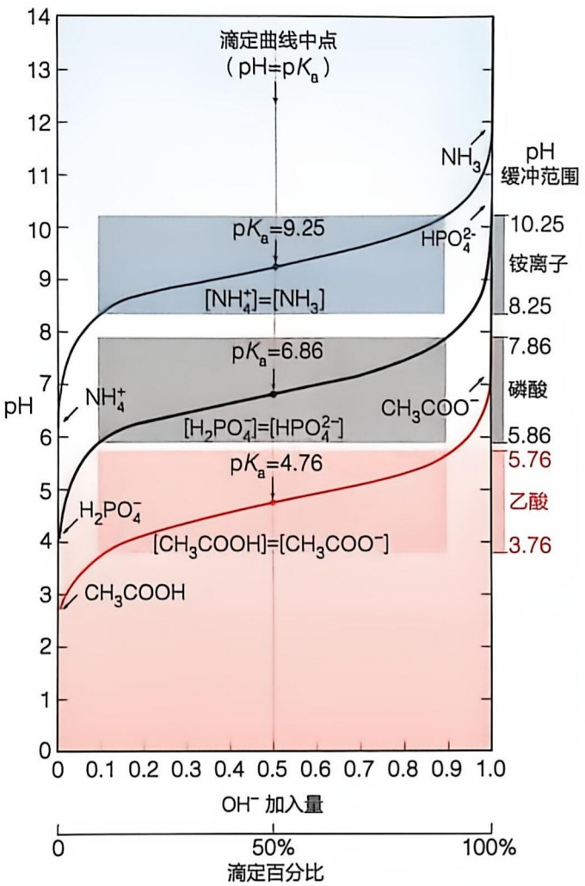

contour

| Species | pH | Concentration (ppm) |
| :--- | :--- | :--- |
| NH3 | 9.25 | 10.25 |
| HPO4^2- | 9.25 | 8.25 |
| NH4+ | 6.86 | 7.86 |
| [H2PO4^-] | 6.86 | 5.86 |
| CH3COO^- | 6.86 | 5.76 |
| H2PO4^- | 4.76 | 3.76 |
| [CH3COOH] | 4.76 | — |

图 1-19 三种生物体内常见弱酸的滴定曲线

同样，也可使用强酸对弱碱进行滴定，测定弱碱的 $pK_{a}$ ，操作过程与上述用强碱滴定弱酸的过程类似。

尽管不同弱酸的滴定曲线各具独特性，但不同曲线的基本形态相似。生物体内三种常见弱酸——乙酸、磷酸和铵离子——被强碱滴定的曲线如图1-19所示。尽管反映三种弱酸 $pK_{a}$ 的滴定曲线的中间转折点位置的pH不同，但三条曲线的形状高度相似，皆为S形；这表明所有弱酸被强碱滴定的过程遵循类似的规律。

此外，这些滴定曲线在其中间转折点两边的附近区域都表现出 pH 变化相对平缓的特征。对此的简单解释是，在此平缓区段内，加入一定量的强碱并不会引起溶液 pH 的大幅增加。总体而言，每种弱酸均在其  $pK_{a}$  的上下各 1 个 pH 单位范围内具抵抗或缓冲 pH 变化的能力。

（4）弱酸溶液的 pH 缓冲效应可通过亨德森-哈塞尔巴尔赫方程进行定量描述

早在 19 世纪早期，人们就观察到弱酸盐可减弱强酸酸性的现象，但并未给予任何解释。20 世纪初，随

着 pH 概念被生物化学研究人员广泛使用且溶液的 pH 可以被有效测定，人们观察到，包括血液在内的动物体液的 pH 均维持在中性附近（即质子浓度约为  $10^{-7}$  mol/L）。为了解释生物体内存在的这种“酸碱平衡”现象，人们提出了 pH 缓冲效应的概念。

最早对生物体内酸碱平衡现象提出解释的是美国学者劳伦斯·亨德森（Lawrence Henderson，1878—1942）。他为了定性和定量解释血液中的磷酸盐和碳酸盐等弱酸系统如何维持血液 $\mathrm{pH}$ 的稳定，于1900年代建立了一个数学公式，以描述质子浓度与弱酸（HA）及其共轭碱（A⁻，当时被称为弱酸盐）浓度比之间的关系。1910年代，丹麦学者卡尔·哈塞尔巴尔赫（Karl Hasselbalch，1874—1962）基于 $\mathrm{pH}$ 概念将亨德森提出的数学公式转换成了对数形式（即在公式两边取对数），这就产生了后来以两人名字命名的亨德森-哈塞尔巴尔赫（Henderson-Hasselbalch）方程:

$$
\mathrm{pH} = \mathrm{p} K _ {\mathrm{n}} + \lg \frac {[ \mathrm{A} ^ {-} ]}{[ \mathrm{HA} ]} \tag {1-14}
$$

该方程其实就是将式（1-12）左右两边取负对数后转换而成。它可被用于描述图 1-20 中的弱酸滴定曲线。曲线上的一个特殊点是当  $[A^{-}]$  和  $[HA]$  浓度相等时的 pH；这也正好是滴定曲线平缓段的中间点。代入式（1-14），则可得到: $pH = pK_{a} +$ $\lg 1 = \mathrm{p}K_{\mathrm{n}}$；即此时溶液的 $\mathrm{pH}$ 等于弱酸的 $\mathrm{p}K_{\mathrm{n}}$。更为重要的是，这个公式同时也对由弱酸及对应的弱酸盐（即其共轭碱）所组成的体系如何能在弱酸的 $\mathrm{p}K_{\mathrm{n}}$ 附近维持 $\mathrm{pH}$ 稳定进行了如下有效解释。

具体而言，如图1-19所示滴定曲线表明，当弱酸系统处于 $\mathrm{pH} = \mathrm{pK}_{\mathrm{o}}$ （即 $[\mathrm{A}^{-}] = [\mathrm{HA}]$ ）条件时，加入少量强碱时并不引起 $\mathrm{pH}$ 的大幅提高。根据式（1-14），这种 $\mathrm{pH}$ 缓冲效应可解释如下（图1-20A）:当加入少量强碱时，可被体系中存在的HA中和，这仅使 $[\mathrm{A}^{-}] / [\mathrm{HA}]$ 的比值变为稍大于1。类似地，当加入少量强酸时，则可被存在的$\mathrm{A}^{-}$ 中和，仅使 $[\mathrm{A}^{-}] / [\mathrm{HA}]$ 的比值变为稍小于1。取以10为底数的对数后（即 $\lg [\mathrm{A}^{-}] / [\mathrm{HA}]$ ，其变化就很小了；如 $\lg 1.5 = 0.178$ ，而 $\lg 0.5 = -0.30$ ；这就解释了为什么加入少量强碱或强酸后，溶液 $\mathrm{pH}$ 的增加或降低幅度都不大。

在一种  $H_{2}PO_{4}^{-}/HPO_{4}^{2-}$  共轭酸碱对缓冲体系中加入一定量酸或碱时的 pH 变化与在纯水中加入同样量的酸或碱时的 pH 变化比较如图 1-20B 所示。

## (5) 生物内环境的 pH 由特定的共轭酸碱对维持恒定

一般认为，碳酸、蛋白质分子中的组氨酸侧链及磷酸等可能对于生物维持中性 $\mathrm{pH}$ 环境发挥了重要作用。例如，$\mathrm{H}_2\mathrm{PO}_4^- / \mathrm{HPO}_4^{2-} (\mathrm{pK}_{\mathrm{n}} = 6.86)$ 和 $\mathrm{H}_2\mathrm{CO}_3 / \mathrm{HCO}_3^-(\mathrm{pK}_{\mathrm{n}} = 6.1)$ 这两种弱酸/弱碱共轭对被认为是维持血液 $\mathrm{pH}$ 处于7（中性）

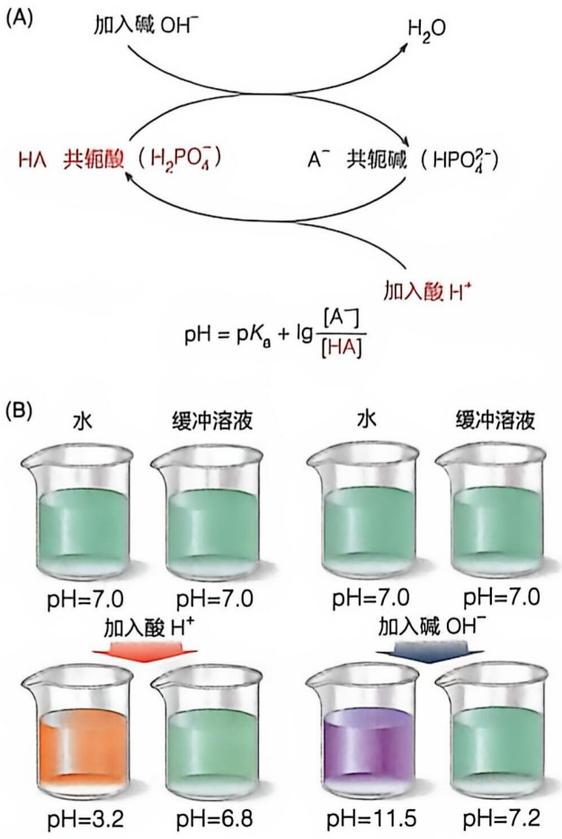

图 1-20 特定弱酸在特定 pH 范围具缓冲能力

(A)  $H_{2}PO_{4}^{-}/HPO_{4}^{2-}$  共轭酸碱对抵抗加入的酸或碱所导致的 pH 改变的机制。(B) 在纯水或缓冲溶液中加入一定量强酸或强碱导致 pH 改变示意图

附近的关键缓冲剂。它们的  $pK_{a}$  分别加 1 和减 1 为其最佳 pH 缓冲范围，正好位于 pH 7 附近。需要强调的是，上述  $pK_{a}$  都是在 25℃ 和零离子强度下测定的， $pK_{a}$  受温度和离子强度影响。例如，在生理条件下，磷酸缓冲系的有效  $pK_{a}$  略低于 6.86。

其实在生物体内产生的大多是弱酸或弱碱，因此，它们对生物体内溶液环境 pH 的影响也不会很剧烈。

除动物血液等细胞外液体环境之外，细胞内不同溶液环境的 pH 都基本维持恒定。生物体内溶液环境的 pH 一般都接近中性，如血液和胞质溶胶的 pH 均为 7.4 左右。但生物体内某些局部环境的 pH 偏离中性，典型的如脊椎动物胃液的 pH 一般为 2.0 左右；真核细胞溶酶体内的 pH 一般为 4.5～6.5；线粒体基质 pH 大约为 8.0（其膜间隙 pH 则与细胞基质相同，为 7.4 左右）；正进行光合作用的叶绿体基质的 pH 通常也在 8 左右，呈弱碱性，而叶绿体类囊体腔中的 pH 则为 4.5～5.5（酸性）；等等。

生物体内蛋白质等生物大分子三维结构的维持和功能的发挥都高度依赖其所在溶液环境的 pH。稍有偏离，蛋白质等生物分子的活性可能会大幅降低甚至丧失。尽管对于试管中发生的非生物化学反应而言，pH 的影响可能微乎其微，但对于生命体而言，不同部位 pH 的有效维持却是生死攸关。例如人体血液的 pH 只要稍微偏离 7.4，就会产生严重后果，甚至危及生命。因此 pH 缓冲概念尽管对非生物化学家而言可能无足轻重，但对生物化学家而言却至关重要。

生物体内存在的多种弱酸在维持其不同部位 pH 的基本恒定方面发挥重要作用。对于弱酸发挥 pH 缓冲作用而言，所需维持的 pH 须处于该弱酸的  $pK_{a}$  附近（即该值加或减 1 个 pH 单位）。

尽管一般认为生物体内中性pH的维持可能主要依赖碳酸（$\mathrm{H}_2\mathrm{CO}_3 / \mathrm{HCO}_3^-$，$\mathrm{pK_n} = 6.1$）、磷酸（$\mathrm{H}_2\mathrm{PO}_4^- / \mathrm{HPO}_4^{2-}$，$\mathrm{pK_n} = 6.86$）和蛋白质分子组氨酸残基侧链上的咪唑基团（$\mathrm{pK_n} = 6.0$）等，但是，作为pH缓冲剂，除了考虑弱酸的$\mathrm{pK_n}$之外，还需考虑弱酸的浓度；因为，只有当一种弱酸的浓度足够高，它才可有效发挥其pH缓冲作用。如果将浓度也考虑在内，则碳酸和蛋白质可能才是细胞内的主要缓冲剂；而磷酸因为浓度过低，难以产生有效的缓冲作用。

总之，生物体内须依赖特定的弱酸以维持不同局部环境的 pH 稳态。局部环境中存在的酶等蛋白质发挥功能需要处于最适 pH（如胃蛋白酶的最适 pH 为 1.5～2.5）。一旦环境 pH 无法维持在特定范围而发生大幅变化，其中的酶等蛋白质的功能也就无法有效发挥，最终可能会危及生物个体的生存。

## 1.8.2 水分子也可发生微弱解离而产生质子

水分子作为生命系统的溶剂或介质都是基于它具有  $H_{2}O$  结构状态时的特征。但水分子也可发生微弱解离（称为自解离）。水分子解离将产生带正电的质子（ $H^{+}$ ）和带负电的氢氧根离子（ $OH^{-}$ ）:

$$
\mathrm{H} _ {2} \mathrm{O} \rightleftharpoons \mathrm{H} ^ {+} + \mathrm{OH} ^ {-} \tag {1-15}
$$

值得注意的是，尽管  $OH^{-}$  可自由存在于溶液中，但  $H^{+}$  只能以水合质子  $H_{3}O^{+}$  形式存在。也就是说，水溶液中并不存在自由的质子。但为简便起见，书写时一般将  $H_{3}O^{+}$  写成为  $H^{+}$ 。据此，更准确反映水分子解离的反应式应该是: $H_{2}O + H_{2}O \rightleftharpoons H_{3}O^{+} + OH^{-}$ 。这表明  $H_{2}O$  分子本身既为弱酸也为弱碱（即既可提供质子，也可接受质子）。

水的解离也可被视为一种可逆化学反应。与其他可逆化学反应一样，它达到动态平衡状态时，其产物浓度乘积与反应物浓度乘积之比为一常数，即平衡常数:

$$
K _ {\mathrm{eq}} = \frac {[ \mathrm{H} ^ {+} ] [ \mathrm{OH} ^ {-} ]}{[ \mathrm{H} _ {2} \mathrm{O} ]} \tag {1-16}
$$

纯水在  $25^{\circ}C$  时的浓度为  $55.5 \, mol/L$  （每升水的质量为  $1000 \, g$ ， $H_{2}O$  的分子量为 18，故纯水的浓度为: $1000/18 = 55.5 \, mol/L$ ）。考虑到  $H_{2}O$  的浓度远高于解离所形成  $H^{+}$ 和  $OH^{-}$ 的浓度这一事实，纯水中  $H_{2}O$  的浓度  $55.5 \, mol/L$  一般被视作一恒定值。因此， $K_{eq} \times [H_{2}O]$  也为一恒定值，它被称作水的离子积（ion product），一般表示为  $K_{w}$ 。依据对纯水溶液的电导率（conductivity）的准确测定，水分子在  $25^{\circ}C$  时的解离平衡常数被确定为: $K_{eq} = 1.8 \times 10^{-16}$ 。因此  $K_{w} = K_{eq} \times [H_{2}O] = 1.8 \times 10^{-16} \times 55.5 = 1.0 \times 10^{-14}$ 。

纯水在室温条件下发生解离时将产生等量的  $H^{+}$  和  $OH^{-}$ ，即各自为  $1.0 \times 10^{-7} \, mol/L$ 。也就是说，这时水的 pH = -lg [ $1.0 \times 10^{-7}$ ] = 7。基于此，pH = 7 被看作为非酸性和非碱性，而是中性。

据此，水溶液的 pH 范围一般被设置为 0～14。当溶液中的质子浓度为 1 mol/L（即  $10^{0}$  mol/L）时，pH 为 0，此时  $OH^{-}$ 的浓度为  $10^{-14}$  mol/L；当质子浓度为  $10^{-14}$  mol/L 时，pH 为 14，此时  $OH^{-}$ 的浓度为  $10^{0}$  mol/L，即 1 mol/L。

这里需要注意几点:一是 pH 越低，质子浓度越高；二是 pH 每相差 1 个单位，溶液的质子浓度相差 10 倍（2 个单位则相差 100 倍，以此类推）；三是尽管在大多数生物体内 pH 被定义为 0～14，但是，pH 可以低于 0，即质子浓度高于 1 mol/L，也可以高于 14，即  $OH^{-}$ 浓度高于 1 mol/L。

## ※展望

## (1) 利用化学概念认识生命现象的过程仍需不断深入

生物体由大小不一、元素组成不同、共价结构和空间结构不同的大量分子构成。认识这些分子的不同化学特征是理解它们如何发挥生物学功能的基础和前提。生物体内可能还存在尚未被鉴定的化学组分，需通过化学方法将它们进行分离和鉴定，然后认识它们在生物体内所扮演的角色。

## (2) 在体外研究的基础上需对生物分子进行更多的体内研究

从科学哲学角度看，利用化学理论和方法认识生命现象属于一种还原论研究方法（reductionism）。具体而言，就是将认识生命过程这一复杂问题简化为认识所参与的化学分子的结构、其转化所涉及的酶促化学反应、分子之间发生的特异相互作用等具体的方面。这种还原论研究方法打破了生命与非生命现象之间的鸿沟，消除了长久以来人们所信奉的二分法，即自然界的物质可分为截然不同的无机和有机两大类。的确，在原子水平，无机和有机分子是完全统一的，只是在分子水平才开始出现差异。

对生物分子的化学研究一般开始于对特定生物分子的分离纯化，然后再通过各种现有的化学方法对纯化的分子进行结构和特性分析。但需注意的是，当生物体内的分子被相互分离并处于非生物体环境时，它们就变成了毫无生命可言的化学分子，而生物体内的分子必然通过特异性识别而逐步组装成特定的生物结构。具体而言，原子之间通过共价键形成分子，分子之间通过非共价相互作用形成分子复合物，分子复合物之间再通过特异的非共价相互作用形成亚细胞器，以此类推，最终形成组织、器官乃至生命个体。

因此，基于非共价相互作用而发生的分子组装可被视作生命形成的关键分子规则。通过这样的组装，生物分子最终形成结构各异、功能复杂却高度有序的生物系统，进而表现出各种神奇的生命特征。

为认识生命的本质，我们在未来必须从传统的体外（in vitro）研究转向更多的体内（in vivo）或活细胞内的研究。同时，也需从针对单一或少数几种分子的简单研究，转向对生物体内存在的所有种类分子的系统和整体研究。这样的体内研究尚需建立新的方法和理论。活体研究虽然极具挑战性，但却有望揭示新的自然规律。

## (3) 在定性研究的基础上需对生物分子进行更多的定量研究

无论宏观还是微观水平，我们对生命过程的认识大多始于定性描述，包括认识生命物质的组成元素、共价结构特征、分子合成过程、大分子空间结构形成（折叠组装）过程、发挥生物学功能的机制出现异常时导致的结果等。但是，我们对任何自然现象的认识，都存在一个从粗到细、从表面到本质的哲学递进过程。这就意味着，到更高级的认识阶段，我们需对生命的不同方面进行精确的定量数学描述。在学习生物化学课程的过程中，我们会看到不少这样的定量描述。例如，对血红蛋白和肌红蛋白与氧气可逆结合所表现出的不同特征而进行的数学描述，通过建立的数学公式对酶促化学反应的发生速率与底物浓度之间的关系进行的定量描述等。

对于生物化学而言，定量描述还需更加深入和广泛。例如，对发生于分子水平的各种调控过程（如代谢调控、基因表达调控等），对维持不同稳态（如血糖浓度的稳态、细胞中能量货币分子 ATP 的稳态等）、生物体内的能量转换过程等，均需进行定量描述。

总之，利用数学方法和数学语言描述生命过程是未来生物化学研究发展的一个重要趋势。

## ※ 本章小结

生命形式多种多样，但均表现出某些共同特征。

存在于地球表面的约 90 种元素中仅约 1/3 被选择用于形成生物分子。

生物分子形成共价键和进行可逆化学转换等可从热力学和动力学两个角度进行表征。

具多样而独特成键能力的碳元素是形成生物分子的核心元素。

碳原子因形成双键和手性结构可形成不同构型的立体异构体，因碳碳单键的自由旋转可形成不同构象的立体异构体。

生物分子三维结构的形成以及分子之间的特异性识别等主要通过四种非共价相互作用实现。

某些含碳化合物是生物能源的储存和提供者。

生物分子最初可能通过地球表面的化学反应过程产生。

地球上最早产生的生物大分子可能既非蛋白质也非 DNA，而是 RNA。

水分子的独特结构及相互作用使得水成为生命演化的不可或缺的溶剂和介质。

水分子跨越半透膜从低浓度溶质区净移向高浓度溶质区所产生的渗透压对生命过程至关重要。

很多弱酸生物分子可维持生物体溶液环境的 pH 相对恒定。

弱酸的解离过程及 pH 缓冲效应可通过 pH 和  $pK_{a}$  等参数及亨德森-哈塞尔巴尔赫公式描述。

水分子也可以进行微弱解离而产生质子。

## ※ 思考题

1. 有学者认为，如果地球表面缺乏碳元素和水分子，生命就不会在地球上演化产生。请你为这样的观点提供支持性论据。
2. 在很多科学幻想小说里都描述了基于硅的生命形式。请查阅文献回答为何地球生命选择使用碳元素而非硅原子作为其核心元素。
3. 有人认为，就生命体的产生而言，从某种意义上说，非共价相互作用的重要性超过了共价键的重要性，你是支持还是反对这样的观点？请提出你的证据。
4. 生物膜是一类典型的半透膜，有人认为，这一特性对生命现象的产生至关重要，为什么？
5. pH 概念在由生物化学家提出后，长期被化学家所忽视。请解释出现这样的历史事件的原因。
6. 1920年代苏联学者奥巴林提出了原始汤假说，这一假说在1950年代由美国学者米勒等进行了实验分析。请你试着对早期地球生命的演化提出一种值得后人通过实验进行检验的假说。

## ※ 推荐阅读

1. MILLER S L. A production of amino acids under possible primitive earth conditions [J]. Science, 1953, 117: 528–529.
2. GILBERT W. The RNA world [J]. Nature, 1986, 319: 618.
3. FRENKEL-PINTER M, RAJAEI V, GLASS J B, et al. Water and life: the medium is the message [J]. J Mol Evol, 2021, 89: 2-11.
4. BÖRNER A, ZEIDLER J. The singular properties of carbon as the basis for the emergence of life. In: The Chemistry of Biology [M]. Heidelberg: Springer, 113–194.

(审修: 裴坚)

## 2

## 蛋白质结构

蛋白质存在于地球上所有生物体中，是生命的物质基础和机体的重要组成部分。蛋白质最早由荷兰化学家赫拉尔杜斯·穆尔德（Gerardus J. Mulder，1802—1880）在生物组织中发现。他通过元素分析发现，这些物质具有相同的元素组成，因此推测它们属于同一类化合物。随后，瑞典著名化学家约恩斯·贝采里乌斯（Jons J. Berzelius，1779—1848）建议将这种物质命名为蛋白质（protein），该名称来源于希腊语“prōteios”，意思是“首要”，这凸显了蛋白质在生命中的重要地位。

生物体中存在着不同类型的蛋白质，其形状和功能各不相同，但基本组成单位均为氨基酸（amino acid），这些氨基酸一般通过首尾相连形成线性肽链，进一步折叠成不同的三维结构，从而执行特定的生物学功能。

本章详细探讨蛋白质中常见氨基酸的结构特征及其化学性质，蛋白质的不同结构层次，包括一级、二级、三级和四级结构，以及蛋白质折叠的基本原理，这为后续学习蛋白质结构与功能关系奠定基础。

## 2.1 氨基酸是蛋白质的基本组成单位

蛋白质主要是由 20 种常见氨基酸作为基本组成单位（知识延展 2-1），通过特定的化学键按一定顺序连接而形成的多聚体。本节重点介绍 20 种常见氨基酸的结构特征及其酸碱性质。

## 2.1.1 20 种氨基酸具有共同的结构模式

蛋白质中20种常见氨基酸均为α-氨基酸。它们均包含一个α-碳原子，以及与α-碳原子共价连接的氨基（amino group）、羧基（carboxyl group）、氢原子（hydrogen）和独特的R基团（R group）。R基团也常被称为侧链（side chain）基团（图2-1）。总的来说，氨基酸可看作由与中心α-碳原子相连的四种不同基团形成的四面体结构，除甘氨酸（glycine）外，其余氨基酸均至少含有一个不对称碳原子，具备手性，因而存在两种镜像对称的异构体，分别为L型和D型，称为对映异构体（enantiomer）（图2-2）。几乎所有蛋白质均由L型氨基酸构成。

## 2.1.2 20 种氨基酸具有不同的结构细节

(A)

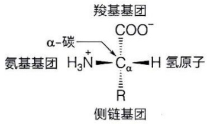

chemical

Chemical structure diagram showing hydrogen bonding between carbon and hydrogen atoms with labeled groups

(B)

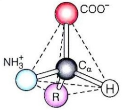

chemical

Molecular structure diagram showing carbon, hydrogen, oxygen, and nitrogen atoms with partial charges labeled

图 2-1 氨基酸的基本结构图

（A）α-氨基酸的立体透视式。不同氨基酸具有不同的R基团。（B）α-氨基酸的立体结构示意图。除脯氨酸外，其他常见氨基酸均形成这种四面体结构。脯氨酸的侧链与其氨基共价相连，形成一个环状结构

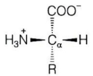

L型

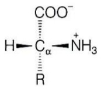

D型

图2-2 两种镜像对称的氨基酸异构体

实心的楔形表示共价键向纸外伸出，虚线填充的楔形表示共价键伸向纸内。大部分氨基酸都具有 L 型和 D 型两种对映异构体

虽然蛋白质中 20 种常见氨基酸的整体空间结构非常相似，但是其侧链基团在大

## 知识延展 2- 1

## 蛋白质中也存在其他稀有氨基酸

除 20 种常见氨基酸之外，某些特定蛋白质中还存在一些稀有氨基酸。与蛋白质中常见的修饰氨基酸（需经翻译后化学修饰生成）不同，稀有氨基酸是通过重新分配的终止密码子或扩展的密码子系统，在核糖体翻译过程中直接整合到多肽链中的特殊氨基酸。科学家发现的第 21 种氨基酸是硒代半胱氨酸（selenocysteine, Sec, U），它是由半胱氨酸中的硫原子被硒原子取代生成。硒代半胱氨酸存在于一些酶中，如谷胱甘肽过氧化酶、硫氧还蛋白还原酶、甘氨酸还原酶和一些氢化酶。此外，吡咯赖氨酸（也称为焦赖氨酸，pyrrolysine，Pyl，O）在产甲烷菌的甲胺甲基转移酶中被发现，是已知的第22种氨基酸。随着科学技术的进步，未来可能会发现更多的稀有氨基酸。

小、形状、电荷性、氢键形成能力以及疏水性等方面存在差异，构成了氨基酸的独特“身份标识”，从而区分不同种类的氨基酸。根据侧链基团在生理 $\mathrm{pH}$ 条件下的化学特性，通常将20种常见氨基酸分为四类:疏水性（非极性）氨基酸、极性不带电氨基酸、带负电荷的酸性氨基酸和带正电荷的碱性氨基酸（图2-3）。

## (1) 疏水性氨基酸

疏水性氨基酸共9种，都具有非极性的侧链基团，可根据侧链基团的大小分为三类。

第一类为小型疏水性氨基酸，包含甘氨酸（glycine，Gly，G）和丙氨酸（alanine，Ala，A）（图2-3A）。甘氨酸是最小的氨基酸，其侧链基团仅为一个氢原子，因此是唯一的非手性氨基酸。丙氨酸的侧链基团则为一个甲基。

第二类为包含较长侧链的疏水性氨基酸，分别为缬氨酸（valine，Val，V）、亮氨酸（leucine，Leu，L）、异亮氨酸（isoleucine，Ile，I）、甲硫氨酸（methionine，Met，M）和脯氨酸（proline，Pro，P）。缬氨酸、亮氨酸和异亮氨酸含有不同长度和形状的侧链烷基基团。甲硫氨酸侧链中含有硫醚基，是两种含有硫原子的氨基酸之一。脯氨酸的疏水侧链与α-碳上的氨基共价连接，形成一个由四个碳原子和一个氮原子组成的四氢吡咯环（其中的氮原子以次氨基形式存在）。由于这些氨基酸的侧链疏水，它们不易溶解，通常存在于水溶性蛋白的内部，作为疏水核心的组成部分，推动蛋白质折叠（见2.6节）。

第三类为含有芳香族基团侧链的疏水性氨基酸，包含苯丙氨酸（phenylalanine, Phe, F）和色氨酸（tryptophan, Trp, W）。苯丙氨酸的侧链由一个苯环和亚甲基组成，色氨酸的侧链则由吲哚环连接在亚甲基上组成。吲哚环上的亚氨基使色氨酸具备局部极性，如能够与水分子等形成氢键，因此色氨酸的疏水性比苯丙氨酸弱。

## (2) 极性不带电氨基酸

极性不带电氨基酸包含6种，它们的侧链基团有极性但不带电荷，因此比疏水性氨基酸更易溶于水。丝氨酸（serine，Ser，S）和苏氨酸（threonine，Thr，T）的侧链均带羟基（图2-3B），苏氨酸比丝氨酸的侧链多一个甲基。由于羟基的存在，这类氨基酸具有很强的亲水性和易反应性。羟基氧原子上的孤对电子可与水或其他极性分子形成氢键，同时也可以作为亲核基团参与酶促反应。此外，羟基易发生磷酸化或糖基化等修饰，从而调节蛋白质的活性或生物学功能（见3.5节）。酪氨酸（tyrosine，Tyr，Y）侧链虽然含有芳香族基团，但由于苯环上带有一个羟基，它在某些性质上与丝氨酸和苏氨酸相似，因此也被归为极性氨基酸。

天冬酰胺（asparagine，Asn，N）和谷氨酰胺（glutamine，Gln，Q）具有酰胺基团，谷氨酰胺的侧链比天冬酰胺多一个亚甲基。半胱氨酸（cysteine，Cys，C）则是另一种含有硫原子的氨基酸，其侧链带有巯基，化学反应活性很强。两个半胱氨酸的巯基可以发生氧化反应形成二硫键，从而在蛋白质中起到稳定三维结构的作用。

## (3) 酸性氨基酸

酸性氨基酸包括天冬氨酸（aspartic acid, Asp, D）和谷氨酸（glutamic acid, Glu, E），它们的侧链上含有羧基（图 2-3C），虽然这些羧基的酸性比  $\alpha-$  羧基弱，但

(A) 疏水性（非极性）氨基酸（9种）

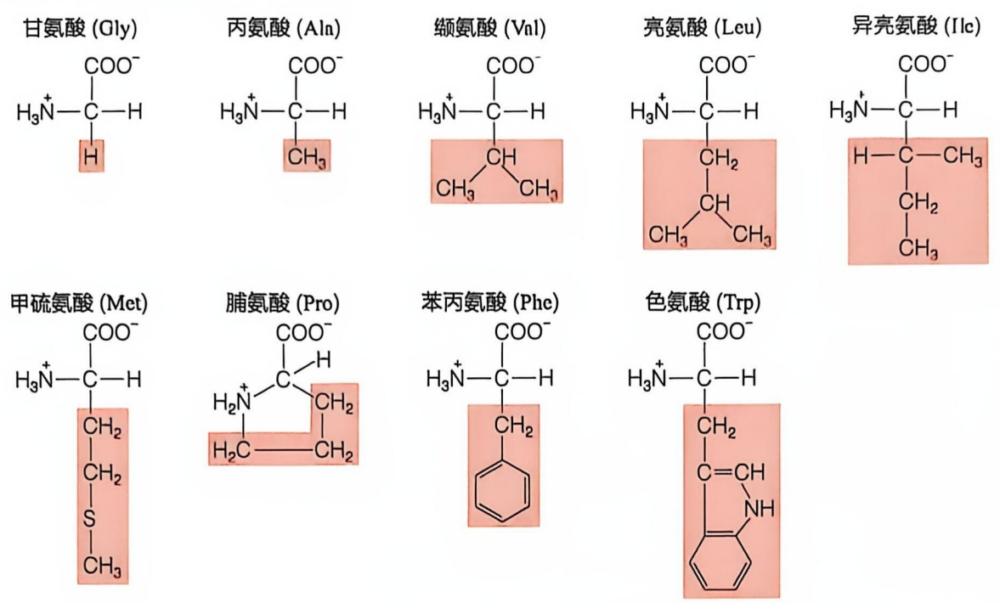

(B) 极性不带电氨基酸（6种）

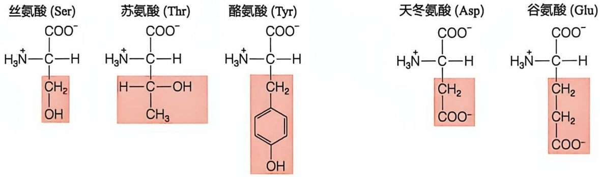

(C) 酸性氨基酸（2种）

天冬酰胺 (Asn)

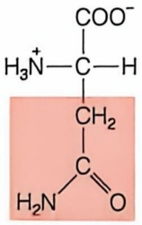

chemical

Chemical structure of a diester compound with carboxylic acid and methyl groups

谷氨酰胺 (Gln)

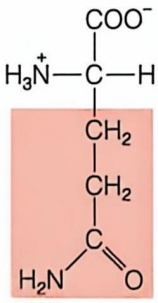

chemical

Chemical structure of a peptide or glycerol molecule with carboxylate and amide groups

半胱氨酸 (Cys)

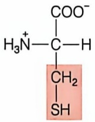

(D) 碱性氨基酸（3种）

赖氨酸 (Lys)

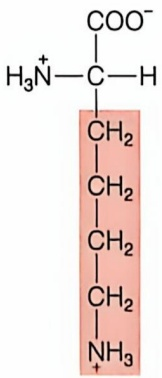

chemical

Chemical structure of a peptide fragment with carboxylate and amino groups

精氨酸 (Arg)

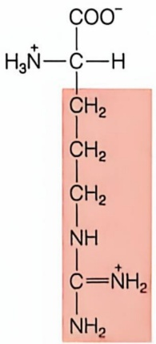

chemical

Chemical structure of a polyamide with carboxylate and amino groups attached to the backbone

组氨酸 (His)

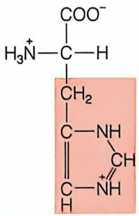

chemical

Chemical structure of a peptide or nucleic acid with carboxylate and amino groups

图 2-3 20 种常见氨基酸的分类及分子结构图

红色阴影部分表示氨基酸的侧链基团，氨基酸的性质由其侧链基团决定

在生理 pH 条件下会电离出  $H^{+}$ ，从而带负电荷。这类负电荷可以帮助某些蛋白质结合金属离子，稳定其三维结构或参与酶的催化。此外，在特定条件下，侧链羧基可以作为质子供体或受体，因此也可以作为广义的酸碱参与催化反应（见 4.2.3 节）。

## (4) 碱性氨基酸

碱性氨基酸包含赖氨酸（lysine，Lys，K）、精氨酸（arginine，Arg，R）和组氨酸（histidine，His，H）（图2-3D）。这类氨基酸具有高度亲水的侧链基团:赖氨酸的侧链含有 $\varepsilon-$ 氨基，精氨酸的侧链含有胍基，而组氨酸含有咪唑基团。在生理pH条件下，赖氨酸和精氨酸的侧链基团可充分质子化而带正电荷，通过静电相互作用稳定过渡态，或作为广义酸提供质子，从而参与酶的催化或蛋白质间的相互作用。组氨酸的咪唑基团的 $\mathrm{pK}_{\mathrm{n}}$ 值约为6.0，在 $\mathrm{pH}$ 为7的环境下约 $10\%$ 会质子化，因此组氨酸能够表现出质子供体和质子受体的双重特性。组氨酸常位于酶的活性中心，含有组氨酸残基的蛋白质是重要的生物缓冲剂（见1.8节）。此外，这三种碱性氨基酸的侧链氮原子还能发生甲基化等修饰，从而动态调节蛋白质的结构和功能（见3.5节）。

## 2.1.3 20 种常见氨基酸兼具酸性和碱性

20 种常见氨基酸都含有一个碱性的  $\alpha-$  氨基和一个酸性的  $\alpha-$  羧基，质子化后它们均可电离出两个氢离子。在中性溶液中，氨基酸同时带有正电荷和负电荷，这种状态下的氨基酸称为两性离子（zwitterion）（图 2-4）。在这种形式下，氨基酸既可作为质子供体，也可作为质子受体，展现出酸性和碱性的双重性质，属于两性电解质（ampholyte）。

在不同的 pH 条件下，两性离子以不同形式存在于溶液中。以侧链不发生解离的二元弱酸——甘氨酸为例:在低 pH 溶液中，氨基和羧基均被质子化，分子整体带正电荷；随着 pH 的增加，羧基上的质子首先解离，此时甘氨酸分子既带正电也带负电，但净电荷为零，处于电中性状态；当溶液 pH 进一步升高，氨基上的质子解离，形成带负电荷的甘氨酸根（图 2-5）。从化学角度看，甘氨酸的三种形式具有两个解离常数。 $pK_{1}$  表示带正电荷的分子去质子化形成电中性分子的能力，而  $pK_{2}$  表示电中性分子去质子化形成带负电荷分子的能力。

当氨基酸分子在特定 pH 下以净电荷为零的电中性形式存在时，这一 pH 称为等电点（isoelectric point, pI）。图 2-6 中所示甘氨酸的滴定曲线的中间转折点处，氨基酸的净电荷为零，对应的 pH 即为氨基酸的等电点。等电点还可以通过两个弱酸基团的解离常数计算: $\mathrm{p}I = (\mathrm{p}K_{1} + \mathrm{p}K_{2})/2$ 。氨基酸处于等电点时带有等量异种电荷，溶解度最低。

图2-4 两性离子结构示意图

在不同的溶液环境中，氨基酸分子具有不同的带电形式

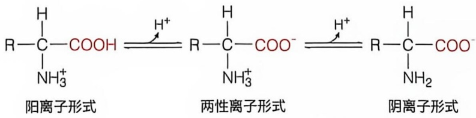

chemical

三种离子形式的化学结构式：阳离子、两性离子和阴离子

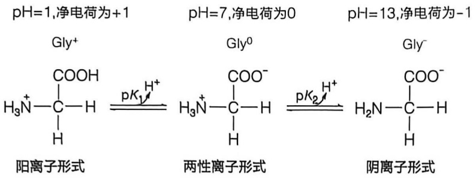

chemical

Hydrolysis reaction equations of ammonia under different pH conditions (1, 7, 13) for neutralization

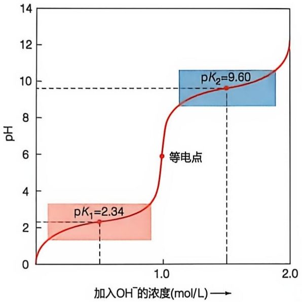

line

| Point | pH |
| --- | --- |
| \(pK_{1}=2.34\) | ~2.34 |
| 等电点 | 6 |
| \(pK_{2}=9.60\) | 9.60 |

图2-5 甘氨酸在不同pH下形成不同离子形式在中性溶液中，甘氨酸以两性离子形式存在；在酸性溶液中，甘氨酸表现为阳离子形式；而在碱性溶液中，甘氨酸表现为阴离子形式

图 2-6 甘氨酸的滴定曲线

当溶液 pH 等于氨基酸的等电点时，它既带正电也带负电，但净电荷为零。甘氨酸的等电点可通过  $(pK_{1} + pK_{2})/2$  计算

侧链基团的电离会影响该氨基酸在溶液中的电荷状态。具体来说，酸性氨基酸的侧链羧基和碱性氨基酸的侧链氨基在一定 pH 范围内可以发生质子化或去质子化，从而使它们具有 4 种不同的带电形式和 3 个解离常数（图 2-7）。酸性和碱性氨基酸的等电点可以通过电中性形式相邻的两个  $pK_{a}$  的平均值来计算。通过强碱滴定实验可以测定每种氨基酸不同酸性基团的  $pK_{a}$ （表 2-1）。氨基酸的酸碱性质（尤其是侧链的酸碱特性）决定了其在水溶液中的行为以及在蛋白质中的作用。

## 2.1.4 氨基酸具有光吸收性

氨基酸的光吸收性由其侧链结构决定，不同的侧链结构赋予氨基酸不同的光谱学特征。这意味着在不同波长的电磁波照射下，氨基酸会表现出不同的光吸收能力。虽然20种常见氨基酸无法吸收可见光，但含有芳香族侧链的氨基酸，如色氨酸、酪氨酸和苯丙氨酸，由于它们的苯环中存在共轭电子，这些电子可以通过吸收光能从基态跃迁到激发态，从而在紫外区展现出不同波长的吸收峰（图2-8）。酪氨酸（Tyr）的最大吸收峰位于274 nm，苯丙氨酸（Phe）在257 nm，而色氨酸（Trp）在280 nm。因为大多数蛋白质都含有至少一种芳香族氨基酸，所以可以使用仪器测定280 nm处的光吸收值来估算蛋白质的浓度。

(A) 谷氨酸

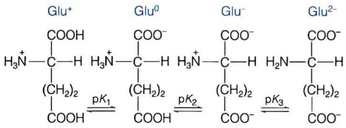

chemical

Chemical reaction diagram showing nucleophilic acid cleavage steps with Glu⁺, Glu⁰, Glu⁻, and Glu²⁻ ions

(B) 赖氨酸

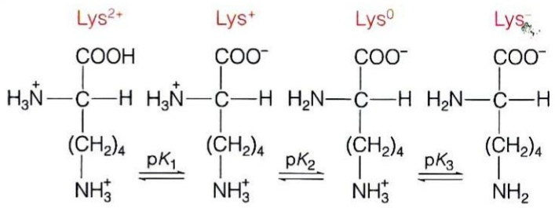

chemical

Chemical reaction diagram showing the formation of Lys complexes with pK chains and carboxyl groups

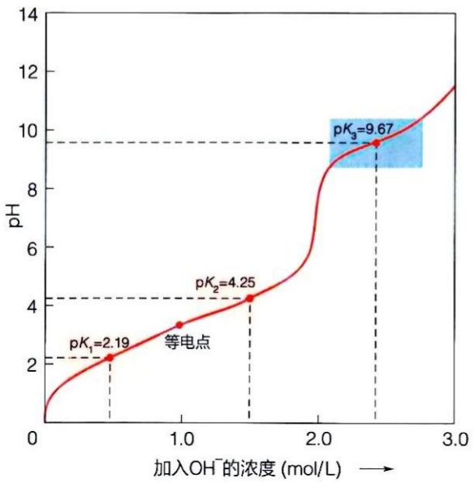

line

| Point | pH |
| --- | --- |
| \(pK_{1}\) | 2.19 |
| 等电点 | ~3.4 |
| \(pK_{2}\) | 4.25 |
| \(pK_{3}\) | 9.67 |

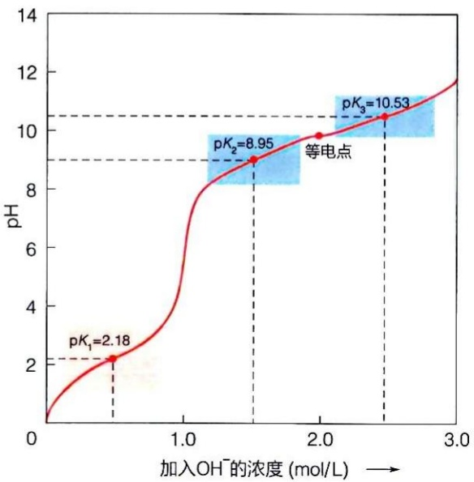

line

| Point | pH |
| --- | --- |
| \(pK_{1}\) | 2.18 |
| \(pK_{2}\) | 8.95 |
| 等电点 | ~9.8 |
| \(pK_{3}\) | 10.53 |

图2-7 谷氨酸（酸性氨基酸）和赖氨酸（碱性氨基酸）的滴定曲线及各自的四种存在形式

表 2-1 20 种常见氨基酸中各个基团的 ${\mathrm{{pK}}}_{\mathrm{a}}$

<table><tr><td>氨基酸种类</td><td>氨基酸名称</td><td>分子量 /Da</td><td> $\alpha -COOH$  $pK_a$ </td><td> $\alpha-NH_3^+$  $pK_a$ </td><td>R 基团 $pK_a$ </td><td>p/</td></tr><tr><td rowspan="9">疏水性(非极性)氨基酸</td><td>甘氨酸 Gly</td><td>75</td><td>2.34</td><td>9.60</td><td>—</td><td>5.97</td></tr><tr><td>丙氨酸 Ala</td><td>89</td><td>2.34</td><td>9.69</td><td>—</td><td>6.01</td></tr><tr><td>脯氨酸 Pro</td><td>115</td><td>1.99</td><td>10.96</td><td>—</td><td>6.48</td></tr><tr><td>缬氨酸 Val</td><td>117</td><td>2.32</td><td>10.96</td><td>—</td><td>5.97</td></tr><tr><td>亮氨酸 Leu</td><td>131</td><td>2.36</td><td>9.60</td><td>—</td><td>5.98</td></tr><tr><td>异亮氨酸 Ile</td><td>131</td><td>2.36</td><td>9.68</td><td>—</td><td>6.02</td></tr><tr><td>甲硫氨酸 Met</td><td>149</td><td>2.28</td><td>9.21</td><td>—</td><td>5.74</td></tr><tr><td>苯丙氨酸 Phe</td><td>165</td><td>1.83</td><td>9.13</td><td>—</td><td>5.48</td></tr><tr><td>色氨酸 Trp</td><td>204</td><td>2.38</td><td>9.39</td><td>—</td><td>5.89</td></tr><tr><td rowspan="4">极性不带电氨基酸</td><td>丝氨酸 Ser</td><td>105</td><td>2.21</td><td>9.15</td><td>—</td><td>5.68</td></tr><tr><td>苏氨酸 Thr</td><td>119</td><td>2.11</td><td>9.62</td><td>—</td><td>5.87</td></tr><tr><td>半胱氨酸 Cys</td><td>121</td><td>1.96</td><td>10.28</td><td>8.18</td><td>5.07</td></tr><tr><td>天冬酰胺 Asn</td><td>132</td><td>2.02</td><td>8.80</td><td>—</td><td>5.41</td></tr><tr><td>氨基酸种类</td><td>氨基酸名称</td><td>分子量 /Da</td><td>α-COOHpKa</td><td> $\alpha-NH_3^+$ pKa</td><td>R 基团pKa</td><td>pI</td></tr><tr><td rowspan="2">极性不带电氨基酸</td><td>谷氨酰胺 Gln</td><td>146</td><td>2.17</td><td>9.13</td><td>—</td><td>5.65</td></tr><tr><td>酪氨酸 Tyr</td><td>181</td><td>2.20</td><td>9.11</td><td>10.07</td><td>5.66</td></tr><tr><td rowspan="2">酸性氨基酸</td><td>天冬氨酸 Asp</td><td>133</td><td>1.88</td><td>9.60</td><td>3.65</td><td>2.77</td></tr><tr><td>谷氨酸 Glu</td><td>147</td><td>2.19</td><td>9.67</td><td>4.25</td><td>3.22</td></tr><tr><td rowspan="3">碱性氨基酸</td><td>赖氨酸 Lys</td><td>146</td><td>2.18</td><td>8.95</td><td>10.53</td><td>9.74</td></tr><tr><td>组氨酸 His</td><td>155</td><td>1.82</td><td>9.17</td><td>6.00</td><td>7.59</td></tr><tr><td>精氨酸 Arg</td><td>174</td><td>2.17</td><td>9.04</td><td>12.48</td><td>10.76</td></tr></table>

## 2.2 氨基酸的线性排列顺序构成蛋白质的一级结构

每种蛋白质分子之所以能发挥其独特的生物学功能，是由于它能形成独特的三维空间结构。为了方便理解，一般将蛋白质的结构从四个层次进行描述，称为蛋白质的一级、二级、三级和四级结构。

蛋白质的一级结构是指多肽链中的氨基酸排列顺序，包括二硫键的位置。一级结构决定了蛋白质如何折叠形成更复杂的结构，氨基酸序列的微小变化就可能导致蛋白质无法正确折叠，从而影响其正常功能。一级结构不仅是蛋白质功能的基础，也是研究蛋白质结构与功能关系的核心。

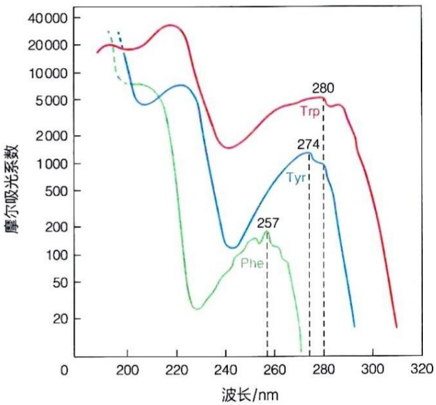

line

| Wavelength (nm) | Trp Absorbance | Tyr Absorbance | Phe Absorbance |
| --- | --- | --- | --- |
| 257 | — | — | ~180 |
| 274 | — | ~1300 | — |
| 280 | ~5000 | — | — |

图2-8 三种芳香族氨基酸在 $\mathrm{pH} = 6$ 条件下的紫外吸收光谱图

在 $280~\mathrm{nm}$ 波长处，测得的色氨酸吸光度是酪氨酸的四倍多。苯丙氨酸的光吸收一般对蛋白质的光谱特性贡献较小

## 2.2.1 氨基酸分子之间通过肽键共价连接形成多肽链

蛋白质中前一个氨基酸的羧基与后一个氨基酸的氨基之间缩合，同时释放出一个水分子，形成酰胺键（amide bond），也称肽键（peptide bond）（图2-9）。肽键中，氧原子与碳原子形成双键，而氮原子也可以通过共轭将其电子部分共享到羰基（C=O, carbonyl group）上。由于C=O双键与C—N键的共轭效应，肽键中C—N键长为0.133 nm，介于典型的C—N单键（0.145 nm）和典型的C=N双键（0.125 nm）之间，因此肽键具有一定的双键特性。

肽键具有部分双键性质，这限制了 C—N 键的旋转，使肽键及其相邻的六个原子共处于同一平面，称为肽平面（peptide plane）或酰胺平面（amide plane）（图 2-10A）。