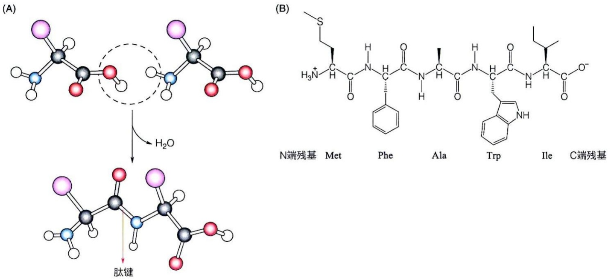

图 2-9 氨基酸通过肽键共价连接

(A) 两个氨基酸形成的肽键。

(B) 氨基酸序列具有方向性

（A）肽平面中6个原子一般形成反式构型。（B）脯氨酸所形成的反式和顺式构型稳定性相当

图2-10 肽平面普遍构型模式及脯氨酸所参与形成肽平面的独特性

肽平面通常以反式构型存在，使两个相邻的  $C_{\alpha}$  原子之间的距离最远，从而减小了空间位阻，使结构更加稳定。需要注意的是，当肽平面中包含脯氨酸残基时，四氢吡咯环的空间位阻会部分抵消反式构型带来的空间位阻优势。在这种情况下，顺式和反式两种构型的稳定性相当，从而使这两种构型均能够存在于含有脯氨酸残基的肽平面中（图 2-10B）。

多个氨基酸以肽键相连形成的结构称为肽链（peptide chain）。由于发生了脱水缩合，每个氨基酸单元不再完整，故称为氨基酸残基（residue）。肽链因其两端结构不对称而具有极性，保留游离  $\alpha-$  氨基的一端称为氨基端（amino terminal）或 N 端，而保留游离  $\alpha-$  羧基的一端称为羧基端（carboxyl terminal）或 C 端。通常在书写多肽链序列时，总将 N 端残基置于最左侧，C 端残基置于最右侧。肽链中每个氨基酸残基可以用三字母缩写或单字母符号表示（知识延展 2-2）。例如，在肽链 Met-Tyr-Ala-Trp-Ile 或 M-Y-A-W-I 中，Met 是 N 端残基，而 Ile 是 C 端残基（图 2-9B）；而 Ile-Trp-Ala-Tyr-Met 或 I-W-A-Y-M 则代表另一条肽链，序列不同的肽链具有不同的生化特性。

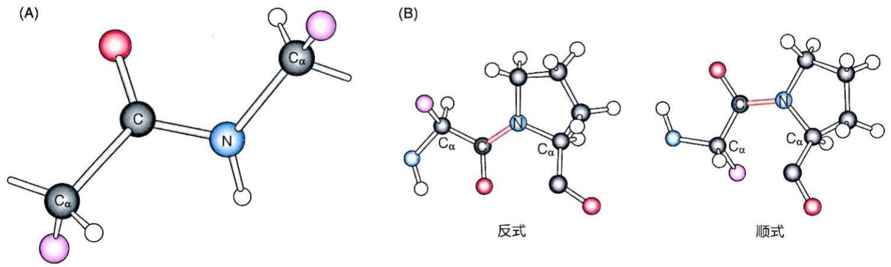

## 知识延展 2- 2

## 生物体内存在大小和组成各异的寡肽和多肽

生物体内存在大小不同、氨基酸组成各异的肽类分子。根据肽链中氨基酸残基数目多少，肽类分子可分为寡肽（oligopeptide）、多肽（polypeptide）和蛋白质三个层次。一般将2～10个氨基酸残基组成的肽称为寡肽，含11～50个氨基酸残基的肽称为多肽，50个以上氨基酸残基组成的肽称为蛋白质。

寡肽中由2个、3个和4个氨基酸分子通过共价连接形成的产物分别称为二肽（dipeptide）、三肽（tripeptide）和四肽（tetrapeptide），依此类推。许多脊椎动物中的激素都是寡肽，如后垂体分泌的九肽催产素，可刺激子宫收缩；蘑菇中的鹅膏毒素是一种环状八肽，极具致命性。还有人工短肽，如阿斯巴甜，在多种食品中作为人工甜味剂使用。

## 2.2.2 胰岛素是第一种氨基酸序列被测定的蛋白质分子

为了确定不同蛋白质的序列，需要开发有效的蛋白质测序方法。由于多肽链包含20种不同的氨基酸，测定其特定的氨基酸排列顺序的工作具有挑战性。

测定多肽的氨基酸序列的研究由英国科学家弗雷德里克·桑格（Frederick Sanger，1918—2013）率先开展，他首先使用特异性化学试剂或蛋白水解酶将多肽链分解成较小的肽段，然后通过多种复杂的化学方法测定不同肽段的N端残基和氨基酸组成，经过约10年的努力，终于在1953年前后成功确定了牛胰岛素多肽链的氨基酸序列（图2-11）。桑格的研究结果也证实了“不同蛋白质具有特定的氨基酸排列顺序”这一重要结论。

## 2.2.3 蛋白质的氨基酸序列提供了重要的生物演化信息

蛋白质中氨基酸的排列顺序不仅决定其功能，还为理解地球上生物的演化提供了宝贵的信息。分子进化研究通常基于密切相关的蛋白质家族成员的序列数据。属于同一蛋白质家族的蛋白质成员称为同源蛋白质（homologous protein）或同源物（homologue）。

同源物可以通过比对蛋白质之间的序列相似性来确定。如图 2-12 所示，通过比对不同种属来源的细胞色素 c（cytochrome c）的氨基酸序列可判断它们之间是否具有同源性。现在可以将一种蛋白质的氨基酸序列与储存于数据库中的所有氨基酸序列逐一比对，以识别任何与目标蛋白质的氨基酸序列具有一定相似性的蛋白质。

同一蛋白质家族的成员在功能上通常具有相似性。例如，一种称为 EF-1α（elongation factor 1α）的蛋白质在所有真核生物中广泛存在，负责参与蛋白质合成，而一种类似功能的 EF-Tu 蛋白则广泛存在于细菌中。EF-1α 和 EF-Tu 的序列和功能相似性表明它们可能起源于共同的祖先蛋白。

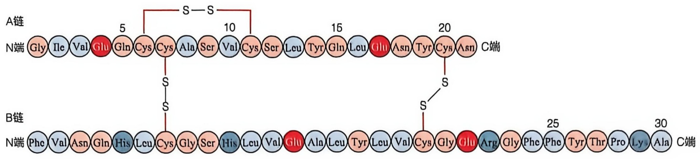

chemical

RNA secondary structure diagram showing A and B chains with nucleotide positions and amino acid residues labeled

图 2-11 胰岛素的两条肽链通过分子间二硫键相连

牛胰岛素A链有21个氨基酸，B链有30个氨基酸，共由51个氨基酸组成。A、B两链通过两个分子间二硫键相连接。A链内部也存在一个二硫键

不同物种中同一蛋白质家族成员的序列差异可用于判断物种间的演化关系远近，还能进一步区分物种亚群。例如，某些氨基酸片段可能出现在一个亚群中，而在另一个亚群中缺失。以 EF-1α/EF-Tu 蛋白质家族为例，其氨基端附近有一个包含 12 个残基的“插入”片段，存在于所有古菌和真核生物中，但在细菌中缺失（图 2-13）。这一标志性序列帮助确认了真核生物与古菌之间的演化关系比真核生物与细菌之间更为接近。

在利用序列同源性研究蛋白质的演化关系时，除了识别对应位置上完全相同的氨基酸残基外，还需识别化学性质相似的氨基酸替换情况。另外，在比对过程中引入适当的间隔也可能提升匹配率。需要注意的是，同源比对得分较高通常说明二者具有演化同源性，但得分较低并不代表二者没有同源性，这是因为有些蛋白质尽管序列相似性不明显，但三维结构相似，可能存在演化关联。这说明对于某些蛋白质而言，保持关键的三维结构或许才是演化选择的最终目标。

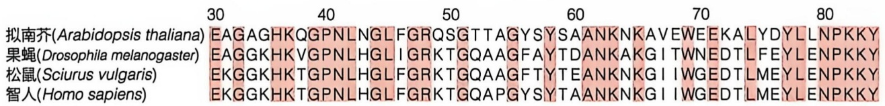

text_image

30	40	50	60	70	80
拟南芥(Arabidopsis thaliana)	EAGAGHKQGPNLNGLFGRQSGTTAGYSYSAANKNKAVEWEEKALYDYLLNPKKY
果蝇(Drosophila melanogaster)	EAGGKHKVGPNLHGLIGRKTGQAAGFAYTDANKAKGITWNEDTLFEYLENPKKY
松鼠(Sciurus vulgaris)	EKGGKHKTGPNLHGLFGRKTGQAAGFTYTEANKNKGIIWGEDTLMEYLENPKKY
智人(Homo sapiens)	EKGGKHKTGPNLHGLFGRKTGQAPGYSYTAANKNKGIIWGEDTLMEYLENPKKY

图 2-12 将两个不同物种细胞色素 c 的氨基酸序列进行比对可揭示它们之间的同源性

细胞色素 c 是生物体内氧化过程的一种电子传递体，人们常常使用细胞色素 c 来分析不同物种之间的演化关系。图中红色部分代表四种生物相同的序列片段

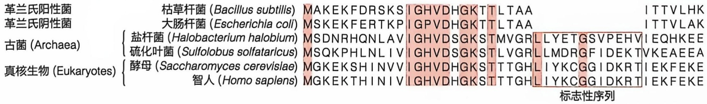

text_image

革兰氏阳性菌
枯草杆菌 (Bacillus subtilis)
MAKEKFDRSKS I GHVDHGKTTLTAA
ITTVLHK
革兰氏阴性菌
大肠杆菌 (Escherichia coll)
MSKEKFERTKP I GPVDHGKTTLTAA
ITTVLAK
古菌 (Archaea)
盐杆菌 (Halobacterium halobium)
MSDNRHQNLAV I GHVDSGKSTMVGR LLYETGSVPEHV I EQHKEE
硫化叶菌 (Sulfolobus solfataricus)
MSQKPHLNIV I GHVDSGKSTLVGR LLMDRGFIDEKT VKEAEEA
真核生物 (Eukaryotes)
酵母 (Saccharomyces cerevisiae)
MGKEKSHINV V I GHVDHGKSTTTGHL I YKCGGIDKRT I EKFEKE
智人 (Homo sapiens)
MGKEKTHINIV I GHVDHGKSTTTGHL I YKCGGIDKRT I EKFEKE
标志性序列

图 2-13 EF-1α/EF-Tu 蛋白家族中存在的标志性序列

黄框中的标志性序列只在古菌与真核生物中出现，暗示古菌与真核生物可能在演化中存在更近的亲缘关系

## 2.3 多肽链主链通过氢键形成的规则构象构成蛋白质的二级结构

所有的多肽链都包含重复的残基结构单元—N—C$_{a}$—C—（图 2-9C），称为主链（main chain）或骨架（backbone）。1950 年代，美国学者莱纳斯·鲍林（Linus Pauling, 1901—1994）注意到多肽链的主链具有形成大量氢键的潜力，因为其中的 C=O 可以

作为氢键受体，而 N—H 可以作为氢键供体。通过这些氢键，多肽链的主链能够形成规则且稳定的局部空间构象，它们构成了蛋白质的二级结构（secondary structure），即多肽链主链上相邻氨基酸残基中原子的局部空间排列，而不考虑每个残基侧链的具体空间位置。

## 2.3.1 不同的二级结构都可通过特征性的二面角进行描述

多肽链中的肽键具有部分双键性质，无法自由旋转。对于每个肽平面，尽管肽键不能自由旋转，但肽键中的C原子或N原子与 $C_{\alpha}$ 之间的共价键是典型的单键，可以旋转。

通常使用二面角（dihedral angle）来定义肽平面的旋转角度。如图2-14A所示，由于连接 $C_{\alpha}$ 原子的两个肽平面具有不同的旋转方向，因此用两个二面角来分别描述两个肽平面的旋转角度。一个是基于 $C_{\alpha}-N$ 单键旋转的 $\phi$ （phi）角，另一个是基于 $C_{\alpha}-C$ 单键旋转的 $\psi$ （psi）角。当主链上的所有肽键位于同一个平面时， $\phi$ 角和 $\psi$ 角被定义为 $\pm180^{\circ}$ 。尽管理论上 $\phi$ 和 $\psi$ 可以在 $-180^{\circ}\sim+180^{\circ}$ 的范围内取值，但由于主链原子之间，特别是R基团之间存在空间位阻，这些二面角的可能组合受到限制。

在多肽主链的局部区域，当每个氨基酸残基的  $\phi$  和  $\psi$  角分别相同或几乎相同时，主链会形成规则的空间结构。1950 年代，科学家们预测并随后验证了几种规则的二级结构，主要包括  $\alpha$  螺旋和  $\beta$  折叠，这两种结构广泛存在于不同的蛋白质分子中。当局部区域的每个氨基酸残基的  $\phi$  和  $\psi$  角不同时，主链则形成不规则的环状结构（loop）。

除上述常见的二级结构外，蛋白质分子中还存在其他规则的多肽主链结构。不同的二级结构均可通过每个氨基酸残基的 $\phi$ 和 $\psi$ 二面角来定义和描述。印度科学家拉马钱德兰（G.N.Ramachandran，1922—2001）等人从理论上预测了二面角的可能组合，提出只有某些组合是可行的，其他组合因空间位阻等原因无法实现。他将允许和禁止的 $\phi$ 和 $\psi$ 角组合进行了二维可视化，称为拉氏图（Ramachandran plot）（图2-14B）。后来的蛋白质晶体结构测定结果表明，他预测的 $\phi$ 和 $\psi$ 角组合基本正确，证明了他的理论依据是恰当的。根据他的预测，甘氨酸残基较为特殊，因为其侧链很小，在肽链中的二面角组合基本上都是可行的，因此可以形成其他氨基酸残基无法形成的肽链构象。

(A)

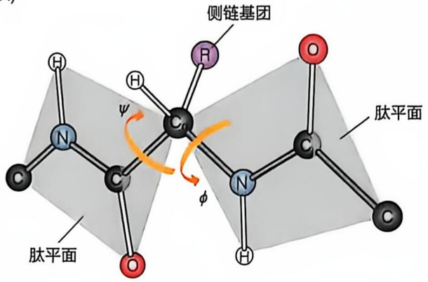

chemical

Molecular structure diagram showing pyridine (Pyridine) coordination with side chain and肽平面, labeled in Chinese

(B)

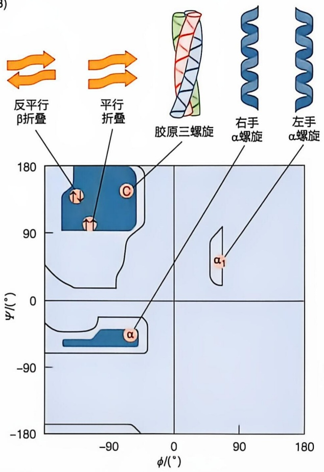

text_image

反平行
β折叠
平行
折叠
胶原三螺旋
右手
α螺旋
左手
α螺旋
φ/°
-90
0
90
180
-180
φ/°
90
180

图 2-14 两个肽平面形成的二面角

（A）两个肽平面形成的二面角展示。（B）拉氏图展示形成不同类型二级结构的两个二面角的允许组合范围（阴影区）

## 2.3.2 $\alpha$ 螺旋是蛋白质分子中最易形成的二级结构

1950年代，鲍林等人利用X射线衍射等方法测定氨基酸和二肽等简单分子的原子间距离、键角及其他构型参数，提出了多肽主链的 $\alpha$ 螺旋（$\alpha$-helix）结构模型（图2-15），并预测这种结构可能普遍存在于各种多肽链中。

在该模型中，多肽主链沿轴线纵向形成螺旋，每个氨基酸残基的侧链基团（R 基团）向外延伸（图 2-15A）。螺旋的螺距约为  $5.4 \, \text{\AA} (1 \, \text{\AA} = 10^{-10} \, \text{m} = 0.1 \, \text{nm})$ ，每螺距包含约 3.6 个氨基酸残基。在理想的  $\alpha$  螺旋中，每个氨基酸残基主链二面角  $\phi$  和  $\psi$  分别为  $-57^{\circ}$  和  $-47^{\circ}$ 。真实蛋白质中的  $\alpha$  螺旋可能稍微偏离这些角度，导致螺旋轴轻微弯曲或扭曲。

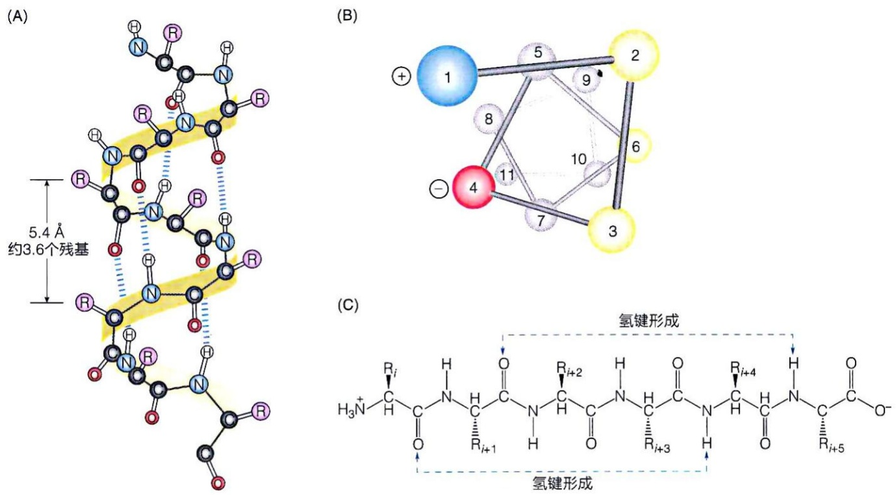

图 2-15 多肽链的 $\alpha$ 螺旋模型结构示意图

（A）条带结构示意图展示多肽链空间结构模型。（B）α螺旋结构的螺旋投影图。图中用不同颜色标识具有特定性质的氨基酸。如黄色代表疏

水性残基，该侧形成疏水表面；红色代表负电荷残基，蓝色代表电荷残基，它们形成亲水性表面。（C）α螺旋结构中的氢键形成情况

α螺旋模型的另一个关键特征是多肽主链上的N—H和C=O之间均形成氢键。一个肽键上的氮原子结合的氢原子，与该肽键N端方向第四个氨基酸残基的羰基氧原子形成氢键（图2-15C）。在α螺旋中心段的每螺距中，每个氢键的参与确保了结构的稳定性。位于α螺旋两端的C=O或N—H无法形成内部氢键，但它们可以与周围水分子或蛋白质其他区域形成氢键，进一步稳定螺旋结构。由于α螺旋中的肽链主链形成了稳定的饱和氢键，使其成为一种稳定的局部空间结构。蛋白质结构的研究结果表明，在所有蛋白质

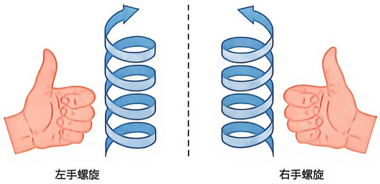

图 2-16 区分左右手螺旋旋转方向

α 螺旋与人的左右手一样，理论上具有两种不同的方向。将大拇指指向螺旋轴的羧基端，四指的方向与肽链的方向（N 端到 C 端）一致则说明螺旋方向与手一致

分子中，大约四分之一的氨基酸残基处于  $\alpha$  螺旋结构中。

和所有螺旋结构一样，$\alpha$ 螺旋理论上也可以以左手螺旋或右手螺旋两种形式存在（图2-16）。然而，研究发现，蛋白质分子中的 $\alpha$ 螺旋几乎都是右手螺旋形式。这种现象可能与蛋白质中的氨基酸残基的 $C_{\alpha}$ 原子普遍呈L构型有关。

## 2.3.3 $\alpha$ 螺旋的形成与否取决于肽链的氨基酸序列

蛋白质中并非所有多肽链都能稳定地形成  $\alpha$  螺旋。不同氨基酸残基形成  $\alpha$  螺旋的倾向性各不相同，主要受以下因素影响。

## (1) 侧链基团的体积大小

侧链的大小会影响相邻主链上  $C_{\alpha}$  原子形成二面角  $\phi$  和  $\psi$  的可能范围。一般而言，侧链大小适中的残基（如丙氨酸）更倾向于形成  $\alpha$  螺旋。

## (2) 侧链基团的电荷

在  $\alpha$  螺旋中，每个氨基酸残基的侧链与前后第四个残基的侧链在空间位置上邻近。如果空间相邻的侧链带相反电荷（如谷氨酸与赖氨酸），它们形成的离子对有助于稳定  $\alpha$  螺旋；如果带相同电荷（如两个谷氨酸或赖氨酸残基），则会产生排斥作用，不利于  $\alpha$  螺旋的形成。

## (3) 侧链基团间的其他相互作用

邻近的侧链基团如果都是芳香族氨基酸，会产生疏水效应，进一步稳定  $\alpha$  螺旋。但如果是天冬酰胺、丝氨酸、苏氨酸或半胱氨酸等残基，则会降低螺旋的稳定性。

## (4) 特定残基的限制作用

脯氨酸和甘氨酸对  $\alpha$  螺旋的形成具有限制作用。脯氨酸的  $C_{\alpha}$  原子位于一个刚性五元环中，限制了其二面角，使其难以形成  $\alpha$  螺旋。此外，脯氨酸残基的 N 原子不带氢原子，无法与主链的羰基形成氢键，从而破坏螺旋结构。而甘氨酸的侧链仅为一个氢原子，具有较大的构象自由度，导致其无法形成稳定的二面角，因此也不利于  $\alpha$螺旋的形成。

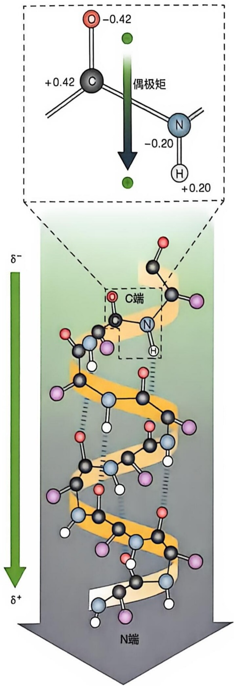

chemical

Molecular structure diagram showing N-terminal end with charge distribution and electron density gradient

图 2-17 α 螺旋形成的电偶极

α 螺旋两端附近的氨基酸残基属性对于该结构的稳定性至关重要。多肽链上的每个肽键都带有一个电偶极（electric dipole）。在 α 螺旋中，这些电偶极沿着螺旋轴方向排列，形成一个净电偶极，并随着螺旋长度的增加而增强（图 2-17）。螺旋的 N 端带部分正电荷，C 端带部分负电荷。因此，如果在螺旋的 N 端附近存在带负电的氨基酸残基，它可以稳定螺旋偶极的正电荷；而在螺旋的 C 端附近的带正电氨基酸，则可以稳定螺旋偶极的负电荷。这样的带电荷氨基酸残基在特定位置的存在，有助于进一步稳定 α 螺旋结构。

## 2.3.4 $\beta$ 折叠是另一种常见的二级结构

β折叠是鲍林等人在预测出α螺旋结构的同时提出的另一种多肽主链的二级结构形式。在β折叠结构中，每个 $C_{\alpha}$ 的二面角 $\phi$ 和 $\psi$ 都保持一致。与α螺旋相比，β折叠呈扁平的锯齿状，需要多段肽链以更为伸展的形式排列才可形成（图2-18A）。

β折叠中的每段肽链通常称为β链（β strand），多条β链平行排列便形成了β片层（β-sheet）。在β片层中，相邻肽段通过主链上的N—H和C=O形成氢键相互连接。参与β折叠的肽段可以来自同一条多肽链，且间隔距离不定，也可以来自不同的多肽链。氨基酸残基的侧链基团通常垂直于β片层的平面，相邻残基的侧链交替分布在片层平面的两侧（图2-18B），使结构更为稳定。

在  $\beta$  片层中，相邻肽段可以有两种排列方式。在平行排列中，相邻的  $\beta$  链方向一致，即氨基端和羧基端方向相同（图 2-18C）。这种排列的周期为 6.5 Å，氢键呈非直线状态，因此稳定性略低。而在反平行排列中，相邻的  $\beta$  链方向相反，即一个链的 N 端与另一个链的 C 端对齐（图 2-18D）。这种排列更为伸展，周期为 7.0 Å，链间氢键几乎呈直线，因此结构更稳定，在天然蛋白质中也更常见。

## 2.3.5 $\beta$ 转角是蛋白质主链上一种常见的局部规则空间结构

在形成紧凑的球形蛋白质分子时，肽链通常需要发生转折，以改变其延伸方向。这种肽链转折处的规则结构称为  $\beta$  转角（ $\beta$ -turn），它通常用于连接多肽链上的两个  $\alpha$  螺旋或两个  $\beta$  折叠。最常见的例子是连接相邻的反平行  $\beta$  折叠，使多肽链转折  $180^{\circ}$ 。这种转角结构通常由 4 个氨基酸残基组成，第 1 个残基中 C=O 的 O 与第 4 个残基中 N—H 的 H 形成氢键，而中间的第 2 个和第 3 个残基则不参与形成主链内部的氢键。

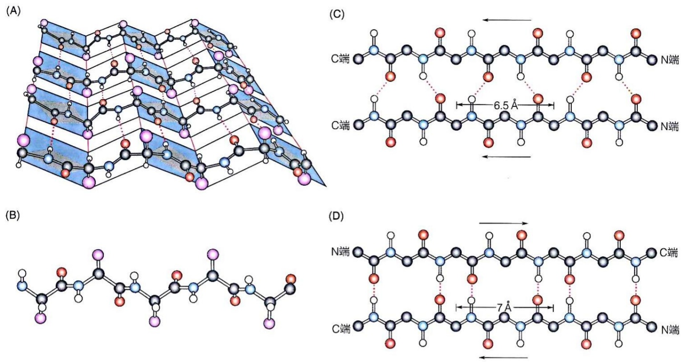

图 2-18 β 折叠结构的特征

（A）反平行多 $\beta$ 折叠形成的片层结构。（B）一个 $\beta$ 折叠中的侧链基团与主链方向垂直。（C）平行 $\beta$ 片层结构示意图。（D）反平行 $\beta$ 片层结构示意图

β转角根据所含氨基酸残基的不同来归类，最常见的为Ⅰ型和Ⅱ型β转角（图2-19）。两者的主要区别是第二个氨基酸残基羰基氧的朝向不同。脯氨酸在Ⅰ型和Ⅱ型β转角的第二位都最为常见，在Ⅱ型转角的第三位中甘氨酸占比最高。

## 2.4 蛋白质多肽链上的所有原子共同参与形成三级结构

蛋白质的三级结构（tertiary structure）指其所有原子的三维空间排布，从而形成了蛋白质特定的三维空间结构。三级结构是在二级结构基础上进一步折叠而成的，包含多肽链中彼此序列相隔较远的氨基酸残基之间，以及不同二级结构之间的相互作用。该结构主要依赖于四种弱相互作用（如氢键、范德瓦耳斯力、疏水作用和离子键）来维持稳定。

根据蛋白质在生理环境中的三维形态，可以将其分为纤维状蛋白质和球状蛋白质两大类（图 2-20）。此外，部分蛋白质分子中还存在一些未折叠成特定结构的区域，称为固有无序区域。本节重点讨论纤维状蛋白质、球状蛋白质以及含有固有无序区域的蛋白质。

不同的三级结构赋予了蛋白质不同的功能类型。以下将进一步探讨这些结构类型的主要特征。

(A)

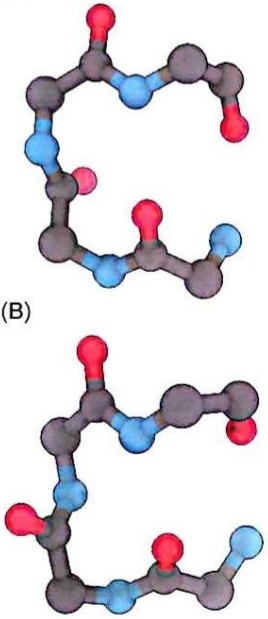

图 2-19 β 转角的两种类型

选自PDB编号:1HMT，仅展示主链。（A）I型β转角，第二个氨基酸残基的羰基氧朝向转角的内侧。（B）II型β转角，羰基氧朝外

(A)

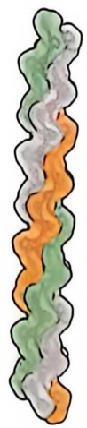

natural_image

Abstract wavy line pattern with green, orange, and gray segments (no text or symbols)

(B)

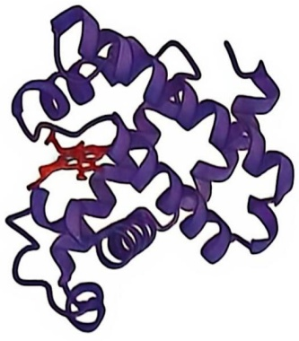

natural_image

3D protein structure visualization with purple and red helices (no labels or text)

图 2-20 不同类型的蛋白质结构示意图

（A）纤维状蛋白质（胶原蛋白，PDB编号:1K6F）示意图:三股左手螺旋链缠绕在一起形成的右手螺旋结构。（B）球状蛋白质（肌红蛋白，PDB编号:2MM1）示意图

(A)

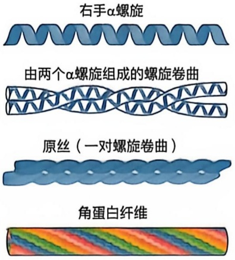

text_image

右手α螺旋
由两个α螺旋组成的螺旋卷曲
原丝（一对螺旋卷曲）
角蛋白纤维

(日)

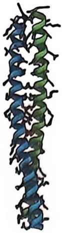

natural_image

Colorful ribbon diagram of a protein or molecular structure, no text or labels present

图 2-21 α-角蛋白超螺旋结构的形成以及互锁模式

（A）两个右手  $\alpha$  螺旋单链以左旋方式缠绕形成螺旋卷曲结构，螺旋卷曲紧密排列形成原丝结构（包含四个  $\alpha$  螺旋单链）。多个原丝结构链继续相互缠绕，形成角蛋白纤维。（B）两个右手  $\alpha$  螺旋单链以左旋方式缠绕为螺旋卷曲的结构展示（PDB 编号:3TNU）

## 2.4.1 纤维状蛋白质通过形成规则的二级结构而完成其功能

纤维状蛋白质（fibrous protein）的多肽链通常保持拉伸状态，而球状蛋白质会存在多处转折。纤维状蛋白质往往由单一类型的规则二级结构组装形成，这种结构赋予纤维状蛋白质特有的物理特性，如高度的机械强度和韧性、较低的水溶性等。较低的水溶性是由于其序列中通常富含疏水性氨基酸残基，这些残基在紧密堆积的多肽链中被隐藏在分子内部，通过疏水相互作用增加了结构的稳定性。纤维状蛋白质通常构成对动物身体有支撑功能的结构，并在外表提供保护。以下介绍三种典型的纤维状蛋白质的结构和功能特点。

## (1)  $\alpha-$  角蛋白的多肽链之间形成超螺旋结构

α- 角蛋白是一种典型的纤维状蛋白质，广泛存在于脊椎动物中，主要构成毛发、指甲、爪、角、蹄、皮肤等外层保护结构。每条 α- 角蛋白肽链形成右手螺旋结构，两条肽链的螺旋同向平行缠绕成左手卷曲螺旋（coiled coil）结构（图 2-21A）。两股右手螺旋通过侧链基团的规则互锁模式紧密交织，从而在左旋超螺旋中形成稳定的结构（图 2-21B）。α- 角蛋白主要通过规则的二级结构进一步组装，与球状蛋白质相比、三级结构特征并不显著。

α- 角蛋白的卷曲螺旋是基础结构单元，成对的卷曲螺旋继续组装成原丝纤维、最终形成毛发等纤维结构，类似多股细绳扭成的粗绳，极大地提升了整体强度。X射线衍射分析显示，毛发中纤维蛋白的螺距为 5.15 \~ 5.2 Å，而非鲍林等人预测的 5.4 Å；每螺距包含约 3.5 个氨基酸残基而非 3.6 个。这些结构通过非共价作用逐级组装，并通过二硫键等共价交联进一步增强了纤维的强度。例如，在犀牛角的 α- 角蛋白中，高达

18% 的残基为半胱氨酸，形成大量二硫键，使犀牛角极为坚固。

此外，由  $\alpha-$  角蛋白形成的某些纤维（如羊毛）因  $\alpha$  螺旋的伸展性而具有弹性。通过破坏氢键等弱相互作用，羊毛可被拉伸至近乎两倍的长度。然而，随着二硫键数目增加，这种伸展性减弱，有助于抵抗外部拉伸力。因此，头发和毛发可以被拉伸，而角、爪和蹄则不易拉伸。在拉伸力解除后，只要二硫键未断裂，纤维结构通常能恢复原状。

## (2) 胶原蛋白的基本结构单位为三股螺旋

胶原蛋白（collagen）是哺乳动物体内含量最丰富的蛋白质，约占其总蛋白质的25%\~35%。这种蛋白质广泛存在于肌腱、软骨、骨的有机基质以及眼角膜等结缔组织中。胶原蛋白的肽链以螺旋形式存在，但其螺旋为左旋，而不是通常的右旋结构（图2-22）。此外，胶原蛋白的螺旋比典型的α螺旋更为伸展，每一螺距包含3个氨基酸残基，而不是3.5或3.6个（图2-22A）。与α-角蛋白的双链螺旋结构不同，胶原蛋白的基本结构单位是三链螺旋，即由三条左手螺旋的肽链相互缠绕，形成一种独特的右手超螺旋结构（图2-22B）。

脊椎动物体内尽管存在多种不同类型的胶原蛋白，但它们通常具有相似的氨基酸组成特征，包括大约 $35\%$ 的甘氨酸、$11\%$ 的丙氨酸和 $21\%$ 的脯氨酸或4-羟基脯氨酸（4-Hyp）。这种独特的氨基酸组成是形成胶原蛋白独特三股螺旋结构的基础。胶原蛋白的氨基酸序列通常由重复的三肽单元Gly-X-Y组成，其中X通常为脯氨酸，而Y则多为4-羟基脯氨酸。甘氨酸在三链螺旋结构中至关重要，它位于三条肽链之间的紧密接触处，空间限制，只有甘氨酸的小体积能够适应，否则会因空间受阻而导致结构不稳定（图2-22C）。脯氨酸和4-羟基脯氨酸的存在赋予每条肽链大角度的扭曲，使三条链能够紧密地堆积在一起，形成胶原纤维。三链超分子结构之间还可通过

(A)

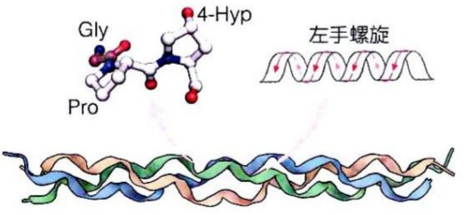

chemical

Molecular structure of 4-Hyp and its corresponding左手螺旋 (synchronous helix) diagram

(B)

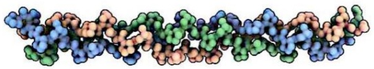

natural_image

Molecular structure diagram showing a helical chain with colored secondary structure elements (no labels or text)

(C)

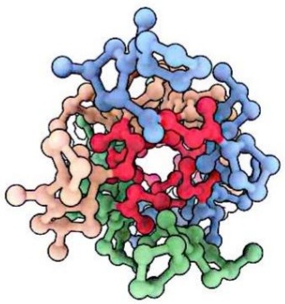

natural_image

3D molecular structure visualization with color-coded atoms (no labels or text)

图 2-22 胶原蛋白的结构示意图

（A）胶原蛋白的α链具有独特的重复二级结构。重复的三肽单元为Gly-X-Y，其中X通常为脯氨酸，Y通常为4-羟基脯氨酸，采用每圈3个残基的左手螺旋结构。（B）空间填充模型的结构图展示胶原蛋白（PDB编号:1CGD）的局部三股螺旋结构，右手螺旋形式缠绕。三

种颜色各代表三条 $\alpha$ 链。（C）三股螺旋结构的顶视图，用球棍模型表示，甘氨酸用红色表示，由于侧链基团很小，在三股螺旋结合的紧密空间里正好适合。这里的球形范围并不代表每个原子的范德瓦耳斯半径，三股螺旋的中心紧密堆叠，并不像这里显示的有多余的空间

图 2-23 丝蛋白形成反平行β片层结构
（A）丝蛋白由反平行β片层构成。（B）丙氨酸和甘氨酸残基的侧链相互交错，形成片层之间的紧密堆积

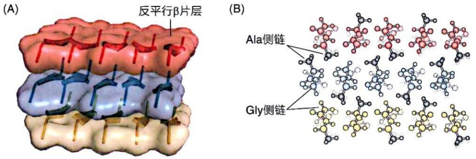

X 和 Y 位置的氨基酸残基形成共价交联，这种结构提供了高于相同横截面积钢丝的拉伸强度。随着年龄增长，胶原纤维中共价交联增多，导致结缔组织逐渐变得僵硬和脆弱（知识延展 2-3）。

## (3) 丝蛋白的基本结构单位为 β 片层

丝蛋白（fibroin），也称为β-角蛋白（β-keratin），是一种存在于蚕茧和蜘蛛网中的纤维状蛋白质。其多肽链主要采用β片层结构，富含丙氨酸、丝氨酸和甘氨酸等侧链较小的氨基酸残基。这些小侧链交替分布于β片层的上下方，使得形成的反平行β片层结构具有很强的稳定性（图2-23）。

在这种 $\beta$ 折叠结构中，多肽链中的所有N—H和C=O均参与链间氢键的形成，加上侧链基团之间的范德瓦耳斯力相互作用，进一步增强了蛋白质的结构稳定性。$\beta$ 片层结构中的多肽链已经是高度伸展的，因此丝蛋白没有延展性。然而，丝蛋白的结构具有一定的柔韧性，这是因为维持 $\beta$ 折叠的相互作用主要为较弱的非共价键（如氢键和范德瓦耳斯力），而非如 $\alpha-$ 角蛋白中的二硫键等共价键。这种特点使富含丝蛋白的材料柔软而富有弹性。

此外，鸟类羽毛中的  $\beta-$  角蛋白也由堆叠的  $\beta$  折叠组成，进一步说明了丝蛋白家族在结构和功能上的多样性。

## 知识延展 2-3

## 胶原蛋白变体的功能差异体现了结构对功能的决定作用

在哺乳动物体内，存在超过30种不同的胶原蛋白结构变体，每种变体分布在特定组织中，具备独特的氨基酸序列和特定功能。人类胶原蛋白的结构性遗传缺陷揭示了氨基酸序列与蛋白质三维结构之间的密切关系。例如，成骨不全（osteogenesis imperfecta）是一种导致婴儿骨骼异常的疾病，已发现多种不同程度的病症变体；艾勒-丹洛斯综合征（Ehlers-Danlos syndrome）主要表现为关节松弛，在人类中也有多种变体。这些病症的一部分变体是由于胶原蛋白肽链中单个甘氨酸残基被具有较大侧链的氨基酸（如半胱氨酸或苏氨酸）替换所引起的。虽然仅涉及一个残基的替换，但却对胶原蛋白的三维结构和功能产生严重影响。这种现象进一步说明了氨基酸序列对于蛋白质结构和功能的决定性作用。

## 2.4.2 球状蛋白质的结构和功能高度多样

与纤维状蛋白质不同，球状蛋白质（globular protein）的结构更为紧凑。其多肽链通过不同片段（或多条不同的肽链）紧密折叠形成球形（图2-24）。不同的球状蛋白质分子具有独特的三维结构，但它们通常都包含 $\alpha$ 螺旋、$\beta$ 折叠和 $\beta$ 转角等二级结构，因此折叠成一种大致双极性的紧凑结构:多数疏水性氨基酸残基侧链集中在分子内部，多数亲水性残基则位于表面，并通过大量氢键、范德瓦耳斯力以及少量离子相互作用来稳定整体结构。

以牛核糖核酸酶 A（ribonuclease A）为例，这是一种相对较小的球状蛋白质，仅包含 124 个残基（12.6 kDa），但包含规则的  $\alpha$  螺旋、反平行  $\beta$  折叠、不规则的  $\beta$  转角和环状结构（loop）等丰富的二级结构（图 2-24）。牛核糖核酸酶 A 内部的疏水性氨基酸残基侧链形成疏水

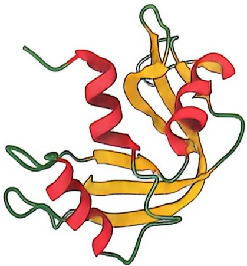

natural_image

3D ribbon diagram of a protein structure with red, yellow, and green helices (no text or labels)

图 2-24 球状蛋白质三维结构

牛核糖核酸酶 A（PDB 编号:1FS3）三维丝带结构图。红色区代表  $\alpha$  螺旋，黄色区代表反平行  $\beta$  折叠，绿色区代表  $\beta$  转角和环状结构

核心，大部分 N—H 和 C=O 极性基团也参与氢键形成，不仅为蛋白质核心提供稳定作用力，还避免了未成键的极性基团带来的不稳定效应。牛核糖核酸酶 A 内部的  $\alpha$  螺旋和  $\beta$  折叠通常在序列和结构上较为保守。同时，核糖核酸酶 A 中的多数极性侧链位于分子表面，与水相互作用。通常球状蛋白质的表面有许多柔性环状结构，连接着蛋白质内部的  $\alpha$  螺旋或  $\beta$  折叠（也包括  $\beta$  转角结构）。这种疏水核心与亲水表面的结构是许多球状蛋白质的典型特征。球状蛋白质的表面可以与具有互补结构的大小分子（包括蛋白质）发生相互作用，这种相互作用是酶-底物结合、细胞信号传递、抗原-抗体识别等生物过程的基础。

在蛋白质的三级结构中，一些由两种或多种二级结构元素组成的特定折叠模式在不同的蛋白质分子中反复出现，这些模式称为结构模体（structural motif），如  $\beta-\alpha-\beta$ 、螺旋-环-螺旋（helix-loop-helix，HLH）、螺旋-转角-螺旋（helix-turn-helix，HTH）、 $\beta$  发夹环（ $\beta$ -hairpin）、 $\beta$  桶（ $\beta$  barrel）、 $\beta$  螺旋（ $\beta$  helix）、Rossmann 折叠（Rossmann fold）、希腊钥匙模体（Greek key motif）（图 2-25）。

蛋白质的三级结构中还有一种重要的结构模式称为结构域（structural domain）。不同于结构模体的概念，结构域是由多肽链的某一部分形成的相对稳定的局部折叠模式。在许多情况下，结构域可以从蛋白质分子中分离出来（如通过蛋白质水解酶的降解），并且仍然保持其三维结构。一个结构域通常包含100～250个氨基酸残基，具有特定的生物学功能，有时也作为演化的基本单位存在。分子量较小的蛋白质通常只含有一个结构域，而分子量较大的蛋白质则可以包含两个或更多结构域，每个结构域都执行特定的生物学功能。结构域大多由连续的氨基酸序列组成，也可由不连续的多肽片段形成（图2-26）。多结构域蛋白质在行使生物学功能时，通常依赖于不同结构域的协同作用，而不同结构域的存在也使得同一蛋白质在不同情景下能发挥多种功能。

通过对编码结构域的基因序列进行跨物种和跨蛋白质的演化比较研究，发现同一

图 2-25 八种代表性的结构模体

(A)  $\beta - \alpha - \beta$  (4TIM)。

(B) HLH (6OD3)。

(C) HTH (2P81)。

(D) β 发夹环 (2EVQ)。

(E) $\beta$ 桶 (5HZT)。

(F) β 螺旋 (8XCJ)。

(G) Rossmann 折叠 (2D4A)。

(H) 希腊钥匙模体 (2POL)。括号内为相应 PDB 编号

(A)

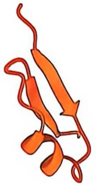

natural_image

3D ribbon diagram of a protein structure, showing alpha helices and beta sheets (no labels or text)

(E)

(B)

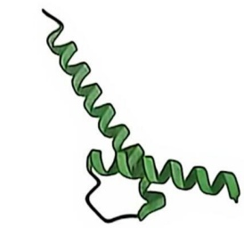

natural_image

3D ribbon diagram of a protein secondary structure (no labels or text)

(F)

(0)

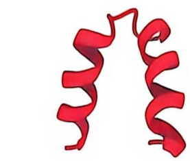

natural_image

3D ribbon diagram of a protein structure, no text or labels present

(G)

(D)

(H)

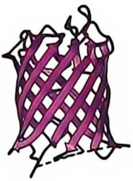

natural_image

Abstract line drawing of a purple lattice structure (no text or symbols)

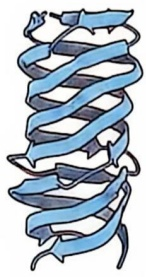

natural_image

Illustration of a protein secondary structure with alpha helices (no labels or text)

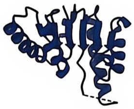

natural_image

3D ribbon diagram of a protein structure, showing alpha helices and beta sheets (no labels or text)

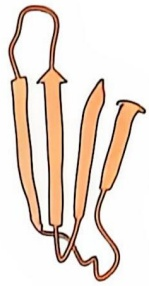

natural_image

Illustration of three orange anatomical structures with directional arrows, no text or symbols present

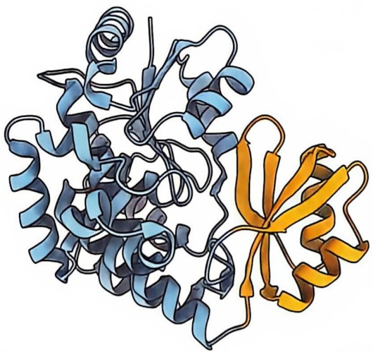

natural_image

3D ribbon diagram of a protein structure with alpha helices and beta sheets (no labels or text)

图 2-26 ACP 酰 CoA 酰基转移酶是一种含两个结构域的代谢酶

左边大结构域（蓝色）由氨基酸残基 1-133 和 198-316 组成。右边小结构域（金黄色）由氨基酸残基 134-197 组成，包含四个反平行 β 折叠和两个 α 螺旋结构（PDB 编号:1NM2）

结构域可以存在于不同的蛋白质中，这表明在演化过程中，编码同一结构域的基因序列可以在不同蛋白质中被重复利用。这一过程可能通过基因重复（gene duplication）实现，即一个基因片段复制成两个相同的片段，然后分别进行独立演化。这种机制解释了为什么不同的蛋白质中会存在相同的结构域。全基因组比较分析显示，大约90%的真核生物结构域可以在不同蛋白质中找到。通过不同结构域的组合或同一结构域的重复，产生了多种多样的蛋白质。

## 2.4.3 很多蛋白质具固有无序结构

研究发现，许多蛋白质的整体或部分缺乏有序的二级和三级结构，这类结构称为固有无序区域（intrinsically disordered region, IDR）。约有 1/3 的人类蛋白质存在固有无序区域，这些无序结构在某些蛋白质的生物学功能中发挥重要作用。与有序结构的蛋白质相比，含有无序结构的蛋白质通常缺乏疏水核心，且富含带电

的氨基酸残基，如赖氨酸、精氨酸和谷氨酸。此外，固有无序区域中还含有较高比例的脯氨酸残基，这些残基会破坏有序结构的形成。随着结构生物学技术的发展，这些所谓的“固有无序区域”在细胞特定生理条件下的精确空间构象逐步被揭示。

许多固有无序蛋白质位于蛋白质相互作用网络的核心，能够与多种蛋白质相互作用实现多种功能。这些固有无序区域与其他蛋白质发生相互作用时，通常会形成特定的有序结构，但不同的结合伙伴会导致不同的结构形式。例如，哺乳动物中的肿瘤抑制蛋白 p53（分子量为 53 kDa）在控制细胞分裂过程中扮演关键角色。p53 的 N 端约 60 个氨基酸和 C 端约 80 个氨基酸为固有无序区域，中间包含一个约 200 个残基的有序 DNA 结合结构域，以及一个约 30 个残基的有序四聚化结构域（图 2-27A）。这些无序区域可以与多种蛋白质相互作用，在不同的结合情况下呈现不同结构（图 2-27B）。这种多样的相互作用使得 p53 参与多条信号转导和调控途径。

(A)

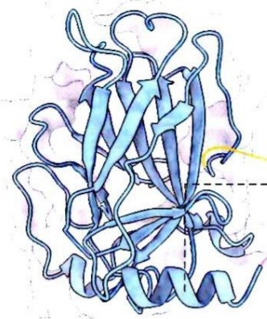

natural_image

3D ribbon diagram of a protein structure with alpha helices and beta sheets (no labels or text)

(B)

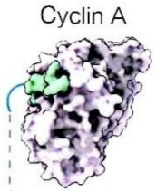

Sirtuin

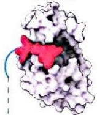

N端

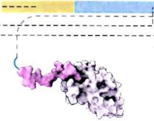

natural_image

Molecular structure diagram showing a protein bound to a ligand (no labels or text)

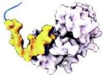

CBP

S100B

图 2-27 具固有无序区域的蛋白质代表

（A）肿瘤抑制蛋白 p53（蓝色）的两端均为固有无序区域（PDB 编号:1TUP）。（B）无序结构区域的存在使得 p53 可与多种蛋白质发

生相互作用，从而发挥不同的生物学功能。与其C端无序区域结合的蛋白质包括Cyclin A（PDB编号:1H26）、Sirtuin（PDB编号:1MA3）、CBP（PDB编号:1JSP）、S100B（PDB编号:1DT7）

## 2.5 具有三级结构的蛋白质亚基进一步组装产生四级结构

具有三级结构的蛋白质亚基可以进一步组装，形成更高层次的四级结构。在生物体内，许多蛋白质以寡聚体（oligomer）或多聚体（multimer）形式存在，这些复合物由两个或多个独立的多肽链（称为亚基）通过非共价键相互结合而成，从而形成四级结构（quaternary structure）。

细胞中很多蛋白质（包括一些酶）以寡聚体形式存在。寡聚体可以是同型寡聚体（homo-oligomer），即由相同的亚基组成，也可以是异型寡聚体（hetero-oligomer），由两种或多种不同的亚基组成。第一个解析出三维结构的寡聚体蛋白质是血红蛋白。它包括两个 $\alpha$ 亚基（各含141个残基）和两个 $\beta$ 亚基（各含146个残基），因此也可以视为由两对 $\alpha \beta$ 亚基组成的二聚体（图2-28）。因此，血红蛋白既可以被描述为四聚体，也可以描述为由 $\alpha \beta$ 组合的二聚体。血红蛋白的结构和功能将在第3章详细探讨。

寡聚体蛋白质中的每个亚基通常都以独立折叠单位的形式发生相互作用。值得注意的是，亚基之间相互作用表面的特征类似于每个亚基的内部，既会形成较多的疏水基团，也会形成氢键和离子键的相互作用基团。寡聚体结构的形成对提高蛋白质的稳定性、遗传效率以及催化功能具有独特的优势。

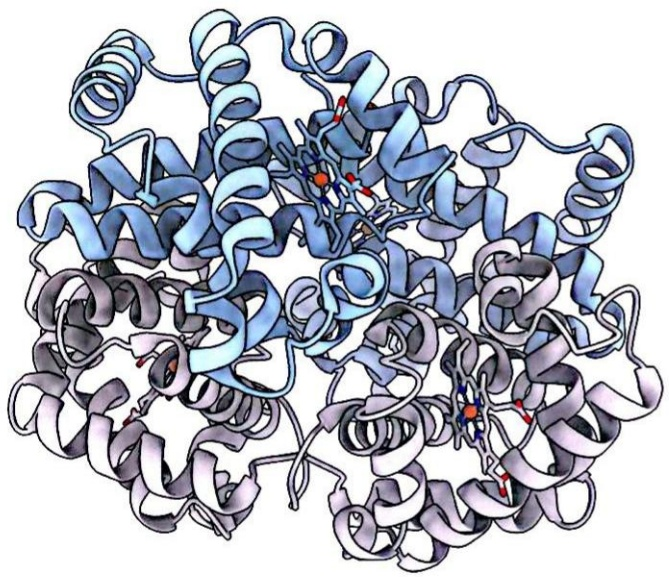

natural_image

3D ribbon diagram of a protein structure showing alpha helices and beta sheets (no labels or text)

图 2-28 血红蛋白四聚体结构

丝带模型结构图展示四个亚基和血红素辅基组成的四聚体结构（PDB编号:1SHR）。灰色表示 $\alpha$ 亚基，蓝色表示 $\beta$ 亚基

多亚基结合后，蛋白质的比表面积降低，减少了蛋白质表面与溶剂水的接触面积，从而提升了稳定性。此外，这种结合方式能降低遗传表达中突变引发不良后果的风险，如镰刀型贫血症。同型寡聚化还能使生物体更高效地组织基因，相比编码一个完整的多亚基肽链，编码单个亚基所需的DNA量大幅减少。例如，烟草花叶病毒的蛋白质衣壳由数千个相同亚基构成，如果用一条大型肽链实现同样功能，则所需编码的DNA量会呈千倍地增加。另外，多亚基组合能将多种酶的催化中心集中在一起，实现复杂的生物合成过程。例如，细菌谷氨酰胺合成酶的活性位点由相邻的两个亚基共同组成，而单独的亚基没有酶活性。寡聚体（如血红蛋白）还可以表现出协同效应，一个亚基

结合配体后构象的变化会影响邻近亚基的配体亲和力，从而在亚基间传递信号。这种协同现象是寡聚体蛋白质特有的重要调节特性（见第3章）。

## 2.6 蛋白质多肽链具有自发折叠形成独特空间结构的能力

蛋白质在执行生物功能时需要具备特定的三维空间结构。蛋白质从一维氨基酸序列折叠形成三维结构是生命过程中的一个重要现象。那么，这一过程中的一维序列与三维结构之间究竟存在怎样的关系呢？

## 2.6.1 一些蛋白质在体外通过变性和复性实现其三级结构的丧失及恢复

体外研究表明，外界环境的变化（如高温、高压，溶液中存在酸、碱、盐酸胍、脲、重金属或某些有机试剂等变性剂）会导致蛋白质失去其生物活性。人们将蛋白质和核酸等生物大分子的三维结构发生变化并导致生物活性丧失的过程称为变性（denaturation）。我国学者吴宪在1930年代提出，蛋白质变性是其空间结构的变化而不是化学结构变化所导致，这一理论得到了国际同行的认可，并得到了鲍林等学者的研究支持。

1950年代至1960年代，美国学者克里斯蒂安·安芬森（Christian Anfinsen，

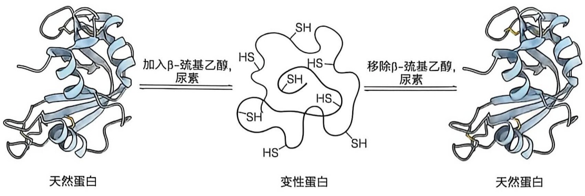

chemical

DNA double helix structure showing natural and variable protein binding to urea, with β-estraining and de-helating steps

图 2-29 以核糖核酸酶为例展示变性复性结构变化

加入β-巯基乙醇和尿素后，核糖核酸酶的二硫键被打开，蛋白质转变为一种更为松散的结构；移除变性剂后，核糖核酸酶自发重新折叠回原来的三维空间结构（PDB编号:1FS3）

1916—1995）等人在研究核糖核酸酶的结构与活性关系时发现，蛋白质在体外发生变性后仍可恢复其结构和活性，并由此提出了一个理论，即蛋白质多肽链的氨基酸序列中包含将其折叠成天然三维结构所需的全部信息。一个已经变性失活的蛋白质分子在一定条件下重新获得天然构象和生物活性的过程称为复性（renaturation）。

安芬森等人关于核糖核酸酶的变性和复性实验可以简要概括如下:在变性剂尿素和还原剂 $\beta-$ 硫基乙醇存在的条件下，核糖核酸酶中的二硫键被还原，三维空间结构被破坏，从而导致酶的活性丧失；当尿素和 $\beta-$ 硫基乙醇被移除后，酶的结构和活性能够在很大程度上恢复。基于这些观察，他们提出了一个假说，即球状蛋白质三级结构的形成是一个自发过程，其最终构象仅由未折叠的肽链的氨基酸序列所决定。

该实验的一个惊人发现是:在复性过程中，由8个半胱氨酸残基形成的4个二硫键有105种可能的组合方式，但其中只有一种是具有酶活性的天然组合方式。这表明，变性的核糖核酸酶能够自发地重新折叠回其天然的三级结构，从而恢复其催化活性（图2-29）。随后，研究人员使用人工合成的多肽链样品（而非从胰腺中提取的样品）也获得了具有催化活性的核糖核酸酶。值得一提的是，1960年代，中国学者也发现化学合成的牛胰岛素肽链能够折叠形成具有生物活性的胰岛素。这些实验结果排除了安芬森等人提纯的核糖核酸酶样品中含有微量其他物质助力活性恢复的可能性，确认了该酶的自发折叠信息完全来自其多肽链本身。

后续研究发现，只有少数分子量较小且折叠后能形成稳定结构的蛋白质，才能在体外条件下自发折叠成其天然结构。在生物体内，许多蛋白质的折叠依赖分子伴侣（chaperone）等蛋白质的帮助，并且即使是核糖核酸酶这样的小分子蛋白质在体内的有效折叠也需要二硫键异构酶的催化。

## 2.6.2 热力学稳定性是驱动蛋白质折叠的内在动力

多肽链的折叠过程往往发生在恒温、恒压的热力学环境中。根据热力学第二定律，在等温和等压的条件下，热力学体系会自发地向吉布斯自由能降低的方向变化，最终到达其最小值。这个折叠过程可以用自由能漏斗景观图来描述（图 2-30）。未折