光眼和焦虑症等多种疾病。而 $\beta_{2}$ 肾上腺素受体（$\beta_{2}AR$）是在结合游离配体的 GPCR 中（视紫红质结合的配体是共价连接在受体上的）第一个被克隆和第一个结构被解析的受体，后续将以 $\beta_{2}AR$ 为例介绍 GPCR 感知信号和传递信号的分子机制。目前人类基因组中仍有 100 多种 GPCR 属于“孤儿受体”，意味着其天然配体未知，对其生物功能的认识也非常有限。

## 3.4.1 GPCR 激活 G 蛋白介导信号传递

GPCR 结合胞外激素或神经递质等配体后，将信号跨膜传递给胞内的 G 蛋白，进而触发一系列信号级联反应。G 蛋白含  $\alpha$ （45～47 kDa）、 $\beta$ （35 kDa）和  $\gamma$ （7～9 kDa）亚基。通常情况下， $\alpha$  和  $\gamma$  亚基通过共价偶联的脂肪链锚定于细胞膜上。在非激活状态下，G 蛋白中的  $\alpha$  亚基（G $\alpha$ ）与 GDP（guanosine diphosphate，鸟苷二磷酸）结合，GDP 结合状态的 G $\alpha$  可与 G $\beta$ 、G $\gamma$  形成异源三聚体。GPCR 与激动剂结合后，发生构象变化被活化，活化的 GPCR 进而招募 G 蛋白异源三聚体，引起 G $\alpha$  亚基构象变化，使 G $\alpha$  亚基释放 GDP 继而结合 GTP（guanosine triphosphate，鸟苷三磷酸）。G $\alpha$  结合 GTP 后转变为活化状态，脱离 GPCR 并与 G $\beta$ 、G $\gamma$  形成的异源二聚体（G $\beta\gamma$ ）解离，解离后的 G $\alpha$  和 G $\beta\gamma$  可分别调控下游多种效应蛋白的活性。

G 蛋白可依据其中  $\alpha$  亚基的蛋白质序列和功能分为不同类型，包括激活型 G 蛋白 ( $G_{s}$ )、抑制型 G 蛋白 ( $G_{i}$ )、 $G_{q}$  和  $G_{12}$  等。有的 GPCR 对某一种 G 蛋白有高选择性，如  $\beta_{2}AR$  主要倾向于结合  $G_{s}$ 。但也有 GPCR 能够与多种不同类型的 G 蛋白相互作用。

GPCR-G 蛋白信号传递过程涉及三个要素:镶嵌于细胞质膜中的 GPCR 作为信号的鉴别器（discriminator）、细胞质一侧的 G 蛋白作为信号的传感器（transducer）以及下游的效应蛋白作为信号的放大器（amplifier）。依据目前对信号转导过程的认知，来自细胞外的激素、生长因子或神经递质等“第一信使”作为配体首先与其对应的 GPCR 结合，通过别构效应引起 GPCR 构象变化从而激活 GPCR。激活后的 GPCR 招募 G 蛋白使其 Gα 构象发生改变，Gα 释放 GDP 并结合 GTP，从而被活化，Gα 对 Gβγ 的抑制也同时被解除。进一步，活化的 Gα 和 Gβγ 与下游的效应蛋白结合并改变其活性，导致细胞质中低分子量代谢物（如 cAMP）或无机离子（如 Ca$^{2+}$）的浓度发生变化。cAMP、Ca$^{2+}$ 等作为“第二信使”，可激活或抑制一种或多种下游靶蛋白。

以 $\beta_{2} \mathrm{AR}$ 为例, 其胞外侧结合作为激动剂的肾上腺素 (epinephrine) 后, 引起胞内侧构象变化, 结合并激活 $G_{\mathrm{a}}$ 。$G_{\mathrm{s}}$ 异源三聚体随之发生解离, 其中转变为 GTP 结合状态的 $\alpha$ 亚基 ($G \alpha_{\mathrm{s}}$) 与腺苷酸环化酶 (adenylate cyclase, AC) 结合, 使之激活并催化 ATP 转化为 cAMP; 而 $G \beta \gamma$ 则可与 $\mathrm{Ca}^{2+}$ 通道结合并调节其通透性。AC 催化生成的 cAMP 可结合并活化蛋白激酶 A (protein kinase A, PKA), 活化后的 PKA 可通过催化磷酸化修饰调控下游效应蛋白 (多为酶) 的活性, 引起信号级联反应 (图 3-27)。

Gα亚基具有 GTP 酶（GTPase）的活性，可水解所结合的 GTP 为 GDP。GDP 结合状态的 Gα 可重新与 Gβγ 结合，终止 Gα 和 Gβγ 对效应蛋白的调控。许多 Gα 亚基有对应的可提高其 GTPase 活性的蛋白，称作 GTP 酶激活蛋白（GTPase activating protein, GAP）。GAP 可加速 G 蛋白失活。Gα 的 GTP 酶活性对于调控 GPCR 信号传递十分重要，若该活性因基因突变被破坏，Gα 会被持续激活，引起许多包括癌症在内的重大疾病。

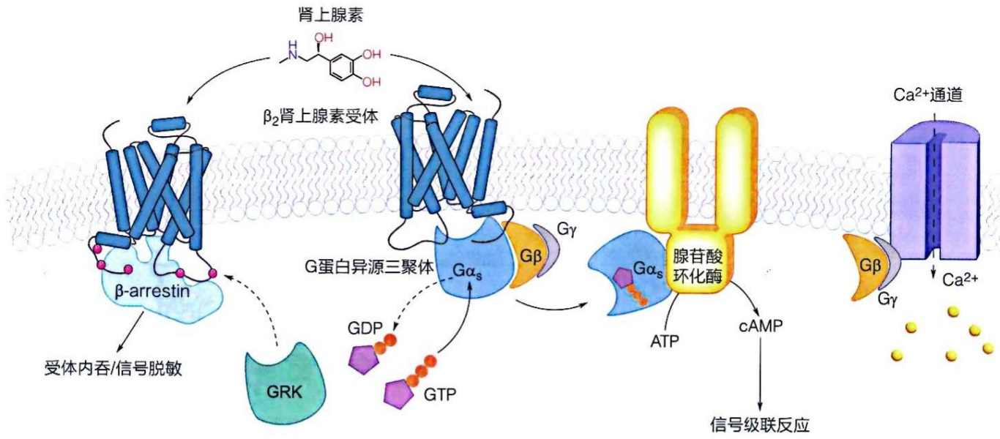

flowchart

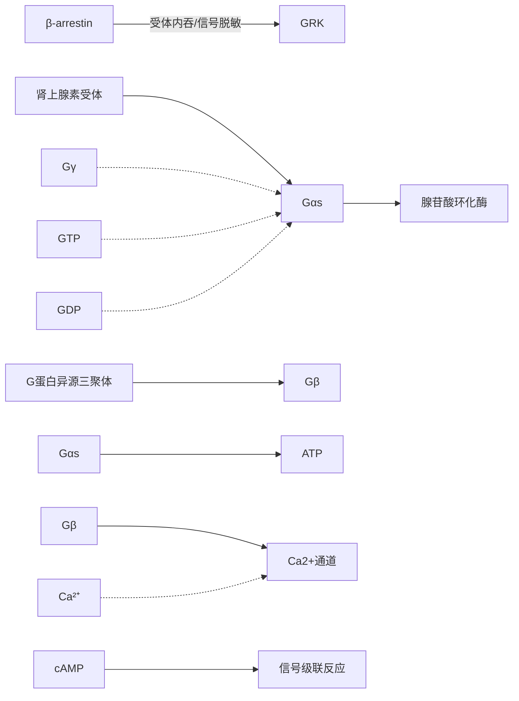

图 3-27 ${\beta }_{2}$ 肾上腺素受体介导的信号传递示意图

$\beta_{2}AR$  被肾上腺素激活后，可激活  $G_{s}$  复合物， $G_{s}$  中的  $\alpha$  亚基（ $G\alpha_{s}$ ）被激活后结合并激活腺苷酸环化酶，促进 cAMP 生成，cAMP 进而激活蛋白激酶 A（PKA），引起下游信号级联反应。而  $G\beta\gamma$  亚基则激活

离子通道（此处以  $Ca^{2+}$  通道为例），引起胞内离子强度的变化。活化的  $\beta_{2}AR$  还会诱发 G 蛋白偶联受体激酶（GRK）对其磷酸化，进而招募  $\beta$ -arrestin，介导  $\beta_{2}AR$  内吞从而脱敏

除了 Gα 水解其结合的 GTP 从而终止信号传递外，机体还存在终止 G 蛋白信号的“脱敏”机制。该机制涉及催化 GPCR 磷酸化的 G 蛋白偶联受体激酶（G protein couple receptor kinase, GRK）和能够识别磷酸化之后的 GPCR 的 β- 抑制蛋白（β-arrestin）（图 3-27）。β-arrestin 的结合抑制了 GPCR 与 G 蛋白结合，同时 β-arrestin 可以介导 GPCR 内吞（endocytosis），将 GPCR 从细胞膜移除，从而终止信号转导。脱敏机制的存在对 GPCR-G 蛋白信号传递进行了负向调控。这个过程和日常生活的体验紧密相关。例如嗅觉是由 GPCR 介导的，“入芝兰之室，久而不闻其香”，正是这样的脱敏机制导致的。

## 3.4.2 GPCR 跨膜传递信号的结构基础

由于 GPCR 在调节生理反应和作为药物靶点方面的重要功能，很多结构生物学家付出了大量努力尝试解析 GPCR 的高分辨率三维结构。 $\beta_{2}AR$ 是第一个结构被解析的结合游离配体的 GPCR。斯坦福大学的布莱恩·科比尔卡（Brian Kobilka）研究组和合作者率先于 2007 年报道了 $\beta_{2}AR$ 结合拮抗剂的高分辨率晶体结构，这个结构代表了 GPCR 的非激活态构象；该研究组在 2011 年又报道了 $\beta_{2}AR$ 结合激动剂的激活态构象，以及结合激素配体类似物的 $\beta_{2}AR$ 与 G 蛋白所形成复合物的晶体结构（图 3-28）。

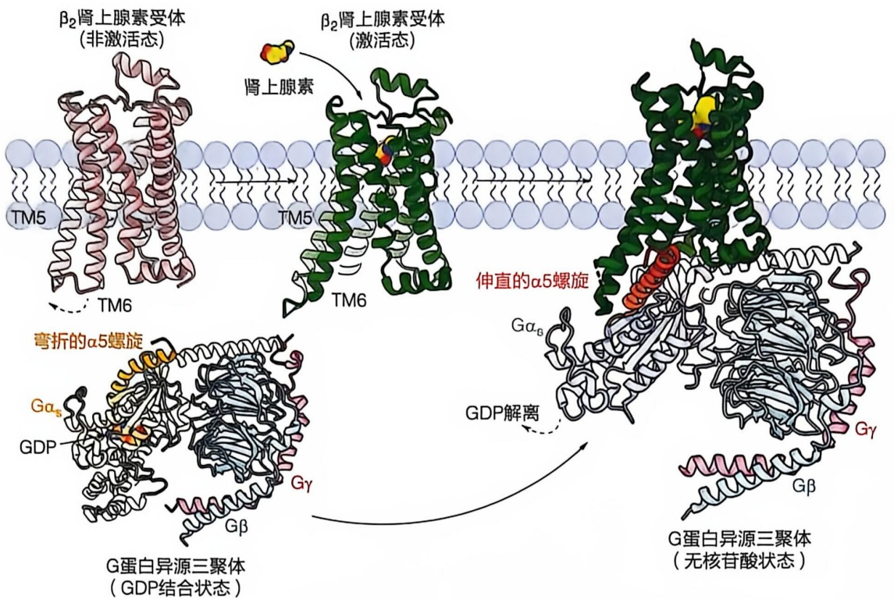

flowchart

This diagram illustrates the structural and binding mechanism of G-protein secondary structure (G蛋白异源三聚体), showing how β2肾上腺素受体激活后, Gα5螺旋形成伸直的α5螺旋, which is then amplified by GDP binding to form Gβ.

图 3-28 $\beta_{2}$ 肾上腺素受体与 G 蛋白异源三聚体形成复合物的过程

首先， $\beta_{2}AR$  与肾上腺素结合，从非激活态（PDB 编号:2RH1）转变到激活态（绿色，PDB 编码:4LDO）；其次，激活后的  $\beta_{2}AR$  招

募G蛋白，其中 $\mathrm{G}\alpha$ 在结合GPCR前处于GDP结合状态（PDB编号:6EG8），与 $\beta_{2}\mathrm{AR}$ 结合导致 $\mathrm{G}\alpha$ 的 $\alpha 5$ 螺旋构象变化（PDB编号:3SN6），GDP被释放，以便GTP结合

科比尔卡教授因这些工作荣获 2012 年诺贝尔化学奖。

这些 $\beta_{2} \mathrm{AR}$ 不同状态的高分辨率结构揭示了 GPCR 如何感知胞外信号, 并通过自身的构象变化将信号传递给胞内的 G 蛋白。在这个过程中, GPCR 就像一台精巧的仪器, 感受细胞外信号带来的微小变化, 并利用自身的构象变化, 将胞外信号带来的微小变化转化成胞内部分更大的构象变化, 进而通过与 G 蛋白的相互作用, 将胞外信号传递给 G 蛋白。具体而言: $\beta_{2} \mathrm{AR}$ 结合激动剂后, 其跨膜区中间的配体结合口袋只有很小的构象变化, 如第五个跨膜螺旋 (TM5) 的胞外区向内移动了 $1 \sim 2$ 埃 (Ångstrom, Å) (一个 C—C 键的键长约为 $1.54 \AA$)。这个很小的构象变化引起了 GPCR 跨膜区的构象变化, 进而导致 TM6 的胞内部分向外移动了约 $14 \AA$ (图 3-29A), 暴露出 GPCR 胞内区的 G 蛋白结合位点, 促进了 G 蛋白与 $\beta_{2} \mathrm{AR}$ 的结合。G 蛋白与 GPCR 的结合主要通过 Gα 羧基端的一个 α 螺旋 (α5 螺旋)。α5 螺旋的羧基端直接参与和 GPCR 的相互作用, 而其氨基端则参与和 GDP 的结合。在结合 GPCR 的过程中, α5 螺旋的羧基端向 GPCR 移动约 $6 \AA$, 带动其氨基端发生构象变化从而破坏了 GDP 结合位点的稳定性, 促进了 GDP 的释放和 GTP 的结合, 实现了 G 蛋白的激活 (图 3-29B)。

需要注意的是，GPCR 的构象远不是简单的 “非激活态” 和 “激活态” 的双构象模式，而是包含很多不同的中间态。阐明这些状态相互转变的动力学特征、这些状态如何决定 GPCR 对不同 G 蛋白以及  $\beta$ -arrestin 的选择性、这些动力学特征和选择性如何影响 GPCR 的功能，对于理解 GPCR 的功能十分重要。

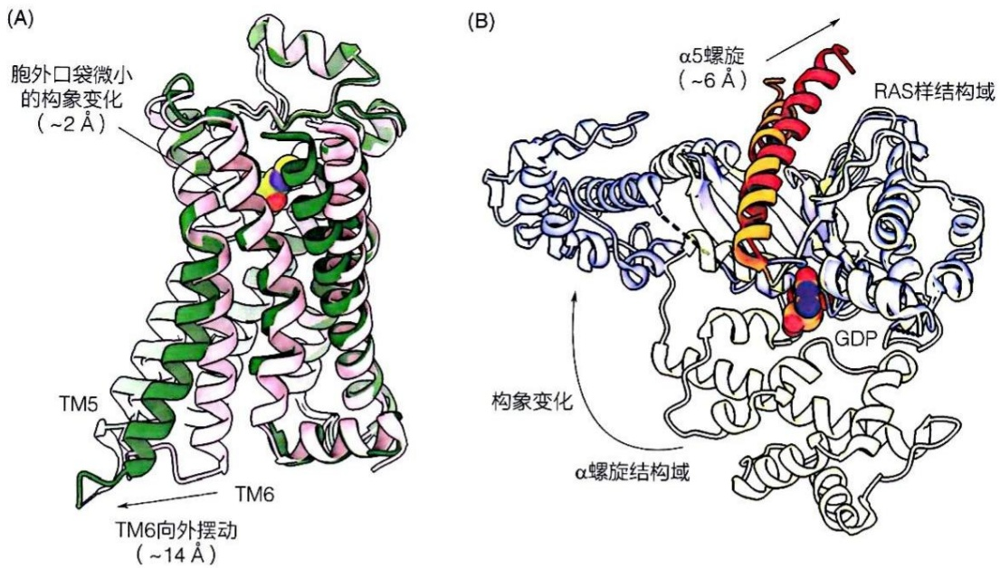

图 3-29  $\beta_{2}$  肾上腺素受体与 G 蛋白异源三聚体在激活过程的构象变化

(A) $\beta_{2}AR$ 在非激活态（粉色，PDB编号:2RH1）和激活态（绿色，PDB编号:4LDO）展示出不同的构象。在结合肾上腺素的过程中，$\beta_{2}AR$ 的配体结合口袋只有微小的构象变化（约 $2\AA$），但胞内TM6则向外摆动约 $14\AA$，暴露出与G蛋白结合的位置。（B）G蛋白与GPCR

结合后，其 $\alpha$ 亚基（Gα）发生显著构象变化，相较Gα结合GDP时的构象（浅黄色，PDB编号:6EG8），Gα与 $\beta_{2}\mathrm{AR}$ 结合后（蓝色，PDB编号:3SN6），其RAS样结构域（RAS-like domain，RD）的$\alpha 5$ 螺旋向 $\beta_{2}\mathrm{AR}$ 移动约 $6\AA$ ，同时其Gα的 $\alpha$ 螺旋结构域（α-helicaldomain，HD）发生大幅旋转，从而使位于RD和HD之间的核苷酸结合口袋被打开，释放GDP，进而可以结合GTP

## 3.5 蛋白质结构和功能可通过翻译后修饰调节

蛋白质在各种生命活动中都发挥核心作用，因此其功能需要受到精确调控，蛋白质的翻译后修饰（post-translational modification，PTM）即是一种十分重要且普遍的调控方式。翻译后修饰指蛋白质在核糖体上合成后，其特定氨基酸残基的主链或侧链发生的化学变化，主要包括功能基团的添加或去除以及肽键的水解。翻译后修饰可通过影响蛋白质构象直接调控蛋白质功能，也可通过影响蛋白质间的相互作用或蛋白质亚细胞定位，间接调控蛋白质的功能。

目前已发现数百种不同类型的翻译后修饰，其中甲基化、乙酰化、磷酸化修饰较为丰富且研究广泛，本节将对这三类修饰的调控及功能进行介绍。

## 3.5.1 蛋白质可发生多种翻译后修饰

很多氨基酸残基的侧链具有一定的化学反应活性，可被特定化学基团修饰。常见的蛋白质翻译后修饰包括甲基化（methylation）、乙酰化（acetylation）、磷酸化（phosphorylation）、ADP核糖基化（ADP-ribosylation）、泛素化（ubiquitination）、S-亚硝基化（S-nitrosylation）、O-糖基化（O-glycosylation）、S-棕榈酰化（S-palmitoylation）等（表3-1）。

表 3-1 常见蛋白质翻译后修饰类型

| 修饰类型 | 供体小分子 | 所主要修饰的氨基酸 | 所修饰蛋白质示例 |
| --- | --- | --- | --- |
| 磷酸化 | ATP | S、T、Y | GPCR |
| 乙酰化 | 乙酰辅酶A | K、蛋白质N端 | 组蛋白 |
| 甲基化 | SAM | K、R、H | 组蛋白 |
| ADP核糖基化 | $NAD^+$ | R、S、C、K、H、N | RNA聚合酶 |
| 泛素化 | 泛素 | K | 细胞周期调节蛋白 |
| S-亚硝基化 | NO | C | GPCR |
| O-糖基化 | UDP-GlcNAc | S、T | tau蛋白 |
| S-棕榈酰化 | 棕榈酰辅酶A | C | HRAS、NRAS |

共价修饰的基团差异很大，小至一个甲基，大至一个如泛素的蛋白质分子。这些基团的共价添加和去除一般需由特定的酶催化。氨基酸残基被修饰改变了其物理和化学性质，从而可影响蛋白质构象、与配体的相互作用或亚细胞定位等。例如，引入的荷电基团（如磷酸基）可增加被修饰残基的大小并改变其带电特征，从而使被修饰的蛋白质发生构象变化或影响其与配体分子的结合；再如，特定位置引入长链脂酰基可赋予蛋白质与膜结合的能力。

甲基化主要发生于精氨酸（R）和赖氨酸（K）残基的侧链氨基上，一般由S-腺苷甲硫氨酸（S-adenosyl-methionine，SAM）提供甲基（图3-30）。赖氨酸残基最多可发生三甲基化修饰，精氨酸残基最多可以发生二甲基化修饰。乙酰化也是一种常见的修饰，它可发生于肽链的N端氨基上，也可发生于赖氨酸残基的侧链氨基上，由乙酰辅酶A（acetyl-CoA）提供乙酰基。磷酸化是目前发现最为广泛、研究最为深入的一类翻译后修饰，主要发生于丝氨酸（S）、苏氨酸（T）或酪氨酸（Y）侧链的羟基上。真核细胞中约有三分之一的蛋白质可发生磷酸化修饰。乙酰可以中和蛋白质中的正电荷，磷酸化则给蛋白质引入负电荷，可以引起蛋白质构象变化。

## 3.5.2 翻译后修饰发生于特定蛋白保守序列中

经过对翻译后修饰的系统分析，人们认识到特定修饰往往发生于特定蛋白质的特定氨基酸残基上，被修饰氨基酸处于一定的保守序列（conserved sequence）之中，表明蛋白质的翻译后修饰并非随机发生。例如，被蛋白激酶A磷酸化的丝氨酸（S）多处于R-R-X-S/T-B（这里的X为任意氨基酸残基，B为任意疏水氨基酸残基）这样的序列中。当然，保守序列的存在只是修饰发生的必要条件，并非充分条件，某个位点是否发生特定的共价修饰须经实验确认。

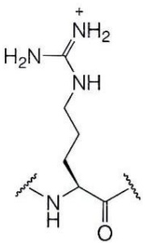

chemical

Chemical structure of a peptide derivative with amide and ester functional groups

R

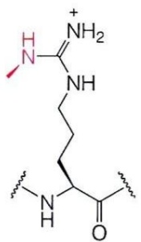

chemical

Chemical structure of a peptide derivative with amide and ester functional groups

Rme1

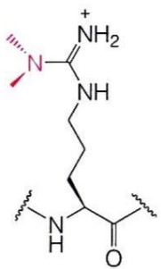

chemical

Chemical structure of a peptide derivative with amide and ester functional groups

Rme2a

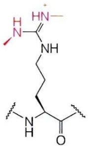

chemical

Chemical structure of a peptide derivative with amide and ester functional groups

Rme2s

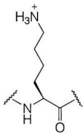

chemical

Chemical structure of a peptide derivative with amide and ester functional groups

K

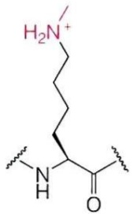

chemical

Chemical structure of a peptide derivative with amide and carboxylic acid groups

Kme1

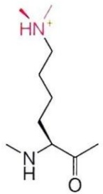

chemical

Chemical structure of a peptide derivative with amide and carboxylic acid functional groups

Kme2

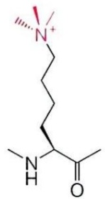

chemical

Chemical structure of a peptide derivative with amide and ester functional groups

Kme3

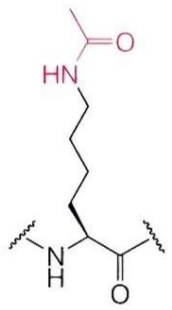

chemical

Chemical structure of a peptide derivative with amide and ester functional groups

Kac

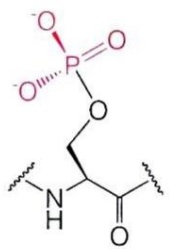

chemical

Chemical structure of a phosphorus-containing compound with amide and ester functional groups

Sph

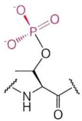

chemical

Chemical structure of a phosphorus-containing compound with ester and amide functional groups

Tph

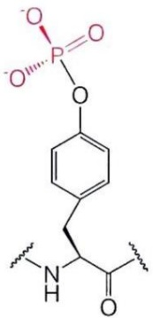

chemical

Chemical structure of a phosphorus-containing organic compound with phenyl and amide functional groups

Yph

图 3-30 常见的蛋白质翻译后修饰

图中展示了精氨酸（R）残基的单甲基化（Rme1）、二甲基化（Rme2a，Rme2s），赖氨酸（K）残基的单甲基化（Kme1）、二甲基化（Kme2）、三甲基化（Kme3）和乙酰化（Kac），以及丝氨酸（S）、苏氨酸（T）和酪氨酸（Y）残基的磷酸化（分别记作Sph、Tph和Yph）。其中修饰基团用红色显示

在不同位点的同一类型修饰可能有着完全不同的功能。以组蛋白甲基化修饰为例，H3K4me3 修饰（组蛋白 H3 第 4 位赖氨酸残基的三甲基化修饰）是基因活跃转录的标志，而 H3K9me3 修饰和 H3K27me3 修饰（组蛋白 H3 第 9、27 位赖氨酸残基的三甲基化修饰）则是转录沉默的标志（图 3-31）。

## 3.5.3 蛋白质的甲基化和乙酰化修饰

甲基化和乙酰化修饰在组蛋白功能调控方面的研究最为广泛，二者可改变组蛋白的疏水性和带电性质，影响染色质的折叠，同时还可以招募修饰依赖的组蛋白“阅读器”（histone reader）来介导下游的生物学事件。

组蛋白甲基化主要由 SET（Su(var)3-9, enhancer-of-zeste and trithorax）家族蛋白催化，去甲基化主要由 Jumonji 家族和 LSD（lysine-specific demethylase）家族蛋白催

图 3-31 常见的组蛋白修饰位点

常见组蛋白修饰多发生在组蛋白氨基端的柔性“尾巴”上，包括赖氨酸的乙酰化（Ac）和甲基化（Me）以及丝氨酸的磷酸化（P）

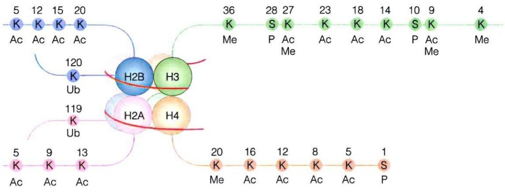

flowchart

This diagram illustrates a protein secondary structure with labeled domains (H2A, H3, H4) and their associated amino acid residues (Ac, Me, P, S). It shows how specific residues are linked to the central H2B/H3 complex.

化。识别组蛋白甲基化的结构域有很多，如 chromo、Tudor、PHD finger 结构域等。不同位点的修饰可通过招募不同的识别蛋白来产生完全不同的生物学后果，例如组蛋白 H3K4me3 可被 TAF3 蛋白的 PHD finger 结构域识别，进而促进转录；而 H3K9me3 可以招募 HP1 等蛋白促进染色质的固缩以抑制基因表达。组蛋白甲基化修饰还可与其他修饰同时存在，产生多价态的修饰组合，一些组蛋白修饰识别蛋白含有串联的识别结构域可以对多修饰进行“组合识别”，从而精细调控转录。例如，组蛋白 H3K4me1 和 H3K27ac 修饰的组合是染色质增强子（enhancer）区域的标志。

组蛋白乙酰化主要由组蛋白乙酰转移酶（histone acetyltransferase，HAT）催化，去乙酰化由组蛋白去乙酰化酶（histone deacetylase，HDAC）催化。组蛋白的赖氨酸残基发生乙酰化后，侧链带正电的氨基转变为不带电的酰胺基，对带负电的DNA的亲和力降低，因此组蛋白乙酰化可促进组蛋白八聚体与DNA解离，使染色体转变为开放构象。此外，乙酰化的赖氨酸残基可被多种蛋白（如bromo家族和YEATS家族蛋白）识别并调控转录过程。以组蛋白乙酰转移酶KAT2B为例，它包含催化乙酰化的HAT结构域和识别组蛋白乙酰化修饰的bromo结构域。KAT2B可通过其bromo结构域被招募到染色质的乙酰化富集区域，进一步催化该区域组蛋白乙酰化。这种“识别—催化—识别”的正反馈环路（positive feedback loop）可使激活的染色质状态快速蔓延以促进基因表达。

除组蛋白外，许多其他蛋白质也可发生甲基化和乙酰化，二者通过影响蛋白质稳定性、催化活性或蛋白质相互作用等多种方式调控生物学事件。例如，抑癌蛋白p53的多处赖氨酸残基可发生甲基化，p53K370me1修饰（p53的370位赖氨酸残基的单甲基化修饰）可抑制p53的转录活性，而p53K382me2修饰可被53BP1蛋白的Tudor结构域识别从而提高p53的稳定性。

## 3.5.4 蛋白质的磷酸化修饰

磷酸化是一种广泛存在的蛋白质功能调控机制，主要发生于丝氨酸、苏氨酸、酪氨酸残基的侧链羟基上；此外，组氨酸（H）侧链也可以发生磷酸化，多存在于细菌中。催化蛋白质磷酸化的酶被称作蛋白激酶（protein kinase），可以将腺苷三磷酸（adenosine triphosphate，ATP）的 $\gamma-$ 磷酸基转移至上述氨基酸残基的侧链上。在人类基因组中，有超过500个基因编码蛋白激酶，根据所催化磷酸化的氨基酸残基可分为丝/苏氨酸蛋白激酶（serine/threonine kinase）、酪氨酸蛋白激酶（tyrosine kinase），以及既可催化蛋白质丝/苏氨酸残基磷酸化，也可催化酪氨酸残基磷酸化的双特异性激酶（dual-specificity kinase）。通常，一种蛋白激酶可催化多种底物蛋白质的磷酸化，一种底物蛋白质也可被多种蛋白激酶催化磷酸化。

蛋白质磷酸化修饰的逆反应由蛋白磷酸酶（protein phosphatase）催化。人类基因组中已鉴定出近200个基因编码蛋白磷酸酶。不同磷酸酶催化水解特定的氨基酸残基侧链与磷酸基之间的共价键，释放磷酸基团。与蛋白激酶分类类似，蛋白磷酸酶也可分为丝/苏氨酸磷酸酶（serine/theomine phosphatase）、酪氨酸磷酸酶（tyrosine phosphatase），以及双特异性磷酸酶（dual-specificity phosphatase）。磷酸酶的底物特异性较激酶低。

可逆磷酸化修饰通常在不到一秒至几小时范围内发生，可使蛋白质在两种不同状态之间转换，从而使细胞能快速响应环境条件的变化。一个活化的蛋白激酶可在短时间内使数百个底物分子发生磷酸化而活化。如果底物蛋白质也是一种酶，则可进一步将信号放大。

## ※展望

蛋白质研究在过去几十年取得了很大的进展，特别是过去十几年，冷冻电镜技术的发展以及基因编辑技术的广泛应用，极大推动了对复杂蛋白质结构的解析和对蛋白质在生物体内功能的研究。此外，随着人工智能在生命科学研究领域的应用，特别是AlphaFold的开发及迭代更新，对单一蛋白质和较为简单的蛋白质复合物的结构预测的准确度已经与实验数据十分接近，已经可以用预测的结构分析或推测蛋白质的功能，开展药物分子的设计和筛选。

随着生物大分子复合物的三维结构越来越容易获取，可利用的结构信息呈爆发式增长，蛋白质结构与功能研究正在进入一个新时代。一方面，所预测结构的范围将进一步扩大，结构预测的准确度将进一步提高；另一方面，人工智能推动冷冻电镜技术的应用，使解析复杂的生物大分子复合物（特别是组成成分不完全清楚的复合物）的结构，甚至其在生物体内的原位结构变得越来越高效。如何利用这些丰富的结构信息，根据蛋白质结构理解甚至反推其功能，根据蛋白质与配体复合物的结构理解甚至反推配体对蛋白质功能的调控机制，发现已知蛋白质新的功能，寻找具有特定功能的未知蛋白质，进而开发用于各种疾病治疗的药物、设计具有全新结构乃至全新功能的蛋白质，将是蛋白质研究的重要方向。

## ※ 本章小结

肌红蛋白和血红蛋白均属于珠蛋白家族，通过所结合的辅基血红素可逆结合氧气。其中肌红蛋白为单体，血红蛋白为异源四聚体。组成差异决定了二者的氧解离曲线具有不同特征。

肌红蛋白和血红蛋白与氧气的可逆结合可用方程定量描述。相关方程也可用于描述其他蛋白质与配体的可逆结合。

血红蛋白各亚基与氧气的结合或解离具有高度协同性，该协同性可用齐变模型或序变模型解释。

血红蛋白与氧气的结合和解离受到多种因子的调节。其中氧气既是血红蛋白的配体，也是其别构效应物； $H^{+}$ 、 $CO_{2}$  通过降低血红蛋白所在环境的 pH 促进血红蛋白释放氧气；2,3-磷酸甘油酸（BPG）也是血红蛋白的一个别构效应物，可降低血红蛋白与氧气的亲和力。

跨膜运输蛋白可分为通道和转运蛋白两大类。后者包括协助转运蛋白和主动转运蛋白，主动转运蛋白根据其能量来源又可分为初级主动转运蛋白和次级主动转运蛋白。

葡萄糖转运蛋白属于主要协助转运蛋白超家族（MFS），其转运机制可用交替开放模型解释。ABC 转运蛋白属于初级主动转运蛋白，可以将底物逆其电化学势能进行转运，该过程需要 ATP 提供能量。

抗体分子由两条重链和两条轻链组成，轻链和重链均含可变结构域和恒定结构域。抗体通过可变结构域特异性结合抗原。不同类别抗体重链可结晶片段（Fc）的差异导致它们理化性质和在免疫应答中的作用存在显著区别。

GPCR 家族成员均含 7 个跨膜螺旋。GPCR 胞外一侧与激动剂结合后，构象发生变化，转变为激活状态；激活后的 GPCR 通过其胞质一侧招募 G 蛋白使其中 Gα 构象改变，Gα 释放 GDP 并结合 GTP 从而被活化，Gα 对 Gβγ 的抑制也同时被解除。

蛋白质翻译后修饰是一种十分重要且普遍的蛋白质功能调控方式。蛋白质的主链和侧链均可发生翻译后修饰。大多数翻译后修饰是可逆的，其可逆过程可被特定的酶催化。

## ※ 思考题

1. 请解释肌红蛋白和血红蛋白的氧解离曲线有何不同，并说明此差异的生物学意义。
2. 葡萄糖转运蛋白 GLUT 和 ABC 转运蛋白在结构和转运机制方面有哪些异同？
3. 抗体分子如何通过其结构特征实现对特定抗原的特异性识别？
4. 在 2011 年发现的 $\beta_{2}$ 肾上腺素受体结合 $G_{8}$ 蛋白的复合物结构（PDB 编号: 3SN6）中第一次捕捉到了 GPCR 感知胞外信号，并将信号传递到胞内的过程。结合这个结构说明为什么 GPCR 与 G 蛋白结合之后，会导致 G 蛋白上的 GDP 解离？
5. 请以组蛋白修饰为例，简述蛋白质翻译后修饰的生物学功能。

## ※ 推荐阅读

1. COHEN P. The origins of protein phosphorylation [J]. Nat Cell Biol, 2002, 4 (5):

E127-E130.

本文综述了蛋白质磷酸化的发现历史。

2. MATSUMOTO M L. Molecular mechanisms of multimeric assembly of IgM and IgA [J]. Annu Rev Immunol, 2022, 40: 221-247.

本文总结了 IgM 和 IgA 抗体的分子组装、结构和功能特性。

3. PERUTZ M F. Science is not a quiet life: unravelling the atomic mechanism of haemoglobin (Vol. 4) [M]. Singapore: World Scientific, 1997.

该书介绍了血红蛋白结构解析以及工作机制研究的历史。

4. RASMUSSEN S G, DEVREE B T, ZOU Y, et al. Crystal structure of the  $\beta_{2}$  adrenergic receptor–G $_{s}$  protein complex [J]. Nature, 2011, 477 (7366): 549–555.

本文首次报道了 GPCR-G 蛋白复合物结构，揭示了 GPCR 如何通过自身构象变化将胞外信号跨膜传递到 G 蛋白。

5. TESSARZ P, KOUZARIDES T. Histone core modifications regulating nucleosome structure and dynamics [J]. Nat Rev Mol Cell Biol, 2014, 15 (11): 703-708.

本文介绍了组蛋白翻译后修饰如何调控核小体结构。

6. THOMAS C, TAMPÉ R. Structural and mechanistic principles of ABC transporters [J]. Annu Rev Biochem, 2020, 89: 605–636.

本文概述了 ABC 转运蛋白的结构及转运机制。

7. WILSON I A, STANFIELD R L. 50 Years of structural immunology [J]. J Biol Chem, 2021, 296: 100745.

本文总结了过去50年来对免疫系统如何识别病原（包括新冠病毒）的研究成果，以及如何应用这些成果来研发疫苗和治疗方法。

8. YAN N. A glimpse of membrane transport through structures—advances in the structural biology of the GLUT glucose transporters [J]. J Mol Biol, 2017, 429 (17): 2710-2725.

本文概述了跨膜运输蛋白的分类，并详细阐述了葡萄糖转运蛋白的结构及转运机制。

（撰写:胡奇，颜宁，杜海宁，肖俊宇，刘翔宇，赵帅；审修:刘俊峰，周发阳，季哲剑，马丹，孙林峰）

## 4

## 酶

如果说生命是一场宏大的化学事件，那么生物体就是一个极其复杂且高效的“化学反应器”，其中发挥核心作用的便是数量众多的酶（enzyme）。酶所催化的化学反应网络，构成了生命活动的基础。生物体内的化学反应种类繁多，几乎每一种反应都需要特定酶的催化，才可以高效完成。如果没有酶的催化，这些反应的速率将永远无法满足生命所需，地球上的生命也难以存在。

酶主要由蛋白质构成，表现出高度的专一性和高效性。酶通过其催化中心结合特定的底物，依赖特定氨基酸基团或辅因子，促进底物转换为产物。作为生物催化剂，酶的活性受到精确调控，这种调控既包括蛋白质水平的修饰，也涉及小分子化合物的调节。为了系统地研究酶的催化效率，酶动力学应运而生。通过酶动力学参数，可以量化和比较酶的催化效率，并深入分析环境因素或抑制剂对酶活性的影响。

本章将从酶的发现历史入手，详细阐述酶的组成、分类及其催化特征。随后揭示酶催化反应的工作机理及其多层次的调控机制，并利用酶动力学对酶的催化行为进行数学描述、分析和比较。最后介绍靶向酶的小分子抑制剂的主要类型及其工作机制。

## 4.1 酶是一类主要由蛋白质构成的生物催化剂

## 4.1.1 对酶的认识是一个渐进的过程

人类对酶的认识经历了漫长的发展过程，从最初无意识地利用酶，到逐渐形成科学的认知。我国最早的酿酒活动可追溯到距今约九千年前的新石器时代早期，在河南舞阳贾湖遗址的陶器残片上检测出稻米、山楂，以及酒类饮料沉淀物和酒石酸等成分，也是迄今为止人类发现的最早酿酒证据。此外，春秋战国时期（公元前770年—前221年）便有人尝试利用酒曲（其中包含曲菌和曲酶）来治疗胃病等。这些都可以视为古人无意识地应用酶的例子。直到1830年代，法国学者安塞尔姆·帕扬（Anselme Payen，1795—1871）和让·佩尔索（Jean Persoz，1805—1868）等人从麦芽中提取出一种能够使淀粉液化并转化为可溶性糖的物质，并命名其为“diastase”（意为“破裂”，因为这种物质能够破坏淀粉粒的外壳）。到了19世纪末，这种物质被正式命名为淀粉酶（amylase）。同时，胃液中的胃蛋白酶（pepsin）也在1830年代由德国学者西奥多·施旺（Theodor Schwann，1810—1882）等人发现。

1830 年代，瑞典学者永斯·贝尔塞柳斯（Jöns J. Berzelius，1779—1848）对生物材料中的化学反应加速现象以及化学反应过程中的类似促进现象进行了系统分析，首次提出了“催化”（catalyze）概念。这个概念的提出对理解酶的生物学功能具有重要意义。随着更多具有催化活性的生命物质的发现，到了 1870 年代，德国学者威廉·屈内（Wilhelm Kühne，1837—1900）将这些具有催化活性的生命物质命名为酶。酶所催化的反应物被称作底物（substrate）。

## 4.1.2 酶主要由蛋白质构成

在认识到酶的存在及其在生命活动中的重要作用后，科学家们开始探究酶的化学本质。1926年，詹姆斯·萨姆纳（James Sumner，1887—1955）成功提取并首次结晶了脲酶，直接证明了酶是蛋白质。随后，科学家们还成功结晶了胃蛋白酶、胰蛋白酶等，并证明这些酶也是蛋白质。萨姆纳因在酶学研究上的杰出贡献而荣获1946年诺贝尔化学奖。长期以来人们普遍认为所有酶都是蛋白质，但在1980年代初，美国学者托马斯·切赫（Thomas Cech）和悉尼·奥尔特曼（Sidney Altman，1939—2022）各自独立发现了具有催化活性的RNA——核酶（ribozyme），从而打破了酶仅为蛋白质的传统观念，他们也因此获得1989年诺贝尔化学奖。尽管如此，由于目前发现的绝大多数酶都是蛋白质，且对蛋白质酶的研究更加深入，因此在本章专门介绍蛋白质酶，而不涉及核酶。

## (1) 酶分为单体酶、寡聚酶和多酶复合体

根据蛋白质组分的特征，酶可被划分为单体酶（monomeric enzyme）、寡聚酶（oligomeric enzyme）和多酶复合体（multienzyme complex）。单体酶只含一条多肽链，主要包括一些促进底物发生水解反应的酶，如溶菌酶、胃蛋白酶及核糖核酸酶等。寡聚酶由多个亚基组成，通常保持一定的对称性。亚基间以非共价键结合，寡聚体的分子质量可以从几万到几百万道尔顿（Da）不等。常见的寡聚酶包括磷酸化酶a（phosphorylase a）和乳酸脱氢酶（lactic acid dehydrogenase）等。多酶复合体由多种不同的亚基组装而成，结构复杂，分子质量通常在几百万Da以上。它们通常催化一系列前后相继、代表某一代谢途径的化学反应。例如，脂肪酸合酶（fatty acid synthetase）复合体就是一个典型的多酶复合体，负责催化脂肪酸的合成。

## (2) 很多酶的催化过程依赖辅因子的参与

根据化学组成，酶可分为单纯酶（simple enzyme）和缀合酶（conjugated enzyme）两大类。单纯酶仅由蛋白质构成，不含其他化学组分，脲酶、淀粉酶和脂肪酶等都是典型的单纯酶。缀合酶除了蛋白质外，还含有其他化学组分，如有机物小分子或金属离子等。这些非蛋白质组分统称为辅因子（cofactor）。当缀合酶去除辅因子后，剩下的蛋白质部分被称为脱辅酶（apoenzyme）。与辅因子结合，具有完整结构和活性的酶称为全酶（holoenzyme）。

辅因子在酶的催化过程中发挥着重要作用，例如，可以作为电子、原子或某些化学基团的载体起传递作用，参与反应并促进催化过程的进行。根据与脱辅酶结合的松紧程度，辅因子可分为辅酶（coenzyme）和辅基（prosthetic group）两类。辅酶通常以非共价键与脱辅酶结合，某些辅酶与脱辅酶的结合较松散，能够通过透析或超滤等温和方法去除。而一些结合较紧密的辅酶，只有在蛋白质完全变性后才能被去除，如辅酶Ⅰ和辅酶Ⅱ等。辅基则与脱辅酶紧密结合（有时甚至通过共价键相连），并且无法通过透析或超滤等方法将其与脱辅酶分开。例如，琥珀酸脱氢酶中的黄素腺嘌呤二核苷酸（FAD）和细胞色素氧化酶中的铁卟啉等就属于辅基。

酶的辅因子还可以根据化学性质大致分为两类。一类为无机金属离子，如  $Fe^{2+}$ 、 $Mg^{2+}$  和  $Zn^{2+}$  等，它们可在酶中发挥协助传递电子、活化底物等不同作用（表 4-1）；另一类是小分子有机化合物，发挥传递氢原子、电子或其他化学基团的作用（表 4-2）。此外，某些辅因子可能既含金属离子，也含小分子有机化合物，如细胞色素分子中的血红素。

表 4-1 金属离子作为酶的辅因子

| 离子类型 | 脱辅酶 |
| --- | --- |
| $K^{+}$ | 丙酮酸激酶、丙酰辅酶 A 羧化酶 |
| $Fe^{2+}$或$Fe^{3+}$ | 细胞色素氧化酶、过氧化氢酶、过氧化物酶 |
| $Mg^{2+}$ | 己糖激酶、丙酮酸激酶 |
| $Cu^{2+}$ | 细胞色素氧化酶 |
| $Zn^{2+}$ | 羧肽酶、醇脱氢酶 |
| $Mn^{2+}$ | 超氧化物歧化酶、核糖核苷酸还原酶 |

表 4-2 有机小分子作为酶的辅因子

| 小分子类型 | 脱辅酶 | 被转移的基团 |
| --- | --- | --- |
| 辅酶A(CoA) | 乙酰CoA羧化酶 | 酰基 |
| 硫辛酸 | 丙酮酸脱氢酶 | 酰基 |
| 核黄素类腺嘌呤核苷酸(FMN、FAD) | 琥珀酸脱氢酶 | 氢原子、电子 |
| 烟酰胺腺嘌呤二核苷酸($NAD^{+}$) | 乳酸脱氢酶 | 氢原子、电子 |
| 烟酰胺腺嘌呤二核苷酸磷酸($NADP^{+}$) | 葡萄糖-6-磷酸脱氢酶 | 氢负离子($:H^{-}$)、电子 |
| 磷酸吡哆醛(PLP) | 天冬氨酸转氨酶 | 氨基 |
| 生物素 | 丙酮酸羧化酶 | $CO_{2}$ |

## 4.1.3 酶的命名和分类

生物体内存在成千上万种酶，此外还有许多酶尚未被发现。为了方便研究和交流，需要对已知的酶加以分类和命名。

## (1) 酶的系统命名

酶的命名多源自其功能。早期酶的英文命名格式并不统一，例如胃蛋白酶英文为“pepsin”，其含义是“消化”；溶菌酶英文为“lysozyme”，其原意是“裂解细菌细胞壁”。后来，为了使命名格式统一，酶的英文名称通过在其底物名称或描述其活性的单词或术语中加后缀“-ase”而形成。典型的例子包括尿素酶（urease，原意是“水解尿素”的酶）、DNA聚合酶（DNA polymerase，“聚合形成DNA”的酶）等。

随着被鉴定的酶的数量的增加，命名工作变得日益困难。既存在同一种酶被给予多个名字的情况，也存在同一个名字被给予不同酶的情况。1950年代，国际生物化学与分子生物学联盟（International Union of Biochemistry and Molecular Biology, IUBMB）专门成立了酶委员会（Enzyme Commission，简称为IUBMB-EC）。IUBMB-EC对已被鉴定的酶，在保留其习惯名称的基础上，根据每种酶的底物以及所催化的化学反应本质，在1961年建立了一套酶的系统命名和分类方法。如果酶催化多底物反应，则将不同底物名称之间以“:”号隔开。如乙醇脱氢酶（俗名）的系统名称为“乙醇:$\mathrm{NAD^{+}}$ 氧化还原酶”。

## (2) 酶的分类

酶依据催化反应的本质被分为七大类。IUBMB-EC 于 1961 年将酶划分为六大类。2018 年，在原有基础上又增加了第七大类。这七大类酶所催化的化学反应可总结如下。①氧化还原酶类（oxidoreductase）:催化底物进行氧化还原反应，典型的如乙醇脱氢酶、葡萄糖氧化酶、过氧化氢酶等。②转移酶类（transferase）:催化底物之间进行特定基团转移，典型的如甲基转移酶、氨基转移酶、糖基转移酶等。③水解酶类（hydrolase）:催化底物发生水解反应，典型的如酯酶、糖苷酶、磷酸酶等。这类酶数量较多，分布也很广。④裂合酶类（lyase）:催化从底物移去一个基团并产生双键或其逆反应，典型的如碳酸酐酶、脱羧酶、醛缩酶等。⑤异构酶类（isomerase）:催化同分异构体之间的相互转化，典型的如消旋酶、异构酶、变位酶等。⑥连接酶类（ligase）:催化两分子底物发生缩合并与 ATP 分子（或类似分子）的裂解反应相偶联，典型的如合成酶、羧化酶等。⑦易位酶类（translocase）:催化离子或分子跨膜转运或在膜内移动位置，典型的如 ABC 转运蛋白。

## (3) 酶的编号

为了对几千种酶进行有效分类和命名，根据酶所催化反应的特点及底物类型，IUBMB-EC 又将每大类酶分为若干亚类（subclass）及亚-亚类（sub-subclass），在每个亚-亚类中给每种酶一个数字编号。最终，每种酶都对应一个以 EC（enzyme commission）为前缀的含四个数字的系统编号，每个数字间以 “.” 分开，四个数字依次反映酶的大类、亚类、亚-亚类和编号。例如，乳酸脱氢酶的编号为 EC 1.1.1.27，其中四个数字依次表示该酶属于氧化还原酶大类（编号为 1），电子供体为羟基的亚类（编号为 1），电子受体为 NAD⁺ 的亚亚类（编号为 1），以及最终的数字编号 27。

## 4.1.4 酶作为生物催化剂的独特特征

作为生物催化剂，酶能催化特定的一种或一类底物，促使其发生特定的一种或一类化学反应。在催化过程中，酶通常表现出高度的专一性和高效性。此外，酶催化反应条件通常比较温和，符合生物体内环境的需求。酶活性也具有可调控性（关于调控机制将在4.4节中详细介绍）。

## (1) 酶是高效的生物催化剂

酶具有极高的催化效率，根据体外测量结果推算，酶促反应的速率可比非催化反应高 $10^{8} \sim 10^{20}$ 倍。例如，一个碳酸酐酶（carbonic anhydrase）分子每秒钟可催化大约 $6 \times 10^{5}$ 个 $\mathrm{CO}_{2}$ 分子发生水合作用，其反应速率与无催化的情况相比，增强了约 $10^{7}$ 倍。

酶的催化效率可以通过催化常数 $k_{\mathrm{cat}}$ [也称转换数（turnover number），后面章节将进行详细介绍]来衡量。当酶被底物充分饱和时，$k_{\mathrm{cat}}$ 表示每个酶分子在单位时间（如每秒）内所能催化转化的底物分子数。表4-3展示了一些具有代表性的酶对其天然底物的最大转换数。

表 4-3 一些酶对其天然底物的最大转换数

| 酶类型 | 最大转换数($k_{cat}$)/$s^{-1}$ |
| --- | --- |
| 溶菌酶 | 0.5 |
| DNA 聚合酶I | 15 |
| 胰凝乳蛋白酶 | 100 |
| 乳酸脱氢酶 | 1 000 |
| 乙酰胆碱酯酶 | 25 000 |
| 过氧化氢酶 | 40 000 000 |

## (2) 酶具有高度的专一性

酶对所催化底物的专一性主要源于它们之间在结构上的互补性。酶专一性的程度因其所承担的生物学功能不同而有所差异。根据酶对底物选择性的严格程度，酶的专一性可分为相对专一性、绝对专一性和立体专一性三种类型。

具有相对专一性的酶对底物的识别不严格，主要作用于结构类似的一组底物。这类酶识别的是某一类基团（如甲基、磷酸基团）或某一类化学键（如酰胺键、糖苷键、磷酸二酯键）等。例如，碱性磷酸酶能在碱性条件下催化任何磷酸单酯的水解反应；糖苷酶可以作用于带有糖基的任何糖苷键。

具有绝对专一性的酶对底物的识别非常严格，只作用于特定的单一底物。例如，麦芽糖酶只能水解麦芽糖，而不会作用于其他双糖。

立体专一性是指酶只能催化底物立体异构体中的一种进行反应。这种专一性包括对手性对映异构体（如 L-氨基酸和 D-氨基酸）以及几何异构体（如 C=C 双键的顺式和反式异构体）的选择性。例如，L-氨基酸氧化酶只能催化 L-氨基酸的氧化，而无法作用于 D-氨基酸；琥珀酸脱氢酶仅能催化琥珀酸（丁二酸）脱氢产生延胡索酸（即反-丁烯二酸）或进行逆向的加氢反应，但不能催化马来酸（顺-丁烯二酸）的加氢反应。

此外，还有一种更严格的立体异构专一性，即酶能够区分前手性（prochiral）碳原子上连接的两个看似完全相同的基团。例如，通过同位素标记的研究发现，酵母乙醇脱氢酶（YADH）在催化乙醇氧化时，能够区分乙醇分子中两个几乎完全相同的氢原子（气与氘）。它选择性地将特定空间位置的氢原子转移到辅因子 $\mathrm{NAD^{+}}$ 的尼克酰胺环C4位的特定一侧。逆反应同样严格遵循相同的立体专一性机制（图4-1）。

由于某些药物分子仅特定异构体具有生理活性，而其他异构体不仅可能无效，甚至可能有毒副作用。在这种情况下，采用传统的非生物催化剂进行有机合成，通常只能得到消旋产物（即两种异构体的混合物），难以分离出单一异构体。而利用酶的立体专一性，则可以实现对目标异构体的选择性催化，从而有效实现不对称合成。

## （3）酶需要合适的环境条件发挥功能

酶催化反应多发生于生物体内，酶活性受环境条件的显著影响。每种酶都有最适宜的反应条件。大部分酶在常温、常压和 pH 接近中性的条件下具有最佳活性。然而，少数酶在极端条件下才具有最佳活性。例如，胃蛋白酶的活性在 pH 1.5～2.5 时最佳，而在中性 pH 下几乎完全失活；嗜热菌中的 Taq 酶则在高温（如 70～75℃）下表现出最佳催化效应，而在常温下几乎无活性。当环境条件偏离酶的最适条件时，酶的活性将显著降低，甚至失活。

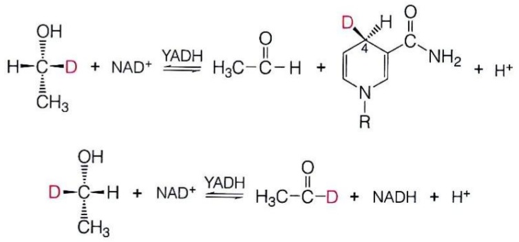

chemical

Chemical reaction equations showing nucleophilic addition of a ketone to an amino acid and its subsequent formation with NAD+ and YADH

图4-1 酵母乙醇脱氢酶催化脱氢反应的立体专一性