## 4.2 酶通过活性中心特异性结合底物并降低反应活化能以实现高效催化

## 4.2.1 酶通过其活性中心结合和转化底物分子

酶作为催化剂能显著加速化学反应，但自身不发生任何不可逆的化学变化。酶发挥催化作用的位点称为催化中心（catalytic center）或活性位点（active site）（图4-2）。在催化过程中，酶的催化中心首先结合底物，然后通过一些关键的氨基酸残基或辅因子，促使底物发生化学反应生成产物。反应完成后，酶与产物分离，并开始新一轮的催化循环。酶催化中心的三维结构具有一定的可塑性，可以被看作是由特定的氨基酸残基（和辅因子）构成的一种特定三维裂缝（凹陷）结构，它能够特异性识别特定的底物分子，并将其转化为产物。虽然酶中大多数氨基酸残基并不直接接触底物，但酶的催化功能必须依赖于酶的整体结构完整性。只有整个蛋白质分子正确折叠，才能维持催化中心的微环境，保证酶促反应的正常进行。底物与酶催化中心之间的结合依赖于结构互补性，并通过可逆弱相互作用（如静电相互作用、疏水相互作用、氢键和范德瓦耳斯力）实现。部分酶还通过催化中心以外的位点进一步促进酶与底物的结合。

## 4.2.2 酶通过降低活化能提升反应速率

在底物 S 转化为产物 P 的化学反应过程中，吉布斯自由能（Gibbs free energy）的变化用  $\Delta G$  表示，反应能否自发进行取决于这个变化的大小和符号。然而，反应发生的速率却主要取决于反应途径中所需跨越的能垒，即从底物 S 到产物 P 之间的过渡态（transition state）$\mathrm{X}^{\ddagger}$ 的自由能高低。过渡态是反应中一种极不稳定的、自由能较高的中间状态，反映了旧键（即反应物中的化学键）正在减弱但尚未完全断裂，同时新键（即产物中的化学键）开始形成但尚未完全形成的阶段。因此，过渡态的存在时间极短，估计仅为 $10^{-14} \sim 10^{-13} \mathrm{~s}$ 。从底物S的初始状态转变为过渡态 $\mathrm{X}^{\ddagger}$，需要克服一段自由能差，这一能量被称为活化能（activation energy，$\Delta G^{\ddagger}$）。活化能的高低决定了反应发生的难易程度:活化能（$\Delta G^{\ddagger}$）越高，反应物越难以到达过渡态，反应速率越慢；活化能（$\Delta G^{\ddagger}$）越低，反应物更易转变为过渡态，反应速率也越快。当没有催化剂参与时，反应需要克服较高的活化能（$\Delta G_{\mathrm{uncat}}^{\ddagger}$），因此反应速率相对较慢；而当有包括酶在内的催化剂参与时，催化剂通过稳定过渡态，显著降低形成过渡态所需的活化能（$\Delta G_{\mathrm{cat}}^{\ddagger}$），反应速率大幅增加（图4-3）。

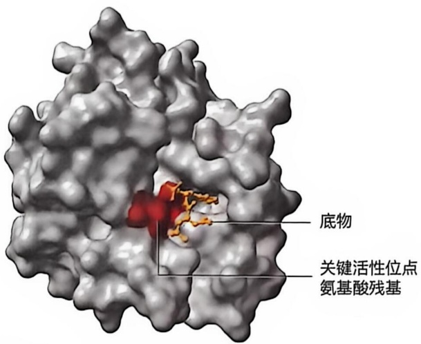

<details>
<summary>text_image</summary>

底物
关键活性位点
氨基酸残基
</details>

图 4-2 底物与酶催化中心的结合

糜蛋白酶与底物结合。红色区域为酶发挥催化作用的关键氨

基酸残基（PDB 编号:7GCH）

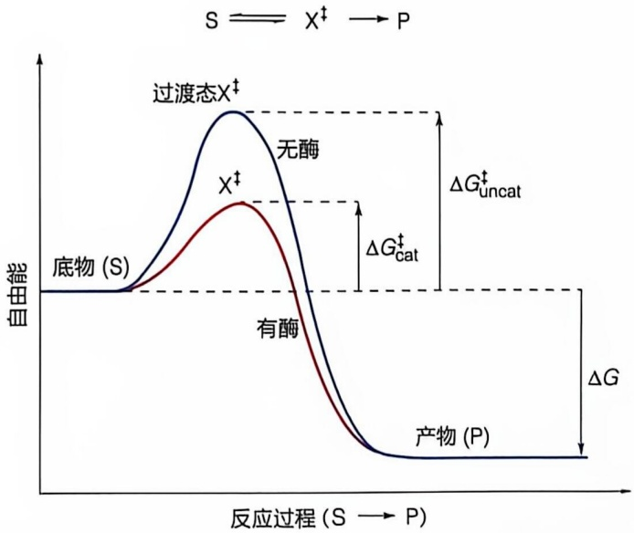

<details>
<summary>line</summary>

| Stage | Free Energy Trend |
| --- | --- |
| Baseline (S) | Constant (Base State) |
| With Enzyme (X‡) | Peak Activation Barrier \((\Delta Gcat)\) |
| Without Enzyme (无酶) | Higher Activation Barrier \((\Delta Guncat)\) |
</details>

图 4-3 酶通过降低催化反应的活化能而加速反应的示意图

化学反应速率 V 与反应物浓度 [S] 之间的关系可用如下公式表示:

$$
V = k [ \mathrm{S} ] \tag {4-1}
$$

速率常数 $k$ 与活化能 $\Delta G^{\ddagger}$ 之间的关系可用如下公式表示:

$$
k = \frac {k _ {\mathrm{B}} T}{h} \mathrm{e} ^ {- \Delta G ^ {*} / R T} \tag {4-2}
$$

这里的 $k_{\mathrm{B}}$ 为玻尔兹曼常数（$k_{\mathrm{B}} = 1.381 \times 10^{-23} \mathrm{~J} \cdot \mathrm{K}^{-1}$）；$h$ 为普朗克常数（$h = 6.626 \times 10^{-34} \mathrm{~J} \cdot \mathrm{s}$）；$R$ 为气体常数（$R = 8.314 \mathrm{~J} \cdot \mathrm{mol}^{-1} \cdot \mathrm{K}^{-1}$）；$T$ 为热力学温度；e为自然对数的底。

式（4-2）表明，活化能 $\Delta G^{\ddagger}$ 与速率常数 $k$ 呈负的指数关系。活化能的小幅下降即可导致反应速率的大幅提升。酶的催化使反应过渡态的自由能下降，反应活化能降低，从而加速反应。

## 4.2.3 酶催化的化学基础

酶催化中心含有化学基团，包括特定氨基酸残基侧链、金属离子和其他辅因子等，这些化学基团直接参与底物识别并促使化学反应发生。根据酶催化中心不同化学基团的特性，催化作用可以大致分为广义酸碱催化、共价催化、金属离子催化等类型。

## (1) 广义酸碱催化在酶促反应中普遍发生

广义酸碱催化（general acid-base catalysis）是指酶催化中心的化学基团通过瞬时向底物提供或接受质子，进而稳定过渡态并降低反应的活化能，从而加速反应速率。这类酸碱催化不同于仅涉及强酸强碱的狭义酸碱催化。在生物体内，狭义酸碱催化存在较少，除非是如动物胃中的盐酸等特殊情况。广义酸碱催化在生物体内更为普遍，尤其在接近中性 $\mathrm{pH}$ 的生理条件下，氨基、羧基、巯基、酚羟基和咪唑基等化学基团可作为质子供体或受体（表4-4），广泛参与酶促化学反应的催化过程。

酶利用广义酸碱催化的机制本质上是通过质子的转移来稳定反应的过渡态，从而显著提高反应速率。这种催化机制在涉及质子转移的化学反应中尤为常见，如羰基加成反应、肽类和酯类的水解反应等。广义酸碱催化的效率取决于弱酸弱碱化学基团的解离强度（通常以酸解离常数 $\mathrm{pK_a}$ 来衡量）以及质子传递的速率。例如，组氨酸咪唑基的  $pK_{a}$  约为 6.0，在生物体内中性 pH 条件下，咪唑基一部分以质子化的弱酸形式存在，可以作为质子供体；另一部分则以去质子化的弱碱形式存在，能作为质子受体。其质子接受与释放的速率极快，半衰期小于  $10^{-10}$  s。咪唑基在酶催化过程中发挥着关键作用。

表 4-4 酶分子中存在的代表性广义酸碱基团

<table><tr><td>氨基酸残基</td><td>广义酸基团(质子供体)</td><td>广义碱基团(质子受体)</td></tr><tr><td>Glu, Asp</td><td>—COOH</td><td>— $COO^{-}$ </td></tr><tr><td>Lys, Arg</td><td>— $NH_{3}^{+}$ </td><td>— $NH_{2}$ </td></tr><tr><td>Tyr</td><td>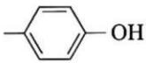</td><td>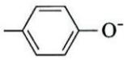</td></tr><tr><td>Cys</td><td>—SH</td><td>— $S^{-}$ </td></tr><tr><td>His</td><td>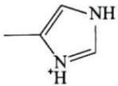</td><td>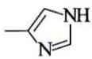</td></tr></table>

## (2) 共价催化在酶促反应中发挥关键作用

在酶的共价催化（covalent catalysis）过程中，活性中心的亲核或亲电基团通过电子转移与底物分子中带正电或带负电的电荷中心相互作用，形成不稳定的瞬时性共价中间体。这一机制有效降低了化学反应的活化能，从而加速了反应进程。酶的一些氨基酸残基侧链基团，如丝氨酸的羟基、半胱氨酸的巯基以及组氨酸的咪唑基，可以作为亲核攻击中心，与底物中的亲电中心（如磷酰基、酰基和糖基等）发生反应，形成共价中间体，例如，酰基-丝氨酸、酰基-半胱氨酸、磷酸丝氨酸、磷酸组氨酸以及席夫碱（Schiff base）等（图4-4，表4-5）。

此外，许多酶催化中心所含的辅因子也通过与底物形成共价中间体参与催化过程。例如，广泛用于不同酶的辅因子硫胺素包含亲核中心，而磷酸吡哆醛则具有亲电中心，它们可与底物形成共价中间体，进而实施共价催化。

## （3）酶利用金属离子实施催化

生物体中存在大量金属酶（metalloenzyme），它们依赖于活性中心的金属离子作为辅因子来协同发挥催化作用。金属离子可以分为两大类:非氧化还原活性金属离子和具有氧化还原活性的金属离子。前者，如锌离子和镁离子，具有固定的电荷数，并不参与电子的接收或供给。后者，如铁离子、铜离子、锰离子、钴离子、钼离子和镍离子，能够通过可逆地改变其氧化态，作为电子的受体或供体，参与催化过程。

图4-4 酶分子中的亲核中心可进攻底物分子中的亲电子基团形成共价中间体

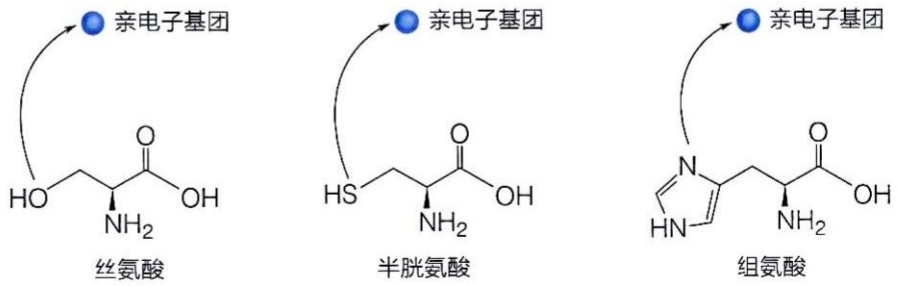

表 4-5 通过形成共价中间体而实施催化的代表性酶

<table><tr><td>酶</td><td>反应基团</td><td>共价中间物</td></tr><tr><td>胰凝乳蛋白酶</td><td></td><td></td></tr><tr><td>弹性蛋白酶</td><td></td><td></td></tr><tr><td>酯酶</td><td>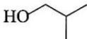</td><td>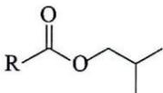</td></tr><tr><td>枯草杆菌蛋白酶</td><td>(Ser)</td><td>(酰基-Ser)</td></tr><tr><td>凝血酶</td><td></td><td></td></tr><tr><td>胰蛋白酶</td><td></td><td></td></tr><tr><td>甘油醛-3-磷酸脱氢酶</td><td>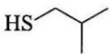</td><td>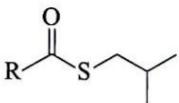</td></tr><tr><td>木瓜酶</td><td>(Cys)</td><td>(酰基-Cys)</td></tr><tr><td>碱性磷酸酶</td><td>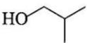</td><td>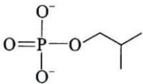</td></tr><tr><td>葡萄糖磷酸变位酶</td><td>(Ser)</td><td>(磷酸-Ser)</td></tr><tr><td>磷酸甘油酸变位酶</td><td>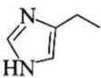</td><td>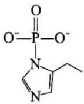</td></tr><tr><td>琥珀酰CoA合成酶</td><td>(His)</td><td>(磷酸-His)</td></tr><tr><td>醛缩酶</td><td> $R-NH_3^+$ </td><td>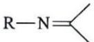</td></tr><tr><td>脱羧酶</td><td>(氨基)</td><td>(席夫碱)</td></tr><tr><td>依赖于磷酸吡哆醛的酶</td><td></td><td></td></tr></table>

不具有氧化还原活性的金属离子主要通过其正电荷来定向或稳定带负电荷的过渡态。这些金属离子通常与酶的催化中心稳定结合。例如，镁离子一般与底物（如 ATP 分子中的磷酸基团）结合，从而与酶分子进行短暂的相互作用。具有氧化还原活性的金属离子不仅可以像非氧化还原活性金属离子一样发挥作用，还能够协助氧化还原反应（电子传递），通过金属离子氧化态的变化来完成。这类金属离子是许多氧化还原酶所必需的辅因子。

综上所述，酶在催化过程中可能采用广义酸碱催化、共价催化和金属离子催化等机制中的一种或多种。在研究特定酶的催化机制时，理解这些机制的存在及其相互作用对于揭示酶的高效催化至关重要，同时也为合理设计和改造酶的催化特性提供了重要的理论依据。

## 4.2.4 酶识别底物的模型

为了解释酶识别底物的机制，人们提出了多种假说，如锁钥模型、诱导契合模型、三点附着模型等。以下将分别进行简单介绍。

## (1) 锁钥模型

这是 1894 年由德国学者埃米尔·费歇尔提出的一种解释酶专一性的假说。费歇尔通过研究葡萄糖和甲醇在 HCl 存在下的化学反应，得到了两种异构体:α-甲基葡萄糖苷和 β-甲基葡萄糖苷。他观察到，α-葡萄糖苷能够被转化酶水解，但不能被苦杏仁酶水解；而 β-葡萄糖苷则能被苦杏仁酶水解，却不能被转化酶水解。为了解释这两种酶对这两种结构高度相似底物的区别能力，费歇尔提出了锁钥（lock and key）模型:酶与底物之间的关系类似于锁与钥匙的关系；底物的结构与酶活性位点的结构必须完全匹配，二者结合后才能发生催化反应（图 4-5A）。这个假说为当时解释酶的专一性提供了重要的思路，具有很大的启发意义。然而，随着对酶催化机制理解的深入，科学家们逐渐认识到这个假说的不足。例如，它无法解释酶如何进行双向催化。双向催化意味着酶活性位点不仅需要结合底物，还需要有效地结合产物。然而，锁钥模型假设酶活性位点与底物的完美匹配，却无法解释酶促逆反应的发生。

## (2) 诱导契合模型

1958 年，美国学者丹尼尔·科什兰（Daniel Koshland，1920—2007）意识到，像锁钥一样的刚性模型无法解释底物上远离反应中心的基团被去除后酶催化活性明显降低的现象。因此，他提出了一种“诱导契合”模型（induced-fit hypothesis）:底物的结合诱导酶的构象发生改变进而激活酶，远离反应中心的基团也参与构象诱导过程。该模型指出酶的活性中心并不是刚性结构，而是柔性可变的。并且当底物与酶结合时，底物分子的构象也可能发生一定的变化。酶和底物之间的构象改变是相互诱导的，故被称作诱导契合模型（图 4-5B）。

图 4-5 酶与底物结合的锁钥模型（A）和诱导契合模型（B）示意图

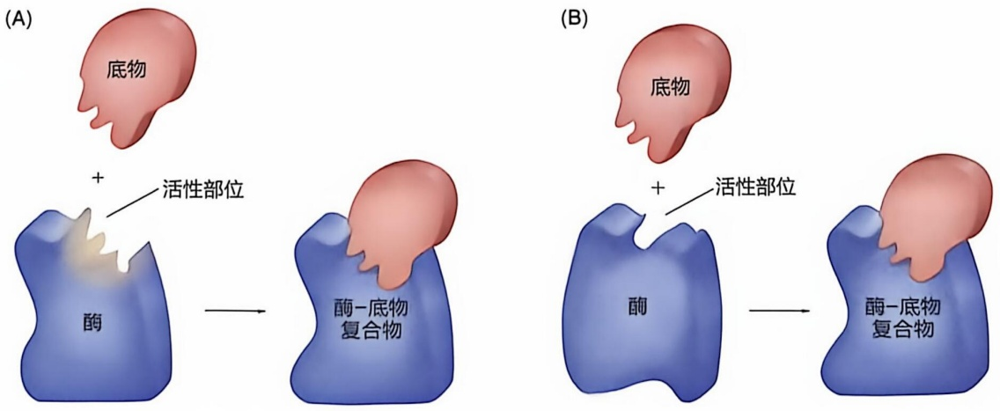

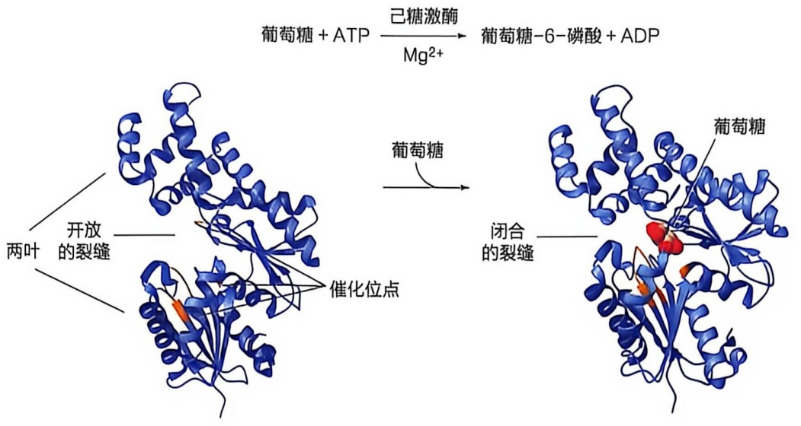

<details>
<summary>flowchart</summary>

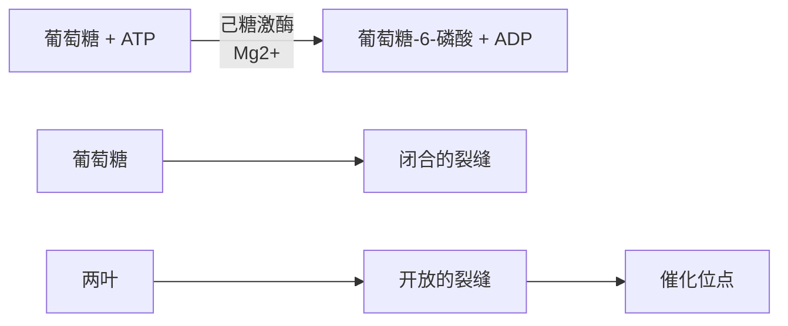
</details>

图 4-6 己糖激酶与底物结合引发明显构象变化（左侧结构 PDB 编号:2E2N；右侧结构 PDB 编号:2E2O）

通过对己糖激酶与底物类似物结合的晶体学研究，进一步证实了诱导契合模型（图4-6）。己糖激酶催化ATP分子中的磷酸基团转移至葡萄糖6号位碳的羟基上。该酶的结构由两个相对独立的叶（lobe）组成，重要的催化残基位于这两个叶片之间的裂缝中。X射线晶体学研究发现，当加入底物葡萄糖后，两个叶片相向移动，从而在裂缝中形成活性中心（图4-6）。这种构象变化后，除了葡萄糖6位碳上的羟基外，葡萄糖分子的其余部分被氨基酸残基包围。这种包围有助于ATP上的磷酸基团顺利转移到葡萄糖6位碳的羟基上（图4-6）。诱导契合模型不仅用于解释特定酶催化的机制，还被广泛应用于理解寡聚体酶催化活性的别构调节现象。

## (3) 三点附着模型

三点附着（three-point attachment）模型是由英国学者亚历山大·奥格斯顿（Alexander Ogston，1911—1996）于1948年提出的，该模型主要用于解释同位素示踪实验中观察到的现象。实验表明，酶能够有效区分非手性碳原子所连接的两个相同基团，使前手性碳转化为手性碳。一个典型的例子是柠檬酸分子中的前手性碳原子，该碳原子连接着两个相同的—CH₂COO⁻基团（图4-7），这种结构可以被一些不对称酶（如乌头酸酶）活性位点区分。根据三点附着模型，底物与酶活性中心的结合是通过三个结合位点来实现的，只有当底物和酶的活性中心在这三个结合位点上都完全匹配时，酶才能有效地催化反应。这一模型不仅能解释不对称酶如何区分前手性碳原子上连接的相同基团，还能够解释酶如何区分对映异构体底物。

(A)

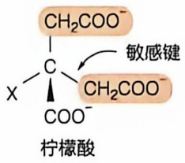

<details>
<summary>chemical</summary>

Chemical structure of citric acid with labeled functional groups and a sensitive key
</details>

(B)

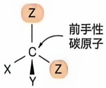

(C)

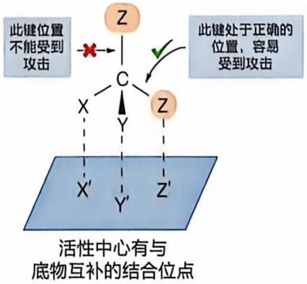

<details>
<summary>flowchart</summary>

This diagram illustrates a feedback loop involving a physical interaction with an active center, showing how a key is accepted or rejected based on the position of the central node.
</details>

图 4-7 酶与底物结合的三点附着模型示意图

## 4.3 酶动力学通过米氏方程及其参数定量阐明酶的催化特性

为了深入分析和量化酶与底物的结合过程以及催化反应的机制，科学家们开展了大量的理论研究和实验探索，从而发展出了酶动力学。本节将介绍酶动力学中的一些常见概念。

## 4.3.1 酶提高反应速率，但不改变反应平衡

## （1）生物体内的化学反应可以从热力学和动力学角度认识理解

酶促反应本质上是化学反应，因此可以从化学热力学（chemical thermodynamics）与化学动力学（chemical kinetics）的角度进行分析。热力学告诉我们，化学反应总是朝着自由能降低的方向自发进行，因此热力学决定了反应的方向和可能达到的平衡状态。而动力学则关注反应速率 $V$ （即单位时间内底物浓度的减少或产物浓度的增加）受哪些因素（如分子结构、温度、浓度、催化剂等）的影响，并探讨反应过程和具体的机理。作为催化剂，酶能够显著提高反应速率，但它并不决定反应的方向。反应的方向由底物和产物之间的自由能差 $\Delta G$ 决定。如果 $\Delta G$ 为负值，反应可以自发向正向进行，而逆向反应则需要额外的能量。在热力学上可行的反应，动力学则帮助我们评估其发生的实际速率，并提供控制反应速率的策略。

当一个反应体系中，正向反应速率等于逆向反应速率时，系统的组成不再随时间而改变，整个体系达到化学平衡（chemical equilibrium），底物和产物的浓度不再变化。这时产物摩尔浓度与反应物摩尔浓度的比值，即为该反应在特定条件下的平衡常数，记作 $K_{eq}$ 。

对于一般可逆反应:

$$
\mathrm{A} + \mathrm{B} \rightleftharpoons \mathrm{C} + \mathrm{D}
$$

反应平衡常数 $K_{eq}$ 可表示为:

$$
K _ {\mathrm{eq}} = ([ \mathrm{C} ] _ {\mathrm{eq}} [ \mathrm{D} ] _ {\mathrm{eq}}) / ([ \mathrm{A} ] _ {\mathrm{eq}} [ \mathrm{B} ] _ {\mathrm{eq}})
$$

酶作为催化剂不会改变底物与产物之间的自由能差  $\Delta G$ ，对正、逆反应的催化作用相同，不改变平衡常数，只加快到达平衡的速率（图 4-8）。

## (2) 酶催化表现出独特的饱和效应

在对酶促反应进行研究时，人们观察到，当酶的浓度固定时，将反应速率与底物浓度作图会得到一条双曲线，呈现典型的饱和动力学特征（图 4-9）。具体而言，当底物浓度较低时，酶促反应速率与底物浓度成正比；随着底物浓度继续提高，反应速率提高的幅度降低；当底物浓度到达一定水平后，反应速率几乎不再随底物浓度提高而提高，最后逐渐趋近一个不变的反应速率，这就是酶催化该底物反应的最大反应速率（maximum velocity， $V_{max}$ ）。如果提高酶的浓度， $V_{max}$ 会相应地提高。

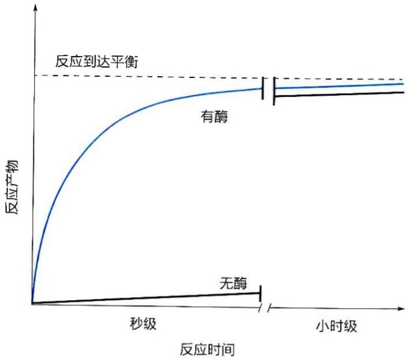

<details>
<summary>line</summary>

| 反应时间 | 有酶 (反应产物) | 无酶 (反应产物) |
| --- | --- | --- |
| 秒级 | ~0.5 | ~0.1 |
| 小时级 | ~0.9 | ~0.2 |
</details>

图 4-8 酶加速反应速率示意图

酶催化的反应与非催化反应最终达到相同的平衡点，但酶的催化使反应显著加速

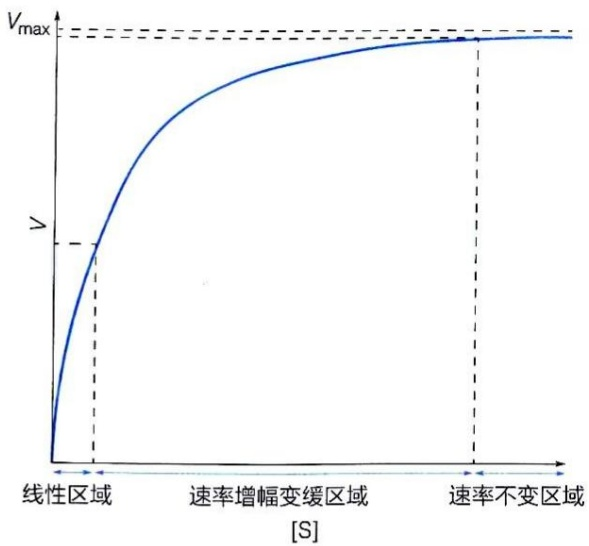

<details>
<summary>line</summary>

| Region | Description |
| --- | --- |
| 线性区域 | Initial phase of velocity increase |
| 速率增幅变缓区域 | Transition to steady state |
| 速率不变区域 | Final phase where velocity approaches Vmax |
</details>

图 4-9 酶促反应速率与底物浓度之间的关系

对于这种饱和现象的解释是，酶在催化底物转变成产物之前，需与底物形成复合物。酶与底物结合形成的复合物可通过实验方法进行观察。酶与底物结合后光吸收谱会发生变化，尤其是当酶带有生色团时，这种改变可以被直接观察到。对酶-底物复合物更为直接的观察是通过X射线衍射或者冷冻电镜等结构生物学研究手段。

酶催化的过程可以简化为如下过程:

$$
\mathrm{E+S} \xrightarrow [ k _ {- 1} ]{k _ {1}} \mathrm{ES} \xrightarrow {k _ {2}} \mathrm{E+P} \tag {4-3}
$$

式中，E代表酶，S代表底物，ES代表酶-底物复合物，P为产物。 $k_{1}$ 和 $k_{-1}$ 分别为酶与底物结合和解离的速率常数，$k_{2}$ 为ES中底物转化为产物的速率常数。酶促反应的速率 $V = k_{2}[\mathrm{ES}]$ 。当底物浓度远低于酶浓度时，因为大量自由酶（指未与底物、反应中间体或产物结合的酶）的存在，[ES]与[S]呈线性相关，因而 $V$ 与底物浓度[S]成正比。但当底物浓度远高于酶浓度时，所有酶分子的催化中心几乎均被底物结合，[ES]近似于酶的总浓度，此时因为没有更多自由的酶来响应底物浓度的增加，底物浓度的增加也就不会导致反应速率的增加。

通过测定反应速率与底物浓度之间的定量关系，可推导出反应的速率常数，进而计算反应的活化能等。在对酶促反应进行动力学分析时，一般测定的都是反应的初始速率 $V_{0}$ ，这时底物尚未被大量消耗，即底物浓度尚无显著变化，近似等于加入的初始底物浓度。

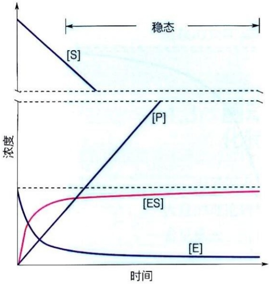

<details>
<summary>line</summary>

| 时间 | [S] (浓度) | [P] (浓度) | [ES] (浓度) | [E] (浓度) |
| --- | --- | --- | --- | --- |
| 初始 | 高 | 0 | 0 | 高 |
| 稳态 | 恒定 | 恒定 | 恒定 | 恒定 |
</details>

图 4-10 酶促反应的时间进程曲线和酶促反应的稳态阶段示意图

底物（S）、产物（P）、游离酶（E）和酶-底物复合物（ES）的浓度一般会随着酶促反应进行如图示中变化。其中 ES 浓度基本保持不变的阶段称为稳态

## 4.3.2 稳态假说

描述酶促反应速率与底物浓度之间定量关系的方程式在20世纪初期被逐渐建立。早期酶促反应动力学研究使用的主要是转化酶（invertase），也称蔗糖酶（sucrase）。该酶催化蔗糖水解为葡萄糖和果糖，蔗糖的旋光活性被用于跟踪反应的进程。德国学者利奥诺·米凯利斯（Leonor Michaelis，1875—1949）和加拿大学者莫德·门滕（Maud Menten，1879—1960）在前人工作基础上，通过对转化酶催化反应的初始速率与酶和底物浓度关系的定量实验观察，于1913年提出了一种可以描述转化酶催化动力学饱和曲线的数学方程。尽管该方程后来经过了进一步的修订，但现在普遍被称作米凯利斯-门滕方程（Michaelis-Menten equation），中文简称为米氏方程，对应的方法体系也被称作米氏动力学。

1925年，英国学者乔治·布里格斯（George Briggs，1893—1985）和约翰·霍尔丹（John Haldane，1892—1964）对酶催化反

应的米氏动力学理论提出了一种稳态解释，认为经过一个极短暂的时间后，酶促反应都会达到一个 ES 浓度基本不变的稳态（steady state）阶段（图 4-10）。因此米氏动力学反映的是一种稳态动力学。后续研究表明，许多酶促反应速率与底物浓度之间的关系都与稳态假说吻合，并能通过米氏方程进行描述。

根据稳态假说，在酶促反应刚开始时存在一个前稳态（pre-steady state）短暂瞬间。其间，酶和底物分子之间互相碰撞并结合，ES复合物的浓度逐渐升高。这个过程一般认为发生于产物刚开始产生时的最初的微秒数量级时间范围内。在经过这个短暂的前稳态阶段后，酶促反应进入稳态（图4-10），即ES复合物的浓度保持恒定，这就是米氏方程所表征的阶段。当底物被大量消耗后，这种稳态也就无法继续维持。

## 4.3.3 酶促反应动力学的米氏方程描述

## (1) 米氏方程的推导

米氏方程推导过程中所使用的酶促反应速率皆为反应的初始速率  $V_{0}$  。它反映底物尚没有被大量消耗阶段的反应速率，此时的底物浓度大约等于初始加入底物的浓度。

下面依据稳态假说，基于单底物酶促反应的情况对米氏方程进行推导。

式（4-3）可以分解为以下两步进行:酶与底物形成酶-底物复合物[式（4-4)]以及酶-底物复合物分离形成产物[式（4-5)]。

$$
\mathrm{E+S} \xrightarrow [ k _ {- 1} ]{k _ {1}} \mathrm{ES} \tag {4-4}
$$

$$
\mathrm{ES} \xrightarrow {k _ {2}} \mathrm{E} + \mathrm{P} \tag {4-5}
$$

酶促反应的初始速率为

$$
V _ {0} = k _ {2} [ \mathrm{ES} ] \tag {4-6}
$$

也就是说， $V_{0}$  取决于 ES 的浓度。尽管稳态条件下，ES 生成和消耗速率相等，浓度维持恒定，但其浓度难以被直接测量。

据式（4-4）和式（4-5），ES生成的速率为 $k_{1}[\mathrm{E}][\mathrm{S}]$ 。在反应初始阶段，以下两点被认为是成立的:一是此时底物的消耗量还很低，所以[S]被认为近似等于初始加入的底物浓度；二是此时的产物浓度还很低，所以E结合P并通过逆反应生成ES的量可以被忽略。ES的消耗速率为 $k_{-1}[\mathrm{ES}] + k_2[\mathrm{ES}]$ ；前一部分反映ES重新解离为E和S的速率，后一部分反映ES被转化成产物P和自由酶的速率。

稳态条件下，因为 ES 的生成和消耗速率相等，所以

$$
k _ {1} \left[ \mathrm{E} \right] \left[ \mathrm{S} \right] = (k _ {- 1} + k _ {2}) \left[ \mathrm{ES} \right] \tag {4-7}
$$

体系中开始加入的总酶浓度  $\left[E_{i}\right]$  与体系中的自由酶浓度存在如下关联:

$$
\left[ \mathrm{E} _ {\mathrm{t}} \right] = \left[ \mathrm{E} \right] + \left[ \mathrm{ES} \right] \tag {4-8}
$$

即总酶浓度等于游离酶浓度与酶-底物复合物浓度之和。

所以  $\left[E\right]=\left[E_{1}\right]-\left[ES\right]$  (4-9)

将式（4-9）代入式（4-7）:

$$
k _ {1} \left(\left[ \mathrm{E} _ {1} \right] - \left[ \mathrm{ES} \right]\right) \left[ \mathrm{S} \right] = \left(k _ {- 1} + k _ {2}\right) \left[ \mathrm{ES} \right] \tag {4-10}
$$

即 $k_{1}[\mathrm{E}_{\mathrm{t}}][\mathrm{S}] - k_{1}[\mathrm{ES}][\mathrm{S}] = (k_{-1} + k_{2})[\mathrm{ES}]$

或 $k_{1}[\mathrm{E}_{\mathrm{t}}][\mathrm{S}] = k_{1}[\mathrm{ES}][\mathrm{S}] + (k_{-1} + k_{2})[\mathrm{ES}]$

$$
= \left(k _ {1} [ S ] + \left(k _ {- 1} + k _ {2}\right)\right) [ E S ]
$$

所以

$$
\left[ \mathrm{ES} \right] = \frac {k _ {1} \left[ \mathrm{E} _ {\mathrm{t}} \right] [ \mathrm{S} ]}{k _ {1} [ \mathrm{S} ] + (k _ {- 1} + k _ {2})} = \frac {\left[ \mathrm{E} _ {\mathrm{t}} \right] [ \mathrm{S} ]}{[ \mathrm{S} ] + \frac {k _ {- 1} + k _ {2}}{k _ {1}}} \xrightarrow {K _ {\mathrm{m}} = \frac {k _ {- 1} + k _ {2}}{k _ {1}}} [ \mathrm{ES} ] = \frac {\left[ \mathrm{E} _ {\mathrm{t}} \right] [ \mathrm{S} ]}{[ \mathrm{S} ] + K _ {\mathrm{m}}} \tag {4-11}
$$

将式（4-11）代入式（4-6），得

$$
V _ {0} = \frac {k _ {2} \left[ \mathrm{E} _ {\mathrm{t}} \right] \left[ \mathrm{S} \right]}{\left[ \mathrm{S} \right] + K _ {\mathrm{m}}} \tag {4-12}
$$

当底物浓度远高于酶的浓度时，所有的酶都处于与底物结合状态，不存在自由酶， $\left[ES\right]=\left[E_{t}\right]$ 。此时酶促反应速率达到最高，记作 $V_{max}$ ，则 $V_{max}=k_{2}\left[E_{t}\right]$ 。将其代入式（4-12），得

$$
V _ {0} = \frac {V _ {\max} [ \mathrm{S} ]}{[ \mathrm{S} ] + K _ {\mathrm{m}}} \tag {4-13}
$$

该方程即为米氏方程。这里的  $K_{m}$  称作米氏常数（Michaelis constant），对于特定酶的特定底物而言，在特定反应条件下  $K_{m}$  为一常数。根据定义， $K_{m}$  为一复合常数:

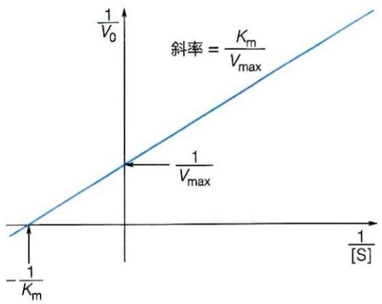

<details>
<summary>line</summary>

| Variable | Value |
| --- | --- |
| Y-axis label | 1/V0 |
| X-axis label | 1/[S] |
| Slope equation | Km/Vmax |
| Intercept point | 1/Vmax |
| Y-intercept | -1/Km |
</details>

图4-11 双倒数作图

$$
K _ {\mathrm{m}} = \frac {k _ {- 1} + k _ {2}}{k _ {1}} \tag {4-14}
$$

（2） $V_{max}$  和  $K_{m}$  可通过对初始速率和底物浓度进行双倒数作图获取

在不同底物浓度下测定酶促反应的 $V_{0}$，然后以 $V_{0}$ 为纵轴，[S]为横轴作图，获得如图4-9所示曲线。先确定在底物浓度远超过酶浓度条件下的 $V_{0}$ 值，即 $V_{\mathrm{max}}$；然后再确定当初始速率 $V_{0}$ 为最大速率 $V_{\mathrm{max}}$ 的一半时的底物浓度，即为 $K_{\mathrm{m}}$ 值。但因为 $V_{\mathrm{max}}$ 是一个理论值，很难直接测得。为解决利用米氏方程获得 $V_{\mathrm{max}}$ 和 $K_{\mathrm{m}}$ 这两个参数的难题，1930年代两位美国学者汉斯·莱恩威弗（Hans Lineweaver，1907—2009）和迪恩·伯克（Dean Burk，

1904—1988）提出将米氏方程［式（4-13）］进行简单的数学处理，在等号的两边皆取倒数:

$$
\frac {1}{V _ {\mathrm{o}}} = \frac {1}{[ \mathrm{S} ]} \cdot \frac {K _ {\mathrm{m}}}{V _ {\mathrm{max}}} + \frac {1}{V _ {\mathrm{max}}} \tag {4-15}
$$

然后以 $1 / V_{0}$ 对 $1 / [\mathrm{S}]$ 作图，则可得一条直线，这样的处理方法被称作双倒数作图（double reciprocal plot）（图4-11），也称为莱恩威弗-伯克作图（Lineweaver-Burk plot）。通过在几个不同的底物浓度下测定 $V_{0}$，然后进行双倒数作图，得到一条直线，直线在纵轴上的截距为 $1 / V_{\max}$，在横轴上的截距为 $-1 / K_{\mathrm{m}}$，斜率为 $K_{\mathrm{m}} / V_{\max}$。对测量的 $1 / V_{0}$ 和 $1 / [\mathrm{S}]$ 进行直线拟合，进一步计算可以得到 $V_{\max}$ 和 $K_{\mathrm{m}}$ 值。当然，现代计算机软件可以直接对测量的 $V_{0}$ 和 [S] 进行曲线拟合，求得 $V_{\max}$ 和 $K_{\mathrm{m}}$ 值。

## 4.3.4 米氏方程参数反映酶的催化特征

$V_{max}$  和  $K_{m}$  可用于对不同酶的催化效率进行比较，但对理解酶催化机制的帮助有限。

（1）酶促反应的 $K_{\mathrm{m}}$ 参数的含义可能因酶而异

如果  $V_{0}=V_{max}/2$ ，则根据公式（4-13）可得  $K_{m}=[S]$ 。因此  $K_{m}$  可以被理解为反应速率达到最大反应速率一半时的底物浓度。

如式（4-14）所示， $K_{m}$  与酶促反应过程中的多个速率常数有关。当 ES 转化为产物和自由酶这一步为限速步骤（即  $k_{2}<<k_{-1}$ ）时，那么式（4-14）中的  $k_{2}$  可忽略不计， $K_{m}$  约等于  $k_{-1}/k_{1}$ ，即式（4-4）中 ES 的解离常数  $K_{d}$ 。该情况下  $K_{m}$  可反映酶与底物之间的亲和力。高  $K_{m}$  值对应低亲和力，低  $K_{m}$  值对应高亲和力。当  $k_{2}$  和  $k_{-1}$  差异不大时，那么  $K_{m}$  就不能被近似看作是 ES 的解离常数，也就不能反映酶与底物之间的亲和力。

大部分酶的  $K_{m}$  都处于  $\mu mol/L$  到 mmol/L 的数量级，比生物体内许多蛋白质与配体之间结合的解离常数高，表明酶与底物之间的结合并非十分紧密。依据前述酶催化的过渡态理论，酶与底物之间的亲和力过高反而会阻碍反应的进行。

值得注意的是， $K_{m}$  具有底物特异性。当一种酶所催化的反应为双底物甚至多底物时，每种底物的  $K_{m}$  值往往也不同，甚至差别很大。如果一种酶可催化几种相似底物的转化，各底物的  $K_{m}$  值一般也都不同。比如，已糖激酶对 D 型葡萄糖的  $K_{m}$  值约为 0.05 mmol/L，而对另外一种底物 D 型果糖的  $K_{m}$  值为 1.5 mmol/L，说明已糖激酶更倾向于催化 D 型葡萄糖的磷酸化。

## (2) 酶促反应的 $V_{\max}$ 一定程度反映酶的催化效率

在上述推导过程中， $V_{\mathrm{max}} = k_{2}[\mathrm{E}_{\mathrm{t}}]$，即 $V_{\mathrm{max}}$ 与酶的浓度成正比。所以，当酶的浓度提高时， $V_{\mathrm{max}}$ 也将随之提高。

严格来说，式（4-5）和式（4-6）只能代表酶促反应的一种情况。因为反应的限速步骤不一定是 $\mathrm{ES} \rightarrow \mathrm{E} + \mathrm{P}$ 这一步。由此，需引入一个更为通用的催化常数 $k_{\mathrm{cat}}$ :它由酶促反应速率最慢的一步甚至多步反应的速率常数决定。因而，公式 $V_{\mathrm{max}} = k_2[\mathrm{E}_t]$ 需修正为:

$$
V _ {\max} = k _ {\mathrm{cat}} \left[ \mathrm{E} _ {\mathrm{t}} \right] \tag {4-16}
$$

尽管基于前面推导中的假设情况， $k_{cnt}=k_{2}$ ，但对于一个可能更为复杂的多步反应而言， $k_{cnt}$  可能并不等于  $k_{2}$ ，而是更为复杂。

当特定酶浓度下的  $V_{max}$  被测定后，可以通过  $V_{\max} = k_{\mathrm{cnt}}[\mathrm{E}_{\mathrm{t}}]$  计算出  $k_{cnt}$  的值。这里  $k_{cnt}$  的单位是时间的倒数（一般都用每秒，即  $s^{-1}$ ），表征在被底物完全饱和的情况下，一个酶分子在单位时间（如每秒）所能转化底物分子的个数。因此，催化常数  $k_{cnt}$  也被更为清楚地描述为转换数（turnover number）。

## (3) 酶的催化效率可通过 $k_{\mathrm{cat}} / K_{\mathrm{m}}$ 参数进行更为有效地反映

可以将米氏方程换一种方式进行解读。当底物的浓度相对比较低，即  $[S] << K_{m}$  的情况下，自由酶的浓度  $[E]$  近似于总酶浓度  $[E_{t}]$ ，这时的米氏方程  $[式（4-13）和式（4-16）]$  可被近似为:

$$
V _ {0} = \frac {k _ {\mathrm{cat}}}{K _ {\mathrm{m}}} [ \mathrm{E} ] [ \mathrm{S} ] \tag {4-17}
$$

式（4-17）表明 $k_{\mathrm{cat}} / K_{\mathrm{m}}$ 为表观二级速率常数，此时酶促反应初始速率 $V_{0}$ 既与[S]成正比，也与[E]成正比。由于在实际生理反应条件下，底物浓度可能远未达到饱和浓度（即[S] << $K_{\mathrm{m}}$），那么不同酶在同样酶浓度以及底物浓度下的反应速率 $V$ 取决于参数 $k_{\mathrm{cat}} / K_{\mathrm{m}}$，因而参数 $k_{\mathrm{cat}} / K_{\mathrm{m}}$ 相比于单独的 $k_{\mathrm{cat}}$ 能更直观地体现酶的催化效率。

通过式（4-14）以及 $k_{\mathrm{cat}} = k_2$ ，推导得到参数 $k_{\mathrm{cat}} / K_{\mathrm{m}} = k_{1}k_{2} / (k_{-1} + k_{2})$ 。由于 $k_{2}/$ $(k_{-1} + k_{2}) < 1$ ，因此参数 $k_{\mathrm{cat}} / K_{\mathrm{m}} < k_{1}$ ，表明酶的催化效率 $k_{\mathrm{cat}} / K_{\mathrm{m}}$ 不能超过酶E和底物S结合生成ES复合物的速率常数 $k_{1}$ 。 $k_{1}$ 数值的大小取决于扩散速率。分子扩散的速率受体系的黏度及分子形状等因素影响，在一般水溶液体系中，分子扩散的最大速率为 $10^{8}\sim 10^{9}\mathrm{L}\cdot \mathrm{mol}^{-1}\cdot \mathrm{s}^{-1}$ ，该数值代表 $k_{\mathrm{cat}} / K_{\mathrm{m}}$ 能达到的最大值。一些代表性酶的相关动力学常数见于表4-6中。

表 4-6 某些代表酶的 ${K}_{\mathrm{m}}$ 、 ${k}_{\text{cat }}$ 以及 ${k}_{\mathrm{{cat}}}/{K}_{\mathrm{m}}$ 值

| 酶 | 底物 | $K_{m}$ ( mol · $L^{-1}$) | $k_{cat}$ ( s$^{-1}$ ) | $k_{cat}/K_{m}$ ( L · mol$^{-1}$ · s$^{-1}$ ) |
| --- | --- | --- | --- | --- |
| 乙酰胆碱酯酶 | 乙酰胆碱 | $9.0 \times 10^{-5}$ | $1.4 \times 10^{4}$ | $1.6 \times 10^{8}$ |
| 过氧化氢酶 | 过氧化氢 | 1.1 | $4.0 \times 10^{7}$ | $3.6 \times 10^{7}$ |
| 碳酸酐酶 | 二氧化碳 | 0.012 | $1.0 \times 10^{6}$ | $8.3 \times 10^{7}$ |
| 延胡索酸酶 | 延胡索酸 | $5.0 \times 10^{-6}$ | $8.0 \times 10^{2}$ | $1.6 \times 10^{8}$ |
| 磷酸丙糖异构酶 | 甘油醛 -3- 磷酸 | $1.8 \times 10^{-5}$ | $4.3 \times 10^{3}$ | $2.4 \times 10^{8}$ |

## 4.3.5 米氏方程可用于描述双底物反应

虽然米氏方程是基于简单的单底物反应假想过程推导的，但研究表明，在很多双底物或多底物酶促反应过程中，反应速率与底物浓度之间的作图也呈现双曲线特征，也能用米氏方程进行分析。对由双底物 $\mathrm{S}_1$ 和 $\mathrm{S}_2$ 参与的酶促反应进行米氏动力学分析，可通过固定其中一种底物的浓度，测定另外一种底物的米氏动力学。例如，可以先固定 $[\mathrm{S}_1]$，测定在不同 $[\mathrm{S}_2]$ 情况下的 $V_0$ 值；然后反过来固定 $[\mathrm{S}_2]$，改变 $[\mathrm{S}_1]$，测定另一套 $V_0$ 值。这样就可以分别测定酶对 $\mathrm{S}_2$ 底物和 $\mathrm{S}_1$ 底物的米氏常数 $K_{\mathrm{m}}$。

对于双底物反应而言，米氏动力学分析除了能测量酶对底物的米氏常数，还能揭示多底物化学反应发生的具体顺序，推测反应过程中是否只形成了 $\mathrm{ES}_1$ 和 $\mathrm{ES}_2$ 这样的二元复合物，还是形成了 $\mathrm{ES}_1\mathrm{S}_2$ 这样的三元复合物。这对于认识酶的催化机制十分重要。

形成三元复合物的酶促反应可分别表示为以下两种情况:

随机顺序反应

$$
\begin{array}{c} \mathrm{E} \xrightarrow {\mathrm{ES} _ {1}} \mathrm{ES} _ {1} \mathrm{S} _ {2} \\ \mathrm{E} \xrightarrow {\mathrm{ES} _ {2}} \end{array} \longrightarrow \mathrm{E} + \mathrm{P} _ {1} + \mathrm{P} _ {2} \tag {4-18a}
$$

固定顺序反应

$$
\mathrm{E} + \mathrm{S} _ {1} \rightleftharpoons \mathrm{ES} _ {1} \xrightarrow {\mathrm{S} _ {2}} \mathrm{ES} _ {1} \mathrm{S} _ {2} \longrightarrow \mathrm{E} + \mathrm{P} _ {1} + \mathrm{P} _ {2} \tag {4-18b}
$$

式（4-18a）表示的是通过随机顺序反应形成三元复合物，而式（4-18b）表示的是通过固定顺序形成三元复合物。两种情况中都需要酶和双底物形成三元复合物才能促使反应发生并生成产物，所获得的双倒数作图的模式如图4-12A所示。在固定不同 $\left[S_{2}\right]$ 的情况下，测得的 $1/V_{0}$ 对 $1/\left[S_{1}\right]$ 的双倒数直线都将相汇于一点。

而仅形成二元复合物的酶促反应可以表示为:

$$
\mathrm{E} + \mathrm{S} _ {1} \rightleftharpoons \mathrm{ES} _ {1} \rightleftharpoons \mathrm{E} ^ {\prime} \mathrm{P} _ {1} \xrightarrow {\mathrm{P} _ {1}} \mathrm{E} ^ {\prime} \xrightarrow {\mathrm{S} _ {2}} \mathrm{E} ^ {\prime} \mathrm{S} _ {2} \longrightarrow \mathrm{E} + \mathrm{P} _ {2} \tag {4-19}
$$

这样的双底物反应所获得的双倒数作图的模式如图 4-12B 所示。在固定不同 $\left[\mathrm{S}_{2}\right]$ 的

(A)

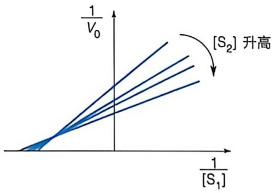

<details>
<summary>line</summary>

| \(1/[S_{1}]\) | \(1/V_{0}\) (Series 1) | \(1/V_{0}\) (Series 2) | \(1/V_{0}\) (Series 3) |
| --- | --- | --- | --- |
| Negative | ~0 | ~0 | ~0 |
| Positive | ~1.5 | ~1.8 | ~2.2 |
</details>

(B)

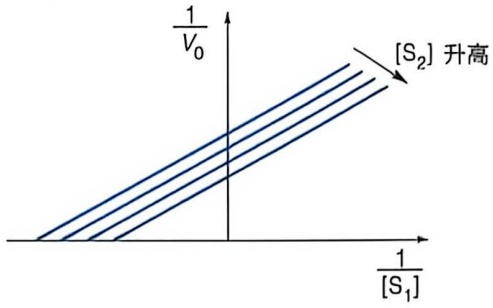

<details>
<summary>line</summary>

| 1/[S1] | 1/V0 (Series 1) | 1/V0 (Series 2) | 1/V0 (Series 3) |
| --- | --- | --- | --- |
| Negative | ~0.5 | ~0.4 | ~0.3 |
| Positive | ~1.5 | ~1.3 | ~1.1 |
</details>

图 4-12 形成三元（A）和二元（B）复合物的双底物酶促反应的双倒数作图典型模式

情况下，测得的  $1/V_{0}$  对  $1/[S_{1}]$  的双倒数直线相互平行。

虽然米氏方程能用于区分以上多底物化学反应发生的机制。但是仍有很多酶促反应并不呈现双曲线特征，如后面将要讨论的别构调控酶（其动力学曲线为 S 形，而非双曲线），就无法通过米氏方程描述。

## 4.3.6 酶促动力学可用于分析 pH、温度等因素对酶活性的影响

## (1) 酶促反应速率受体系 $\mathrm{pH}$ 的影响

如果测试不同 pH 条件下的酶促反应速率并绘制相关曲线，则大部分酶都会给出钟形曲线（图 4-13），即在某个 pH 条件下酶促反应速率达到最大，这个 pH 称为此酶促反应的最适 pH。体内很多酶的最适 pH 都恰好等于体内最常见的生理条件 pH。而酶活力在 pH 向酸或碱方向大范围偏离时会急剧下降。造成此现象的原因主要有两方面:一方面，pH 影响可电离基团的解离，而这些基团可能直接参与催化过程本身；另一方面，带电基团对于酶分子三维空间结构的稳定作用也会受到 pH 变化的影响。某些具酸碱性的氨基酸侧链基团会直接参与酶的酸碱催化过程。通过研究 pH 对酶活性的影响，可以测得关键反应基团的 $pK_{a}$，推测哪种氨基酸侧链参与了催化，进而帮助推测反应机制。

## (2) 酶促反应受到体系温度的影响

对一般化学反应而言，随着温度的升高，反应物的碰撞概率增大，因而反应速率随之增加。反应温度每上升10℃，反应速率增加2\~4倍（范托夫规则）。但对于酶促反应，由于大多数酶分子作为蛋白质存在热不稳定性，反应速率随温度上升到一定程度后，随着酶开始变性失活又逐渐下降。因此，如果测量酶活力与温度之间的相关性，也会得到一条钟形曲线。其最高点代表高于此温度酶蛋白开始变性。大部分动物细胞中的酶在生理条件温度35\~40℃及以下能保持活性，但在稍高一些的温度下即变得不稳定。然而某些嗜热微生物的酶可以耐受高温。由于上述原因，温度对酶促反应的速率的影响应分两部分进行研究，一是酶促反应速率本身随温度的变化，二是酶的热稳定性。

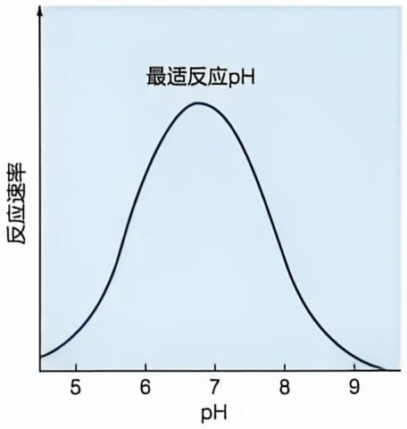

<details>
<summary>line</summary>

| pH | 反应速率 |
| --- | --- |
| 5 | ~0.1 |
| 6 | ~0.6 |
| 7 | ~0.8 |
| 8 | ~0.4 |
| 9 | ~0.1 |
</details>

图 4-13 pH 对延胡索酸酶催化反应速率的影响示意图

## 4.4 酶活性可通过共价修饰、酶原激活和别构效应等多种机制进行精密调控

无论是单细胞生物还是多细胞生物，体内都同时进行着大量酶促反应，这些反应是生长、发育等生命活动的基础。这些酶促反应并不是彼此独立、随机进行，而是按照特定的顺序依次发生，从而完成特定的生理过程。在很多合成代谢和分解代谢过程中，前一步酶促反应的产物往往会成为下一步（或几步）酶促反应的底物。生物体通过精确调控这些酶促反应，以满足生长、发育以及维持内环境稳定对物质与能量的需求。一旦酶的活性发生异常，便会扰乱正常的生命活动，进而引发多种疾病。

酶的活性调控机制主要分为两类，一是对酶浓度的调控，二是对酶催化活性的直接调控。酶的浓度调控包括调控酶的表达和降解速率，从而影响酶的总浓度；通过调控酶的亚细胞定位或与特定骨架蛋白的相互作用，调控特定区域底物周围的酶浓度；通过调控酶的寡聚化或多聚化，改变局部酶的浓度。对酶催化活性的直接调控主要通过影响酶底物识别区域或催化中心的构象，从而改变其催化效率。常见调控机制包括共价修饰、蛋白酶催化的水解以及别构调控等。本节将重点介绍酶催化活性的直接调控机制。

## 4.4.1 酶活性可被共价修饰调控

酶的活性可以通过对酶分子中的某个或某些氨基酸残基的侧链或主链进行共价修饰来调节。这是一种广泛存在的酶活性调控方式，其中大多数共价修饰是可逆的，并且通常依赖特定修饰酶和去修饰酶的催化。酶的共价修饰种类繁多，常见的有磷酸化（phosphorylation）、腺苷酸化（adenylylation）、尿苷酸化（uridylylation）、ADP-核糖化（ADP-ribosylation）等。其中，磷酸化是研究较为广泛的一种修饰方式。磷酸化修饰主要发生在含羟基的氨基酸残基侧链上，如丝氨酸、苏氨酸和酪氨酸，偶尔也会发生于组氨酸残基侧链的咪唑基上。催化蛋白质磷酸化的酶称作蛋白质激酶（protein kinase），磷酸基团通常都由ATP分子提供，而催化蛋白质去磷酸化的酶称作蛋白磷酸酶（protein phosphatase）。蛋白质可逆磷酸化修饰的过程如图4-14所示。

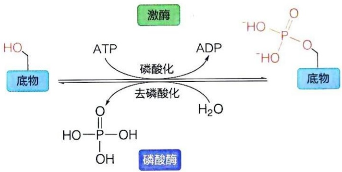

<details>
<summary>flowchart</summary>

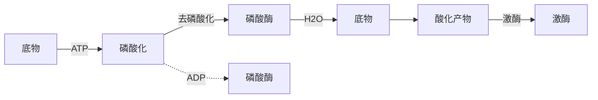
</details>

图 4-14 蛋白质可逆磷酸化修饰过程示意图

## 4.4.2 酶原可通过蛋白酶催化的水解而被激活

胃蛋白酶于 1830 年代被发现后，一些学者在尝试重复相关实验时遇到了困难。后来发现，当使用稀盐酸从风干的胃黏膜样品中提取胃蛋白酶时，其酶活性远高于使用甘油提取的结果。进一步的研究揭示了其中的原因:胃蛋白酶在合成时以无活性前体的形式存在，而这种前体蛋白在盐酸条件下会发生自水解，切断 N 端的 44 个（猪胃蛋白酶）或 47 个（人胃蛋白酶）氨基酸残基，从而转变为有活性的胃蛋白酶。这一发现推动了对其他类似蛋白质水解酶前体的研究，如胰蛋白酶和胰凝乳蛋白酶等。这类无酶活性的前体蛋白质称作酶原（zymogen）。酶原的激活通常通过水解切割肽链引发蛋白质的构象变化，从而使其转变为具有活性的酶（图 4-15）。许多蛋白质水解酶在细胞内合成时都是以无活性的酶原形式存在的，只有当它们被分泌到特定功能场所，或者与特定信号分子结合后，才通过自水解被不可逆地激活。激活后的蛋白水解酶能够进一步催化其他酶原分子的激活，这种级联反应使得信号可以迅速放大（知识延展 4-1）。

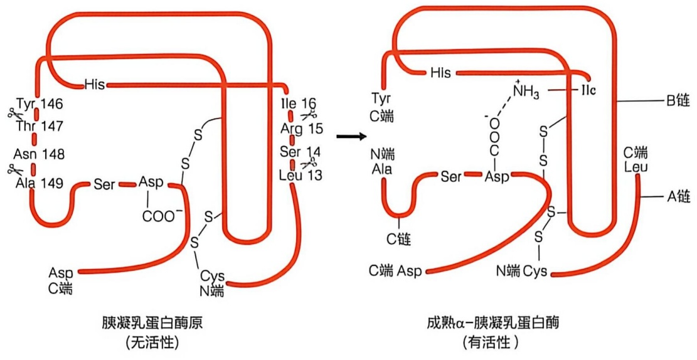

<details>
<summary>flowchart</summary>

```mermaid
graph LR
  subgraph n_No_lifestyle["\"胰凝乳蛋白酶原\n(无活性)\" (No-lifestyle)"]
  A["His"] --> B["Tyr 146"]
  A --> C["Thr 147"]
  A --> D["Asn 148"]
  A --> E["Ala 149"]
  A --> F["Ser"]
  A --> G["Asp"]
  A --> H["COO⁻"]
  A --> I["S"]
  A --> J["Cys"]
  A --> K["N端"]
    L["Ile 16"] -.-> M["Arg 15"]
    L -.-> N["Ser 14"]
    L -.-> O["Leu 13"]
  end

  subgraph n_Active["\"成熟α-胰凝乳蛋白酶\n(有活性)\" (Active)"]
  M --> P["His"]
  N --> Q["Tyr C端"]
  N --> R["N端 Ala"]
  N --> S["Ser"]
  N --> T["Asp"]
  N --> U["C链"]
  N --> V["C端 Asp"]
  N --> W["N端 Cys"]
  P --> X["NH₃"]
  X --> Y["Ilc"]
  Y --> Z["B链"]
  Y --> AA["C端 Leu"]
  AA --> AB["A链"]
  end
```
</details>

图 4-15 胰凝乳蛋白酶原的水解激活过程示意图

## 4.4.3 酶活性可通过别构效应被调控

1950 年代，科学家在研究细菌中核苷酸和氨基酸的合成途径时发现，某种终产物可以对其合成途径进行反馈抑制（feedback inhibition）。例如，胞苷三磷酸（CTP）能够抑制大肠杆菌中嘧啶核苷酸合成的第一个限速步骤。进一步研究发现 CTP 抑制的是天冬氨酸转氨甲酰酶（aspartate transcarbamoylase, ATCase）。ATCase 催化氨甲酰磷酸与天冬氨酸缩合形成 N-氨基甲酰天冬氨酸和无机磷酸（图 4-16A）。通过对纯化的 ATCase 开展酶动力学研究，科学家发现该酶的催化反应不遵循米氏动力学，其反应初始速率与底物浓度之间呈现 S 形曲线，表明 ATCase 底物的结合具有协同性；当在反应体系中加入嘧啶合成途径终产物 CTP 时，S 形曲线右移，表明 CTP 对酶活性具有抑制作用（图 4-16B）。

进一步的研究表明，ATCase 能够形成一个由 6 个催化亚基和 6 个调节亚基组成的十二聚体结构。其中，催化亚基以 2 个三聚体的形式呈双层结构，而调节亚基以 3 个二聚体的形式结合于双层催化三聚体周围的三个位置，呈现出三角形分布（图 4-17）。CTP 能与 ATCase 的调节亚基结合，进而通过调节亚基与催化亚基之间的相互作用，