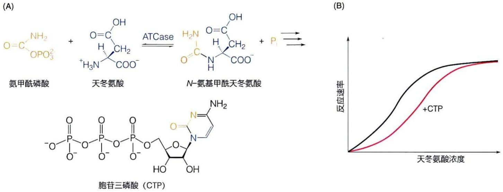

图 4-16 嘧啶核苷酸合成途径的别构调控

（A）天冬氨酸转氨甲酰酶（ATCase）催化嘧啶核苷酸合成途径的第一步反应，而CTP为该途径的终产物。（B）CTP是ATCase的抑制剂

影响催化亚基的构象，即 CTP 通过调节亚基的别构效应使催化亚基处于失活状态，从而抑制 ATCase 的酶活性（图 4-17）。

酶的构象可以受到其他调节分子的调控而发生改变，从而影响其催化活性。在酶的催化中心以外，有一些可以结合调控分子的特殊位点，称为别构中心（allosteric site）。别构中心与调控分子结合可以诱导酶的构象发生改变，进而影响酶催化中心的构象，最终影响酶的催化活性，称为别构调节。具有别构中心的酶被称为别构酶（allosteric enzyme），而与别构中心结合从而调控酶活性的分子被称为别构效应物（allosteric effector）。最初发现的别构效应物大多为别构抑制剂，但别构效应物也可以表现为别构激活剂（图4-18）。例如，腺嘌呤核苷三磷酸（ATP）是ATCase的别构激活剂，ATP可提高ATCase的活性，且可抵消CTP对ATCase的抑制作用。

图 4-17 天冬氨酸转氨甲酰酶的别构调控机制

(左侧结构 PDB 编号: 1RAB;
右侧结构 PDB 编号: 1F1B)

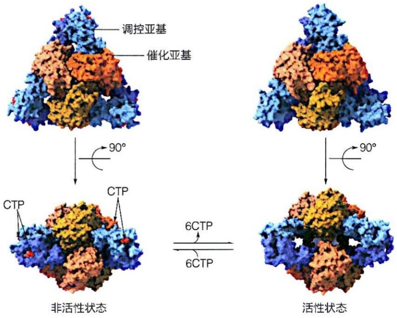

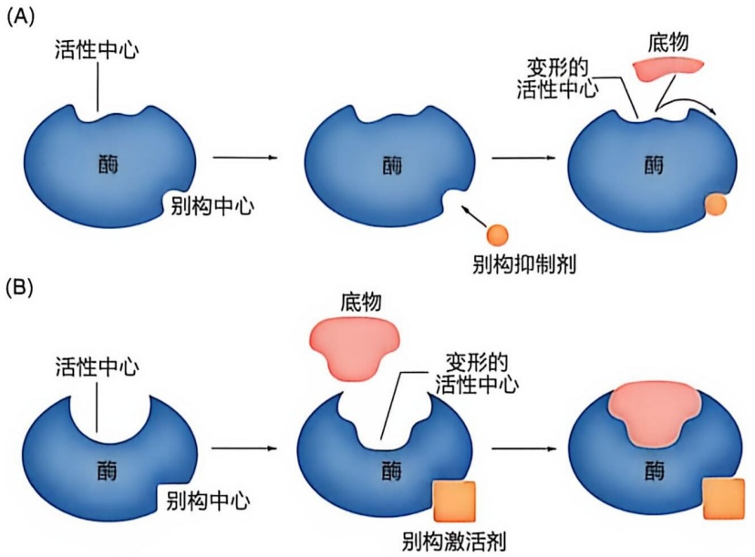

图 4-18 酶活性的别构抑制（A）与别构激活（B）示意图

当别构效应物是酶的底物分子时，这种别构效应被称为同促效应（homotropic effect）；而当别构效应物是其他分子时，则称为异促效应（heterotropic effect）。需要强调的是，同一酶分子中可能存在多个别构中心，这些别构中心可以分别结合不同的别构效应物，从而产生相似或不同的调控效应。例如，大肠杆菌的谷氨酰胺合成酶（glutamine synthetase）至少能够与8种不同的抑制性别构效应物结合，每种效应物的结合都导致酶活性不同程度的下降。这种结合通常是通过非共价相互作用实现的，因此别构调控通常是可逆的。

## 4.5 小分子抑制剂通过可逆或不可逆方式精确干预酶功能

人体内的酶活性异常可能影响生命活动的正常进行，从而引发各种疾病，因此酶是重要的药物靶点之一。目前，靶向酶的药物主要是能够透过细胞膜的小分子药物。根据这些药物对酶催化活性的作用，可以分为小分子激动剂和抑制剂两类。

本节将重点探讨酶的小分子抑制剂，说明其工作机制及对酶动力学参数的影响。根据抑制剂与酶结合是否可逆，酶抑制剂可以分为不可逆抑制剂（irreversible inhibitor）和可逆抑制剂（reversible inhibitor）两大类。不可逆抑制剂通常通过与酶形成共价键，导致酶分子发生永久性修饰，从而失去活性。此外，一些不可逆抑制剂与酶的结合是非共价的，但结合非常紧密，难以通过透析或超滤等方法将其有效去除，因此也表现出永久性抑制的特征。与不可逆抑制剂不同，可逆抑制剂通常通过非共价作用与酶结合，有时也可能通过可逆的共价键与酶结合。可逆抑制剂能够通过透析、稀释等物理方法被有效去除，从而使酶的催化活性得以恢复。接下来将详细介绍可逆抑制剂的工作机制，并简要介绍不可逆抑制剂。

## 4.5.1 可逆抑制剂工作机制

可逆抑制剂对酶催化活性的抑制程度受酶、抑制剂和底物三者相对浓度的影响。通过测定在不同浓度的抑制剂存在下，酶促反应初始速率的下降程度，可以分析抑制剂的作用效果。根据抑制剂与底物之间的竞争关系不同，可逆抑制可分为竞争性抑制（competitive inhibition）、非竞争性抑制（noncompetitive inhibition）和反竞争性抑制

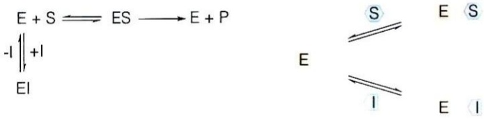

chemical

Chemical reaction diagram showing electron transfer between states E, S, and I with labeled arrows indicating electron movement

图 4-19 竞争性抑制剂与酶结合的动态平衡示意图

式中E、S、P和I分别代表酶分子、底物分子、产物分子和抑制剂分子

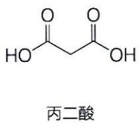

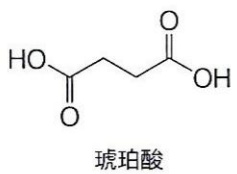

chemical

Chemical structure of uracilic acid with labeled name

图 4-20 丙二酸与琥珀酸的分子结构

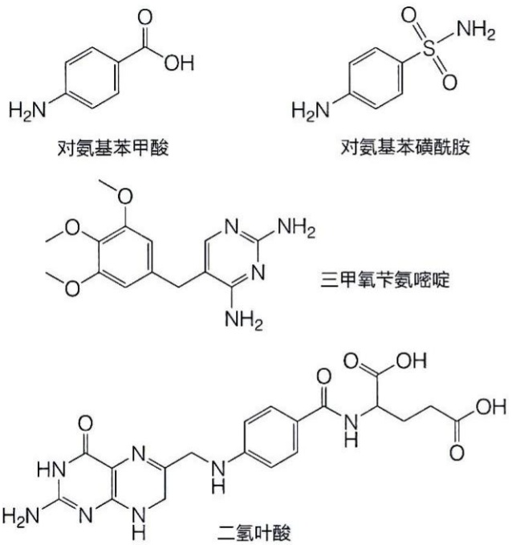

图4-21 对氨基苯甲酸、对氨基苯磺酰胺、三甲氧苄氨嘧啶以及二氢叶酸的分子结构

（uncompetitive inhibition）等类型。理解这些抑制机制，对于靶向酶的药物开发具有重要的指导意义。

## (1) 竞争性抑制剂

竞争性抑制剂与酶底物之间的竞争关系如图 4-19 所示。

竞争性抑制剂（I）通过与底物（S）竞争酶（E）的催化位点，形成不能结合底物的EI复合物，从而抑制酶的催化活性。例如，琥珀酸脱氢酶可催化琥珀酸脱氢生成延胡索酸（即反丁烯二酸）。丙二酸作为琥珀酸脱氢酶的竞争性抑制剂，可以与底物琥珀酸竞争结合酶的催化位点，阻碍酶的正常催化反应。丙二酸与琥珀酸在结构上相似，都含有两个羧基，因此能被酶的催化中心识别并结合，但不同于琥珀酸，丙二酸无法被酶催化脱氢（图4-20）。

竞争性抑制的程度取决于抑制剂与底物的相对浓度以及酶对它们的亲和力。保持抑制剂浓度不变，逐步增加底物浓度，抑制剂对酶的抑制将会减弱甚至消失。抑制剂对酶亲和力越高，抑制效果越强。

针对致病细菌或病毒的关键酶开发竞争性抑制剂，可作为治疗相关传染性疾病的临床药物。例如，细菌二氢叶酸合成酶负责催化对氨基苯甲酸转化为二氢叶酸，后者在细菌内转化为四氢叶酸后参与核苷酸和氨基酸的合成（具体见合成代谢部分）。对氨基苯磺酰胺是对氨基苯甲酸的结构类似物（图4-21），因而可与对氨基苯甲酸竞争结合二氢叶酸合成酶催化中心，从而抑制细菌增殖。再如，三甲氧苄氨嘧啶作为二氢叶酸的结构类似物，可抑制细菌二氢叶酸还原酶活性；三甲氧苄氨嘧啶与对氨基苯磺酰胺等磺胺类抑制剂共同使用时，可双重阻碍细菌四氢叶酸合成，发挥更好的抗菌疗效。在抗生素发现之前，磺胺类药物

是最有效的抗菌药物之一。

## (2) 非竞争性抑制剂

非竞争性抑制剂与酶结合的动态平衡如图 4-22 所示。

这类抑制剂不干扰酶与底物之间的结合，即使酶已经与抑制剂结合形成EI复合物，其催化中心仍可结合底物分子，形成ESI复合物。然而，抑制剂的结合导致酶的构象发生变化，使ESI复合物中的底物无法有效转化为产物，从而导致酶活性被抑制。简而言之，非竞争性抑制剂通过前述别构效应抑制酶活性，CTP即为ATCase的非竞争抑制剂。此外，丙氨酸和ATP对糖酵解代谢途径中的丙酮酸激酶的抑制以及葡萄糖-6-磷酸对己糖激酶的抑制均属于非竞争性抑制。如果抑制剂与自由酶结合形成EI复合物的解离常数与抑制剂与酶-底物复合物ES结合形成ESI复合物的解离常数不同，则该抑制剂被视为混合型抑制剂(mixed inhibitor)。

## (3) 反竞争性抑制剂

反竞争性抑制剂与酶结合的动态平衡如图 4-23 所示。

与竞争性和非竞争性抑制剂不同，反竞争性抑制剂不能与游离的酶分子结合，仅在底物与酶结合并诱导酶发生特定构象变化后，抑制剂才能结合并形成

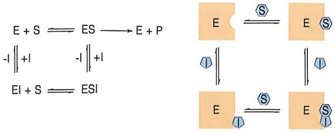

chemical

Chemical reaction equations showing E + S ⇌ ES → E + P and EI + S ⇌ ESI with electron transfer diagram

图 4-22 非竞争性抑制剂与酶结合的动态平衡示意图

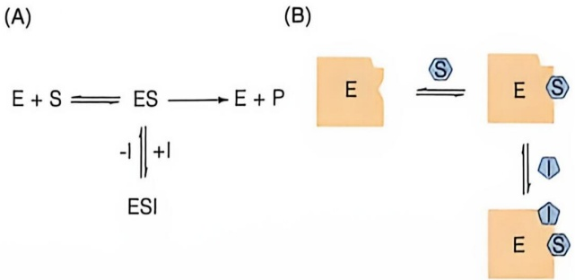

chemical

Chemical reaction diagram showing E + S ⇌ ES → E + P with ESI and S ligands

图 4-23 反竞争性抑制剂与酶结合的动态平衡示意图

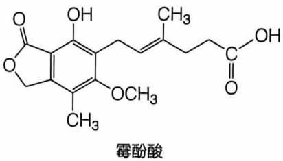

chemical

Chemical structure of Methyl Anhydride (MnAnhydride)

图4-24 次黄嘌呤核苷单磷酸脱氢酶的反竞争性抑制剂霉酚酸的分子结构

ESI 复合物，从而抑制酶催化活性。反竞争性抑制剂靶向的酶通常催化双底物或多底物反应。如果一个双底物（ $S_{1}$ 、 $S_{2}$ ）酶按固定顺序结合底物，即底物  $S_{2}$  仅在底物  $S_{1}$  结合后才可结合，那么针对  $S_{1}$  而言， $S_{2}$  的类似物就是一种反竞争性抑制剂。值得注意的是，这样的抑制剂对于  $S_{2}$  而言为竞争性抑制剂。如果底物的结合无固定顺序，则  $S_{2}$  的类似物对于底物  $S_{1}$  而言为非竞争性抑制剂。例如，霉酚酸（mycophenolic acid）是次黄嘌呤核苷单磷酸脱氢酶（inosine monophosphate dehydrogenase）的反竞争抑制剂（图 4-24），该酶催化  $NAD^{+}$ 依赖的次黄嘌呤核苷酸的氧化，参与鸟苷酸从头合成。霉酚酸在临床上用作免疫抑制剂。

## 4.5.2 不同类型可逆抑制剂的酶促动力学特征

不同类型的抑制剂对米氏动力学曲线的影响不同，导致最大反应速率  $V_{max}$  和米氏常数  $K_{m}$  发生不同模式的改变，反映它们的作用机制的差异。通过实验分析一种可逆抑制剂究竟如何影响相应米氏动力学参数，也可以帮助判断其抑制剂的相应类别。

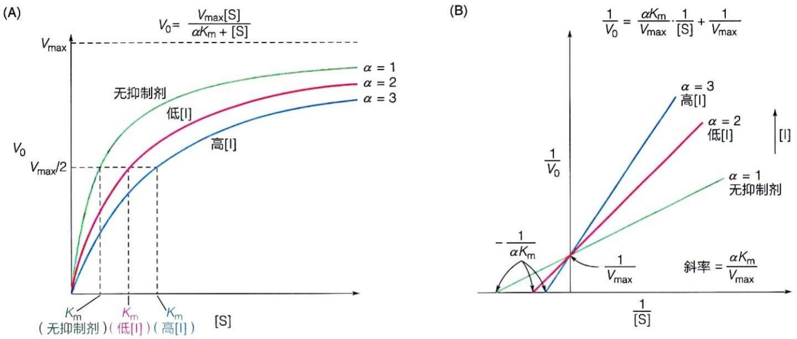

图4-25 竞争性抑制剂影响酶促动力学参数中的$K_{\mathrm{m}}$ 值但不影响 $V_{\mathrm{max}}$ 值

## (1) 竞争性抑制剂

竞争性抑制剂的加入，相当于降低了酶可接触的底物的相对浓度。如果绘制酶促反应初始速率 $V_{0}$ 对底物浓度[S]的曲线，会发现随着抑制剂浓度的增加，双曲线右移，表明需要更高浓度的底物才能使反应的初始速率达到未加入抑制剂时的水平（图4-25A）。

将测量数据进行双倒数作图，会发现不同浓度的竞争性抑制剂的数据将产生一系列交汇于纵轴的直线。这表明增加反应体系中竞争性抑制剂的浓度并不改变酶促反应的 $V_{\mathrm{max}}$，但导致了直线与横轴的交点右移，即 $-1 / K_{\mathrm{m}}$ 增大，表明 $K_{\mathrm{m}}$ 值增大，即酶与底物的表观亲和力降低（图4-25B）。

为反映表观 $K_{\mathrm{m}}$ 值的改变，相应的双倒数方程可以修正为以下形式:

$$
\frac {1}{V _ {0}} = \frac {\alpha K _ {\mathrm{m}}}{V _ {\mathrm{max}}} \cdot \frac {1}{[ \mathrm{S} ]} + \frac {1}{V _ {\mathrm{max}}}
$$

式中， $K_{\mathrm{m}}$ 为未加入抑制剂时的米氏常数，而 $\alpha K_{\mathrm{m}}$ 则代表加入抑制剂后的表观米氏常数，且 $\alpha >1$ 。显然酶的 $\alpha K_{\mathrm{m}}$ 值随着抑制剂浓度[I]的增加而增大（即直线的斜率变大，在 $1 / [\mathrm{S}]$ 横轴上的截距变短）。 $\alpha$ 值的具体大小与抑制剂的浓度和抑制剂与酶结合的解离常数 $K_{\mathrm{i}}$ （详见后文）相关。

## (2) 非竞争性抑制剂

加入一定量的非竞争性抑制剂后，将酶促反应初始速率  $V_{0}$  对底物浓度 [S] 作图，可以观察到随着抑制剂浓度的增加，双曲线下移， $V_{0}$  降低，但达到最大速率一半所需的底物浓度保持不变（图 4-26A）。将数据进行双倒数作图，则可见加入非竞争性抑制剂的直线与未加抑制剂的直线相交于横轴，表明酶的  $K_{m}$  值未发生变化；然而，加入抑制剂的直线在纵轴的截距增加，说明  $1/V_{max}$  值增大，即  $V_{max}$  值降低（图 4-26B）。这种抑制效果表明非竞争性抑制剂降低了酶的催化速率，但不影响酶与底物的结合能力。

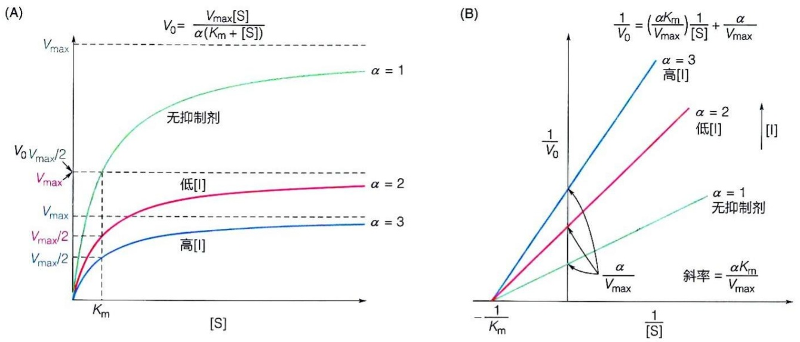

图4-26 非竞争性抑制剂降低酶促反应的 $V_{\mathrm{max}}$ 值，但不影响 $K_{\mathrm{m}}$ 值

为反映表观 $V_{\mathrm{max}}$ 值的改变，对应的双倒数方程式可以修正为

$$
\frac {1}{V _ {0}} = \frac {\alpha K _ {\mathrm{m}}}{V _ {\mathrm{max}}} \cdot \frac {1}{[ \mathrm{S} ]} + \frac {\alpha}{V _ {\mathrm{max}}}
$$

因此，这里反映加入非竞争性抑制剂后， $V_{max}$  下降为  $V_{max}/\alpha$ ，即这里的  $\alpha > 1$ 。

需要注意的是，许多非竞争性抑制剂表现为混合型抑制剂，在使 $V_{\mathrm{max}}$ 值降低的同时，也会影响酶的 $K_{\mathrm{m}}$ 值。具体表现为双倒数作图的直线并不相交于横轴，在此不作详细介绍。

## (3) 反竞争性抑制剂

反竞争性抑制剂只与酶-底物复合物ES结合，而不与自由酶结合，导致酶促反应的最大速率 $V_{\mathrm{max}}$ 和米氏常数 $K_{\mathrm{m}}$ 均下降（图4-27A）。反竞争性抑制剂与ES复合物结合，增强了其稳定性，导致底物难以从ES复合物解离，也难以转化为产物，相当于增加了底物与酶的亲和力，因此 $K_{\mathrm{m}}$ 值也随之下降。

将数据进行双倒数作图，可见未加反竞争抑制剂的直线与加入反竞争性抑制剂的直线互相平行（图4-27B），表明加入抑制剂后直线的截距在横轴和纵轴上均发生了变化，表观 $V_{\mathrm{max}}$ 和表观 $K_{\mathrm{m}}$ 均下降。加入抑制剂后直线斜率与未加抑制剂条件下的斜率相同，表明 $K_{\mathrm{m}}$ 和 $V_{\mathrm{max}}$ 下降幅度相同，即 $K_{\mathrm{m}} / V_{\mathrm{max}}$ 比值不变。

为了反映表观  $V_{max}$  和  $K_{m}$  的改变，相应的双倒数方程可以修改为以下形式:

$$
\frac {1}{V _ {0}} = \frac {K _ {\mathrm{m}}}{V _ {\mathrm{max}}} \cdot \frac {1}{[ \mathrm{S} ]} + \frac {\alpha^ {\prime}}{V _ {\mathrm{max}}}
$$

## (4) 可逆抑制剂与酶结合的抑制常数  $K_{i}$

对于可逆抑制剂而言，其与酶结合的解离常数 $K_{\mathrm{i}}$ 是常被测定的关键参数之一。$K_{\mathrm{i}}$ 值越低，表明抑制剂与酶的亲和力越强，因此，具有低 $K_{\mathrm{i}}$ 值的化合物通常被视为更为理想的药物候选物。

$K_{\mathrm{i}}$ 可通过双倒数作图求得。一种常规的测定 $K_{\mathrm{i}}$ 的方法是通过对加入特定浓度抑制剂的酶促反应体系进行米氏方程的双倒数作图。抑制剂的 $K_{\mathrm{i}}$ 可以从测得的 $K_{\mathrm{m}}^{\text{表观}}$ 和$V_{\mathrm{max}}^{\text{表观}}$ 以及未加抑制剂条件下测得的 $V_{\mathrm{max}}$ 和 $K_{\mathrm{m}}$ 值通过以下公式计算出来。

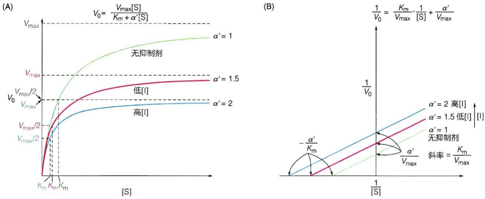

图 4-27 反竞争性抑制剂使酶促反应的  $V_{max}$  值和  $K_{m}$  值同时下降

对于竞争性抑制剂而言: $\alpha=1+\left[I\right]/K_{i}$ ;  $K_{m}^{表观}=\alpha\cdot K_{m}$ ; 故  $K_{i}=K_{m}\left[I\right]/\left(K_{m}^{表观}-K_{m}\right)$ 。

对于非竞争性抑制剂而言: $\alpha = 1 + [\mathrm{I}] / K_{\mathrm{i}}$； $V_{\max}^{\text{表观}} = V_{\max} / \alpha$；故 $K_{\mathrm{i}} = V_{\max}^{\text{表观}}[\mathrm{I}] / (V_{\max} - V_{\max}^{\text{表观}})$。

对于反竞争性抑制剂而言: $\alpha^{\prime}=1+\left[\mathrm{I}\right]/K_{\mathrm{i}}$ ;  $V_{\max}^{表观}=V_{\max}/\alpha^{\prime}$ ;  $K_{m}^{表观}=K_{m}/\alpha^{\prime}$ ; 故  $K_{i}=V_{\max}^{表观}\left[\mathrm{I}\right]/\left(V_{\max}-V_{\max}^{表观}\right)$ 。

$K_{\mathrm{i}}$ 也可通过狄克逊作图法求得。这种方法由1950年代的英国学者马尔科姆·狄克逊（Malcolm Dixon，1899—1985）提出，采用 $1 / V_{0}$ 对[I]作图可直接测定抑制剂的 $K_{\mathrm{i}}$ 值。具体操作是:在分别固定底物S的浓度为 $[\mathrm{S}]_1$ 和 $[\mathrm{S}]_2$ 的情况下，改变抑制剂浓度并分别测定酶促反应的初始速率 $V_{0}$ 随着抑制剂浓度[I]变化的过程；然后，以抑制剂浓度[I]为横坐标，反应速率的倒数 $1 / V_{0}$ 为纵坐标绘图，最终将获得对应底物浓度分别为 $[\mathrm{S}]_1$ 和 $[\mathrm{S}]_2$ 下的两条直线（图4-28）。这两条直线在纵轴（$1 / V_{0}$）左侧的交点的横坐标值即为 $-K_{\mathrm{i}}$ 。狄克逊作图法不仅可以直接从图表中读取 $K_{\mathrm{i}}$ 值，而且还能用于区分抑制剂是竞争性还是非竞争性抑制剂。

请读者注意，为了简化对知识点的理解，本小节省略了关于可逆抑制剂存在下的酶促动力学方程推导过程。如若读者希望深入学习相关内容，建议参考由朱圣庚和徐长法老师主编的《生物化学（第4版）》教材。

## 4.5.3 不可逆抑制剂

不可逆抑制剂几乎均为共价抑制剂。共价抑制剂对酶的抑制一般依赖两个条件。首先，抑制剂需能通过非共价作用识别并结合于酶的催化中心或别构中心；其次，抑制剂需具有能与催化或别构中心特定氨基酸残基（半胱氨酸、丝氨酸、苏氨酸、酪氨酸、赖氨酸、谷氨酸和天冬氨酸等）形成共价键的反应基团。酶催化中心的关键氨基酸残基侧链常因特殊的微环境而被活化，从而容易与共价抑制剂反应。下面将举例予以说明。

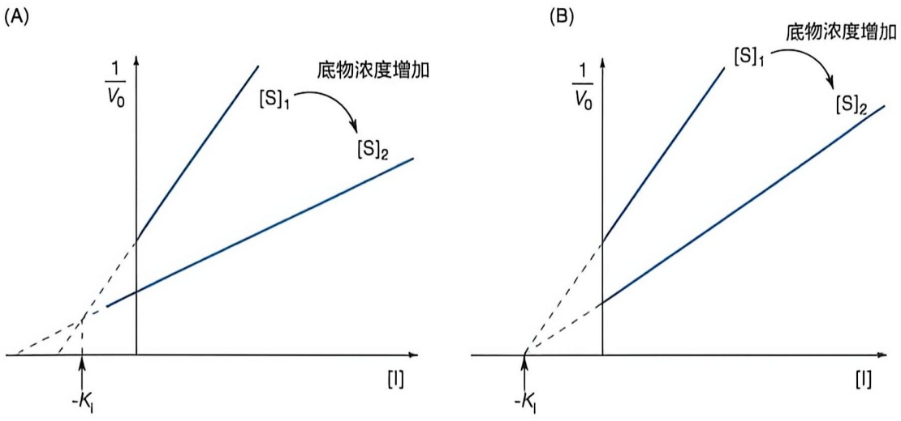

图 4-28 酶的可逆抑制剂的 $K_{1}$ 值可通过狄克逊作图法求得 $\left(\left[\mathrm{S}\right]_{2} > \left[\mathrm{S}\right]_{1}\right)$ (A) 竞争性抑制。(B) 非竞争性抑制

从柳树皮中发现的阿司匹林（aspirin，化学本质为乙酰水杨酸）在20世纪初就被用于解热镇痛，但其作用机制直到1970年代才被揭示:它可以不可逆地抑制环氧合酶（cyclooxygenase）。阿司匹林可以对环氧合酶催化中心的关键丝氨酸残基侧链进行乙酰化修饰（图4-29），从而抑制环氧合酶活性，使动物体内的前列腺素的合成受阻；而后者是诱发炎症反应（产生发烧和疼痛等症状）的信号分子。因此阿司匹林具有解热镇痛的效果。

某些共价抑制剂需要先结合于酶的催化中心，然后在酶的催化下被激活生成化学反应性强的基团，进而通过共价修饰催化中心基团而使酶不可逆地失活。这类抑制剂被称作“自杀性底物”或“自杀性抑制剂（suicide inhibitor）”。“自杀性底物”必须由目标酶激活才成为抑制剂，因此具有很好的选择性。这样的抑制剂用于临床以抑制某些病原菌或疾病组织中特有的靶标酶时，副作用往往低于其他类型的抑制剂。

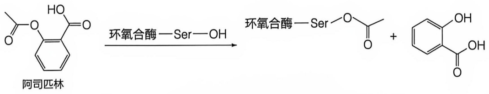

chemical

Chemical reaction equation showing hydrolysis of benzaldehyde to form Ser-oxide and then to form a ketone

图 4-29 阿司匹林作用机制

通过与环氧合酶催化中心的丝氨酸残基共价反应而不可逆地抑制环氧合酶活性

## 知识延展 4- 1

## 血液凝固涉及多种酶原的级联激活过程

血液是人体重要的循环系统，其流动性确保了物质（如氧气、无机盐、激素、抗体等）的运输，同时也使不同器官之间可以进行代谢分工和协调，对于维持生命体的各项基本活动十分重要。基于血液的流动性特征，动物演化产生了一套复杂但快速的血液凝固机制，确保当血管出现破损时，破损处的血液能迅速凝固以免血液的大量流失。

血液凝固简称凝血，指血液由流动的液态变为不可流动的凝胶态的过程。参与血液凝固的凝血因子包括蛋白质、辅因子等，它们大多由肝细胞合成后分泌至血液，并以无活性的前体形式存在于血液中。一旦出现血管破裂，它们将以一种级联的方式被迅速激活，最终形成固体的血凝块，覆盖于伤口处，从而阻止血液的继续流失。所谓的级联激活，简单说，就是前体蛋白质（酶原）1被激活后，催化前体蛋白质2的激活，后者再催化前体蛋白质3的激活，依此类推。直到最后导致纤维蛋白聚集成血凝块。这种酶的级联激活模式，使得信号被迅速放大，导致血液凝固过程快速有效地发生。血液凝固级联激活的最终阶段是在被激活的凝血酶（thrombin）的作用下，血液中的可溶性的纤维蛋白原（fibrinogen）被激活成不溶性的纤维蛋白（fibrin），之后发生聚集并共价交联形成纤维蛋白块。

参与血液凝固的凝血因子总共有 12 种，分别以罗马数字编号为 I、II、III、IV、V、VI、VII、IX、X、XI、XII 和 XIII，编号下标 a 表示该因子为激活形式，关于凝血因子的具体组成参考图 4-30。血液凝固过程可以划分为三条途径:内在途径（也称接触途径）、外在途径（也称组织因子途径）和共同途径（图 4-30）。内在途径被认为是由于血管的内部创伤而诱发，开始于凝血因子XII被激活为XIIa的过程，然后凝血因子XI、IX、X被依次激活。外在途径是由血管内皮组织的损坏导致血液与组织中的一种被称作组织因子的凝血因子III的暴露，凝血因子III与活化的凝血因子VIIa形成复合物并进一步激活凝血因子X变成Xa。由内在途径和外在途径生成的激活态的凝血因子Xa会进入后续的共同途径。在共同途径中，激活的凝血因子 $X_{a}$ 在凝血因子 $V_{a}$ 和IV（钙离子）存在情况下，将凝血因子Ⅱ（凝血酶原）切割生成 $II_{a}$ （凝血酶）； $II_{a}$ 进一步活化凝血因子I（纤维蛋白原）变成纤维蛋白单体 $I_{a}$，同时 $II_{a}$ 激活凝血因子XIII变成XIIIa；活化的XIIIa促使纤维蛋白单体聚集形成不溶性的纤维蛋白，促使血凝块的形成。

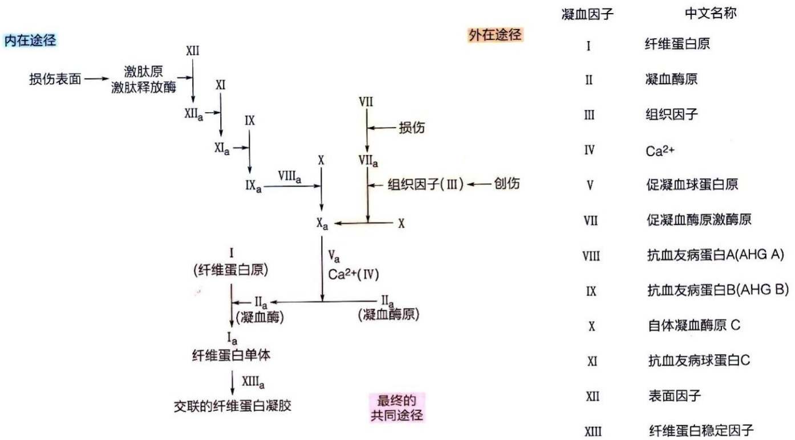

flowchart

This flowchart illustrates the clinical process of a liver injury, detailing the progression from damage to specific pathways (surgery, thrombosis, and tissue synthesis) leading to final comprehensive treatment.

图4-30 酶原的级联激活使得凝血过程快速发生

## ※展望

## (1) 对酶催化机制的认识还远非彻底

在过去几十年里，通过理论研究和实验探索，人们对酶催化过程的理解取得了重大进展，但关于酶催化的本质，尤其是其高效性的来源，依然存在诸多未解之谜。深入理解酶的催化机制，仍然需要理论创新与实验方法的进一步突破。

酶结构的柔性使得在催化过程中能够发生构象变化，这意味着酶催化中心所提供的微环境并非固定不变。然而，当前的理论和实验技术尚难以精确地解析和表征酶在催化过程中的连续构象变化。

酶催化的化学反应极快，这使得实验观测尤为困难。例如，酶催化过程中化学键的断裂和形成，以及蛋白质中氨基酸残基的局部运动，往往发生在飞秒至皮秒（即 $10^{-15} \sim 10^{-12} \mathrm{~s}$）的时间尺度，而蛋白质肽链的运动则发生在纳秒（$10^{-9} \mathrm{~s}$）尺度，蛋白质结构域之间的运动和整体构象变化也是在微秒至毫秒（$10^{-6} \sim 10^{-3} \mathrm{~s}$）的范围内。要探究这些极短时间内发生的微观事件，目前仍缺乏有效的实验方法。计算机模拟，特别是近年来发展迅速的分子动力学模拟（molecular dynamics simulation），提供了一种新的分析工具。

酶催化机制之所以复杂，源于多种因素的共同作用。这些因素包括反应微环境的复杂性、酶分子的构象变化、辅因子的作用、多步骤的催化过程以及潜在的量子效应等。近年来，结构生物学、计算模拟和人工智能等先进技术的发展，为深入理解酶催化机制提供了新的工具和思路。通过解析和预测高分辨率的酶分子结构、模拟催化过程中的分子动态、研究辅因子的作用，以及利用大数据分析和机器学习挖掘酶催化的潜在规律，有望揭示更多酶催化机制的细节。然而，仍然存在许多未知的领域。例如，量子效应在酶催化中的具体影响尚未明确，酶活性中心微环境的物理化学特性也未能完全表征。未来，需要依靠理论和技术的创新，通过跨学科的合作，对酶催化过程进行深入研究，以揭示酶催化机制的完整图景。

## (2) 根据酶的结构等信息预测酶的催化底物仍是一大挑战

在对酶的催化特性有了一定理解之后，人们开始尝试对酶进行改造，甚至从头设计，以开发出符合特定需求的酶催化剂，这些催化剂在自然界中可能并不存在，却能满足人类的需求。然而，正如在蛋白质功能预测中所面临的挑战一样，目前仍缺乏有效的方法来预测通过基因组分析新鉴定的酶或纯化的新型酶所催化的特定反应及其底物。正因为如此，在数据库中储存的潜在酶分子的氨基酸序列或三维结构信息中，绝大多数候选酶分子都缺乏对其所催化反应的高质量注释。因此，利用酶的结构信息来预测其催化的底物类型将成为未来研究中的一项极具挑战性任务。

## (3) 对于核酶的认识有待深入

尽管绝大多数生物催化剂是由蛋白质构成的，但在 1980 年代，科学家发现核酸也具备催化活性，并称之为核酶。与由蛋白质组成的酶不同，核酶的底物主要为 RNA 分子。除核糖体中的 RNA 能够催化肽键形成外，目前尚未发现核酶能够催化其他分子的转化过程。一般来说，核酶的催化活性明显低于蛋白酶，其转化数通常在 0.1～5，比蛋白酶低几个数量级。当前对核酶的理解仍然不够深入，亟需进一步的研究。需要探讨自然界中存在的核酶是否能像蛋白质酶一样催化多种类型的化学反应，研究核酶在生命进化中的作用，并明确核酶的催化效率等关键问题。

## ※ 本章小结

生命体内的所有代谢活动都依赖酶的参与。绝大多数酶由蛋白质构成，少数酶则是由核酸构成。

很多酶需要依赖金属离子或有机小分子等辅因子才能发挥其功能。

作为生物催化剂，酶具备高效性和专一性等独特特征，这些特性源自酶分子具有特定的底物结合位点和催化中心。

酶通过与底物形成中间态复合物，降低反应的能垒，从而提高反应速率。

基于对酶催化过程的理论和实验研究，科学家们提出了酶的米氏动力学模型，并通过该模型对酶与底物的亲和力及催化效率进行了数学描述，便于直观且准确地分析和比较酶的特性。

为了确保生物体内化学反应的有序进行，酶的活性可以通过酶本身的修饰、其他小分子或其他蛋白质的作用进行精细调控。

酶的抑制剂分为不可逆抑制剂和可逆抑制剂两大类，其中可逆抑制剂又可分为竞争性抑制剂、非竞争性抑制剂和反竞争性抑制剂等类型。

作为控制细胞内众多反应的直接开关，酶作为重要的药物靶点，受到了广泛关注，并且已有许多针对酶的药物被用于疾病的治疗。

## ※ 思考题

1. 根据酶催化反应的本质，酶具体被分为哪些类别？它们具体催化何种反应？
2. 酶有哪些催化特征？
3. 酶催化中心的质子受体和质子供体有哪些？

4. 米氏方程成立的基本前提是什么？
5. 请推导米氏方程。
6. 什么是别构调控？别构调控的酶的动力学曲线呈现何种特征？
7. 可逆抑制剂的分类以及各自特征有哪些？

## ※ 推荐阅读

1. SUMNER J B. The isolation and crystallization of the enzyme urease: preliminary paper [J]. J Biol Chem, 1926, 69: 435–441.
本文献首次结晶了脲酶并直接证明酶是蛋白质。
2. MICHAELIS L, MENTEN M L. Die kinetik der invertinwirkung [J]. Biochemische Zeitschrift, 1913, 49: 333-369.
本文献建立了米氏方程。
3. BRIGGS G E, HALDANE J B. A note on the kinetics of enzyme action [J]. Biochem J, 1925, 19: 338–339.
本文献提出稳态模型并修正了米氏方程。
4. COPELAND R A. Enzymes: a practical introduction to structure, mechanism, and data analysis [M]. 3rd ed. Hoboken: Wiley, 2023.

(撰写:谢田，于湘晖，胡奇；审修:王志新)

## 5

## 蛋白质探究

蛋白质是生命活动的核心执行者，几乎参与了所有的生物过程。研究蛋白质的结构与功能关系，对于揭示生命现象和规律具有重要意义。为了更深入地理解生命活动，必须从复杂的生物体成分中分离出特定蛋白质，并对其进行功能分析和结构研究。现代物理学、化学和生物技术的不断进步，为这些研究提供了多种方法和技术手段。

蛋白质的纯化可以利用盐析、离心及层析等多种技术，依据蛋白质在溶液中的溶解度、分子大小、电荷特性、吸附特性及与配体的亲和力等差异进行分离。分离得到的蛋白质可通过电泳、免疫学方法和质谱分析等技术进行成分鉴定，并借助蛋白质测序仪或质谱技术进行序列分析。为了深入研究蛋白质间的相互作用，可以采用免疫共沉淀、表面等离子共振、酵母双杂交、荧光共振能量转移等方法。蛋白质及其复合物的三维结构解析则可通过X射线晶体衍射、核磁共振或冷冻电镜技术实现。此外，计算机技术与人工智能技术的快速发展和应用，也让蛋白质结构预测和动态模拟取得了显著突破。

本章将围绕蛋白质的基本特性，简要介绍蛋白质的纯化方法、性质表征、序列测定，以及多肽和蛋白质的化学合成方法。此外，还将介绍蛋白质间相互作用、结构解析、空间结构预测及结构动态模拟等相关研究方法。

## 5.1 基于蛋白质物理和化学性质的差异而进行分离和纯化

对于目标蛋白质，可以直接从其天然所在的生物样品中获取，如动物组织、植物组织或微生物等。也可以对目标蛋白质天然所在生物中相应基因进行编辑，或者将目标蛋白质基因导入合适的宿主生物或细胞中进行表达，随后从中获取目标蛋白质。此外，还可以通过体外翻译（in vitro translation）获取目标蛋白质，即在无细胞提取物（cell-free extract）中利用 DNA 或 RNA 作为模板进行蛋白质合成。

目标蛋白质所在的生物样品中，除目标蛋白质外，还含有多种其他蛋白质、核酸等生物大分子，以及脂质和代谢产物等各种分子。纯化目标蛋白质的过程，就是将其与样品中其他分子（特别是其他蛋白质）分离，同时需尽量保证目标蛋白质的生物活性不受影响。由于不同蛋白质的物理和化学性质存在差异，所采用的纯化方法也有所不同，但整体纯化流程基本相似，主要步骤如下（图 5-1）:

① 样品准备:通过物理或化学方法处理含有目标蛋白质的生物样品（如破碎组织、裂解细胞或使用去垢剂溶解等），以释放目标蛋白质。
② 目标蛋白质粗分离:利用离心、盐析等初步分离方法，将目标蛋白质所在组分与其他组分分离开。
③ 目标蛋白质精细纯化:依据目标蛋白质的物理和化学性质，选择合适的层析方法（如亲和层析、离子交换层析、凝胶层析等）对初步分离的目标蛋白质进一步纯化，以获得纯度和性质良好的目标蛋白质。

图 5-1 蛋白质纯化流程示意图

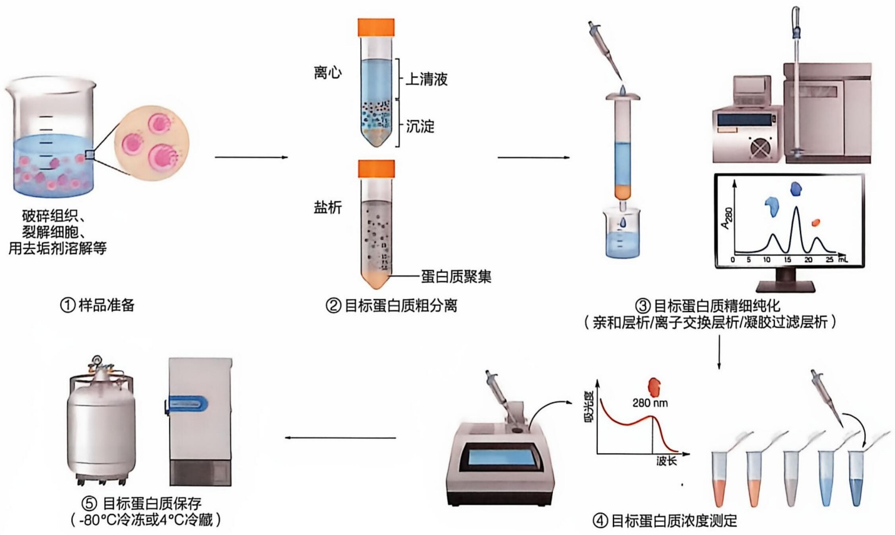

flowchart

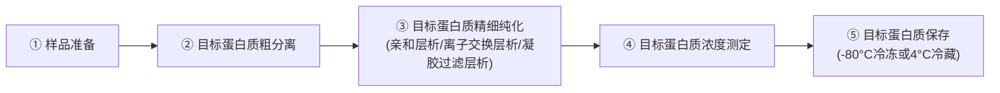

④ 目标蛋白质浓度测定:根据目标蛋白质的物理特性（如紫外吸收）或化学特性（与特定化学试剂反应）测定其浓度。
⑤ 目标蛋白质保存:将纯化后的蛋白质在适当条件下保存，如冷冻、冷藏或冷冻干燥。

由于大多数蛋白质具有热不稳定性，整个纯化流程通常需在冰上或 $2\sim 8^{\circ}\mathrm{C}$ 的环境进行，短暂的液体转移、称量配平及某些不适合低温操作的步骤（如切除亲和标签的部分蛋白酶在低温下催化效率低）可在室温完成。

## 5.1.1 蛋白质通过破碎细胞被释放

根据目标蛋白质所在生物样品的类型，以及目标蛋白质在细胞内表达后的分布情况（如是否分泌到细胞外，或是否与细胞膜或细胞器膜结合），需选择合适的缓冲液并采取适当的方法将生物样品裂解，从而释放目标蛋白质，为后续纯化做好准备。

## (1) 裂解缓冲液组成

裂解缓冲液（lysis buffer）是在裂解生物样品之前加入的溶液，其作用是促进目标蛋白质从生物样品中释放，并维持其结构稳定性。选择合适的裂解缓冲液对目标蛋白质的成功纯化至关重要。

裂解缓冲液通常由适当浓度的盐和 pH 缓冲液组成，用双重蒸馏水（double-distilled water, dd  $H_{2}O$ ）配制。常用的盐为 150 mmol/L 氯化钠，浓度与生理盐水（9 g/L NaCl）接近。常见的缓冲液包括 pH 7.4 的 HEPES-Na 缓冲液和室温下 pH 8.0 的 Tris-HCl 缓冲液等。需要特别注意，Tris-HCl 缓冲液的 pH 受温度影响:在 5～25℃ 范围内，温度每降低 1℃，pH 约升高 0.03。

此外，为了防止目标蛋白质被水解，裂解缓冲液中通常需要加入蛋白酶抑制剂，以抑制裂解时释放的蛋白酶活性。常用抑制剂包括:丝氨酸蛋白酶抑制剂苯甲基磺酰氟（phenylmethylsulfonyl fluoride，PMSF）和抑肽酶 aprotinin、丝氨酸与半胱氨酸蛋白酶抑制剂 leupeptin、半胱氨酸蛋白酶抑制剂 E-64、天冬氨酸蛋白酶抑制剂 pepstatin A 以及氨肽酶抑制剂 bestatin 等。其中，PMSF 在水溶液中易分解，因此在加入 PMSF 后需尽快进行样品裂解。作为替代，可以使用 PMSF 的类似物 AEBSF [4-(2-aminoethyl)benzenesulfonyl fluoride hydrochloride, 4-(2-氨乙基)苯磺酰氟盐酸盐)，其水溶性和稳定性优于 PMSF。值得注意的是，如果目标蛋白质本身属于蛋白酶，或者能够与某些蛋白酶抑制剂发生化学反应，那么在选择蛋白酶抑制剂时须格外谨慎，避免对目标蛋白质造成影响。

对于细胞内蛋白质或含有胞内区域的蛋白质，如果这些蛋白质没有二硫键（disulfide bond）但存在裸露的半胱氨酸残基，裂解缓冲液和纯化缓冲液中通常需要加入还原剂，以防止半胱氨酸侧链被氧化。常用还原剂包括二硫苏糖醇（dithiothreitol, DTT）、2-巯基乙醇（2-mercaptoethanol, 2-ME）及三（2-羧乙基）膦盐酸盐 [Tris(2- carboxyethyl)phosphine hydrochloride, TCEP]。需要注意的是，如果后续纯化过程中需要使用 His 标签蛋白纯化树脂，那么缓冲液中应避免加入 DTT，因为 DTT 会还原树脂上结合的 Ni$^{2+}$ 或 Co$^{2+}$，导致树脂失去结合 His 标签蛋白的能力。

对于含有跨膜结构域或与细胞膜、细胞器膜结合的蛋白质，通常需要在裂解缓冲液中加入去垢剂（detergent）。去垢剂可以包裹目标蛋白质的膜结合区域，将其从膜中分离并溶解到缓冲液中。用于蛋白质纯化的去垢剂通常是不易导致蛋白质变性的非离子型去垢剂（nonionic detergent）或两性型去垢剂（zwitterionic detergent），例如十二烷基-β-D-麦芽糖苷（n-dodecyl-β-D-maltoside，DDM）、糖-薯蓣皂苷元（glyco-diosgenin，GDN）和3-[(3-胆酰胺丙基)二甲基氨基]-1-丙磺酸内盐(3-[(3-cholamidopropyl)dimethylammonio]-1-propanesulfonate，CHAPS）等。

此外，裂解缓冲液及后续的纯化缓冲液中，往往还需要加入一些小分子或离子，以结合并稳定目标蛋白质的结构。例如，G蛋白的 $\alpha$ 亚基（$\mathrm{G}\alpha$ 亚基）可以结合 $\mathrm{Mg}^{2+}$ 以及GDP或GTP，因此在缓冲液中加入 $\mathrm{Mg}^{2+}$ 和GDP，可以显著稳定 $\mathrm{G}\alpha$ 亚基的结构，防止其发生水解或变性。

裂解缓冲液通常需要现用现配，并在使用前于冰上或 $2\sim 8^{\circ}\mathrm{C}$ 预冷。

## (2) 组织或细胞裂解

如果目标蛋白质来自体外培养的细胞，且属于分泌型蛋白，则无须破碎细胞，只需通过离心去除细胞，收集上清液即可进行后续纯化。对于胞内蛋白质，则需要先破碎细胞，使蛋白质从细胞内释放出来，同时尽可能保持其天然的具有生物活性的结构。

根据不同细胞的结构特点，裂解方法有所不同。常用裂解方法可分为物理法和化学法两类。物理法通过机械力使细胞破碎，包括匀浆处理、冷冻研磨、超声处理、高压破碎及渗透压胁迫等方法。化学法利用特定化学试剂或酶破坏细胞结构，例如，使用特定的水解酶破坏细胞壁的特定结构组分（溶菌酶水解细菌细胞的肽聚糖、 $\beta-$ 葡聚糖酶水解酵母细胞的细胞壁、纤维素酶水解纤维素等），以及使用不易导致蛋白质变性的去垢剂，破坏细胞膜脂质双层结构。

动物细胞由于没有细胞壁，通常可以采用较为温和的物理方法进行破碎，如超声处理或渗透压胁迫。植物组织则不同，由于其具有由纤维素等物质组成的细胞壁，破碎时需要借助石英砂或玻璃粉，在适当的缓冲液中进行研磨。此外，使用纤维素酶处理能够有效促进细胞壁裂解，提高细胞破碎速率。细菌的细胞壁骨架由肽聚糖分子通过共价键构成，结构坚韧，因此破碎时需要更强的机械力，如使用超声波破碎或高压破碎。也可以通过添加溶菌酶促进细菌细胞壁的破坏。

## 5.1.2 蛋白质可通过离心或盐析等物理方法进行粗分离

组织或细胞破碎后，通常采用离心法或盐析法进行粗分离，其中离心法较为常用。离心法还可用于表征生物大分子（如蛋白质）的分子量、聚集状态等物理性质（见5.2.2节）。