## （1）离心是根据蛋白质分子的大小或密度差异而分离蛋白质的物理方法

离心（centrifugation）是一种利用高速旋转产生离心力，对不同物质根据其沉降速率的差异进行分离的方法。针对生物分子的分离，常用的离心方法包括差速离心（differential centrifugation）和密度梯度离心（density gradient centrifugation）。

差速离心是指在离心管内溶液密度均匀的情况下，通过逐步提高离心速率，分阶段分离待处理的生物样品的一种方法。在较低离心速率下，尺寸较大的成分（如未破碎的细胞、细胞碎片以及密度较高的细胞器）会沉降下来；收集上清液，以更高的离心速率离心，可以沉降细胞膜及细胞器膜等膜组分；进一步提高离心速率，则可沉降蛋白质复合体等生物大分子复合物，而分子量较小的蛋白质通常会留在上清液中（图 5-2A）。差速离心通常用于将特定的细胞器或细胞膜与较大的细胞碎片及可溶于裂解缓冲液的成分分开。若目标蛋白质溶解于上清液中，则可直接进入下一步的纯化流程；若目标蛋白质位于沉降的细胞器或膜组分中，则需进一步裂解释放或使用去垢剂萃取目标蛋白质。再次离心后收集上清液，进行后续纯化。

密度梯度离心是一种在离心管内建立密度梯度（从管底到管口溶液密度逐渐减小），然后利用离心力使不同组分分布在与其密度相等的区域，从而分离不同组分的方法。根据分离原理可分为依赖沉降速率的速率区带离心和依赖浮力密度的平衡密度梯度离心。其中的平衡密度梯度离心所用离心速率较高，时间较长，通常需要在超速离心机中进行。离心后，样品中的不同组分根据其密度差异，在离心管（通常为塑料管）中形成不同的分布区域（图5-2B）。提取这些区域的样品可以采用两种方式:一是用注射器从管上部到下部逐层刺穿抽取；二是将注射器从管上部伸入管底或从底部刺入依次抽取。随后，通过 SDS-PAGE（聚丙烯酰胺凝胶电泳）或其他检测方法，确定目标蛋白质所在的密度梯度区域，进而收集该部分样品用于进一步纯化。常用的密度梯度介质包括蔗糖、甘油和氯化铯等。

图 5-2 差速离心法 (A) 和密度梯度离心法 (B) 原理示意图

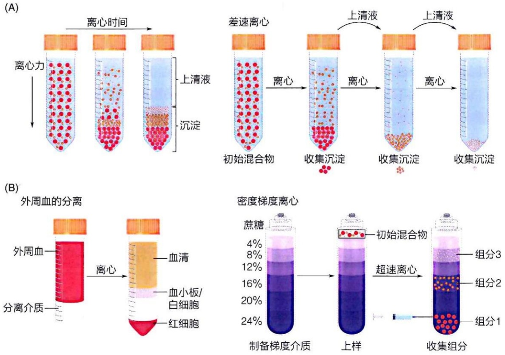

## (2) 盐析是根据蛋白质分子的溶解度差异而分离蛋白质的物理方法

在通过离心获得目标蛋白质的粗提取液后，可以直接通过层析（见5.1.3节）进行精细纯化，也可以先选择合适的方法将目标蛋白质与其他蛋白质进行初步分离，再利用层析精细纯化。盐析（salting out）是一种常用的粗分离方法。盐析是指利用高浓度无机盐降低蛋白质的溶解度，使其从溶液中析出形成沉淀的过程。这一现象最早在1850年代被发现，随后在1880—1890年代，德国学者弗兰茨·霍夫迈斯特（Franz Hofmeister，1850—1922）等人以血清和鸡蛋蛋白中的不同蛋白质为研究对象，探讨了不同类型的盐分子引发盐析效应的现象及机制。

一般来说，加入较低浓度的中性盐（中性盐是由强酸和强碱反应生成的盐，其水溶液在一定条件下 pH 接近 7）可以促进蛋白质（或其他带电大分子）的溶解，这一现象称为盐溶（salting in）。这是因为盐分子与蛋白质分子之间的结合抑制了蛋白质分子间的疏水相互作用，从而增强了蛋白质的亲水性。然而，当中性盐的浓度达到较高水平时，盐离子的水化（hydration）会与蛋白质分子争夺水合所需的水分子。这使得蛋白质分子表面的水化层被逐渐剥离，导致蛋白质分子之间通过其表面的疏水区域发生相互作用，最终聚集形成沉淀，即发生盐析（图 5-3）。由于不同蛋白质的分子表面结构存在差异，它们发生盐溶和盐析所需的盐浓度也不同。因此，可以通过调节盐浓度，利用盐析来分离不同的蛋白质。

具体而言，向混合液中加入适量的中性盐，使盐浓度逐渐升高到一定水平时，一部分蛋白质会先被沉淀。通过离心分离获得上清液后，进一步提高盐浓度，另一部分蛋白质会随之沉淀。不断增加盐浓度，直到大部分（或全部）目标蛋白质在特定盐浓度下被沉淀。盐析过程中沉淀的蛋白质可以通过再次溶解恢复其生物活性。用于蛋白质盐析的中性盐中，硫酸铵是首选，它具有很高的水溶性，且溶解时对温度影响较小，不会导致溶液温度明显升高。

在进行离心或盐析等实验时，常需要去除无机盐或更换缓冲液。这时，可以利用蛋白质大分子无法通过半透膜，而无机盐和单糖等小分子可以通过的特性，通过透析（dialysis）去除盐分或更换缓冲液。具体操作是将装有蛋白质样品的半透膜袋浸泡在大体积的缓冲液中，小分子通过扩散自由进出，逐步降低样品中的无机盐浓度或置换缓冲液。也可以利用压力或离心力使水和其他小分子溶质快速通过半透膜，将蛋白质进行截留，从而达到浓缩蛋白质样品并同时脱盐的双重目的，该过程称作超滤（ultrafiltration）（图5-4）。

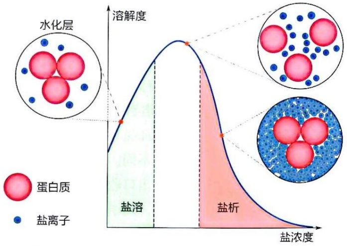

<details>
<summary>area</summary>

| 区域 | 描述 |
| --- | --- |
| 水化层 | 蛋白质 (红色) |
| 盐溶 | 非晶溶 (绿色) |
| 盐析 | 非晶酸 (粉色) |
</details>

图 5-3 蛋白质溶解度与盐浓度之间的关系

图 5-4 利用透析（A）和超滤（B）去除水和无机盐示意图

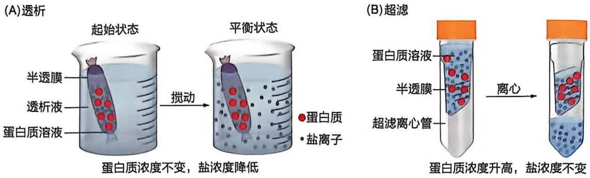

当蛋白质处于等电点（isoelectric point，pI）时，其净电荷为零，溶解度最低。因此，可以通过逐步改变溶液的 pH，使不同蛋白质在各自的等电点处沉淀，从而实现分离。沉淀的蛋白质可以通过调整溶液 pH 重新溶解。但需要注意，pH 过高或过低容易导致蛋白质变性，因此该方法存在一定的局限性。

## 5.1.3 层析基于待分离物质在固定相和流动相之间的不同分配比例而进行蛋白质分离

通过粗略分离获得的含目标蛋白质的混合物，可以进一步利用层析（或称色谱，chromatography）方法进行精细纯化。层析是一种基于蛋白质分子（或其他生物分子）之间在尺寸、带电特性或疏水相互作用等方面的细微差异，进行分离纯化的技术。

虽然英国化学家阿彻·马丁（Archer J.P. Martin，1910—2002）和理查德·辛格（Richard L.M. Synge，1914—1994）因发明“分配层析”而于1952年荣获诺贝尔化学奖，但层析技术最早是由俄国学者米哈伊尔·茨维特（Mikhail Tswett，1872—1919）在20世纪初发明的。

茨维特等人将树叶的有机溶剂提取液滴入一根装有碳酸钙（石灰粉）的窄玻璃管中，当液体向下流动时，在玻璃管中形成了颜色不同的条带，这些颜色来自不同的植物色素。当提取液被完全吸附后，再使用合适的有机溶剂流过吸附柱，不同色素即可被进一步分开。这一过程就是分配层析，其中碳酸钙作为固定相，有机溶剂作为流动相。植物色素分子的分离正是基于它们在两相之间的分配系数不同以及流动速率的差异而实现的。这一现象与光谱中不同颜色的光线分离效果相似，故被称为色谱（后来也被称为层析）。

各种层析技术均可视为利用待分离物质在固定相和流动相中分配系数（partition coefficient）不同来实现分离。由于分配系数的差异，不同物质在层析柱中的移动速度也不同。随着层析时间的延长，这些物质之间的距离会逐渐拉开，从而可以在层析柱出口收集不同时间的流出样品，达到分离的目的。常用的层析技术包括:亲和层析、离子交换层析、尺寸排阻层析和疏水相互作用层析。为了提高分离效率，发展出了在高压条件下进行这些层析的技术，即高效液相色谱（high performance liquid chromatography，HPLC）。以下将分别介绍各类层析技术的基本原理和应用。

## (1) 亲和层析基于蛋白质与其配体之间的亲和作用进行分离

亲和层析（affinity chromatography）是一种基于目标蛋白质与特定分子或离子之间特异亲和作用来实现分离的蛋白质纯化方法。在所有层析技术中，亲和层析选择性最强、效率最高。用于特异识别目标蛋白质的分子或离子会被共价连接于惰性树脂等固体基质上，形成固定相。可用于亲和层析的分子包括:底物类似物（用于纯化特定的酶）、抗原分子（用于纯化特定的抗体）、抗体分子（用于纯化特定的抗原）、核酸片段（用于纯化与其特异结合的蛋白质）、激素（用于纯化其特异性受体）等。尽管早在1910年代，人们就尝试使用含有不同类型淀粉（直链淀粉和支链淀粉）的层析柱纯化淀粉酶，但亲和层析的首次成功应用可能是在1950年代，利用共价连接苯酚基团的纤维素柱从蘑菇中纯化出酪氨酸酶。

在亲和层析中，固定相由共价偶联了配体基团的惰性树脂组成。当蛋白质混合物流经固定相时，只有能够与配体特异性结合的蛋白质会被吸附，而其他成分则随流动相流出。随后，通过改变流动相条件（如加入高浓度配体等），使被吸附的目标蛋白质从层析柱上被竞争洗脱下来，实现分离纯化（图 5-5）。

## (2) 离子交换层析依据带电差异而分离蛋白质

离子交换层析（ion-exchange chromatography）是一种以带有正电或负电基团的树脂作为固定相，利用待分离物质的电荷差异实现分离的层析技术（图5-6）。这一方法最早被应用于分离稀有无机离子（如稀土元素）。1940—1950年代，离子交换层析开始用于生物分子的分离，例如分离果胶多聚半乳糖醛酸酶（polygalacturonase）和果胶甲酯酶（methylesterase），以及分离混合物中的核苷酸和氨基酸等。随着技术的发展，离子交换层析被广泛应用于多肽和蛋白质的纯化，成为一种高效、常用的分离方法。

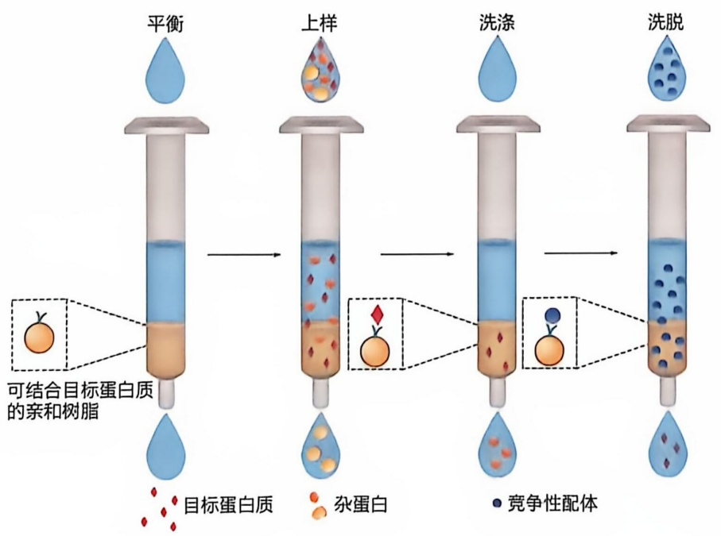

<details>
<summary>flowchart</summary>

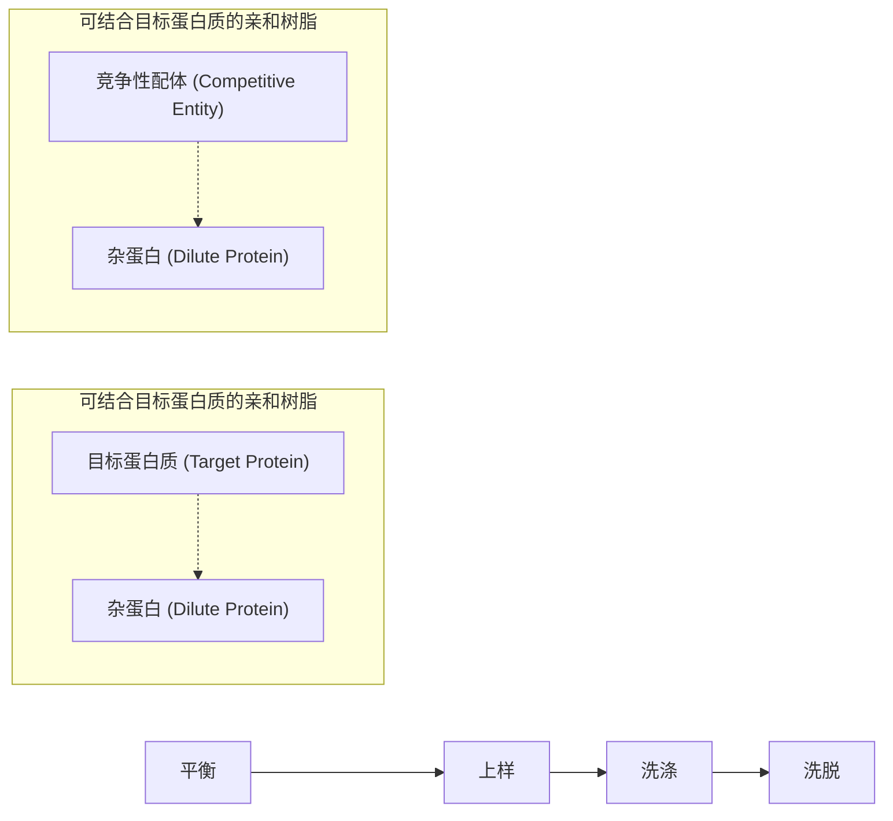
</details>

图 5-5 亲和层析原理示意图

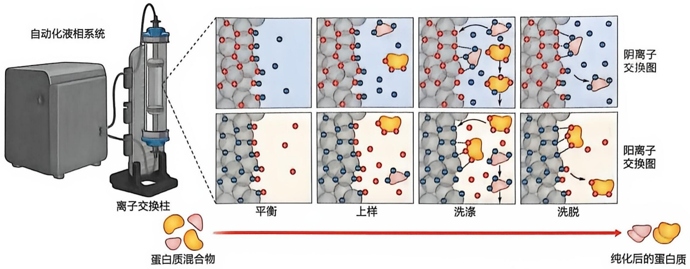

<details>
<summary>flowchart</summary>

This diagram illustrates the process of polymerization using an automated liquid phase system and a solution exchange column, showing steps from neutralization to final purification.
</details>

图 5-6 离子交换层析分离蛋白质原理示意图

离子交换层析过程分两步。第一步，在低盐浓度（常用的盐是 NaCl）的缓冲液条件下，流动相中带有与固定相相反电荷的组分通过静电相互作用与固定相结合。第二步，逐渐提高缓冲液的盐浓度，利用离子交换作用，将与固定相结合的组分洗脱下来。在特定 pH 条件下，不同组分由于净电荷或表面电荷分布的差异，其与固定相之间的静电作用强弱不同。与固定相结合较弱的组分会被较低的盐浓度洗脱，而结合较强的组分则需要较高的盐浓度才能洗脱。通过逐步增加盐浓度，不同带电性质的组分会被依次洗脱并收集，从而实现分离。

根据固定相树脂所带电荷的不同，离子交换层析可分为两类:阴离子交换层析和阳离子交换层析。当树脂带正电荷时，称为阴离子交换层析，因为它吸附的是带负电荷的组分；而当树脂带负电荷时，则称为阳离子交换层析，因为它吸附的是带正电荷的组分。

蛋白质所带的电荷与其所在溶液的 pH 密切相关。pH 与蛋白质的等电点（pI）相差越大，蛋白质所带电荷越多；反之，pH 接近 pI 时，蛋白质的净电荷接近零。在 pH 等于 pI 时，蛋白质不带净电荷。因此，通过改变溶液的 pH，可以调节蛋白质与固定相结合的强度。

## (3) 尺寸排阻层析依据尺寸的差异而分离蛋白质

尺寸排阻层析（size exclusion chromatography）也称凝胶过滤（gel filtration）层析，是一种基于分子尺寸差异进行分离的层析技术（图 5-7）。不同大小或形状的分子流经填充有多孔介质（固定相）的凝胶层析柱时，表现出不同的流动行为。尺寸较大的分子无法进入凝胶颗粒内部的网状结构，被排阻在颗粒外部，随溶剂（流动相）沿着凝胶颗粒之间的空隙快速向下移动，因此最先从层析柱中流出。尺寸较小的分子可以进入凝胶颗粒内部的孔隙，因而流动速度较慢，需要更长时间才能流出层析柱。

简单来说，分子大小不同导致它们流经凝胶层析柱时所走路径的长短不同，从而实现分离:分子越大，所走的路径越短，越早流出层析柱；分子越小，路径越长，越晚流出。此外，分子的形状也会影响其在层析柱中的流动行为:相同质量的分子，线性分子与球形分子相比较难进入凝胶颗粒的孔隙，因而会比球形分子较早流出。

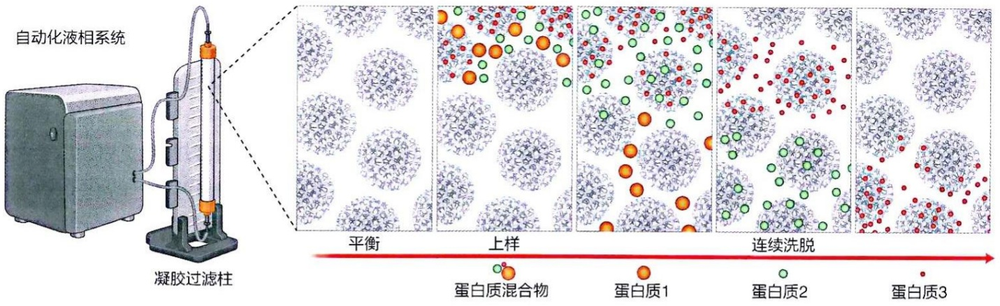

<details>
<summary>text_image</summary>

自动化液相系统
凝胶过滤柱
平衡
上样
蛋白质混合物
蛋白质1
蛋白质2
连续洗脱
蛋白质3
</details>

凝胶层析柱中使用的凝胶颗粒通常由交联程度不同（因而孔径大小不同）的葡聚糖、聚丙烯酰胺或琼脂糖等材料制作。这些材料的孔径大小决定了适用于分离的分子尺寸范围。

（4）疏水相互作用层析依据蛋白质表面的疏水特征差异而分离蛋白质

疏水相互作用层析（hydrophobic interaction chromatography）是一种基于蛋白质表面疏水特征差异进行分离的层析技术。不同蛋白质分子表面的疏水和亲水基团比例不同，这种差异是疏水层析的分离基础。虽然水溶性蛋白质的大部分疏水性氨基酸残基通常隐藏在分子内部，但仍有部分疏水残基暴露在分子表面，形成局部疏水区域。疏水相互作用层析正是利用蛋白质分子表面疏水性的差异，通过固定相上疏水基团与蛋白质表面疏水区域之间的作用力实现分离。常用的固定相是连接疏水基团（如辛烷基或苯环）的惰性树脂。

疏水相互作用层析通常在高盐浓度条件下进行。高盐浓度可以促进蛋白质分子表面疏水区域与固定相上疏水基团之间的相互作用。蛋白质表面的疏水区域越多、越大，其与固定相的结合越强。洗脱可以通过改变盐浓度进行。与离子交换层析洗脱时盐浓度从低到高不同，疏水相互作用层析是采用盐浓度从高到低进行洗脱。结合较弱的蛋白质会在较高盐浓度时首先被洗脱，而结合较强的蛋白质则在较低盐浓度时被洗脱。

疏水相互作用层析是一种常用的蛋白质分离纯化方法，但由于不同蛋白质的表面疏水特征难以预知，因此具体的分离条件和方法细节需要通过实验摸索确定。

## 5.1.4 蛋白质浓度测定

在对目标蛋白质的结构和功能进行研究之前，需要准确测定蛋白质浓度。蛋白质浓度的测定方法主要基于蛋白质的物理性质（如紫外吸收、折射率、比重等）或化学性质（如双缩脲反应、福林-酚试剂反应、BCA法、考马斯亮蓝法等）。下面具体介绍几种常用方法的原理和流程。

图 5-7 凝胶过滤（尺寸排阻层析）原理示意图

## (1) 紫外吸收法

蛋白质中芳香族氨基酸（色氨酸、酪氨酸、苯丙氨酸）残基能够吸收紫外光，最大吸收波长在 280 nm 附近。根据比尔-朗伯定律（Beer-Lambert law），蛋白质的吸光度与其浓度有如下关系:

$$
A = \varepsilon \cdot c \cdot l
$$

式中，A 为吸光度； $\varepsilon$  为蛋白质的摩尔吸光系数，单位为  $L \cdot mol^{-1} \cdot cm^{-1}$ ，是蛋白质的固有性质，取决于蛋白质分子量以及所含芳香族氨基酸（尤其是色氨酸）的数量，与其浓度无关；c 为蛋白质浓度，单位为  $mol \cdot L^{-1}$ ；l 为光程长度（吸收池的厚度），单位为 cm。其中， $\varepsilon$  可根据蛋白质一级序列利用软件计算获得，对于特定紫外分光光度计，l 也是已知的。因此通过测量吸光度 A，即可计算得到蛋白质浓度 c。

## (2) BCA 法

BCA（bicinchoninic acid，二喹啉甲酸）及其钠盐是水溶性化合物，可与硫酸铜等含  $Cu^{2+}$  的试剂混合，形成苹果绿色的 BCA 试剂。蛋白质与 BCA 试剂的反应分两步:第一步，在碱性条件下，蛋白质分子中的肽键与  $Cu^{2+}$  络合，形成配位化合物，将  $Cu^{2+}$  还原为  $Cu^{+}$ 。生成的  $Cu^{+}$ 浓度与蛋白质的浓度成正比。在这一过程中，试剂由苹果绿色变为蓝紫色，最大吸收波长约为 540 nm。第二步，生成的  $Cu^{+}$ 与 BCA 络合，形成稳定的紫色配位化合物，其最大吸收波长为 562 nm，该波长处的吸光度与  $Cu^{+}$ 浓度成正比（图 5-8）。因此，通过测量目标蛋白质与 BCA 试剂反应后在 562 nm 处的吸光度，即可计算出蛋白质的浓度。在实际操作中，通常以牛血清白蛋白（bovine serum albumin, BSA）作为标准品，建立标准曲线，将目标蛋白质的吸光度转换为蛋白质浓度。

图 5-8 蛋白质浓度测定三种方法的流程图

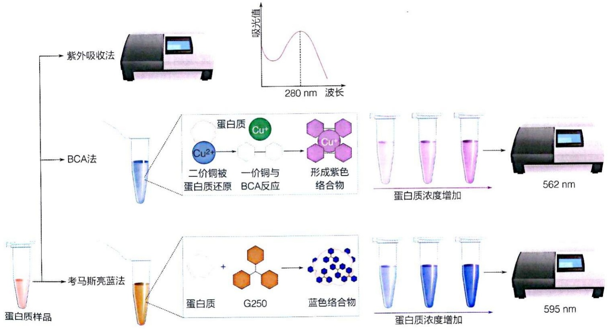

<details>
<summary>flowchart</summary>

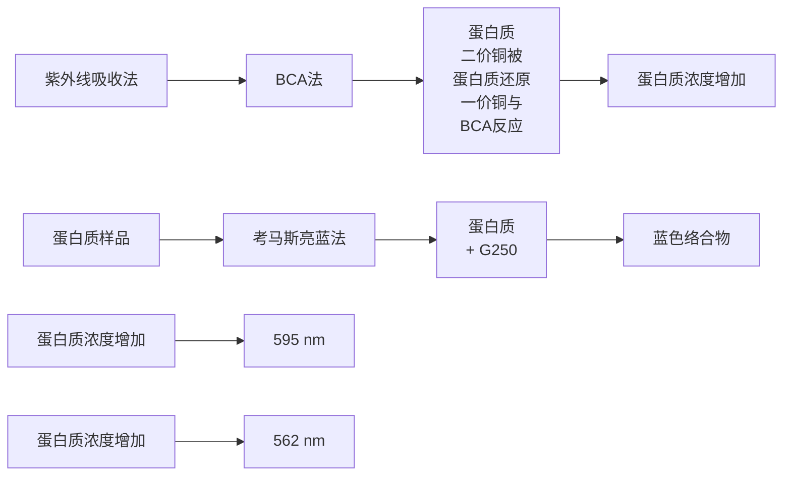
</details>

## (3) 考马斯亮蓝法

考马斯亮蓝（Coomassie brilliant blue）法由马里恩·布拉德福德（Marion Bradford）于1976年提出，原理是利用含考马斯亮蓝G250的比色试剂（colorimetric reagent）与蛋白质结合形成有色复合物，其吸光度与蛋白质浓度成正比。具体而言，在酸性条件下，蛋白质中的碱性氨基酸残基和芳香族氨基酸残基能够与考马斯亮蓝G250结合，使后者的最大吸收波长从465 nm红移至610 nm。在595 nm波长处，考马斯亮蓝G250结合蛋白质前后的吸光度差值达到最大，该差值与蛋白质浓度在一定范围内成正比。因此，通过测量样品与考马斯亮蓝G250反应后在595 nm的吸光度，减去考马斯亮蓝G250与不含蛋白质的缓冲液混合后的背景吸光度，然后根据已知浓度的BSA在同样条件下与考马斯亮蓝G250混合后测定所得标准曲线即可计算目标蛋白质的浓度。

蛋白质样品中的某些成分，如去垢剂可能会使比色试剂变色或发生沉淀，干扰测定结果。

## 5.1.5 目标蛋白质保存

经过纯化的目标蛋白质脱离了其在生物样品内所处环境，往往变得不稳定，容易发生不可逆的变性、失去活性，因此必须选择合适的缓冲液并在适当条件下进行保存。大部分蛋白质在 $4\mathrm{C}$ 仅可短期保存（通常为一天到几周不等），若需保存更长时间，则需要冻存在 $-20\mathrm{C}$ 或 $-80\mathrm{C}$，其中 $-80\mathrm{C}$ 更为常用。冷冻保存可能会导致蛋白质变性，主要原因包括:①水结晶:在冷冻过程中，水分子会形成晶态水，导致溶液中的溶质浓度发生变化。②蛋白质冷变性:低温会引起蛋白质结构的改变。③再结晶:在解冻过程中，样品中的小冰晶可能会生长形成更大的冰晶，这一过程称为再结晶，可能对蛋白质造成进一步损害。

为了减少冰晶的形成，可以采取以下方法:①迅速冷冻:将蛋白质样品迅速放入液氮中冷冻。②使用冷冻保护剂:在样品中加入10%（体积分数）甘油，可以有效抑制冰晶的形成。③快速升温:在解冻时，通过快速升温避免冰晶在蛋白质样品中继续生长。当升温速率超过20℃/min时，冰晶的再结晶速率低于复融速率，从而减少对蛋白质的伤害。

为避免反复冻融对蛋白质造成损害，建议在冷冻前将蛋白质样品分装成多个小份，每次只解冻一份使用，避免再次冻融。

## 5.2 蛋白质可通过多种物理或化学的手段来进行体外表征

蛋白质的表征是通过对其物理、化学和生物学特性的全面分析，来深入理解蛋白质结构与功能的关系。上一节讲述了依据蛋白质相关特性对其进行分离和纯化的方法。在获得目的蛋白质后，可利用多种手段对其进行表征。

## 5.2.1 蛋白质分子可通过电泳和免疫学方法进行体外表征

电泳（electrophoresis）是指带电粒子在电场驱动下在流体中向与粒子电性相反的电极移动的现象。尽管早在18世纪初便有人观察到这一现象，但电泳技术在分析领域的应用始于1930年代。瑞典学者阿尔内·蒂塞利乌斯（Arne Tiselius，1902—1971）利用电泳现象发明了移动界面电泳（moving-boundary electrophoresis），并设计了以他名字命名的装置，成功分离出血清中的不同蛋白质，如白蛋白、α球蛋白、β球蛋白和γ球蛋白。因这项成就，蒂塞利乌斯获得了1948年的诺贝尔化学奖。1950年代，区带电泳（zone electrophoresis）被引入，采用滤纸、毛细管、凝胶等作为载体，大大提高了分辨率。随着技术及设备的不断进步，电泳在生物化学实验技术中占据了重要地位。

在蛋白质分离与纯化过程中，通常会辅以电泳技术，以使研究人员在纯化的每个步骤中进行可视化分析，从而快速评估混合物中各种蛋白质的含量以及目标蛋白质的纯度和浓度。此外，电泳还可用于确定蛋白质的关键特性，例如等电点和近似分子量。

聚丙烯酰胺凝胶电泳（polyacrylamide gel electrophoresis，PAGE）是当前应用最广泛的电泳方法。它利用丙烯酰胺（acrylamide）单体与交联剂甲叉双丙烯酰胺（bis-acrylamide）在催化剂作用下形成的三维网状结构作为介质。在电泳过程中，分子的迁移率由其净电荷、大小和形状共同决定。如果在样品和凝胶中不添加任何蛋白质变性剂和还原剂，则可以保持蛋白质的天然结构（包括寡聚体状态），此时称为非变性聚丙烯酰胺凝胶电泳（native-PAGE）。完成电泳后，通过特定染料（如考马斯亮蓝）对凝胶中的蛋白质条带进行染色，从而识别分离出的蛋白质种类及其相对含量，但在非变性条件下通常无法仅凭迁移距离来判断蛋白质分子的实际大小。

如果在凝胶和样品中加入变性剂十二烷基硫酸钠（sodium dodecyl sulfate，SDS），此时进行的聚丙烯酰胺凝胶电泳称为 SDS-PAGE，是蛋白质分析中最常用的电泳方法。SDS 是一种阴离子表面活性剂，分子式如图 5-9A 所示，能够破坏蛋白质的二级和三级结构，使多肽链展开呈线性状态。SDS 与多肽链以大约每两个氨基酸残基结合一个 SDS 分子的比例结合，掩盖了肽链中原有基团的电荷，使蛋白质带上与其分子量成正比的负电荷。因此，在电泳过程中，样品加入加样孔后（图 5-9B），所有的 SDS-蛋白质复合物都会朝向正极迁移，并且迁移率仅取决于分子大小，而不受蛋白质原始电荷和形状的影响（图 5-9C）。通过这种方式，不同蛋白质可以根据分子大小不同进行有效分离。电泳完成后，使用硝酸银或考马斯亮蓝等染料对凝胶中的蛋白质进行染色，即可观察到一系列蛋白质条带（图 5-9D）。此外，使用已知分子量的蛋白质分子量标准品 [即标志物（marker）] 作为对照，可以估算出各条带对应的分子量。

等电聚焦（isoelectric focusing，IEF）是一种利用 $\mathrm{pH}$ 梯度分离不同等电点蛋白质的电泳技术。它的原理基于蛋白质分子的两性电解质特性:在 pH 高于其等电点的环境中，蛋白质带负电荷，向正极迁移；在 pH 低于其等电点的环境中，蛋白质带正电荷，向负极迁移（图 5-10A）。当蛋白质到达其等电点 pH 时，净电荷为零，迁移停止。因此，在具有 pH 梯度的介质中，不同等电点的蛋白质分子会在其对应的 pH 位置聚焦，最终形成分离的蛋白质区带。随着电泳时间延长，蛋白质的聚焦区带变得更集中、狭窄，从而提高分辨率，能够区分等电点相差仅 0.01 个 pH 单位的分子。等电聚焦可以用于测定蛋白质的等电点或检测蛋白质因脱氨、磷酸化或糖基化而产生的微小电荷变化。

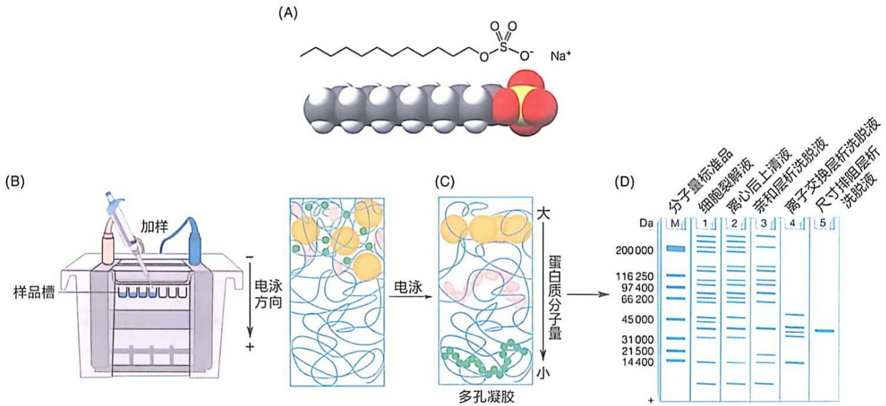

<details>
<summary>flowchart</summary>

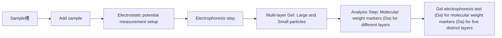
</details>

图5-9 SDS-PAGE示意图

（A）SDS 分子结构式图。（B）准备好待分析样品后，配制凝胶并进行电泳设备组装，将样品 / 分子量标准品加入凝胶加样孔中。（C）电泳。

利用待分离样品的迁移率不同施加电场进行分离。（D）电泳结束后，凝胶进行染色，根据样品条带对应分子量标准品条带位置进行可视化分析

等电聚焦可以与 SDS-PAGE 结合使用，称为二维电泳（two-dimensional gel electrophoresis，2-DE）（图 5-10B）。该技术在蛋白质组学研究中具有极大的应用价值，广泛用于分析蛋白质表达图谱，以识别疾病状态或药物处理引起的蛋白质表达变化。双向电泳结合质谱技术（见 5.3 节）可以同时分离和鉴定数千种蛋白质，是一种适用于复杂混合物的高分辨率分析方法。

蛋白质印迹法（Western blotting，WB）又称免疫印迹法，是一种用于鉴定特定蛋白质，并进行定性和半定量分析的高效常规技术。Western blotting 技术最早由哈利·托宾（Harry Towbin，1941—2021）团队于 1979 年提出，并由尼尔·伯奈特（W. Neal Burnette）稍作改进并命名。该方法的核心步骤是将通过 SDS-PAGE 分离的蛋白质转移到硝酸纤维素（nitrocellulose，NC）膜或聚偏二氟乙烯（polyvinylidene fluoride，PVDF）膜上，然后通过带标记的特异性抗体检测目标蛋白质的存在。这种方法的名称“Western”是一种“地理学”昵称，用于与英国学者埃德温·萨瑟恩（Edward

图 5-10 等电聚焦和二维电泳原理示意图

（A）等电聚焦按照等电点的不同对蛋白质分子进行分离。（B）以第一向进行等电聚焦后将等电点相同的蛋白质分子在垂直方向进行SDS-PAGE，按照分子大小进行分离

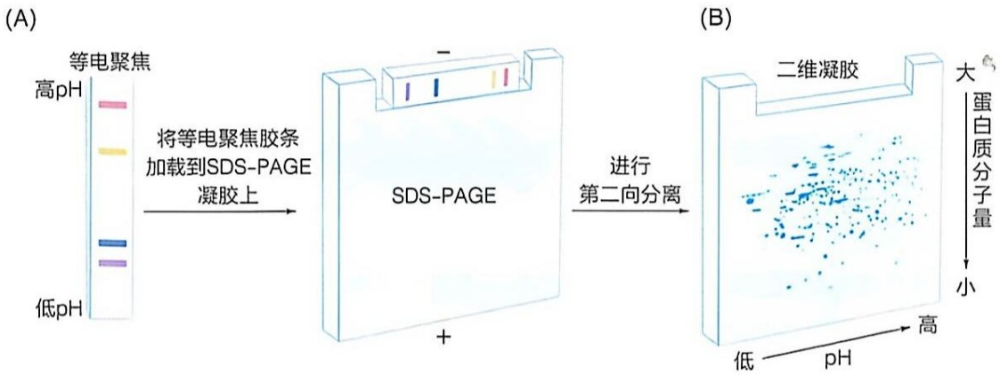

<details>
<summary>flowchart</summary>

```mermaid
graph LR
  subgraph A["(A)"]
  A["等电聚焦\n高pH"] -->|"将等电聚焦胶条加载到SDS-PAGE凝胶上"| B["SDS-PAGE"]
    C["低pH"] -.-> A
  end

  subgraph B["(B)"]
  B -->|"进行第二向分离"| D["二维凝胶\n低 pH → 高"]
  end
```
</details>

Southern）发明的、基于类似方法的 DNA 印迹法——Southern blotting 相对应，后来基于同样策略的 RNA 印迹法被称为 Northern blotting。

典型的 Western blotting 检测流程如图 5-11 所示。首先，将制备好的样品通过 SDS-PAGE 进行分离，接着将凝胶上的蛋白质条带转移到固相载体（如 NC 膜或 PVDF 膜）上；之后，对膜进行封闭处理，以避免非特异性结合，然后与针对目标蛋白质的特异性第一抗体进行孵育；接着，加入识别第一抗体的第二抗体，此抗体与特定酶（如辣根过氧化物酶或碱性磷酸酶）融合；最后，通过第二抗体上的酶进行显色反应进行检测，这些酶会将无色底物转化为有色产物。此外，除了酶标第二抗体显色方法，还可以使用带荧光基团的第二抗体直接显色（早期的显色方法使用同位素标记第一抗体，通过放射自显影进行显色）。随着技术的进步，数字化的 Western blotting 技术（也称 Simple Western）已被开发出来，可克服传统方法手动操作的烦琐流程，实现全过程自动化，大幅缩短检测时间至约 3 h。

图 5-11 蛋白免疫印迹流程示意图

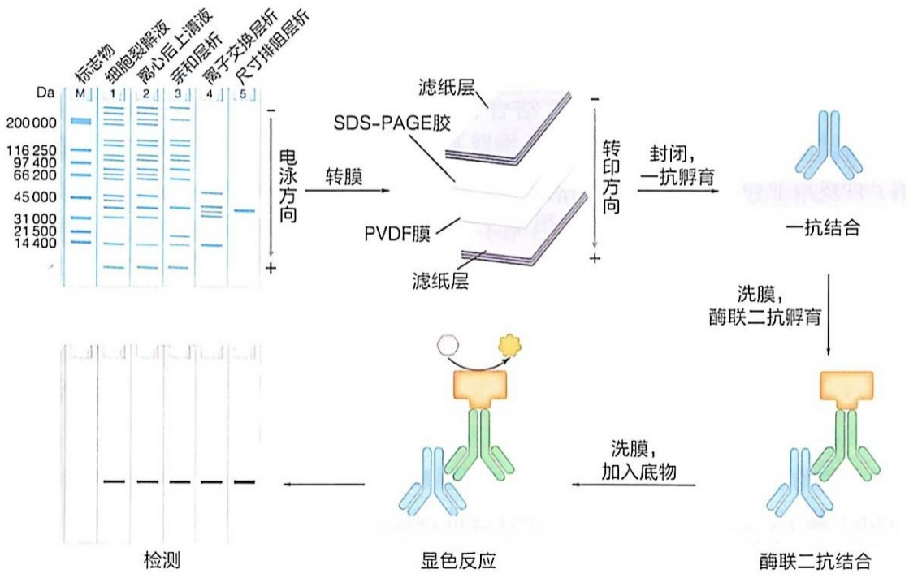

<details>
<summary>flowchart</summary>


</details>

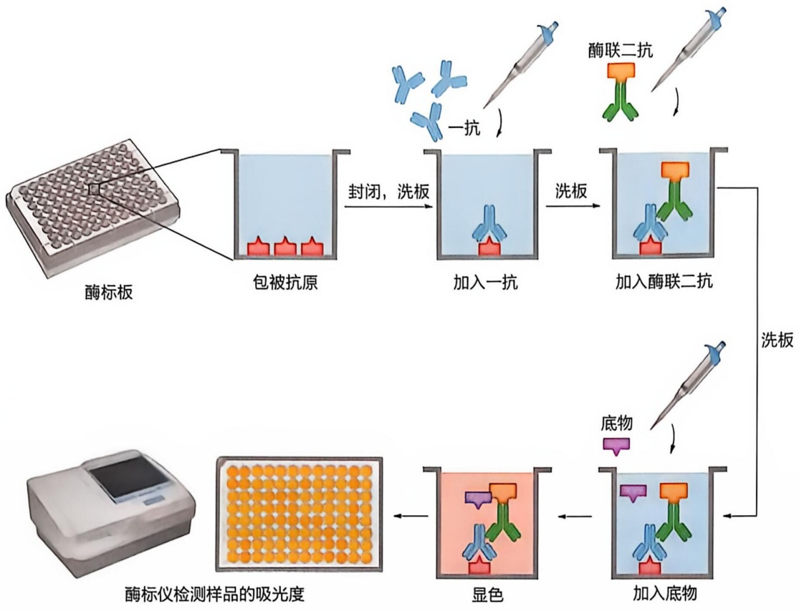

<details>
<summary>flowchart</summary>

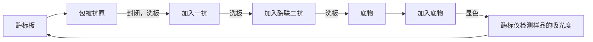
</details>

图 5-12 酶联免疫吸附分析法基本过程示意图

酶联免疫吸附分析（enzyme-linked immunosorbent assay，ELISA）是一种常用于生物样品中抗体或抗原（如病原体）定性和定量检测的免疫分析方法，其基本原理与蛋白质印迹类似。ELISA最早源自放射免疫法，使用放射性同位素（如碘-125）标记抗体（或抗原），后来转用酶（如辣根过氧化物酶）作为标记物。酶与抗体（或抗原）分子之间的连接最初通过化学交联方法实现，后来使用基因重组技术进行融合表达。

在 ELISA 检测过程中，抗原蛋白质（通常是生物样品中的混合物）被直接固定在固相载体表面，避免了蛋白质电泳分离的步骤。接着，加入特异性的一抗和酶标记的二抗，最后加入酶底物进行显色反应，利用产物的颜色变化可以通过测量特定波长（例如 450 nm）的光吸收值来进行定量分析（图 5-12）。

ELISA 方法具有很高的灵敏度和特异性，特别适用于定量检测细胞外的蛋白质（如血清中的病毒或细菌表面蛋白），能够有效应用于病毒、细菌感染的监测与诊断。

## 5.2.2 蛋白质分子可通过分析超速离心技术进行体外表征

分析超速离心（analytical ultra centrifugation，AUC）是一种用于研究生物大分子溶液中性质的经典技术。在高速旋转产生的强大离心力场的作用下，利用光学检测器监测样品池中生物大分子的径向浓度分布，从而获取分子量、纯度、聚集状态以及生物分子间相互作用等重要信息。第一台分析型超速离心机由瑞典化学家特奥多尔·斯韦德贝里（Théodor Svedberg，1884—1971）于1924年发明，他成功测定了第一个蛋白质——马血红蛋白的分子量。此项工作和他在胶体化学方面的贡献为斯韦德贝里赢得了1926年的诺贝尔化学奖。

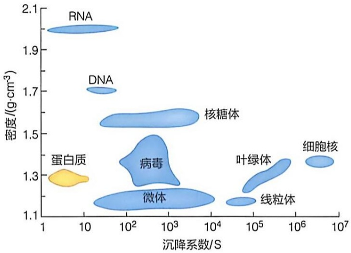

<details>
<summary>bubble</summary>

| Category | Sedimentation Coefficient (S) (range) | Density \((g \cdot cm^{-3})\) (range) |
| --- | --- | --- |
| RNA | 1~20 | 1.95~2.05 |
| DNA | 10~30 | 1.7~1.75 |
| 蛋白质 | 1~10 | 1.25~1.35 |
| 核糖体 | 100~10^4 | 1.5~1.6 |
| 病毒 | 100~10^3 | 1.2~1.5 |
| 微体 | 100~10^4 | 1.15~1.25 |
| 叶绿体 | 10^4~10^6 | 1.2~1.4 |
| 线粒体 | 10^4~10^6 | 1.15~1.25 |
| 细胞核 | 10^6~10^7 | 1.35~1.4 |
</details>

图5-13 不同生物样品的沉降系数和密度范围分布

在分析超速离心技术中，“沉降系数”是一个核心概念。沉降系数（s）是指颗粒在单位离心加速度下的沉降速率，单位为Svedberg（S），以斯韦德贝里的名字命名， $1\mathrm{S}=10^{-13}\mathrm{s}$ 。沉降系数是生物大分子的特征常数，它不仅与颗粒的密度、形状和大小相关，还与溶液介质的密度和黏度有关。通过测定沉降系数，能够获得有关生物大分子特性的重要信息。常见生物样品的沉降系数范围如图5-13所示。

分析型超速离心机由主机、光学系统、转头和样本池组件等部分组成（图 5-14A）。它的工作原理可以通过两种不同的实验模式进行:沉降速率和沉降平衡。

沉降速率（sedimentation velocity）实验通常在较高的离心力下进行，主要测量粒子在离心场中向样品池底部沉降的速率（图 5-14B）。沉降速率受到粒子的质量、密度、大小和形状的影响。通过对数据进行分析处理，可以得到粒子的沉降系数，以及与粒子形状相关的信息（如摩擦系数比、斯托克斯半径、轴长比等）。结合溶液

图 5-14 分析超速离心技术原理示意图

(A) 分析型超速离心机组成。

(B) 沉降速率法原理。

(C) 沉降平衡法原理

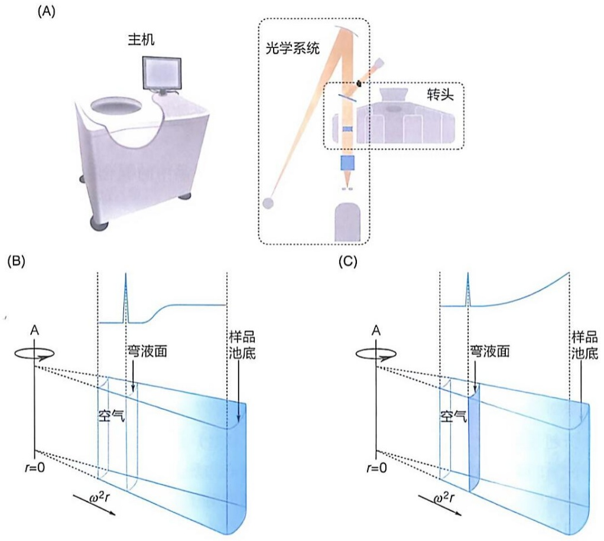

的黏度和密度数据，可以利用斯韦德贝里方程计算出粒子的分子量。然而，需要注意的是，这种方法得到的分子量是近似值，因为沉降系数受粒子形状（特别是摩擦系数比）的影响较大。除了沉降系数的测定，沉降速率实验还可以用于研究生物大分子在溶液中的聚集状态、均一性、蛋白质-蛋白质相互作用、蛋白质-核酸相互作用等。

沉降平衡（sedimentation equilibrium）实验通常在较低的转速下进行，随着时间的推移，在沉降和扩散的共同作用下，粒子会在样品池中达到径向浓度的分布平衡状态。当平衡达到时，粒子浓度会从液面到样品池底部呈递增趋势（图 5-14C），此时粒子处于相对静止的状态，浓度分布主要受分子量的影响，而与其形状无关。因此，可以提供更加准确的分子量信息。

除了分子量测定，沉降平衡实验还可以用于研究生物大分子之间的相互作用，包括大分子与大分子之间、大分子与小分子配体或金属离子之间的相互作用。在沉降平衡状态下，粒子浓度沿径向的变化反映了体系中的相互作用，研究者可以根据此浓度分布获得复合物及其组成物质的分子量、结合常数以及化学计量比等参数。沉降平衡法特别适用于研究平衡解离常数（ $K_{d}$ ）在1 nmol/L至10 mmol/L范围内的分子相互作用。

## 5.2.3 蛋白质及其复合物分子量可通过质谱进行精确测定

质谱已有一百多年的发展历史，是目前测定分子量的重要工具。质谱仪主要由四部分组成:离子源、质量分析器、检测器和数据分析系统。两种广泛应用于生物大分子分析的质谱电离技术分别为电喷雾电离（electrospray ionization，ESI）和基质辅助激光解吸电离（matrix-assisted laser desorption/ionization，MALDI）；常见的质量分析器包括四极杆质量分析器、离子阱质量分析器、飞行时间质量分析器（time of flight，TOF）和静电场轨道阱质量分析器（orbitrap）。

质谱仪的工作原理是在真空环境下利用电场或磁场对不同质荷比（m/z）的离子进行分离和检测。在生物质谱分析中，电喷雾离子源能够在常压条件下将溶液中的蛋白质分子（通常溶解在含有挥发性溶剂的溶液中）转移至气相，生成带有多个电荷的离子。带电离子进入质谱仪，依据它们的质荷比大小进行分离和检测。在质谱图中，横轴表示离子的质荷比，纵轴则代表离子的相对强度。

去卷积是蛋白质质谱数据分析的关键步骤，即从多电荷峰中计算出蛋白质分子的精确分子量。图 5-15A 展示了一组带有不同电荷的抗体分子峰，其中三个最高强度的峰对应的质荷比分别为 2743.241、2794.981 和 2848.708，通过去卷积处理，结合分子量与电荷数之间的关系，可推断这三个分子离子峰的电荷数分别是 54、53 和 52，由此计算得到该抗体分子的分子量为 148082.984 Da。图 5-15B 展示了去卷积后的抗体分子分子量的分布图，除了质量为 148082.984 Da 的抗体分子峰外，其他峰对应于带有不同糖基化修饰的抗体分子。

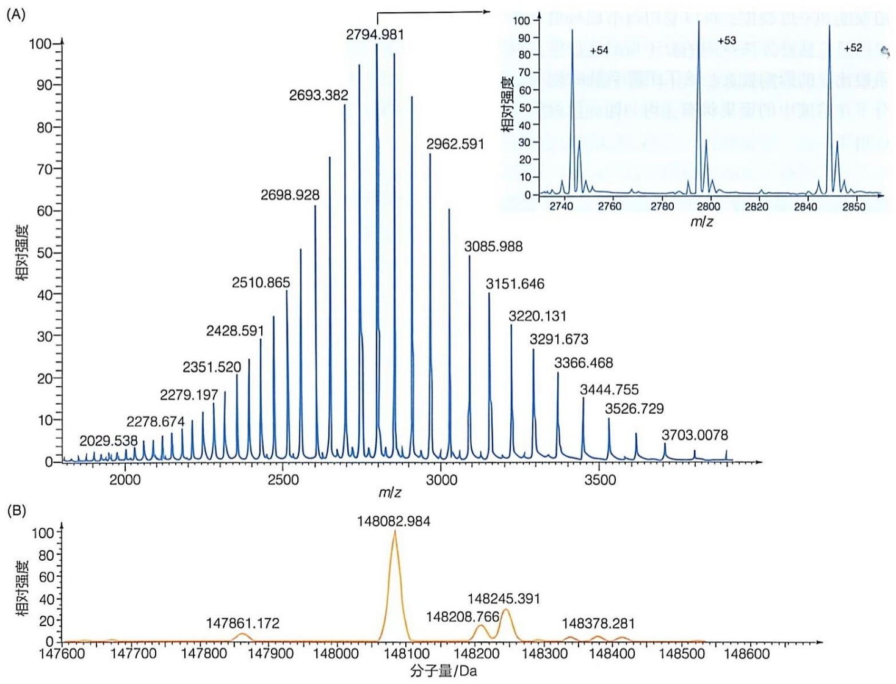

图5-15 抗体分子的分子量测定

(A) 抗体分子的一级质谱图。

(B) 去卷积后的抗体分子的分子量分布

除单个蛋白质分子的质量外，质谱还可以测量蛋白质复合物的质量，这种方法被称为非变性质谱（native mass spectrometry）。该技术使用与质谱兼容的溶剂体系（例如乙酸铵或碳酸氢铵等挥发性盐溶液），利用电喷雾离子源，将非共价键结合的蛋白质复合物完整地从溶液中转移至气相，从而被质谱检测。非变性质谱能够提供多种关键信息，包括蛋白质复合物的分子量、寡聚状态、构象信息、异质性、蛋白质-配体相互作用、蛋白亚基的相互作用以及化学计量比。

非变性质谱的数据处理流程通常包括确定离子价态分布、去卷积、验证及可视化等步骤。图5-16展示的是大肠杆菌来源的热激蛋白（GroE）复合物质谱图，图中最高的三个分子离子峰的质荷比分别为11962.11、12143.37和12330.81。通过分析分子量与离子价态的对应关系，推测这三个分子离子峰所带的电荷数分别为67、66和65，进一步计算得出GroE复合物的分子量为801283.19Da，由此可判断该复合物为十四聚体结构。

非变性质谱技术不仅适用于常规蛋白质和蛋白质复合物的分析，还可扩展至多种大分子组装体的研究，包括核糖体复合物、蛋白质-脂质复合物、核酸结构、非共价键结合的蛋白质-药物复合物以及病毒颗粒等。非变性质谱技术具有灵敏度高、速度快和特异性强的特点，目前已广泛应用于生命科学相关领域。

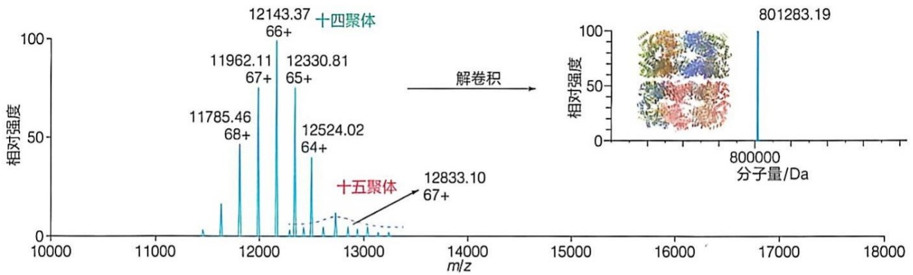

<details>
<summary>spectrogram</summary>

| m/z | Relative Intensity |
| --- | --- |
| 11785.46 (68+) | ~45 |
| 11962.11 (67+) | ~75 |
| 12143.37 (66+) | 100 |
| 12330.81 (65+) | ~75 |
| 12524.02 (64+) | ~40 |
| 12833.10 (67+) | ~10 |
</details>

图 5-16 蛋白质复合物的分子量测定

分子量是蛋白质的一个关键特征参数。除质谱技术外，还有其他几种方法可以用于获得蛋白质及其复合物的分子量信息，包括尺寸排阻色谱法、SDS-PAGE法、分析超速离心-沉降平衡法（AUC-SV）和静态光散射法等。每种方法都有其独特的优势和局限性，因此适用于不同的研究场景和需求。

左图为GroE十四聚体的一级质谱图，右图为去卷积后的蛋白质复合物分子量

## 5.2.4 蛋白质的稳定性是蛋白质在细胞环境中保持其结构和功能的能力

蛋白质的稳定性（stability）指的是其保持天然构象的趋势。许多蛋白质仅具备边缘稳定性，即它们在生理条件下的折叠与去折叠之间的吉布斯自由能 $\Delta G$ 通常在 $5\sim 65\mathrm{kJ / mol}$ 。这意味着它们在功能性结构上的稳定性相对较低，处于一种微弱稳定的状态。这种边缘稳定性使得蛋白质能够在执行生物学功能时保持一定的灵活性，但也使得它们容易受到外部压力而发生错误折叠。稳定的蛋白质能够正确折叠并维持其生物活性，而不稳定的蛋白质则可能会发生错误折叠或聚集，导致功能丧失或引发疾病。例如，阿尔茨海默病、帕金森病和亨廷顿病等神经退行性疾病，就与蛋白质的错误折叠和聚集密切相关。

衡量蛋白质稳定性的一个重要参数是熔解温度（melting temperature， $T_{m}$ ），它表示在特定条件（如 pH、离子强度等）下，蛋白质分子从其天然折叠状态转变为非折叠状态时的中点温度。在  $T_{m}$  温度下，约一半的分子处于折叠状态，另一半则处于非折叠（展开）状态。 $T_{m}$  值越高则该条件下蛋白质越稳定。 $T_{m}$  的测定通常通过差示扫描量热法（differential scanning calorimetry，DSC）、圆二色光谱法（circular dichroism，CD）或差示扫描荧光法（differential scanning fluorimetry，DSF）来实现。

差示扫描量热法是一种经典的热力学分析技术，它能够量化测量蛋白质热变性过程中的热效应，是直接测量蛋白质样品去折叠热力学的唯一的可靠方法。在该方法