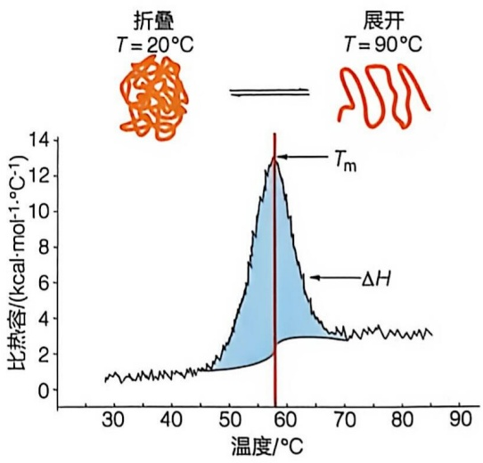

<details>
<summary>area</summary>

| Temperature \(({}^{\circ}C)\) | \(\Delta H (\)kcal·mol⁻¹·°C⁻¹) |
| --- | --- |
| 30 | ~1 |
| 40 | ~1 |
| 50 | ~2 |
| 60 | ~13 |
| 70 | ~3 |
| 80 | ~3 |
| 90 | ~3 |
</details>

图5-17 差示扫描量热曲线示意图

中，通过程序控制温度逐渐升高，测量样品池和参比池之间功率差与温度之间的关系。DSC 可以提供关于蛋白质构象变化的详细热力学信息，并且能够有效地确定  $T_{m}$  值。DSC 曲线通常以比热容（即单位质量的物质在压力不变的条件下，温度升高或下降 1℃ 所吸收或放出的能量）为纵坐标，温度为横坐标，在起始温度下蛋白质仍保持天然结构，当样品池和参比池被升温加热蛋白质开始热变性，样品池比热容随着蛋白质的结构展开而增加，其峰值为  $T_{m}$ ，到实验结束时高级结构都展开了，如图 5-17 所示，峰面积代表整个过程的总能量变化（即蛋白质去折叠的焓变  $\Delta H$ ），这是一个吸热反应，需要能量来破坏维持蛋白质高级结构的非共价作用力。

## 5.3 蛋白质氨基酸序列可通过化学和质谱方法测定而且多肽可以通过化学方法合成

测定蛋白质的氨基酸序列是解析其结构与功能的基础。尽管通过翻译编码基因的DNA序列可以理论上推导出蛋白质的氨基酸序列，但这一方法存在显著局限。在真核生物中编码基因通常含有内含子，经转录和可变剪接后可产生多种mRNA亚型，从而翻译出不同的蛋白质变体。此外，这些蛋白质变体在细胞内还会发生多种蛋白质翻译后修饰或被蛋白酶酶切，因此并不能从编码基因的DNA序列来确定细胞、器官和组织中的蛋白质氨基酸序列及蛋白质翻译后修饰类型和位点，也不能获得蛋白质的二硫键信息。例如，胰岛素基因转录的mRNA首先翻译为一条含有110个氨基酸的前胰岛素原；然后，前胰岛素原N端信号肽被切除，折叠成带有3对二硫键的胰岛素原；最后胰岛素原在高尔基体中发生酶促反应，切除连接胰岛素A链和B链的连接肽（C肽），生成由21个氨基酸的A链和30个氨基酸的B链组成的成熟胰岛素分子。由此可见，蛋白质在细胞中的实际序列、翻译后修饰类型与位点以及二硫键的位置需要由实验来确定。

## 5.3.1 蛋白质序列可以利用埃德曼降解法测定

英国科学家弗雷德里克·桑格（Frederick Sanger，1918—2013）通过发展桑格试剂，即 2,4-二硝基氟苯（dinitrofluorobenzene，DNFB），完成了人类纯化的第一种蛋白质——胰岛素的氨基酸序列测定。桑格法的工作原理是 DNFB 与多肽或蛋白质 N 端的游离氨基反应，生成 2,4-二硝基苯酚修饰的蛋白质；在酸性条件下这些反应产物发生水解，产生黄色的 2,4-二硝基苯酚修饰的氨基酸以及其他氨基酸；通过纸层析分离这些产物，并与标准品比较，即可确定 N 端氨基酸的种类。为了解析胰岛素蛋白质 N 端氨基酸之外的氨基酸种类和序列，桑格对胰岛素进行了部分水解和胰蛋白酶酶解，产生了多条胰岛素肽段片段。随后，他利用桑格反应和纸层析技术确定肽段 N 端的氨基酸种类，通过拼接这些片段获得胰岛素的蛋白序列。经过十年研究，桑格终于成功测定了胰岛素的一级结构，并因此荣获 1958 年诺贝尔化学奖。

虽然桑格法在蛋白质序列分析中具有里程碑意义，但分析步骤烦琐且耗时。因此，瑞典化学家佩尔·埃德曼（Pehr Edman，1916—1977）开发了埃德曼降解法，该方法通过化学反应依次标记蛋白质N端和相邻的每一个氨基酸，利用高效液相色谱（HPLC）鉴定每一个被标记的氨基酸种类，从而逐步读出蛋白质的氨基酸序列（图5-18）。该方法的原理是利用苯异硫氰酸酯（phenylisothiocyanate，PITC）与固定化的蛋白质或多肽N端的游离氨基反应，生成苯氨基硫甲酰肽（phenylthiocarbamyl peptide，PTC-肽段）；随后在三氟乙酸的作用下，被修饰的N端氨基酸残基发生环化反应，产生苯胺噻唑啉酮衍生物（anilinothiazolinone amino acid，ATZ-氨基酸）和失去了一个N端氨基酸的蛋白质或多肽；ATZ-氨基酸在酸催化下进一步转化为稳定的苯乙内酰硫脲衍生物（phenylthiohydantoin amino acid，PTH-氨基酸）。通过比较PTH-氨基酸与标准品的色谱保留时间，以确定氨基酸的种类。固定化介质上残留的蛋白质或多肽与PITC进行下一轮反应，重复上述分离和鉴定程序，确定蛋白质或多肽N端下一个氨基酸残基的种类，从而获得整个蛋白或肽段的氨基酸序列。基于埃德曼降解法的自动化多肽测序仪于20世纪七八十年代被开发出来，极大地提高了蛋白质或肽段氨基酸序列测定的效率。

埃德曼降解法是蛋白质序列分析的传统方法，但其应用存在以下局限性:首先，该方法通常只能测定蛋白质 N 端 30～40 个氨基酸残基，而大多数蛋白质分子由超过 100 个氨基酸组成；其次，它仅适用于 N 端为游离氨基酸的蛋白质，无法分析 N 端被修饰（如乙酰化）的蛋白质；此外，该方法通量和灵敏度较低，难以用于分析混合成低丰度蛋白质样品。为了提高蛋白质序列的检测覆盖度，一种常见的策略是将纯化的蛋白质通过酶切或化学水解形成较小的多肽片段，随后对这些片段分别进行埃德曼降解分析。然而随着质谱技术的发展，蛋白质序列测定已逐渐转向更高效的串联质谱。目前埃德曼降解法主要用于纯化蛋白或融合表达蛋白 N 端氨基酸残基的验证。

图 5-18 埃德曼降解法测定肽段氨基酸序列流程示意图

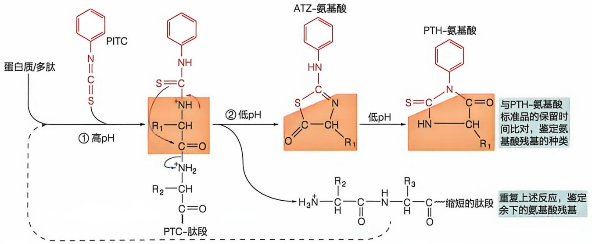

<details>
<summary>flowchart</summary>


</details>

## 5.3.2 蛋白质或多肽氨基酸序列可以通过串联质谱进行测定

与单级质谱相比，串联质谱（tandem mass spectrometry，MS/MS）技术能够提供特定质荷比（m/z）离子的碎片信息，这对于解析蛋白质或肽段的序列及其翻译后修饰的类型和位点至关重要。串联质谱通常包含两个及更多的质量分析步骤，分别称为 $MS^{1}$ 和 $MS^{2}$，用于特定质荷比离子的分离、所选离子的碎片化以及碎片离子质荷比的检测。目前，串联质谱仪有两种不同的构架:一种为空间串联质谱，其原理是将两个或多个质量分析器串联安装，利用第一级质量分析器分离特定质荷比的离子，然后在离子碰撞池中将这些离子进行碎片化，最后将产生的碎片离子送入后续的质量分析器进行检测。图5-19A展示的三重四级杆质谱仪就是一种简单的空间串联质谱仪。另一种是时间串联质谱，其工作原理是在离子阱类型的质量分析器中，按照时间顺序进行离子选择、离子活化碎裂以及碎片离子检测。时间串联质谱技术可以扩展至多级质谱分析，即进行多级前体离子的选择和多级碎片离子的检测，$MS^{n}$ 表示串联质谱检测的级数。

在质谱分析中，离子通常通过碰撞诱导解离（collision-induced dissociation, CID），也称为碰撞活化解离（collision-activated dissociation, CAD）来实现碎裂。CID 的原理是将被选定的分子离子加速以获得较高动能，随后使其与惰性气体分子发生碰撞，这一过程将动能转化为内能，使分子发生碎裂。在离子阱中进行的 CID 通常使用氦气作为碰撞气体，通过多次低能碰撞产生碎片。蛋白质序列分析中，除 CID 外，还有其他几种常用的碎裂模式，包括光诱导解离（photodissociation）、电子转移解离（electron transfer dissociation, ETD）和电子捕获解离（electron capture dissociation, ECD）。

蛋白质和肽段离子经 CID 后肽键发生断裂，在二级谱图（MS/MS 或 MS$^{2}$）中产生 b 序列和 y 序列离子。图 5-19B 展示的是 b 和 y 序列离子的种类和断裂位置。在大部分的二级谱图中，相邻碎片离子的质量差对应于一个特定氨基酸残基的质量，因此通过测量碎片离子的质量，可以确定肽段序列。如图 5-19C 所示，二级谱图上标注了碎片离子的质荷比，肽段序列的推断通常遵循以下步骤:首先，根据低质量区域的质荷比 143.08 的离子峰推断出肽段离子 N 端的两个氨基酸残基（Ala-Ala），即 b$_{2}$；然后结合高质量区域的碎片离子质量，推断出整个肽段的序列。搜库软件的开发极大地提高了二级谱图解析的效率和能力，大多数搜库软件通过将实验中获得的二级谱图与蛋白质数据库中肽段的理论二级谱图进行比对，能够快速准确地确定肽段或蛋白的序列。这些软件能够在一分钟内解析上万张二级谱图，极大地推动了高通量蛋白质组学研究的发展。

串联质谱技术虽然能够用于测定高分子量的肽段和蛋白质的序列，但由于碎片化效率和质谱测量精度的限制，目前该技术更适合于20～30个残基的肽段序列的测定。

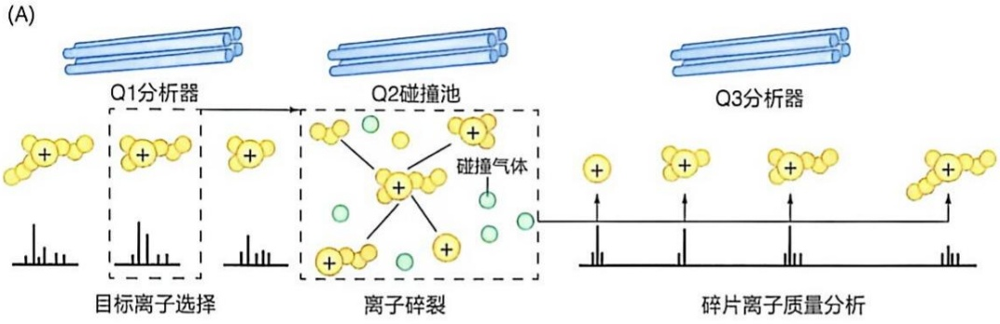

<details>
<summary>flowchart</summary>

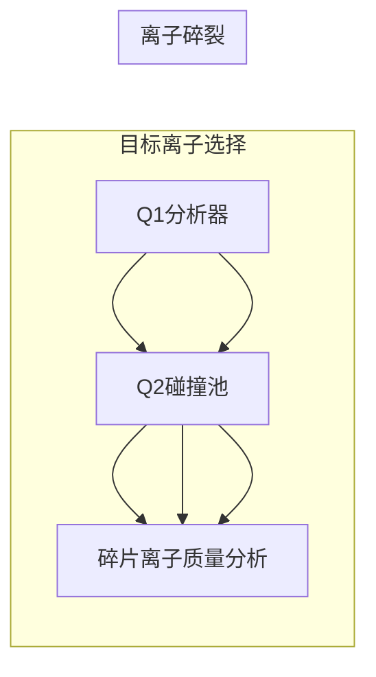
</details>

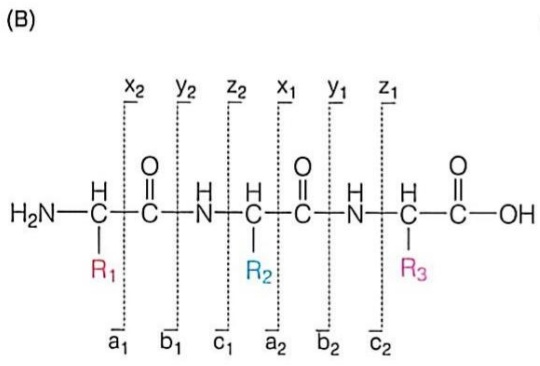

<details>
<summary>chemical</summary>

Chemical structure of a polyamide polymer with repeating units and labeled substituents R1, R2, R3
</details>

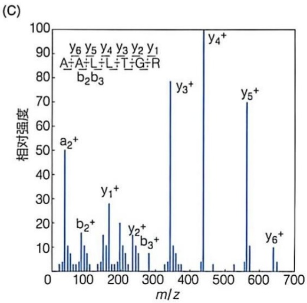

<details>
<summary>bar</summary>

| m/z | Relative Intensity |
| --- | --- |
| ~50 | 50 |
| ~100 | 15 |
| ~180 | 28 |
| ~230 | 20 |
| ~260 | 12 |
| ~350 | 78 |
| ~450 | 100 |
| ~570 | 70 |
| ~640 | 10 |
</details>

图 5-19 串联质谱测定肽段的氨基酸序列

（A）三重四极杆质谱仪示意图。（B）肽段碎片化产生的二级离子的命名和断裂位置。（C）肽段离子的二级质谱图和序列解析

因此，在串联质谱分析前，通常会将蛋白质或蛋白质混合物酶解成较小的肽段片段。近年来，质谱技术的发展趋势之一是开发组合式质谱仪，即通过集成不同类型的质量分析器和离子透镜，构建多功能系统。这类组合式仪器不仅能够同时进行高分辨率的一级质谱和串联质谱的测量，还能与色谱技术联用，显著提升检测速度、分析通量和检测灵敏度，为蛋白质组学研究提供了一种通用且经济的解决方案。以赛默飞公司的Astral质谱仪为例，该仪器能够在一秒钟内采集200张MS/MS质谱图，为蛋白质组学研究提供了强有力的技术支持。

## 5.3.3 蛋白质组可以通过质谱进行定性和定量分析

色谱-串联质谱联用技术有力驱动了复杂蛋白质混合物的高通量分析，极大地推动了蛋白质组学研究的快速发展。蛋白质组学致力于系统解析生物体、组织或细胞内所有蛋白质的表达谱、结构特征、翻译后修饰状态及其动态变化规律。以质谱为基础的蛋白质组学分析主要采用两种策略:自上而下法（top-down）和自下而上法（bottom-up）。自下而上法，也称为鸟枪法（shotgun），是最常用的策略。其基本流程如图5-20所示，首先将蛋白质混合物酶切成肽段，经液相色谱分离后，采集一级和三级质谱图；通过与蛋白质数据库比对，实现蛋白质鉴定。该方法不仅能鉴定蛋白质种类，还能分析修饰类型和位点、检测突变变异及定量分析表达水平。自上而下法则直接对完整的蛋白质进行质谱分析，获得完整序列和修饰信息，但目前主要应用于低分子量蛋白质的分析。

图 5-20 自下而上蛋白质组学的实验流程

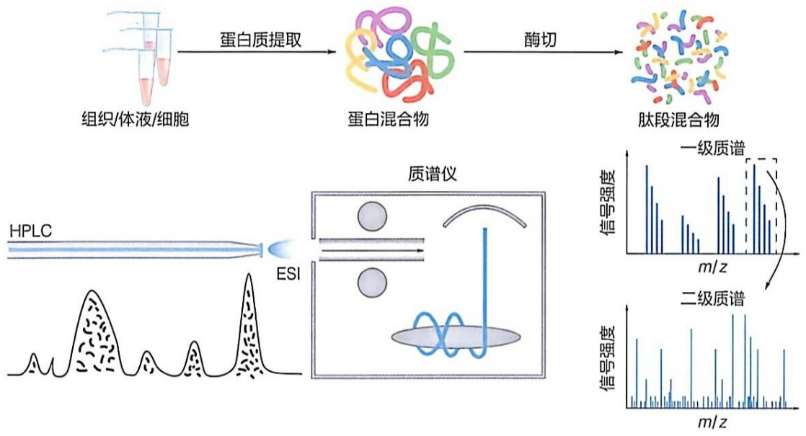

<details>
<summary>flowchart</summary>

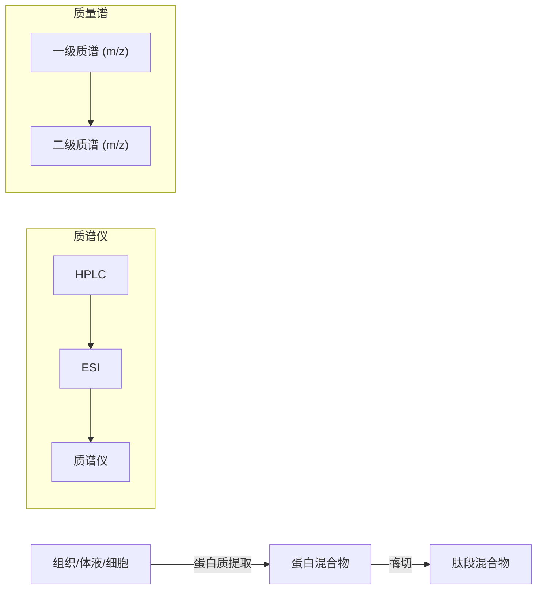
</details>

自下而上法作为蛋白质组学研究的核心策略，广泛应用于定量蛋白质组学、蛋白质修饰组学、蛋白质互作组学以及蛋白质结构分析。定量蛋白质组学通过稳定同位素标记或非标记的方式，精确测定不同样本间蛋白质表达水平的动态变化。常用定量方式包括细胞培养中氨基酸稳定同位素标记（stable isotopic labeling using amino acids in cell culture, SILAC）技术、等量标签（isobaric mass tag）标记技术和非标记定量技术。蛋白质修饰组学采用化学方法或抗体捕获方法特异性富集修饰肽段，结合串联质谱技术系统鉴定磷酸化、乙酰化等翻译后修饰类型和位点，揭示蛋白质功能和调控机制。蛋白质互作组学通过免疫共沉淀（见5.4.1节）等方法富集目标蛋白质复合物，进而解析蛋白质-蛋白质相互作用网络。此外，自下而上法也常用于蛋白质结构分析，如化学交联质谱技术利用化学交联剂将蛋白质内部或蛋白质复合物中邻近的氨基酸残基以共价键形式连接，通过自下而上法分析发生交联的氨基酸位点，从而提供蛋白质或蛋白质复合物的三维结构信息；氢氘交换质谱技术将具有天然构象的蛋白质或复合物溶于氘水中进行氢氘交换，通过自下而上法测量蛋白质不同肽段的氢氘交换速率，以获得蛋白质结构信息。

## 5.3.4 多肽和蛋白质可以通过化学方法进行合成

胰岛素的发现和及其临床应用极大地促进了多肽药物的研究。早在20世纪初，科学家们便开始探索多肽的化学合成。肽是由两个或多个氨基酸残基通过肽键连接而成的生物分子，根据氨基酸残基的数量不同可分为短肽、多肽和蛋白质。多肽和蛋白质的化学合成是将氨基酸按照特定序列连接形成线性肽链，对于研究多肽和蛋白质的结构和功能、开发新型药物和疫苗具有重要意义。此外，多肽化学合成技术的发展也推动了生物化学、药物开发和材料科学等多个学科领域的进步。

## 5.3.4.1 多肽可以通过化学方法进行固相合成

早期的多肽化学合成主要在溶液中进行，为避免副反应的发生，会对氨基酸的活性基团（例如氨基、羧基以及侧链基团）进行保护，确保只发生肽键的缩合反应。多肽合成的基本步骤包括:对起始氨基酸进行活化，然后与另一个被保护的氨基酸发生缩合反应，生成二肽；纯化后的二肽重复进行缩合反应和纯化，直至完成目标肽段的合成；最后去除肽段上的保护基团。美国科学家文森特·迪维尼奥（Vincent du Vigneaud，1901—1978）在这一领域做出开创性贡献，他不仅首次鉴定了催产素，并通过液相合成法成功制备了具有生物活性的催产素，因此荣获1955年诺贝尔化学奖。然而，液相合成法存在明显的局限性，如反应条件苛刻、合成效率低，完成一个短肽的合成和纯化常需要数月时间，并且不适用于长肽的制备。

为了克服多肽液相合成技术的局限性，布鲁斯·梅里菲尔德（Bruce Merrifield, 1921—2006）在1950年代末开始独立探索，发展了多肽固相合成技术。梅里菲尔德创新性地开发了一种具有稳定物化性质的多聚体固相载体，并建立了从多肽C端向多肽N端合成的模式。尽管固相合成的反应速率略低于溶液合成，但由于肽链在整个合成过程中始终固定在固相载体上，确保了每一步缩合反应的高效进行，并且利用简单的过滤步骤即可实现反应产物的纯化，极大地简化了合成流程。梅里菲尔德于1963年独自发表了这一合成技术，并在1965年研发出世界上首台多肽自动合成仪。他利用该仪器在1969年成功合成了由124个氨基酸残基组成的核糖核酸酶A，这一成就标志着多肽合成技术的成熟。梅里菲尔德的工作极大地推动了有机合成化学的发展，因此荣获1984年诺贝尔化学奖。

在梅里菲尔德工作的基础上，研究人员对固相载体、保护基团、活化试剂和去保护试剂进行了优化，发展出了目前广泛使用的基于氨基保护基团氟苯基甲基（fluorenylmethyloxycarbonyl，Fmoc）的Fmoc多肽固相合成方法。Fmoc多肽固相合成方法的工作流程如下（图5-21）:①根据待合成多肽的序列，选择适合的固相载体，通常是带有C端氨基酸的树脂；②在二甲基甲酰胺（dimethylformamide，DMF）溶剂中，利用六氢吡啶脱去固相载体上氨基酸的Fmoc保护基团；③加入下一个Fmoc保护的氨基酸和活化试剂，如 $N,N^{\prime}$ -二异丙基氨基乙酸（ $N,N^{\prime}$ -diisopropylcarbodiimide，DIC）或羟基苯并三唑（1-hydroxybenzotriazole，HOBt），进行氨基酸的偶联反应，反应结束后，使用DMF等溶剂清洗树脂，去除未反应的氨基酸和副产物；④按照多肽序列依次添加所需的氨基酸，重复去保护和偶联反应，直至完成目标肽链的合成；⑤使用适当的试剂（如三氟乙酸）去除多肽上的保护基团，并将多肽从固相载体上释放出来；⑥最后使用HPLC或其他纯化方法分离和纯化合成的多肽，并通过质谱或氨基酸分析等技术对多肽进行鉴定和表征，还可通过核磁共振等方法对合成的多肽进行结构分析。

图 5-21 Fmoc-多肽固相合成方法的基本流程

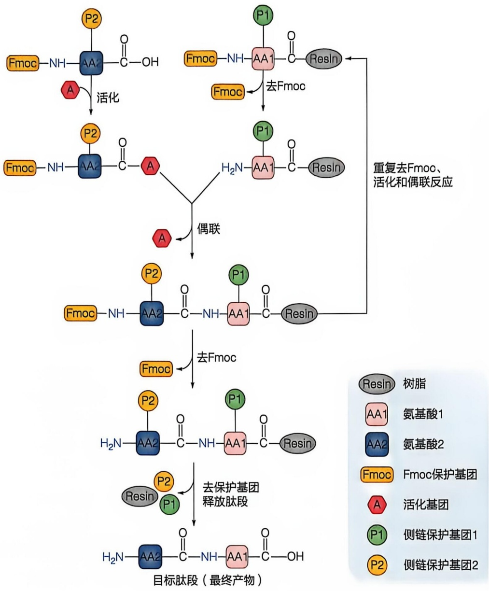

<details>
<summary>flowchart</summary>

```mermaid
graph TD
  A["Fmoc-NH-AA2-C(OH)-P2"] -->|A 活化| B["Fmoc-NH-AA1-C(OH)-P1"]
  C["Fmoc-NH-AA2-C(OH)-P2"] -->|A 活化| B
  D["Fmoc-NH-AA2-C(OH)-P2"] -->|A 活化| E["Fmoc保护基团"]
  F["Fmoc-NH-AA2-C(OH)-P1"] -->|去Fmoc| G["侧链保护基团1"]
  H["Fmoc-NH-AA2-C(OH)-P2"] -->|重复去Fmoc、活化和偶联反应| I["Fmoc保护基团"]
  J["Fmoc-NH-AA2-C(OH)-P1"] -->|重复去Fmoc、活化和偶联反应| K["侧链保护基团2"]
  L["Fmoc-NH-AA2-C(OH)-P2"] -->|重复去Fmoc、活化和偶联反应| M["Fmoc保护基团"]
  N["Fmoc-NH-AA2-C(OH)-P1"] -->|重复去Fmoc、活化和偶联反应| O["Fmoc保护基团"]
  P["Fmoc-NH-AA2-C(OH)-P2"] -->|重复去Fmoc、活化和偶联反应| Q["Fmoc保护基团"]
  R["Fmoc-NH-AA2-C(OH)-P1"] -->|重复去Fmoc、活化和偶联反应| S["Fmoc保护基团"]
  T["Fmoc-NH-AA2-C(OH)-P2"] -->|重复去Fmoc、活化和偶联反应| U["Fmoc保护基团"]
  V["Fmoc-NH-AA2-C(OH)-P1"] -->|重复去Fmoc、活化和偶联反应| W["Fmoc保护基团"]
  X["Fmoc-NH-AA2-C(OH)-P2"] -->|重复去Fmoc、活化和偶联反应| Y["Fmoc保护基团"]
  Z["Fmoc-NH-AA2-C(OH)-P1"] -->|重复去Fmoc、活化和偶联反应| AA["目标肽段 (最终产物)"]
  AB["Fmoc-NH-AA2-C(OH)-P1"] -->|重复去Fmoc、活化和偶联反应| AC["目标肽段 (最终产物)"]
  AD["Fmoc-NH-AA2-C(OH)-P2"] -->|重复去Fmoc、活化和偶联反应| AE["目标肽段 (最终产物)"]
  AF["Fmoc-NH-AA2-C(OH)-P1"] -->|重复去Fmoc、活化和偶联反应| AG["目标肽段 (最终产物)"]
  AH["Fmoc-NH-AA2-C(OH)-P2"] -->|重复去Fmoc、活化和偶联反应| AI["目标肽段 (最终产物)"]
  AJ["Fmoc-NH-AA2-C(OH)-P1"] -->|重复去Fmoc、活化和偶联反应| AK["目标肽段 (最终产物)"]
  AL["Fmoc-NH-AA2-C(OH)-P2"] -->|重复去Fmoc、活化和偶联反应| AM["目标肽段 (最终产物)"]
  AN["Fmoc-NH-AA2-C(OH)-P1"] -->|重复去Fmoc、活化和偶联反应| AO["目标肽段 (最终产物)"]
  AP["Fmoc-NH-AA2-C(OH)-P2"] -->|重复去Fmoc、活化和偶联反应| AQ["目标肽段 (最终产物)"]
  AR["Fmoc-NH-AA2-C(OH)-P1"] -->|重复去Fmoc、活化和偶联反应| AS["目标肽段 (最终产物)"]
  AT["Fmoc-NH-AA2-C(OH)-P2"] -->|重复去Fmoc、活化和偶联反应| AU["目标肽段 (最终产物)"]
  AV["Fmoc-NH-AA2-C(OH)-P1"] -->|重复去Fmoc、活化和偶联反应| AW["目标肽段 (最终产物)"]
  AX["Fmoc-NH-AA2-C(OH)-P2"] -->|重复去Fmoc、活化和偶联反应| AY["目标肽段 (最终产物)"]
  AZ["Fmoc-NH-AA2-C(OH)-P1"] -->|重复去Fmoc、活化和偶联反应| AZ["目标肽段 (最终产物)"]
  AY -->|"去保护基团释放肽段"| AY
  AY -->|"去保护基团释放肽段"| AY
  AY -->|"去保护基团释放肽段"| AY
  AY -->|"去保护基团释放肽段"| AY
  AY -->|"去保护基团释放肽段"| AY
  AY -->|"去保护基团释放肽段"| AY
  AY -->|"去保护基团释放肽段"| AY
  AY -.->|"重复去Fmoc、活化和偶联反应"| AY
  AY -.->|"重复去Fmoc、活化和偶联反应"| AY
  AY -.->|"重复去Fmoc、活化和偶联反应"| AY
  AY -.->|"重复去Fmoc、活化和偶联反应"| AY
  AY -.->|"重复去Fmoc、活化和偶联反应"| AY
  AY -.->|"重复退还原" | AY
  AY -.->|"重复退还原" | AY
  AY -.->|"重复退还原" | AY
  AY -.->|"重复退还原" | AY
  AY -.->|"重复退还原" | AY
  AY -.->|"重复退还原" | AY
  AY -.->|"重复退还原" | AY
  AY -.->|"重复退还原" | A Y
  AY -.->|"重复退还原" | AY
  AY -.->|"重复退还原" | AY
  AY -.->|"重复退还原" | AY
  AY -.->|"重复退还原" | AY
  AY -.->|"重复退还原" | AY
  AY -.->|"重复退还原" | AY
  AY -.->|"重复退还原" | AY
  
  %% Pathways:**
  %% Pathways:
  %% Pathways:
  %% Pathways:
  %% Pathways:
  %% Pathways:
  %% Pathways:
  %% Pathways:
  %% Pathways:
  %% Pathways:
  %% Pathways:
  %% Pathways:
  %% Pathways:
  %% Pathways:
  %% Pathways:
  %% Pathways:
  %% Pathways:
  %% Pathways:
  %% Pathways:
  %% Pathways:
  %% Pathways:
  %% Pathways::Refrigeration
  %% Pathways::Refrigeration
  %% Pathways::Refrigeration
  %% Pathways::Refrigeration
  %% Pathways::Refrigeration
  %% Pathways::Refrigeration
  %% Pathways::Refrigeration
  %% Pathways::Refrigeration
  %% Pathways::Refrigeration
  %% Pathways::Refrigeration
  %% Pathways::Refrigeration
```
</details>

## 5.3.4.2 长肽和蛋白质可以通过天然化学连接技术进行合成

在多肽固相合成中，随着肽链的延长，官能团间的相互作用增强，降低了后续偶联反应的效率和活性。通常多肽液相合成方法适用于合成含有5个氨基酸以下的短肽，而多肽固相合成方法多适用于合成不超过50个氨基酸的多肽。对于超过50个氨基酸的多肽或蛋白质，通常采用DNA重组技术，在原核或真核表达体系中进行表达和生产。近30年来，连接合成多肽或重组表达蛋白质是蛋白质化学合成领域的研究热点。这些方法不仅能够扩展全合成产生的多肽和蛋白质的长度，还可用于合成具有特定结构或修饰的蛋白质，成为研究蛋白质结构和功能的重要工具。天然化学连接（native chemical ligation，NCL）是一种简单且实用的多肽片段连接方法，而表达蛋白连接（expressed protein ligation，EPL）则是用NCL将合成的多肽与重组表达的蛋白质连接起来，进一步扩展了天然化学连接反应的应用范围，特别适用于合成天然骨架蛋白或带有特定修饰的蛋白。最常用的天然化学连接反应可以在中性水溶液中连接C端为硫酯的多肽片段和N端为半胱氨酸的多肽片段，其反应机制是半胱氨酸侧链的巯基与硫酯发生交换反应生成硫酯中间体，随后通过五元环过渡态发生分子内的硫酯→酰胺迁移反应，最终形成以半胱氨酸残基连接的多肽终产物（图 5-22）。

天然化学连接反应的优势在于使用非保护的多肽片段，无需蛋白酶或化学偶联试剂的活化，且能在水溶液中进行。然而，该技术的应用受到天然蛋白质中半胱氨酸残基的相对含量较低（约为1.2%）的限制。为突破这一瓶颈，研究人员近年来发展了多种将半胱氨酸转化为其他氨基酸残基的方法。例如通过自由基介导的还原反应实现半胱氨酸到丙氨酸的脱硫转化，为复杂多肽和糖肽的合成提供了新的途径。此外，研

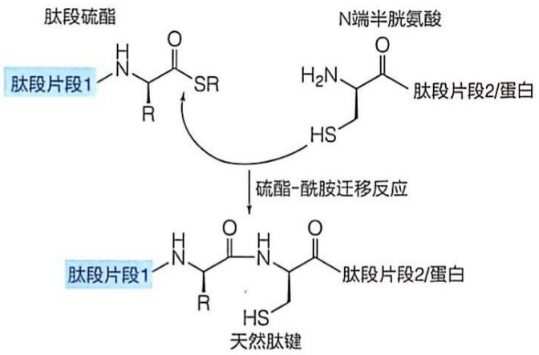

<details>
<summary>chemical</summary>

肽段硫酯与N端半胱氨酸的合成反应示意图，展示其化学结构及还原反应
</details>

图 5-22 天然化学连接反应的机制

究人员还开发了新型的化学连接反应如酰肼连接反应，进一步优化了蛋白质的化学合成，推动了生物医学领域的发展。

## 5.4 蛋白质 - 蛋白质相互作用可通过多种方法进行鉴定与分析

蛋白质在生物体内很少孤军作战，大都需要与其他生物大分子或小分子发生稳定的或暂时性的非共价物理相互作用来实现相应功能的执行。大量研究表明，生物体内存在一个巨大的蛋白质-蛋白质相互作用网络，参与形形色色的生命过程，完成多种多样的生物学功能。

蛋白质-蛋白质相互作用（protein-protein interaction，PPI）的概念和研究方法经历了长时间的演变。从19世纪末到20世纪初，抗原-抗体和胰蛋白酶-胰蛋白酶抑制因子的相互作用被发现，但当时蛋白质的化学本质尚不明了。直到1940年代，肌球蛋白与肌动蛋白的相互作用被揭示并认识到二者能组装成多聚体，才基本形成了PPI的概念。1960年代以后，随着对信号转导、转录和复制等生物过程的研究，动态的PPI广泛存在的现象逐渐被认识。进入21世纪，随着高通量筛选技术和质谱技术的发展，PPI的研究进入系统性探索阶段。2010年人类蛋白质组计划（Human Proteome Project，HPP）启动，并在2020年通过约30亿次酵母双杂交实验，绘制了迄今为止规模最大的人类蛋白质互作组数据库，涵盖了约53000种蛋白质相互作用信息，为蛋白质相互作用网络的研究以及疾病研究提供了强有力的工具和方法，推动了相关领域的重大进展。

长期的研究发展了多种体内和体外的方法用于PPI的鉴定。早期的PPI研究主要依赖传统的生物化学技术，如免疫共沉淀（co-immunoprecipitation，co-IP）和酵母双杂交（yeast two-hybrid，Y2H）。随着质谱技术的发展，基于质谱的PPI研究方法，如串联亲和纯化（tandem affinity purification，TAP）和蛋白质微阵列（protein microarray)，使得研究者可以定量和动态地分析蛋白质相互作用，尤其是蛋白质微阵列技术可同时分析数千种蛋白质相互作用，显著提升了高通量能力。荧光共振能量转移（fluorescence resonance energy transfer, FRET）和双分子荧光互补（bimolecular fluorescence complementation, BiFC）技术的发展，使研究者能够在单分子和活细胞中直接观察蛋白质相互作用，提供了更高的空间和动态分辨率。邻近标记技术 BioID 则能够在细胞内标记和鉴定微弱和瞬时的蛋白质相互作用，进一步推动了 PPI 研究的深入。虽然这些方法大多数是定性分析，即仅判断蛋白质之间是否发生了相互作用，但它们为 PPI 的进一步研究提供了有力的工具。

蛋白质-蛋白质相互作用的亲和力大小，反映在亲和力常数 $K_{\mathrm{D}}$ 上。高亲和力的相互作用（$K_{\mathrm{D}} < 10^{-7} \mathrm{~mol/L}$）通常形成稳定的结合复合体，而低亲和力的相互作用（$K_{\mathrm{D}} > 10^{-4} \mathrm{~mol/L}$）则是瞬时性的结合。例如，大肠杆菌素DNA酶与其免疫蛋白的相互作用具有极高亲和力（$K_{\mathrm{D}}: 10^{-14} \mathrm{~mol/L}$），使免疫蛋白能够高效抑制大肠杆菌素DNA酶的活性，减少其毒性。需要注意的是，PPI的亲和力会受到如小分子结合、共价修饰等因素的调节，并非一成不变。

不同亲和力的 PPI 需要采用不同的方法来鉴定和分析。常见的体外方法可以定量分析亲和力和结合动力学。表面等离子共振（surface plasmon resonance，SPR）和生物膜层干涉（bio-layer interferometry，BLI）技术可以实时测量相互作用的结合速率常数（ $k_{on}$ ）和解离速率常数（ $k_{off}$ ），通过两者的比值计算亲和力（ $K_{D}$ ）。微量热泳动（microscale thermophoresis，MST）和等温滴定量热（isothermal titration calorimetry，ITC）技术也可以测量亲和力（ $K_{D}$ ）以及结合的化学计量比，并且 ITC 还可以提供结合反应的热力学信息，如焓变和熵变。这些技术能够提供关于蛋白质相互作用的定量数据，帮助更全面地了解 PPI 的热力学特性和动力学机制。

下面对几种经典的研究蛋白质-蛋白质相互作用的定性和定量方法逐一进行阐述。

## 5.4.1 免疫共沉淀可用于对亲和力较强的蛋白质 - 蛋白质相互作用的分析

免疫共沉淀利用亲和层析策略，通过特异性抗体分离与目标蛋白质相互作用的蛋白质（图 5-23）。首先使用合适的裂解缓冲液制备含内源或外源诱饵和靶标蛋白的细胞裂解液，以确保提取的蛋白质复合物不被破坏，保留细胞内蛋白质-蛋白质相互作用。随后，将裂解液与固定在 Protein A/G 填料（如琼脂糖微珠或磁珠）上的诱饵蛋白特异性抗体进行孵育，捕获诱饵蛋白及其相互作用的靶标蛋白。由于 Protein A 和 Protein G 对不同抗体类型的亲和力不同，选择合适的 Protein A 或 Protein G 填料是实验成功的关键因素之一。经过多次洗涤去除未结合的蛋白质后，将蛋白质复合物在变性缓冲液（如 Laemmli 缓冲液）中从填料上释放，最终通过免疫印迹或质谱分析确定诱饵蛋白和靶标蛋白之间的相互作用。

免疫共沉淀是验证蛋白质相互作用的经典方法，常用于检测两种目标蛋白质是否在体内结合，也可用于鉴定与特定蛋白质发生相互作用的未知蛋白质。免疫共沉淀分析的蛋白质是天然存在于细胞中的（可能具有翻译后修饰等），其相互作用也在自然状态下进行，因此能够较真实地反映体内的情况，所检测到的蛋白质相互作用可信度较高。然而，免疫共沉淀通常只能检测亲和力较高的蛋白质-蛋白质相互作用。在免疫沉淀和洗涤过程中，低亲和力和动态的相互作用往往会被破坏。此外，检测到的两种蛋白质的相互作用可能是间接的，可能存在第三种蛋白质作为中间桥梁。

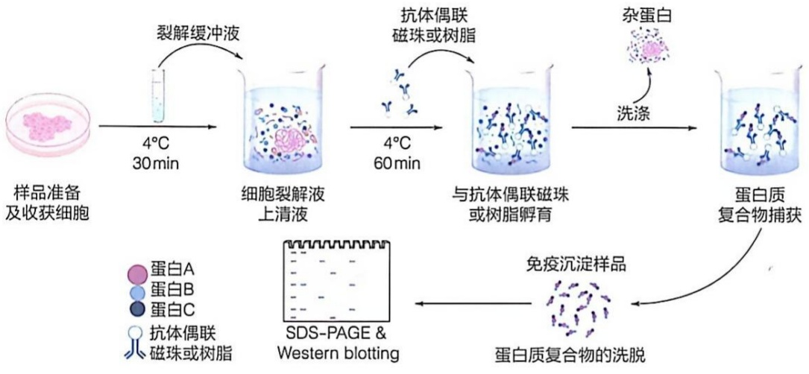

<details>
<summary>flowchart</summary>


</details>

图5-23 免疫共沉淀基本流程

## 5.4.2 酵母双杂交是基于酵母细胞转录因子而建立的一种体内分析蛋白质相互作用的遗传学方法

酵母双杂交（yeast two-hybrid，Y2H）系统是由美国学者斯坦利·菲尔茨（Stanley Fields）在1980年代末设计的一种遗传学方法，用于检测酵母细胞核内的蛋白质相互作用（图5-24）。该系统基于酵母转录因子GAL4的双结构域特性。GAL4包含一个与启动子区域结合的DNA结合域（DNA-binding domain，DBD）和一个激活下游基因转录的转录激活域（transcription-activating domain，AD）。将GAL4的DBD与目标蛋白X融合，将AD与另一种目标蛋白Y融合。将这两种融合蛋白在酵母细胞中共同表达后，如果蛋白质X和Y之间存在相互作用，就会将GAL4的DBD和AD结构域带到一起，恢复GAL4的功能，启动下游报告基因的表达。报告基因的产物如果被检测到，则说明X和Y蛋白之间存在相互作用；如果无产物产生，则表明两者之间不存在相互作用。

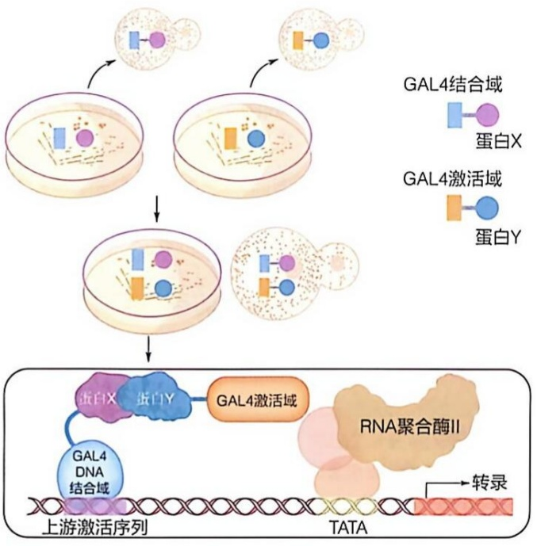

<details>
<summary>flowchart</summary>

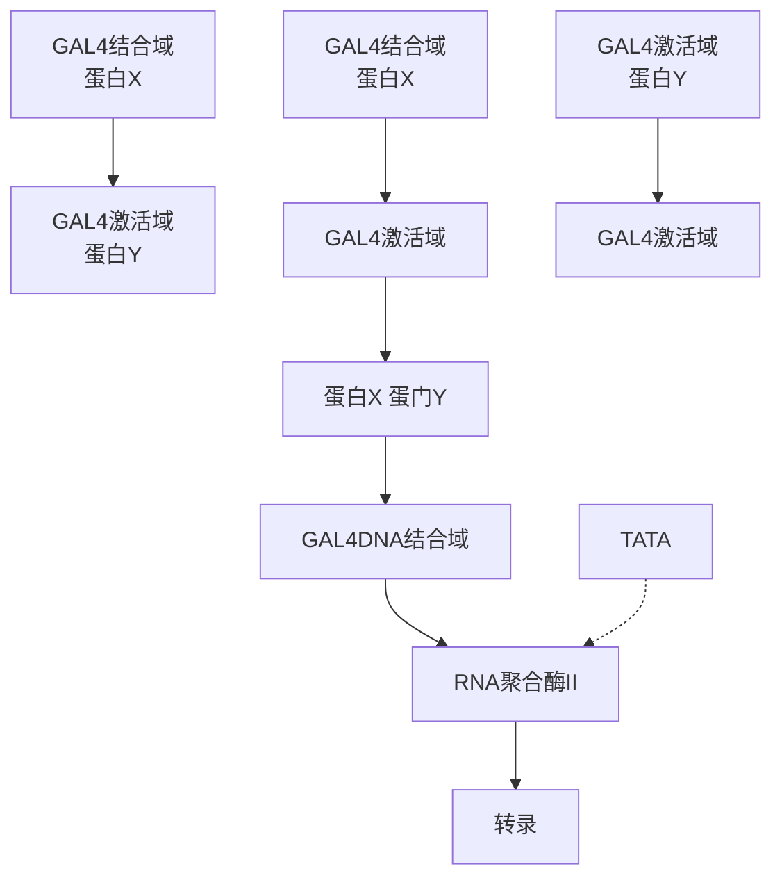
</details>

图 5-24 酵母双杂交技术原理示意图

基于 GAL4 的酵母双杂交技术。GAL4 转录因子可分为两部分:DNA 结合域（DBD）和转录激活域（AD）。当它们通过融合蛋白中的 X 和 Y 部分之间的相互作用而重构时，转录被启动，报告基因被表达

酵母双杂交系统的核心在于通过报告基因的表达来判断两种蛋白质是否相互作用。常用的报告基因如 lacZ，通过编码  $\beta-$  半乳糖苷酶催化无色底物（如 X-gal）生成有色产物，检测相互作用。另一种常见标记方法是营养缺陷标记，例如缺失 his3 或 leu2 基因的酵母菌株，只有在目标蛋白 X 和 Y 发生相互作用并激活报告基因（如 his3 或 leu2）时，酵母才能生长，从而实现相互作用的筛选。可通过将 AD 结构域与全蛋白融合库中的未知蛋白融合，筛选出与 X 蛋白相互作用的蛋白质。

然而，Y2H 方法存在假阳性和假阴性的问题。假阳性可能是由于某些蛋白质自带转录激活功能，或与多种蛋白质产生非特异性相互作用。假阴性则可能因蛋白质融合引发结构改变，影响 GAL4 的激活。此外，Y2H 仅能检测核内相互作用，且对某些依赖翻译后修饰或辅助蛋白的相互作用不适用。因此，Y2H 实验结果往往需通过其他方法进一步验证。

## 5.4.3 捕拉实验通过将亲和标签肽段加入目标蛋白质中而鉴定和分析与其发生相互作用的蛋白质

捕拉实验（pull-down experiment）通过在目标蛋白质中引入亲和标签，以鉴定和分析与其他蛋白质的相互作用。在该实验中，带有亲和标签的重组蛋白作为诱饵蛋白。标签为实验的关键，常用的亲和标签包括谷胱甘肽S-转移酶（glutathione-S-transferase, GST）和多聚组氨酸，它们分别结合固相化的谷胱甘肽（glutathione, GSH）和金属螯合物亲和配体（如 $Ni^{2+}$ 或 $Co^{2+}$ ），以固定诱饵蛋白。当体系中存在与诱饵蛋白直接相互作用的“靶标”蛋白时，靶标蛋白会与固相复合物结合，从而被“拉”下来（图5-25）。因此，捕拉实验既可用于验证已知蛋白间的相互作用，也可以筛选未知的蛋白质相互作用。

图 5-25 GST 捕拉实验原理图

以重组表达的 GST 亲和标签 - 蛋白 A（已知蛋白）作为诱饵蛋白，使用固相化的谷胱甘肽（GSH）固定诱饵蛋白，在体系中存在与诱饵蛋白有直接相互作用的靶标蛋白 B（未知蛋白），它就能够与固相复合物（重组蛋白 A）结合而被“拉”下来

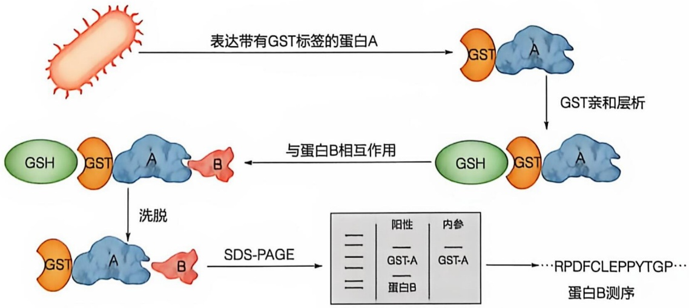

<details>
<summary>flowchart</summary>

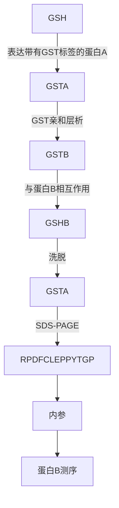
</details>

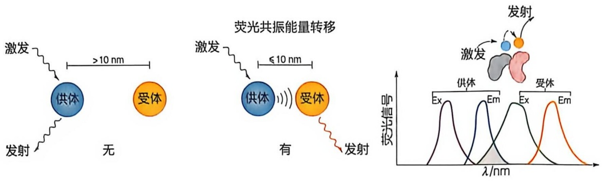

<details>
<summary>text_image</summary>

激发
供体
发射
无
>10 nm
受体
激发
荧光共振能量转移
供体
有
<10 nm
受体
发射
发射
发射
Ex
Em
Ex
Em
λ/nm
</details>

图 5-26 荧光共振能量转移原理示意图

## 5.4.4 荧光共振能量转移可以实时监控发生于活细胞中的蛋白质相互作用

荧光共振能量转移（fluorescence resonance energy transfer，FRET）是一种通过能量在两个相邻荧光基团之间的转移来探测蛋白质分子相互作用的技术。FRET 通过非辐射形式的激发能转移，即不涉及光子的发射和重新吸收，而是通过供体与受体之间的偶极-偶极相互作用，将能量从激发态的供体荧光基团传递到基态的受体荧光基团。当供体荧光基团的发射光谱与受体的吸收光谱有一定重叠，且两基因距离足够近（一般小于 10 nm）时，可以观察到这种能量转移现象（图 5-26）。

在活细胞中应用 FRET 探测蛋白质相互作用的一个常用策略是利用青色荧光蛋白（cyan fluorescent protein，CFP）和黄色荧光蛋白（yellow fluorescent protein，YFP）的组合。作为供体的 CFP 发射波长与作为受体的 YFP 激发波长存在部分重叠，如图 5-26 所示，若 CFP 与 YFP 分别与蛋白质 A 和 B 融合，当以 CFP 的吸收波长 433 nm 进行激发，如果 A 和 B 没有相互作用，则检测到 CFP 的发射波长 476 nm 的荧光；如果 A 和 B 有相互作用，使 CFP 和 YFP 足够接近，则 CFP 作为供体会将能量转移给受体 YFP，检测到 YFP 的发射波长 527 nm 的荧光信号，即发生了 FRET。FRET 的效率受供体和受体荧光基团之间的光谱重叠、供体的量子产率，以及供体和受体之间的距离和取向等因素的影响。

## 5.4.5 表面等离子共振技术是体外研究蛋白质相互作用的经典方法

表面等离子共振（surface plasmon resonance，SPR）是一种基于光学现象的无标记检测技术，用于实时监测生物分子间的相互作用。利用金属表面（通常是金）与光束相互作用时产生的消逝波与等离子体波共振现象来检测生物分子在固相表面的结合和解离过程。SPR 现象在 1902 年由约翰霍普金斯大学的罗伯特·伍德（Robert W. Wood，1868—1955）首次观察到。1983 年瑞典科学家比约恩·利德伯格（Björn Liedberg）等人首次将 SPR 技术用于生化分析，这一创新使得 SPR 技术开始受到重视并迅速发展。

SPR 技术的核心在于光在不同介质界面上的全反射现象。当偏振光照射到金属膜表面时，形成消逝波进入光疏介质中，与金属中的等离子体波相遇并发生共振。共振条件与生物分子在金属表面的含量和结构有关。当生物分子（如蛋白质或 DNA）固定在金属表面并与溶液中的分析物相互作用时，共振角发生变化，通过监测这种变化可以分析分子间的结合特性（图 5-27）。

图 5-27 表面等离子体共振技术原理示意图

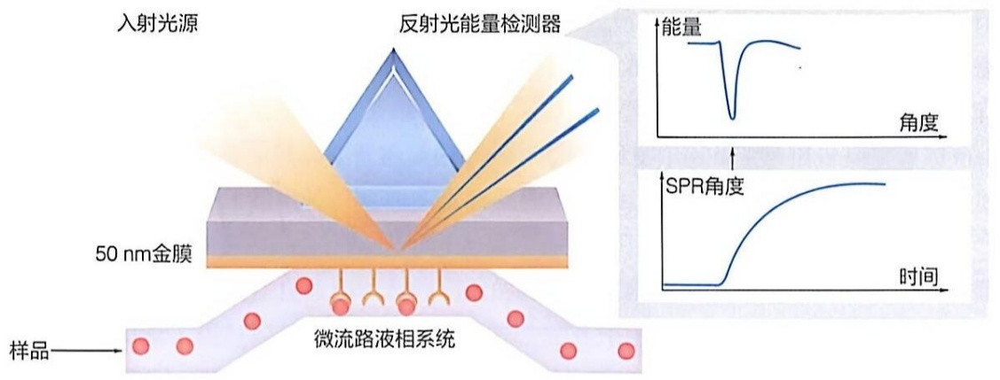

<details>
<summary>text_image</summary>

入射光源
反射光能量检测器
50 nm金膜
样品
微流路液相系统
能量
角度
SPR角度
时间
</details>

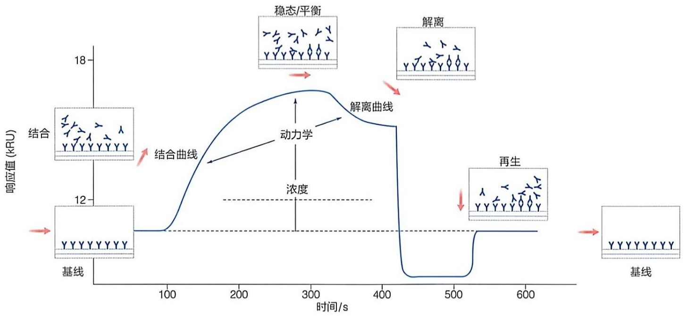

<details>
<summary>flowchart</summary>


</details>

图 5-28 SPR 实时传感信号的示意图

目前，SPR广泛应用于蛋白质、核酸等生物分子间相互作用的检测。在实验中，通常将一种分子（如配体）固定在传感芯片的金膜表面，另一种与其相互作用的分子（如分析物）流经传感芯片表面。当分析物与配体结合或解离时，传感芯片界面处的质量增加或减少，导致共振角发生变化，生成实时的传感信号（图5-28）。通过这种方式，不仅可以检测到相互作用的发生，还可以进一步分析结合速率常数（ $k_{\mathrm{on}}$ ）、解离速率常数（ $k_{\mathrm{off}}$ ）以及亲和力常数（ $K_{\mathrm{D}}$ ）。

SPR 技术的优势在于无须对分析物进行标记，可在生理条件下实时监测分子相互作用。然而，它对样品的浓度和纯度要求较高，且由于分子固定在表面上，可能会影响其天然构象，从而对实验结果产生一定影响。因此，在 SPR 实验中通常结合其他方法进行验证。

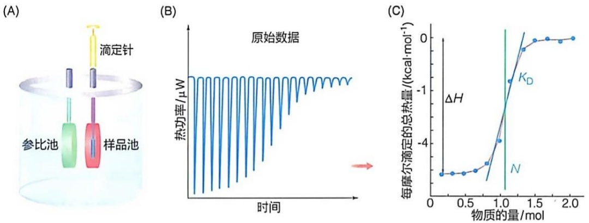

图 5-29 等温滴定量热法测定相互作用的原理示意图

（A）等温滴定量热仪结构示意图。（B）典型吸热反应的原始数据图。（C）等温滴定拟合曲线图

## 5.4.6 等温滴定量热技术是一种基于热力学的检测蛋白质相互作用的经典无标记方法

等温滴定量热（isothermal titration calorimetry，ITC）技术是一种无标记、定量的分析技术，通过直接测量结合反应中释放或吸收的热量，来精确确定亲和力常数 $(K_{\mathrm{D}})$ 、化学计量比 $(N)$ 、焓变 $(\Delta H)$ 和熵变 $(\Delta S)$ ，从而提供关于分子相互作用的完整热力学信息。

等温滴定量热法的基本装置包括一个参比池（通常以水为参比）和一个样品池。在实验中，将一种生物分子（如蛋白a）放入样品池，并将另一种生物分子（如蛋白b）放入一个精确的注射装置——滴定针中，准备逐步滴入样品池（图5-29A）。实验开始时，参比池和样品池被设置为恒定的实验温度。当滴定针将蛋白b小量、多次地注入样品池的蛋白a溶液中时，如果a和b之间发生结合反应，产生的吸热或放热效应将导致样品池温度变化。ITC设备通过热敏装置检测样品池与参比池之间的温差，并自动调节加热器以补偿该温差，从而保持两个池的温度一致。这一补偿过程能够精确检测到微小的热量变化，可以达到百万分之一摄氏度的灵敏度。

如图 5-29B 所示，当 a 和 b 的结合反应为放热反应时，样品池的温度会暂时高于参比池，从而在检测信号上显示为下行的热峰。随着蛋白 b 的逐滴注入，蛋白 a 逐渐被 b 饱和，释放的热量逐渐减少。对每个热峰的面积进行积分，并将其绘制在横轴（a 和 b 的物质的量比）上，可以得到一条等温滴定曲线（图 5-29C）。通过拟合这条曲线，能够确定反应的亲和力（ $K_{D}$ ）和化学计量比（N）。在等温线中点对应的物质的量比即为反应化学计量比，例如图中 a 和 b 为 1:1 的结合关系。此外，通过曲线还可以得到反应的焓变（ $\Delta H$ ）。

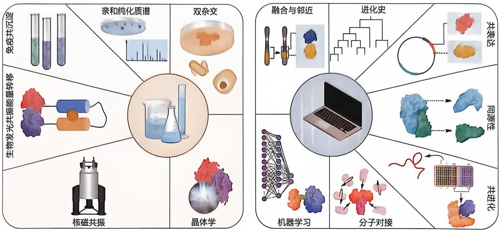

图 5-30 实验（左）和计算（右）方法分别用于检验和预测蛋白质相互作用

## 5.4.7 蛋白质相互作用也可通过计算方法进行预测

蛋白质分子之间的特异而动态的相互作用是蛋白质发挥功能的重要方面。目前已经建立了多种鉴定相互作用的体外和体内实验方法，同时也可以使用计算机算法预测分子间相互作用（图 5-30）。预测蛋白质相互作用包括基于网络拓扑、基于序列、基于结构等不同方法。其中基于网络拓扑的方法主要是通过设计不同的拓扑相似度度量方法，对实验构建的网络（如蛋白质互作网络或共表达网络）进行分析，提取相关的特征，用于预测蛋白质间是否形成相互作用。基于序列或者结构的方法是利用蛋白质分子中的各种生物信息元素进行预测，如通过分析蛋白质分子中所存在的序列模体或结构模体，建立物理模型（如分子对接、同源建模等）或统计模型（比如共进化模型、进化树等）进行蛋白质间相互作用预测。近年来，基于机器学习的人工智能方法展现出较大潜力。它依赖人工智能模型的强大学习能力，从海量的已知数据中，能够自动学习与蛋白质互作相关的各种结构特征，从而生成更精确的特征向量，更准确地评估蛋白质分子间相互作用的概率。继蛋白质结构预测软件 AlphaFold2 之后，DeepMind 团队又推出了能够用于蛋白质相互作用预测（蛋白质复合体结构预测）的 AlphaFold-Multimer 和 AlphaFold3 软件，在异源多聚体和同源多聚体的结构预测方面达到了相当高的准确度。

## 5.5 蛋白质分子的三维结构可通过物理方法测定

在生物体内扮演关键角色的蛋白质分子，仅仅具有特定的一级氨基酸序列还不够，它们必须形成特异的三维空间结构才可发挥其特有生物学功能。自1960年代以来，研究人员采用X射线晶体衍射技术、核磁共振技术和冷冻电镜技术等主要方法，已解析超过20万个蛋白质分子的三维结构。本节将介绍这些研究方法的基本原理、应用、限制以及未来发展前景。

## 5.5.1 X射线晶体衍射是测定蛋白质三维结构的经典方法

利用 X 射线晶体衍射方法测定蛋白质三维空间结构经过了几十年的努力才获得成功。X 射线是 1895 年由德国学者威廉·伦琴（Wilhelm Röntgen，1845—1923）偶尔发现的一种射线。X 射线的波长较短，能够穿透薄的物质，且与可见光相比，具有更强的穿透性。1912 年，德国学者马克斯·冯·劳厄（Max von Laue，1879—1960）等观察到 X 射线穿过晶体后产生衍射现象。这一现象证明了 X 射线不仅具有波动性质，而且可以与晶体中原子间的周期性结构相互作用，开启了 X 射线晶体学的基础。1913 年，英国学者威廉·亨利·布拉格（William Henry Bragg，1862—1942）和威廉·劳伦斯·布拉格（William Lawrence Bragg，1890—1971）父子建立了布拉格定律，描述了 X 射线衍射与晶体面间距的关系，并通过实验验证了该定律。自此，X 射线晶体衍射技术被陆续用于对不同无机化合物结构的解析。

1940—1950年代，英国女学者多罗西·霍奇金（Dorothy Hodgkin，1910—1994）利用X射线衍射技术先后测定了青霉素和辅酶 $B_{12}$ 等具有较为复杂结构的重要分子的三维结构。1950年代，英国学者罗莎琳德·富兰克林（Rosalind Franklin，1920—1958）和莫里斯·威尔金斯（Maurice Wilkins，1916—2004）测定了DNA纤维的X射线衍射数据，为DNA双螺旋结构模型提供了重要的实验数据。

在 1930 年代获得蛋白质晶体后，人们就一直试图利用 X 射线晶体衍射测定蛋白质的三维结构。但直到 1950 年代末至 1960 年代初，才由英国学者约翰·肯德鲁（John Kendrew，1917—1997）和马克斯·佩鲁茨（Max Perutz，1914—2002）分别解析了肌红蛋白和血红蛋白的三维结构，标志着结构生物学的一个重大突破。

值得一提的是，在 1965 年成功合成了人工牛胰岛素之后，中国科学家在 1960 年代末也组建了一支跨学科的团队，开展胰岛素晶体结构测定攻关，并在 1970 年代初先后获得了分辨率为 2.5 Å 和 1.8 Å 的猪胰岛素高分辨率结构。这是我国（也是亚洲）测定的第一个蛋白质晶体结构，为理解胰岛素结构与功能关系提供了重要的高分辨率结构信息。

X射线衍射所用波长通常在 $0.5\sim 2.5\AA$ ，波长长度与晶体中周期排列的原子间距离相当。当X射线穿过蛋白质晶体时，晶体中各个原子会对X射线进行散射，而原子的周期排布使这些散射波相互干涉，产生不同方向上强度不同的衍射波。利用探测仪记录这些不同衍射波的强度，并采用实验或计算方法推算出衍射波的相位，就能够计算出蛋白质分子的电子密度图，据此进行模型搭建和修正，最终得到蛋白质中各个原子的三维空间坐标，完成晶体结构测定。