图5-31 X射线晶体学技术路线

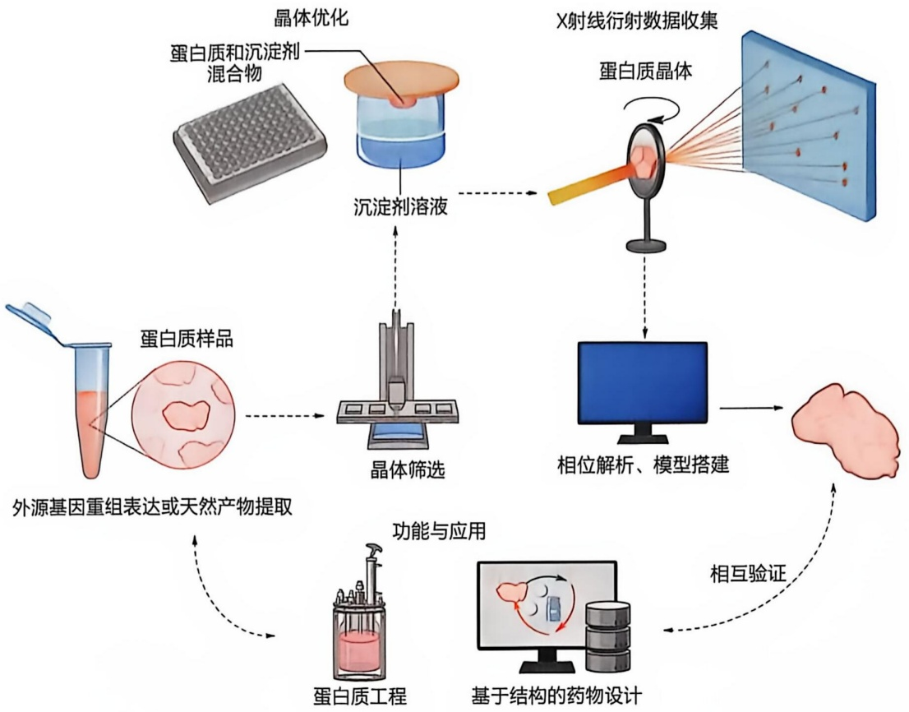

<details>
<summary>flowchart</summary>

```mermaid
graph TD
  A["蛋白质和沉淀剂混合物"] --> B["晶体优化"]
  C["X射线衍射数据收集"] --> D["蛋白质晶体"]
  B --> E["沉淀剂溶液"]
  D --> F["相位解析、模型搭建"]
  E -.-> F
  G["外源基因重组表达或天然产物提取"] -.-> H["蛋白质样品"]
  H --> I["晶体筛选"]
  I --> J["功能与应用"]
  K["蛋白质工程"] --> L["基于结构的药物设计"]
  M["相互验证"] -.-> N["功能与应用"]
  N --> O["功能与应用"]
  P["X射线衍射数据收集"] -.-> D
  Q["相位解析、模型搭建"] --> R["X射线衍射数据收集"]
  S["X射线衍射数据收集"] -.-> D
  T["X射线衍射数据收集"] -.-> D
  U["X射线衍射数据收集"] -.-> D
  V["X射线衍射数据收集"] -.-> D
  W["X射线衍射数据收集"] -.-> D
  X["X射线衍射数据收集"] -.-> D
  Y["X射线衍射数据收集"] -.-> D
  Z["X射线衍射数据收集"] -.-> D
  AA["X射线衍射数据收集"] -.-> D
  AB["X射线衍射数据收集"] -.-> D
  AC["X射线衍射数据收集"] -.-> D
  AD["X射线衍射数据收集"] -.-> D
  AE["X射线衍射数据收集"] -.-> D
  AF["X射线衍射数据收集"] -.-> D
  AG["X射线衍射数据收集"] -.-> D
  AH["X射线衍射数据收集"] -.-> D
  AI["X射线衍射数据收集"] -.-> D
  AJ["X射线衍射数据收集"] -.-> D
  AK["X射线衍射数据收集"] -.-> D
  AL["X射线衍射数据收集"] -.-> D
  AM["X射线衍射数据收集"] -.-> D
  AN["X射线衍射数据收集"] -.-> D
  AO["X射线衍射数据收集"] -.-> D
  AP["X射线衍射数据收集"] -.-> D
  AQ["X射线衍射数据收集"] -.-> D
  AR["X射线衍射数据收集"] -.-> D
  AS["X射线衍射数据收集"] -.-> D
  AT["X射线衍射数据收集"] -.-> D
  AU["X射线衍射数据收集"] -.-> D
  AV["X射线衍射数据收集"] -.-> D
  AW["X射线衍射数据收集"] -.-> D
  AX["X射线衍射数据收集"] -.-> D
  AY["X射线衍射数据收集"] -.-> D
  AZ["X射线衍射数据收集"] -.-> D
  BA["X射线衍射数据收集"] -.-> D
  BC["X射线衍射数据收集"] -.-> D
  BD["X射线衍射数据收集"] -.-> D
  BE["X射线衍射数据收集"] -.-> D
  BF["X射线衍射数据收集"] -.-> D
  BG["X射线衍射数据收集"] -.-> D
  BH["X射线衍射数据收集"] -.-> D
  BI["X射线衍射数据收集"] -.-> D
  BJ["X射线衍射数据收集"] -.-> D
  BK["X射线衍射数据收集"] -.-> D
  BL["X射线衍射数据收集"] -.-> D
  BM["X射线衍射数据收集"] -.-> D
  BN["X射线衍射数据收集"] -.-> D
  BO["X射线衍射数据收集"] -.-> D
  BP["X射线衍射数据收集"] -.-> D
  BR["X射线衍射数据收集"] -.-> D
  BC["X射线衍射数据收集"] -.-> D
  BD["X射线衍射数据收集"] -.-> D
  BE["X射线衍射数据收集"] -.-> D
  BF["X射线衍射数据收集"] -.-> D
  BG["X射线衍射数据收集"] -.-> D
  BH["X射线衍射数据收集"] .-.-_B1["(&quot;外部基因重组表达或天然产物提取&quot;)"]
  BH --> B2["(&quot;蛋白质工程&quot;)"]
  BH --> B3["(&quot;基于结构的药物设计&quot;)"]
  BH --> B4["(&quot;相互验证&quot;)"]
  BH --> B5["(&quot;相互验证&quot;)"]
  BH --> B6["(&quot;相互验证&quot;)"]
  BH --> B7["(&quot;相互验证&quot;)"]
  BH --> B8["(&quot;相互验证&quot;)"]
  BH --> B9["(&quot;相互验证&quot;)"]
  BH --> B10["(&quot;相互验证&quot;)"]
  BH --> B11["(&quot;相互验证&quot;)"]
  BH --> B12["(&quot;相互验证&quot;)"]
  BH --> B13["(&quot;相互验证&quot;)"]
  BH --> B14["(&quot;相互验证&quot;)"]
  BH --> B15["(&quot;相互验证&quot;)"]
  BH --> B16["(&quot;相互验证&quot;)"]
  BH --> B17["(&quot;相互验证&quot;)"]
  BH --> B18["(&quot;相互验证&quot;)"]
  BH --> B19["(&quot;相互验证&quot;)"]
  BH --> B20["(&quot;相互验证&quot;)"]
  BH --> B21["(&quot;相互验证&quot;)"]
  BH --> B22["(&quot;相互验证&quot;)"]
  BH --> B23["(&quot;相互验证&quot;)"]
  BH --> B24["(&quot;相互验证&quot;)"]
  BH --> B25["(&quot;相互验证&quot;)"]
  BH --> B26["(&quot;相互验证&quot;)"]
  BH --> B27["(&quot;相互验证&quot;)"]
  BH --> B28["(&quot;相互验证&quot;)"]
  BH --> B29["(&quot;相互验证&quot;)"]
  BH --> B30["(&quot;相互验证&quot;)"]
  BH --> B31["(&quot;相互验证&quot;)"]
  BH --> B32["(&quot;相互验证&quot;)"]
  BH --> B33["(&quot;相互验证&quot;)"]
  BH --> B34["(&quot;相互验证&quot;)"]
  BH --> B35["(&quot;相互验证&quot;)"]
  BH --> B36["(&quot;相互验证&quot;)"]
  BH --> B37["(&quot;相互验证&quot;)"]
  BH --> B38["(&quot;相互验证&quot;)"]
  BH --> B39["(&quot;相互验证&quot;)"]
  BH --> B40["(&quot;相互验证&quot;)"]
  BH --> B41["(&quot;相互验证&quot;)"]
  BH --> B42["(&quot;相互验证&quot;)"]
  BH --> B43["(&quot;相互验证&quot;)"]
  BH --> B44["(&quot;相互验证&quot;)"]
  BH --> B45["(&quot;相互验证&quot;)"]
  BH --> B46["(&quot;相互验证&quot;)"]
  BH --> B47["(&quot;相互验证&quot;)"]
  BH --> B48["(&quot;相互验证&quot;)"]
  BH --> B49["(&quot;相互验证&quot;)"]
  BH --> B50["(&quot;相互验证&quot;)"]
  BH --> B51["(&quot;相互验证&quot;)"]
  BH --> B52["(&quot;相互验证&quot;)"]
  BH --> B53["(&quot;相互验证&quot;)"]
  BH --> B54["(&quot;相互验证&quot;)"]
  BH --> B55["(&quot;相互验证&quot;)"]
  BH --> B56["(&quot;相互验证&quot;)"]
  BH --> B57["(&quot;相互验证&quot;)"]
  BH --> B58["(&quot;相互验证&quot;)"]
  BH --> B59["(&quot;相互验证&quot;)"]
  BH --> B60["(&quot;相互验证&quot;)"]
```
</details>

蛋白质晶体结构测定实验步骤主要分为蛋白质样品纯化、蛋白质晶体生长、衍射数据收集与处理、相位求解与优化、模型构建与修正、模型质量评估（图 5-31）。早期的蛋白质晶体结构测定样品从生物组织中直接分离和纯化，随着分子生物学技术的发展，通过重组表达和多种层析方法组合，能够获得纯度高、构象均一且具有生物活性的蛋白质样品。但对于膜蛋白和大型蛋白质复合物，目前获取能够满足晶体生长的样品仍然相当困难。

通过改变物理或化学条件，使溶液中蛋白质浓度不断提高至过饱和（supersaturation），最终蛋白质分子能够有序聚集析出形成晶体。目前并无任何理论可以预测一种蛋白质形成结晶的具体条件，必须通过不断测试各种条件的组合，获得初始的蛋白质晶体，进而优化结晶条件，才有可能最终获得衍射能力强的单晶。晶体生长是目前蛋白质晶体结构测定的瓶颈步骤。

和普通实验室使用的铜靶光源产生的固定波长 X 射线相比，同步辐射光源产生的 X 射线亮度更强、发散度更小且波长可调。利用液氮系统对蛋白质晶体进行冷却保护，使用同步辐射光源 X 射线照射蛋白质晶体，可以获得更高质量的晶体衍射数据。利用探测器记录衍射画面和软件处理后，可以得到记录下的每条衍射波的衍射指数和强度。

利用 X 射线衍射测定晶体结构的一个关键问题是衍射波相位的确定。目前还没有方法直接测定每条衍射波的相位，因此需要利用实验或计算方法推算相位信息，主要方法包括同晶置换法（isomorphous replacement method）、分子置换法（molecular replacement method）、反常散射法（anomalous dispersion method）以及直接法（direct method）。由于近些年结构数据库的不断更新以及人工智能辅助的结构预测（如AlphaFold3）发展迅速，分子置换法已逐渐成为蛋白质晶体结构测定过程中解决相位问题的最常用方法。

实验测定的衍射波强度和推算的相位信息可用于计算电子密度图，据此进行蛋白质分子模型的构建。构建的分子模型和真实结构之间的差异可通过循环进行模型调整和模型修正不断进行缩小直至收敛。最终得到的三维模型的质量可通过晶体学参数（主要为R因子和自由R因子）和立体化学参数（主要为键长键角偏差以及主链二面角分布）来进行评估。

经过过去一个多世纪理论和技术的发展，X射线晶体衍射技术解析的蛋白质结构数目最多，是目前结构测定最经典的方法，但依然面临一定的技术瓶颈，例如高质量单晶的获得。随着实验技术的进一步发展，X射线晶体学正朝着更高分辨率、更高通量、更自动化和智能化的方向发展，并且它与其他技术的结合将继续促进对生物大分子结构与功能关系的理解，并在药物开发领域发挥更加重要的作用。

## 5.5.2 核磁共振波谱分析是表征较小蛋白质分子在溶液中的结构和动态的有效方法

如上所述，X射线晶体衍射技术固然是一种揭示蛋白质三维结构的强有力工具，但它仅适用于可以结晶的蛋白质分子。核磁共振波谱（nuclear magnetic resonance spectroscopy，NMR）提供了一种在溶液状态下研究蛋白质三维结构，特别是其构象动态的有效手段，在一定程度上可以弥补晶体衍射技术的缺陷。

核磁共振是自旋不为零的原子核在外加恒定磁场下与特定频率的电磁波发生共振的一种量子现象。自旋（spin）是基本粒子的内禀属性。自旋非零的原子核能够产生微小的磁矩，在外磁场作用下其空间取向发生量子化。用于核磁共振测量的大多是自旋为1/2的原子核，例如 $^{1}$ H、 $^{13}$ C、 $^{15}$ N、 $^{31}$ P和 $^{19}$ F等。这些原子核在磁场中只有自旋向上和自旋向下两种空间取向，形成两个能级。当与恒定磁场垂直的方向有无线电频段的电磁波入射，且其频率所对应的能量恰好等于两个能级之差时，原子核将吸收电磁波的能量而从低能级跃迁到高能级，此即核磁共振现象。对于给定原子核，外磁场越强，共振频率越高。 $^{1}$ H是核磁实验中最灵敏也是最常用的原子核。核磁共振仪标称的频率值，例如600 MHz或800 MHz，指的就是 $^{1}$ H的共振频率。

以测量一维氢谱为例，核磁共振仪的工作原理简述如下（图 5-32A）:首先将样品置于磁体中，外磁场在样品中激发出沿磁场方向的总磁矩，此时样品处于平衡态；接着施加一个频率满足共振条件的横向电磁脉冲使得总磁矩偏转到水平面上；脉冲撤除后，总磁矩一边以共振频率绕外磁场转动，一边回到平衡态，在此过程中检测线圈将产生振荡衰减的时域信号；最后，对该信号进行傅里叶变换，得到频域上的核磁共振一维谱。整个过程可比拟为将一颗石块扔入平静的湖面（施加脉冲令自旋体系偏离平衡态），产生涟漪（振荡衰减的时域信号），最后通过分析波纹获得水面的振动频率（产生核磁谱）。自旋体系受到扰动后回复到平衡态的过程称为弛豫（relaxation）。弛豫与分子运动密切相关，因此对弛豫的测量是用核磁共振研究蛋白质构象动态的主要手段。

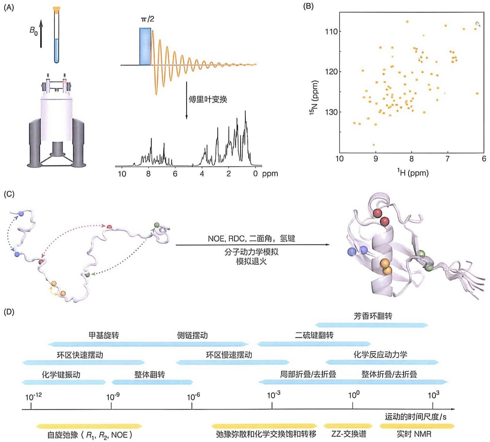

图 5-32 核磁共振的原理及其在蛋白质结构和动态研究中的应用

（A）核磁共振测量的基本原理。（B）人源泛素蛋白的NH-HSQC二维谱。（C）核磁结构解析方法的示意图，不同颜色的小球代表距离应

该约束在 5 Å 以内的四对氢原子，该泛素蛋白结构解析所使用的距离约束多达 2727 个；NOE，原子核奥弗豪泽效应；RDC，残余偶极耦合。（D）蛋白质分子运动的时间尺度（上）和进行动力学研究的主要核磁共振方法（下）

从图 5-32A 的一维氢谱可以看到， $^{1}$ H 原子核产生了众多的谱峰。核磁谱峰相对于原子核的固有共振频率发生移动的现象称作化学位移（chemical shift），源于原子核所处的局部化学环境不同，因而电子云对磁场的屏蔽程度存在差异。化学位移数值很小，以百万分比（parts per million，缩写为 ppm）为单位。蛋白质等生物大分子中氢原子数量众多，谱峰重叠严重，通常需要采集二维或三维谱以便更好地区分这些谱峰。测量多维谱常常需要对蛋白质进行  ${}^{15}N$  或  ${}^{13}C$  的稳定同位素标记。最常用的蛋白质核磁谱是关联了  ${}^{1}H$  和  ${}^{15}N$  化学位移的 HSQC 二维谱，在该谱中蛋白质各残基的氨基都会产生一个谱峰（图 5-32B）。该谱对蛋白质的构象变化极为敏感，可以用作指纹谱。例如，在  ${}^{15}N$  标记的蛋白质样品中加入未标记的配体，发生变化的谱峰即对应着参与配体互作的氨基酸残基。

解析蛋白质的核磁结构首先需要制备  ${}^{15}N/{}^{13}C$  双标的样品，采集一系列多维核磁谱；然后通过谱图分析得到谱峰的归属，这是一个非常烦琐耗时的过程；最后从谱图中提取出结构约束，整合到分子动力学模拟中计算出蛋白质的三维结构。最主要的结构约束是氢原子之间的距离:当两个氢原子核的空间距离在大约 5 Å 之内，就会在 NOESY 谱上呈现出一个相关峰，距离越近谱峰越强。用于解析结构的距离约束往往数目多达数千。其他结构约束包括化学键的空间朝向、二面角、氢键、化学位移等。计算结构时，通常从无序构象出发，将结构约束作为附加的能量项，引导分子动力学模拟向着能够满足结构约束的构象收敛。这样的模拟计算要重复很多轮，最后选出能量最低的多个结构组成构象系综，作为解析结果（图 5-32C）。构象系综在一定程度上反映了蛋白质的柔性。

核磁结构的解析受到样品需求量大、学习门槛高和解析周期长的制约，而且只有分子量较小（30 kDa 以下）且构象稳定的蛋白质才能产生高质量的可用于结构解析的核磁谱图。因此核磁共振更适合作为晶体衍射和冷冻电镜方法的补充，尤其适合于难以结晶、同时分子量过小而无法用电镜方法解析的蛋白质。该技术的真正优势在于研究结构比较动态的蛋白质分子。因此，近年来生物核磁共振的研究重心已经转到对蛋白质等生物大分子构象动态的表征上。

蛋白质在溶液中通常存在多个构象，这些构象互相转换，跨越了从皮秒到秒甚至更慢的时间尺度。蛋白质的功能发挥不仅取决于三维结构，还与构象动态息息相关，例如蛋白质的折叠与去折叠、配体识别、酶的催化等。对于不同时间尺度的构象转换，核磁共振都提供了相应的方法进行测量（图 5-32D）。自旋弛豫方法能够获取每个氨基酸残基在皮秒到纳秒量级的动态信息，包括运动的幅度和快慢。弛豫弥散和化学交换饱和转移用于测量微秒到毫秒量级的构象动态，尤其是丰度低至难以用其他技术研究的构象。几十毫秒或者更慢的构象运动可以通过 ZZ-交换谱或者实时 NMR 的方法来测量。

## 5.5.3 冷冻电镜技术日益成为生物分子结构解析的主要方法

冷冻电镜是一种重要的研究工具，其对应的冷冻电子显微学技术（简称冷冻电镜技术）用于分析生物大分子和细胞的高分辨率结构。作为透射电子显微镜的一种，冷冻电镜的主要特点是能够将样品，尤其是冷冻含水的生物样品保持在液氮或更低温度下进行观察。透射电子显微镜使用高能电子束［电子能量通常在数百到数千电子伏特（keV）之间］作为光源，其波长仅为数皮米，远小于原子尺寸，分辨率目前最高可以达到数十皮米，因此能够实现物质结构的高分辨率成像或衍射分析。冷冻电镜技术与X射线晶体衍射和核磁共振技术并列，是结构生物学研究和测定生物大分子结构的主要方法之一。

冷冻电镜技术的起源可以追溯到1930年代透射电子显微镜刚刚问世时。当时，研究人员尝试使用透射电镜观察生物样品，却发现由于高能电子束的辐照损伤，生物样品很快被破坏。同时，由于电子束需要在真空中传播，透射电镜内部必须维持高真空环境，而水在真空中会迅速蒸发，因此，含水的生物样品需要先冷冻，以使水固化后才能进行观察。然而，直接冷冻含水样品会因冰晶的形成和膨胀效应而对生物样品造成破坏，这使得使用透射电镜观察生物结构变得极为困难。

在接下来的几十年里，由于这些技术难题，研究人员无法直接观察含水生物样品，只能通过间接手段，如重金属盐染色，来观察生物结构，成像分辨率最多可达纳米级别。随着多项技术突破，冷冻电镜逐渐能够被用来观察高分辨率的含水生物样品三维结构。1968年，艾伦·克拉格（Aron Klug，1926—2018）提出了中心截面定理，为生物结构的三维重构奠定了数学基础。进入1980年代，快速冷冻技术成功将生物样品冷冻于非晶态冰中，为冷冻电镜的发展奠定了基础。

此后，冷冻电镜技术得到了迅速发展，涵盖了透射电镜的电子光学、算法、软件、计算机技术和相机等多个方面的技术突破。到了2013年，基于直接电子探测相机的电子计数技术和基于统计推断的三维重构算法的突破，使得用冷冻电镜解析近原子甚至原子分辨率水平的生物大分子结构成为可能，这一进展被称为“分辨率革命”。

生物大分子和细胞等生物结构十分复杂，对其进行研究需要三维成像。然而，冷冻电镜在成像过程中只能获取样品的二维投影图像或衍射数据。因此，三维重构成为冷冻电镜技术的核心，其理论基础是中心截面定理，即三维物体沿某个方向的二维投影的傅里叶变换，等同于该物体的三维傅里叶变换中，垂直于投影方向且通过中心原点的截面。

根据中心截面定理，重建三维结构需要满足两个条件:①从多个角度获取样品的投影图像；②记录投影方向信息，然后便能将不同方向的投影图像在三维傅里叶空间中整合。这两个要素的获取构成了三维重构的基础。研究人员发展了不同的策略来获得这两个要素，进而发展出了冷冻电镜技术的三个主要分支:①冷冻电镜单颗粒分析（single-particle analysis, SPA）；②冷冻电子断层成像（cryo-electron tomography, cryoET）；③微晶电子衍射（micro-crystalline electron diffraction, MicroED）（图 5-33）。

冷冻电镜单颗粒分析是冷冻电镜技术中发展最快且最成熟的分支，主要用于解析纯化蛋白质复合物的三维结构。单颗粒分析基于溶液中具有相同结构的生物大分子颗粒呈现随机取向的特点，通过一次成像可以获得同一结构沿多个方向的二维投影图像。然而，由于分子颗粒的取向是未知的，因此需要借助算法进行计算，确定各个投影图像的方向信息，从而满足中心截面定理中所需的核心要素。在三维重构过程中，结合图像处理方法，对大量结构相同的颗粒图像进行三维平均，以增强信噪比，从而获得生物分子的精细结构细节。

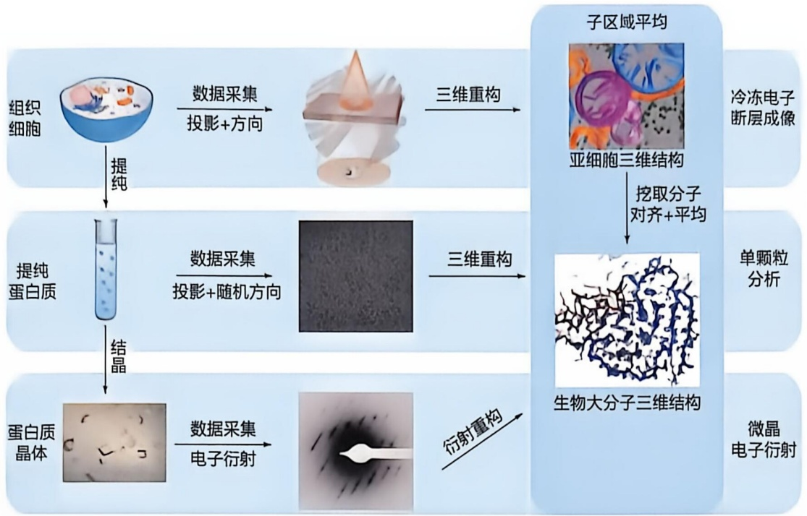

<details>
<summary>flowchart</summary>

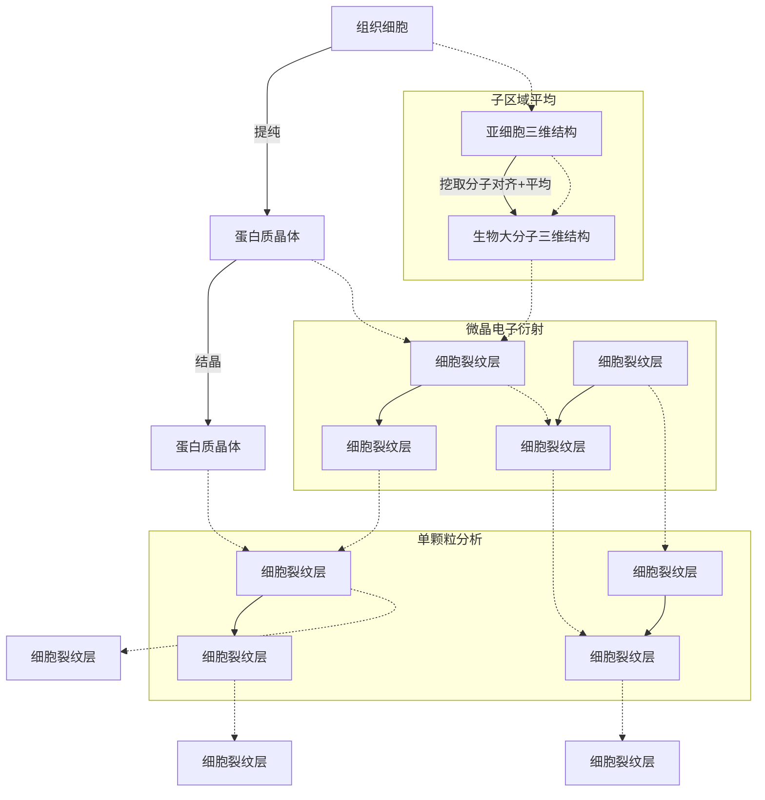
</details>

图6-33 冷冻电镜技术的三个主要分支及其关系示意图

需要强调的是，单颗粒三维重构要求参与计算的所有分子都具有相同的结构，但这一要求在现实中往往难以完全满足。当分子存在结构不均一性或柔性时，可以通过生化方法来稳定结构，或者采用柔性分析与优化算法进行解析。目前，单颗粒分析的最高分辨率已达到1 Å左右，常规解析分辨率处于2\~4 Å的近原子分辨率范围。该技术特别适用于分子质量大于数十 kDa 的生物大分子复合物，尤其适合解析数百 kDa 甚至数千 kDa 的蛋白质复合物及复杂的病毒复合体结构。

冷冻电子断层成像是一种能够观察细胞结构并解析原位生物大分子结构的强大工具。与单颗粒分析相比，冷冻电子断层成像能够直接揭示生物大分子在生理状态下的真实结构，揭示细胞中生物大分子之间的相互作用及其空间组织关系。冷冻电子断层成像采用与单颗粒分析不同的数据采集策略:通过连续倾转样品，获取同一生物样本在多个角度的投影图像，形成倾转系列照片（tilt series），一次性满足三维重构所需的两个核心要素。该技术特别适用于非重复性的生物样本，如细胞和细胞器。

然而，对样品的同一区域进行连续成像，导致辐照损伤变得显著，因此必须降低每个倾角上拍摄图像的电子辐照剂量。这使得图像的信噪比较低。此外，虽然冷冻电子断层成像技术能够同时获取样品的投影图像及其方向信息，但受限于样品台的机械不稳定性和运动误差以及电子束辐照引起的样品形变，投影方向信息仍需进一步通过计算进行精确修正，而这一过程又受到低信噪比的限制。因此，利用冷冻电子断层成像技术获得生物大分子的高分辨率结构具有较大挑战性。

为了解决这一难题，人们开发了子区域平均（sub-tomogram averaging，STA）技术。该技术通过从电子断层成像获得的细胞三维密度图中提取感兴趣分子的三维密度，再将大量相同分子的三维密度图进行取向测定与平均，从而显著提高信噪比和分辨率。子区域平均技术在算法上与单颗粒分析基本相似，只是输入数据有所不同:单颗粒分析使用的是目标分子的二维投影图像，而子区域平均使用的是三维密度图或对应的倾转系列照片。

微晶电子衍射技术不同于前述两种基于成像的三维结构测定方法，它更类似于 X 射线晶体学，通过电子衍射解析蛋白质或有机小分子晶体的结构。这一技术主要聚焦于那些难以生长至微米尺度的亚微米级微小晶体。由于电子与样品之间的强相互作用，即使是极其微小的蛋白质晶体，也能够激发出显著的衍射信号，这些信号足以满足结构解析的要求。这使得微晶电子衍射成为解析微小晶体结构的重要工具，特别是对传统 X 射线晶体学难以处理的小晶体样品具有显著优势。

冷冻电镜技术的快速发展不仅极大推动了结构生物学领域的进步，还为基于结构的药物设计等关键领域提供了强有力的工具。随着技术的不断创新和完善，冷冻电镜技术在生物大分子结构解析方面展现出巨大的潜力，并有望与其他技术融合，实现对生物结构和功能更全面、深入的研究。

## 5.6 根据氨基酸序列可对蛋白质的结构和功能特征进行理论预测

长期以来，人们一直在努力通过蛋白质的氨基酸序列预测其三维结构。自1960年代以来，基于上述X射线晶体衍射、核磁共振波谱学以及冷冻电镜技术等方法，大约有180 000种蛋白质三维结构已经被测定。如此海量的蛋白质结构信息为开展蛋白质结构的预测提供了条件。特别是近些年，人工智能技术促进了结构预测的长足进步。目前根据氨基酸序列预测蛋白质三维结构的方法主要包括基于物理和统计知识的建模法和基于人工智能的预测方法。

基于物理和统计知识的建模策略主要依赖多重序列比对（multiple sequence alignment，MSA）以及已经测定的蛋白质分子的三维结构信息。该策略的主要依据是:MSA体现了蛋白质序列的进化关系，因此其中隐含了氨基酸残基间的关联信息；氨基酸序列相似的蛋白质或多肽片段可能呈现相似的三维结构。主要步骤如图5-34所示:a. 根据目标蛋白质的氨基酸序列，使用序列比对软件搜索序列数据库，建立MSA；b. 根据MSA，使用统计模型预测目标蛋白质的二级结构以及主链二面角，然后搜索结构数据库，为目标蛋白质的每个片段（fragment）找到与其氨基酸序列和二级结构相匹配的片段模板（fragment template）；c. 根据MSA中残基间的关联突变，建立统计模型预测残基间是否形成物理接触，甚至预测二者间的空间距离；d. 根据第三步中的预测结果构建几何约束，使用分子动力学模拟或蒙特卡洛模拟将第二步中得到的片段模板进行动态的片段组装（fragment assembly），并用梯度下降（gradient descent）法进行能量优化；e. 依据物理和统计知识，对所得结构模型进行打分排序，并进行结构聚类，筛选出具有一定结构多样性的优势构象。代表性的算法包括 Rosetta、I-TASSER、QUARK 等。

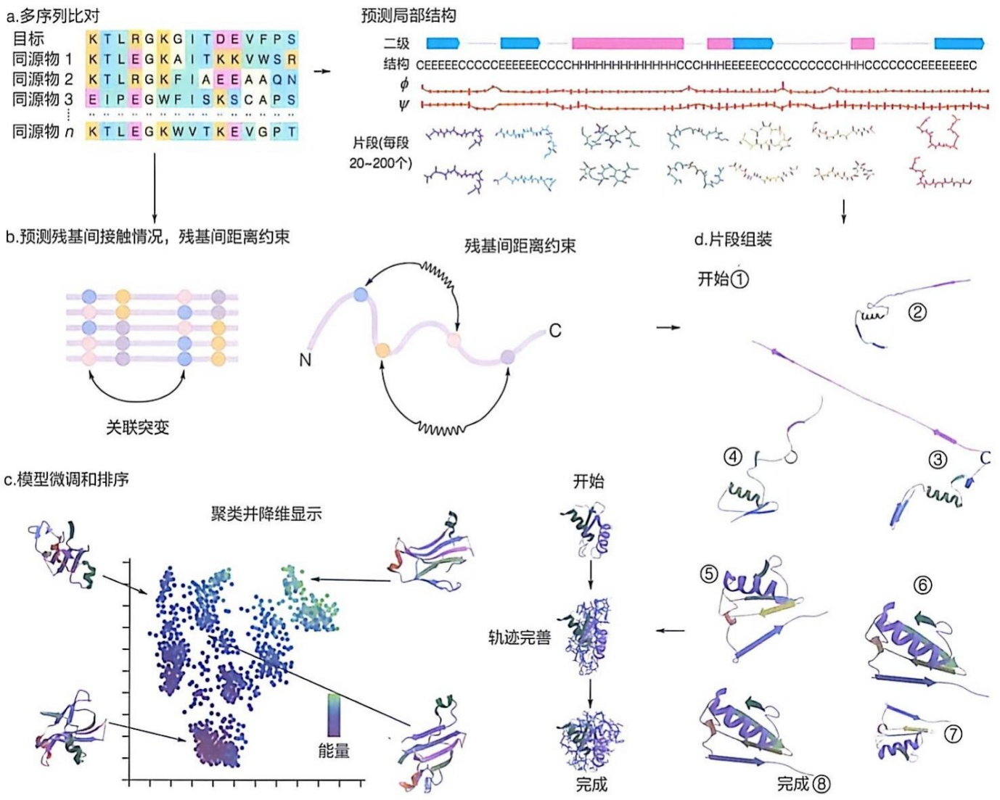

<details>
<summary>flowchart</summary>

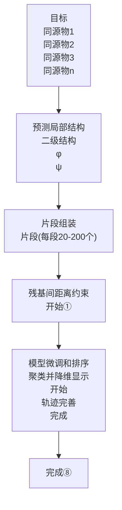
</details>

图 5-34 基于物理和统计知识的建模策略的关键步骤

基于人工智能的预测方法大幅度提高了蛋白质三维结构预测的准确度。当前主流的人工智能（artificial intelligence）模型多基于深度堆叠的人工神经网络（artificial neural network）。网络的输入是氨基酸序列，输出为需要预测的结构信息。模型通常含有海量的待学习参数，而这些参数的数值是通过对已知的大量的蛋白质序列和结构数据进行训练优化得到的。简而言之，人工智能模型通过调整优化其内部参数，试图在海量的已知数据中学习蛋白质的氨基酸序列与三维结构间的映射关系。如果所学的关系具有较好的泛化性，模型就可以根据未知结构的目标蛋白质的氨基酸序列准确预测出其三维结构。早期的人工智能模型往往选择难度较小的预测任务，比如根据氨基酸序列预测蛋白质主链的二面角、二级结构以及氨基酸残基间的物理接触信息等。这些预测信息可以制作成额外的几何约束，显著改善基于物理和统计知识的建模方法。

AlphaFold2 是这些方法中的集大成者——它采用端对端设计的方式，把预测几何约束和基于预测结果进行建模的过程集成在一个统一的人工神经网络模型中，可以直接根据氨基酸序列预测所有原子坐标（图 5-35）。在一些蛋白质的评测中，AlphaFold2 预测的结构甚至与实验所测得的结构模型相当（知识延展 5-1）。目前 AlphaFold 系列算法（AlphaFold2、AlphaFold-Multimer、AlphaFold3 等）已经普遍应用于生命科学的诸多领域。

图 5-35 AlphaFold 预测蛋白质结构

(A) 分子生物学的核心原理

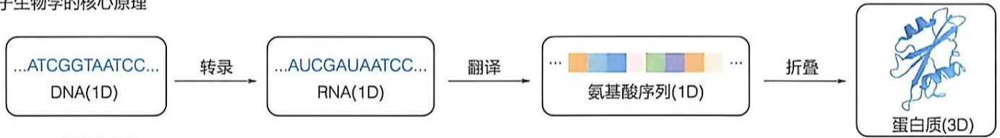

<details>
<summary>flowchart</summary>


</details>

(B) AlphaFold的算法结构

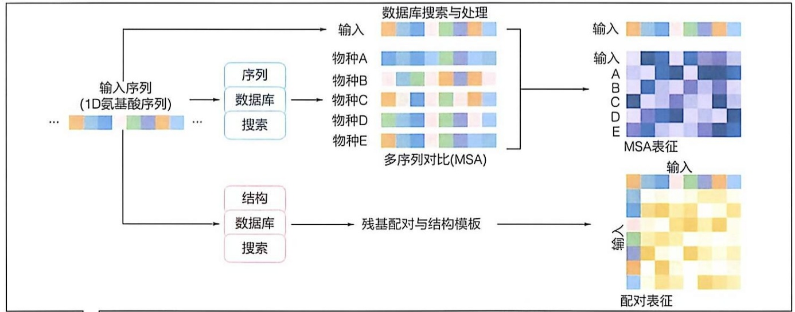

<details>
<summary>flowchart</summary>

```mermaid
graph LR
  Input["输入序列\n(1D氨基酸序列)"] --> DB["数据库\n搜索"]
  DB --> Search["多序列对比(MSA)"]
  Search --> Output["输出数据集"]
  
  subgraph Sequence ["序列\n数据库\n搜索"]
    direction TB
  DB1["序列"] --> DB2["数据库"]
  DB2 --> DB3["数据库"]
  DB3 --> DB4["数据库"]
  end
  
  subgraph Structure ["结构\n数据库\n搜索"]
    direction TB
  DB4["结构"] --> Structure
  DB5["结构"] --> Structure
  end
  
  Output --> Table["MSA表征"]
  Table --> Table
  Table --> Table
  
  subgraph Table_caption ["残基配对与结构模板"]
    direction TB
  Table1["结构"] --> Table2["结构"]
  Table2 --> Table3["结构"]
  end
```
</details>

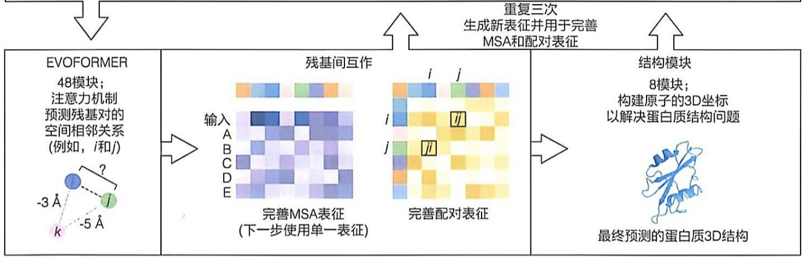

<details>
<summary>flowchart</summary>

This flowchart illustrates the process of constructing a final predicted 3D structure using EVOFORMER and MSA methods, involving interaction with residues A-E and their modification.
</details>

(C) AlphaFold的潜在应用


<details>
<summary>natural_image</summary>

Illustration of a pill with a pink and blue capsule inside a circular frame, surrounded by abstract cloud-like shapes (no text or symbols)
</details>

设计能与蛋白质口袋紧密结合的药物


<details>
<summary>chemical</summary>

Diagram of DNA double helix structure showing alpha-helices and beta-sheets with red highlighted regions
</details>

评估基因突变对蛋白质结构和功能的影响

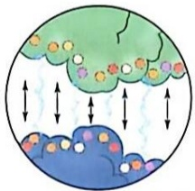

<details>
<summary>natural_image</summary>

Illustration of a stylized landscape with clouds and arrows indicating movement or flow (no text or symbols)
</details>

为蛋白质界面建模从而评估蛋白质分子间相互作用


<details>
<summary>natural_image</summary>

Illustration of various laboratory instruments including a plant, test tube, and molecular structures inside a circular frame (no text or labels)
</details>

为医学、农业和其他领域设计具有新功能的蛋白质

## 知识延展 5- 1

## 蛋白质结构预测技术的批判性评价

蛋白质结构预测技术的批判性评价（critical assessment of techniques for protein structure prediction, CASP）是一个定期举办的蛋白质结构预测国际竞赛，旨在评估和促进蛋白质结构预测方法的发展。其于1994年首次举办，初衷是为了解决蛋白质结构预测领域存在的问题。截至 2024 年，一共举办了 16 届，吸引了来自世界各地的科研人员和团队。通过这样的比赛，诞生了多种有效的蛋白质结构预测工具，也为 AlphaFold 系列算法的研发提供了理论基础。

## 5.7 蛋白质的折叠过程、动态结构及相互作用可通过计算机软件进行一定程度的模拟

蛋白质数据库里提供的蛋白质结构信息是静止的，但无论是在体外还是体内的生理条件下，蛋白质分子结构都是动态变化的，且结构的动态性是蛋白质行使功能的必备条件。目前可以有效探测蛋白质动态结构的实验方法相对有限。但是计算机模拟能辅助揭示蛋白质的动态特征，乃至蛋白质折叠信息。

通过分子动力学模拟和蒙特卡洛模拟等计算机模拟技术可获得蛋白质的结构动态信息。这里主要介绍分子动力学模拟（molecular dynamics simulation）。它根据物理和化学的基本原理，模拟在特定时间范围内体系中的原子和分子的运动轨迹，被形象描述为一种“虚拟显微镜”。对蛋白质研究而言，全原子分子动力学模拟（all-atom molecular dynamics simulation）通过对一个分子中的所有原子的运动及相互作用进行模拟，展示蛋白质分子的微观运动过程。其基本流程如下:首先需给所研究体系（如蛋白质和溶剂所组成的体系）确定初始坐标和初始速度；随后，通过数值积分求解牛顿运动方程，获得体系在不同时间点的结构状态，得到蛋白质分子的运动轨迹。在计算过程中，一般使用分子力场（molecular force field）来定义和约束蛋白质分子中不同原子之间的关系，包括由键长、键角、二面角等定义的共价约束以及范德瓦耳斯相互作用、静电相互作用等非共价约束。分子力场是描述分子结构的一种简化模型，使用一套带参数的解析函数逼近量子力学计算所得的电子势能函数，从而极大地提升了计算效率。根据模拟轨迹，结合统计力学方法最终可以计算出系统的力学、热力学、动力学性质等。

形成天然构象的蛋白质分子是动态的（图 5-36），这对于蛋白质分子执行其生物学功能也是必须的。但是，结构的动态性目前还难以通过实验方法进行可靠地测定和表征。1970 年代，马丁·卡普拉斯（Martin Karplus）等首次在全原子水平上模拟了牛胰蛋白酶抑制因子（一种仅由 58 个氨基酸残基组成的小蛋白质分子）在天然构象状态附近的结构波动。之后，经过多年的发展，分子动力学模拟技术已经成为研究蛋白

图 5-36 蛋白质动态结构示例

(A)配体的结合引发蛋白质构象的显著改变。(B)蛋白质表面的环区（即松散连接部分）有较大柔性。(C)多结构域蛋白可发生结构域间相对运动

(A)

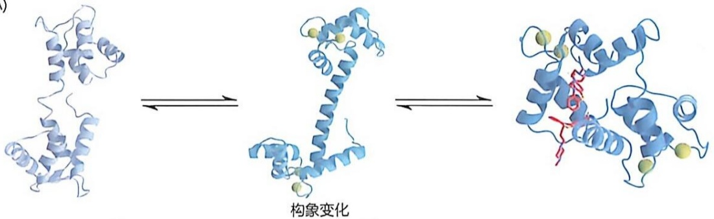

<details>
<summary>chemical</summary>

Protein structure transformation diagram showing structural changes with labeled '构象变化' (structural change)
</details>

(B)

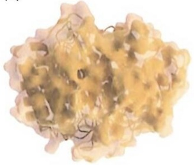

<details>
<summary>natural_image</summary>

Close-up of a protein structure with yellow and beige regions, no visible text or labels
</details>

表面环的柔性

(C)

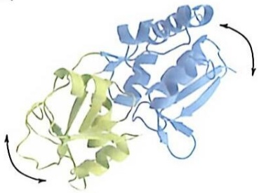

<details>
<summary>natural_image</summary>

3D ribbon diagram of a protein structure with alpha helices and beta sheets, showing alpha helices and beta sheets (no text or labels)
</details>

结构域运动

质结构动态的常规手段。

相比于局部的结构动态，蛋白质折叠过程的时间尺度较长，一般在微秒至秒的量级，超过了常规分子动力学模拟计算的时间尺度（通常在纳秒量级）。随着计算机软硬件的发展，现在可以将模拟时间增长至微秒甚至毫秒尺度范围，使得人们可以通过计算机模拟观测小的球状蛋白质的快折叠过程。但是较大蛋白质的折叠和聚集过程仍然难以模拟。为解决这一问题，可以采用多尺度模拟策略。即先使用粗粒化模拟（coarse-grain simulation），在牺牲空间分辨率的条件下增大模拟计算的时间尺度，粗

## 知识延展 5- 2

## 蛋白质从头设计

蛋白质的从头设计是指基于氨基酸的物理化学性质，从头搭建、设计具有全新结构与全新功能的蛋白质。蛋白质设计的核心问题是蛋白质折叠的逆命题，即基于已知或设计出的结构模板得到与其相符的氨基酸序列。蛋白质从头设计不依赖于自然存在的蛋白质模板，而是根据功能需求，利用计算方法设计出实现功能的骨架结构（scaffold）以及与之匹配的氨基酸序列。这些设计的蛋白质可以作为酶，催化全新的化学反应；作为大分子药物，靶向结合重要疾病相关的靶点以干预疾病的发生与发展；作为元件构建蛋白质纳米材料；或者作为膜转运蛋白以及通道蛋白调控跨细胞膜的物质转运。通过从头设计，可以在更广阔的蛋白质序列与结构空间中采样，创造具有各种功能的蛋白质，具有无限的可能性。近来，通过深度学习算法，结合蛋白质结构、序列数据库，基于生成式人工智能的蛋白质从头设计得到了快速的发展，为创造全新的基于蛋白质的药物、传感器、智能材料和工程酶等打开了新世界的大门。

略地观测这些较慢的生物学进程。然后基于粗粒化观测的结果，在感兴趣的相应区段，通过细粒化重构和全原子模拟得到蛋白质分子在该区段的原子分辨率细节。

蛋白质通常至少含有上万个原子。这种复杂的分子体系，对于其结构动态的研究，仍然需要在预测和模拟的方法学上的进一步发展。并且模拟过程与真实发生的蛋白质动态结构之间的吻合性也有待确认。

蛋白质的从头设计也是目前一个活跃的研究领域（见知识延展 5-2）。

## ※展望

蛋白质是生命活动的直接执行者，参与了几乎所有生物过程，如遗传、发育、繁殖、物质和能量代谢及应激反应等。揭示生物体内成千上万种蛋白质的具体功能机制，是蛋白质研究的核心内容之一，也是后基因组时代生命科学领域中的重大挑战。尽管已有许多针对蛋白质的研究方法，仍然缺乏多角度的探究手段，尤其是在蛋白质的动态结构、折叠机制、活细胞内蛋白质结构的测定以及其他定性和定量检测方法等方面。

近年来，蛋白质组学技术的迅速发展将电泳、层析、高效分离、质谱鉴定与基因组测序技术结合，为揭示生物体内蛋白质的种类、表达水平、翻译后修饰情况和蛋白质相互作用提供了全新手段。这些技术大大推动了人们对细胞和组织中蛋白质的全面了解。此外，荧光蛋白标记技术的出现，使得人们能够对活细胞内的蛋白质进行动态成像，观察其在细胞内的表达水平、亚细胞定位及其相互作用的变化过程。

在蛋白质结构研究领域，冷冻电镜技术的发展为解析蛋白质在天然状态下的三维结构提供了强有力的工具。然而，现有技术仍未能实时捕捉活细胞中蛋白质的动态结构变化。针对这一问题，交联结合质谱鉴定技术的进展为探索活细胞内蛋白质的结构提供了新的可能性。此外，细胞内核磁共振波谱学、限制性酶解质谱分析（LIP-MS）等技术，也为蛋白质的功能和结构研究提供了潜力。

随着冷冻电镜和交联质谱技术的持续发展，科学家们能够以前所未有的分辨率解析细胞中蛋白质的组成与结构。三维分类和改进型冷冻电镜技术，甚至有望揭示瞬时、弱的蛋白质相互作用，并实现时间依赖的动态观察。同时，交联质谱技术仍需在数据量、数据密度和交联量方面进一步优化。

为了实时追踪和探究特定蛋白质分子在活细胞中的行为，研究人员正在开发具有更高灵敏度和特异性的光谱学检测方法。通过将特异性的化学探针引入细胞内目标蛋白质，并结合实时成像或检测技术，有望为深入理解活细胞中蛋白质的动态行为提供新的突破。未来，随着这些新方法的不断发展和完善，我们有望对蛋白质分子获得更加深刻的认识，进而揭示生命活动的奥秘。

## ※ 本章小结

蛋白质纯化是研究蛋白质结构与功能的基础，涉及一系列生物化学和生物物理实验。

纯化流程通常包括根据目标蛋白质的性质（如热稳定性、聚合形式、溶解性、均一性及是否结合特定辅助因子等）对缓冲液和纯化步骤进行调整。纯化过程和结束后，必须进行功能检测，以确保样品质量满足后续研究需求。

蛋白质表征包括分子量、等电点、流体力学性质和稳定性等，通常通过多种方法进行研究。

蛋白质相互作用研究涉及体内、体外实验以及计算机预测等方法，是阐明蛋白质功能、理解生命活动机制、疾病发生机制以及药物研发的关键。

质谱仪是一种用于准确测定分子量的仪器，包含离子源、质量分析器、检测器和数据系统。其原理是通过电场或磁场将离子按质荷比（ $m / z$ ）分离，从而生成质谱图。

电喷雾离子源是生物质谱中常用的电离源，能够使液相色谱分离的分子进入质谱仪，特别适用于多肽和蛋白质的电离与分析。

串联质谱技术通过将特定质荷比的离子进行分离和碎片化，产生二级或多级质谱，是鉴定多肽序列的有效工具。

多肽固相合成法是最常用的化学合成方法，其原理是通过共价键将目标多肽的 C 端氨基酸连接至不溶性树脂，并通过肽键连接第二个氨基酸，重复此过程以获得目标多肽。

X射线晶体衍射、核磁共振和冷冻电镜三种结构解析方法互为补充。晶体衍射解析结构的分辨率高，但需要高质量的蛋白质晶体；冷冻电镜不需要结晶且样品需求量小，近年来得到广泛应用；核磁共振则擅长解析溶液状态下的结构，尤其在研究柔性区域较多的蛋白质和表征构象动态上有独特优势。

基于氨基酸序列预测与模拟蛋白质结构及其动态特性，为下游的功能研究提供了大量信息，显著推动了相关领域的实验科学进展。未来的研究模式将从实验探索主导的传统范式转变为计算/理论与实验相结合的方式。

## ※ 思考题

1. 蛋白质分子量的表征可以通过哪些方法实现？
2. 已知蛋白 A 是由体细胞突变基因编码的癌症蛋白, 如何从蛋白质相互作用研究出发, 设计和开发针对癌症蛋白 A 的药物?
3. 如何用质谱方法鉴定蛋白质的 N 端残基和形成二硫键的半胱氨酸残基？
4. X射线晶体衍射、核磁共振和冷冻电镜是解析蛋白质结构的主要方法，请简述三种方法各自的优势和劣势。
5. 为什么 X 射线晶体衍射和冷冻电镜这两种方法难以解析蛋白质的柔性区域？
6. 对比基于物理知识和统计信息的结构预测方法与基于人工智能的结构预测方法，分析两类方法的优劣。

## ※ 推荐阅读

- 1. ABRAMSON J, ADLER J, DUNGER J, et al. Accurate structure prediction of biomolecular interactions with AlphaFold 3 [J]. Nature, 2024, 630: 493–600.
- 本论文是AlphaFold3方法的原始论文，系统介绍了该方法的设计思路和性能评测。
- 2. MEISSNER F, GEDDES-MCALISTER J, MANN M, et al. The emerging role of mass pectrometry-based proteomics in drug discovery [J]. Nat Rev Drug Discov, 2022, 21: 637-654.
- 本论文总结了基于质谱的蛋白质组学的原理，以及在药物靶点发现、验证和药物安全性评估等领域的应用。
- 3. ALDERSON R, KAY L. NMR spectroscopy captures the essential role of dynamics in regulating biomolecular function [J]. Cell, 2021, 184: 577–595.
- 本论文总结了核磁共振技术对生物大分子构象动态的表征及应用。
- 4. DRENTH J, MESTERS J. Principles of protein X-ray crystallography [M]. 3rd ed. Berlin: Springer, 2007.
- 本书是理解蛋白质晶体结构测定方法的理论基础的经典教材。

（撰写:王新泉，常卿，胡奇，邓海腾，陈宇凌，龚海鹏，李雪明，薛毅，范仕龙，于湘晖，殷平；审修:陈春来）

## 6

## 核酸

核酸（nucleic acid）是遗传信息的载体，按其组成和结构可以分为两类:脱氧核糖核酸（deoxyribonucleic acid, DNA）和核糖核酸（ribonucleic acid, RNA）。

DNA 由四种脱氧核糖核苷酸组成，通常呈双螺旋结构，主要功能是储存和传递遗传信息。DNA 是一种巨大的生物大分子，在细菌细胞中所有遗传信息储存在一个 DNA 分子内，而在真核细胞中，每条染色体均由一条独立的 DNA 分子构成。DNA 的双螺旋结构保证了遗传信息的稳定性及复制的准确性。

RNA 则由四种核糖核苷酸构成，通常呈单链结构，在遗传信息的表达过程中发挥作用。信使 RNA（mRNA）、转运 RNA（tRNA）与核糖体 RNA（rRNA）是遗传信息由 DNA 向蛋白质传递的重要中介与参与者。干扰小 RNA（siRNA）、微 RNA（miRNA）和长链非编码 RNA（lncRNA）等在基因表达调控中具有关键作用，而核酶具有催化功能。此外，RNA 病毒中的 RNA 也是遗传信息的载体。

在生物体内，核苷酸及其衍生物不仅是遗传信息的基本单位，还担任多种角色，如能量货币、第二信使、酶的辅基和中间代谢产物等。

本章将深入探讨核酸的化学组成、空间结构及其生物学功能。核酸的结构决定其功能，而 DNA 与 RNA 在功能上的差异正源于其结构上的不同特征。核酸研究的历史也充分体现了结构研究对功能理解的巨大推动作用。

## 6.1 对核酸结构和功能认识的历史

核酸最初是于1860年代，由瑞士年轻学者弗雷德里希·米歇尔（Friedrich Miescher，1844—1895）在德国学者菲利克斯·霍普-塞勒（Felix Hoppe-Seyler，1825—1895）实验室首次发现的。米歇尔在分析人体白细胞的化学成分时，发现了一种含磷的新物质，加酸后沉淀。这种新物质并非蛋白质，也非脂质。他认为这种物质来自细胞核，故称其为核素（nuclein），并从鲑鱼精子中进一步分离出这种物质。

## 6.1.1 化学分析显示生物体内存在两大类核酸

1880 年代，德国学者理查德·奥尔特曼（Richard Altmann，1852—1900）通过去除酵母和动物器官中核素的蛋白质成分，获得了更纯的物质，称之为核酸（这其实只是核酸中的一种，即 DNA）。1940 年代，科学家们系统研究了核酸的化学组成和结构，揭示了其在生物体内的功能。通过对不同生物材料的化学分析，识别出两种核酸——以胸腺核酸为代表的 DNA 和以酵母核酸为代表的 RNA，前者在水解时产生胸腺嘧啶，后者则产生尿嘧啶。

## 6.1.2 核酸的化学结构通过对基于其水解产物的化学分析而认识

从 19 世纪末到 1930 年代，利用纯化的核酸，人们对核酸的化学组成和化学结构进行了深入分析。尽管这样的化学分析并不一定能揭示核酸的功能，但这是深入认识其功能的基础。

德国学者阿尔布雷克特·科塞尔（Albrecht Kossel，1853—1927）和俄裔美国学者菲巴斯·莱文（Phoebus Levene，1869—1940）等对酵母核酸和胸腺核酸的化学结构进行了系统分析。他们利用各种方法（如酸碱处理或酶处理等）使核酸水解，通过分析水解后的产物，科塞尔等鉴定出核酸中除磷酸外的五种含氮杂环化合物，即嘌呤和嘧啶碱基，以及糖基的存在。

莱文等分析了温和条件下（如酶处理）的水解产物，发现了不同组分之间的连接方式，区分了核苷（即糖基与碱基之间通过糖苷键连接的产物）、核苷酸（核苷与磷酸基通过磷酸酯键连接的产物）及核苷酸之间的连接方式（磷酸二酯键）。莱文等还于1920年代末揭示，存在于胸腺核酸中的糖基并非人们早期所认为的己糖，而是2号碳脱氧的脱氧戊糖。基于这些组分上的差异（如尿嘧啶与胸腺嘧啶、戊糖与脱氧戊糖），在1930年代，科学家们成功地将核酸区分为DNA和RNA两大类。

基于不同核酸中四种碱基含量相等的定量分析结果，莱文等提出了“四色核苷酸”假说。虽然当时尚不清楚这些碱基如何连接，但这一假说暗示核酸的结构相对简单。因此，科学界普遍认为核酸在细胞内的功能有限，仅充当辅助角色。这种观点在一定程度上削弱了人们对核酸功能深入研究的重视，导致20世纪上半叶对核酸作为