生物分子的功能探究存在一定程度的轻视。

## 6.1.3 DNA 可能是遗传物质的经典实验

在生命科学的发展历程中，科学家通过一系列经典实验揭示了 DNA 作为遗传物质的核心地位。这些实验为现代遗传学和分子生物学的奠基提供了重要支持，以下是几个具有代表性的实验及其重要意义。

## (1) 格里菲斯的细菌转化实验暗示了遗传物质的存在

1928年，英国学者弗雷德里克·格里菲斯（Frederick Griffith，1877—1941）在研究肺炎链球菌（Streptococcus pneumoniae）时发现了菌株之间的遗传特性可以发生转变，暗示了某种遗传物质的存在。他观察到将S型细菌（S是英文smooth的首字母，S型细菌为光滑型，具有荚膜，不易被宿主免疫系统清除，具有致病性）注入小鼠后，小鼠死亡。将R型细菌（R是英文rough的首字母，R型细菌为粗糙型，无荚膜，容易被宿主免疫系统清除，非致病性）注入小鼠，小鼠存活。将S型细菌加热灭活后注入小鼠，小鼠存活。而将大量高温灭活的致病的S型细菌与少量活的R型细菌混合注射入小鼠体内后，很多小鼠都死亡了，并且从小鼠体内分离出活的S型细菌。这些实验结果暗示了R型细菌获得了S型细菌的遗传信息，发生了“转化”（transformation）。但当时尚并不知道转化因子是DNA。

## (2) 艾弗里的细菌转化实验表明 DNA 为细菌转化要素

1944 年，美国学者奥斯瓦尔德·艾弗里（Oswald Avery，1877—1955）等人提出格里菲斯实验中的转化因子可能是 DNA（图 6-1）。他们将 S 型细菌的细胞组分逐一分离，包括蛋白质、RNA 和 DNA。然后，加入各种酶（如蛋白酶、RNA 酶、DNA 酶）分别降解这些组分。当 DNA 被降解时，R 型细菌无法转化为 S 型；而当蛋白质和 RNA 被降解时，转化仍然发生。因此他们得出结论:转化因子是 DNA。

这些结果不仅被其他研究人员所证实，而且在之后的几年内，用从其他细菌（大肠杆菌、枯草芽孢杆菌和流感嗜血杆菌）中制备出来的 DNA 诱导的转化现象也被发现和描述。

## (3) 噬菌体感染实验进一步验证了 DNA 为遗传物质

艾弗里的实验虽然有力支持 DNA 是遗传物质，但当时科学界普遍认为蛋白质更可能承担遗传功能。艾弗里本人也非常谨慎，认为无法排除转化活性可能来自某些仍旧存在于纯化后的 DNA 样品中的其他微量物质。

1950 年代，美国学者艾尔弗雷德·赫尔希（Alfred Hershey，1908—1997）和玛莎·蔡斯（Martha Chase，1927—2003）通过 T2 噬菌体（侵染细菌的一种病毒）感染细菌的实验进一步验证了 DNA 的遗传作用。根据 DNA 含磷但不含硫，而组成噬菌体蛋白质的氨基酸含硫但极少含磷的事实，赫尔希和蔡斯分别用放射性同位素 $^{32}\mathrm{P}$ 标记 T2 噬菌体中的 DNA，用 $^{35}\mathrm{S}$ 标记蛋白质（图 6-2）。用标记的噬菌体分别感染大肠杆菌。在搅拌分离后，发现大部分噬菌体的 DNA（$^{32}\mathrm{P}$）（大约 85%）进入细菌细胞内，而蛋白质（ $^{35}$ S）（大约75%）则留在噬菌体衣壳中。同位素分析表明，母体噬菌体中的 $^{35}$ S很少（小于1%）存在于新生成的子代噬菌体中，而 $^{32}$ P则有显著比例（大约30%）出现在子代噬菌体中。

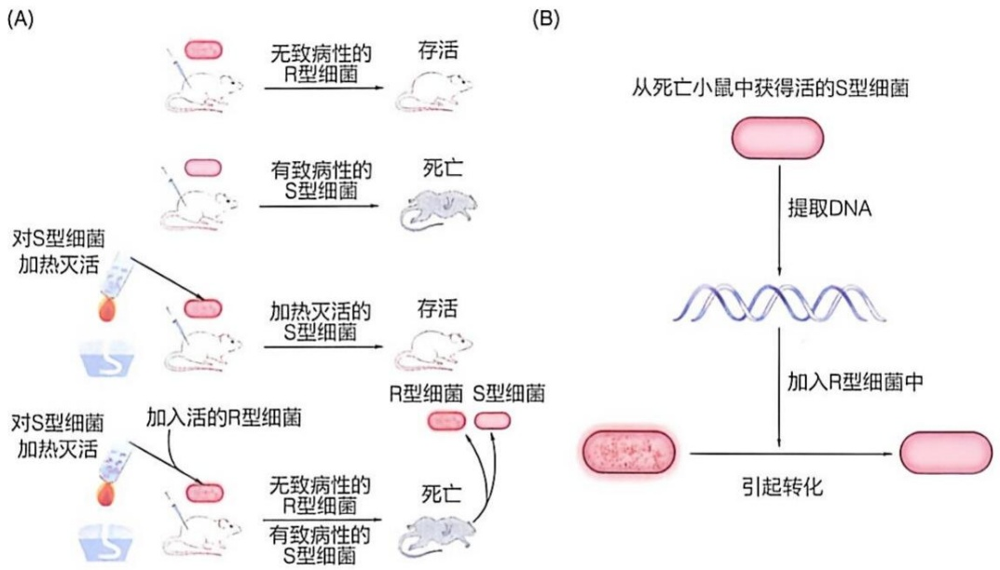

图 6-1 细菌转化实验表明 DNA 可能为遗传物质

（A）格里菲斯肺炎链球菌转化实验:将 R 型（粗糙型，无致病性）细菌单独注射给小鼠，小鼠存活；将 S 型（光滑型，有致病性）细菌单独注射给小鼠，小鼠死亡；将加热杀死的 S 型细菌注射给小鼠，小鼠存活，因为细菌已死亡，无法繁殖或致病；将加热杀死的 S 型细菌与活的 R 型细菌混合后注射给小鼠，小鼠死亡，且从死亡的小鼠体内可

以分离出活的 S 型细菌和 R 型细菌。（B）艾弗里在格里菲斯实验的基础上，进一步分离和提纯了 S 型细菌的 DNA、蛋白质和多糖类荚膜等物质。他将这些提纯后的物质分别与 R 型细菌混合，发现当将提纯的 DNA 与 R 型细菌混合时，R 型细菌转化成了 S 型细菌。而将提纯的蛋白质、多糖类荚膜等物质与 R 型细菌混合时，则不发生转化

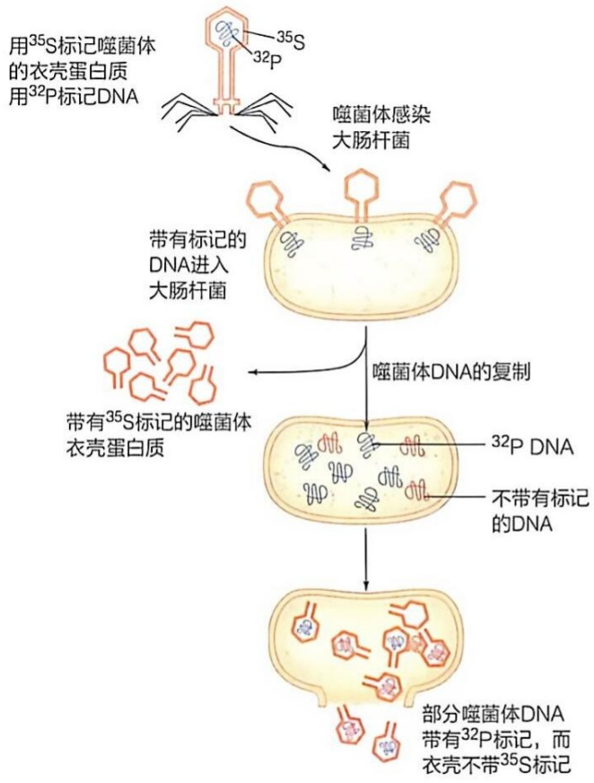

flowchart

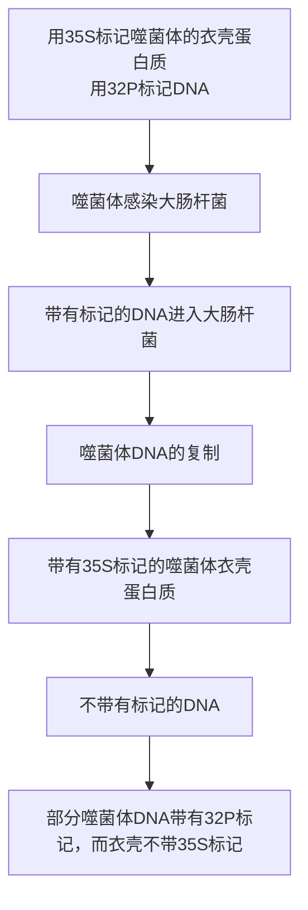

这些结果进一步证明，DNA 是噬菌体将遗传信息传递给细菌的物质，而非蛋白质。

图 6-2 噬菌体感染实验支持 DNA 为遗传物质

赫尔希和蔡斯通过 T2 噬菌体感染细菌的实验进一步验证了 DNA 的遗传作用。噬菌体的衣壳蛋白质被标记为  ${}^{35}S$ ，而  ${}^{32}P$  则用于标记噬菌体的 DNA。当噬菌体侵染大肠杆菌时，会将其带有标记的 DNA 注入大肠杆菌体内。随后，在大肠杆菌细胞内，噬菌体 DNA 利用细菌的代谢机制进行复制。复制出的新 DNA 部分仍然带有  ${}^{32}P$  标记，这表明 DNA 在复制过程中保持了其遗传信息的稳定性和连续性。新合成的蛋白质衣壳并不带有  ${}^{35}S$  标记，因为它们是由大肠杆菌的代谢机制合成的，而非直接来自噬菌体的原始衣壳蛋白质。这一观察结果进一步强调了 DNA 在指导蛋白质合成中的关键作用

## 6.1.4 DNA 双螺旋结构的发现奠定了 DNA 是遗传物质的基础

虽然细菌转化实验和噬菌体感染实验为 DNA 作为遗传物质提供了重要证据，但并未完全说服所有研究者。然而，当查加夫规则（Chargaff rules）和 DNA 双螺旋结构模型（DNA double helix）被提出后，这一结构的合理性和美妙的对称性让科学界普遍接受了 DNA 作为遗传信息载体的结论。

## 6.1.5 RNA 在遗传信息翻译中的重要性逐渐明确

尽管人们在 1930 年代已区分了 DNA 和 RNA 两类核酸，并明确了它们的化学组成差异，但在相当长的时间内未能充分认识 RNA 的功能。直到 1950 年代中后期（1955—1961 年），RNA 的研究取得了重要突破，人们逐渐发现 RNA 在蛋白质合成过程中发挥着关键作用。

## (1) 核糖体的发现与 rRNA 的识别

乔治·帕拉德（George Palade，1912—2008）通过亚细胞分离技术，从细胞质中分离出一种小颗粒结构，后被鉴定为核糖体——蛋白质合成的场所。核糖体不仅含有蛋白质，还富含核糖体 RNA（rRNA）。最初，研究者认为 rRNA 是 DNA 指导蛋白质合成的模板。然而，后续研究表明，rRNA 的主要作用是作为核糖体的组成成分，支持其在蛋白质合成中的结构和功能。

## (2) tRNA 的发现和功能阐明

保罗·扎梅奇尼克（Paul Zamecnik，1912—2009）等在无细胞体系中利用放射性同位素标记氨基酸，发现了一种低分子量的转运RNA（tRNA）。tRNA与特定的氨基酸形成共价结合物，并在核糖体上参与肽链的生成。tRNA正是克里克预言的适配器分子，负责将特定氨基酸运送到核糖体，以确保蛋白质按基因指令正确合成。

## (3) mRNA 的发现与三联密码子的破译

与 rRNA 和 tRNA 相比，信使 RNA（mRNA）的发现过程更加复杂且富有传奇色彩。研究人员发现，在噬菌体侵染宿主细菌后，细胞中会产生与噬菌体 DNA 相匹配的新 RNA 分子，这些 RNA 与细菌自身的 RNA 不同；1960 年代初，研究者通过研究细菌基因组中的乳糖操纵子序列，发现酶可被诱导合成。由此，人们认识到 mRNA 是一种短寿命的 RNA 分子，能够将 DNA 上的遗传信息拷贝下来，并指导在核糖体上的蛋白质合成。通过体外翻译实验，人们进一步破译了 mRNA 以三联体密码形式指导蛋白质的合成，揭示了遗传信息的翻译机制。

## (4) DNA 与 RNA 的异同

20 世纪上半叶对 DNA 和 RNA 两类核酸分子的深入研究，代表了生命科学领域的重大突破。尽管两者在化学组成和基本结构上高度相似，但它们在空间构型和生物学功能上却存在显著差异。这一现象再次印证了生物分子 “结构决定功能” 的规律。

## 6.2 DNA 和 RNA 的基本组成单位皆为核苷酸

DNA 和 RNA 是重要的核酸分子，分别负责遗传信息的储存与表达。化学降解分析表明，DNA 和 RNA 的基本组成单位均为核苷酸。DNA 的核苷酸称为脱氧核糖核苷酸，RNA 的核苷酸则为核糖核苷酸。尽管每种核酸分子只由四种主要的核苷酸构成，但它们的序列多样性为遗传信息的复杂性奠定了基础。

这里，我们将介绍组成 DNA 和 RNA 分子的核苷酸的化学结构。

## 6.2.1 DNA 和 RNA 分别由四种核苷酸单位组成

在温和条件下将 DNA 和 RNA 分子降解后进行的化学分析表明，它们各自由四种核苷酸单位组成（图 6-3）。

DNA 中的四种核苷酸分别是脱氧腺苷酸（deoxyadenosine 5'-monophosphate, dAMP），脱氧鸟苷酸（deoxyguanosine 5'-monophosphate, dGMP），脱氧胞苷酸（deoxycytidine 5'-monophosphate, dCMP），脱氧胸苷酸（deoxythymidine 5'-monophosphate, dTMP）。

图6-3 组成DNA和RNA分子的核苷酸的化学结构

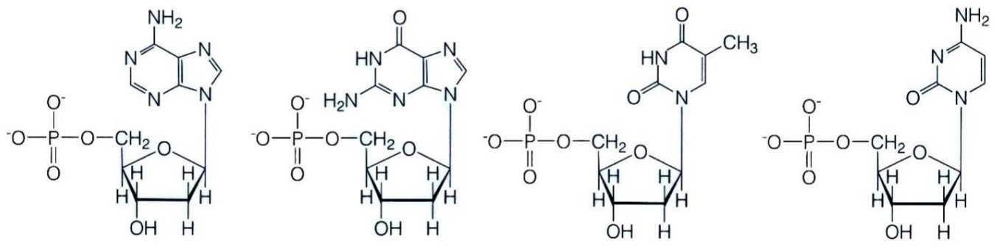

chemical

Four peptide-like molecular structures with phosphate groups and amide linkages, showing repeating units with labeled amino acid residues.

核苷酸:脱氧腺苷酸（脱氧腺苷一磷酸） 脱氧鸟苷酸（脱氧鸟苷一磷酸） 脱氧胸苷酸（脱氧胸苷一磷酸） 脱氧胞苷酸（脱氧胞苷一磷酸）

符号: dAMP dGMP dTMP dCMP
核苷: 脱氧腺苷 脱氧鸟苷 脱氧胸苷 脱氧胞苷

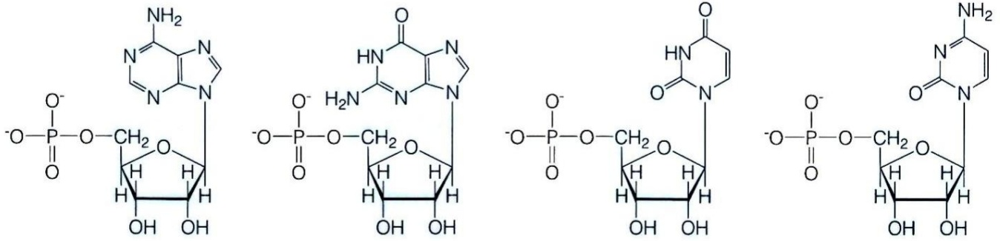

chemical

Four peptide-like molecular structures showing phosphate groups and nucleosides with labeled amino acid residues

核苷酸: 腺苷酸（腺苷一磷酸） 鸟苷酸（鸟苷一磷酸） 尿苷酸（尿苷一磷酸） 胞苷酸（胞苷一磷酸）
符号: AMP GMP UMP CMP
核苷: 腺苷 鸟苷 尿苷 胞苷

RNA 中的四种核苷酸分别是腺苷酸（adenosine 5'-monophosphate，AMP），鸟苷酸（guanosine 5'-monophosphate，GMP），胞苷酸（cytidine 5'-monophosphate，CMP），尿苷酸（uridine 5'-monophosphate，UMP）。

DNA 和 RNA 的核苷酸结构高度相似，但有两个关键区别:①糖基不同，DNA 中的糖基是 2'-脱氧核糖，而 RNA 中的糖基为核糖；②碱基差异，DNA 中使用胸腺嘧啶（T），而 RNA 中使用的是尿嘧啶（U），二者之间的区别仅在于尿嘧啶缺少一个甲基基团。

此外，DNA和RNA共享的碱基包括腺嘌呤（A）、鸟嘌呤（G）和胞嘧啶（C）。

## 6.2.2 每种核苷酸皆由含氮碱基、糖基和磷酸基三部分组成

如同所有氨基酸具有相同的基本骨架一样，核苷酸也有共同的结构模式。无论脱氧核苷酸还是核糖核苷酸，它们都由以下三部分组成（图6-4）:①含氮碱基（base）:嘌呤或嘧啶；②糖基:RNA的糖基为核糖，DNA的糖基为 $2^{\prime}$ -脱氧核糖；③磷酸基:与糖基通过酯键连接。

## (1) 碱基为嘌呤或嘧啶类含氮杂环分子

通过对核酸水解产物的分离和化学分析，结合有机合成等方法，在19世纪末至20世纪初存在于两类核酸分子中的两种嘌呤碱基和三种嘧啶碱基的化学结构被全部确定。它们分别是腺嘌呤（adenine，A）和鸟嘌呤（guanine，G），以及胞嘧啶（cytosine，C）、胸腺嘧啶（thymine，T）和尿嘧啶（uracil，U）。

嘌呤和嘧啶是分别由两个和一个碳-氮杂环组成的有机化合物。这里的嘌呤和嘧啶只是作为很多衍生物的母体化合物存在，很少单独存在。根据IUPAC（国际纯粹与

应用化学联合会）的规定，嘌呤环上的9个原子和嘧啶环上的6个原子有特定的编号（图6-5）。

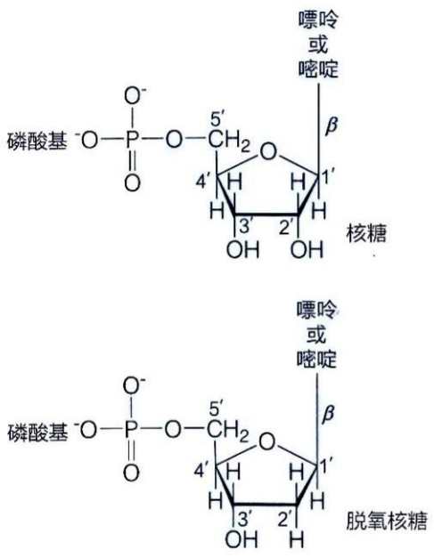

图6-4 核苷酸由含氮碱基、糖基和磷酸基三部分组成

在上述五种碱基中，与氧原子和氨基相连的碳原子皆与环中的氮原子邻位。因此，它们可能以不同的互变异构体形式存在，即酮-烯醇互变形式或氨基-亚氨基互变形式。图6-5中所展示的为它们的酮式和氨基式，这被认为是它们在细胞内的生理条件下的主要异构体形式，也是搭建DNA双螺旋结构时所必须利用的形式。这样的结构互变可能在由基因自发突变而引起的生物演化过程中发挥一定作用。

## (2) 糖基为 D- 核糖和 D- 脱氧核糖

德国学者埃米尔·费歇尔（Emil Fischer，1852—1919）等于1890年代从阿拉伯胶中首次鉴定出L-核糖（L-ribose）。该名称源于其与五碳醛糖阿拉伯糖结构的相似性。

20 世纪初，莱文及其同事在研究中发现，酵母核酸（RNA）中糖基的旋光性与 L-核糖相反，为 D-核糖。1920 年代，莱文等进一步鉴定出胸腺核酸（DNA）中的糖基为 2'-脱氧-D-核糖（2'-deoxyribose），即通常所说的脱氧核糖。这是脱氧核糖首次在自然界中被发现。

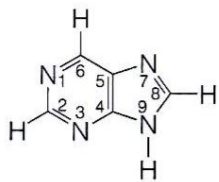

chemical

Molecular structure of a pyrimidine derivative with labeled atoms and bonds

嘌呤

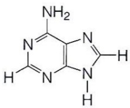

chemical

Molecular structure of a purine derivative with amino and hydrogen substituents

腺嘌呤

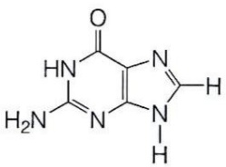

chemical

Chemical structure of a heterocyclic compound with amine and pyrimidine substituents

鸟嘌呤

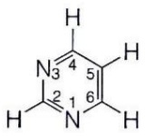

嘧啶

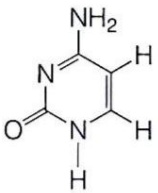

胞嘧啶

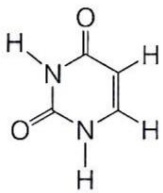

尿嘧啶

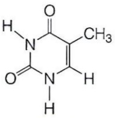

胸腺嘧啶

图 6-5 碱基的化学结构

借助糖类的分析技术，人们探明了两种核糖的环结构形式:它们均为五元环的呋喃糖，而非六元环的吡喃糖。D-核糖在其2′、3′和5′号碳原子上均有自由羟基（—OH），而2′-脱氧-D-核糖仅在3′和5′号碳上含有羟基，2′位则缺少一个氧原子。

需要注意的是，当核糖以自由形式存在时，其主要构象为吡喃糖形式。然而，在核苷酸中，呋喃糖的结构形式似乎赋予分子更高的稳定性，但其背后的具体机制尚未阐明。

## （3）糖基与碱基通过β-糖苷键连接

确定核糖与碱基之间糖苷键的连接方式并非易事，一方面需要确定异头碳的构型是 $\alpha$ 还是 $\beta$ ，另一方面还需确定异头碳究竟与碱基的哪个氮原子连接。1940年代，英国学者亚历山大·托德（Alexander Todd，1907—1997）等通过分析核苷等的化学衍生物结构以及用化学合成方法，确认核糖或脱氧核糖的异头碳以 $\beta$ 构型与嘌呤环第9号位或嘧啶环第1号位上的氮形成糖苷键（称为 $\beta-$ 糖苷键或 $N-$ 糖苷键）。这种由核糖（或脱氧核糖）与碱基连接所形成的产物称为核苷（nucleoside）。

## (4) 嘌呤碱基与脱氧核糖之间的糖苷键相对不稳定

核苷酸或核苷分子中的糖苷键在中性或碱性条件下相对稳定，但在酸性条件下容易发生水解，并且水解速率高于磷酸二酯键。研究表明，在酸性环境中，由嘌呤碱基（如腺嘌呤或鸟嘌呤）形成的糖苷键比由嘧啶碱基（如胸腺嘧啶或胞嘧啶）形成的糖苷键更易水解。此外，嘌呤碱基与脱氧核糖之间的糖苷键也比嘌呤碱基与核糖之间的糖苷键更容易断裂。这使得在酸性条件下DNA比RNA更容易发生脱嘌呤作用（depurination）。

这种体外现象与生物体内的观察结果相一致。在细胞内，DNA 分子容易自发地发生脱嘌呤反应，形成无嘌呤位点（AP 位点）。这些缺损若不及时修复，可能导致基因突变或链断裂，因此需要通过 DNA 修复机制，如碱基切除修复（base excision repair, BER）进行修复，以维持基因组的稳定性。

图 6-6 核糖核苷酸和脱氧核糖核苷酸中的磷酸基以不同方式连接于糖基上

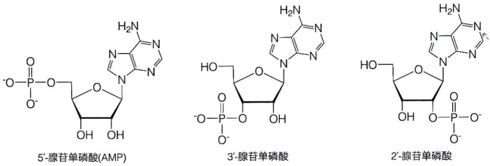

## (5) 糖基与磷酸基通过磷酯键连接

磷酸基可以通过多种方式与核苷的糖基连接。在核苷分子中，糖基上的任何自由羟基（如  $2'$ 、 $3'$  或  $5'$  位的羟基）都可与磷酸基发生酯化反应，生成核苷单磷酸，如  $5'-$ ， $3'-$ ， $2'-$  单磷酸核苷和  $5'-$ ， $3'-$  单磷酸脱氧核苷（图 6-6）。

在生物体内，绝大多数游离的核苷酸以  $5'$ -核苷酸或  $5'$ -脱氧核苷酸的形式存在。这些分子在文献中常用缩写表示，如  $5'$ -腺苷单磷酸（adenosine monophosphate, AMP），其他核苷酸包括鸟苷酸（GMP）、胞苷酸（CMP）和尿苷酸（UMP）。相应的脱氧核苷酸在缩写前加“d”，如 dAMP（脱氧腺苷酸）、dGMP（脱氧鸟苷酸）、dCMP（脱氧胞苷酸）及 dTMP（脱氧胸苷酸）。

此外，这些  $5'$ -核苷酸和  $5'$ -脱氧核苷酸的磷酸基可以通过酸酐键进一步与一个或两个磷酸基相连，形成二磷酸或三磷酸化合物，如 ADP（腺苷二磷酸）、ATP（腺苷三磷酸）、GTP（鸟苷三磷酸）、CTP（胞苷三磷酸）、UTP（尿苷三磷酸）以及 dCTP（脱氧胞苷三磷酸）等。这些缩写均表明磷酸基位于糖基的  $5'$  碳上，而非其他位置。

## (6) 含共轭双键的碱基与紫外光吸收

一般来说，具有共轭双键（即两个双键之间间隔一个单键）的分子具有特定的光吸收特征。当分子中双键数量较少时，主要吸收紫外光；而当双键数量较多时，则可吸收可见光。五种常见的碱基（A、G、C、T和U）组成的核苷酸都能够吸收波长

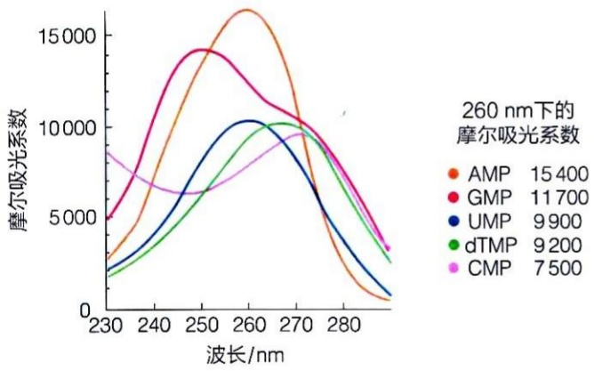

line

| 波长 (nm) | AMP | GMP | UMP | dTMP | CMP |
| --- | --- | --- | --- | --- | --- |
| 230 | ~3000 | ~5000 | ~2000 | ~1800 | ~8800 |
| 240 | ~7000 | ~11000 | ~4500 | ~3500 | ~7000 |
| 250 | ~13000 | ~14200 | ~8500 | ~6500 | ~6500 |
| 260 | ~16500 | ~13500 | ~10200 | ~9500 | ~8500 |
| 270 | ~11000 | ~11500 | ~9500 | ~10200 | ~9800 |
| 280 | ~3500 | ~7500 | ~4500 | ~7500 | ~7500 |
| 290 | ~500 | ~3500 | ~1000 | ~2500 | ~3500 |

图6-7 五种核苷酸的紫外吸收光谱与摩尔吸光系数

240～280 nm 的紫外光，并通常在 260 nm 处进行测定。每种碱基的共轭双键数量和排列不同，因此它们的光吸收特性也存在差异。在 260 nm 波长下，每种碱基的摩尔吸光系数（molar extinction coefficient， $\varepsilon_{260}$ ，单位: $L \cdot mol^{-1} \cdot cm^{-1}$ ）表明腺嘌呤的吸光能力最强，鸟嘌呤次之，嘧啶类碱基（如胸腺嘧啶、胞嘧啶和尿嘧啶）的吸光能力相对较弱。这些碱基具有光吸收特性，因而含有碱基的核苷、核苷酸和核酸分子都具有紫外光吸收特征。其紫外吸收光谱可用于样品的定性和定量分析（图 6-7）。

## (7) 碱基中的氮原子表现出酸碱特性

核苷酸中碱基的酸碱特性主要取决于其杂环结构中的氮原子。核苷酸中不同氮原子具有不同的  $pK_{a}$ （解离常数）（表6-1）。值得注意的是，腺嘌呤的 N-1、胞嘧啶的 N-3 和鸟嘌呤的 N-7 的  $pK_{a}$  都较低，在中性 pH 即生理条件下均处于去质子化状态。而鸟嘌呤的 N-1、胸腺嘧啶的 N-3 和尿嘧啶的 N-3 的  $pK_{a}$  都比较高，在生理条件下处于质子化状态。

表 6-1 核苷中不同碱基氮原子的 $\mathrm{p}{K}_{\mathrm{a}}$

| 碱基(质子化) | $pK_a$ |
| --- | --- |
| 腺嘌呤(N-1) | 3.6 |
| 胞嘧啶(N-3) | 4.1 |
| 鸟嘌呤(N-7) | 2.2 |
| 鸟嘌呤(N-1) | 9.5 |
| 胸腺嘧啶(N-3) | 9.8 |
| 尿嘧啶(N-3) | 9.3 |

碱基中氮原子的质子化和去质子化状态对于它们在生理环境中的功能至关重要。例如，在 DNA 分子中，碱基之间的正确配对（如 A-T 和 G-C 配对）高度依赖氮原子的酸碱状态。氢键的形成和稳定性受到这些氮原子是否质子化的影响。沃森和克里克在建立 DNA 双螺旋结构模型时，必须准确理解碱基中氮原子的质子化状态。正是基于这种理解，他们得以正确描述 A-T 和 G-C 之间的氢键配对，从而提出了经典的 DNA 双螺旋结构模型。这一发现不仅揭示了 DNA 的结构规律，也奠定了现代分子生物学的基础。

## 6.2.3 核苷酸的不同构象形式

核苷酸不仅具有化学结构，还存在多种构象。其立体结构主要体现在以下几个方面:

## (1) 碱基为刚性平面结构

根据化学理论计算和高分辨 X 射线或中子衍射测定，嘌呤碱基的双环和嘧啶碱基的单环结构中的所有原子都位于同一刚性平面。这种平面性是碱基在 DNA 双螺旋结构中进行氢键配对的重要前提和基础。

## (2) 糖基的呋喃环信封状构象

脱氧核糖和核糖都以五元呋喃糖环形式存在。类似于其他糖类分子，呋喃糖环可以轻微扭曲，形成信封状构象。在这种构象中，呋喃糖环的四个原子（包括氧原子）大致处于同一平面，而另一个碳原子则偏离平面。以处于平面外的 $5^{\prime}$ 碳作为判断标准:若偏离平面的碳原子与 $5^{\prime}$ 碳处于同一侧，则称该碳原子处于内式（endo）构象，若处于另一侧则称之为外式（exo）。这样就可以区分出四种稍有差异的信封状构象形式:分别是 C-2' 内式、C-2' 外式、C-3' 内式与 C-3' 外式（图 6-8）。在典型的 DNA 双螺旋结构中，脱氧核糖主要处于 C-2' 内式构象。

图6-8 核糖与脱氧核糖的呋喃糖环以不同的信封状构象存在

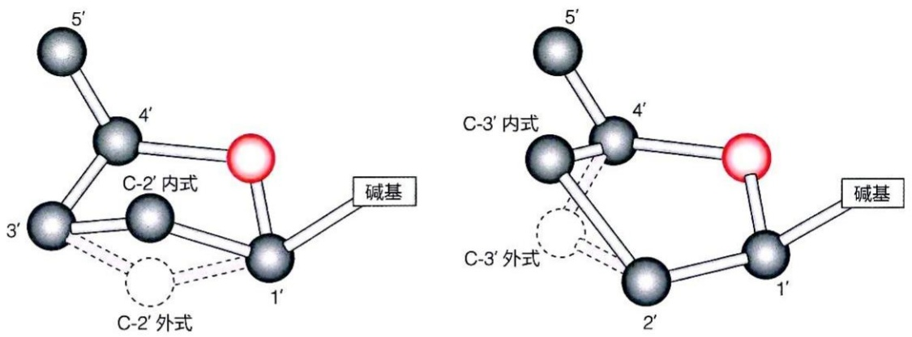

图 6-9 核苷中的糖苷键可以呈顺式或反式构象

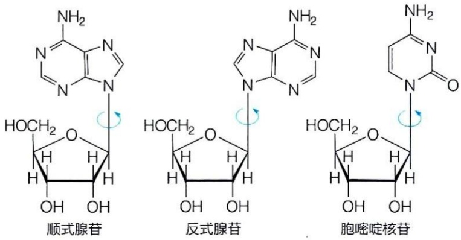

## (3) 碱基平面与糖环平面的垂直排列

在核苷酸分子中，碱基平面与糖环平面通常呈垂直排列。两者通过糖苷键相连，而糖苷键可以自由旋转，这使得碱基平面相对于糖环平面的空间排列呈现出一定的灵活性。比较极端的构象状态为反式（anti）与顺式（syn）排列，分别代表空间位阻最小和最大的构象（图6-9）。结构测定结果表明，在嘌呤核苷酸中两种构象皆存在，而在嘧啶核苷酸中一般只存在反式构象。这是因为在顺式构象中，嘧啶碱基的C-2位的取代基与糖环之间会产生较大的空间位阻，从而不利于该构象的稳定性。

## 6.2.4 DNA 和 RNA 中的碱基化学修饰

早在 1940 年代，美国学者罗林·霍奇基斯（Rollin Hotchkiss，1911—2004）在牛胸腺 DNA 的水解产物中直接发现了 5-甲基胞嘧啶的存在。他注意到，这种化合物在纸层析中的移动位置与胞嘧啶不同，但其光吸收特征与胞嘧啶完全一致。因此，霍奇基斯推断 5-甲基胞嘧啶是核酸的组成成分。这一发现为后续研究 DNA 的碱基修饰和表观遗传学奠定了重要基础。

研究表明，上述五种碱基（A、G、C、T、U）进入DNA或RNA分子之后，可发

DNA修饰

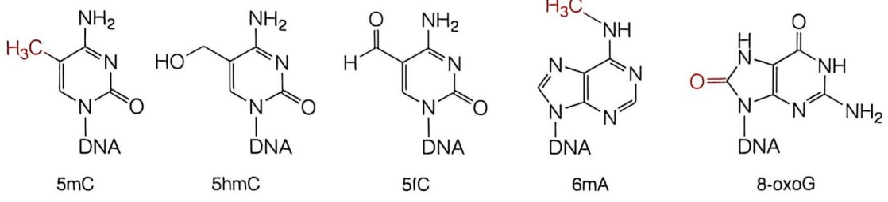

图 6-10 DNA 和 RNA 分子中的代表性修饰碱基

RNA修饰

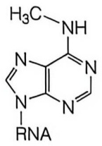

$\mathrm{m^{6}A}$

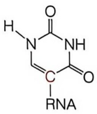

ψ

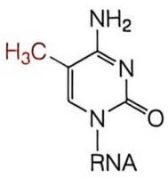

$m^{5}C$

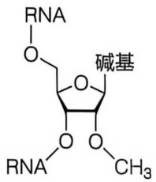

chemical

Chemical structure of a nucleotide derivative with RNA and base groups labeled

Nm

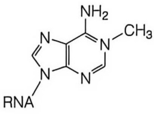

chemical

Chemical structure of a pyrimidine derivative with amino and methyl substituents

m$^{1}$A

生化学修饰（图 6-10），这样的化学修饰发生于动物、植物和细菌等所有生物内。

在 DNA 中，碱基修饰主要集中于胞嘧啶（C）和腺嘌呤（A），其中 5-甲基胞嘧啶（5mC）是研究最深入的表观遗传标志之一。5mC 是由胞嘧啶的 5 位碳上添加甲基而形成的。该修饰与基因表达调控密切相关，常出现在基因启动子区域并与基因沉默有关，在细胞分化和癌症等病理过程中发挥重要作用。此外，TET 酶（ten-eleven-translocation protein，10-11 易位蛋白）可以将 5mC 进一步氧化为 5-羟甲基胞嘧啶（5hmC）、5-甲酰基胞嘧啶（5fC）和 5-羧基胞嘧啶（5caC），这些氧化产物在基因重编程中起到关键作用。

除胞嘧啶修饰外，腺嘌呤也可以被修饰形成  $N^{6}-$  甲基腺嘌呤（6mA）。6mA 存在于多种生物体如植物和单细胞生物中。这一修饰可能在基因表达调控和染色质结构调节中发挥作用。此外，DNA 碱基还容易发生氧化损伤，如鸟嘌呤可氧化为 8-氧代鸟嘌呤（8-oxoG）。8-oxoG 是一种常见的氧化损伤产物，如果不及时修复，可能导致突变的发生。

与 DNA 相比，RNA 中的碱基修饰种类更加丰富，并且分布于多种 RNA 分子（如 mRNA、tRNA 和 rRNA）中。目前已知 RNA 中存在超过 170 种不同的化学修饰，其中 N$^{6}$-甲基腺嘌呤（m$^{6}$A）是最常见的修饰之一。m$^{6}$A 主要存在于 mRNA 中，对其稳定性、剪接及翻译效率具有重要影响。m$^{6}$A 的添加由甲基转移酶（如 METTL3/14）催化，而去甲基化则由去甲基化酶（如 FTO 和 ALKBH5）完成。结合蛋白（如 YTHDF 家族）可以识别这一修饰，从而调控 mRNA 的代谢命运。

另一种常见的 RNA 修饰是假尿嘧啶（pseudouridine， $\psi$ ）修饰。 $\psi$  由尿嘧啶通过糖基连接位置的转变而成，广泛存在于 tRNA 和 rRNA 中。 $\psi$  修饰有助于增强 RNA 的结构稳定性，并提高核糖体在翻译过程中的效率。5-甲基胞嘧啶（m $^{5}$ C）修饰也存在于 RNA 中，参与 RNA 的稳定性和转录调控。此外，N $^{1}$ -甲基腺嘌呤（m $^{1}$ A）和 2'-O-甲基化（Nm）也是RNA中的重要修饰，分别参与维持tRNA的结构和抵抗核酸酶降解。

与氨基酸进入蛋白质后发生的化学修饰类似，核酸的化学修饰也是在特异的酶催化下进行的，而且某些修饰也是可逆的，对 DNA 分子中碱基修饰或可逆修饰的研究，是现代表观遗传学的重要内容之一。

DNA 和 RNA 中的碱基修饰在多方面发挥重要作用。首先，这些修饰直接参与基因表达调控。例如，DNA 中的 5mC 修饰可以影响转录因子的结合，从而决定基因的开启与关闭，而 RNA 中的  $m^{6}A$  修饰则可以调控 mRNA 的降解和翻译。其次，RNA 修饰还在 RNA 加工和成熟过程中扮演关键角色，确保 tRNA 和 rRNA 的正确折叠和功能。在应激状态下，某些修饰（如 8-oxoG）是氧化损伤的标志，而 RNA 修饰则参与调控细胞应激反应。最后，碱基修饰的异常还与多种疾病密切相关，如癌症、自身免疫性疾病和神经退行性疾病。在肿瘤细胞中， $m^{6}A$  修饰的改变会影响其增殖、迁移和耐药性。

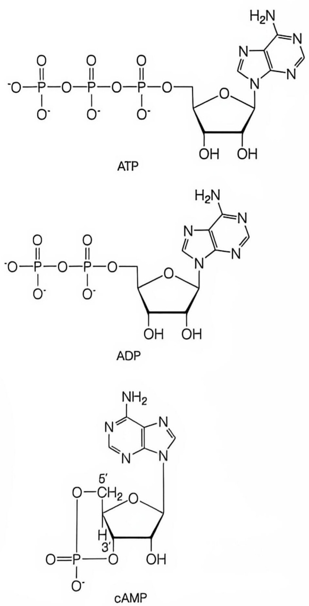

图 6-11 ATP、ADP 和 cAMP 等核苷酸分子的化学结构

## 6.2.5 核苷酸除作为核酸的组成单元外还具有其他功能

核苷酸除了作为构建核酸（DNA 和 RNA）的基础单元外，还在细胞中以游离状态发挥多种重要的生物学功能。以下是核苷酸在其他生物过程中扮演的重要角色:腺苷三磷酸（adenosine triphosphate，ATP）（图 6-11）是细胞内主要的能量载体，支持生物体内多种生命活动。ATP 水解为 ADP（腺苷二磷酸）或 AMP（腺苷单磷酸）时释放能量，驱动细胞中非自发进行的化学反应。此外，ATP 还作为蛋白质磷酸化的磷酸基供体。ADP（图 6-11）是多种辅酶（如 NAD$^{+}$、NADP$^{+}$、FAD、辅酶 A 等）的结构组分，这些辅酶在代谢反应中扮演电子或化学基团传递者的角色。

GTP、CTP、UTP 同样作为能量的携带者，GTP 参与蛋白质合成中的翻译阶段，并参与信号转导相关的 G 蛋白的活化。CTP 通过生成 CDP-二酰甘油（CDP-diacylglycerol）参与磷脂合成，支持膜结构的形成。UTP 在糖原合成过程中参与葡萄糖的活化，生成 UDP-葡萄糖以延伸糖原链。

3',5'-环腺苷酸（3',5'-cyclic adenosine monophosphate, cAMP）（图6-11）和3',5'-环鸟苷酸（cGMP）是细胞内重要的第二信使，它们参与细胞内信息的传递，引发一系列反应以调节细胞代谢和生理状态。

## 6.3 DNA 和 RNA 分子的一级结构

1930年代，通过酶促降解和化学分析，科学家逐渐认识到核酸是一种生物大分子。揭示核苷酸在DNA和RNA分子中的连接方式同样艰难，类似于对肽链中氨基酸连接方式的探索。直到20世纪四五十年代，研究人员通过对核酸降解产物的分析（如RNA在RNA水解酶作用下只生成 $3^{\prime}$ -和 $5^{\prime}$ -核苷酸，而不生成 $2^{\prime}$ -核苷酸），才逐步明确了核酸分子中的核苷酸是如何连接的。这些化学分析结合寡核苷酸的合成研究，最终确认DNA和RNA中的核苷酸通过磷酸二酯键（phosphodiester bond）相连。

## 6.3.1 核苷酸之间以 $3',5'$-磷酸二酯键相连

DNA 和 RNA 的基本单元分别是脱氧核苷酸（deoxynucleotide）和核糖核苷酸（ribonucleotide）。在核酸链中，每个核苷酸单位的 5'-磷酸基与相邻核苷酸的 3'-羟基之间发生缩合反应，形成两个磷酸酯键，将这些核苷酸串联起来，构建出 DNA 或 RNA 的一级结构。两个核苷酸残基之间的这种连接称为 3',5'-磷酸二酯键（图 6-12）。

磷酸基一端与一个核苷酸的 3' 羟基相连，另一端与相邻核苷酸的 5'-羟基相连，从而赋予核酸链方向性。每条核酸链有两个不同的末端:5' 端（5' end）:保留未成键的 5'-磷酸基，3' 端（3' end）:保留未成键的 3'-羟基。核酸的这种方向性与多肽链中氨基端和羧基端的方向性高度相似。这种方向性对 DNA 和 RNA 的功能至关重要，确保它们在复制、转录和翻译过程中能被正确识别和处理。

核酸中的核苷酸通过  $3',5'$ -磷酸二酯键形成链结构后，它们的化学性质相对游离状态下的核苷酸发生改变，因此这些核苷酸被称为核苷酸残基（nucleotide residue）。书写核酸链的结构时，通常将核酸的  $5'$  端置于上方（绘制详细结构时）或左方（以碱基符号简写序列时），而  $3'$  端置于下方或右方。例如，一个 DNA 序列按碱基符号简写为  $5'$ -A-T-G-C-T-3'。这种书写方式不仅体现了核酸的方向性，还确保在分析和处理核酸序列时具有一致性。

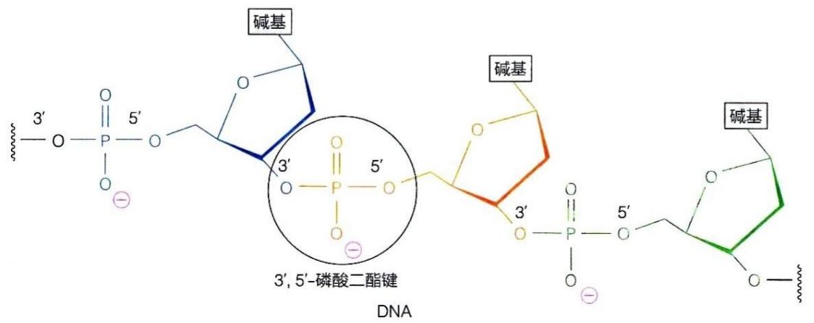

chemical

DNA分子结构示意图，标注了碱基、磷酸二酯键及3',5'-链上的化学键位置

图6-12 DNA和RNA分子中的核苷酸残基皆通过 $3^{\prime},5^{\prime}$ -磷酸二酯键连接

核苷酸通过磷酸二酯键连接，形成一种高度重复且稳定的骨架结构。RNA 分子骨架由戊糖和磷酸基交替组成；DNA 分子骨架则由脱氧戊糖和磷酸基交替组成。这种恒定的骨架结构与蛋白质的主链高度相似。也就是说，不同 RNA 或 DNA 分子之间的主要差异来自碱基的不同，这类似于蛋白质分子之间的差异取决于氨基酸侧链的不同。这种通过相对简单的构件组合出大量复杂分子的生物学策略极具哲学意义，值得深入探讨。

此外，每个磷酸二酯键中的磷酸基仍可发生一级解离，带有一个负电荷。因此，DNA 和 RNA 都是带负电荷的分子，这成为它们的重要特征。然而，目前尚不清楚这种负电性在细胞内产生的具体效应。

## 6.3.2 每种核酸链都具有独特的碱基序列

每一种核酸链都具有独特的碱基序列，这种序列被称为核酸的一级结构。在核酸的一级结构中，相间排列的戊糖和磷酸构成了核酸分子的主链，碱基则像侧链基

团一样附着在主链上，这种设计类似于蛋白质的结构，其中氨基酸的侧链决定了蛋白质的多样性。核酸分子中，所有核苷酸间的磷酸二酯键连接方向一致，RNA 和 DNA 链都具有明显的方向性，即每条链都有一个 5' 端和一个 3' 端。5' 端通常含有磷酸基，而 3' 端则含有自由的羟基（图 6-13）。遗传信息正是存储在 DNA 或 RNA 的一级结构中，生物体的多样性也体现在核酸链中 4 种核苷酸的多种排列组合上。

DNA 中虽然只有 4 种脱氧核糖核苷酸，但每条 DNA 链中包含大量的核苷酸单体，其多样化的排列能够形成极其庞大的信息库。这使得 DNA 具有巨大的编码能力，可以承载生物体的全部遗传信息。一种生物的 DNA 链数量从一条到数千条不等，每条链中都含有大量脱氧核苷酸，因此储存了丰富的遗传信息。

基因（gene）是指 DNA 分子中一段具有特定遗传信息的序列，它能通过 RNA 或蛋白质间接控制生物的性状。基因组（genome）则指生物体内所有遗传信息的集合，即某一物种单倍体细胞内的全部 DNA。例如，人类基因组由 24 条染色体组成（22 条常染色体和 2 条性染色体），总计包含约 30 亿对核苷酸和 2 万个基因，携带了控制人类生长、发育和繁殖的全部遗传信息。

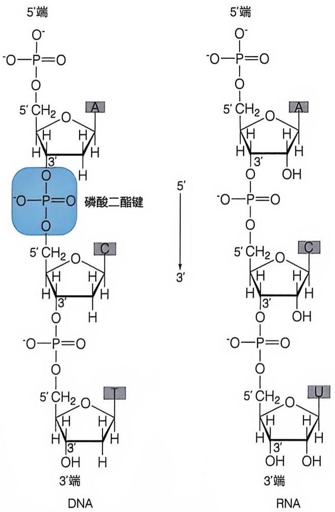

图6-13 DNA与RNA的一级结构

此外，大部分生物的 DNA 是线性长链，但也有部分生物或细胞器（如细菌、质粒、叶绿体等）中，DNA 链的两端通过磷酸二酯键相连，形成环状结构。

RNA 是由核糖核苷酸通过磷酸二酯键连接而成的线性多聚体，其一级结构的特点因种类和来源不同而有所差异。如 tRNA 具有较多的稀有碱基，在其一级结构中具有一些保守序列，与其高级结构和功能有关。一些 rRNA（如原核生物的 16S 和 23S rRNA、真核动物的 18S 和 28S rRNA）含有比较多的甲基化核苷酸，且甲基化发生在核糖上。原核生物具有多顺反子 mRNA，即一条 mRNA 链上有多个编码区。真核生物的 mRNA 为单顺反子，即每条成熟 mRNA 链只编码一种蛋白质。

真核生物 mRNA 具有特殊的 5' 端和 3' 端结构，5' 端为帽结构，由甲基鸟苷酸（m$^{7}$G）与原 mRNA 的 5' 端核苷酸通过焦磷酸键连接而成。该结构有三种类型，分别为 O 型（m$^{7}$G$^{5'}$ppp$^{5'}$Np）、I 型（m$^{7}$G$^{5'}$ppp$^{5'}$NmpNp）和 II 型（m$^{7}$G$^{5'}$ppp$^{5'}$NmpNmpNp）。其中 G 代表鸟苷，N 代表任意核苷，m 在字母左侧表示碱基被甲基化，m 右上角的数字表示甲基化位置，m 在字母右侧表示核糖被甲基化。5' 端帽子结构使 mRNA 可抵抗 5' 核酸外切酶的水解作用，还有助于蛋白质合成过程中核糖体对 mRNA 的识别与结合，使翻译能正确起始。3' 端为多腺苷酸 [poly(A)]，是在 mRNA 转录后在 poly(A) 聚合酶的作用下添加的，此 poly(A) 尾与 mRNA 从细胞核到细胞质的运输有关，也可能与 mRNA 的寿命有关，新生成的 mRNA 的 poly(A) 尾较长，临近衰老（降解）的 mRNA 的 poly(A) 尾较短。

## 6.4 DNA 一般以双链形式形成空间结构

## 6.4.1 沃森与克里克提出 DNA 双螺旋结构模型

DNA 的双螺旋结构模型是由英国学者詹姆斯·沃森（James Watson）和弗朗西斯·克里克（Francis Crick，1916—2004）在 1950 年代提出。简要而言，DNA 分子由两条单链反向平行排列，螺旋状扭转形成类似梯子的结构。每条链由糖-磷酸骨架构成，糖为脱氧核糖；每个糖基与四种碱基（A、G、C 与 T）中的一种相连接。两条链之间通过 A-T 和 G-C 的碱基配对相互连接形成双链结构。DNA 双螺旋结构模型综合了多位其他研究者的研究结果，主要参考的关键数据包括对 DNA 碱基组成的定量分析数据和 DNA 分子的空间结构分析数据。

1950 年代，埃尔温·查加夫（Erwin Chargaff，1905—2002）通过纸层析和紫外吸收光谱分析了不同来源的 DNA 样本，发现了重要的碱基组成规律。他观察到，尽管胞嘧啶（C）和鸟嘌呤（G）的含量接近，但 C 总是略低于 G，而腺嘌呤（A）和胸腺嘧啶（T）的含量几乎完全相等。查加夫总结出两条规律，又称查加夫规则（Chargaff rules）:A 和 T、C 和 G 分别配对，且含量相近；不同物种的 A + T 与 G + C 的比例存在差异。这表明 DNA 的碱基排列高度精确，并非随机分布。虽然 C 略低于 G 的差异可能源于实验误差或结构变异，但查加夫的发现为 DNA 双螺旋结构模型的提出奠定了基础，对分子生物学的发展产生了深远影响。

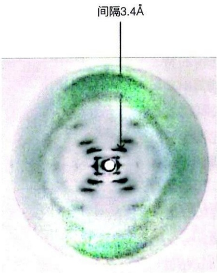

text_image

间隔3.4Å

图6-14 DNA纤维的X射线衍射图谱1952年5月，富兰克林与其研究生雷蒙·高斯林（Raymond Gosling）共同拍摄到了一张具有里程碑意义的B型DNA的X射线衍射照片，这张照片后来被广泛称为“照片51号”

在 DNA 结构研究的历史中，X 射线衍射分析起到了关键作用。英国科学家莫里斯·威尔金斯（Maurice Wilkins，1916—2004）和罗莎琳德·富兰克林（Rosalind Franklin，1920—1958）通过对 DNA 纤维进行 X 射线照射，获取衍射图谱。这些衍射图谱揭示了 DNA 分子内部存在高度有序的重复结构。X 射线衍射的结果不仅证明了 DNA 是一种有序分子，还为 DNA 的双螺旋结构模型奠定了基础。1952 年，富兰克林获得了标志性的“照片 51 号”这一 DNA 纤维的高质量衍射图谱（图 6-14）。这一成果显示了 DNA 的螺旋对称性，为双螺旋结构模型提供了决定性支持。

在 DNA 双螺旋结构模型提出之前，许多科学家已经在探索 DNA 的结构。莱纳斯·鲍林（Linus Pauling，1901—1994）是这一领域的重要先驱之一。鲍林不仅在蛋白质结构研究中提出了  $\alpha$  螺旋的概念，还提出了一种大胆的 DNA 三链模型。在鲍林的三链模型中，每一条 DNA 链都绕成螺旋，三个螺旋再相互缠绕在一起。该模型的关键特点是脱氧核糖-磷酸骨架位于结构的中央轴上，并紧密排列在一起。含氮碱基以放射状形式从中央轴向外伸展。虽然该模型后来被证明不符合实验数据，但鲍

林提出的螺旋建模方法和分子构型理念为双螺旋结构模型奠定了一定的基础，具有重要意义。

## 6.4.2 DNA 由两条链之间通过碱基互补而形成双螺旋结构

DNA 分子由两条脱氧核苷酸链通过碱基互补配对形成了经典的双螺旋结构。富兰克林的 X 射线衍射分析表明，DNA 结构随水分含量的变化而有所不同。在低湿度条件下 DNA 形成 A 型结构，在高湿度条件下 DNA 呈现 B 型结构，并且这两种结构可以相互转换。

沃森和克里克提出的 DNA 双螺旋结构模型主要基于 B 型 DNA 的衍射数据，同时参考了已有的化学知识。该模型的主要特征如下:

## (1) 双链的反向平行排列与螺旋构型

DNA 双链反向平行排列，并围绕中心轴缠绕形成右手螺旋（图 6-15A）。尽管 X 射线数据并未直接揭示双螺旋的方向，但右手螺旋符合原子间的空间排布要求，左手螺旋在建模时因空间位阻而被排除。碱基位于双螺旋的内侧，而由磷酸基和脱氧核糖基交替连接形成的骨架位于双螺旋的外侧。这些磷酸-脱氧核糖通过 3',5'-磷酸二酯键相连接。

## (2) 碱基的互补配对规则

DNA 双链之间，嘌呤碱基与嘧啶碱基通过氢键特异配对。A 与 T 之间通过两对氢键配对。G 与 C 之间通过三对氢键配对（图 6-15B）。这种配对方式是基于碱基的酮

(A)

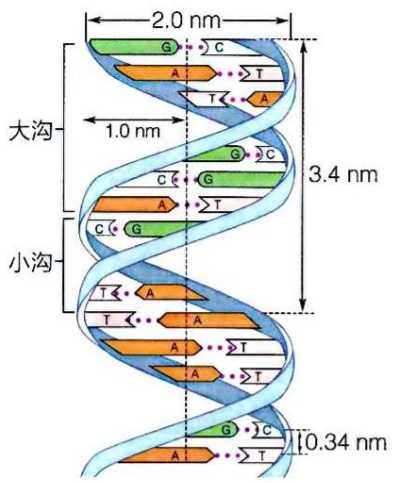

text_image

2.0 nm
1.0 nm
3.4 nm
大沟
小沟
0.34 nm

(B)

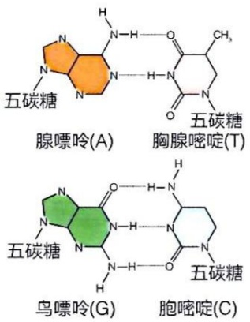

chemical

Chemical structures of three compounds: 腺嘌呤(A), 胸腺嘧啶(T), and 鸟嘌呤(G), each labeled with 五碳糖.

(C)

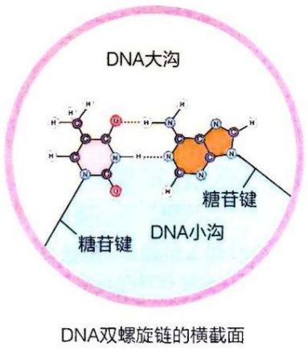

chemical

DNA双螺旋链的横截面结构示意图，标注了DNA大沟、DNA小沟及糖苷键

图6-15 DNA双螺旋表面存在连续的大沟和小沟（A）双螺旋的右手螺旋结构，显示外侧的磷酸骨架与内侧的碱基对。（B）A-T和G-C碱基配对情况。（C）DNA双螺旋的横截面示意图，显示大沟和小沟的形成

式互变异构体和查加夫规则提出的。

## （3）双螺旋的周期性结构与几何参数

DNA 双螺旋具有重复的周期性结构，每一条链沿中心轴旋转  $360^{\circ}$  所形成的螺距为 3.4 nm，且每个螺距内包含 10 个碱基对（bp）。每两个相邻碱基之间的夹角为  $36^{\circ}$ ，碱基平面之间的距离为 0.34 nm。双螺旋的平均直径为 2 nm。

## (4) 大沟和小沟的形成

由于每一个碱基对都是以一种非对称方式附着于两个脱氧核糖磷酸骨架上，因此，如果沿 DNA 螺旋纵向观察，则可见两条骨架链在双螺旋表面形成两个宽度不同的连续凹槽或沟（图 6-15A）。从 DNA 的碱基配对（图 6-15B）或双链的横截面（图 6-15C）都可以看出，碱基对较宽的一边形成一个大沟（major groove），而较窄的一边则形成一个小沟（minor groove）；嘌呤碱基的 N7 和 C6，以及嘧啶碱基的 C4 和 C5 位于大沟中；嘌呤碱基的 C2 和 N3，以及嘧啶碱基的 C2 则位于小沟中。这种不对称结构还体现在以下方面:每个碱基对的两个糖苷键形成一个约  $240^{\circ}$  的广角和一个约  $120^{\circ}$  的窄角；广角一侧对应大沟，窄角一侧则对应小沟（图 6-15C）。

## 6.4.3 DNA 的双螺旋结构并非高度均一

DNA 双螺旋结构模型为我们提供了 DNA 分子结构的理想化蓝图，但现代研究表明，DNA 的结构并非高度均一。1980 年代，随着具有特定序列的脱氧核苷酸寡聚片段的人工合成与结晶技术的发展，科学家终于确认了 DNA 双螺旋的基本结构特征与沃森和克里克模型的相符性。然而，进一步的 X 射线衍射晶体结构分析揭示了 DNA 的多样性，表明双螺旋结构会因序列差异而发生变化。

DNA 结构多样性对其生物学功能至关重要。在 DNA 的复制、转录和修复过程中，不同序列的 DNA 需要与特异性蛋白质相互作用，这些相互作用依赖于 DNA 的序列所导致的结构变化。例如，在 DNA 双螺旋中，同一条 DNA 单链上的相邻碱基平面之间