的旋转角并非总是  $36^{\circ}$ ，构成碱基对的两个碱基也并非处于同一平面；每个螺距的碱基数也并非总是理想化模型中的 10 个。DNA 双螺旋的螺距和直径也会随序列的变化而波动。

## 6.4.4 DNA 双螺旋结构的稳定性

## (1) DNA 双螺旋结构的维持依赖于配对碱基之间所形成的横向氢键

如图 6-15B 所示，DNA 双螺旋结构的稳定性主要依赖于非共价相互作用，包括配对碱基之间的氢键（横向作用）和碱基沿纵轴堆积形成的范德瓦耳斯力（纵向作用）。这些相互作用彼此依存、相互协同，共同维持 DNA 双螺旋的稳定性。在 DNA 分子内部，A-T 碱基对之间通过两对氢键连接，而 G-C 碱基对之间通过三对氢键连接。氢键的供体来自碱基上的氨基（—NH₂）或亚氨基（—NH—），受体则来自羰基（>C=O）或次氨基（—N=）。尽管单个氢键的强度较弱，但大量氢键协同作用提供了显著的稳定性。即使局部氢键断开，也会迅速恢复，从而保证双螺旋结构的完整性。DNA 的熔解温度（Tₘ）反映了 DNA 结构稳定性与 G-C 含量之间的关系:G-C 含量高的 DNA 区域熔解温度更高，结构也更稳定（见第 9 章）。

## (2) DNA 双螺旋结构的维持也依赖纵向碱基堆积力的存在

除氢键作用外，碱基对在双螺旋中的纵向堆积也是维持结构稳定的关键要素。配对后的碱基沿纵轴以 3.4 Å 的间隔堆积排列，这些扁平的芳香环结构在无水环境中通过范德瓦耳斯力形成碱基堆积力（base stacking force），在 DNA 内部形成一个疏水核心。疏水核心内几乎没有游离的水分子，有利于互补碱基间形成氢键。尽管碱基堆积力的具体机制仍在研究中，但它被认为是 DNA 双螺旋稳定性的主要来源之一。

DNA 中的磷酸基因带负电而彼此排斥，这种静电排斥力会降低双螺旋的稳定性。金属阳离子（如  $Mg^{2+}$ ）可中和磷酸基的负电荷，屏蔽静电排斥力，从而增强 DNA 结构的稳定性。如果 DNA 溶解在缺乏金属阳离子的纯蒸馏水中，静电排斥力会导致双螺旋在室温下解链。

## 6.4.5 DNA 双螺旋结构的不同构象

DNA 分子中存在多种可以自由旋转的化学键，包括 DNA 主链上的磷酸二酯键、戊糖中的 C—C 单键、脱氧核糖与碱基之间的 β-糖苷键等，使得 DNA 分子的整体结构具有较强的柔性。

(1) A 型 DNA (A-DNA) 和 B 型 DNA (B-DNA) 分子之间的主要差异在于脱氧核糖环的构象不同

DNA 结构的柔性允许其在不同环境条件下呈现多种构象。研究表明，DNA 在不同湿度条件下可形成 A 型和 B 型构象。在相对湿度为 75% 的环境中 DNA 为 A 型构象，而在 92% 的湿度条件下则转变为 B 型。A 型和 B 型 DNA 的主要区别在于脱氧核糖环的构象不同（图6-16）。在A-DNA中，脱氧核糖处于C-3'内向构象，相邻碱基间距缩短为2.6 Å，导致螺旋变得更宽更短。相反，在B-DNA中，脱氧核糖采用C-2'内向构象（图6-16），相邻碱基间距为3.4 Å。这使B-DNA的螺旋直径约为20 Å，而A-DNA的螺旋直径增宽至26 Å。此外，A-DNA的碱基对与螺旋轴存在20°的倾斜角，而B-DNA的碱基对则与螺旋轴有6°倾斜角；A-DNA的小沟较宽而浅，大沟则窄而深，而B-DNA的小沟较窄而深，大沟则宽而深。A-DNA和B-DNA的结构特点及各参数总结于表6-2。

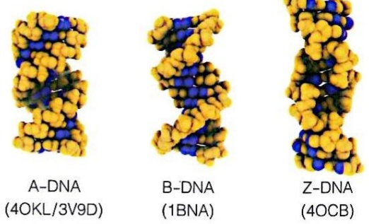

图6-16 A型、B型与Z型DNA的比较（括号为相应DNA的PDB编号）

表 6-2 A 型、B 型和 Z 型 DNA 双螺旋结构的特征参数比较

| 结构参数 | A-DNA | B-DNA | Z-DNA |
| --- | --- | --- | --- |
| 螺旋方向 | 右 | 右 | 左 |
| 螺旋直径 / nm | 2.6 | 2 | 1.8 |
| 碱基堆积距离 / nm | 0.26 | 0.34 | 0.37 |
| 每圈碱基数 | 11 | 10.4 | 12 |
| 糖环构象 | C-3' 内式 | C-2' 内式 | 嘌呤 C-3' 内式嘧啶 C-2' 内式 |
| 糖苷键构象 | 反式 | 反式 | 嘌呤顺式,嘧啶反式 |
| 大沟 | 窄而深 | 宽而深 | — |
| 小沟 | 宽而浅 | 窄而深 | 窄而深 |

分析表明，当 DNA 分子处于较干燥条件下或与蛋白质发生相互作用时，可能会从 B 型构象转变为 A 型构象。此外，DNA-RNA 或 RNA-RNA 双链分子的结构也被认为与 A-DNA 接近。

（2）具左手螺旋特征的 Z 型 DNA（Z-DNA）构象在人工合成的某些脱氧寡核苷酸片段中被观察到

Z-DNA 是于 1970 年代由美国学者亚历山大·里奇（Alexander Rich，1924—2015）首次发现。这种结构是在高盐条件下，由嘧啶和嘌呤交替排列的序列 [如 d(CG)₃ 六聚体] 形成。Z-DNA 是左手螺旋，其脱氧核糖磷酸骨架呈 Z（zigzag）字形，因此得名 Z 型（图 6-16）。Z-DNA 的螺旋直径约为 18 Å，比 B-DNA 更细长。该构象的特殊之处在于其糖苷键的构象交替出现:嘧啶核苷酸的糖苷键呈反式构象，而嘌呤核苷酸的糖苷键则为顺式构象（图 6-9）。此外，Z-DNA 的碱基对与螺旋轴存在 7° 的倾斜角，Z-DNA 的重复单位为两对碱基（A 型和 B 型 DNA 为一对碱基），并且仅能观察到一个窄而深的沟，相当于 B-DNA 的小沟。这使得 Z-DNA 呈不规则结构。

Z-DNA 的结构特征与参数也见表 6-2。

Z-DNA 与 B-DNA 在结构上存在显著差异，并在脊椎动物体内展示出独特的生物学特性。研究发现，Z-DNA 可以诱发抗体的产生，这一特性被用于检测生物基因组中 DNA 构象的转变。在某些基因组的转录起始部位可观察到 DNA 从 B 型向 Z 型构象的转变，而且 DNA 超螺旋结构有助于这种构象转换。B 型向 Z 型的转变机制可能是由嘌呤碱基的糖苷键从反式翻转为顺式所触发。

尽管Z-DNA构象在热力学上不稳定，但这种不稳定性可能正是其重要的生物学功能所在。Z-DNA的磷酸基团之间的距离较近，导致较强的静电排斥，可能会诱导DNA双链局部解开，允许聚合酶等酶类访问DNA模板并合成新的核酸链。因此，Z-DNA的形成可能与基因表达和DNA复制调控密切相关。

DNA 与蛋白质的结合也受 DNA 构象的影响。通常情况下，蛋白质通过结合 DNA 双螺旋中的大沟或小沟来识别特定的序列信息。然而，当 B-DNA 转变为 Z-时，大沟消失，小沟变得更窄且深。这可能改变 DNA 与蛋白质的相互作用方式。例如，一些蛋白质可能在 B-DNA 中无法结合，但在 Z-DNA 的构象下却能够与 DNA 结合。这一特性暗示了 Z-DNA 可能在基因调控、信号传递或应激响应中发挥作用。

现有研究表明，Z-DNA 的构象变化可能在动态基因表达和 DNA 代谢过程中发挥重要作用。B 型向 Z 型 DNA 的转变不仅可以提供结构上的灵活性，还可能通过调控蛋白质的结合和 DNA 链的解开，影响生物体内的重要分子过程。这些特性为我们深入理解 DNA 构象的多样性与其功能关联提供了新的思路。

## 6.4.6 DNA 三链螺旋结构及其形成机制

1950 年代，沃森和克里克提出的 DNA 双螺旋结构模型虽然与查加夫规则相符，但当时缺乏直接的原子级证据支持，特别是在碱基配对的结构细节上。因此，科学家们尝试用多种方法验证该模型，并发现了 DNA 的三链螺旋结构。

在 DNA 双螺旋结构模型被提出几年后，美国学者里奇等观察到，某些人工合成的多聚核苷酸在一定条件下可形成三链螺旋（triplex）结构。他们通过光谱学方法和超速离心沉降分析观察到，一条多聚腺嘌呤核苷酸链 [poly(A)] 与一条多聚尿嘧啶核苷酸链 [poly(U)] 首先形成双链结构，随后，另一条多聚尿嘧啶核苷酸链与该双链结合，生成 RNA 三链螺旋结构。该结构中的氢键形成模式不同于沃森-克里克碱基配对模式。

几年后，美国学者卡斯特·胡斯坦（Karst Hoogsteen，1923—2015）通过X射线衍射实验发现了一种新的氢键模式。在这种模式中，嘌呤碱基（如A或G）的N7参与了氢键的形成。这一配对方式后来被称为胡斯坦碱基配对（Hoogsteen base pairing）（图6-17），并与沃森-克里克碱基配对相结合来解释三链螺旋结构的形成机制。如图6-17所示:如果一条由脱氧嘧啶核苷酸（即T和C）组成的脱氧核酸链（D₁链）与由脱氧嘌呤核苷酸组成的互补链（D₂链）以沃森-克里克碱基配对方式形成B型双螺旋结构，则在该双螺旋的大沟里还可以结合一条由脱氧嘧啶核苷酸组成的三链形成寡核酸链（triplex-forming oligonucleotide，TFO）。这第三条链与双螺旋中的碱基形成胡斯坦碱基配对。

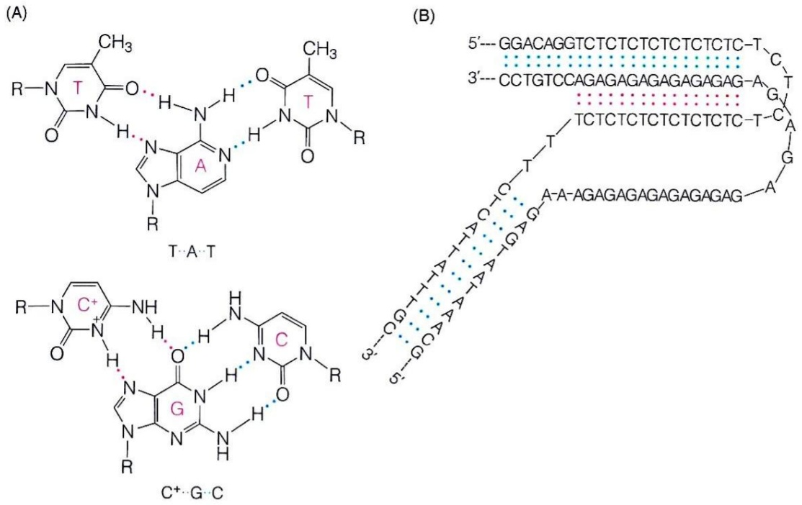

图6-17 胡斯坦碱基配对（虚线表示）方式（A）和一段局部三链螺旋结构的形成机制（B）

三链螺旋 DNA 也可能在一个双链 DNA 分子内通过自身回折而形成，如图 6-17 所示 H-DNA。在三链螺旋结构中，三条链中的两条由脱氧嘧啶核苷酸组成的链都处于反平行状态:如一条 DNA 链上存在镜像重复嘧啶序列 5'……TCTCTC……CTCTCT3'（这样的正读和反读相同的序列被称作回文序列）区域时，其互补链则为 3'……AGAGAG……GAGAGA5'；其中由脱氧嘧啶核苷酸组成的链可以通过回折而产生三股螺旋（图 6-17）。显然，这种三链螺旋结构将伴随一条自由的、不配对的脱氧嘌呤核苷酸区域链的存在，而且这里的胞嘧啶环中的 N3 必须发生质子化后（以 C+ 表示）才可与鸟嘌呤环上的 N7 形成氢键，因此酸性环境可通过促使胞嘧啶的质子化而提高形成三链螺旋结构的能力。

分子内三链螺旋结构的形成可能导致超螺旋结构的局部松弛。三链 DNA 可能在基因调控和 DNA-蛋白质相互作用中发挥作用。例如，在基因组的调控区域，三链螺旋结构可能参与转录调控或为特定蛋白提供结合位点。此外，H-DNA 等分子内三链结构的形成可能与 DNA 复制、转录及基因突变相关。因此，DNA 三链螺旋不仅拓展了对遗传信息结构的理解，还为探索新型的分子机制提供了思路。

## 6.4.7 单条 DNA 链上的邻近互补序列之间可形成发夹结构

根据沃森-克里克碱基配对模式，如果一条 DNA 链上存在两段邻近的互补区域，则有可能形成发夹（hairpin）结构。其互补链在双链解开后也可以形成发夹结构。DNA 超螺旋结构的形成有利于双链解开，因此可以促进两个发夹结构的形成，共同组成一种十字形（cruciform）结构（图 6-18）。十字形结构可能在 DNA 复制、基因表达调控、核小体形成及 DNA 重组等重要生物过程中发挥重要作用。

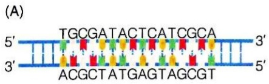

chemical

DNA sequence diagram showing base pairing and nucleotide positions with color-coded bases

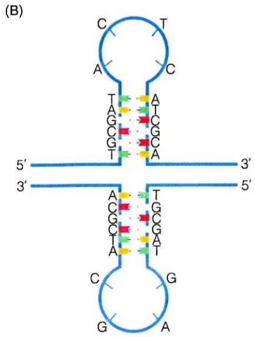

chemical

DNA double helix structure diagram with labeled nucleotide bases (A, C, G) and base pairs (3', 5')

图 6-18 DNA 发夹结构

(A) DNA 链上两段邻近的互补序列可形成发夹结构。(B) DNA 超螺旋结构的形成促进两个发夹结构形成十字形结构

## 6.4.8 富含鸟嘌呤的 DNA 序列可回折形成四股螺旋结构

1960 年代，通过 X 射线衍射结果，科学家发现高浓度的鸟嘌呤核苷酸（GMP）在酸性条件下可形成稳定的螺旋结构。1980 年代，人们观察到富含鸟嘌呤的 DNA 序列可形成平行的四链结构，即四股螺旋。这种四股螺旋是四个鸟嘌呤碱基之间通过形成胡斯坦碱基配对氢键而自我识别所形成的 G- 四联体（鸟嘌呤四体）堆积而形成（图 6-19）。

四股螺旋结构常见于真核生物 DNA 末端（端粒，telomere）和基因组调节区，对 DNA 复制和表达调控至关重要。在端粒中，四股螺旋维持端粒的稳定性；在基因组调节区，四股螺旋影响基因表达和 DNA 复制过程。

## 6.4.9 双链 DNA 可形成超螺旋的复杂三维结构

DNA 超螺旋（supercoil）最初是 1960 年代被杰罗姆·维诺格勒（Jerome Vinograd，1913—1976）等在多瘤病毒的环状 DNA 分子中通过超离心鉴定到，并通过电子显微镜直接观察到的一种 DNA 结构形式。DNA 双链可因欠旋（即螺旋形成不足，形成的螺旋过少，总体分子处于松弛状态）或过旋（即螺旋形成过度，形成的螺旋过多，总体分子处于紧绷状态）形成负或正的超螺旋结构。当 DNA 末端固定或具有环状结构时，额外的张力导致原子位置重排，形成超螺旋。

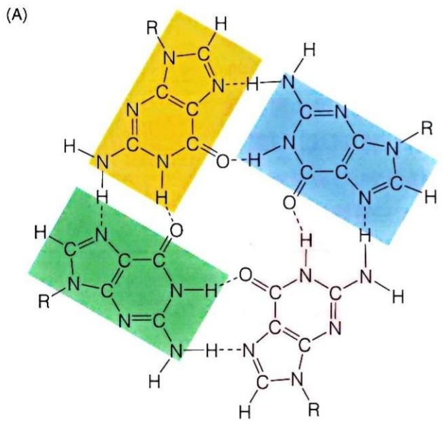

chemical

Molecular structure diagram showing three pyridine-like units with labeled atoms and functional groups

图 6-19 G- 四联体可介导四股螺旋结构的形成

(B)

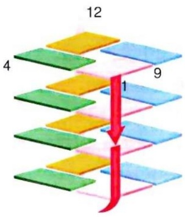

text_image

12
4
9
1

(C)

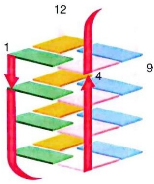

text_image

1
12
4
9

（A）展示了G-四联体的分子结构，其中四个鸟嘌呤分子通过氢键相互作用，形成稳定的四体结构。这种四体结构为后续的四股螺旋形成（B，C）提供了基础

在 DNA 双螺旋中，每旋转一圈（即  $360^{\circ}$ ）由大约 10.4 bp 完成，则处于能量最低状态，双螺旋最稳定。转一圈超过（欠旋）或不足（过旋）这个长度都会使双螺旋上的原子偏离原来位置，而产生额外的张力。如果 DNA 分子的末端是开放的，则这种张力可通过链的转动而释放，DNA 分子维持原来的双螺旋状态。但如果 DNA 分子的两端以某种方式被固定，或者为环状，则这些张力无法被有效释放，从而导致分子中某些原子的位置发生重排，诱发分子扭曲形成超螺旋。

对于正负 DNA 超螺旋结构的形成过程及差异，可通过 DNA 的连环数（linking number, Lk）这一拓扑学概念进行描述。连环数可以被定义为一个双螺旋 DNA 分子中每条链沿右手方向绕分子纵轴缠绕的圈数（每一圈为  $360^{\circ}$ ）；也就是一条链绕穿过另外一条链的次数，即两条链相互缠绕的次数（图 6-20A）。当一个 DNA 分子处于未形成超螺旋的松弛状态时，其连环数等于其碱基对数目除以 10.4（因为 B-DNA 分子中每个螺距由 10.4 个碱基组成），如一个由 2080 个碱基对组成的 DNA 分子的连环数为  $2080/10.4 = 200$ 。一个 DNA 分子的连环数不会因为双链 DNA 形态的改变而改变，即无论如何扭曲、盘绕或伸拉，连环数都不会改变，故为一种拓扑学参数。改变一个 DNA 分子的连环数只有通过磷酸二酯键的断裂和重新形成才能实现。对于环形 DNA 分子而言，连环数一定是整数。

以 DNA 的连环数 Lk 考察，从上述松散的形式开始，则负超螺旋的形成必然伴随 Lk 的减少，而正超螺旋的形成则伴随 Lk 的增加（图 6-20B）。需要注意的是，改变一种 DNA 分子的连环数，需依赖细胞内拓扑异构酶的催化才可实现。Lk 值不同的同一种 DNA 分子的不同形式之间为拓扑异构体。

一般负超螺旋导致 DNA 的两条链之间更易分离，而正超螺旋导致 DNA 双链更难分离。DNA 的复制、转录和重组等过程都依赖 DNA 双链之间的分离，显然，负超螺旋的存在将有助于这些过程的发生。

(A)

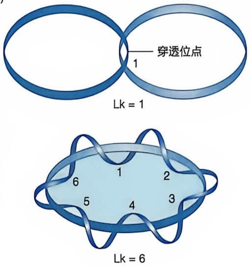

text_image

穿透位点
1
Lk = 1
6
5
4
2
3
Lk = 6

(B)

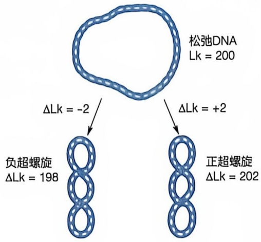

flowchart

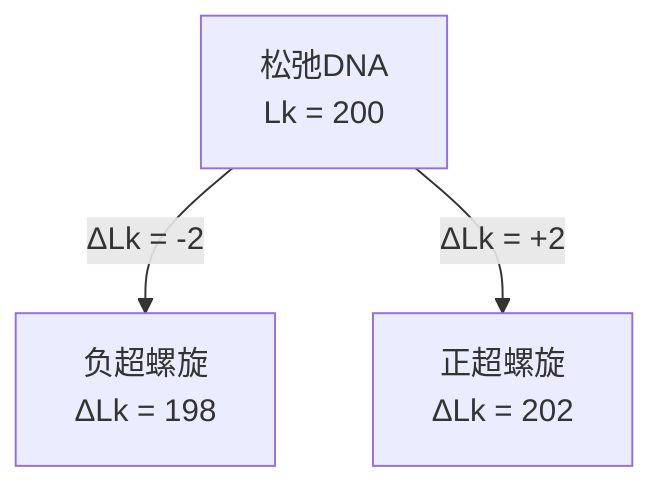

图 6-20 用 DNA 连环数描述 DNA 超螺旋

（A）连环数示意。（B）负超螺旋的形成必然伴随 Lk 的减少，而正超螺旋的形成则伴随 Lk 的增加

对于处于不同超螺旋状态的同一种DNA分子而言，除通过电子显微镜直接观察之外，也可以通过电泳方法进行初步的区分和分析。对于一种DNA分子而言，即使是Lk值相差为1的不同拓扑异构体之间也可以通过琼脂糖凝胶电泳有效分离。但对这样的超螺旋结构进行详细的物理和数学表征，还存在诸多难题。

## 6.4.10 真核细胞中的双链 DNA 与组蛋白结合形成核小体

真核生物的双链 DNA 多为线性分子，但在细胞中并非以自由形式存在，而是与组蛋白八聚体结合形成核小体（nucleosome）结构，并在此基础上进一步逐级压缩，形成染色质和染色体等超分子结构。

核小体的发现始于1970年代，通过核酸酶切割和电子显微镜观察揭示了其存在。核小体由四种核心组蛋白（H2A、H2B、H3、H4）和约 $200\mathrm{bp}$ 的DNA片段组成，DNA片段盘绕于核心八聚体外表面。核小体是由DNA和组蛋白组成的重复单位。组蛋白（histone）是存在于真核生物中的一类可与DNA特异结合的、富含赖氨酸和精氨酸残基的碱性蛋白质。此外，在染色质或染色体中还存在组蛋白之外的其他蛋白质成分，一般被统称为非组蛋白。

核小体的结构如图6-21所示，每一核小体含一个由四种核心组蛋白（H2A、H2B、H3和H4各两个单体）组成的核心八聚体、一个长约 $200\mathrm{bp}$ 的DNA片段和一

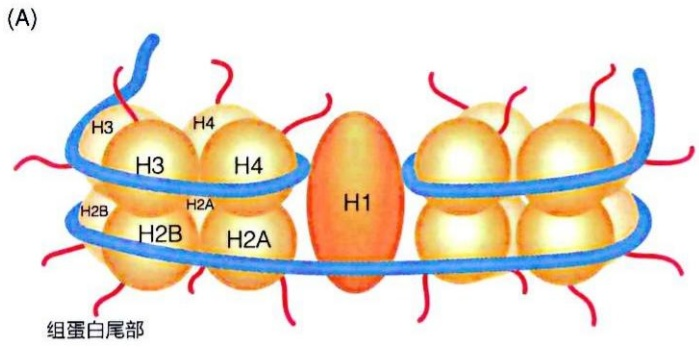

text_image

(A)
H3
H4
H3
H4
H2B
H2A
H2B
H2A
H1
组蛋白尾部

(B)

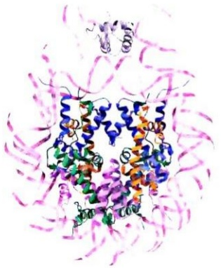

natural_image

3D protein structure visualization with alpha helices and beta sheets (no labels or text)

图 6-21 核小体结构

(A) 结构示意图。(B) 测定的结构, PDB 编号: 1AOI

个组蛋白 H1 单体组成。DNA 片段中约 140 bp 盘绕于核心八聚体的外表面（而非早期认为的里面），其余约 60 bp 的连接 DNA 则位于核心八聚体之间，形成一种电子显微镜下可见的串珠状结构。晶体结构分析结果表明，在核小体中 DNA 基本维持 B 型双螺旋结构。

通过组蛋白之间的作用，以核小体形式存在的DNA-蛋白质链将进一步螺旋化，形成每圈为6个核小体的 $30\mathrm{nm}$ 纤丝结构。这种状态的DNA-蛋白质复合体对应于细胞中的染色质（chromatin）。在非组蛋白的作用下，纤丝DNA被固定在细胞核中的核骨架蛋白上，形成纤丝突环，每个突环 $20\sim 100\mathrm{kb}$ （千碱基对）；突环进一步组装成玫瑰花结样结构，进而形成螺旋管，由螺旋管最后形成染色单体结构。通过这样的逐级压缩，使得很长的DNA分子存在于很小的体积内，从而被收纳于细胞核中；这同时也增强了DNA分子的稳定性。

细胞分裂时，两条具有相同序列的染色单体中的双链DNA分子通过各自的着丝点附着形成一条染色体（chromosome）。每条染色单体皆由一个末端开放的双链 DNA 分子组成，其 5' 端和 3' 端皆含大量富含鸟嘌呤的重复序列，形成端粒，后者再与特异蛋白质结合，即在保持染色体完整性的同时参与 DNA 的复制。

## 6.5 RNA 一般通过形成独特的三维结构而发挥其生物学功能

RNA 分子在细胞中主要以单链形式存在，但不同于无结构的线性单链，RNA 通过折叠形成复杂的三维结构来执行其生物学功能。这些结构包括局部的双螺旋区、茎环结构等二级结构，以及更复杂的三级结构。

## 6.5.1 单链 RNA 分子内可形成局部的双螺旋结构

RNA 分子内的某些区域之间可以通过类似双链 DNA 分子的方式进行碱基配对，形成双螺旋结构（图 6-22A）。在 RNA 中，A 与 U、G 与 C 之间可以配对，G 与 U 之间可以发生非标准配对。RNA 双螺旋的稳定也依赖碱基堆积力以及氢键维系。碱基堆积力使碱基发生最大程度的堆积，是 RNA 折叠的重要驱动力，相当于疏水相互作用在多肽链折叠过程中的作用。两个嘌呤碱基之间的碱基堆积力强于一个嘌呤与一个嘧啶或两个嘧啶碱基之间的碱基堆积力。因此，当一个嘧啶核苷酸居于两个嘌呤核苷酸之间时，嘧啶碱基往往被排挤出去，导致两个嘌呤碱基之间发生堆积。

RNA 单链的局部双螺旋结构主要以与 A-DNA 类似的构象存在。这主要是因为核糖中存在 2' 羟基，使得呋喃环只能以 C3'-内向型构象（类似 A-DNA 构象）存在；C2' 羟基的氧原子与 C3' 羟基的氧原子以及磷酸基和碱基之间存在空间位阻而不易形成 C2'-内向型构象（图 6-16）。另外，每一段 RNA 双螺旋区需要至少 4\~6 个碱基对才能维持。一个 RNA 分子中可有高达 40%\~70% 的核苷酸参与形成这样的双螺旋结构。

单链 RNA 中所形成的局部双螺旋结构一般被形象地称作臂（arm）或茎（stem），而那些不能配对的碱基则可以单链环（loop）形式存在（图 6-22A）。RNA 分子中形成的茎环（stem-loop）结构是一种局部的空间结构，可以被看作是一种二级结构。比较典型的一种茎环结构呈发夹形（图 6-22B）。这样的茎环结构仅仅代表 RNA 分子的一种二级结构，在此基础上 RNA 分子一般还会进一步折叠形成更为复杂的三级结构。

## 6.5.2 RNA 分子可通过大量氢键而折叠形成独特的三级结构

RNA 分子的三级结构是在其二级结构（如茎环结构）的基础上进一步折叠形成的复杂空间构象。在此过程中，氢键起到了至关重要的作用。在 RNA 分子的三级结构中，除上述碱基配对氢键之外，还存在多种其他氢键形式。在 RNA 的三级结构中，氢键可以产生于任何合适的基团之间，包括碱基与核糖磷酸主链的基团之间，以及核糖磷酸主链自身的基团之间。这类氢键既可以发生在 RNA 分子的臂内或环内，也可以在臂之间或环之间，甚至环与臂之间。正是这些复杂而精细的氢键网络，使得 RNA 分子能够折叠成具有特定生物学功能的三维结构。

图6-22 RNA的不同二级结构（A）与发夹结构的三维模式图（B）

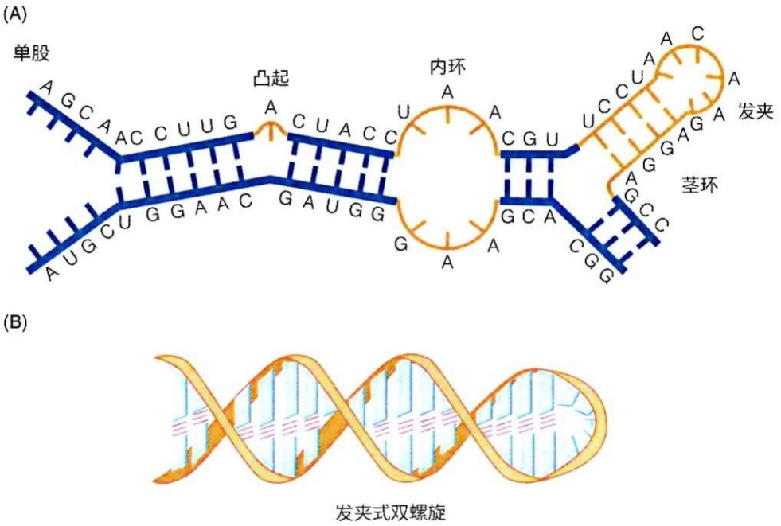

此外，具有特异三维结构的 RNA 分子通常需要与蛋白质发生特异性相互作用。这种相互作用可以是暂时性的或永久性的。RNA 分子发挥其生物学功能离不开与特异蛋白质分子之间的相互作用。即使是 RNA 病毒，也需要与病毒蛋白质形成特异的病毒颗粒，依赖此颗粒侵染宿主细胞并完成复制。

## 6.5.3 转运 RNA 一般折叠形成 L 形三级结构

转运 RNA（tRNA）是细胞中一种非常重要的 RNA 分子，它负责在蛋白质翻译过程中将特定的氨基酸转运到核糖体上。tRNA 的倒 L 形三级结构是其功能实现的基础。tRNA 于 1950 年代末被发现。1960 年代，美国学者罗伯特·霍利（Robert Holley，1922—1993）及其团队从酵母细胞中分离纯化了足够的丙氨酸 tRNA（tRNA $^{Ala}$ ）。他们利用多种核酸酶将该分子切割为小片段，并对这些片段的核苷酸序列进行分析，最终拼接出了 tRNA $^{Ala}$  分子的完整序列，即包含 70 多个核苷酸残基。这是首次测定完整的 RNA 分子序列的突破性研究。

根据 RNA 的核苷酸序列，霍利团队发现，tRNA 分子可以通过碱基的互补配对折叠成一种三叶草形（cloverleaf）二级结构，包括四个茎区和三个环区（图 6-23A）。几乎所有 tRNA 分子都遵循这种折叠模式。三叶草结构由五个主要部分组成:一个氨基酸臂、一个 D 环（因其环中含修饰碱基二氢尿嘧啶 dihydrouracil，故也被称作二氢尿嘧啶环）、一个反密码子环（anticodon arm；其环中含反密码子）、一个可变环（variable loop），V 环（在不同 tRNA 分子中，该环可大可小变化较大）和一个 TψC 环（含 TψC 序列，其中 ψ 为假尿嘧啶修饰碱基，故也被称作假尿嘧啶环）。

从功能角度看, 最为重要的是氨基酸臂和反密码环。其中的氨基酸臂由一个双链区 (一般由 7 个碱基对组成) 和由 RNA 链 $3^{\prime}$ 末端 -CCA-OH 组成的未配对单链组成。在蛋白质翻译过程中, 末端腺苷酸 (A) 残基中的核糖组分的 $\mathrm{C}3^{\prime}-$ 或 $\mathrm{C}2^{\prime}-\mathrm{OH}$ 可与特定氨基酸的 $\alpha$ 羧基通过酯键形成共价连接, 形成氨基酰-tRNA 分子。反密码子环的茎部一般由 5 对碱基组成, 中部含由 3 个碱基组成的反密码子; 蛋白质翻译时, 由它识别 mRNA 上的密码子。

1970 年代, 科学家通过 X 射线晶体衍射技术首次解析了酵母苯丙氨酸 tRNA 的三维结构, 揭示了其倒 L 形三级结构 (图 6-23B)。具体而言, 由三叶草形二级结构中的氨基酸臂的 7 个碱基对与含 T 环的 5 个碱基对发生同轴堆积 (coaxial stacking), 形成含 12 个碱基对的 A 型螺旋, 组成倒 L 形结构的一个臂。类似地, 反密码子环的几个碱基对与 D 环的几个碱基对之间也发生同轴堆积, 形成另外一个 A 型螺旋, 组成倒 L 形结构的另外一个臂。

值得注意的是，这种倒 L 形三维结构，使得 tRNA 的氨基酸臂位于一端，而反密码子环则位于另一端（图 6-23B），二者之间相距约 70 Å。这种空间布局保证了蛋白质翻译过程中两个关键步骤（密码子的识别和肽键的形成）的有效分离。

还值得关注的结构特征包括以下方面:D 环和 TψC 环在三级结构上处于相邻位置，共同构成倒 L 形结构的转角；tRNA 中存在大量非沃森-克里克碱基配对的氢键（例如两个碱基或三个碱基之间的氢键）；核糖磷酸骨架也与某些碱基或其他骨架基团之间形成了氢键。碱基堆积力（正如在 DNA 双螺旋分子中那样）对稳定 tRNA 的构象发挥重要作用。

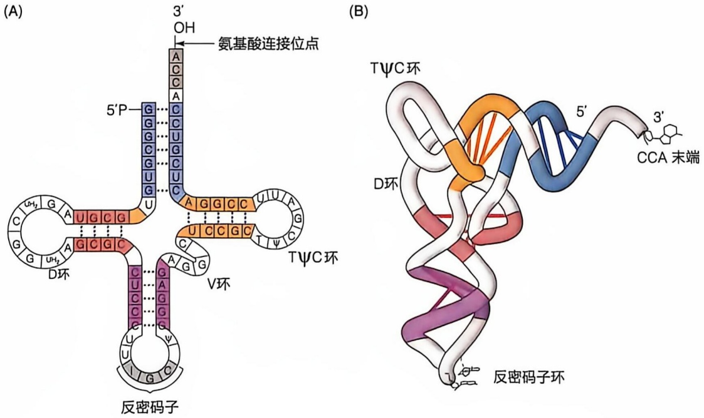

图 6-23 tRNA 的三叶草形二级结构（A）与倒 L 形三级结构（B）
(PDB 编号:1EHZ, 4TNA, 2TRA)

在蛋白质翻译过程中，20种氨基酸由不同tRNA分子转运。尽管这些tRNA的核苷酸序列和长度（77～90 nt）不同，但其三级结构却高度相似，均呈倒L形。这种现象生动地体现了生物分子的空间结构与生物学功能之间的高度统一性。

每种 tRNA 都通过其所含的反密码子与 mRNA 分子上的特定密码子进行配对识别，从而将特定氨基酸精确转运至核糖体中的肽链合成位点。tRNA 的倒 L 形结构确保了它们与核糖体的结合方式基本一致:tRNA 分子一端的反密码子与 mRNA 分子中的三核苷酸密码子特异配对；其另一端所携带的氨基酸则刚好处于核糖体中肽酰转移酶的活性中心，便于其催化新生肽链的延长。

tRNA 的结构总体相似，但也存在细微的差异。这些差异使得每种 tRNA 能够被不同的酶（如不同的氨酰 tRNA 合成酶）和蛋白质特异性地识别。这些酶会将相应的氨基酸加载到正确的 tRNA 上，确保每种氨基酸都能按 mRNA 提供的遗传信息被精确地加入多肽链中。

## 6.5.4 核糖体 RNA 分子一般形成复杂的三维结构

存在于核糖体中的核糖体 RNA（ribosomal RNA，rRNA）是细胞内含量最高的一类 RNA。原核和真核生物的核糖体皆由大、小两个亚基组成，大、小亚基均为由蛋白质与 rRNA 组成的复合物。原核生物的小亚基含超速离心时沉降系数为 16S（约 1500 个碱基）的一种 rRNA，而大亚基则含 5S（约 120 个碱基）和 23S（约 2900 个碱基）两种 rRNA；真核生物的小亚基含有 18S（约 1900 个碱基）一种 rRNA，而大亚基含 5S、5.8S（约 150 个碱基）和 28S（约 5050 个碱基）三种 rRNA。rRNA 形成核糖体大小亚基的骨架，决定着核糖体中各种蛋白质的定位。

1960 年代以来，随着大肠杆菌 5S、16S 和 23S rRNA 的核苷酸序列被先后测定，多种 rRNA 的序列（一级结构）、二级结构和三级结构被测定。以大肠杆菌中的 16S rRNA 为例，其二级和三级结构如图 6-24 所示。与 tRNA 类似，在 rRNA 中也发生广泛的双螺旋结构之间的同轴堆积；各式各样的氢键形成，包括非沃森-克里克碱基配对、三碱基配对、磷酸基团和核糖羟基等参与形成氢键等，使得 rRNA 各自折叠形成独特的三维结构。rRNA 一级结构中相隔很远的核苷酸之间也可形成碱基配对。由 16S rRNA 折叠所形成空间结构的形状与大肠杆菌中核糖体小亚基的形状非常相似，表明 16S rRNA 为小亚基提供了一种骨架结构。

结构分析表明，真核细胞中的 5.8S 和 5S rRNA 与原核细胞中的 5S rRNA 之间、真核生物 18S rRNA 与原核生物 16S rRNA 之间，以及真核 28S rRNA 与原核 23S rRNA 之间皆存在同源性，即相互具有类似的三维结构和生物学功能。

rRNA 在物种演化时是高度保守的，即不同物种来源的 rRNA 序列高度相似，所以 18S/16S rRNA 的核苷酸序列之间的差异常被用于构建物种之间的演化树:rRNA 分子之间序列越相似，表明两个物种在演化过程中亲缘关系越近；序列差异越大，表明亲缘关系越远。

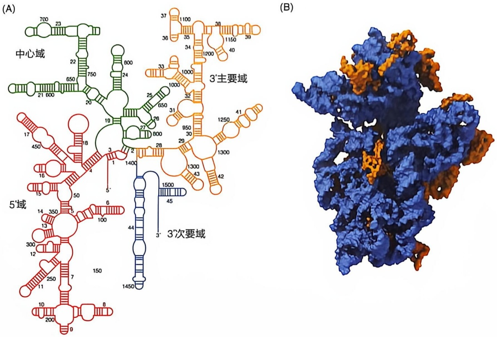

图 6-24 16S rRNA 的二级结构（A）与核糖体小亚基结构（B）

(B) PDB 编号: 1FJG, 1FKA,
其中褐色部分为 16S rRNA

在核糖体上进行的多肽链合成是一个复杂而高度动态的过程，需要多个重复性步骤的协调进行。rRNA 分子在此过程中不仅提供了结构支撑，还通过构象的动态变化促进了多肽链的合成。比如，在合成多肽链过程中，mRNA 和 tRNA 分子需与核糖体特定部位进行特异结合，这样的结合依赖 rRNA 与 mRNA 特异序列之间形成碱基配对；新生肽链需在核糖体上不断移动位置，这一过程也依赖于 rRNA 分子的动态构象变化，以促进肽链的顺利转移与延伸。此外，研究表明，核糖体大小亚基的解离能引起其中 rRNA 分子的构象发生变化；而且 16S rRNA 分子处于游离状态和与核糖体蛋白质结合状态时，构象也是存在差异的。这些都提示了 rRNA 分子结构的动态性特征，使核糖体能够灵活地适应多肽链合成过程中的不同步骤。

## 6.5.5 mRNA 分子一般不形成特定的三维结构

与 tRNA 和 rRNA 不同，mRNA 分子整体呈线性结构，并不形成稳定的三维结构。然而，mRNA 在特定条件下也可能局部折叠，生成具有功能意义的茎环类二级结构。不同 mRNA 分子中形成的二级结构存在很大差异，并在特定场景下发挥重要的生物学作用。

当 mRNA 分子结合到核糖体并指导多肽链合成时，其编码区必须解开为线性状态，以确保核糖体准确读取三核苷酸密码子，实现氨基酸的精确插入。尽管 mRNA 整体呈线性结构，但某些区域通过自身碱基配对，可形成茎环结构。这些二级结构通常出现在 mRNA 的 5' 非翻译区（UTR）或 3' 非翻译区，并与调控翻译过程密切相关。

## 6.5.6 某些 RNA 分子（核酶）在折叠形成独特的三维结构后发挥催化功能

核酶（ribozyme）是一大类生物体内的 RNA 分子，在折叠形成特定的三维结构后能够发挥催化功能，类似于传统的蛋白酶。它们最初是由美国学者托马斯·切克（Tom Cech）和西德尼·奥尔特曼（Sidney Altman，1939—2022）等于 1980 年代所发现的（知识延展 6-1）。典型的核酶包括四膜虫中的 I 型内含子（存在于 rRNA 前体中，负责催化自剪接的发生）、细菌核糖核酸酶 P 中的 RNA（催化 tRNA 前体的加工）、植物病毒中的卫星 RNA（独立于病毒基因组而存在，参与病毒感染等过程）前体等。此外，植物类病毒的复制过程会产生线性二体或三体的 RNA 链，这些 RNA 链通过自催化反应形成单体环状 RNA，从而完成病毒的组装和传播。核酶在核糖体中的作用也十分关键，原核生物的 23S rRNA 和真核生物的 28S rRNA 参与肽键的形成，是蛋白质合成中的重要催化分子。

与蛋白酶类似，核酶的催化功能依赖于其与底物分子的特异性结合，并通过特定的催化基团加速反应。一些核酶无须蛋白质辅助即可完成催化，形成稳定的三维结构是其发挥催化活性的关键。例如，锤头核酶（hammerhead ribozyme）是一种被广泛研

## 知识延展 6- 1

## 核酶的发现

核酶是指具有催化能力的 RNA。最初由美国学者切克和奥尔特曼等课题组在 1980 年代发现。切克等在研究嗜热四膜虫的 rRNA 前体加工过程时意外观察到，即使在没有任何蛋白质存在的情况下，只要有鸟苷和镁离子存在，前体分子也可以自发切除其内部的一段内含子序列，并将两个外显子拼接为成熟的 rRNA 分子。之后，切克等从切除的内含子序列中分离得到 L19RNA 序列，并发现它可在体外催化一系列寡核苷酸分子间的化学反应，既包括使寡核苷酸链延长的合成反应，也包括使之变短的水解反应。这表明，与 rRNA 前体只发生一次性化学转换不同的是，L19RNA 分子在维持自身结构完全不改变的条件下，催化其他分子发生重复性的化学转换，后者表现出蛋白酶的催化特征功能，故将其命名为核酶。

大约同时，美国学者奥尔特曼等在研究大肠杆菌中一种催化 tRNA 前体加工的核糖核酸酶 P（RNase P）的过程中观察到，尽管该酶由 RNA 和蛋白质两部分组成，但发挥催化作用的仅仅是其中的 M1 RNA 组分。进一步的分析表明，单独的 M1 RNA 分子就具有催化功能；即使通过体外转录所产生的 M1 RNA 也具催化活性。因此，这是另外一种被清楚鉴定的核酶。

核酶的发现具有重要的理论意义。这不仅证明了核糖核酸也可发挥催化功能，更表明在地球上演化产生生命的过程中，RNA这类分子很可能早于DNA和蛋白质而出现，这为认识生命起源的过程提供了全新视角。与此同时，人们可以根据对核酶结构与作用机制的认识，设计出生物体内本不存在的人工核酶，以应用于生物技术实践。

(A)

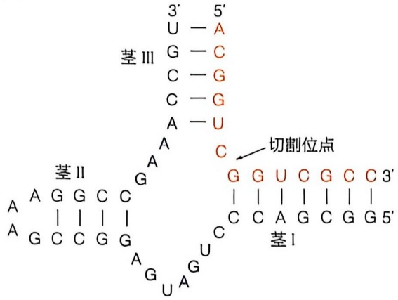

chemical

DNA nucleotide structure diagram showing base pairing and cleavage point annotation

(B)

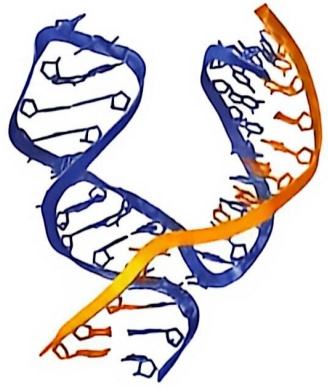

natural_image

3D illustration of a DNA double helix structure with blue and orange helices (no text or labels)

图6-25 一种代表性锤头核酶的二级结构（A）和三级结构（B）(PDB编号:1HMH，1Q29)

究的核酶。研究表明，锤头核酶通过与底物 RNA 链的碱基配对，形成三个茎区，呈现典型的锤头形状（图 6-25）。此外，这种结构包含 13 个保守的核苷酸残基，确保了切割反应的特异性，切割会在图 6-25 中箭头所示的部位发生。这类原始核酶可能广泛存在于不同的生物体中，其功能和演化意义尚待进一步探究。

## 6.5.7 真核生物中还存在多种细胞核内小 RNA

1960 年代，人们从大鼠肝细胞中分离到多种富含尿苷酸的小分子 RNA。这些 RNA 后来被命名为核内小 RNA（small nuclear RNA，snRNA）；这些被称为 U RNA 的分子一般含 100～250 个核苷酸残基，它们以与特异蛋白质形成复合物的形式，在 mRNA 前体剪接过程中（即去除内含子，并将剩下的外显子序列连接在一起形成成熟的 mRNA 分子）发挥重要作用。细胞核内小 RNA 中还包括位于核仁中的核仁小 RNA，它们参与核糖体的生成过程，包括 rRNA 前体分子的修饰和加工，以及核糖体的组装过程等。

## 6.5.8 细胞中还存在多种调节性小分子非编码 RNA

除了上述三大类经典 RNA 分子及核内小 RNA 之外，人们陆续在真核和原核细胞内鉴定到了多种调节性小分子非编码（即不编码蛋白质信息）RNA 的存在。小 RNA（small RNA）的发现是 20 世纪生物学领域的一项重要突破，为理解基因调控开辟了新的方向。在此之前，科学家普遍认为基因的主要产物是蛋白质。然而，在 1990 年代，科学家们在研究秀丽隐杆线虫（Caenorhabditis elegans）的发育调控时，发现了一种特殊的小 RNA 分子。这一发现揭示了 RNA 不仅参与信息传递，还在基因表达的调控中发挥关键作用。

研究的突破始于对 lin-4 突变体的分析。这些突变体的发育出现异常，导致无法正常过渡到下一个发育阶段。1993 年，维克多·安布罗斯（Victor Ambros）团队和加里·鲁夫昆（Gary Ruvkun）研究发现，lin-4 基因编码的产物并非蛋白质，而是一个 22 个核苷酸的小 RNA 分子。进一步分析表明，lin-4 小 RNA 通过与 Lin-14 蛋白 mRNA 的 3' 非翻译区（3'UTR）发生碱基配对，抑制了该 mRNA 的翻译，导致 Lin-14 蛋白的表达被阻断。这种抑制机制影响了线虫的发育，标志着首次发现 RNA 分子通过非编码机制调控基因表达。

lin-4 的发现为生物体内普遍存在的小分子 RNA 调控现象奠定了基础。2000 年，鲁夫昆团队发现了另一个重要的微 RNA（microRNA，miRNA）——let-7。let-7 被证明在真核生物（如人类和果蝇）中高度保守，并在调控发育时序和细胞分化中发挥关键作用。miRNA 通过与 mRNA 的 3'UTR 部分匹配来抑制其翻译，使细胞在适当的时间调控特定蛋白质的生成。

除了 miRNA，安德鲁·法尔（Andrew Fire）和克雷格·梅洛（Craig Mello）于 1998 年发现了干扰小 RNA（small interfering RNA，siRNA），并提出了 RNA 干扰（RNA interference，RNAi）的概念。他们的研究表明，siRNA 源自双链 RNA（dsRNA），通过与目标 mRNA 完全匹配并促使其降解，从而实现基因沉默。

后续研究表明，在不同类型的生物体内，都存在一类长20\~30 nt的调节性小分子RNA。这些小分子RNA的产生方式和生物功能存在一定差异，被给予不同名称，如上述的miRNA、siRNA以及向导RNA（guide RNA，gRNA）等。小分子RNA的功能多样且机制复杂。miRNA和siRNA主要通过与目标RNA碱基互补配对来调控其活性或稳定性，导致基因沉默，从而抑制特定蛋白质的生成。gRNA则通过与特异蛋白结合（如CRISPR中的Cas9），引导基因组的精确编辑。此外，小分子RNA还在病毒防御、转座子抑制和基因组稳定性维持中发挥关键作用。

## 6.6 DNA 与 RNA 的结构差异及其功能关联

DNA 和 RNA 是遗传信息的核心载体，但它们在结构和功能上存在显著差异。DNA 的主要作用是长期储存和传递遗传信息，而 RNA 则参与基因表达和信息传递以及具有某些催化和调节功能。这些功能差异与二者在分子组成和三维结构上的不同紧密相关。

## 6.6.1 DNA 的双链互补结构是稳定性与高效复制的基础

细胞中的 DNA 分子一般都是以两条反向平行的核酸链遵循碱基互补配对原则形成双螺旋结构。这种独特的结构形式使得 DNA 分子成为所有生物个体中遗传信息载体的不二选择。DNA 双链结构不仅具有高度的稳定性，还能确保遗传信息的高效复制，其优势体现在以下方面。

## (1) DNA 单链的核苷酸组成和排列顺序不受任何限制

在 DNA 双螺旋中，任意组合的碱基序列都可以形成稳定的双螺旋结构。DNA 的高度包容性允许其储存多种多样的遗传信息，无论碱基序列多么复杂，都能保持其功能。该特征使得这种看上去组成（只含四种碱基）和结构（仅形成螺旋结构）都简单的 DNA 分子成为了极为高效的遗传信息载体。这是生物体长期演化选择的结果。

(2) 两条单链的碱基序列互为模板是 DNA 有效复制和修复损伤的重要基础

DNA 的两条单链根据碱基互补配对原则相结合，即腺嘌呤（A）与胸腺嘧啶（T）、鸟嘌呤（G）与胞嘧啶（C）配对。这意味着，只要知晓一条单链的碱基序列，就能准确推测出另一条

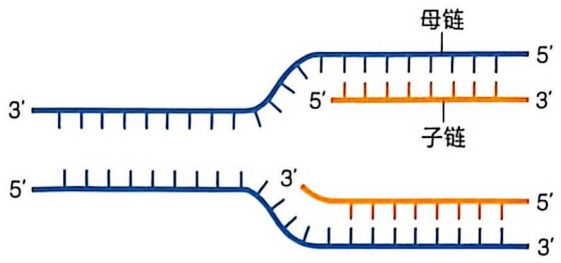

text_image

母链
3'
5'
子链
3'
5'
3'

图 6-26 DNA 复制时的碱基互补配对原则

互补链的序列。这种互补性为 DNA 的复制与修复奠定了重要基础（知识延展 6-2）。

当 DNA 的两条单链分开时，每条单链都可作为模板，合成与其互补的新链。如果将分开的两条单链各自作为模板进行复制，就会形成两个完全相同的双链 DNA 分子。这种简单而高效的复制方式完美解决了遗传信息如何传递的难题。沃森和克里克在 1953 年提出 DNA 双螺旋结构模型时，已经认识到这一点，并在此基础上提出了 DNA 的半保留复制假说（图 6-26）。

DNA 分子中两条单链互为模板的特征，还使得 DNA 分子单链上发生的损伤可以被有效修复，恢复原有序列信息，这一特征对于 DNA 作为遗传信息的载体而言极为重要。后面我们将看到，细胞演化出了多种机制对 DNA 损伤进行修复，而 DNA 的这种结构特征为此提供了重要基础。

(3) DNA 双螺旋具亲水外表和疏水内部的结构特征

在 DNA 双螺旋结构中，由脱氧核糖基和磷酸基交替连接形成的两条主链骨架位于其外表面，具有极性，高度亲水，这使得 DNA 分子能溶于水，从而可以在细胞内的水环境中有效发挥其生理功能。

附着于脱氧核糖磷酸骨架上的所有嘌呤碱基和嘧啶碱基则处于双螺旋内部相对疏

## 知识延展 6-2

## 互补配对

此处的互补配对特指核酸分子内或分子间的 A-T/A-U 与 G-C 配对模式。具体包括:DNA 双螺旋中的互补配对、RNA 的双螺旋区域的互补配对；DNA 复制过程母链与子链之间的互补配对、模板与引物的配对；转录时 DNA 模板与 RNA 链的配对；逆转录时 RNA 模板与 cDNA 的配对；翻译时密码子与反密码子的配对；原核生物 rRNA 与 mRNA 的 SD 序列的配对；mRNA 与mRNA 的配对；siRNA 与 mRNA 的配对；gRNA 与 DNA 的配对等。上述这些互补配对使得 DNA 能够形成双螺旋，tRNA 等 RNA 分子能够形成具有特定功能的三维结构，遗传信息能够由一个细胞（生命）传递给另一个细胞（生命），DNA 能够控制蛋白质，遗传信息的传递与表达得到精密的调控。可以说，核酸世界与遗传的核心法则就是核酸分子内或分子间的互补配对。