## 知识延展 8- 1

## 端粒及端粒酶的发现

端粒的发现要比线性染色体末端复制问题的提出早很多年。1938年，因发现X射线诱导突变而获得1946年诺贝尔生理学或医学奖的赫尔曼·米勒（Hermann J. Müller，1890—1967）发现果蝇染色体末端存在一个对X射线不敏感的特殊结构，命名为端粒。1978年，伊丽莎白·布莱克本（Elizabeth H. Blackburn）在单细胞纤毛虫四膜虫中发现了其端粒DNA是由许多重复序列TTGGGG构成。1980年，杰克·绍斯塔克（Jack Szostak）和布莱克本共同进行了一项关键实验，发现线性质粒进入酵母细胞后，要么被降解，要么被整合到基因组中；但如果将四膜虫端粒序列克隆在线性质粒末端，线性DNA则像微小染色体一样稳定保留在细胞中。酵母利用外来端粒DNA就像自己的端粒DNA一样。更有趣的是，随着细胞分裂增殖，端粒DNA会变长，且测序结果显示酵母还在来自四膜虫的端粒DNA上添加了自己的端粒 DNA 序列。这些研究表明细胞进化出了维持端粒的机制。

1985年，布莱克本和她的博士生卡罗尔·格雷德（Carol Greider）发现了一种能够在端粒DNA末端添加端粒重复序列的末端转移酶，命名为端粒酶（telomerase）。1989年端粒酶的RNA组分被鉴定，同年还报道了人类细胞中也有端粒酶存在。十年之后，端粒酶的蛋白质催化亚基被纯化并鉴定，并证实端粒酶是一种依赖于RNA模板进行DNA合成的逆转录酶。因此，某一物种中端粒DNA的序列拷贝了端粒酶中的RNA模板序列。绍斯塔克后来在酵母中的研究还表明，端粒酶活性的丧失会导致细胞过早衰老和细胞死亡，这是端粒缩短与衰老相关最早的实验证据。布莱克本、绍斯塔克和格雷德也因他们对端粒和端粒酶的研究而获得了2009年诺贝尔生理学或医学奖。

## 8.3.6 细菌质粒、线粒体、叶绿体及某些病毒的 DNA 通过其他方式进行复制

前面介绍的生物体基因组 DNA 的复制过程是最常见的复制形式，但并非所有生物都以相同的方式复制基因组。细菌中的某些质粒、线粒体、叶绿体以及某些病毒的 DNA 还可以采用完全不同的滚环复制方式。大肠杆菌中的 Col E1 质粒和  $\Phi X174$  噬菌体的复制就是滚环复制的典型例子。Col E1 质粒具有一个确定的复制起点，且该质粒从复制起点起只向一个方向进行复制。而另一些生物的基因组是单一线性的双链 DNA（如  $\Phi 29$  噬菌体和腺病毒），其 DNA 复制从其末端起始。

这里以 $\Phi X174$ 噬菌体基因组DNA的复制为例说明滚环复制的过程（图8-24）。$\Phi X174$ 噬菌体基因组是一个单链环状DNA分子，这条链称为正 $(+)$ 链。其复制时首先合成与正链互补的负 $(-)$ 链，从而形成一个环状闭合DNA双链分子。随后，噬菌体基因组编码产生的A蛋白会在双链DNA分子正链的特定位置上产生一个切口，切口处形成的正链 $3^{\prime}$ 端在DNA聚合酶的作用下延伸形成一条新链。这条新链围绕着环状的负链不断延伸，取代旧的正链并直至到达起始位置置换起始的位点。而此时 A 蛋白可以从之前产生切口处的正链 5' 端再次结合至复制起点并产生切割，被置换出的旧的正链也会在 A 蛋白的作用下连接形成一个新的环形单链。通过这样的滚环复制方式，ΦX174 噬菌体就可以产生大量基因组拷贝。

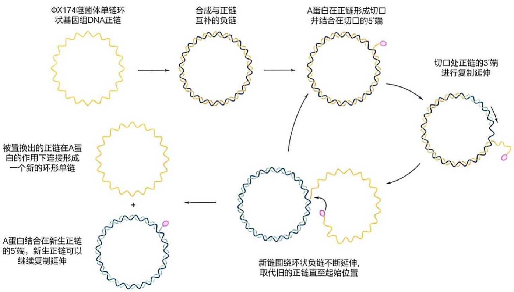

flowchart

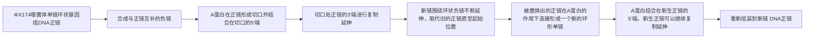

图 8-24 ΦX174 噬菌体基因组 DNA 的滚环复制方式

## 8.4 DNA 复制受到严格调控

所有生物都必须保证自己的染色体数目和细胞数量相对平衡，因此，复制起始是被严格调控的。换句话说，对 DNA 复制的调控也主要是指对复制起始的调控。一旦 DNA 复制启动，细胞便会全力完成复制和分裂。同时，在染色体 DNA 复制起始后的一段时间内，复制起点不会再重新开始复制，最终保证 DNA 复制与细胞分裂协调进行。以下分别介绍原核和真核细胞是如何调控 DNA 复制起始的。

## 8.4.1 原核细胞复制起始的调控

E. coli 中复制起始调控的核心环节是起始蛋白 DnaA 在 OriC 上的结合，而 DNA 甲基化修饰控制 DnaA 能否在 OriC 上的 R 位点结合。E. coli 的基因组序列中存在许多散在分布的 GATC 序列，这一回文序列中的两条链都可以被 DNA 腺嘌呤甲基转移酶（Dam）识别，并将 GATC 位点两条链上 A 残基的 N6 位置甲基化。GATC 序列随机出现的平均频率是每 256 bp 一次，然而在 OriC 序列中其出现的频率极高，245 bp 的 OriC 序列中含有 11 个 GATC 位点（图 8-3）。

染色体DNA发生复制前，GATC位点两条链上的A碱基都有甲基化修饰（图8-25A）。当GATC位点被复制一轮后，新合成链上的A还没有被甲基化，此时GATC位点是半甲基化状态（图8-25B）。这种新合成DNA上的半甲基化状态只是暂时的，最终被Dam再次修饰。但在Dam发挥作用之前，这些半甲基化的GATC位点可以被另一种称为SeqA的蛋白特异性结合（图8-25C）。SeqA蛋白和半甲基化GATC位点的结合有两种作用:一方面，这种结合可以使新复制的OriC区域被隔离，阻止DnaA蛋白对复制起点的再次结合并引发新一轮复制事件；另一方面，这种结合能够极大地降低Dam对该位点的甲基化作用（图8-25D）。

生物大分子之间的相互作用是一个动态的过程，SeqA蛋白与半甲基化位点的结合也存在结合-解离的动态过程。Dam可以在SeqA蛋白与半甲基化位点解离的间隙将半甲基化的GATC位点甲基化，从而阻断SeqA的结合（图8-25E）。通过Dam在SeqA解离再结合的循环之间发挥作用，最终使得OriC区域的GATC位点全部被甲基化修饰，也使得DnaA能够与OriC区域的9-mer R位点结合（图8-25F），再次打开复制起点。

此外，DnaA 的活性也取决于其结合核苷酸的状态。DnaA 利用结合的 ATP 水解的能量在 OriC 形成开放复合物。复制叉开始移动后，E. coli 中与 β 滑动夹结合的 Had 蛋白可刺激 DnaA 水解 ATP，从而使 DnaA 变为结合 ADP 的失活状态。当复制叉推进将 DnaA 从 OriC 上移除时，DnaA-ADP 可以重新结合在此区域，但不能打开 DNA 双链形成开放复合物，从而阻止引发新一轮复制。值得指出的是，游离 ATP 与 DnaA-ADP 上 ADP 的交换过程很慢，可能需要长达半小时的时间，这也可以保证 OriC 上结合的 DnaA-ADP 不能快速转换为有活性的 DnaA-ATP 而引发新一轮复制起始。

细胞中DnaA结合位点的数量也对复制起始的频次有调控作用。DnaA也是一种转录调节因子，在 $E.$ coli染色体许多基因的启动子中都存在DnaA的结合位点。总体而言，这些DnaA结合位点的数量远远超过了复制起点上的DnaA结合位点。因此，随着染色体DNA的复制，DnaA结合位点的总数翻了一番，从而降低了可与OriC结合的游离DnaA的数量。

虽然上述机制都会阻止一轮复制起始后复制起点被再次快速重新启动，但这些抑制作用可能无法持续到大肠杆菌细胞分裂完成。特别是当环境中养分充足，细胞进入对数生长期时，E. coli 细胞可以每 20 min 分裂一次，但完成大肠杆菌基因组 DNA 的复制至少需要 40 min。事实上，当大肠杆菌细胞以最大的速度分裂增殖时，在前一轮复制完成之前，复制起始位点上就启动了下一轮的复制（图 8-26）。细胞分裂时，分配到子代细胞中的染色体也处在复制中。在如此快速的生长条件下，细胞分裂的周期与 DNA 复制的周期虽不完全吻合，但对于每一轮细胞分裂，也只对应一轮来自 OriC 的复制起始。

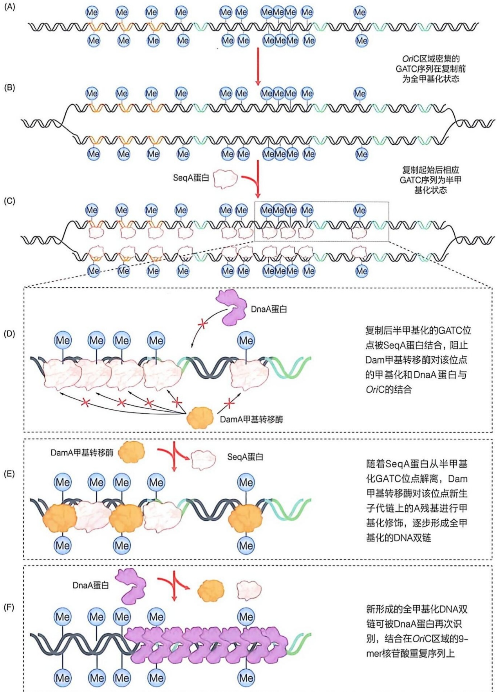

图 8-25 SeqA 与半甲基化 DNA 结合抑制复制起点的重新启动

图 8-26 快速生长的细胞中复制起点在细胞分裂前即可重新启动复制

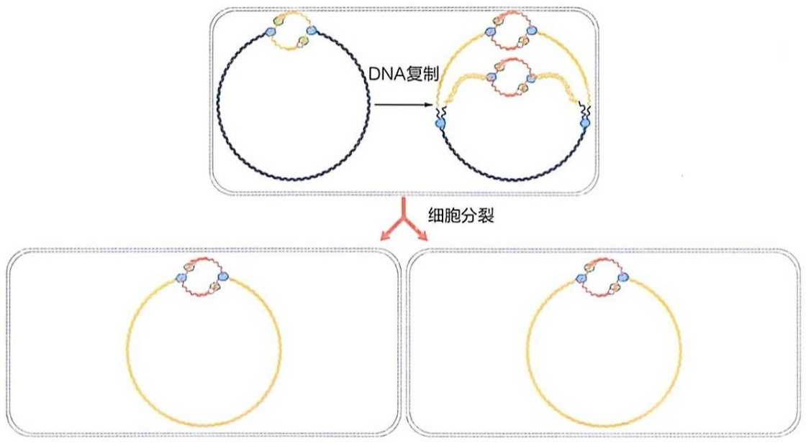

flowchart

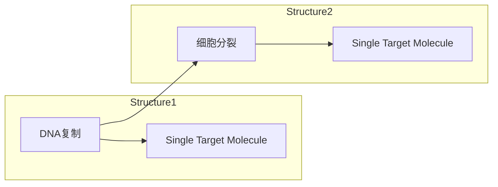

## 8.4.2 真核细胞中基因组 DNA 的复制在特定细胞阶段发生且每个细胞周期中只能复制一次

与大肠杆菌不同，真核细胞有明确的细胞周期，且细胞周期会明确划分为不同阶段。其中，DNA复制发生在真核细胞周期中的S期。在此期间，细胞中所有的DNA必须精确复制一次。一方面，一个复制周期中染色体任何部分的不完全复制都会导致子代染色体之间的不正常连接，连接染色体的分离可能导致染色体断裂或丢失。而另一方面，即使是极少量的真核DNA在一个细胞周期中的重复复制也会导致难以修复的DNA损伤，对其修复的尝试很可能引起相关的DNA扩增，进而可能导致相关基因表达的异常升高，这对于细胞的生存或增殖很可能是灾难性的。因此，真核细胞的每个细胞周期中，每个染色体中的每个碱基对都要复制且只能复制一次，这至关重要。对真核细胞来说，这无疑也是一个极大的挑战。下面介绍真核细胞如何精确控制其DNA的复制。

真核细胞复制起始与原核细胞一样的是，其也涉及起始蛋白对复制起点的识别和复制起点激活两个环节，但也有不同。在原核细胞中，复制起点的识别和DNA的解旋及聚合酶的招募是内在偶联的，即复制起始与否主要取决于复制起点上起始蛋白的结合。而在真核细胞中，复制起始区域上复制起始复合体的组装和起始位点的激活这两个环节发生在细胞周期的不同时期。

## （1）真核细胞复制起始复合体的组装

DNA复制发生于细胞周期的S期，复制后的姐妹染色单体分离发生在M期，但真核细胞复制起始相关的过程却是在S期前就已经开始。真核细胞的复制起始蛋白是一种被称为复制起点识别复合物（origin recognition complex，ORC）的六聚体复合物。ORC在细胞周期的 $G_{1}$ 期后期与染色质DNA结合。ORC在染色质DNA上的组装标识了 S 期可用于复制起始的位置。

ORC 与 DNA 结合后，Cdc6 蛋白与 ORC 结合。然后 ORC 在 Cdc6 和 Cdt1 两个分子的帮助下，将两个拷贝的微小染色体维持蛋白 2-7（Mcm2-7）复合物装载到 DNA 的双链上。Mcm2-7 复合物是一种环状六聚体，是后续发挥解旋活性的解旋酶复合物的重要组分。两个 Mcm2-7 复合物以头对头的二聚体形式，环绕包围在复制起点处的 DNA 上。这些事件仅发生在 G₁ 期，由此产生的 ORC、Cdc6、Cdt1 和 Mcm2-7 复合物称为复制前复合物（prereplication complex, preRC）（图 8-27）。

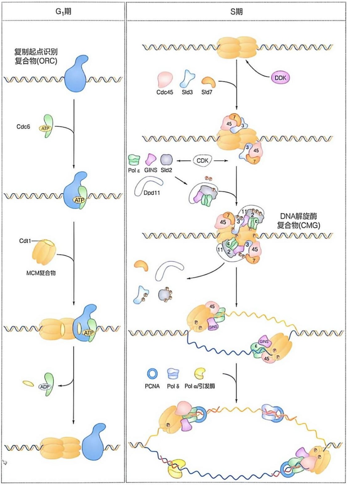

flowchart

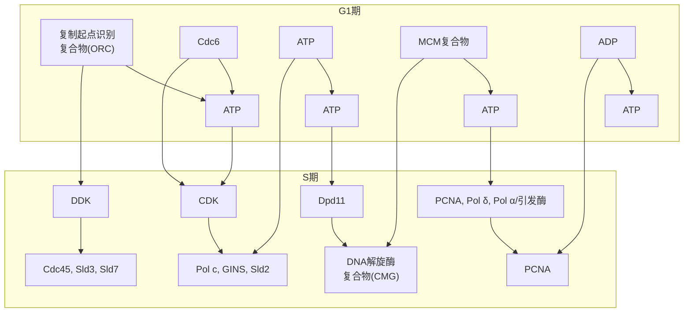

图 8-27 真核细胞复制起点上复制前复合物的组装及其激活过程示意图

## (2) 真核细胞复制起点的激活

preRC 的组装发生在细胞周期 $G_{1}$ 期，但 ORC 的结合与 Mcm2-7 的组装并不会自发地导致 DNA 解旋和 DNA 聚合酶的招募。preRC 组装后需要静待细胞周期进入 S 期后，才会被激活以解开 DNA 双链形成复制泡，进而招募 DNA 聚合酶启动 DNA 的复制。

细胞周期蛋白依赖性激酶（cyclin-dependent kinase，CDK）是细胞周期转换的关键激活因子。它们通过磷酸化特定蛋白质上的特定丝氨酸和苏氨酸残基，从而调控相关蛋白质的活性来推动细胞周期转换。进入S期后，两种重要的DNA复制起始相关激酶——CDK和DDK（Dbf4依赖性激酶）激活复制起点的复合物（图8-27）。DDK催化Mcm2-7复合物亚基磷酸化使两个Mcm2-7复合物相互分离。CDK则作用于另外两种参与复制的蛋白质Sld2/Sld3，使其磷酸化。磷酸化的Sld2和Sld3结合到Dpb11上，进一步招募Cdc45和GINS蛋白与Mcm2-7结合，组装形成具有解旋酶活性的DNA解旋酶复合物（Cdc45-Mcm-GINS helicase complex，CMG），Cdc45和GINS能够极大地激活Mcm2-7的ATP酶和解旋酶活性，其共同形成的CMG是真核细胞DNA复制过程中形成和维持复制叉的主要复合物。

虽然 Mcm2-7 最初是以头对头二聚体的形式装载在 dsDNA 周围，但在复制起点被激活后，单个 Mcm2-7 六聚体被认为环绕在复制叉处的 ssDNA 上。因此，在复制起点激活过程中，Mcm2-7 六聚体必须从每个解旋酶的中心通道中排出一条 DNA 单链，这个过程也需要破坏两个 Mcm2-7 复合物之间的相互作用。

对 preRC 装载和激活的调控使得在每个细胞周期中复制起点仅可被激活一次。真核细胞染色体 DNA 上含有数百甚至数千个复制起点，如何保证这些复制起点在一个细胞周期中仅可被激活一次？秘密就在于 CDK 对 preRC 的组装和激活所进行的严密调控。如上所述，解旋酶的装载和激活发生在细胞周期的不同阶段，而每个细胞周期仅发生一次解旋酶的装载和激活。在  $G_{1}$  期，细胞处于解旋酶的装载阶段，此时细胞内的 CDK 活性很低，允许解旋酶在复制起点上装载，但不激活。一旦进入 S 期，CDK 的活性升高，并激活  $G_{1}$  期装载的解旋酶。由于 CDK 在整个 S、 $G_{2}$  和 M 期内保持高活性的状态，所以在  $G_{1}$  期形成的 preRC 要么被激活，要么在 S 期 DNA 复制过程中被复制叉破坏。尽管 DNA 复制后，新生链上的复制起点可以迅速被 ORC 所识别，但高水平的 CDK 活性阻碍了复制起点上新的解旋酶的组装，无法形成 preRC（图 8-28）。解旋酶装载和激活的条件彼此不相容，因此，在每个细胞周期中，只有一次机会将解旋酶装载到复制起点（在  $G_{1}$  期），并且也只有一次机会激活已装载的解旋酶（在 S 期）。只有在细胞完成染色体的复制并随细胞分裂将其分离后，子代细胞进入 CDK 活性较低的  $G_{1}$  期时，复制起点上才能再次装载一组新的 Mcm 2-7 复合物。

需要特别说明的是，染色体 DNA 中的复制起点多而冗余，这意味着一轮复制中并非所有复制起点都需要激活才能完成复制。在胚胎发育的早期，当胚胎细胞快速增殖分裂时，绝大部分复制起点被激活。而随着胚胎发育成熟，细胞分裂减慢，这个阶段就不需要全部的复制起点都被激活，即一些复制起点被选择性地激活，而另一些则被抑制。细胞似乎能很好地平衡激活和抑制的复制起点的数量，因为如果激活的复制起点太少，基因组的某些区域将无法在一定的细胞周期时间内完成复制。对于生物体如何调控从最初大量激活复制起点到后续激活特定复制起点的机制尚不清楚，但这可能与染色质结构的变化以及起始蛋白与 DNA 的比例变化等有关。

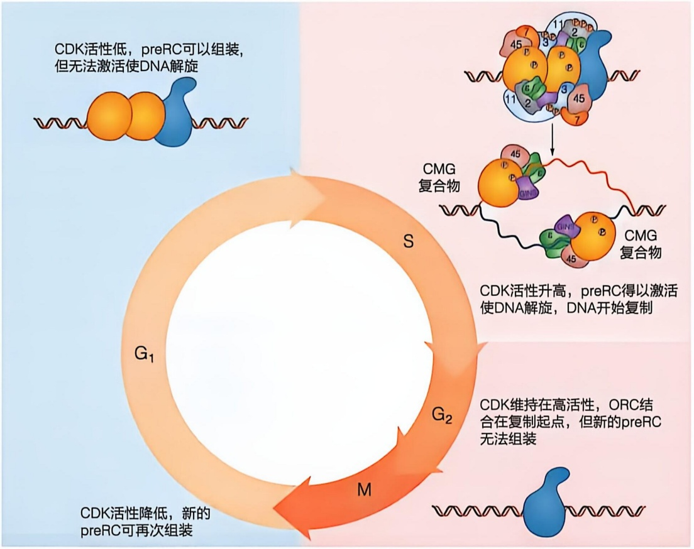

flowchart

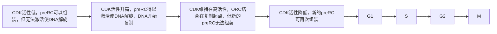

图 8-28 细胞周期依赖的 CDK 活性变化调控解旋酶的装载与激活

了解 DNA 复制的保真性是生物体遗传稳定性的关键所在，而其调控机制确保了遗传信息在正确的时期内完成复制过程，从而维护了细胞周期的正常运作和基因组的完整性。然而生命体在维持遗传信息稳定传递的同时，也会因 DNA 的损伤或通过遗传重组而导致不同程度的变异。下面两节将分别介绍 DNA 损伤修复和 DNA 遗传重组的分子机制，以及它们如何影响生物体的进化和适应性。

## 8.5 细胞内 DNA 可被多种因素损伤进而导致遗传突变

前面介绍了细胞如何通过精确的 DNA 复制将遗传信息传递给子代。当细胞增殖分裂时，染色体 DNA 被准确地复制，细胞内的遗传信息尽可能以最大的精确性和最小的错误率传递给下一代。尽管 DNA 聚合酶有严格的底物选择机制和校对功能，但在复制过程中仍会存在一定的错配概率。此外，尽管 DNA 是一种相对稳定的分子，但对它的损伤和破坏仍是不可避免的。生物体对氧气和水的依赖使细胞内的生物分子容易受到氧化和水解反应的攻击，包括DNA在内的各种生物分子都可因氧化和水解反应而被损伤。此外，环境中许多其他天然或人工合成的化学物质，以及各种类型的电磁辐射等物理因素也会造成DNA的损伤或破坏。

无论是外界因素造成的 DNA 损伤，还是 DNA 复制过程中的错误，通常都会被细胞很快修复，而未经及时修复的 DNA 损伤会对基因组的稳定性和完整性构成持续的威胁。DNA 复制和环境损伤而导致的遗传物质结构改变或信息错误是不可避免的。复制错误和 DNA 损伤可以引起 DNA 中遗传信息的永久改变，即突变（mutation），这会改变编码基因或其调控区域的序列。当突变发生在生殖系细胞或单细胞生物体内时，便具有了遗传性，即子代细胞或个体的 DNA 序列会发生改变。突变其实并不完全是绝对的坏事，事实上，某种频率的突变是产生变异所必需的，自然选择正是在这种变异体产生的基础上来推动生物进化的。然而，必须承认赋予细胞或机体特定优势的突变罕见。某些关键基因的突变对细胞或个体而言可能是灾难，积累了多种突变的细胞通常会死亡。癌细胞通常是积累了防止细胞死亡的突变，导致细胞周期控制的丧失和不受调节的细胞分裂。此外，DNA 损伤引起其化学结构的改变还可能导致 DNA 无法作为复制或转录的模板，阻碍复制或转录，对细胞功能和生存产生即刻且不可估量的影响。

## 8.5.1 物理化学因素可以导致 DNA 错配、插入、删除和断裂等不同形式的损伤

DNA 可以受到多种因素的损伤。细胞内正常代谢过程中产生的反应性化学物质会破坏 DNA，甚至是细胞内的水都可能通过水解作用造成 DNA 的自发损伤。此外，DNA 的高负电性也使其容易受到烷化剂和活性氧的亲电攻击，而多种活性氧分子也是存在于正常细胞内环境中的。外界环境中的多种物理和化学因素同样容易造成 DNA 的破坏，包括 X 射线和紫外线等在内的各种类型的辐射可以引起 DNA 的结构改变甚至是骨架链的断裂。同样，多种天然或合成的化学物质也可以直接损伤 DNA 或通过代谢间接产生能够损伤 DNA 的物质。我们把能够增加 DNA 突变频率的化学物质称为诱变剂（mutagen），把那些由外界物理或化学因素导致 DNA 损伤而产生的突变称为诱发突变（induced mutation）。不同因素引起 DNA 损伤的形式也可以大不相同，下面就一些常见的 DNA 损伤形式及可能导致这些损伤的因素进行介绍。

## (1) DNA 可因水解作用自发损伤

即使外界不存在任何有害因素，DNA也会由于水解造成自身的损伤。DNA水解可以导致核苷酸碱基的脱氨基，甚至是由糖苷键的水解而造成DNA脱碱基。

脱氨基作用是从化合物中除去氨基，所有含有氨基的分子都可能成为水解攻击的目标。DNA中有三种核苷酸——胞嘧啶、腺嘌呤和鸟嘌呤，它们的碱基中含有氨基，都可以通过水解作用发生脱氨基反应（图8-29）。

胞嘧啶的水解脱氨基作用是最常见和最重要的水解损伤。在正常生理条件下，胞嘧啶经历自发脱氨基作用，产生天然 DNA 中不存在的碱基尿嘧啶，尿嘧啶优先与腺嘌呤配对。因此，如果在复制前胞嘧啶脱氨基形成的尿嘧啶没有被修复，这个位点将在复制时由 C≡G 碱基对替换为 U=A 碱基对，形成 C≡G 到 T=A 的转换突变。然而，由于正常情况下 DNA 中并不存在尿嘧啶，尿嘧啶很容易被识别为异常位点而被修复。因而基因组 DNA 在长期演化中，细胞为了避免突变而在 DNA 中使用 T 而非 U。

在高等真核细胞中，约有 5% 的胞嘧啶残基会被甲基化形成 5-甲基胞嘧啶（5mC），这是一种与基因表达调控相关的 DNA 修饰。胞嘧啶甲基

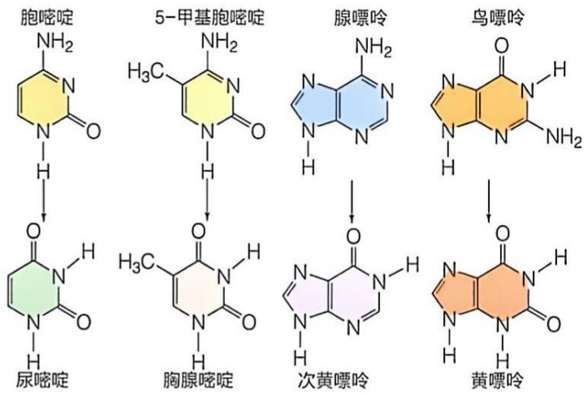

flowchart

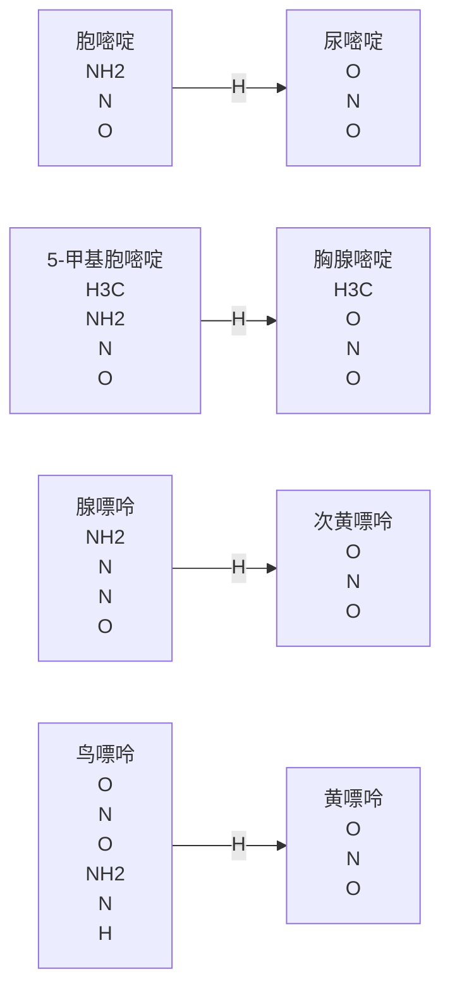

图 8-29 几种嘌呤和嘧啶的脱氨基产物

化最常见于 CpG 序列中的 C。CpG 序列的甲基化则会在 DNA 的两条链上对称地产生 5mCpG。5mC 的脱氨基作用产生的是 T 而不是 U。T 是 DNA 中天然存在的碱基，因而 5mC 脱氨基作用产生的 T 不会被认为是 DNA 中的异常碱基，但这会导致基因组该位点的碱基配对从 5mC-G 变为 T-G 的错配位点。

腺嘌呤和鸟嘌呤也可以发生脱氨基作用，但概率仅为胞嘧啶的百分之一。腺嘌呤和鸟嘌呤的脱氨基作用产物分别是次黄嘌呤和黄嘌呤，它们也是在天然 DNA 中不存在的核苷酸。次黄嘌呤会与胞嘧啶而不是胸腺嘧啶配对，而黄嘌呤仍可通过两个氢键继续与胞嘧啶配对。

除了碱基的水解脱氨基，另一个相对频繁的水解反应是水对核苷酸中碱基和戊糖之间的 $N-\beta-$ 糖苷键的攻击，这会导致核苷酸残基上整个碱基的丢失，从而留下一个去碱基的位点。嘌呤碱基的 $N-\beta-$ 糖苷键水解速度远高于嘧啶碱基（图8-30），嘌呤碱基被水解形成无嘌呤位点的过程又被称为脱嘌呤作用（depurination）。事实上，哺乳动物细胞中每天每 $10^{5}$ 个嘌呤中就有1个会因脱嘌呤作用而丢失（相当于每个细胞每天会产生10000个无嘌呤位点）。单链DNA中的无嘌呤位点使得复制时模板链中该位点的信息丢失，DNA聚合酶在遇到无嘌呤位点时常常会插入错误的核苷酸来形成子代DNA链，导致突变。此外，碱基丢失还容易引起DNA链部分自发解链，或使得DNA骨架链变得脆弱从而容易发生链的断裂。

## (2) 氧化、烷化及碱基类似物可导致碱基错配

在生理条件下，DNA 带有大量的负电荷，很容易受到烷化剂（alkylating agent）和活性氧（reactive oxygen species，ROS）（如过氧化氢、羟自由基和超氧自由基等）的亲电性攻击。

氧化损伤是 DNA 损伤的最常见类型，而碱基氧化最为普遍。羟自由基与嘌呤碱基和嘧啶碱基都可以发生反应。在嘧啶碱基中，C-5 和 C-6 之间的双键非常容易受到氧化攻击，而在嘌呤碱基中，其 8 位碳原子的氧化最为常见（图 8-31）。氧化后碱基与其原先配对的碱基不再完美互补。更糟糕的是，当其作为模板链进行复制时，这些氧化损伤的碱基很可能与错误碱基配对，从而改变子代DNA中该位点的遗传信息导致突变。

图 8-30 水解脱碱基形成的无嘌呤位点

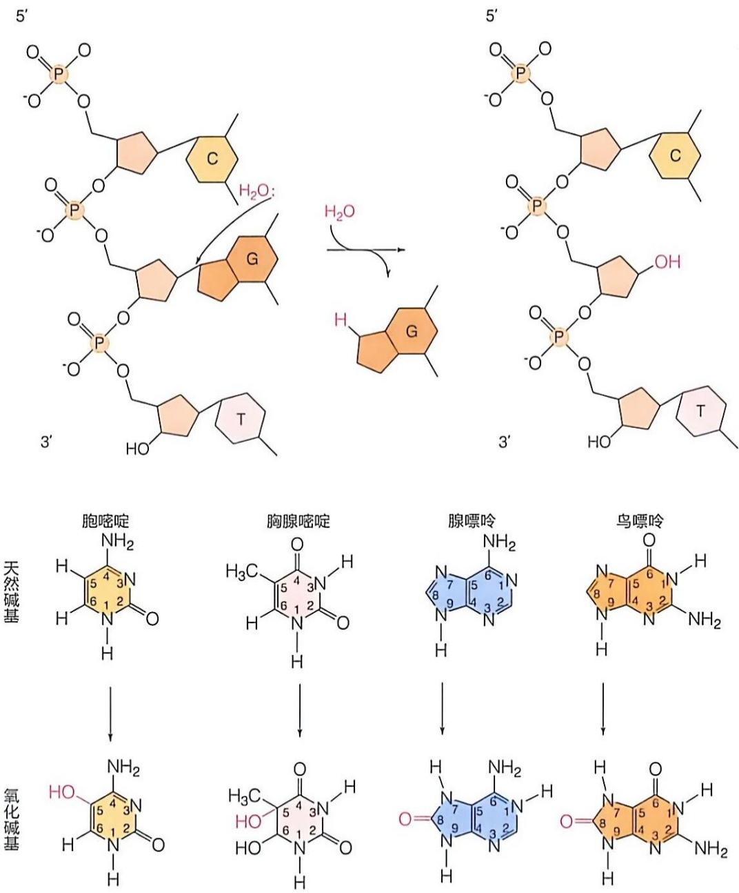

图 8-31 碱基的氧化损伤

氧化损伤也可以造成碱基脱氨基，亚硝酸诱导的氧化脱氨基就是最常见的例子。硝酸钠（$\mathrm{NaNO_3}$）是一种常见的食品防腐剂，但其在胃中可转化为亚硝酸（$\mathrm{HNO_2}$）。亚硝胺和硝酸盐也可转化为亚硝酸，亚硝酸作为诱变剂与A和C碱基反应，使其脱氨基分别转化为尿嘧啶和次黄嘌呤，改变其碱基配对能力（图8-32）。此外，用作食品防腐剂的亚硫酸氢盐（$\mathrm{HSO_3^-}$）也具有类似的作用，但使用浓度较低，对DNA损伤较小。

另一种容易引发碱基错配的因素是DNA的烷基化修饰。将烷基添加到核苷酸碱基或磷酸二酯骨架上的现象称为烷基化（alkylation）。碱基的烷基化，有些对碱基配对不产生任何影响，有些会完全妨碍烷基化碱基与另一个碱基的配对，这取决于烷基化位置和修饰的烷化基团的性质。根据烷化剂种类的不同，四种核苷酸碱基中的许多位置以及 DNA 的糖磷酸骨架都可以被修饰（图 8-33A），其中腺嘌呤的 N-3 和鸟嘌呤的 O6 是常见的烷基化位点。烷基化最脆弱的位点之一是鸟嘌呤 6 位碳原子上的酮基甲基化的产物——O6-甲基鸟嘌呤，通常与胸腺嘧啶发生错配，导致受损 DNA 复制时原本的 C≡C 碱基对变成 A=T 碱基对（图 8-33B）。

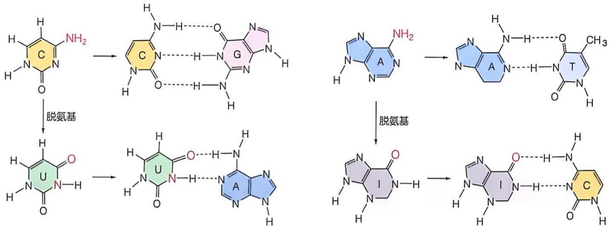

chemical

Chemical reaction pathway showing nucleophilic attack and deprotection steps for a heterocyclic compound

与特定碱基结构相似的一些碱基类似物也可以导致 DNA 错配，例如胸腺嘧啶的类似物——5-溴尿嘧啶。碱基类似物与正常碱基的结构非常相似，因而可以被细胞吸收转化为相应的核苷三磷酸，并在复制过程中被掺入 DNA 中。但是，这些碱基类似物与正常碱基之间仍存在一定的结构差异，这使得其作为模板时会形成错误的碱基对，导致遗传信息的改变。例如 5-溴尿嘧啶在配对时，溴取代基的存在使得其更易形成烯醇式互变异构体进而与鸟嘌呤配对（图 8-34）。这会使得原本的 T=A 碱基对变为 C≡G 碱基对。

图 8-32 亚硝酸诱导的 C 和 A 氧化脱氨基改变其碱基配对能力

图 8-33 碱基的不同烷基化位点和烷化损伤引起的错配

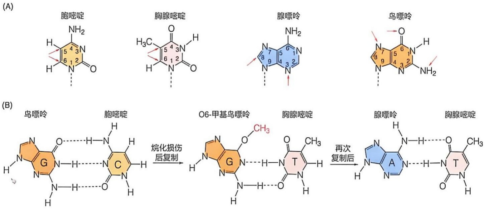

图8-34 碱基类似物5-溴尿嘧啶及其与鸟苷酸的配对结构

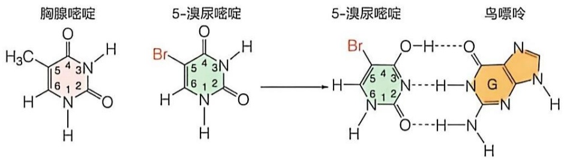

chemical

Chemical structures of three nucleotide analogs: thymidine, 5-methylaminobutyrate, and guanine

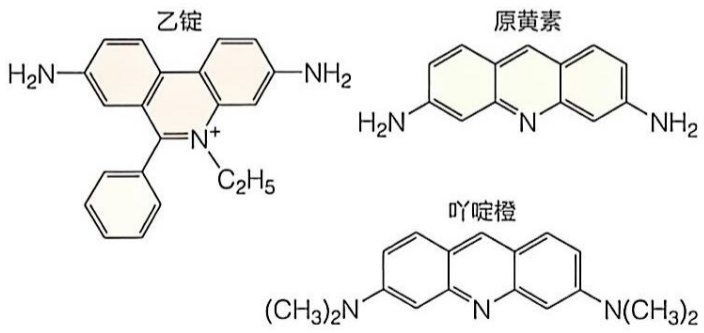

chemical

Three chemical structures: 乙锭, 原黄素, and 吖啶橙, each with a benzene ring and amine substituent.

图 8-35 常见嵌入剂乙锭、原黄素和吖啶橙的结构

## （3）嵌入剂导致碱基的插入或删除

除了引起 DNA 中碱基的错配之外，一些损伤 DNA 的因素还可引起碱基的插入或删除，其中与碱基对结构相似的嵌入剂就会导致这样的损伤。嵌入剂是具有多环结构的平面分子，其虽然并不像碱基类似物一样会被掺入 DNA 中，但它们可以通过这些多环平面与 DNA 中同样平坦的碱基平面相互作用，就像双螺旋中碱基对的堆积一样被嵌入碱基平面之间。乙锭、原黄素和吖啶橙等都是常见的嵌入剂（图 8-35）。复制

过程中嵌入剂的存在会导致一个或几个碱基对的缺失或增加。这可能是由于一个嵌入剂分子的插入大约会使两个碱基对之间的典型距离加倍，复制中嵌入剂在模板链中碱基之间的存在可以导致DNA聚合酶在嵌入剂分子的对面插入额外的核苷酸。此外嵌入剂分子引起的模板变形，也可能会使DNA聚合酶跳过模板链上的核苷酸，进而导致合成的子代链中缺失核苷酸。在基因的编码区出现一个或几个核苷酸的缺失或增加，可导致DNA的移码突变，将会对其所编码的mRNA的翻译产生极大的影响。

## (4) 辐射造成 DNA 相邻碱基的交联或骨架链的断裂

除化学物质可以造成 DNA 损伤之外，包括各种辐射在内的物理因素也会引起 DNA 结构和功能的改变。几乎所有形式的生命都会暴露于不同能量的辐射下，普通人也会接触到日光中的紫外线或者医学检查或治疗中使用的 X 射线。据估计，紫外线和其他电离辐射造成的 DNA 损伤约占环境因素所致 DNA 损伤的 10%。辐射除了可以通过产生 ROS 造成生物分子的氧化损伤之外，紫外线和以 X 射线为代表的电离辐射还可以通过不同的机制引起 DNA 损伤。

嘧啶二聚体（pyrimidine dimer）是同一条 DNA 单链上相邻的两个嘧啶碱基在紫外线的作用下共价交联形成的异常结构。紫外辐射可以诱导相邻的两个 T 残基之间形成环丁烷环（图 8-36），即胸腺嘧啶二聚体，导致双链 DNA 的结构畸变。含有嘧啶二聚体的 DNA 链在复制时不能再与另一个核苷酸进行碱基配对，因此 DNA 聚合酶在遇到嘧啶二聚体时会停止复制，这对细胞而言是致命的威胁。相邻的 T 残基或相邻的 C 残基还可以反应形成 6-4 光产物（6-4 photoproduct，6-4PP）（图 8-36）。尽管 6-4 光产物产生的概率较嘧啶二聚体的低，但近来的研究发现，其可以更有效地激活 DNA 损伤修复途径。

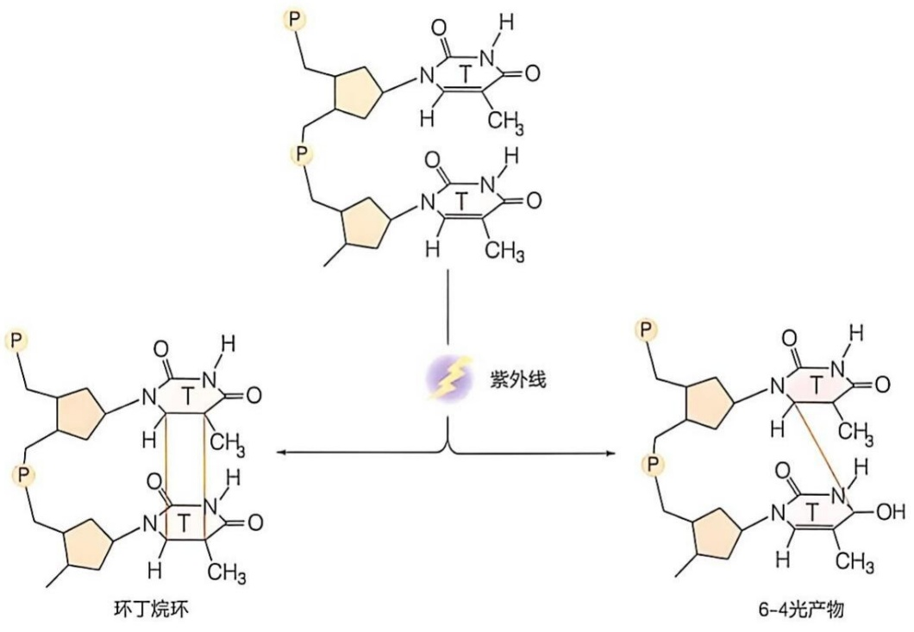

chemical

Chemical reaction diagram showing the synthesis of 6-4 fluorescent light from cyclohexane and pyridine derivatives via an ultraviolet excitation.

图 8-36 紫外辐射可以导致相邻的嘧啶碱基形成环丁烷环或 6-4 光产物

γ射线和X射线的光子能量远远高于紫外线，属于典型的电离辐射，它们不仅可以直接导致DNA单链或双链的断裂，还会通过活性氧的增加而损伤DNA。

## 8.5.2 未修复的 DNA 损伤可导致遗传突变、生物功能紊乱甚至死亡

DNA 损伤如果不被及时修复，会引起小到单个核苷酸位点，大到整个染色体片段的遗传突变，有一些突变可能不会带来明显的生物体表型变化，但严重的突变会导致生物功能的紊乱，甚至个体的死亡。

例如 5mC 脱氨基产生的 T，会使得基因组该位点从 5mC-G 变为 T-G 的错配位点。碱基对的错配可能成为一个过渡突变，如果其不能被有效识别并及时修复，在下一轮复制后，其中一个子代 DNA 中原来的 C≡G 碱基对就会突变为 T=A 碱基对。事实上，真核生物 DNA 中 5mC 残基确实是 DNA 自发突变的热点。又如，由鸟嘌呤氧化损伤产生的 8-氧代鸟嘌呤（8-oxoG）也具有极强的致突变性。如果 8-oxoG 不被及时修复，复制时其可以与 A 配对从而引起该位点的错配，这种错配在下一轮复制后会导致一条子代 DNA 中原来的 G≡C 碱基对发生颠换突变，形成 T=A 碱基对（图 8-37）。这种 G≡C 到 T=A 的颠换突变是人类癌症中最常见的突变。通常，人们可以采用艾姆斯试验对某种化学物质的诱变性或致癌性进行初步测试（知识延展 8-2）。

## (1) 点突变

上述这两个例子中所产生的突变都是简单的单个碱基的替换，这种单个碱基的替换又被称为点突变（point mutation）。点突变并非一定会导致表型或功能的变化，这要取决于点突变所发生的位置是否在关键的基因调控区域、是否改变功能 RNA 分子或

图 8-37 8-氧代鸟嘌呤复制中引起 G≡C 到 T=A 的颠换突变

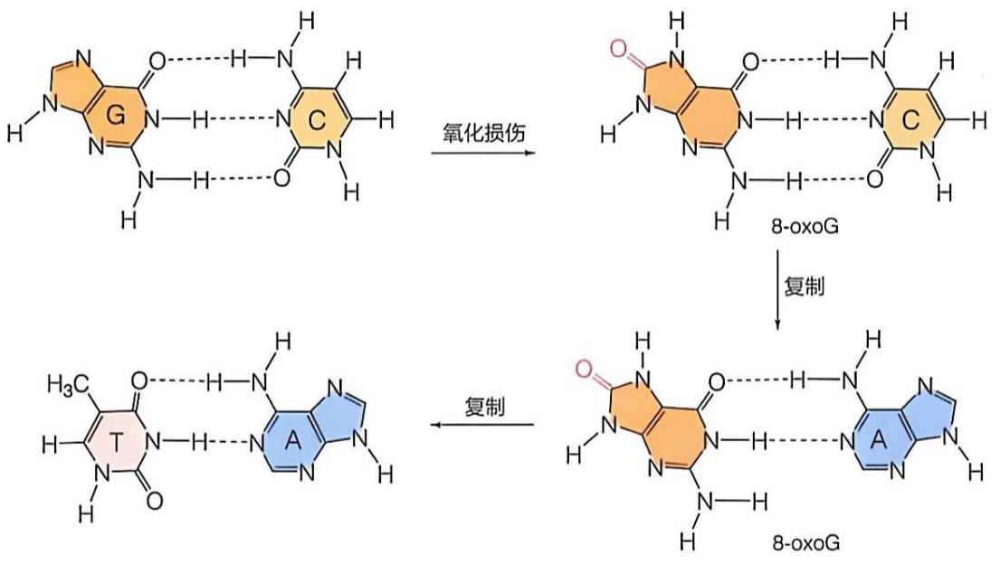

chemical

Chemical reaction pathway showing oxidation damage and replication of 8-oxoG derivatives

## 知识延展 8- 2

## 潜在致癌剂可通过艾姆斯试验测试其对细菌 DNA 的诱变效应

许多致癌剂都是通过诱变作用导致基因突变而致癌。自然界存在的或人工合成的化学物质不计其数，如何识别这些化学物质的诱变性或致癌性显得非常重要。直接用动物实验来研究和确定化学物质的潜在致癌作用无疑既耗时又昂贵。是否有更便捷的方法进行初步筛选呢？加州大学伯克利分校的布鲁斯·艾姆斯（Bruce Ames, 1928—2024）设计了一个简单的测试方法，即通过评估化学物质对鼠伤寒沙门菌的诱变能力来测试化学物质潜在致癌作用，这个技术又被称为艾姆斯试验（Ames test）。

艾姆斯试验采用一种鼠伤寒沙门菌营养缺陷型（auxotroph）菌株，该菌株在组氨酸生物合成途径中的突变使其需要在含有组氨酸的培养基中才能生长。在缺乏组氨酸的培养基上培养时，该组氨酸营养缺陷型的鼠伤寒沙门菌细胞不能存活。但由于自发突变的存在，极少数细胞可能获得功能上逆转原始突变的突变，具有这种回复突变（reverse mutation，或称为逆转突变）的细胞就可以合成组氨酸，并在不含组氨酸的培养基上存活下来，形成少量菌落（8-38A）。

利用这一性质可以进行潜在诱变剂与潜在致癌物的初步筛选。将待测化合物吸附在滤纸片上并放置在涂布有组氨酸缺陷型鼠伤寒沙门菌的培养基平板中心（8-38B）。由于某些化合物是在肝中羟基化后才具有诱变活性，因此根据需要也可以将待测化合物首先与肝提取物孵育反应后再用于艾姆斯试验。

滤纸片上吸附的化合物会扩散到周围的培养基中，在滤纸片周围形成一定的浓度梯度。该化合物在紧邻滤纸片的区域浓度最高，具有细胞毒性的化合物可以杀死细胞，从而在滤纸片周围形成一定大小的无细胞生长的致死区域（图8-38C）。在致死区域之外，具有诱变能力的化合物可以在一些细胞中诱导产生回复突变，从而观察到部分细胞生长形成菌落的现象。根据致死区域的大小、外围菌落生长区域的大小及形成菌落的个数可以判断该化合物的细胞毒性和诱变性。

艾姆斯建立的这种筛选技术为化学诱变剂提供了一种快速、廉价的检测方法。在艾姆斯试验中，大多数已知的人类致癌物都会导致回复突变增加。事实上，许多常见的工业化学品和天然产物在测试中也可以产生许多突变。因此，艾姆斯试验仅仅是一种初筛手段，通过艾姆斯试验发现的诱变剂还需要在动物中进一步测试，以确定其是否是真正的致癌物。

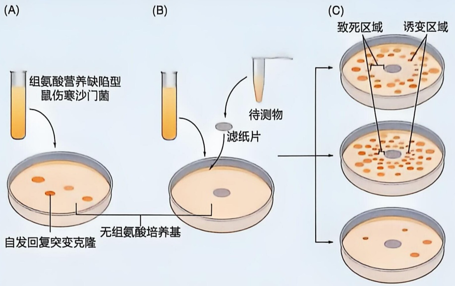

flowchart

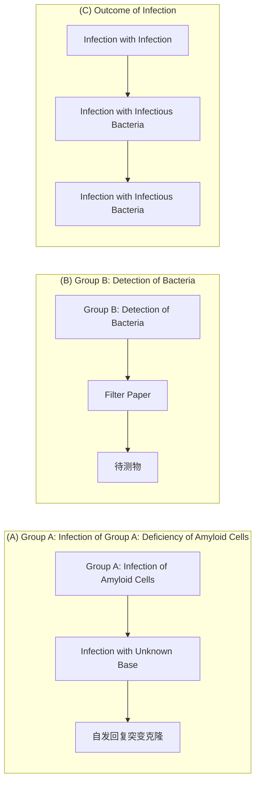

图8-38 基于艾姆斯试验检测化合物的致突变性

蛋白质编码区中的关键位点。根据蛋白质编码区的点突变对蛋白质序列和功能造成的影响，点突变又可以分为沉默突变、错义突变或无义突变。

## ① 沉默突变

蛋白质编码区的核苷酸发生替换后，不一定会改变编码蛋白质的氨基酸。这是因为氨基酸是由被称为密码子（codon）的三个连续排列的核苷酸所编码的，而许多氨基酸可以由不止一个密码子编码，这些编码同一个氨基酸的不同密码子称为同义密码子（synonymous codon）。当蛋白质编码区中的核苷酸替换后不改变其所编码的氨基酸时，即突变后的密码子与原密码子是同义密码子时，突变不会改变蛋白质产物的氨基酸序列，也不会对蛋白质产物的性质或生理功能造成明显影响，这种突变称为沉默突变（silent mutation）或同义突变。互为同义密码子的三联核苷酸通常前两位是相同的，第三位核苷酸可以不同，因此沉默突变通常发生在密码子的第三位核苷酸上。这种突变可以在子代保留，并以变异体基因或等位基因的形式出现在群体中，是形成蛋白质遗传多态性的主要原因。

## ② 错义突变

如果蛋白质编码区的核苷酸替换，导致原来编码某一氨基酸的密码子变为编码另一种氨基酸的密码子，相应地会引起蛋白质中该位点氨基酸的变化。这种可以引起编码蛋白质中氨基酸变化的核苷酸替换称为错义突变（missense mutation）。不同的氨基