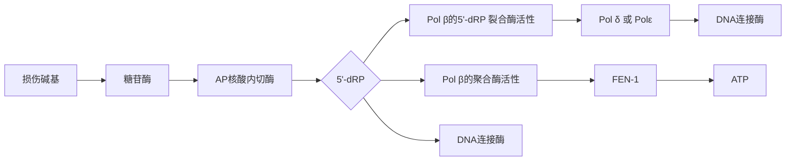
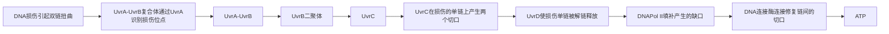
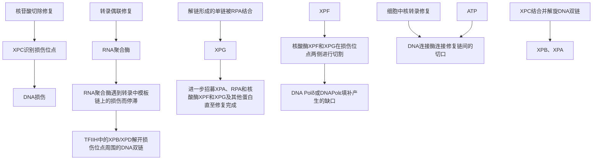
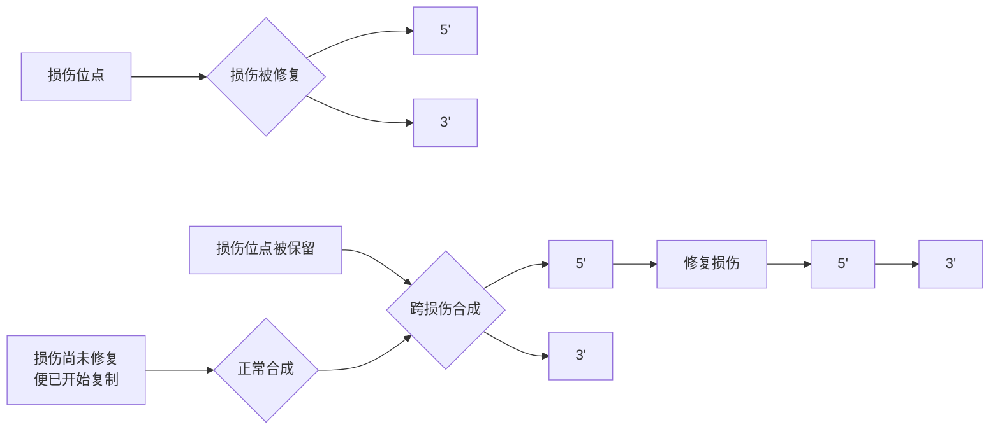
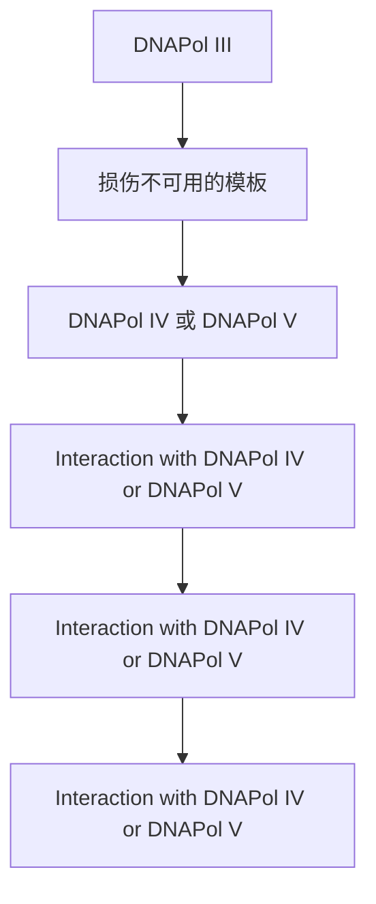
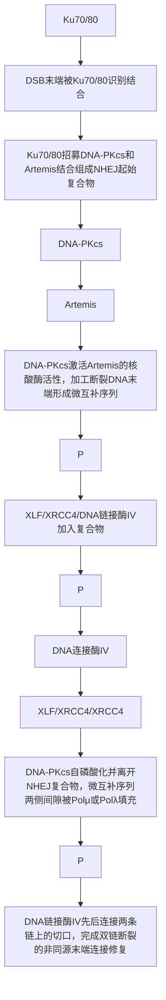
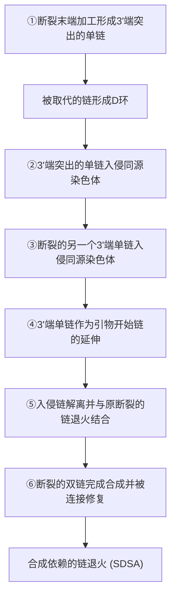

酸之间可能性质相似，也可能性质迥异，若突变密码子所编码的氨基酸正好与原密码子所编码的氨基酸性质相似，那么很可能突变后蛋白质的性质和生理功能不会发生明显的改变，此时错义突变不产生表型上的结果。但是在更多情况下，突变密码子所编码的氨基酸与原密码子所编码的氨基酸性质迥异，可能对所编码的蛋白质产物的结构或功能造成极大影响，导致该蛋白质失活或持续激活，造成有害甚至致死性的后果。错义突变的一个典型例子是镰状细胞贫血症。镰状细胞贫血症中血红蛋白编码基因中T到A的颠换使多肽链第6位谷氨酸突变为缬氨酸（E6V），这两个氨基酸的性质具有较大差异:谷氨酸带有极性的亲水侧链，而缬氨酸是疏水性氨基酸。在正常氧浓度条件下，该突变对血红蛋白形成高级结构的影响不大；但在低氧条件下，脱氧血红蛋白暴露出的一些疏水区域可与缬氨酸相互作用，使异常血红蛋白聚集成纤维状。

## ③ 无义突变

如果蛋白质编码区的核苷酸突变使得本来编码氨基酸的密码子变成终止密码子，其转录出的 mRNA 被翻译到此突变位点时提前终止蛋白质的合成，造成截短的蛋白质产物，这种由于碱基对的改变而使决定某一氨基酸的密码子变成一个终止密码子的突变称为无义突变（nonsense mutation）。其中密码子改变为 UAG 的无义突变又称琥珀突变（因其发现者的姓伯恩斯坦（Bernstein）在德语中意为“琥珀”而得名），密码子改变成 UAA 的无义突变又称赭石突变。无义突变会导致蛋白质合成过程中被过早终止，剩余的多肽片段几乎总是缺失正常生理功能的。因此，无义突变通常是有害的，其产生的表型结果也往往较为恶劣。

## (2) 核苷酸的插入或缺失可以导致移码突变

嵌入剂的存在或复制中 DNA 聚合酶在模板上的滑动可能会造成一个或多个碱基对的插入或缺失。一个或多个碱基对添加到野生型序列中的突变称为插入突变 (insertion mutation)，而一个或多个碱基对的丢失引起的突变称为缺失突变 (deletion mutation)。

在讨论这类插入或缺失突变对功能产物，特别是蛋白质合成的影响之前，我们需要先知道，当基因被转录形成成熟的 mRNA 后（真核细胞的基因转录后需要进行剪接去除内含子才能形成成熟的 mRNA），蛋白质中的氨基酸序列是由一系列连续排列的密码子编码的。蛋白质的编码区以起始密码子 AUG 开始，以三个终止密码子（UAA、UAG、UGA）之一结束，从起始密码子到终止密码子的 DNA 序列称为一个开放阅读框（open reading frame, ORF）（8-39A）。密码子要以三联体的形式进行解码，可想而知，蛋白质编码序列中一个或两个核苷酸插入或缺失的突变会导致突变位点后开放阅读框的混乱，从而导致突变位点下游的所有氨基酸序列发生改变，这种情况称为移码突变（frameshift mutation）（8-39B）。移码突变通常会产生一个截短的蛋白质，特别是当基因较大且突变发生在野生型编码序列靠近 5' 端时，这种移码突变常会导致蛋白质功能丧失。

text_image

(A) 以ATG作为起始密码子，TAG作为终止密码子的开放阅读框
ATG AGT TCC GTA GCT TTT AGT GTA AGT GAG GTA AGG AGT CCC TAG
Met Ser Ser Val Ala Phe Ser Val Ser Glu Val Arg Ser Pro 终止密码子
核苷酸插入或缺失的位点
(B)
缺失一个G ATG AGT TCC GTA CTT TTA GTG TAA GTG AGG TAA GGA GTC CCT AG
Met Ser Ser Val Leu Leu Val 终止密码子
缺失AG ATG AGT TCC GTC TTT TAG TGT AAG TGA GGT AAG GAG TCC CTA G
Met Ser Ser Val Phe终止密码子
插入一个A ATG AGT TCC GTA AGC TTT TAG TGT AAG TGA GGT AAG GAG TCC CTA G
Met Ser Ser Val Ser Phe 终止密码子
插入AG ATG AGT TCC GTA AGG CTT TTA GTG TAA GTG AGG TAA GGAGTC CCT AG
Met Ser Ser Val Arg Leu Leu Val 终止密码子

图 8-39 1\~2 个核苷酸的插入或缺失会导致移码突变

## 8.6 细胞内存在多种 DNA 损伤修复系统

为了解决 DNA 损伤的问题，细胞面临着双重挑战:一方面，细胞必须能够及时监测和发现 DNA 合成的错误或受到的损伤；另一方面，它需要能够修复错误或损伤的 DNA，尽可能恢复其原始序列信息。随着生物演化，细胞发展出多种 DNA 修复系统。大多数 DNA 修复过程在不同物种中都相对保守，细菌、古菌和真核细胞的主要 DNA 修复途径较相似。然而，真核细胞的 DNA 修复的确在许多方面不同于细菌的 DNA 修复。本节将介绍针对 DNA 复制错误或不同类型 DNA 损伤的修复系统和修复过程。

## 8.6.1 DNA 复制中的错配主要通过错配修复系统进行纠正

引起核苷酸发生错配的原因之一是 DNA 复制过程中引入的错误核苷酸，尽管 DNA 聚合酶具有校对功能，但不能保证万无一失。如果一些错误掺入的核苷酸逃脱校对，成为子代 DNA 中的错配位点且在下一轮复制前没有被检测到并被纠正的话，那么在第二轮复制时，错误掺入的核苷酸将作为模板链的一部分指导与其互补的核苷酸掺入新合成的链中，后果是该位点上核苷酸序列的变化将永久留存在基因组中。所幸生物体进化出了一套专门用于检测复制后逃过校对机制的错配位点，并修复它们的错配修复系统（mismatch repair system, MMR）。从 E. coli 到人类，错配修复机制的基本特征都较为保守。这套修复系统会在一轮复制后到下一轮复制前扫描整个基因组来寻找碱基错配位点，然后准确地纠正错配的核苷酸。由于错配修复系统的存在，DNA 合成的精确性可以在校对后再提高 2\~3 个数量级，达到十亿到百亿分之一的出错率。错配修复系统需要在 DNA 复制后快速发现并修复基因组中的错配位点。同时，错配修复系统还必须确保替换的是新合成链中错误掺入的核苷酸，而不是亲本链中正确的核苷酸。错配修复系统的缺陷会导致细胞基因突变率增加和对某些癌症的易感性增加。

在 $E.$ coli中，错配修复系统主要由MutS二聚体、MutL和MutH组成，其中MutS二聚体负责检测DNA上的碱基错配位点。碱基错误配对会引起DNA骨架链扭曲变形，MutS则通过扫描DNA双链骨架的局部扭曲变形而找到它们（图8-40A、B）。由于错配的DNA比正确配对的DNA更容易扭曲，MutS二聚体与错配位点结合后会通过自身构象的改变诱导DNA产生一个明显的纽结。此时MutS二聚体能够与错配修复系统中的 MutL 结合（图 8-40C），进而 MutS-MutL 复合物利用其 MutS 的 ATP 酶活性水解 ATP 提供能量向两侧扫描 DNA（图 8-40D）。当 MutS-MutL 复合物遇到基因组中复制后形成的半甲基化 GATC 位点时，招募并激活 MutH 蛋白（图 8-40E）。MutH 是一种位点特异性内切酶，可切割半甲基化 GATC 位点上未被甲基化的子代 DNA 链。在链断裂后，MutS-MutL 招募特异的 DNA 解旋酶 II（UvrD）从切口位点开始向碱基错配位点解开 DNA 双链，核酸外切酶进而将解旋的单链降解，直到越过错配位点（图 8-40F）。根据 MutH 产生切割的半甲基化 GATC 位点与错配位点的相对位置，具有 $5' \rightarrow 3'$ 或 $3' \rightarrow 5'$ 方向活性的核酸外切酶会降解错配的子代链。要注意的是，在碱基错配修复过程中，所消化的核苷酸并不仅仅只有错配位点的核苷酸。核酸酶会将从错配位点附近的 GATC 半甲基化位点到包含错配核苷酸在内的一段 DNA 切除。这个过程产生了一个从切口到错配位点之间的 DNA 单链的缺口，形成的单链间隙首先会被 SSB 包裹，再由 DNA Pol III 填充，并最终被 DNA 连接酶连接成完整的一条链，从而完成对错配核苷酸的修复（图 8-40G、H）。

图 8-40 E. coli 的错配修复系统对复制产生的错配位点的修复过程

```mermaid
graph TD
  subgraph A["(A) MutS"]
  A1["MutS"] --> A2["MutS"]
  A2 --> A3["MutL"]
  end

  subgraph B["(B) MutS"]
  B1["MutS"] --> B2["MutL"]
  B2 --> B3["MutH"]
  B3 --> B4["GATC"]
  B4 --> B5["CTAG"]
  B5 --> B6["CH3"]
  end

  subgraph C["(C) MutL"]
  C1["MutL"] --> C2["MutH"]
  C2 --> C3["GATC"]
  C3 --> C4["CTAG"]
  C4 --> C5["CH3"]
  end

  subgraph D["(D) MutH"]
  D1["MutH"] --> D2["GATC"]
  D2 --> D3["CTAG"]
  D3 --> D4["CH3"]
  end

  subgraph E["(E) MutH"]
  E1["MutH"] --> E2["GATC"]
  E2 --> E3["CTAG"]
  E3 --> E4["CH3"]
  end

  subgraph F["(F) MutH"]
  F1["MutH"] --> F2["GATC"]
  F2 --> F3["CTAG"]
  F3 --> F4["CH3"]
  end

  subgraph G["(G) DNA Pol III"]
  G1["DNA Pol III"] --> G2["GATC"]
  G2 --> G3["CTAG"]
  G3 --> G4["CH3"]
  end

  subgraph H["(H) DNA连接酶"]
  H1["DNA连接酶"] --> H2["GATC"]
  H2 --> H3["CTAG"]
  H3 --> H4["CH3"]
  end
```

flowchart

在错配修复过程中，E. coli 是通过利用基因组中 GATC 序列在复制后短暂的半甲基化特性，来判断碱基错配位点的两条 DNA 链中哪一条是存在错误掺入核苷酸的新合成链。错配修复系统的修复与 DNA 的复制同期进行。那些半甲基化状态的 GATC 序列可以被具有内切酶活性的 MutH 结合，并且只有当 MutH 与识别了碱基错配位点的 MutS 二聚体和 MutL 接触时，其内切酶活性才会被激活，选择性地切割没有被甲基化的子代 DNA 链，这样就保证了被修复的是含有配错的核苷酸的子代链。当 DNA 复制完成后，基因组中 GATC 序列可以逐步被甲基化酶 Dam 甲基化。当 Dam 将子代 DNA 链上 GATC 序列中的 A 全部甲基化后，错配修复系统就无法再进行有效的修复了。

就能量消耗而言，错配修复对于大肠杆菌来说是一个昂贵的过程。有的错配位点与 GATC 位点之间的距离很远，甚至超过 1 000 bp。为了修复一个错误配对的核苷酸，降解并重新合成这么长的 DNA 链无疑需要消耗很多 dNTP。但相对于发生突变而言，这个代价还是可以接受并且值得的。在所有细胞中都存在这样一个高成本的修复系统也很好地说明了维持基因组 DNA 序列的稳定对细胞的重要性。

除错配的核苷酸之外，大肠杆菌错配修复系统还可以识别复制过程中由模板滑动造成的4 bp以下的未配对核苷酸小环。这些模板滑动形成的DNA小环可以导致缺失或插入的突变。错配修复系统无法识别超过4 bp的更大的环，同时目前尚未发现有其他机制来识别这样的错误。E. coli中参与错配修复的蛋白质汇总见表8-1。

表 8-1 E. coli 中参与错配修复的蛋白质汇总表

| 参与蛋白质 | 主要功能 |
| --- | --- |
| MutS | 识别单碱基错配位点 |
| MutL | 与 MutS 结合辅助修复 |
| MutH | 切割半甲基化 DNA 位点 |
| DNA 解旋酶 II UvrD | 解旋 DNA |
| SSB | 结合未损伤的单链 |
| 核酸外切酶 I /X | 3'→5'方向核酸外切去除 |
| 核酸外切酶VII/RecJ | 5'→3'方向核酸外切去除 |
| DNA 聚合酶III全酶 | 填补修复切除产生的缺口 |
| DNA 连接酶 | 将 DNA 链切口连接完整 |

在真核细胞中，对错配核苷酸的修复机制和酶系与原核细胞类似，但似乎只有MutS和MutL蛋白的同源物被保留下来（表8-2）。真核细胞MutS同源物以异二聚体形式发挥作用，不同的异二聚体功能有所差异。例如，在酵母中，MSH2-MSH6的异二聚体通常识别单个碱基对的错配并与之结合，而与稍长的错配环的识别结合则是由MSH2-MSH3异二聚体完成的。真核细胞MutL的同源物MLH1-PMS1也是一种异二聚体，与MutS同源物结合。

表 8-2 酵母和人类的错配修复蛋白

<table><tr><td>酵母</td><td>人类</td><td>主要功能</td></tr><tr><td>MSH2/MSH6</td><td>MSH2/MSH3</td><td>MutS/L/H</td></tr><tr><td>MSH2/MSH3</td><td>MSH2/MSH3</td><td>DNA糖苷酶</td></tr><tr><td>MLH1/PMS1</td><td>MLH1/PMS2</td><td>DNA光解酶</td></tr><tr><td>MLH1/MLH2</td><td>MLH1/MLH2</td><td>UvrA/B/C/D</td></tr><tr><td>MLH1/MLH3</td><td>MLH1/MLH3</td><td>RecA重组酶;Ku70/80-Artemis</td></tr><tr><td colspan="2">RPA</td><td>结合未损伤的单链</td></tr><tr><td colspan="2">核酸外切酶I</td><td>5&#x27;→3&#x27;方向核酸外切去除</td></tr><tr><td colspan="2">DNA聚合酶/PCNA</td><td>填补修复切除产生的缺口</td></tr><tr><td colspan="2">DNA连接酶</td><td>将DNA链切口连接完整</td></tr></table>

尽管真核细胞在错配位点的识别方面与细菌非常相似，但在选择哪条链进行切割修复的问题上两者却有很大差别。真核细胞中缺乏细菌MutH和Dam的同源物，也不通过识别DNA的甲基化状态来区分新旧链。在真核生物中，新旧链的区分主要依赖于后随链上冈崎片段间尚未完成连接的缺口。真核细胞中冈崎片段的长度较短，为$100\sim 200\mathrm{bp}$，因此未完成连接的冈崎片段间的缺口在后随链上很常见。真核细胞的错配修复系统可以以错配位点附近的冈崎片段间的缺口为起点，将存在错配核苷酸的新链水解切除，然后通过聚合酶填补单链缺口并最终完成连接，就像在细菌错配修复中一样。上述方式在解释真核生物如何利用缺口来区分后随链上的新旧DNA链是有效的，但对于连续合成的前导链上存在的错配位点并不适用。关于前导链中如何识别错配位点，并在新生链上产生缺口的机制仍不是十分清楚。但最近的研究表明，与细菌 MutL 不同，人类 MutL 同系物具有依赖于 PCNA（真核细胞中的滑动夹）的内切酶活性，这显示出新生链上缺口的产生可能与 DNA 复制相协调。PCNA 有明显的 “正面” 和 “背面”，复制过程中 PCNA 与 DNA 结合后的方向可能会将核酸内切酶的定位指向新合成的链。

无论是利用后随链上冈崎片段间的缺口，还是在前导链上产生的切口，核酸外切酶 EXO1 会从切口开始消化掉切口到错配位点之间的一长段含有错配核苷酸的新生 DNA 链。后续填补 DNA 单链缺口的任务由 DNA 聚合酶 δ 在滑动夹 PCNA 和复制因子 C（RFC）的协助下完成。最终，DNA 连接酶 I/IV 将修复合成的 DNA 片段与相邻 DNA 单链连接，完成错配位点的修复。

真核细胞的错配修复系统也负责修复复制过程中由于模板滑动而引起的错误。基因组中常存在大量短重复序列构成的微卫星 DNA，这些区域在复制中很可能会发生模板链的滑动，导致复制后新合成的子链与模板链配对时形成部分突起的单链环（图 8-41）。如其未被修复，会导致重复序列的扩张。这些突起的单链环也是被真核细胞的错配修复系统所识别并进行修复的。

## 8.6.2 碱基切除修复机制依赖 DNA 糖苷酶和无碱基位点内切酶等的作用

除了 DNA 复制中的错配问题需要被纠正，细胞中的 DNA 还会面临自发的或者是环境中物理或化学因素对其的损伤，这些不同类型的损伤也需要通过不同的方式进行修复。细胞中存在一系列各具特色的修复系统来应对不同类型的 DNA 损伤。其中，比较常见的方式是通过切除修复系统将受损的核苷酸从 DNA 中移除。切除修复又包括碱基切除修复（base excision repair，BER）和核苷酸切除修复（nucleotide excision repair，NER），是细胞内清除DNA中受损核苷酸最普遍的方法，在修复DNA碱基损伤、嘧啶二聚体及碱基类似物嵌入等类型的DNA损伤中均可发挥作用。碱基切除修复和核苷酸切除修复的名称，很容易让人误解为碱基切除修复只是切除受损位点的碱基，核苷酸切除修复是切除损伤的核苷酸，然而事实并非如此。这两种切除修复系统在发挥功能时都涉及对受损位点糖磷酸骨架的水解。那么这两种切除修复系统有什么不同呢？它们能否相互取代呢？

flowchart

图 8-41 真核错配修复系统对模板滑动形成的单链小凸起环的识别与修复

碱基切除修复系统通常通过检测受到特定损伤的碱基来识别要修复的对象，其主要作用于单个的存在损伤的碱基，但对 DNA 双螺旋结构不造成显著扭曲的位点。此外，BER 也是修复缺乏可连接接头的单链 DNA 断裂的主要途径。

碱基切除修复由一组称为DNA糖苷酶（DNA glycosylase）的酶识别受损碱基。DNA糖苷酶可以水解受损碱基和脱氧核糖之间的 $N - \beta-$ 糖苷键，从而使碱基从DNA骨架上脱落，留下一个无碱基位点。这里需要注意的是，后续的修复过程并非将正确的碱基直接添加到这个无碱基位点来实现。由糖苷酶切除受损碱基留下的无碱基位点和由DNA自发水解形成的无碱基位点一样，都会被AP核酸内切酶（apurinic/apyrimidinic endonuclease）识别，并在无碱基位点处的戊糖 $5^{\prime}$ 端进行切割，产生一个带有 $3^{\prime}$ 羟基和 $5^{\prime}$ 脱氧核糖磷酸（$5^{\prime}-\mathrm{dRP}$）的缺口。在大肠杆菌中，这个缺口会被DNA Pol I的缺口平移活性移除，再由DNA连接酶将最终的切口连接起来，形成完整的DNA链从而完成修复（图8-42）。

真核细胞的BER中，前两步由糖苷酶切除受损碱基形成无碱基位点和由AP核酸内切酶在无碱基位点切割糖磷酸骨架链的步骤与细菌相同。但在后续的  $5'$  脱氧核糖磷酸的去除和空缺的填补上有两种不同的方式——短补丁修复（short patch repair，单个核苷酸残基位点缺失的修复）和长补丁修复（long patch repair，2～10个核苷酸残基切除的修复）（图 8-43）。

图8-42 E.coli中的碱基切除修复

flowchart

图 8-43 真核细胞中的碱基切除修复

真核细胞的长补丁碱基切除修复与细菌中的 BER 类似。糖苷酶切除受损碱基后，AP 核酸内切酶在无碱基位点的  $5'$  端产生切口。然后，DNA Pol δ 或 DNA Pol ε 以及 PCNA 在此合成一段 2～10 个核苷酸的片段。由于 DNA Pol δ 或 DNA Pol ε 并不像 E. coli 中的 DNA Pol I 一样具有  $5' \rightarrow 3'$  核酸外切酶的作用，因此不能形成切口平移，这一段包含  $5'dRP$  的瓣状 DNA 单链可以通过翼式内切酶 FEN-1 切除。最后，DNA 连接酶 I 会将修复后的 DNA Pol 新合成链  $3'$  端和下游 DNA 链  $5'$  端的核苷酸连接起来，从而完成长补丁修复。

短补丁修复是真核生物碱基切除修复过程中使用最多的修复方式。糖苷酶切除受损碱基后，AP内切核酸内切酶同样在无碱基位点的5'端产生切口，但在无碱基位点的3'端，可以由糖苷酶相关的β-裂合酶在此产生切口，将无碱基位点的糖磷酸基团切除下来，形成仅去除了一个核苷酸残基的缺口。然后，DNA Pol β会在这个单核苷酸缺口的3'端填补上一个新的正确的核苷酸。有趣的是，DNA Pol β也具有5'-dRP裂合酶活性，能够除去5'-dRP的部分，即在AP核酸内切酶切割无碱基位点的5'端后，可由DNA Pol β直接去除5'-dRP而不需要糖苷酶相关的β-裂合酶去除无碱基位点的糖磷酸基团。除Pol β外，其他几种低保真DNA聚合酶，如Pol 1和Pol λ也可以参与真核生物的碱基切除修复。这些酶都具有5'-dRP裂合酶活性。在糖苷酶去除碱基和AP核酸内切酶切割主链后，这些低保真聚合酶去除5'-dRP并填补缺口。由于合成的DNA长度很短（通常只有一个核苷酸），突变频率被最小化。当单核苷酸缺口被DNA Pol β或其他聚合酶填充后，DNA连接酶Ⅲ（XRCC1复合物）将新添加的核苷酸残基的3'端和下游DNA链5'端的核苷酸连接起来，形成完整的DNA链，从而完成修复。

## 8.6.3 核苷酸切除修复机制涉及一段包含被损伤碱基 DNA 单链的切除和重新合成

除了碱基切除修复系统，另一种相对更为直接的切除修复系统是核苷酸切除修复（nucleotide excision repair，NER）系统。

与碱基切除修复系统不同，核苷酸切除修复系统不识别任何特定种类的损伤核苷酸或碱基，其所识别的目标是损伤导致的 DNA 双螺旋结构的扭曲和畸变，如胸腺嘧啶二聚体、6-4 光产物或碱基上的大体积加合物引起的 DNA 结构扭曲。这些扭曲的结构会触发核苷酸切除修复系统将包括损伤位点在内的一段短单链 DNA 切除。NER 系统的核酸切除活性较为特殊，是在一条 DNA 单链上产生两个切口，切除损伤位点及其两侧的几个核苷酸，这种独特的核酸酶活性也被称为切除核酸酶（excinuclease）。NER 所产生的单链缺口再进一步由 DNA 聚合酶以未受损伤的链为模板进行填充，并由 DNA 连接酶连接从而恢复原始的核苷酸序列。

在 E. coli 中，核苷酸切除修复主要由四种蛋白质完成:UvrA、UvrB、UvrC 和 UvrD。首先，UvrA 与 UvrB 结合形成蛋白复合物共同扫描 DNA，其中 UvrA 负责检测 DNA 双螺旋结构中的扭曲位点。检测到扭曲位点后，UvrA 从 UvrA-UvrB 蛋白复合物中解离下来，留下 UvrB 二聚体将损伤位点附近的 DNA 解旋产生单链，并进一步招募 UvrC。UvrC 在损伤位点所在的单链上切割产生两个切口:一个位于损伤位点 3' 端 4 或 5 个核苷酸处，另一个位于损伤位点 5' 端 8 个核苷酸处。UvrC 在这两个位置的切割产生了一条包含损伤位点的 12～13 个核苷酸残基长的 DNA 单链。在 DNA 解旋酶 UvrD 的作用下，包含损伤位点的 DNA 单链被解离并释放，这会在染色体中形成一段 12～13 个核苷酸的间隙缺口。这个缺口进一步被 DNA Pol I 填补并被 DNA 连接酶连接（图 8-44）。

图 8-44 大肠杆菌中核苷酸切除修复过程

真核细胞NER的原理与大肠杆菌的非常相似，但其机制更为复杂。人类细胞

flowchart

中 NER 的主要参与因子是在对一种遗传性的着色性干皮病（xeroderma pigmentosum, XP）的研究中发现的，患有 XP 的人因暴露在阳光下而患皮肤癌的可能性要比正常人高几千倍。对这些患者的研究已经确定了至少 7 种不同的基因，这些基因的编码产物都参与 NER，其中任何一种基因产生缺陷，都会导致 XP。

真核细胞 NER 过程中负责检测识别损伤位点的是 XPC 蛋白，其作用类似于细菌中的 UvrA。XPC 识别损伤位点，启动修复过程，损伤位点周围的 DNA 双链在 XPA、XPB 和 XPD（相当于大肠杆菌中的 UvrB）的作用下解链，形成的单链被真核细胞单链结合蛋白 RPA 结合，进而在损伤位点的两侧分别招募两个核酸酶 XPF 和 XPG。XPF 和 XPG 分别在损伤位点 3' 端距离损伤位点约 6 个核苷酸处和 5' 端距离损伤位点约 20 个核苷酸处进行切割（执行类似于细菌中 UvrC 的功能），使得包含损伤位点在内的一段 24～32 个核苷酸长的 DNA 单链被释放出来，形成的缺口再通过 PCNA 招募 DNA Pol δ 或 DNA Pol ε 来填补，并最终由 DNA 连接酶 I 连接新合成链与下游 DNA 片段（图 8-45）。

NER 不仅能够广泛地检测整个基因组中的受损 DNA 并对其进行修复，还能够与基因转录过程相偶联。通过将 NER 相关的酶招募至因模板链损伤而被阻止的 RNA 聚合酶上，可以拯救因模板损伤导致的基因转录停滞，这种现象被称为转录偶联修复（transcription-coupled repair, TCR）。

转录偶联修复的意义在于它针对的是当前活跃转录的基因区域的 DNA 损伤，而不是纠正位于基因组其他庞大的未转录区域的可能损伤，从而更有效地减少 DNA 损伤对细胞生存和功能的影响。在转录偶联修复中，RNA 聚合酶发挥了损伤感应蛋白的作用。RNA 聚合酶识别转录中 DNA 模板链上的损伤而停滞在损伤处，并招募 NER 修复的酶（图 8-45）。真核生物中转录偶联修复的核心是通用转录因子 TF II H。我们将在真核细胞基因转录的章节中详细了解到，TF II H 是真核细胞 RNA 聚合酶 II 的基础转录因子，其功能是在转录开始时解开 DNA 双链。TF II H 的亚单位包括真核细胞 NER 过程中负责解开损伤位点处 DNA 双螺旋的蛋白 XPB 和 XPD。由此可见，TF II H 具有的解旋酶活性不仅在基因转录过程中打开 DNA 双链模板，而且也在核苷酸切除修复（包括转录偶联修复）过程中解开损伤位点周围的 DNA 双链。后续通过 XPB、XPD、XPA 和 RPA 进一步招募 NER 的其他蛋白质直至完成损伤位点的修复。

原核生物中也存在将修复与转录偶联的系统。当细菌 RNA 聚合酶在 DNA 模板损伤处停滞时，它被转录修复偶联因子（transcription repair coupling factor, TRCF, 又称 Mfd 解旋酶）取代，TRCF 进而招募 UvrABC 蛋白进行损伤的修复。

## 8.6.4 当 DNA 损伤导致其不可作为模板时可通过跨损伤合成维持基因组基本完整

在 BER 或 NER 过程中，当 DNA 损伤位点被切除后会使用未受损的另一条链作为模板进行再合成。但有时这些修复系统并不能非常及时地将基因组中所有损伤位点一一修复。当诸如嘧啶二聚体和无碱基位点这类影响 DNA 作为模板使用的损伤没有在下一轮复制前被及时修复时，在复制开始后，这样的损伤位点势必会阻碍 DNA 聚合酶的合成，使得复制叉推进到模板损伤位点时，DNA 聚合酶无法继续向下游合成子代链。又或者有时在复制中 DNA 双链被解开后，复制叉处的模板链会发生损伤。在这种情况下，DNA 聚合酶也将在损伤处停滞。复制叉的停滞导致细胞不能完成基因组的复制，这对细胞而言是致命性的。在这种情况下，细胞往往会通过一种称为跨损伤合成（translesion synthesis，TLS）的途径帮助复制酶越过模板的受损部位，防止因复制无法完成而导致的细胞死亡。这种跨损伤合成的方式并没有修复模板链上的损伤，其可以看作是细胞为了避免染色体不能完全复制而采用的一种对 DNA 损伤的耐受方式，当然这也为修复损伤的模板链争取了更多的时间和机会（图 8-46）。

flowchart

图 8-45 真核细胞中核苷酸切除修复及转录修复偶联

flowchart

图 8-46 细胞通过跨损伤合成耐受复制前损伤且不可用模板

跨损伤合成过程需要有细胞中特殊的 TLS 聚合酶替代复制中的 DNA 聚合酶来完成。TLS 聚合酶是一类特化的、低保真的 DNA 聚合酶。TLS 聚合酶的合成需要模板链的存在，但其可以不依赖于与模板链上的碱基配对而添加核苷酸。TLS 聚合酶的活性位点空间结构比正常聚合酶催化中心更宽，且缺失部分封闭底物通道的氨基酸残基区域（图 8-47），这也解释了 TLS 聚合酶如何能够在模板链被损伤不可用的情况下合成 DNA。正是由于 TLS 聚合酶并不从模板中“读取”序列信息，因而这种合成方式通常非常容易出错，极易引入突变。TLS 聚合酶通常也不具有  $3' \rightarrow 5'$  核酸外切酶的校对功能，但其可以有效帮助 DNA 链延伸，直至跨过模板链上损伤的位点。

复制中处于延伸中的 DNA 聚合酶遇到不可用的模板时会被迫停下，离开复制叉并被 TLS 聚合酶所取代，待 TLS 聚合酶将子代链延伸至越过 DNA 模板上的损伤位点

后，DNA 聚合酶重新结合到复制叉上，按照模板链继续复制直到复制完成或再次遇到不可使用的 DNA 模板。在 E. coli 中，DNA Pol IV（DinB）或 DNA Pol V（UmuC 和 UmuD' 的复合物）发挥跨损伤合成的功能。其中 DNA Pol V 是主要的跨损伤聚合酶（图 8-48）。

目前，在其他细菌、古菌和真核生物中都发现了能够跨损伤合成的DNA聚合酶家族成员，科学家们将其统称为DNA聚合酶Y家族。酿酒酵母中rad30基因编码的DNA聚合酶 $\eta$ 是Y家族的TLS聚合酶。人类细胞中至少有10种不同的TLS聚合酶。Pol $\xi$ 是一种极易错配的TLS聚合酶，主要在非编码的损伤位点复制时随机添加核苷酸。相反，当Pol $\eta$ （XPV）遇到模板链上的胸腺嘧啶二聚体时，其能够特异性地在子代链上添加两个 A 残基，以一种无错误添加的形式跨越模板链中的胸腺嘧啶二聚体。不过 Pol η 跨损伤合成的范围仅限于嘧啶二聚体，之后需要另一种 DNA 聚合酶将子代链延伸至复制性的 Pol δ 或 Pol ε 可以使用的长度。这也可能是由于 Pol η 对未受损 DNA 模板链复制的保真度非常低，因而其在胸腺嘧啶二聚体的对侧添加两个 A 残基后，需要另一种聚合酶来延伸 DNA。也可以说，Pol η 是细胞进化出的用于特异性和准确跨越胸腺嘧啶二聚体的酶，因此，Pol η 的存在能够更好地保护细胞免受紫外线伤害，而 Pol η 的缺失则同样容易引起着色性干皮病。

图8-47 TLS聚合酶（A）与T7噬菌体DNA聚合酶（B）的活性部位结构

(A)(B)PDB 编号分别为 1JX4、1T7P

flowchart

图 8-48 复制中跨损伤聚合酶与复制性 DNA 聚合酶的替换

尽管具有“易错配倾向”的TLS聚合酶能够在受损的DNA模板处进行复制，可以避免复制被强行终止而导致的染色体不能完全复制的严重后果，但也因为TLS聚合酶的低保真度和高错误率，这种DNA跨损伤合成方式只能是细胞求生存的最后备选方式，因此细胞内并不会储备大量的TLS聚合酶。E.coli中在通常情况下并不储备TLS聚合酶，只有遭遇DNA损伤才能被诱导产生。哺乳动物细胞中存在少量储备性的TLS聚合酶。当DNA模板受损不可使用时，滑动夹PCNA被泛素化并触发TLS的信号。TLS聚合酶具有识别和结合泛素化修饰的结构域，可以结合至DNA模板损伤处，取代复制性DNA聚合酶继续延伸子代链至跨过损伤部位。

## 8.6.5 DNA 双链断裂及导致模板链不可用的损伤可通过多种途径进行修复

尽管有多种修复机制保护细胞 DNA 免于损伤带来的突变，但细胞复制时模板链中仍有可能存在未被修复的损伤，这可能会导致复制叉的停滞或引入错误的核苷酸。与核苷酸或碱基的损伤相比，DNA 双链断裂（double-strand break，DSB）无疑是所有 DNA 损伤中最危险的，这些断裂的 DNA 如果不被及时修复，会阻断复制并引起染色体片段丢失等，从而导致细胞死亡或肿瘤发生。

细胞可通过非同源末端连接（non-homologous end joining，NHEJ）和同源重组（homologous recombination，HR）两条途径使断裂的双链重新连接在一起，但两者在修复的精准程度和发挥作用的时期上有很大差别。真核细胞中，DNA 的同源重组修复是细胞在细胞周期 S 期和  $G_{2}$  期首选的 DSB 修复途径，损伤染色体的同源染色体或是复制后新产生的姐妹染色单体都可以为重组修复提供同源的双链 DNA，作为恢复断裂 DNA 的模板来指导重组修复过程。但对于处在细胞周期的  $G_{1}$  期和静止的  $G_{0}$  期的细胞而言，如果此时染色体发生了断裂，细胞则会通过 NHEJ 的方式进行 DSB 的修复。

下面将先介绍 NHEJ 途径对 DNA 双链断裂损伤的修复。之后再详细介绍 HR 的具体机制和 HR 途径对双链断裂及不可用的模板损伤的修复过程。

## 8.6.6 哺乳动物体细胞中的很多 DNA 双链断裂损伤通过非同源性末端连接而修复

NHEJ 是所有真核生物中 DSB 修复的一个重要途径。NHEJ 在酵母中是 DSB 修复的后备系统，但在高等细胞中，NHEJ 是修复 DSB 的主要途径。在一些细菌中也检测到了 NHEJ 的修复方式，但似乎只有少数细菌具有 NHEJ 系统。总的来说，NHEJ 的重要性随着基因组的复杂性增加而增加。

NHEJ 修复过程依赖多种专一性蛋白质的参与。当处于 $G_{1}$ 期和 $G_{0}$ 期的细胞中发生 DSB 时，负责 NHEJ 的酶会被迅速激活。目前在真核生物中发现的参与 NHEJ 途径的蛋白质和酶包括:Ku70、Ku80、DNA 依赖的蛋白激酶 DNA-PKcs、Artemis 蛋白、DNA Pol μ、DNA Pol λ、XRCC4、XLF（又称为 Cernunnos）和 DNA 连接酶 IV（表 8-3）。

表 8-3 参与 NHEJ 途径的相关蛋白和酶

| 参与蛋白和酶 | 功能 |
| --- | --- |
| Ku70/80 | 结合 DNA 末端 |
| DNA-PKcs | 蛋白激酶催化亚基 |
| Artemis | 核酸酶 |
| Pol μ/Pol λ | 填补修复中的单链缺口 |
| XRCC4/XLF/DNA 连接酶IV | 将 DNA 上的切口连接完整 |

NHEJ 反应由 Ku70 和 Ku80 蛋白组成的异源二聚体启动。Ku70/80 复合体能在断裂的 DNA 末端迅速组装，并充当一种分子支架，进一步招募 DNA-PKcs 与 Artemis 蛋白形成起始复合物。一旦起始复合物组装好，两个断裂的 DNA 末端就会结合在一起，DNA-PKcs 的蛋白激酶活性被激活，进而使 Artemis 磷酸化以激活其核酸酶活性。Artemis 既具有  $5'\rightarrow3'$  的核酸外切酶活性，又是潜在的核酸内切酶。DNA 末端在解旋酶的帮助下分离，Artemis 对断裂的 DNA 末端进行消化加工，在断裂端两侧的 DNA 链上产生一个 1\~6 bp 的微互补序列，以备进行非同源末端连接。此时微互补序列两侧短的 DNA 间隙被真核 DNA 聚合酶 Pol μ 或 Pol λ 填充。最后 DNA 连接酶 IV、XRCC4 和 XLF 三者组成的蛋白复合物负责连接双链 DNA 的断裂切口，完成非同源末端的连接（图 8-49）。

flowchart

图8-49 非同源末端连接对DSB的修复过程

## 8.6.7 断裂的 DNA 双链可通过同源重组进行修复

如果 DNA 双链断裂发生在 S 期和  $G_{2}$  期，细胞则更倾向于通过 HR 途径进行断裂 DNA 的修复。相对于 NHEJ 的非特异性及其可能造成的遗传信息的丢失，HR 途径在维持基因组的完整性方面更具优势，因而也是细胞在 DNA 复制期间首选的 DSB 修复途径。HR 是在两个序列高度相似的 DNA 分子之间发生的重组，其存在于所有细胞中。以下介绍 HR 的基本过程及其在 DNA 链断裂或模板链不可用时所介导的修复过程。损伤染色体的同源染色体或复制后新合成的 DNA 都可以作为恢复断裂 DNA 的模板来指导 HR 修复过程。

DNA双链断裂的HR修复途径由三个酶促反应启动，这三个反应是其他同源重组过程中的通用步骤。第一个反应是断裂的DNA末端的加工处理，即断裂位置 $5^{\prime}$ 端游离的链被选择性地降解，形成 $3^{\prime}$ 端突出的单链（图8-50①）。第二个反应是 $3^{\prime}$ 端突出的单链入侵同源染色体，这一过程由重组酶进行催化。这一DNA单链入侵的过程是同源重组和与之相关的所有过程的典型步骤。入侵的单链和另一条序列互补的链形成配对结合，取代完整同源染色体中与之序列相同的一条链，被取代的那条链游离出来形成D环（图8-50②）。在图8-50中，步骤②和③显示了两个连续的链侵入。第三个决定性反应是入侵链的复制延伸，入侵链的 $3^{\prime}$ 端正好可以作为DNA合成的引物发挥作用。DNA聚合酶在入侵链的 $3^{\prime}$ 端持续进行链的

延伸（图 8-50 ④），使用被侵入的染色体作为模板忠实地恢复断裂位点丢失的遗传信息。两次链的入侵会产生两个 DNA 单链的交叉点。

后续的修复过程仍需要若干步骤来完成 DNA 双交叉中间体的分离。DNA 双交叉中间体看起来很复杂，但实际上细胞至少可以通过两种方式使其分离。第一种，经过延伸的已经变长的入侵链可以在解旋酶的作用下与延伸时使用的模板链解离，然后与原本所在的染色体中的另一条 DNA 链退火配对（图 8-50⑤），这条染色体上剩余的空缺区域都可以被 DNA 聚合酶填补并经过 DNA 连接酶的连接而完成修复（图 8-50⑥）。这种简单且常见的途径被称为合成依赖的链退火（synthesis-dependent strand annealing, SDSA）。

flowchart

图 8-50 DNA 双链断裂的 SDSA 修复过程

第二种方式相对更为复杂。在这种情况下，入侵的链被持续复制并与下游的 DNA 链连接起来（图 8-51），形成两个具有四分支交叉连接的结构，这种特殊的结构被称为 Holliday 中间体或 Holliday 连接（Holliday junction）——这是以最初提出这个重组模型的遗传学家罗宾·霍利迪（Robin Holliday，1932—2014）的名字命名的。Holliday 连接可以沿着 DNA 不断移动，并且在它移动过程中也不断伴随着配对碱基之间氢键的断裂和重新形成。即在 Holliday 连接移动的过程中，亲代双链 DNA 分子互补配对的碱基之间的氢键被破坏，继而在同源重组中间体的异源双链 DNA 区域中，再重新