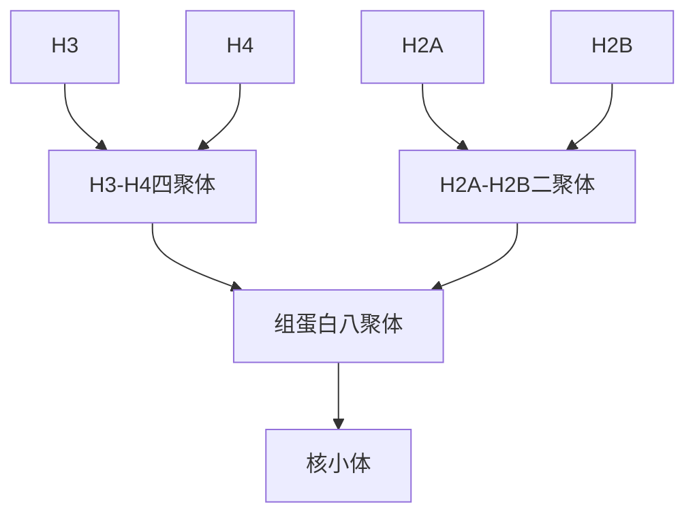
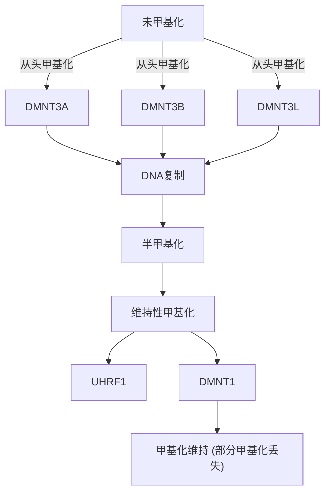

DNA 复制、损伤修复和重组这三个过程，体现了生命遗传信息传递过程中的辩证和统一。稳定与变化、连续性与多样性，这些看似矛盾的概念在这一过程中和谐共存。生命的奥秘不仅仅在于其复杂的生物化学过程和分子机制，更在于这些机制所体现的深刻哲学内涵。我们在学习中不仅要了解这些生物学过程的具体细节，更要从中思考生命存在和演化的意义，探索科学背后的哲学智慧。这不但会帮助我们更深刻地理解生命的本质，更好地欣赏生命的奇妙，还可以启发我们去深入探索生命现象背后更深入的机制，并利用我们的所学所知去开发新的技术和工具，造福人类、造福生命，让世界更美好。

## ※ 本章小结

DNA 的复制是遗传信息传递的关键过程，以半保留方式进行。DNA 聚合酶依赖模板在引物 3' 端以 dNTP 为底物合成 DNA。真核细胞与原核细胞都具有多种 DNA 聚合酶，绝大多数 DNA 聚合酶具有 5'→3' 聚合酶活性，部分参与复制的 DNA 聚合酶还具有 3'→5' 核酸外切酶活性，可发挥校对功能以提高复制准确性。复制过程中未被清除的错配则通过错配修复系统进一步纠正。

DNA 复制的起始阶段由起始蛋白（原核细胞中的 DnaA 及真核细胞中的 ORC 复合体）识别复制起点，随后解旋酶打开双链 DNA 形成复制叉。在复制叉处，两条子链分别通过前导链和后随链方式合成。原核细胞环形染色体复制通常终止于起始点对侧的终止区域。真核细胞通过端粒酶延长线性染色体末端的端粒序列，以补偿常规 DNA 复制过程中无法完全合成末端区域的问题。

DNA 复制起始受到严格调控，确保遗传信息的准确传递。原核细胞通过基因组中 GATC 序列甲基化-半甲基化状态影响 DnaA 结合复制起点，从而调控起始频率。真核细胞 DNA 复制与细胞周期紧密协调， $G_{1}$  期中可组装 preRC 但保持其非活化状态，进入 S 期后高活性的 CDK/DDK 激活复制复合体启动 DNA 复制。在进入下一个细胞周期前，起始位点上的 preRC 重新组装受到抑制，由此保证所有染色体在每个细胞周期中复制且仅复制一次。

细胞存在多种DNA修复系统以应对各种内源或外源性因素引起的DNA损伤。通过碱基切除修复（BER）、核苷酸切除修复（NER）等途径去除受损的碱基或核苷酸并修复DNA，通过非同源末端连接或同源重组途径修复DNA双链断裂。未修复的DNA损伤可导致突变，进而引起基因改变及其产物功能紊乱。DNA突变通常对生物体有害，但同时也为个体变异的产生和生物进化提供动力。

同源重组不仅参与DNA断裂修复，而且在遗传信息交换及转移中也发挥重要作用。在大肠杆菌中，RecA、RecBCD及RuvAB复合物等蛋白参与同源重组的关键步骤。真核细胞减数分裂过程中，同源重组通过形成交叉稳定同源染色体联会，从而促进其准确分离，同时增加子代的遗传多样性。

遗传重组还包括不依赖于同源序列的位点特异性重组和转座重组。位点特异性重组通过重组酶识别特定 DNA 短序列，催化 DNA 切割、链的交换和重新连接，从而实现 DNA片段的反转、删除或插入。转座重组不依赖于特定的序列即可实现 DNA 片段在染色体上不同区域之间的转移，其随机插入特性是遗传变异与疾病发生的重要成因之一。

## ※ 思考题

1. 原核生物和真核生物中参与核基因组复制的主要 DNA 聚合酶是哪些？它们主要发挥什么作用？
2. 细胞在增殖过程中如何保证遗传信息被最大限度地精确复制并稳定遗传？
3. 细胞中同时存在碱基切除修复、核苷酸切除修复和同源重组修复等多种 DNA 损伤修复机制。为什么细胞需要这些不同的修复途径？它们同时存在于细胞中的必要性是什么？
4. 原核细胞和真核细胞中都存在同源重组机制，但原核细胞中并不存在同源染色体，其同源重组过程中的同源序列来自哪里？同源重组机制在原核细胞和真核细胞中各自发挥什么功能？
5. 转座重组区别于同源重组和位点特异性重组的重要特征是什么？人类基因组中的逆转录转座子是如何发生转座重组的？

## ※ 推荐阅读

## DNA 复制

1. MESELSON M, STAHL F W. The replication of DNA in Escherichia coli [J]. Proc Natl Acad Sci U S A, 1958, 15: 671-682.
本文通过同位素标记和离心技术，首次直接证实DNA通过半保留方式复制，亲代链作为模板被保留并传递给子代，为分子遗传学奠定了实验基础，并推动了后续对DNA复制机制的深入研究。
2. GANAI R A, JOHANSSON E. DNA replication: a matter of fidelity [J]. Mol Cell, 2016, 2: 745-755.

本文综述了DNA复制保真度的分子机制及其在基因组稳定性中的作用，有助于深入理解DNA复制高保真度的多层次调控及其与疾病（如癌症）的关联。

3. KURAT C F, YEELES J T P, PATEL H, et al. Chromatin controls DNA replication origin selection, lagging-strand synthesis, and replication fork rates [J]. Mol Cell, 2017, 5: 117-130.

本文通过纯化蛋白重建染色质复制系统，揭示了染色质结构如何动态调控 DNA 复制的分子机制，以及多因子协同在维持复制保真性中的作用，能帮助读者进一步理解染色质环境下的 DNA 复制。

4. LANGSTON L D, O'DONNELL M. DNA replication: keep moving and don't mind the gap [J]. Mol Cell, 2006, 23: 155-160.

本文介绍了DNA复制过程中后随链的不连续合成机制，以及复制叉在遇到模板损伤时如何通过跳跃损伤继续前进，从而避免复制叉停滞或崩溃，能够帮助读者深入浅出地理解DNA复制叉上复制及应对模板损伤的动态过程。

5. CORN J E, BERGER J M. Regulation of bacterial priming and daughter strand synthesis through helicase-primase interactions [J]. Nucleic Acids Res, 2006, 34: 4082-4088.

本文介绍了细菌复制体中解旋酶和引物酶之间的相互作用及其如何调节引物与后随链的合成，有助于读者理解复制叉上蛋白质的协同作用。

## DNA 损伤修复

6. DE LAAT W L, JASPERS N G, HOEIJMAKERS J H. Molecular mechanism of excision nucleotide repair [J]. Genes Dev, 1999, 13: 768–785.

本文详细阐述了核苷酸切除修复（NER）的分子机制，并探讨了其与转录偶联修复的关系，揭示了 NER 缺陷相关疾病的分子基础，有助于深入理解 NER 的复杂性和重要性。

7. SCULLY R, PANDAY A, ELANGO R, et al. DNA double-strand break repair-pathway choice in somatic mammalian cells [J]. Nat Rev Mol Cell Biol, 2019, 20: 698-714.

本文详细介绍了哺乳动物细胞中 DNA 双链断裂修复途径的选择机制，以及这些机制如何影响基因组稳定性，对于深入理解 DNA 修复机制和基因组稳定性的重要性及理解癌症等疾病的分子基础具有重要作用。

8. CHANG H H Y, PANNUNZIO N R, ADACHI N, et al. Non-homologous DNA end joining and alternative pathways to double-strand break repair [J]. Nat Rev Mol Cell Biol, 2017, 18: 495-506.

本文介绍了哺乳动物细胞中非同源末端连接（NHEJ）途径在 DNA 双链断裂（DSB）修复中的作用，以及不同 DNA 末端结构如何影响 NHEJ 蛋白的活性，能帮助读者深入理解哺乳动物细胞中 DNA 双链断裂修复机制的细节。

9. PUTNAM C D. Evolution of the methyl directed mismatch repair system in Escherichia coli [J]. DNA Repair (Amst), 2016, 38: 32-41.

本文介绍了大肠杆菌中甲基化指导的错配修复系统的进化历程，揭示了其通过获得 Dam 甲基化酶和 MutH 核酸酶，同时丢失 MutL 内切酶活性的独特机制，能启发读者理解错配修复系统的起源及其进化适应性。

## 遗传重组

10. WRIGHT W D, SHAH S S, HEYER W D. Homologous recombination and the repair of DNA double-strand breaks [J]. J Biol Chem, 2018, 293: 10524-10535.

本文系统阐述了同源重组修复 DNA 双链断裂的分子机制，详细介绍了从 DNA 末端切除、Rad51 核蛋白丝形成、同源搜索、链侵入到最终染色体恢复的全过程，强调了拓扑结构和动态中间体在修复高保真性中的作用，能够帮助读者深入理解同源重组修复的核心机制。

- 11. CECCALDI R, RONDINELLI B, D'ANDREA A D. Repair pathway choices and consequences at the double-strand break [J]. Trends Cell Biol, 2016, 26: 52-64.
- 本文全面综述了 DNA 双链断裂修复的四种主要途径，解析了修复路径选择的调控机制及其对基因组稳定性的影响，有助于理解 DNA 双链断裂修复的分子机制与临床应用的关联，尤其是在癌症治疗中的潜力。
- 12. WELLS J N, FESCHOTTE C. A field guide to eukaryotic transposable elements [J]. Annu Rev Genet, 2020, 54: 539–561.
- 本文全面综述了真核生物转座元件的分类、进化起源、传播机制及其对基因组演化的影响，揭示了转座元件的多样性与宿主基因组的复杂互动关系。

（撰写:卢晓云，陈佳，高宁；审修:周金秋，陈玲玲，徐彦辉）

## 9

## 基因、染色质与表观遗传

1953 年 DNA 双螺旋结构模型的提出和 2001 年人类基因组 DNA 序列蓝图的公布是生命科学研究的两大里程碑，似乎预示着人类已经揭开了生命奥秘的神秘面纱。然而，许多生物学现象至今仍然无法得到合理解释。例如，为何具有相同 DNA 序列的同卵双胞胎在成年后会出现相貌、体型和性格上的显著差异？同一片树叶上为何会出现颜色不同的斑块？由 Agouti 单基因控制的小鼠毛色为何会表现出颜色差异？这些生物学表型现象无法用经典遗传学理论加以解释。康拉德·沃丁顿（Conrad Waddington，1905—1975）早在 1939 年就提出了表观遗传学（epigenetics）的概念，用于解释发育过程中从相同基因型转化为不同表型的现象。其中，“epi-”在希腊语中意为“在……之上或之外”。因此，表观遗传学从字面上可以理解为探究“超越遗传学”的一门学科。经过长期的研究和总结，2007 年科学家们从分子层面将表观遗传学定义为:“在同一基因组上建立并传递基因表达调控（转录）模式和基因沉默的染色质模式变化的总和”。这些染色质模式的调控机制包括 DNA 甲基化、组蛋白修饰、组蛋白变体、染色质重塑及非编码 RNA 等。归根结底，染色质结构的动态变化是影响生物表型的关键因素。本章将围绕各种表观遗传机制，阐释染色质结构的动态调控过程，以帮助读者理解染色质生物化学在转录调控中的作用。

## 9.1 不同生物体的基因组具有复杂性和特异性

生物体的全部遗传物质称为基因组，其组成在不同物种之间存在显著差异，主要体现在以下几个方面:①基因数量和基因组大小。在细菌等原核生物中，基因数量一般为几千个，基因组大小通常不超过10 Mb（百万碱基对）。相比之下，高等真核生物的基因组要大得多。人类基因组大约有3 Gb（十亿碱基对），包含2万多个编码基因和更多的非编码基因。植物的基因组大小和基因数量则具有更大的变异性，例如水稻约为0.4 Gb，而玉米则可达2.3 Gb。②基因的长度在不同物种间差异显著。原核生物的基因往往较短且连续，即编码区是无间隔的单一序列。而真核生物的基因长度通常较长，因为它们含有大量的内含子。③重复序列的比例。在高等真核生物中，基因组中包含大量的重复序列，这些重复序列分为散在重复和串联重复。散在重复通常包括转座子，能够在基因组中转移，这些序列在植物和动物中含量丰富。人类基因组中约50%的DNA是重复序列，而在植物如玉米中这一比例高达85%。重复序列虽然不直接编码蛋白质，但可能在调控基因表达、基因组结构维持和进化中起到重要作用。这些差异反映了生物进化的多样性和遗传信息的复杂性，也为生物体功能的基础研究提供了重要线索。

在人类基因组中，只有约 $1.5\%$ 是真正的蛋白质编码区，其他都是非编码区（图9-1）。这种非编码区曾一度被认为是“垃圾DNA”，但近年来的研究表明，非编码DNA在基因组稳定性和基因表达调控中具有重要作用。非编码区域包括许多调控元件，例如增强子、沉默子和启动子等，这些序列通过与转录因子相互作用，决定基因的时空表达模式，还有一些长链非编码RNA（long non-coding RNA，lncRNA）在基因调控中也可能发挥作用。基因的非编码区在进化中往往比编码区更具可变性，适应环境变化的生物体可以通过对非编码区的改变，调整基因表达水平。此外，重复序列和转座子也为基因组变异提供了来源，影响基因组结构和功能的多样性。

pie

| Category | Percentage |
| --- | --- |
| 编码蛋白质基因 | 2% |
| 长散在核元件 | 20% |
| 短散在核元件 | 13% |
| 含长末端重复序列的逆转录转座子 | 8% |
| DNA转座子 | 3% |
| 单一片段重复 | 3% |
| 片段重复 | 5% |
| 各种异染色质 | 8% |
| 各种独特序列 | 12% |
| 内含子 | 26% |

图9-1 人类基因组中不同组成成分的差异比较

1953 年，克里克和沃森提出了 DNA 双螺旋结构模型，解释了遗传信息的复制机制，为遗传学和基因组学奠定了分子基础。1961 年，克里克和悉尼·布伦纳（Sydney Brenner，1927—2019）提出了分子生物学的“中心法则”，揭示了编码基因的本质，即基因组中部分序列可以翻译成蛋白质。1977 年，理查德·罗伯茨（Richard J. Roberts）和菲利普·夏普（Phillip Sharp）分别独立发现了基因上的内含子—外显子结构，为编码基因复杂性的研究开启了新篇章。他们提出 mRNA 的前体 pre-mRNA 通过“剪接”过程，切除内含子，形成成熟的 mRNA 指导蛋白质合成。

1960年代，科学家们发现了一些不能转录为蛋白质的RNA分子（如rRNA和tRNA）。尤其是弗朗索瓦·雅各布（François Jacob，1920—2013）和雅克·莫诺（Jacques Monod，1910—1976）提出的“操纵子模型”，首次揭示了非编码基因在表达调控中的作用，为非编码基因概念的提出奠定了基础。1993年，维克托·安布罗斯（Victor Ambros）和加里·鲁夫昆（Gary Ruvkun）等在秀丽隐杆线虫中首次发现了微RNA（miRNA），揭示了小RNA在基因表达调控中的功能。近年来，长链非编码RNA（lncRNA）的功能逐渐被揭示，显示它们在细胞分化、发育及疾病中的作用，进一步加深了我们对非编码基因的理解。

1948 年，麦克林托克在玉米中发现了一类能够在基因组中移动的基因片段，并称其为 “控制因子”，后被命名为转座子（transposon）。然而，这一发现最初未引起广泛关注。麦克林托克的研究为基因组动态性的探索奠定了基础，她因此获得了 1983 年诺贝尔生理学或医学奖。到 1990 年代，科学家发现转座子广泛存在于哺乳动物基因组中，其比例在不同物种间差异显著，在植物基因组中数量尤为庞大。转座子不仅是基因组的重要组成部分，还能促进基因组的进化多样性。转座子的插入可能导致基因功能的丧失或创新，这在哺乳动物和植物基因组的进化过程中起到了重要作用。

原核生物与真核生物的基因组在大小、结构和功能上存在显著差异。原核生物基因组通常较小，基因密度高；而真核生物的基因组则较大，具有更多非编码区及复杂的调控机制。2001年，人类基因组计划的完成是基因组学领域的里程碑事件。研究表明，人类基因组中仅约1.5%的区域编码蛋白质，其余部分为非编码区域，这揭示了基因组非编码区域的复杂性。此后，多种真核生物（如植物、动物）的基因组相继完成测序，揭示了基因组结构的多样性。

ENCODE 项目（encyclopedia of DNA element）进一步表明，人类基因组的非编码区域包含大量功能性元件，这些元件在基因表达调控中发挥重要作用（图 9-1）。在原核生物中，基因表达调控主要集中在转录水平；而在真核生物中，调控机制更加复杂，依赖于染色质的组成和结构。过去 30 年来，表观遗传学（如 DNA 甲基化和组蛋白修饰）逐渐成为研究热点。表观遗传修饰不仅能够影响基因表达，还可以遗传给后代细胞，成为调控研究的重要方向之一。

## 9.2 真核生物的基因组以染色质形式存在

在真核生物中，遗传信息 DNA 并非以裸露形式存在，而是以染色质（chromatin）的形式储存于细胞核中。一切与 DNA 相关的生命活动都在染色质这一结构平台上进行。染色质为真核生物的基因转录、DNA 复制和重组等基本生命活动提供了必需的信息整合平台。

染色质的概念最早由华尔瑟·弗勒明（Walther Flemming，1843—1905）于1879年提出，用以描述细胞核内能够被碱性染料染色的物质。根据染色质的形态特点，着色较浅且呈伸展状态的区域被称为常染色质（euchromatin），而着色较深且呈凝缩状态的区域被称为异染色质（heterochromatin）（图9-2A）。基于电镜观察结果（图9-2B），奥林斯夫妇（Donald Olins与Ada Olins）及皮埃尔·尚邦（Pierre Chambon）等提出了染色质结构的串珠模型。而罗杰·科恩伯格（Roger Kornberg）在1974年发现，染色质的基本结构单元是形状类似于扁珠的核小体（nucleosome）。核小体由一段DNA缠绕四种特定序列的组蛋白（histone）组成的八聚体（octamer）构成（图9-3A）。

染色质的组织结构可以划分为多个层次:由 DNA 链缠绕在核小体上形成 “串珠状” 结构，直径约 11 nm。两核小体之间由长 10～90 bp 的 DNA 连接；在连接组蛋白（linker histone）H1 或 H5 的作用下，“串珠状” 结构进一步压缩为直径约 30 nm 的染色质纤维；染色质纤维进一步螺旋化和蜷缩，形成直径约 400 nm 的超螺线体；超螺线体再进一步折叠，最终形成染色体（chromosome，图 9-3B）。通过多层次的有序压缩，线性长度达 2 m 的基因组 DNA 被折叠压缩约 8 400 倍，储存于微米级别的细胞核中。

染色质作为真核细胞遗传信息的载体，不仅储存 DNA，还充当调控基因转录的重要平台。核小体中的 DNA 和组蛋白可以接收和传递各种信号信息，包括 DNA 修饰和组蛋白上的多种翻译后修饰，这些信号被整合并输出特定指令，通过动态调控染色质结构影响基因转录。当染色质高度凝聚形成异染色质时，基因转录被沉默；而当染色质局部解聚并转换为常染色质时，各种转录调控因子及转录机器能够接近染色质并启

(A)

text_image

异染色质
常染色质
细胞核膜

(B)

图 9-2 细胞核内染色质的不同存在形式

(A) DNA 染料染色后显示细胞核内不同的染色质形态。
(B) 高分辨率电镜下观察到由一串核小体相连组成的染色质形态图。上图为异染色质，下图为常染色质。(B) 引自 OLINS D E, et al. Nat Rew Mol Biol, 2003, 4: 809-814.

图9-3 以核小体为基本结构单元组成的不同层次的染色质结构

（A）核小体是147 bp的DNA缠绕在四种核心组蛋白形成的八聚体上而组成的最基本结构单元。（B）不同层次的染色质结构示意图

text_image

(A)
H3
H2A
H4
H2B
(B)
2 nm
11 nm
1
二级结构
30 nm
300 nm
700 nm
高级结构
1400 nm

动基因转录，促进特定基因的表达。

## 9.2.1 核小体是由组蛋白八聚体和缠绕在上面的 DNA 组成的扁珠状结构

核小体作为染色质基本组成结构单元的确立可以追溯到 1974 年。当时，科恩伯格和奥林斯夫妇通过实验和清晰的电镜照片分别得出了相同的结论。1997 年，卡洛琳·鲁格尔（Karoline Luger）和蒂莫西·里士满（Timothy Richmond）首次解析了体外重组且成分均一的单个核小体晶体结构（分辨率为 2.8Å），揭示了核小体形成的分子基础（图 9-4A）。完整的单个核小体（即染色质小体，chromatosome）主要由三部分组成:核小体核心颗粒（nucleosome core particle，NCP）、连接 DNA 和连接组蛋白 H1 或 H5。核小体核心颗粒由 147 bp 的 DNA 以左手负超螺旋方式缠绕组蛋白八聚体约 1.65 圈形成，呈现直径约 11 nm、高约 5.5 nm 的扁珠状颗粒结构。

在真核生物中，组蛋白八聚体由四种核心组蛋白（H2A、H2B、H3和H4）组成，这些组蛋白的分子质量为11～15 kDa，序列高度保守。四种组蛋白的结构相似，包括由三个 $\alpha$ 螺旋组成的稳定组蛋白折叠结构域（histone fold domain）。该结构域主要负责组蛋白的二聚化，分别形成H2A-H2B和H3-H4两种异源二聚体。H3-H4异源二聚体通过H3与H3间“头碰头”的方式进一步形成更为稳定的H3-H4异源四聚体结构。随后，H3-H4异源四聚体通过H4与H2B之间的相互作用，与两对H2A-H2B二聚体共同构建了组蛋白八聚体（图9-4B）。此外，在组蛋白折叠结构域以外，四种组蛋白的氨基酸肽段以“尾巴”形式延伸至核小体外部，这些“尾巴”和组蛋白翻译后修饰在核小体的组装与解离过程中发挥重要作用。

(A)

natural_image

Molecular docking visualization showing protein binding site with colored active sites (no text or labels)

(B)

flowchart

图 9-4 核小体的基本结构组成

（A）重组单核小体的整体结构图。（B）组蛋白逐步组装成核小体的示意图（PBD 编号:1AOI）

连接组蛋白主要为 H1 家族的成员。与进化过程中高度保守的核心组蛋白不同，H1 家族的序列可变性较大，例如在鸟类红细胞中，H1 被组蛋白 H5 所替代。连接组蛋白通常由三部分组成:短的 N 端结构域、长的 C 端结构域以及中间相对保守的球

形结构域（图9-5）。连接组蛋白H1/H5结合在靠近核小体核心进出口处的连接DNA区域（约 $10\mathrm{bp}$ ），从而稳定核小体结构，并促进核小体的折叠及染色质高级结构的形成。

为什么与基因组 DNA 结合并组装成核小体的是组蛋白，而不是其他蛋白质呢？这与组蛋白的氨基酸组成密切相关。所有组蛋白都富含带正电荷的精氨酸和赖氨酸等碱性氨基酸，可以通过电荷相互作用与带负电荷的 DNA 紧密结合，从而实现基因组 DNA 的包装与压缩。当紧密折叠的染色质需要被打开以进行基因转录或 DNA 复制时，组蛋白上的赖氨酸和精氨酸残基侧链的氨基基团会发生多种翻译后修饰，包括甲基化、乙酰化和泛素化等。这些修饰或者改变组蛋白的局部电荷性，或者作为分子标签被“阅读器”蛋白识别，从而招募不同的调控蛋白，动态调控染色质的结构和功能。

(A)

text_image

N端
球形结构域
C端
H1

(B)

text_image

C端
N端
球形结构域

图9-5 组蛋白H1的结构示意图

(A) H1 蛋白的线性结构。(B) AlphaFold3 预测的三维结构。蓝色代表预测准确度高的球形区域，黄色代表预测准确度较低的柔性区域

(A) 螺线管结构

chemical

Molecular structure diagram showing labeled nitrogen atoms (N1–N8) in blue and yellow spheres connected by bonds

(C) "Z"字结构

chemical

Molecular structure diagram showing a DNA double helix with labeled nitrogen atoms (N1–N8)

(B)

(D)

图 9-6 两种 30-nm 染色质的结构模型图

(A)、(B): 螺旋管结构模型。(C)、(D): “Z” 字结构模型。
N1 代表第 1 个核小体，以此类推

## 9.2.2 通过“Z”字结构和30纳米染色质纤维形成了染色质高级结构

在生理条件下，核小体“串珠”状结构在连接组蛋白H1/H5的帮助下，通过核小体之间的相互作用进一步压缩，形成更加致密的染色质结构——30纳米（30-nm）染色质纤维。早期，科学家从细胞核中分离并纯化天然状态下的染色质纤维，结合生物化学和生物物理技术的研究，提出了两种具有代表性的30-nm染色质纤维结构模型:螺线管（solenoid）结构和“Z”字（Zig-Zag）结构（图9-6）。螺线管模型认为，每6\~7个核小体单元组成一圈，相邻的核小体连续排列，连接DNA呈弯曲状态，相邻核小体在空间上紧密相邻，整体呈现螺旋缠绕的上升形式。而在“Z”字模型中，相邻的核小体以“Z”字形螺旋排列，连接DNA呈拉直状态，导致空间上非相邻的核小体相互靠近。需要指出的是，尽管分离得到的染色质接近天然状态，但复杂生理条件下细胞内染色质的高度异质性仍然阻碍了染色质纤维精细结构的确定。

近年来，越来越多的实验支持“Z”字模型。2005年，里士满等利用电镜和X射线晶体学方法观察并构建了不含连接组蛋白H1的30-nm染色质纤维结构模型，支持“Z”字结构的假说。2014年，李国红和朱平合作解析了体外组装的包含12个核小体和连接组蛋白H1的30-nm染色质纤维冷冻电镜结构，分辨率为11Å（图9-7）。冷冻电镜显示，30-nm染色质纤维以“四核小体”（tetranucleosome）为结构单元，依赖于组蛋白H1形成左手双螺旋结构。相邻核小体之间的连接DNA呈拉直状态，这一结果与“Z”字模型的特征一致。实验还发现，核小体DNA长度不同（如177bp和187bp）并不影响染色质纤维的整体结构，但会改变其直径。该团队进一步解析了包含12个核小体和连接组蛋白H5的冷冻电镜结构（图9-8A，分辨率为3.6Å），揭示了连接组蛋白H5与核小体结合的分子基础（图9-8B）。结果显示，连接组蛋白H5以1:1的比例非对称地结合在核小体上，这种非对称定位使得四核小体单元内部的H5-H5之间没有相互接触，而结构单元之间的H5-H5通过相互作用形成固定角度的扭转，进而构成左手超螺旋结构（图9-8）。

30-nm 染色质纤维长期以来被认为是染色质进一步折叠为高级结构的基础。然而，与体外重构染色质纤维相比，细胞核内的天然染色质纤维存在固有的局部差异性，例如核小体重复长度、组蛋白的化学修饰与变体替换以及 DNA 的甲基化修饰等。这些差异可能赋予天然染色质更加多样化且动态的三维结构。由于活细胞高分辨率染色质成像技术的限制，细胞内是否存在规则的 30-nm 染色质纤维二级结构仍存有争议。然

图 9-7 30-nm 染色质纤维的冷冻电镜左手双螺旋结构模型

$12 \times 187$ bp 染色质纤维冷冻电镜结构（A）和模型（B）； $48 \times 187$ bp 染色质纤维的假原子模型（C）和电子密度图（D）

text_image

(A)
28.1 nm
N2
N4
N6
N8
N10
N12
N1
N3
N5
N7
N9
N11
90°
27.6 nm
四核小体单元1
四核小体单元2
四核小体单元3

(B)

图 9-8 30-nm 染色质纤维内的各种相互作用

(A) 高分辨率的 H5- 染色质纤维的冷冻电镜结构 (3.6 Å)。(B) H5- 染色质小体结构。参与相互作用的氨基酸残基在图中标出

而，大量体内外实验结果表明，细胞核内的天然染色质纤维与体外重构染色质具有类似的结构特征。未来成像技术的突破将是解开体内染色质纤维结构奥秘的关键所在。

## 9.3 DNA 甲基化修饰是承载表观遗传信息的重要方式之一

DNA 甲基化是一种关键的表观遗传修饰，通过直接阻碍转录因子与 DNA 的结合，抑或通过招募其他蛋白质促使染色质形成紧密结构抑制基因转录。作为一种稳定存在的表观遗传修饰，DNA 甲基化在细胞分化、哺乳动物胚胎发育及维持基因组稳定性等过程中发挥重要作用。本节重点阐述经典与新型 DNA 甲基化修饰的生化特征及其生物学功能。

## 9.3.1 5mC 是最经典和最主要的 DNA 甲基化修饰形式

DNA 甲基化是由一系列 DNA 甲基转移酶（DNA methyltransferase，DNMT）催化完成的过程（图 9-9A）。在此过程中，S-腺苷甲硫氨酸（S-adenosyl methionine，SAM）作为甲基供体，其包含的甲基基团可被转移到 DNA 的碱基上。真核生物基因组 DNA 上广泛存在 C$^{5}$-甲基化（5-甲基胞嘧啶，5mC，胞嘧啶 C 的第五位碳原子上发生甲基化），是最为重要的甲基化修饰。目前已知的其他 DNA 甲基化类型包括腺嘌呤 A 的 N$^{6}$-甲基化（N$^{6}$-甲基腺嘌呤，6mA）和胞嘧啶 C 的 N$^{4}$-甲基化（4-甲基胞嘧啶，4mC）。表观遗传学研究中提到的 DNA 甲基化通常特指 5mC。本节主要介绍 5mC。

5mC 于 1925 年首次在结核杆菌中发现，并于 1948 年在小牛胸腺 DNA 中得到证实，随后被发现广泛存在于动物、植物和真菌中。5mC 修饰在基因组 DNA 链上的分布具有偏好性，在动物细胞中，DNA 甲基化主要发生在胞嘧啶-鸟嘌呤（CpG）二核苷酸的 C 位，其中 p 代表 C 和 G 之间的磷酸基团（图 9-9B）。而在植物细胞中，CG 甲基化占主导，但 CHG 和 CHH 甲基化也较为常见（H 表示除 G 外的任意碱基）。真菌细胞中，CG 甲基化与 CHH 甲基化的比例大致相等。

在哺乳动物细胞中，70%\~80%的CpG位点被甲基化，且其分布有特定的规律。总体而言，基因组中的重复序列区域通常被高度甲基化，尤其是异染色质区域内的重复序列，如卫星DNA、长散在核元件（LINE）、短散在核元件（SINE）以及包含长末端重复序列的逆转录转座子（LTR-RT）。此外，基因编码区内（即外显子）的

图 9-9 DNA 甲基化修饰示意图

（A）不同碱基在DNMT的作用下，将一分子甲基基团共价转移到相应位置上的反应。（B）DNA上三种甲基化类型

## 知识延展9-1

## CpG 岛排斥 DNA 甲基化的可能原因

尽管大多数 CpG 位点会发生 DNA 甲基化，但位于基因启动子和 5' 端非翻译区的 CpG 岛却不受整体 DNA 甲基化的影响。可能的解释包括:①一些富集在 CpG 岛上的结合因子（如转录因子和 RNA 聚合酶等）会排斥 DNA 甲基转移酶的结合；②存在 DNA 去甲基化酶，可以主动去除 CpG 岛区的 DNA 甲基化。特别是在胚胎发育早期，DNA 会经历两次大规模的去甲基化过程。去甲基化后的 CpG 岛由于需要快速响应基因转录，因此保持非甲基化状态；③有研究表明，CpG 岛是 DNA 复制的源头，因此该区域具有较高的 DNA 代谢活动，这种高活性可能会排斥 DNMT 招募。需要注意的是，在癌细胞中，许多正常情况下非甲基化的 CpG 岛发生了甲基化，表明维持 CpG 岛的非甲基化状态对正常细胞活动至关重要。

甲基化也很常见，尤其是外显子中的 CpG 位点，甲基化程度通常较高。有趣的是，CpG 岛区域中的 CpG 位点多数处于非甲基化状态（知识延展 9-1）。CpG 岛一般长 300～3 000 bp，主要位于基因的启动子和 5' 端非翻译区。这表明 DNA 甲基化不仅受

序列的影响，还与其在基因组中的位置密切相关。

flowchart

图9-10 DNA的从头甲基化和维持性甲基化黑色方格代表甲基化的碱基，灰色方格代表未甲基化的碱基

DNA 甲基化的建立至少需要两种酶活性:一种是从头甲基化，即催化非甲基化的 CpG 位点从头建立甲基化模式；另一种是维持性甲基化，即在细胞分裂过程中将亲本链上的甲基化模式复制到新生链上（图 9-10）。这两种模式在哺乳动物胚胎发育中缺一不可。

## (1) 细胞基因组 DNA 上甲基化以半保留复制的方式得以维持

基于 DNA 双链上对应的 CpG 二核苷酸的自我互补性，1975 年两个实验小组分别提出，甲基化模式可能通过半保留方式在细胞分裂时得以维持。这一假说认为，在 DNA 复制过程中，某种 DNA 甲基转移酶能够利用甲基化的亲本 CpG 模板，对新生链上的对应 CpG 位点进行甲基化修饰，而非甲基化的 CpG 则无法成为新生链的甲基化模板。该假说为 DNA 甲基化模式在细胞分裂时稳定遗传提供了理论支持。1983 年，具有维持性甲基化功能的 DNA 甲基转移酶 1（DNMT1）的发现证实了这一观点。DNMT1 对半甲基化（DNA hemimethylation，即双链中一条链的 CpG 发生甲基化，而与其互补的另一条链的 CpG 未发生甲基化）CpG 位点的活性远远高于对非甲基化 CpG 位点的活性，这符合维特性 DNA 甲基转移酶的性质。DNMT1 在增殖细胞中广泛表达，特别是在 S 期 DNA 复制时，DNMT1 可被调节因子 UHRF1(ubiquitin-like with PHD and RING finger domains 1) 招募到复制区域，通过 DNA 复制偶联的方式促进新生链上的甲基化。UHRF1 蛋白中含有能够识别 DNA 半甲基化修饰和组蛋白修饰的结构域，因此它能帮助 DNMT1 在染色质特定区域（如异染色质区）正确定位。朱冰等发现，在卵细胞中，DNMT1 也具备从头甲基化（de novo methylation）的酶活性，该功能受到 STELLA 蛋白的抑制。因此，在细胞分裂时，DNMT1 通过半保留方式维持 DNA 甲基化模式，是细胞记忆并传承该模式的关键机制。

bar

| Protein | Target Region | Length (aa) |
| :--- | :--- | :--- |
| DNMT1 | 调节区 | 1620 |
| DNMT2 | 催化区 | 415 |
| DNMT3A | 调节区 | 908 |
| DNMT3B | 调节区 | 859 |
| DNMT3L | 催化区 | 387 |

图 9-11 DNA 甲基转移酶家族蛋白的比较图

## (2) 早期胚胎中的 DNA 甲基化依赖特定甲基转移酶进行从头合成

原核细胞中的 DNA 甲基转移酶包含相同的结构域，因此研究人员通过蛋白质数据库搜寻真核生物中与 DNMT1 具有相似序列特征的成员，发现了其他潜在的 DNA 甲基转移酶，包括 DNMT2、DNMT3A、DNMT3B 以及 DNMT3L（图 9-11）。DNMT2 尽管保留了 C 端的催化序列，但它似乎不具备 DNA 甲基转移酶活性。与 DNMT1 类似，DNMT3A 和 DNMT3B 也包含 N 端调节区和 C 端催化区。N 端调节区包含 PWWP 结构域和 ADD 结构域，可以作为组蛋白修饰的“阅读器”识别特定的组蛋白修饰，发挥调节作用（见 9.5.2 节）。更为重要的是，这两种甲基转移酶通过其 C 端催化结构域修饰非甲基化的 CpG 位点，从头建立 DNA 甲基化模式，因此被称为从头合成 DNA 甲基转移酶（de novo DNMT）。DNA 从头甲基化对胚胎发育至关重要。敲除早期胚胎中高表达的 Dnmt3a 和 Dnmt3b 基因将导致小鼠胚胎致死。此外，虽然 DNMT3L 因缺失某些关键催化序列而失去酶活性，但它仍能作为辅助因子与 DNMT3A 或 DNMT3B 形成复合体，促进 DNMT3A 或 DNMT3B 的催化功能。缺乏 DNMT3L 的卵细胞甲基化水平显著降低，包括印记基因（imprinted gene）区域，表明其对从头合成 DNA 甲基化至关重要。

## 9.3.2 DNA 甲基化修饰抑制基因表达

在高等生物中，DNA 甲基化的最主要功能是调控基因表达。多方面实验证据表明，基因启动子区的 DNA 甲基化与转录抑制密切相关。例如:人为构建的 DNA 甲基化腺病毒报告基因在注入蛙卵母细胞核后表达受到抑制；DNA 载体转染小鼠