和基因的错误表达，这些异常表达最终引起了人类和小鼠的多种肢体畸形。在另一项基于急性 T 淋巴细胞白血病模型的研究中，研究人员同样证明了拓扑结构域边界的破坏，可以造成致癌基因与异位增强子的错误结合，导致致癌基因的错误激活。

## 9.9.3 染色质三维结构变化影响细胞衰老

细胞在衰老过程中伴随着多种变化，包括染色质状态的重塑、基因表达的改变，以及细胞功能逐渐减弱的特征。最近，研究人员发现，在人类和小鼠的小脑颗粒神经细胞中，随着年龄增长，染色质相互作用的距离逐渐变长。

## 9.9.4 在生物演化中人类形成了特有的三维基因组特征

在生物演化过程中，基因组非编码区域的序列分化被认为是物种特异性特征形成的重要驱动力。通过对比人类与恒河猴脑神经细胞的三维基因组结构，科学家们发现它们在某些方面具有相似性，但也揭示了人类特有的三维基因组特征。例如，人类独有的拓扑关联域和染色质环展现出特殊的基因调控模式。这些特有的结构在调节大脑发育关键基因表达方面发挥重要作用，尤其是在神经回路的形成以及大脑复杂功能的建立过程中。这些独特的基因组结构帮助解释了人类在认知能力和神经功能方面的进化优势。

## 9.9.5 三维基因组面临更多技术和科学上的挑战

大量研究表明，染色质高级结构在基因转录调控中发挥重要作用。然而，有研究显示，敲除结构蛋白CTCF或黏连蛋白复合体亚基RAD21虽然会导致染色质结构发生显著变化，但基因整体表达的变化却相对较小。这一现象引发了关于染色质高级结构与转录调控之间因果关系的广泛争论，已成为当前染色质研究领域的关键科学问题。

2013 年开发的单细胞 Hi-C（scHi-C）技术为研究单个细胞及不同细胞类型间的染色质结构异质性提供了重要工具。自 2019 年起，具有多组学检测能力的单细胞三维基因组解析技术（如同时进行 scHi-C 和单细胞转录组 / 单细胞甲基化组）能够将三维染色质结构与基因表达或表观基因组联系起来，极大地推动了我们对转录调控中染色质结构基础的理解，并揭示了细胞类型特异性的染色质特征。此外，具备多组学检测能力的高通量显微成像技术也为我们提供了另一种独特的视角来理解染色质在细胞核中的构象。未来，随着三维基因组研究技术的进一步发展，我们将更深入地关联基因组的三维结构与其在不同生物学过程中的功能，进而推动对基因调控、细胞分化和疾病机制的理解。

## 9.10 染色质上的多种序列元件在基因转录中发挥重要作用

染色质结构在基因转录中发挥了决定性的作用。染色质上含有多种顺式作用元件，包括启动子、增强子、沉默子和绝缘子等。开放的染色质状态更有利于多种调控因子与基因组上的顺式作用元件共同作用，促进基因转录；反之，压缩的染色质状态会使得这些顺式元件难以被调控因子触及，导致转录抑制。在一系列表观遗传机制的作用下，这些调控元件不仅确保基因在特定时空条件下表达，还能响应外部信号或环境变化，精确调控基因转录活性，以保证细胞功能的正常运行。本节将围绕染色质状态和部分重要顺式元件的表观特征阐述它们与基因转录的关系。

## 9.10.1 根据染色质的松散程度，染色质可分为常染色质和异染色质两种类型

通过染料对细胞核进行染色，生物学家发现 DNA 在细胞核的不同区域富集，且呈现深浅两种染色形态，由此将染色质分成常染色质和异染色质两种类型。常染色质呈现松散的状态，散落分布于细胞核的中心区域。它常以一种开放的（非浓缩的）、对核酸酶更为敏感的形式存在，即便它有时仍处于非转录状态，也能随时开启基因表达模式。异染色质则呈现高度致密的形态，更倾向富集于核膜周围，也有部分散落在细胞核中心附近。异染色质与转录沉默相关，根据其沉默状态，又可分为组成型异染色质（constitutive heterochromatin）和兼性异染色质（facultative heterochromatin）两种形式。组成型异染色质区域的基因转录处于永久沉默状态；而兼性异染色质则是一类动态变化的染色质结构，它在不同的细胞类型或不同的发育阶段可能会被打开或关闭。与组成型异染色质不同，兼性异染色质具有可塑性，能够在特定条件下转变为活跃的染色质状态。哺乳动物基因组中，常染色质只占不到 4% 的编码区，而由非编码序列和重复序列组成的 96% 基因组均处于异染色质状态。

## 9.10.2 组成型异染色质具有特定的表观修饰特征

组成型异染色质主要位于各种转座子、端粒和着丝粒区域，通常富含重复 DNA 序列。组成型异染色质区域具有较高水平的 DNA 甲基化水平和特定的组蛋白修饰，这些标记有助于招募 HP1 蛋白，促使染色质高度凝集，维持这些区域内绝大多数基因的沉默状态。组成型异染色质上的标记在不同物种中具有保守性。在哺乳动物和果蝇中，组成型异染色质的显著表观修饰标记为 H3K9me3 和 H4K20me3；而在拟南芥中，H3K9me2/H3K9me3 和 H3K27me3 是常见的标记（图 9-32）。组成型异染色质通过抑制转座子活性，防止重复序列扩增，维持基因组稳定性。它也可以在着丝粒区域维持染色质的物理结构，确保在细胞分裂时染色质可以精准分离。另外，在某些物种中，非编码 RNA（如 Xist）参与异染色质的形成和维持，保证性别相关基因的平衡表达。因此，组成型异染色质在基因组稳定性、染色体结构维护、转录沉默及细胞分化过程中发挥功能。虽然它们的具体机制可能因物种而异，但其在生物体的功能维持中发挥着至关重要的作用。

图 9-32 哺乳动物中基因组重要区域的表观修饰分布


<details>
<summary>text_image</summary>

端粒区
基因间区
转座子元件
内含子
旁着丝粒区
增强子
启动子
编码区
转座子元件
端粒区
</details>

## 9.10.3 兼性异染色质具有不同于组成型异染色质的表观修饰特征

兼性异染色质主要出现在基因组的编码区、沉默的X染色体以及常染色体的印记基因上。调控兼性异染色质状态的表观遗传修饰涉及多种机制，主要包括组蛋白修饰、非编码RNA和染色质重塑。不同的表观特征展现在不同的兼性异染色质区域上。PRC2介导的H3K27me3和PRC1介导的H2AK119单泛素化是兼性异染色质区域的表观标记，它们常常结伴富集于X染色体的去活化区域以及表达沉默的基因启动子区。对于失活的X染色体，调控其处于兼性染色质状态的关键元件是Xist。前面9.3.4节已经详细描述了Xist导致X染色体失活的机制，在此不再赘述。另外，通过特定的重塑因子，如SWI/SNF复合物，核小体发生动态重塑，促进或抑制兼性异染色质区域的开放或关闭，影响兼性异染色质的状态。

## 9.10.4 调控染色质转录的不同基因启动子区具有相似的表观修饰特征

启动子（promoter）是基因表达调控的核心元件，它位于基因的转录起始点 TSS 的 5' 端，长度几百到上千碱基不等。启动子的核心作用是确定基因转录的起始位置，是 RNA 聚合酶与转录因子结合的主要部位。启动子区还存在多种转录因子结合元件序列，转录激活或抑制因子可以序列依赖性地结合在不同序列的启动子区域动态调控基因转录进程。其中，启动子元件上的表观修饰可以表征基因所处的转录状态。如 H3K9ac 在基因启动子区的富集表征基因处于转录激活状态；而 H3K4me3 是转录起始位点处的典型标记，它的存在会通过招募转录共激活因子和染色质重塑因子增强转录水平（图 9-32）。另一方面，启动子区的去甲基化状态也是基因转录活化的标志，因为高 DNA 甲基化程度会抑制转录因子在启动子区的结合。只有当该区域的 DNA 甲基化被去除后，这些区域变为易于结合转录激活蛋白的开放状态，允许转录因子和 RNA 聚合酶结合，激活转录。许多启动子区域的去甲基化是细胞分化和发育过程中必需的。启动子元件在细胞类型、发育阶段及环境刺激等条件下具有高度的时空特异性。不同类型的细胞会通过不同的启动子元件调控基因的表达，这对于细胞功能的多样性至关重要。

## 9.10.5 促进染色质转录的增强子元件上具有特定的表观修饰特征

增强子（enhancer）也是基因组中的重要调控元件之一，它是指一类能够增强目标基因转录活性的 DNA 序列。增强子可以位于靶基因的上游或下游，或存在于基因的内含子区内，甚至远离靶基因的区域。增强子的功能是通过与启动子的空间物理接触，增强启动子区域的活性，达到在特定时空条件下激活目标基因转录的目的。鉴于增强子位于距离启动子线性距离较远的位置，因此染色质折叠及基因组三维结构的变化对于实现空间上增强子与启动子的物理接触具有重要意义。

一个增强子往往同时调控多个目标基因，因此早期鉴定增强子序列元件的方法是用比较基因组学来系统地寻找基因组中非编码区域中的保守区域。目前大多数已发现的增强子都具有组织和细胞特异性，可在特定细胞类型和发育阶段调节不同基因的时空表达。因此，即便利用这种方法找到了大量在进化上保守的增强子元件，也并不能提供这些元件发挥功能的具体时空信息。近些年来，通过表观遗传组学描绘增强子序列图谱的方法被广泛应用，即特定的组蛋白修饰和转录因子结合位点可以作为增强子序列的标记。

H3K4me1 是首个被发现的增强子标记（图 9-32）。在胚胎干细胞中，静态增强子在未分化状态下具备 H3K4me1 和 H3K27me3 双标记，使得其调控的分化相关的目标基因处于一种随时可以被开启的静息状态。分化起始后，这些增强子上的组蛋白修饰转换为 H3K4me1 和 H3K27ac 标记的激活状态。因此，H3K27ac 可以用作鉴定活化增强子的标记。此外，负责催化 H3K27ac 的乙酰转移酶 p300、CBP 的结合位点以及染色质的开放区域也用于预测增强子位点。

近年来，科学家们又鉴定出一类特殊的增强子，被称为超级增强子（super-enhancer）。它们通常是由多个增强子序列组成的高效调控区域，在细胞内与多个关键转录因子和调控因子紧密结合，调控细胞命运决定基因（如干细胞干性基因）或细胞特异性基因（如T细胞分化基因）的转录，对维持细胞的特定身份或发育过程具有决定性作用。

## ※展望

近 20 多年来，表观遗传学研究取得了迅猛的发展，人们在表观遗传机制的各个层面对调控染色质的结构和功能均有了较为深入的理解，但仍然有很多问题有待研究和探索。

例如，新的表观遗传调控分子机制的解析，包括精氨酸甲基化修饰的生物学功能及动态调控机制、新“阅读器”的分子识别机制、体内30-nm染色质纤维结构及染色质三维结构的动态变化等。另外，HI-C和ChIA-PET等基于DNA测序的三维基因组解析技术揭示了染色质折叠的基本规律，但这些信息主要来自细胞群体，难以准确反映单个细胞的染色质结构。随着基因组学进入单细胞与空间解析时代，三维基因组学的研究重点也逐渐从细胞群体的染色质组织转向探索细胞类型或组织特异性的染色质结构。这一转变不仅推动了技术的进步，也为我们更深入地理解细胞功能和多样性提供了新的视角。

表观遗传调控异常与多种人类疾病的发生发展紧密相关，整合单细胞、高通量、多组学及人工智能等技术，将其应用于疾病样本检测和研究中，有助于获得更为全面深入的信息来理解病理条件下表观遗传调控的重要作用，为开发预防、诊断和治疗相关疾病的新方法奠定基础。

## ※ 本章小结

真核生物的基因组以染色质形式存在。作为真核生物遗传信息的载体，一切有关DNA的生命活动都在染色质层面上进行。

核小体是染色质的基本组成单元，它是 147 bp 长度的 DNA 以左手负超螺旋方式缠绕组蛋白八聚体形成的“扁珠”结构。在连接组蛋白 H1 的作用下，核小体之间由长度不等的 DNA 连接，通过“Z”字结构凝缩成直径约 30 nm 的染色质纤维。

与双链 DNA 形成右手双螺旋结构不同，体外的 30-nm 染色质纤维形成左手双螺旋结构。30-nm 结构是染色质折叠形成更高维结构的基础。

染色质结构的松散程度在一定程度上调控基因表达的水平:高度凝聚的染色质形成异染色质，该状态阻止转录因子结合，导致基因沉默；松散的染色质形成常染色质，该状态使得转录激活因子可接近 DNA，促进基因转录。

染色质结构受到多种因素的动态可逆调控，包括 DNA 修饰、组蛋白修饰、组蛋白变体和染色质重塑因子等。

表观遗传修饰发生在构成染色质的某些 DNA 区域或组蛋白的特定残基上。发生的化学小分子修饰类型众多，包括甲基化、乙酰化、泛素化、磷酸化及其他酰基化修饰等。

表观遗传修饰的类型和修饰位点组成了一个精密复杂的编码系统，依赖于“书写器”、“阅读器”和“擦除器”等多种染色质修饰酶和结合因子的协同作用，动态调控染色质结构和基因表达。

组蛋白变体可以替换常规组蛋白组装成含不同成分的核小体，发挥特异的生物学功能。

染色质可以在 ATP 的帮助下，被多亚基组成的染色质重塑复合物进行重塑，改变染色质的组成和结构，影响染色质相关生命活动进程。

将高通量的三维基因组学技术用于解析染色质的高维结构对于深入理解染色质结构在基因转录调控中的功能具有重要意义。

构成染色质的基因组上含有多种顺式作用元件，DNA 序列和表观遗传修饰特征决定了它们在转录调控中的功能。

深入了解表观遗传的调控机制对于理解非基因突变导致的各种人类疾病及开发表观遗传因子相关的药物具有重要意义。

## ※ 思考题

1. 高等真核生物基因组中仅有少于 $2\%$ 的区域编码蛋白质，而其他大部分为非编码区域。如何理解这些非编码区域存在的意义。
2. 高等真核生物的 DNA 以核小体形式存在的必要性是什么？其他物种中 DNA 是如何存在的？请举例说明。
3. 30-nm 染色质纤维形成 “Z” 形折叠结构的分子基础和潜在的生物学意义是什么？
4. 思考胞嘧啶 C 比其他碱基更容易发生 DNA 甲基化修饰的生化特性。
5. 组蛋白上有哪些常见的蛋白质翻译后修饰？它们都有哪些生化特征？它们介导生物学效应的生化基础存在哪些差异？
6. 组蛋白修饰“阅读器”依赖哪些作用力来实现特异性识别底物的效应？
7. 组蛋白变体多样性的生物学意义是什么？
8. 如何理解组蛋白序列在进化中的高度保守性？
9. 染色质重塑复合物都有哪些种类？它们在功能上的异同点有哪些？
10. 常染色质和异染色质有哪些表观修饰特征？简述这些表观修饰特征在基因组上如何分布。

## ※ 推荐阅读

1. LUGER K, MÄDER A W, RICHMOND R K, et al. Crystal structure of the nucleosome core particle at 2.8 Å resolution [J]. Nature, 1997, 389: 251–260.

本文首次在原子水平上揭示单核小体的三维结构，具有里程碑意义。

2. BROWNELL J E, ZHOU J, RANALLI T, et al. Tetrahymena histone acetyltransferase A: a homolog to yeast Gcn5p linking histone acetylation to gene activation [J]. Cell, 1996, 4: 843-851.

本文首次揭示组蛋白修饰在基因转录激活中的表观调控机制，开启了表观遗传修饰的研究方向。

3. REA S, EISENHABER F, O'CARROLL D, et al. Regulation of chromatin structure by site-specific histone H3 methyltransferases [J]. Nature, 2000, 406: 593–599.

本文阐释了多种组蛋白修饰协同调控染色质高级结构的机制，奠定了表观修饰维持染色质状态的基础。

4. TAHILIANI M, KOH K P, SHEN Y, et al. Conversion of 5-methylcytosine to

5-hydroxymethylcytosine in mammalian DNA by MLL partner TET1 [J]. Science, 2009, 324: 930-935.

本文首次报道哺乳动物中DNA去甲基化酶的功能。

5. SONG F, CHEN P, SUN D, et al. Cryo-EM study of the chromatin fiber reveals a double helix twisted by tetranucleosomal units [J]. Science, 2014, 344: 376–380.

本文首次解析染色质纤维的双螺旋结构和四核小体单元的相互作用模式，为理解表观遗传调控提供了新视角。

6. SHI Y, LAN F, MATSON C, et al. Histone demethylation mediated by the nuclear amine oxidase homolog LSD1 [J]. Cell, 2004, 119: 941–953.

本文首次发现了组蛋白甲基化修饰的可逆性，是表观遗传学领域革命性工作之一。

7. TSUKADA Y, FANG J, ERDJUMENT-BROMAGE H, et al. Histone demethylation by a family of JmjC domain-containing proteins [J]. Nature, 2006, 439: 811-816.

本文首次报道了 JmjC 家族成员催化组蛋白去甲基化，与 LSD1 共同构建了组蛋白甲基化动态调控的分子基础。

8. TAN M, LUO H, LEE S, et al. Identification of 67 histone marks and histone lysine crotonylation as a new type of histone modification [J]. Cell, 2011, 146: 1016-1028.

本文首次在哺乳动物细胞中系统地鉴定出67种新型组蛋白翻译后修饰。

（撰写:李国红，杜海宁，阮一骏，柴皓曦，徐彦辉；审修:朱冰，陈玲玲）

## RNA 的生成

在 “中心法则” 中，转录（transcription）是遗传信息从 DNA 流向 RNA 的过程，即以双链 DNA 中的一条链为模板，以 ATP、UTP、CTP、GTP 四种核糖核苷酸为原料，按碱基配对的原则（dT-A、dA-U、dG-C、dC-G），在 RNA 聚合酶催化下合成 RNA。双链 DNA 分子中在 5' 端到 3' 端方向上携带可翻译编码的链称为非模板链（non-template strand）或有义链（sense strand）。另一条互补链能作为模板转录出 RNA，称为模板链（template strand）或反义链（antisense strand）。虽然在不同的物种中可能存在一些差异（如逆转录），但上述转录的定义中基本原则和机制从细菌到人都高度保守。在本章中，我们将概述 DNA 转录成 RNA 的过程，阐明行使转录功能的生物大分子机器 RNA 聚合酶的组成和催化机制，讲解转录的三个步骤及其生成的转录本的加工和修饰，并揭示作为基因表达调控主要环节的 RNA 生成过程，最后介绍 RNA 分子作为模板指导合成 DNA（即逆转录）和 RNA 的分子机制。

## 10

## 10.1 基因和基因表达调控

基因和基因表达调控是近一个世纪以来生命科学最核心的研究范畴之一，其不仅揭示了生物体如何将遗传信息转化为具体功能，还为现代医学、生物技术和进化研究奠定了基础。本小节将介绍基因调控研究的历史脉络，阐释关键概念，并搭建基因表达调控的基本框架。

## 10.1.1 “中心法则”和转录

克里克和沃森于1953年发表在Nature杂志《核酸的分子结构——DNA的一种可能结构》的文章中，提出了DNA双螺旋结构模型并推测了遗传信息半保留复制的机制。克里克后来对于RNA与蛋白质合成的关系尤其感兴趣，其中一个关键的科学问题是:蛋白质的氨基酸序列是否被RNA控制？1955—1956年的几项研究指出，RNA可以携带遗传信息并作为模板指导蛋白质的合成。在此基础上，克里克于1957年在题为“关于蛋白质的合成”的报告中首次提出“中心法则”假说，即RNA可能是在DNA和蛋白质之间的中介物。在最初的版本中，RNA被克里克假想为把DNA携带的遗传密码传递到蛋白质的信息载体，位于中心法则的中心。1958年，克里克在将该报告整理成论文正式发表时，进一步提出“适配器猜想”（adaptor hypothesis），提出RNA分子一头连接蛋白质的氨基酸，另一头通过类似DNA双螺旋结构中的碱基配对方式和模板RNA（即信使RNA）相连，从而将从DNA传递到mRNA上的遗传信息翻译成蛋白质。由此，克里克猜想存在两种RNA，其中“适配器”被称为可溶性RNA（soluble RNA）即转运RNA（tRNA），而从DNA获得遗传信息的“模板”RNA（template RNA）即信使RNA（mRNA）。

## 10.1.2 mRNA是遗传信息流动的载体

1960 年，法国科学家弗朗索瓦·格罗斯（François Gros，1925—2022）和马修·梅塞尔森（Matthew Meselson）发现在细胞核里的染色体和细胞质中的核糖体之间存在一种不稳定的“短寿命”（short-lived）RNA 分子作为联系的桥梁，将细胞核里的遗传信息转移到细胞质。法国巴斯德研究所的弗朗索瓦·雅各布（François Jacob，1920—2013）和雅克·莫诺（Jacques Monod，1910—1976）提出“操纵子学说”（operon theory），推测存在某种短寿命的 RNA 分子，它可以携带遗传信息以指导蛋白质的合成。雅各布提出“信使 RNA 假说”，认为细胞内存在一种特殊的 RNA 是直接以 DNA 为模板合成的，然后被运输到细胞质与核糖体结合，为蛋白质合成提供模板。1961 年，格罗斯在哈佛大学沃森的实验室证实了信使 RNA（messenger RNA，mRNA）的存在。悉尼·布伦纳（Sydney Brenner，1927—2019）、雅各布和梅塞尔森在加州理工学院的实验室里完成了一个关键的实验，他们使用噬菌体感染大肠杆菌后不久，就有一种病毒特异性的 RNA 能够与核糖体短暂结合，而不作为核糖体的永久性成分，从而证实了假说中 mRNA 的存在。

那么 mRNA 是如何从 DNA 获得遗传信息的呢？1963 年，朱利叶斯·马穆尔（Julius Marmur，1926—1996）和他的同事利用侵染枯草杆菌的噬菌体 SP8 为材料进行 DNA 和 RNA 杂交技术实验证实 DNA 通过转录生成 RNA。他们发现 SP8 侵染枯草杆菌后新生成的噬菌体 RNA 只与噬菌体 DNA 双链中富含嘌呤的重链（H strand）形成 DNA-RNA 杂合分子，表明 mRNA 是噬菌体 DNA 双链中的一条链在宿主体内转录产生的。值得注意的是，尽管分离出的噬菌体 DNA 双链在体外均能被大肠杆菌 RNA 聚合酶催化生成 RNA，但在体内仅有一条链被转录为 mRNA。几乎同时，索尔·斯皮格尔曼（Sol Spiegelman，1914—1983）及其同事同样利用 RNA-DNA 杂交技术在大肠杆菌噬菌体 φX174 中证实，分离得到的 mRNA 只与噬菌体 DNA 复制得到的双链 DNA 中的一条互补。上述实验确认了 DNA 双链中只有一条链可以通过转录传递给 mRNA，而转录传递由一种 DNA 依赖的 RNA 聚合酶完成。

## 10.1.3 基因和基因表达调控概述

产生 mRNA 的 DNA 模板称为基因（gene），是生物体遗传信息的基本单位，决定生物体的性状、功能及行为等特性。在生物学史上，“基因”这个术语的确立标志着对生命遗传现象的理解进入了分子水平。基因的名称源于希腊语“genos”，意为“后代”或“繁殖”，首次被提出是为了解释生物体性状在世代之间的遗传现象。在 20 世纪初，科学家发现生物体的许多特性是通过染色体上的某些离散因子遗传的，便将这些因子命名为基因。随后，随着 DNA 双螺旋结构模型的提出和分子生物学技术的进展，基因逐渐被确认为 DNA 分子上的特定序列，负责编码蛋白质或功能性 RNA。

基因表达调控是生物体控制特定基因在特定时间和条件下产生 RNA（称为基因表达，gene expression）的过程，它对于生物体的生长、发育、代谢及环境适应等至关重要。在生物体内，基因表达的过程分为多个阶段，包括转录、RNA 加工及翻译等，而基因表达调控则贯穿于这些过程中，以确保细胞在适当的时间和条件下选择性地激活或抑制基因的表达。本章主要阐述转录阶段的基因表达调控。

## 10.1.4 基因的组成和功能

基因主要涉及以下几个部分（图 10-1）。①编码区:编码区是基因中含有编码遗传信息的部分，这些信息可以翻译成蛋白质的氨基酸序列。②调控区:调控区位于编码区的上下游，负责控制基因的转录过程，包含启动子、增强子和沉默子等元件，通过与特定的转录因子结合来调控基因的表达强度和时间。例如，启动子是 RNA 聚合酶识别并结合的部位，决定了基因是否被转录和转录效率。③内含子和外显子:在真核生物中，基因的编码区往往包含内含子和外显子。外显子是最终被保留在 mRNA中的部分，内含子则在 RNA 加工过程中被剪切掉。④非编码 RNA 基因:除了蛋白质编码基因，许多基因并不编码蛋白质，而是转录成功能性 RNA，包括核糖体 RNA（rRNA）、转运 RNA（tRNA）以及小分子 RNA（如 miRNA 和 siRNA）。这些非编码 RNA 在基因表达调控、转录后加工和细胞内信息传递中起到重要作用。

图 10-1 真核生物基因结构及遗传信息从 DNA 到蛋白质的流动

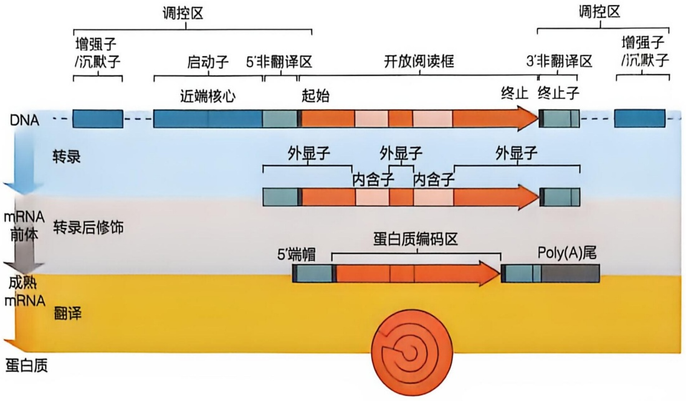

<details>
<summary>flowchart</summary>

```mermaid
graph LR
  subgraph Control ["调控区"]
    direction TB
  A["增强子/沉默子"] --> B["启动子 5'非翻译区"]
  B --> C["起始"]
  C --> D["开放阅读框"]
  D --> E["终止"]
  E --> F["3'非翻译区"]
  F --> G["增强子/沉默子"]
  end

  subgraph Transcription ["转录"]
    direction TB
    H["DNA"] -.-> I["近端核心"]
  I --> J["起始"]
  J --> K["外显子"]
  K --> L["内含子"]
  L --> M["外显子"]
  M --> N["内含子"]
  N --> O["外显子"]
  O --> P["终止子"]
  end

  subgraph Post_Transcription["Post-Transcription [\"转录后修饰\"]"]
    direction TB
    Q["mRNA 前体"] -.-> R["成熟 mRNA"]
  R --> S["翻译"]
  S --> T["蛋白质编码区"]
  T --> U["Poly(A)尾"]
  end

  subgraph Final ["蛋白质"]
    direction TB
    V["蛋白质"] -.-> W["翻译"]
  W --> X["5'端帽"]
  X --> Y["Poly(A)尾"]
  end
```
</details>

## 10.2 细菌基因转录和调控

细菌的基因组织方式和表达调控理论起源于乳糖操纵子（lactose operon）研究。莫诺发现乳糖转运代谢相关基因（lacZ、lacY、lacA）在大肠杆菌基因组上相邻排列，在培养基中葡萄糖为主要碳源时，上述基因表达均受到阻遏蛋白 Lac I 抑制。而当培养基中乳糖为主要碳源时，乳糖代谢物——异乳糖结合阻遏蛋白 Lac I，促使其从 DNA 上解离，促进乳糖转运和代谢的基因同步表达。据此，莫诺提出操纵子（operon）的概念，指出细菌以操纵子形式组织功能相关基因，其表达受转录因子（transcription factor）同步调控。

乳糖操纵子的发现开启了细菌基因表达调控研究的篇章（图 10-2）。Lac I 通过结合乳糖操纵子核心启动子区域下游，阻碍 RNA 聚合酶结合 DNA 从而抑制基因表达，代表了绝大多数转录抑制因子（transcription repressor）的作用机制。针对乳糖操纵子的后续研究发现，除受到 Lac I 的负向转录调控之外，乳糖操纵子还受到代谢产物活化蛋白（catabolite activator protein，CAP）的正向转录调控，CAP 结合第二信使环腺苷酸（cyclic adenosine monophosphate，cAMP）后，结合到乳糖操纵子的启动子区域上游，促进 RNA 聚合酶结合启动子 DNA，激活基因表达，因此该蛋白又被称为环腺苷酸受体蛋白（cAMP receptor protein，CRP）。

图 10-2 以乳糖操纵子为代表的细菌基因结构

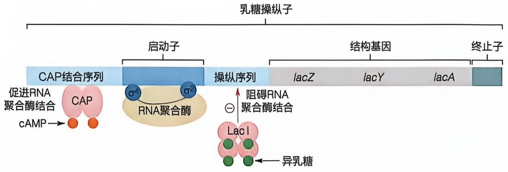

<details>
<summary>flowchart</summary>

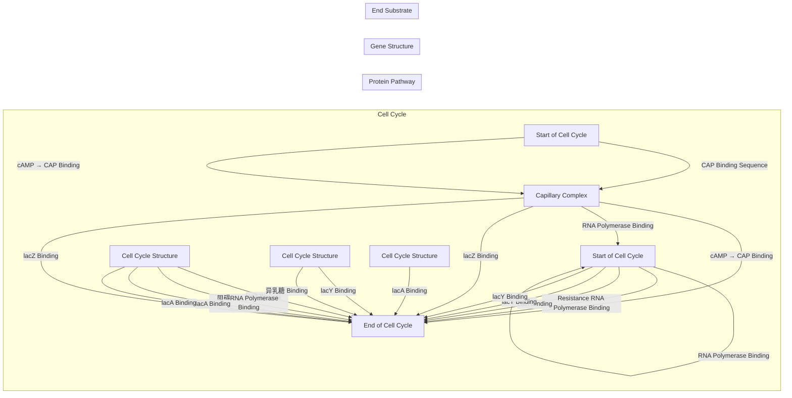
</details>

## 10.2.1 细菌基因转录的基本过程

细菌基因的启动子包含两种类型:$\sigma^{70}$ 启动子和 $\sigma^{54}$ 启动子。$\sigma^{70}$ 启动子通常包含两个核心元件:-10区和-35区。-10区（-10 box）序列位于转录起始位点上游约10个碱基处，长度为6碱基对（base pair, bp），保守序列特征为TATAAT；-35区（-35 box）序列位于转录起始位点上游约35个碱基处，长度为6bp，保守序列特征为TTGACA（图10-3）。细菌启动子-10区和-35区的序列保守程度与基因转录强度呈一定相关性。-10区和-35区之间的距离十分重要，一般为 $16\sim 18$ bp，小于$16\mathrm{bp}$ 或大于 $18\mathrm{bp}$ 的启动子一般转录活性较弱。核糖体RNA基因的启动子还存在UP元件（UP element），其序列富含A/T，能显著促进RNA聚合酶与启动子结合，增强其基因表达活性。部分基因还具有-10延长区（extended -10 element, EXT），鉴别区（discriminator element, DISC），核心酶识别区（core recognition element, CRE）。$\sigma^{54}$ 启动子包含-24区（-24 box）和-12区（-12 box），其保守序列特征分别为GGCA和TTGC。

细菌 RNA 聚合酶（RNA polymerase，RNAP）起始基因转录需要  $\sigma$  因子协助（有关细菌 RNA 聚合酶的发现过程见知识延展 10-3）。科学家在鉴定 RNA 聚合酶亚基组成的过程中，发现阴离子磷酸纤维素（phosphocellulose）层析方法能大大提高 RNA 聚合酶纯度，然而高纯度的 RNA 聚合酶却丧失了体外转录活性。随后发现该纯化步骤去掉了一个关键蛋白，将这个关键蛋白补充到体外转录实验可恢复 RNA 聚合酶转

录活性，因此这个蛋白被命名为 $\sigma$ 因子（sigma factor）。在后续研究中，科学家陆续鉴定出不同类别的 $\sigma$ 因子，例如大肠杆菌 $\sigma$ 因子包括 $\sigma^{70}$ 家族和 $\sigma^{54}$ 家族。$\sigma^{70}$ 家族成员包括 $\sigma^{70}$、$\sigma^{38}$、$\sigma^{32}$、$\sigma^{28}$、$\sigma^{24}$ 和 $\sigma^{19}$，而 $\sigma^{54}$ 家族只有一个成员，即 $\sigma^{54}$，它们通过识别不同的启动子各自分工大肠杆菌中的基因表达。

在转录起始阶段，RNAP 和  $\sigma$  因子组装成 RNAP- $\sigma$  全酶形式，识别启动子 DNA 起始 RNA 合成。 $\sigma^{70}$  家族因子具有 3 个保守结构域， $\sigma_{2}$ 、 $\sigma_{3,2}$  和  $\sigma_{4}$ 。 $\sigma_{2}$  和  $\sigma_{4}$  结构域结合在 RNA 聚合酶表面， $\sigma_{3,2}$  深入 RNA 聚合酶内部。除保守结构域外，细菌看家  $\sigma$  因子（如大肠杆菌  $\sigma^{70}$ ）还包括  $\sigma_{1}$  和  $\sigma_{3,1}$  等区域（图 10-3）。RNAP 和  $\sigma$  因子共同负责识别启动子 DNA 序列。RNAP- $\alpha$ CTD 识别 UP 元件， $\sigma_{4}$  结构域识别 -35 区， $\sigma_{3,1}$  识别 EXT， $\sigma_{1,2}$  识别 DISC，RNAP 核心酶识别 CRE 区（图 10-3）。

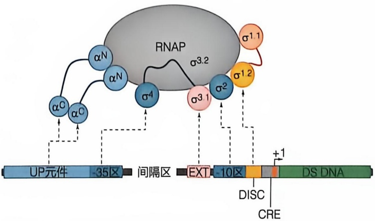

<details>
<summary>flowchart</summary>

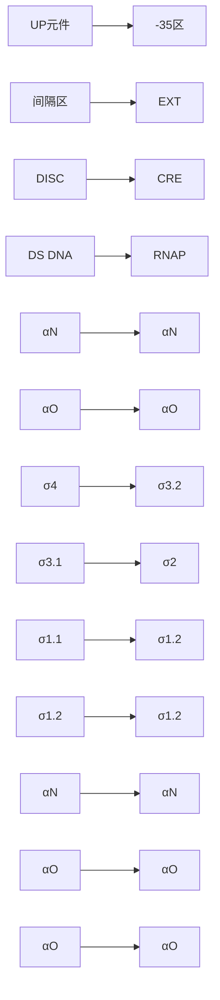
</details>

图 10-3 细菌核心启动子结构和序列识别方式

RNAP- $\sigma$  全酶起始转录的过程可以分为 5 个阶段。① RPc（RNAP-promoter DNA closed complex）阶段:RNAP- $\sigma$  全酶通过  $\sigma_{4}$  结构域识别并结合启动子 -35 区，从而定位到基因启动子区域，在该阶段 RNAP- $\sigma$  全酶结合闭合形式的启动子双链 DNA。② RPi（RNAP-promoter DNA intermediate complex）阶段:RNAP- $\sigma$  全酶通过  $\sigma_{2}$  结构域在 -10 区逐渐解链启动子 DNA，并且将解链的部分核苷酸碱基（非模板链 -11A、-7T、+2G）结合在蛋白口袋中，一方面实现序列特异性识别，一方面稳定解链的单链 DNA。③ RPo（RNAP-promoter DNA open complex）阶段:RNAP- $\sigma$  全酶将启动子 DNA 解链约 13 bp（-11 到 +2）形成稳定的转录泡（transcription bubble），将单链模板链 DNA 置于催化中心，等待三磷酸核糖核苷酸（NTP）结合，起始 RNA 合成。④ RPitc（RNAP-promoter DNA initial transcribing complex）阶段，RNAP 聚合酶利用 NTP 起始 RNA 合成并逐渐延伸新生 RNA 链，在该过程中大量短片段 RNA（abortive transcript）被不断合成和释放。⑤ 当新生 RNA 延长至几个到十几个碱基后，RNAP 脱离启动子 DNA 往前行进，进入转录延伸阶段。

## 10.2.2 细菌转录起始调控

细菌主要通过 $\sigma$ 因子和转录因子调控基因转录起始。一个细菌基因组平均编码约10个 $\sigma$ 因子。细菌基因组 $\sigma$ 因子的编码数量与其生存环境复杂性呈正相关，例如生殖支原体基因组编码1个 $\sigma$ 因子，大肠杆菌基因组编码7个 $\sigma$ 因子，天蓝色链霉菌编码65个 $\sigma$ 因子。$\sigma$ 因子具有严谨的DNA序列识别特异性，因此每个 $\sigma$ 因子负责转录不同的基因操纵子。细菌基因组除了通过多个 $\sigma$ 因子调控基因表达之外，每个细菌基因组平均编码几百个转录因子，如大肠杆菌编码300多个转录因子。大多数转录因子具有DNA结合域（DNA-binding domain，DBD）和调节域（regulatory domain，RD）。转录因子在上游信号的调控下，通过改变自身构象或聚合状态，改变和DNA以及RNA聚合酶的相互作用能力，从而激活或抑制转录。

转录因子激活基因转录的机制复杂多样（图 10-4）。调控乳糖操纵子的 CRP 作为代表性转录因子，其转录激活机制被深入研究。CRP 的转录激活机制大概分为两种类型:在第一种类型中（class I activation），CRP 结合位于 -35 区上游的顺式元件，通过与 RNA 聚合酶 α 亚基的 C 端结构域（RNAP-αCTD）相互作用招募 RNA 聚合酶，激活基因转录。在第二种类型中（class II activation），CRP 结合位于与 -35 区部分重叠的顺式元件，同时与 RNAP-αCTD 和 σ 因子相互作用，激活基因转录。细菌大多数转录激活因子通过上述两类经典机制发挥作用。除此之外，研究者近年来发现转录因子还可以通过多种非经典方式激活基因转录:大肠杆菌 MerR 家族转录因子识别 -35/-10 区

(A)

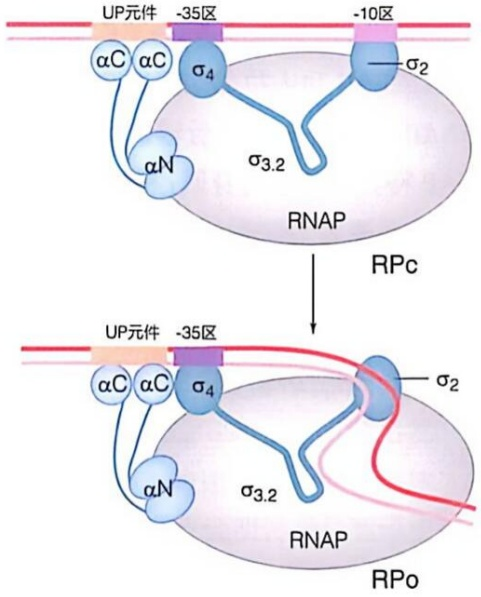

<details>
<summary>flowchart</summary>

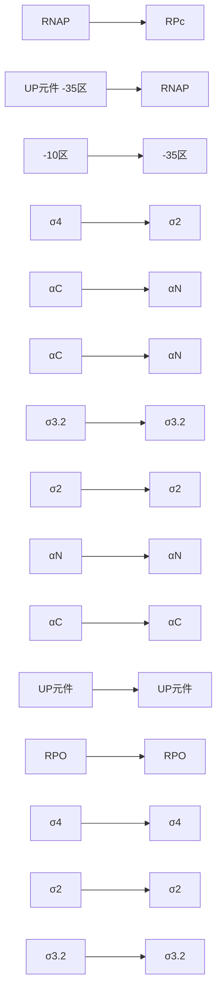
</details>

(B)

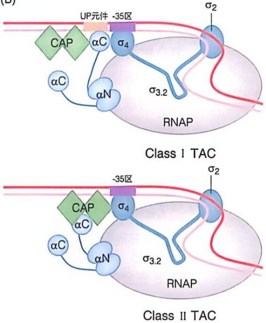

<details>
<summary>chemical</summary>

RNA polymerase II (RNA polymerase II) TAC structures showing CAP, αC, and αN subunits with 3.2σ regions and 35区 distances
</details>

(C)

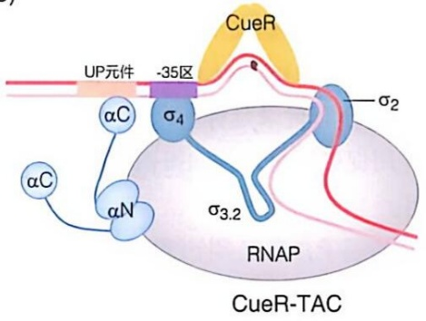

<details>
<summary>flowchart</summary>

This diagram illustrates the interaction between UP elements and RNAP in a CueR-TAC model, showing interactions with stress states (σ2, σ3.2) and receptor subunits (αC, αN).
</details>

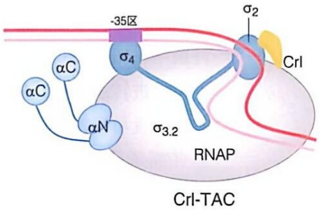

<details>
<summary>chemical</summary>

Diagram of RNA polymerase II (RNA polymerase II) showing transcriptional modification sites and restriction enzyme activity
</details>

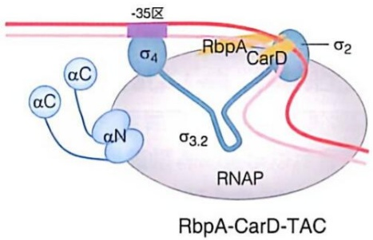

<details>
<summary>chemical</summary>

Diagram of RbpA-CarD-TAC protein interaction showing transcriptional subunits and regulatory regions
</details>

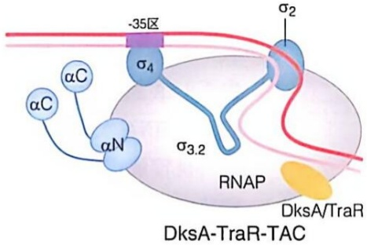

<details>
<summary>chemical</summary>

Diagram of DksA-TraR-TAC protein structure showing alpha helices, sigma regions, and RNAP binding sites
</details>

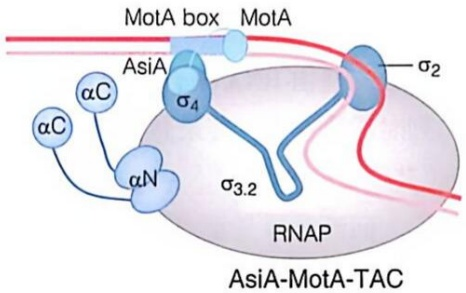

<details>
<summary>flowchart</summary>

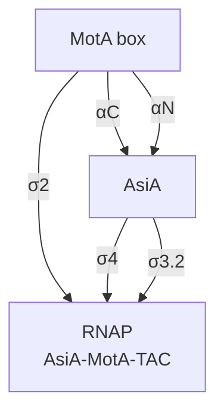
</details>

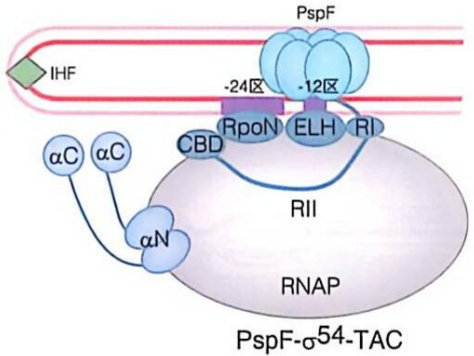

<details>
<summary>chemical</summary>

Diagram of PspF-σ54-TAC protein complex showing alpha-coupled and beta-sheets with labeled domains and interactions
</details>

图 10-4 细菌的转录激活机制示意图

（A）细菌转录起始过程中闭合复合物向开放复合物的转变（PDB 编号:6PSQ，4XLN）。（B）细菌经典的 Class I 和 Class II 激活模型（PDB 编

号:6B6H，5I2D)。(C)细菌的非经典激活模型（PDB编号:6LDI, 6KJ6, 6EDT, 7KHI, 6K4Y, 7QV9）。A, B改绘自Fang C, et al. Acta Biochim Biophys Sin (Shanghai), 2022, 54(1): 25-36.

中间区域的顺式元件，通过改变 DNA 构象激活转录；结核分枝杆菌 RbpA 和 CarD 等转录因子结合 RNAP- $\sigma$  全酶后，通过序列非特异性结合启动子 DNA，稳定转录起始复合物激活转录；大肠杆菌 Crl、DksA、TraR 和土拉弗朗西斯菌的 MglA-SspA 等转录因子不结合 DNA，而是通过稳定 RNAP- $\sigma$  活性构象激活转录；还有部分转录因子与  $\sigma_{4}$  结构域竞争结合 RNAP，引导 RNAP 特异性转录自身调控基因（如耻垢分枝杆菌的 PafBC，噬菌体 T4 编码的 AsiA/MotA）。调控  $\sigma^{54}$  家族的转录因子一般呈六聚体形式，其结合在核心启动子上游区域，在宿主整合因子（integration host factor，IHF）帮助下，利用 ATP 水解酶活性激活转录。转录因子抑制基因转录的机制相对简单，其主要通过序列特异性结合 DNA，阻遏 RNA 聚合酶结合启动子 DNA 或阻止 RNA 聚合酶前进。

## 10.2.3 细菌基因转录延伸

细菌基因转录延伸主要受到 NusG、GreA/B 和 NusA 等延伸因子调控，它们通过与 RNA 聚合酶及其他蛋白相互作用，共同影响 RNA 的延伸过程（图 10-5）。

NusG 在结构和功能上与真核生物中的 SPT5 因子类似。NusG 含有两个功能结构域:NGN 和 KOW 结构域。NGN 结构域与 RNA 聚合酶和上游 DNA 相互作用。在大肠杆菌中，NusG 单独作用时促进 RNA 聚合酶转录延伸。NusG 与转录终止因子  $\rho$  相互作用促进转录终止，与核糖体相互作用促进转录延伸和蛋白质翻译，NusG 的 KOW 结构域负责和核糖体、 $\rho$  因子相互作用。

NusA 是细菌和古菌特有的转录延伸因子，具有多个结构域。在大肠杆菌中，NusA 单独作用能够稳定转录暂停复合物，促进转录终止。NusA 也能与 NusG 协同作用促进转录与翻译偶联。

GreA/B 是转录校正因子，其功能与真核生物中的 TFII S 类似。在转录延伸过程中，RNA 聚合酶因碱基掺入错误而发生停滞时，GreA/B 结合到 RNA 聚合酶 NTP 通道激活其 RNA 水解活性，切除错配碱基，帮助 RNA 聚合酶重新启动转录延伸。

在转录延伸过程中，细菌 RNA 聚合酶以约 50 nt/s 的速度高效延伸 RNA 链，但遇到特定 DNA 序列、RNA 错配或 DNA 损伤时会发生转录暂停。细菌转录暂停过程包括序列诱导暂停（elemental pausing）和回溯暂停（backtracking pausing）。

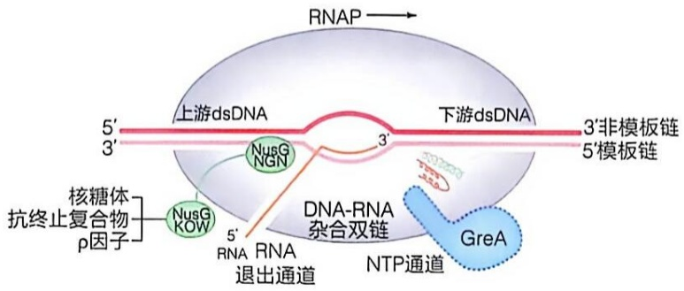

<details>
<summary>text_image</summary>

RNAP
上游dsDNA
3'
5'
3'
NusG
NGN
3'
下游dsDNA
3'非模板链
5'模板链
DNA-RNA
杂合双链
GreA
NTP通道
5'
RNA
RNA
退出通道
核糖体
抗终止复合物
p因子
</details>

图10-5 细菌的转录延伸复合物

序列诱导暂停是 RNA 聚合酶转录延伸时自然发生的短暂停顿，不需要外部因素或调控因子介入，是由 RNA 聚合酶转录到具有特殊 DNA 序列时诱导发生。转录暂停的序列特征为  $G_{-10}Y_{-1}G_{+1}$  （其中 -1 对应于 RNA 3' 端，Y 代表 C 或 T）。

回溯暂停是指 RNA 聚合酶转录延伸过程中，遭遇 DNA 损伤、行进障碍或需要校正 RNA 合成错误时在 DNA 模板上后退导致的暂停。回溯暂停的 RNA 聚合酶如果不重新激活，会影响基因表达和 DNA 复制。细菌利用多种机制解除回溯暂停:Gre 因子切除错配 RNA 片段重新启动延伸；Mfd 蛋白将 RNAP 从受损的 DNA 上移除，UvrD 蛋白招募 DNA 损伤修复复合物促进 DNA 损伤修复。

细菌基因转录和蛋白质翻译紧密偶联（图10-6）。1970年，米勒等通过电子显微镜，首次观察到大肠杆菌mRNA链上同时存在RNA聚合酶和核糖体，并将与RNA聚合酶最接近的核糖体命名为前导核糖体（leading ribosome）。随后发现RNA聚合酶合成mRNA的速度与前导核糖体

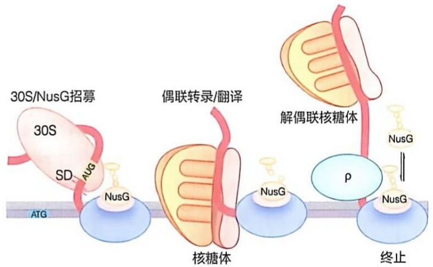

<details>
<summary>flowchart</summary>

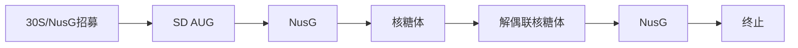
</details>

图10-6 细菌的转录翻译偶联调控

翻译蛋白质的速度保持一致，证明转录与翻译相互偶联。转录翻译偶联能够促进 RNA 聚合酶转录延伸，防止  $\rho$  因子提前与 RNA 聚合酶结合造成转录提前终止（premature transcription termination），保护 mRNA 不被核酸内切酶（RNase E）降解。近年来，多国科学家同步解析了细菌转录翻译偶联复合物的冷冻电镜结构，揭示了转录翻译偶联过程的复杂机制。

## 10.2.4 细菌基因转录终止

基因转录终止是 RNA 聚合酶停止 RNA 延伸、释放 RNA 并从 DNA 上解离的过程（图 10-7）。转录终止异常会干扰下游基因表达，阻碍 RNA 聚合酶循环利用，破坏基因组稳定性。细菌基因转录终止主要有两种方式:一种是固有转录终止（intrinsic termination），也称为  $\rho$  因子非依赖型转录终止；另一种是  $\rho$  因子依赖型转录终止（ $\rho$ -dependent termination）。此外，在一些特定的情况下，基因转录终止还可以通过 Mfd 蛋白移位，以及 RNA 聚合酶碰撞等方式实现。

细菌 RNA 聚合酶转录至固有终止子序列后自发终止转录的方式，称为固有转录终止。固有终止子由富含 G/C 的反向重复序列（inverted repeat sequence）和紧随其后的富含 T 的序列（U tract 序列）组成，转录出的 RNA 在 U tract 序列上游能够形成发卡结构。固有转录终止过程可分为 4 个步骤:① RNA 聚合酶转录至终止位点时，U tract 序列诱导转录暂停；②富含 G/C 的反向重复序列形成 RNA 发卡结构，撑开 RNA

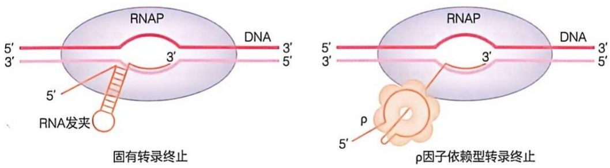

图 10-7 细菌转录终止机制模型

PDB 编号:7YPA，8E6X，8E6W。改绘自 SANTANGELO T, et al. Nat Rev Microbiol, 2011, 9: 319-329.