聚合酶克服障碍并保持转录连续性，从而维持基因表达处于正常水平。TF IIS 还参与染色质转录启动活性（chromatin transcription-enabling activity, CTEA），通过与 p300 和乙酰辅酶 A 协作促进转录通过核小体。

FACT 是一种组蛋白伴侣复合物，参与 H2A-H2B 二聚体的拆解与重新组装，在 Pol II 转录通过核小体时发挥作用。延伸过程中组蛋白可能部分丢失，但 FACT 能快速重新将组蛋白组装到 Pol II 后方的 DNA 上，从而维持染色质完整性。FACT 不仅帮助组蛋白重组，还防止 DNA 裸露导致隐蔽启动子暴露。FACT 及相关因子的突变会导致基因组隐蔽启动位点的异常转录。

染色质重塑复合物通过利用ATP改变核小体位置和组成，帮助PolⅡ穿越染色质障碍。复合物如SWI/SNF、ISWI和CHD家族可以滑动、替换或剔除核小体，开放被核小体占据的基因启动子区域。它们还能调节核小体间距，维持整体染色质稳定性。

染色质修饰酶复合物通过可逆的化学修饰，如组蛋白的甲基化、乙酰化和泛素化，控制转录活动。这些修饰通常作用于组蛋白尾部，影响组蛋白与DNA的相互作用及效应因子的招募。例如，一方面，组蛋白乙酰转移酶（HAT）通过在赖氨酸残基上添加乙酰基，减少其正电荷，减弱组蛋白与DNA的结合，使染色质松弛，从而为转录机器提供空间；另一方面，Set2-Rpd3S通路利用组蛋白甲基化信号激活特定去乙酰化酶，确保染色质在聚合酶通过后恢复至开放状态，抑制异常转录。

Pol II 的运动速度受多种因素影响，包括基因结构、RNA 后加工及染色质结构等。这些因素不仅决定转录速度，也影响基因表达效率和准确性。全基因组研究显示，不同生物体中 Pol II 的延伸速度随年龄变化。例如，在线虫和果蝇中，降低转录速度与寿命延长相关。此外，通过过表达组蛋白成分调控 Pol II 速度，可以抵消核小体定位的年龄变化，从而延长果蝇寿命并增强人类细胞的分裂潜能。这些研究揭示了转录速度可能与寿命和健康密切相关，为进一步理解老化机制及开发治疗策略提供了重要线索。

## 10.5.6 共转录事件及其调控机制

在真核生物细胞中，Pol II 不仅负责将 DNA 转录为 RNA，还介导一系列同步发生的 RNA 处理事件，这些过程被统称为共转录事件（图 10-34）。首先，转录开始时，RNA 5' 端被加帽，有助于 mRNA 的稳定、运输和翻译。接下来，RNA 剪接在转录过程中动态进行。剪接复合物与转录机器协同作用，移除内含子并连接外显子，最终形成成熟的 mRNA。在转录过程中进行 RNA 3' 端加工，包括 pre-mRNA 的 3' 端切割和多腺苷酸化，这对于 mRNA 的后续功能至关重要。此外，RNA 编辑和修饰，如 m$^{6}$A 甲基化，进一步增强了 RNA 分子的多样性与功能性，这些修饰与转录过程紧密相关。这些复杂的共转录机制表明，Pol II 不仅是一个转录工具，更是一个集成了多种功能的细胞核内加工平台，通过精确调控以上过程，保障了基因表达的高效性和准确性。转录延伸复合物在这一过程中发挥了枢纽作用，为转录机制与 RNA 处理机制的结合提供了物理和功能平台，使它们能够协同工作。此外，由于 RNA 在转录过程中与染色体结构产生复杂的相互调控，这些共转录事件也与染色质结构密切相关。

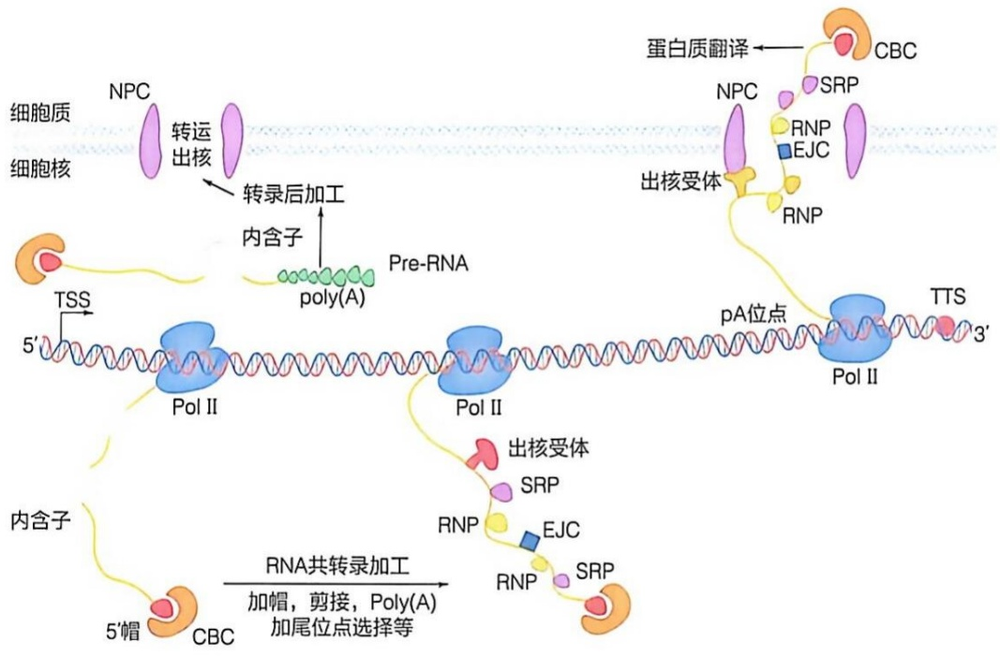

<details>
<summary>flowchart</summary>

```mermaid
graph LR
  subgraph Cell_Culture ["细胞质与核"]
    direction TB
  NPC["NPC"] --> Transcription["转运\n出核"]
  Transcription --> Posttranscription["转录后加工\n内含子"]
  Posttranscription --> PreRNA["Pre-RNA\npoly(A)"]
  PreRNA --> PolII1["Pol II"]
  PolII1 --> pA["pA位点"]
  pA --> TTS["TTS"]
  TTS --> CBC["CBC"]
  CBC --> RNP["RNP"]
  RNP --> EJC["EJC"]
  EJC --> SRP["SRP"]
  SRP --> CBC
  end

  subgraph Membrane ["内含子"]
    direction TB
  TSS["TSS"] --> PolII2["Pol II"]
  PolII2 --> Out["出核受体"]
  Out --> SRP2["SRP"]
  SRP2 --> RNP3["RNP"]
  RNP3 --> EJC3["EJC"]
  EJC3 --> SRP3["SRP"]
  SRP3 --> CBC
  end

  subgraph Translation ["蛋白质翻译"]
    direction TB
  SRP4["SRP"] --> CBC
  CBC --> SRP4["SRP"]
  SRP4 --> EJC4["EJC"]
  EJC4 --> RNP4["RNP"]
  RNP4 --> SRP4
  SRP4 --> CBC
  end

  subgraph Modification ["RNA共转录加工\n加帽，剪接，Poly(A)\n加尾位点选择等"]
    direction TB
  CBC --> 5'帽["5'帽"]
  n5["5'帽"] --> CBC
  CBC --> PolII2
  PolII2 --> Out
  Out --> SRP3
  SRP3 --> EJC3
  EJC3 --> RNP3
  RNP3 --> SRP3
  SRP3 --> CBC
  CBC --> CBC
```
</details>

图 10-34 RNA 聚合酶延伸过程中的共转录事件

在转录延伸过程中，Pol II 不可避免地与正在复制中的 DNA 聚合酶相遇并发生碰撞。由于转录和复制共享相同的 DNA 模板，且 Pol II 在 DNA 复制阶段同样活跃，转录和复制机器在细胞内可能发生头-尾或头-头的碰撞。巨大的聚合酶及其结合的延伸因子是 DNA 复制体不可跨越的障碍，加之转录过程中 DNA 超螺旋变化或形成的 R 环结构，都会阻碍复制叉的进程，最终导致 DNA 损伤和基因组不稳定。值得注意的是，DNA 复制起点大多位于开放染色质中，且靠近活跃的转录区域，这表明转录和复制可能是被精细调控并协同进行的。一方面，一些延伸因子，如 Spt6 和 DNA 解旋酶 RECQL5，能够抑制复制压力；另一方面，DNA 聚合酶还能够利用 Pol II 产生的 mRNA 来重启复制过程。这些保护机制帮助维持了在活跃转录和复制状态下基因组的稳定性。

转录偶联修复（transcription-coupled repair，TCR）是一种专门修复转录过程中DNA损伤的机制，涉及多种蛋白质，如Cockayne综合征蛋白B（CSB）、Cockayne综合征蛋白A（CSA）和紫外线刺激蛋白质骨架A（UVSSA）（图10-35）。这些蛋白有助于识别停滞的聚合酶并移除妨碍转录的DNA损伤。当CSB或CSA功能受损时，会引发Cockayne综合征，这是一种遗传性疾病，表现为严重的神经功能退化；而当UVSSA功能受损时，会引发UV敏感综合征，其特征是轻微的皮肤光敏感，但不涉及神经系统。PolⅡ在遇到DNA损伤或与复制中的DNA聚合酶发生碰撞时停滞，进而起始TCR。首先，CSB蛋白识别并结合到停滞的聚合酶上，进而招募CSA和UVSSA等到损伤位点，稳定修复复合物并推动修复过程。接着，TCR复合物吸引TFⅡH，利用其 XPD 亚基提供的解旋酶活性，移除停滞的聚合酶，并使得 DNA 双螺旋在损伤部位局部解开，从而允许修复机器结合并最终修复这些损伤，确保转录过程的恢复。此外，TFⅡH 在 TCR 中的功能还依赖于 Pol Ⅱ RPB1 亚基的泛素化修饰，这一修饰由 CSA 介导的环状 E3 连接酶（CRL）完成。在 DNA 损伤修复和转录恢复过程中，TFⅡH 的结构和功能发生显著变化，从一个通用转录因子转变为 DNA 修复因子。即 TFⅡH 与 XPA 和 XPG 等核苷酸切除修复（NER）因子相互作用，激活 XPD 的解旋酶活性，推动 DNA 损伤的修复。通过这些复杂的相互作用和修饰，细胞能够有效修复转录过程中的 DNA 损伤，确保基因的正常表达和细胞的健康生存。

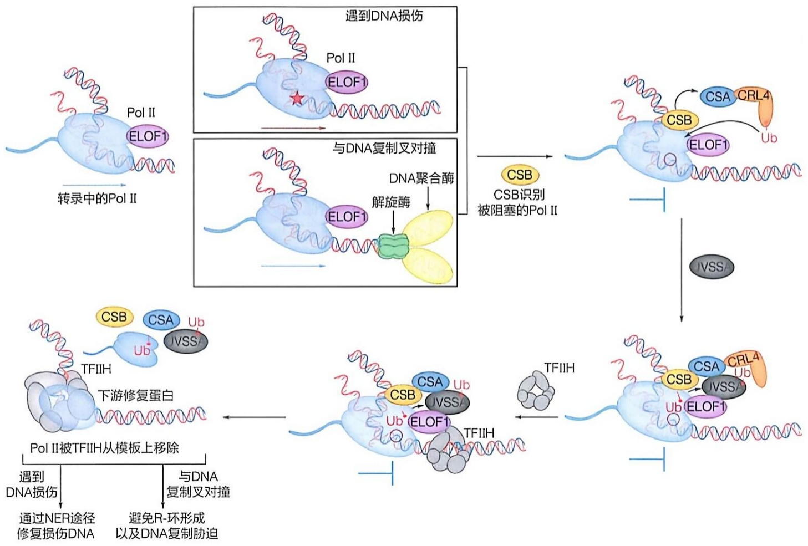

<details>
<summary>flowchart</summary>

```mermaid
graph TD
  Start["Start"] --> PolII["Pol II\nELOF1"]
  PolII --> DNADamage["遇到DNA损伤"]
  DNADamage --> PolII
  PolII --> Transcription["转录中的Pol II"]
  
  subgraph DNA["\"与DNA复制叉对撞\""]
    direction TB
  DNAReplication["DNA聚合酶\n解旋酶"] --> ELOF1["ELOF1"]
  ELOF1 --> DNAReplication
  end
  
  Transcription -->|"CSB识别\n被阻塞的Pol II"| CSB["CSB"]
  CSB --> CSB_CRL4["CSA CRL4\nUb"]
  CSB --> CSB_CRL4
  
  subgraph IVSS_CSB_n_Pol_II_IVSS_IVSS["\"IVSS\" ->|\"CSB识别\n被阻塞的Pol II\"| IVSS[\"IVSS\"]"]
  IVSS --> CSB_CRL4
  
  Transcription -->|"TSIIH\n下游修复蛋白\nPol II被TFIIH从模板上移除\n遇到DNA损伤\n通过NER途径修复损伤DNA\n与DNA复制叉对撞\n避免R-环形成以及DNA复制胁迫"| TFIIH["TFIIH"]
  TFIIH --> CSB_CRL4
  
  subgraph TSIIH_TSIIH_nCSB_n_Pol_II_nCSB_CRL4_nUb_CSB_CRL4["\"TSIIH\" ->|\"TSIIH\nCSB识别\n被阻塞的Pol II\nCSB_CRL4\nUb\"| CSB_CRL4"]
  
  CSB_CRL4 --> CSB_CRL4
  CSB_CRL4 --> CSB_CRL4
  
  CSB_CRL4 -.->|"TSIIH" | CSB_CRL4
```
</details>

图 10-35 TCR 复合物组装模型及转录偶联修复的作用机制

当转录中的PolⅡ在模板上遭遇DNA损伤或DNA复制叉对撞，CSB、CSA和UVSSA逐步与其结合，并与RPB1-K1268和UVSSA-K414的泛素化共同作用，将通用转录因子TFⅡH复合物定位到被阻塞的延伸中的PolⅡ，从而将PolⅡ从DNA模板移除。

## 10.6 真核生物转录终止

## 10.6.1 真核生物 mRNA 的转录终止

真核生物 mRNA 转录终止与新生 mRNA 前体的 3' 端加工偶联，其主要分为转录终止信号识别、RNA 切割、poly(A) 加尾、Pol II 解离几个过程。其中，新生 mRNA 前体的 3' 端加工由一个包含多个亚基的切割加工超大复合物完成（图 10-36）。该加工复合物识别多腺苷酸化信号（polyadenylation signal，PAS）以及附近序列元件，启动转录终止过程。多腺苷酸化信号序列较为保守，通常为 A[A/U]UAAA，位于 mRNA 前体切割位点上游 10\~30 nt。多腺苷酸化信号附近序列元件还包括切割位点下游的富含鸟苷酸 / 尿嘧啶信号（G/U-rich signal）。人源切割加工复合物由至少 14 个亚基组成，包括切割和多腺苷酸化特异因子（cleavage and polyadenylation specificity factor，CPSF）、切割刺激因子（cleavage stimulation factor，CstF）、切割因子 CF I 和 CF II（cleavage factors I and II）、RBBP6 等调控亚基。CPSF-CstF 复合物通过识别 RNA 序列信号和 Pol II CTD 磷酸化信号（CTD Ser2P）定位到 Pol II 转录延伸复合物。在信号识别阶段，CPSF 识别切割位点上游的 PAS 信号，CstF 识别切割位点下游的富含 G/U 信号，Pcf11 亚基识别 SPT5 和 Pol II CTD 的磷酸化修饰信号。CPSF 中保守的核酸内切酶 CPSF73 亚基完成 mRNA 前体的切割，CPSF 模块招募的 poly(A) 聚合酶 [poly(A) polymerase, PAP] 对切割后的 mRNA 前体 3' 端加 Poly(A) 尾。哺乳动物中的 Poly(A) 尾平均长约 250 nt，而在酵母中则约为 70 nt。新形成的 Poly(A) 尾被细胞核的多腺苷酸结合蛋白(nuclear poly(A)-binding protein, PABPN) 结合，其长度也受其控制，加尾完毕的成熟 mRNA 被运送到细胞质中翻译。

图10-36 真核转录终止示意图

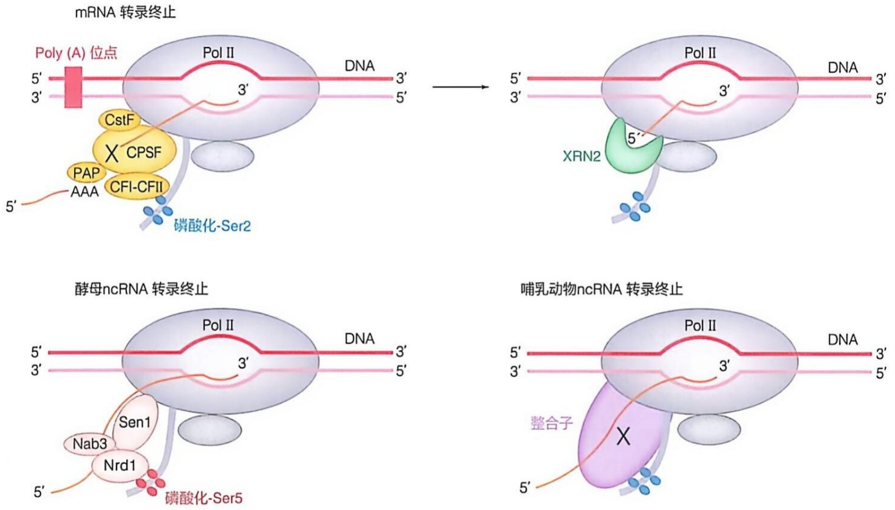

新生 mRNA 前体的 3' 端加工和 Pol II CTD 去磷酸化修饰紧密偶联。Pol II CTD 磷酸酶 PP1 和 SSU72 与 CPSF 复合物相互作用进而定位到转录终止区域，去磷酸化 Pol II CTD 的 Ser5P/Ser7P（SSU72）和 Tyr1P（PP1），上述过程在酿酒酵母细胞中的偶联更加紧密，因为酿酒酵母细胞中的两个磷酸酶（Glc7 和 Ssu72）和 CPF 组成稳定的复合物。Pol II CTD 去磷酸化促使转录延伸因子解离，诱导 Pol II 构象变化（如形成二聚体），减缓 Pol II 延伸速度。

成熟 mRNA 被运送到细胞质的同时，Pol II 仍然往下游缓慢行进并同时继续合成 RNA，当 RNA 合成一定长度之后（从酵母细胞中的几十 bp 到人源细胞的数千 bp），合成终止，Pol II 从基因组 DNA 解离。当前有三种模型用来解释该过程:异构模型（allosteric model）、鱼雷模型（torpedo model）和整合模型。异构模型认为:Pol II 通过 PAS 位点后，转录延伸因子解离，并诱导 Pol II 构象变化，减慢 Pol II 合成 RNA 速度，最终停止 RNA 合成并解离 DNA 和 RNA。鱼雷模型认为:CPSF-CstF 复合物切割前体 mRNA 后，一个保守的 RNA 外切酶（酵母 Rat1，人 XRN2、拟南芥 XRN3）捕获下游 RNA 5' 端，边降解 RNA 边追赶 Pol II，追赶上 Pol II 后引发 Pol II 解离。近年来，生物化学、结构生物学、遗传学的证据更加倾向于支持异构和鱼雷结合的整合模型，张余等解析的 Rat1-Pol II 冷冻电镜复合物结构表明，RNA 外切酶稳定结合在 Pol II 的 RNA 退出通道外侧，促使转录延伸因子解离，减慢 Pol II 转录速度，而 RNA 外切酶通过不断缩短 RNA 长度，最后将 RNA 从 Pol II 催化中心拖拽出来完全降解，同时将 Pol II 从基因组 DNA 上解离。

## 10.6.2 真核生物非编码 RNA 的转录终止

真核生物非编码 RNA 的转录终止不依赖 PAS 信号和 CPSF-CstF/XRN2 复合物。酵母非编码 RNA（snRNA 和 snoRNA）的转录终止由 NNS（Nrd1-Nab3-Sen1，NNS）复合物介导。NNS 复合物中包含两个 RNA 结合蛋白 Nrd1 和 Nab3，以及一个保守的 RNA/DNA 解旋酶 Sen1。Nrd1 和 Nab3 分别识别 RNA 的特异序列 GUAA/G 和 UCUUG。Sen1 具有依赖 ATP 的 5'→3' 解旋酶活性，能与 Nrd1 和 Pol II 相互作用。首先，Nrd1 和 Nab3 通过识别 RNA 序列信号和 Pol II CTD 磷酸化信号（Ser5P）结合到 Pol II 和 RNA，随后招募 Sen1 至 Pol II 转录延伸复合物。生物化学和结构数据表明，Sen1 转录终止机制与细菌 ρ 因子类似。Sen1 结合在 Pol II 的 RNA 退出通道外侧，利用 5'→3' 解旋酶活性将 RNA 拖拽出 Pol II 催化中心，终止转录。后生动物没有 Nrd1 和 Nab3 同源蛋白，snRNA 和 snoRNA 的转录终止主要由整合因子（Integrator）复合物介导，Integrator 复合物同样结合在 Pol II RNA 退出通道外侧，其转录终止依赖于该复合物的外切酶活性。

## 10.6.3 真核生物 RNA Pol II 的其他转录终止机制

Pol II 也可通过其他机制终止转录。①整合因子介导的转录提前终止（pre-mature termination）:Pol II 转录 mRNA 时会在基因启动子近端发生暂停，等待信号进入转录延伸阶段。不允许通行的 Pol II 会招募整合因子，切割未成熟的 RNA，随后诱导 Pol II 释放 mRNA 并从基因组 DNA 解离，snRNA 的转录终止也依赖整合因子复合物；②DNA 损伤诱导转录终止:Pol II 转录延伸过程中遇到 DNA 损伤时，其招募相关蛋白移除 Pol II，促进 DNA 修复；③自发终止:当 Pol II 转录至富含 T 的 DNA 序列时，Pol II 在不依赖其他蛋白的情况下能够效率较低地自发完成转录终止，XRN2 可促进自发转录终止。新生 RNA 可通过多种方法分析（知识延展 10-4）。

## 知识延展 10-4

## 示踪转录活性的新生 RNA 分析方法

在现代生物分子研究中，了解 RNA 的新生与其后续的命运是极为重要的。传统的转录组学研究，如 RNA 测序（RNA-seq）为我们提供了细胞在某一时刻的基因表达快照，但这些信息仅能反映出 RNA 的稳定状态，除了转录过程本身外还受到 RNA 稳定性等的影响。因此，为了直观地分析转录活性，科学家们开发了多种专门针对新生 RNA 的测序技术，这些技术能够更精确地捕捉 RNA 合成的动态变化。

## (1) 染色质结合新生 RNA 分析 (ca-RNA-seq)

此方法利用高盐溶液来富集与染色质结合的新生RNA，并进行后续的测序分析。这种策略能够有效排除细胞质和核质中的RNA干扰，只研究转录中的基因。然而，某些RNA（如Xist）本身就有较强的染色质结合性，可能会导致这些RNA的过量富集。

## (2) Pol II 结合新生 RNA 分析 (NET-seq)

这种技术通过免疫共沉淀方法富集与 RNA聚合酶Ⅱ（Pol Ⅱ）结合的 RNA，然后进行测序。NET-seq 能够揭示转录活性位点，从而帮助研究者详细了解哪些基因在某一时间点处于活跃转录状态。尽管如此，这项技术也可能会捕获一些与延伸 Pol Ⅱ 结合的非新生 RNA，如核小 RNA（snRNA）。

## （3）正在合成中的新生 RNA 分析（GRO-seq 和 PRO-seq）

GRO-seq 利用一种称为 “run-on” 的技术，在特定条件下在细胞外促使已经暂停的 Pol II 恢复转录，并使用标记的核苷酸对新生 RNA 进行标记和测序。PRO-seq 则可以精确捕捉到 Pol II 在 DNA 上的位置，即具体在哪个核苷酸上。这两种方法能够细致地描绘出细胞内转录活跃的聚合酶位点。

## (4) 代谢法标记新生 RNA (TT-seq)

TT-seq 技术通过向活细胞中引入标记的核苷酸 4sU 来标记新合成的 RNA，然后利用基因组测序方法鉴定这些新合成的 RNA 分子。这种方法不仅能够监测新生 RNA 的合成，还能观察到 RNA 的共转录加工和降解过程，是一种动态的转录活性观测手段。

这些方法各有优势和局限，相互补充，共同构建了一个多维的转录活性分析框架。然而，这些技术目前还难以单独用于分析单一细胞内的转录异质性，这是未来研究中需要解决的问题。通过这些先进的技术，研究者可以更全面地理解基因在不同环境和条件下如何被调控，从而深入探索生物体的复杂生命活动。

## 10.7 以 RNA 为模板生成 RNA

病毒是自然界中一种独特的微小生物体，既是引发传染病的主要病原体之一，也是探索和发现生命科学新现象和新规律的重要模式生物。在传统病毒学概念中，根据病毒基因组类型，大体可划分为 DNA 病毒和 RNA 病毒两类。其中，RNA 病毒的转录复制以及其特有的 RNA 依赖的聚合酶催化反应，是自然界中极为独特的生物学过程。此外，在植物中也发现了 RNA 依赖的 RNA 合成。

对病毒 RNA 依赖的核酸合成研究，最早开始于对门戈病毒（mengovirus）和脊髓灰质炎病毒（poliovirus）等小 RNA 病毒的研究。抑制 DNA 依赖的 DNA 合成和 DNA 依赖的 RNA 合成，都不影响小 RNA 病毒的增殖，说明这些病毒中存在一种 RNA 依赖的 RNA 聚合酶，可以直接以 RNA 为模板完成 RNA 的复制。随后，戴维·巴尔的摩（David Baltimore）和霍华德·特明（Howard Temin）分别在对劳舍尔氏鼠白血病病毒（Rauscher mouse leukaemia virus，R-MLV）和劳氏肉瘤病毒（Rous sarcoma virus，RSV）的研究中，发现了一种能够以 RNA 为模板合成相应 DNA 的酶，由此明确了“RNA 依赖的 DNA 聚合酶”（RNA-dependent DNA polymerase，RdDp）的存在，也称“逆转录酶”（reverse transcriptase，RT）。

根据病毒基因组的特点和极性，RNA病毒主要分为单股正链RNA病毒（positive-sense single-stranded RNA virus，+ssRNA virus）与逆转录病毒、单股负链RNA病毒（negative-sense single-stranded RNA virus，-ssRNA virus）、双链RNA病毒（图10-37）。其中，单股负链RNA病毒根据基因组是否分节段又可分为分节段负链RNA病毒（segmented negative-sense RNA virus, sNSRV）和不分节段负链RNA病毒（non-segmented negative-sense RNA virus, nsNSRV）。本节主要介绍单股正链RNA病毒、单股负链RNA病毒以及逆转录病毒的聚合酶和RNA合成。

图 10-37 RNA 病毒分类图

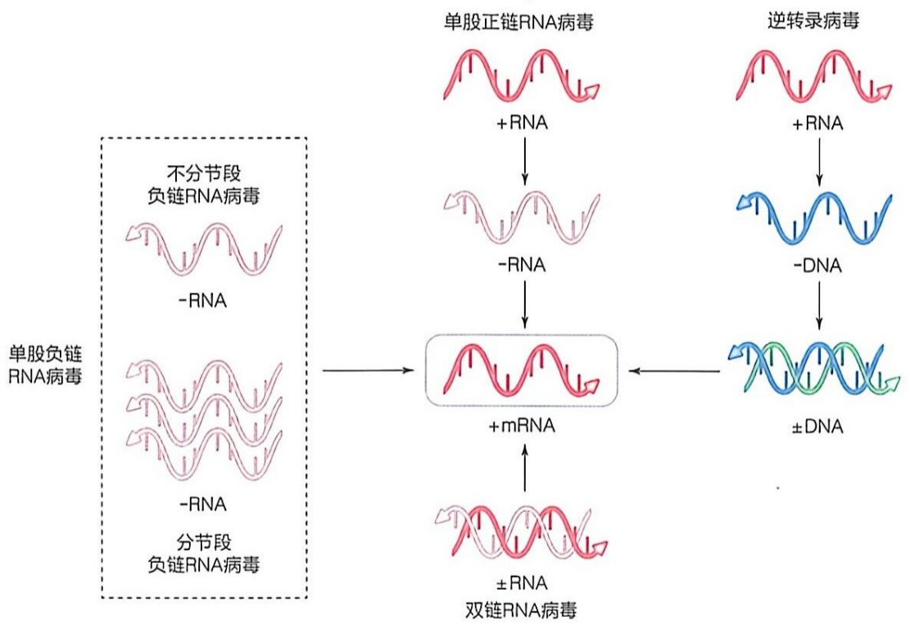

<details>
<summary>flowchart</summary>

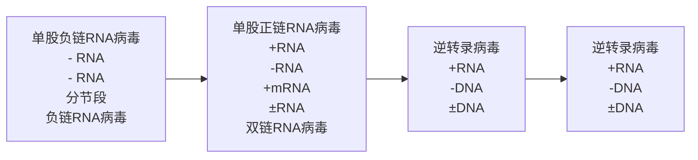
</details>

## 10.7.1 病毒 RNA 依赖的 RNA 聚合酶的分类

RNA 病毒编码的 RNA 依赖的 RNA 聚合酶主要分为三种类型，即单股正链 RNA 病毒的 RdRp、分节段负链 RNA 病毒的 RdRp 和不分节段负链 RNA 病毒的 RdRp。

单股正链 RNA 病毒的 RdRp 以丙型肝炎病毒（hepatitis C virus）、小 RNA 病毒（picornavirus）、冠状病毒（coronavirus）编码的 RdRp 最为典型，其结构相对简单，主要包含 RNA 催化合成的核心结构域。参与 RNA 合成的其他酶分子，如加帽酶和核酸酶等，均以单独编码蛋白的形式存在，并在病毒生命周期中与 RdRp 协同发挥功能。

单股负链 RNA 病毒在其生命过程中仅编码一个主要聚合酶分子（也称 L 蛋白），除包含核心 RdRp 结构域外，还包含加帽酶等用于 RNA 加工的全部催化酶结构域，其分子量大、组成形式复杂。单股负链 RNA 病毒根据其基因组是否分节段，其 RNA 加帽过程完全不同，聚合酶组成形式也呈现显著区别。其中，不分节段负链 RNA 病毒以水疱性口炎病毒（vesicular stomatitis virus, VSV）、埃博拉病毒（ebola virus, EBOV）等最为典型。此类病毒由自身聚合酶完成全部 RNA 帽结构的合成，因而其聚合酶分子中含有加帽所需的多核糖核苷转移酶结构域（PRNTase）、甲基转移酶结构域（MTase）等。

分节段负链 RNA 病毒自身不合成 RNA 帽结构，以流感病毒（influenza virus）、布尼亚病毒（bunyavirus）等最为典型。此类病毒利用 “cap snatching” 的方式，从宿主 mRNA 上抢夺成熟的帽结构，因此其聚合酶分子的组成形式与不分节段负链 RNA 病毒的聚合酶完全不同，含有帽结合结构域、内切核酸酶结构域等。

## 10.7.2 病毒 RNA 依赖的 RNA 聚合酶的结构特征

与 DNA 聚合酶类似，RNA 病毒的 RdRp 为右手结构，具有手指状域、掌状域和拇指状域，使用常见的双金属催化机制，通过手掌状域中保守的 motif A 和 motif C 上的一对天冬氨酸残基完成催化（图 10-38）。拇指和手指状域具有广泛的相互作用，围绕活性位点形成模板进入的通道，这种闭手构象（closed-hand）也是 RdRp 不同于其他聚合酶的一点。

大部分正链 RNA 病毒的聚合酶相对比较简单，只包括 RdRp 结构域，但是尼多病毒目（nidovirus）的聚合酶的 N 端则还具有一个尼多病毒 RdRp 相关的核苷酸转移酶（nidovirus RdRp-associated nucleotidyltransferase, NiRAN）结构域，能够发挥核苷酸转移的功能，而黄病毒（flavivirus）的聚合酶的 N 端通常会融合甲基转移酶结构域，在加帽过程中发挥功能。

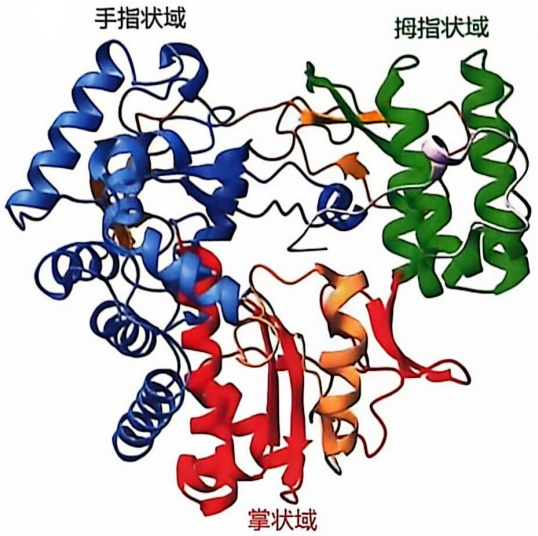

<details>
<summary>text_image</summary>

手指状域
拇指状域
掌状域
</details>

图 10-38 RNA 依赖的 RNA 聚合酶的结构 (PDB 编号: 1SH0)

负链 RNA 病毒的聚合酶分子组成则较为复杂，其中 sNSRV 的聚合酶有两种形式:一种以流感病毒为代表，由聚合酶碱性蛋白 1（polymerase basic 1，PB1）、聚合酶碱性蛋白 2（PB2）和聚合酶酸性蛋白（polymerase acidic，PA；在丙型和丁型流感病毒中被称为 P3）三个亚基组成聚合酶复合物。PB1 亚基位于复合物中心，包含 RdRp 结构域。PA 亚基的 N 端为核酸内切酶结构域，C 端与 RdRp 的拇指亚结构域结合，被称为 PA-C 结构域。PB2 亚基的 N 端与 RdRp 结构域紧密相连，被称为 PB2-N 结构域，C 端则由 CapB 结构域、Mid-link 结构域、627 结构域和 C 端核定位信号结构域构成。另一种是以沙粒病毒和布尼亚病毒为代表，其聚合酶则是由一个单一蛋白构成，被称为 L 蛋白。sNSRV 的 L 蛋白包括一个中央的 RdRp 结构域，该结构域两侧分别为 N 端的 PA-C 样结构域与 C 端的 PB2-N 样结构域，形成一个球状的聚合酶核心。该核心的 N 端为核酸内切酶结构域，C 端为延伸结构域，包括 CapB 结构域、Mid 结构域和锌结合结构域。nsNSRV 的聚合酶由单一蛋白构成，也被称为 L 蛋白。

nsNSRV 的 L 蛋白包括 N 端的 RdRp 结构域和具有多核苷酸转移酶（polyribonucleotidyl transferase，PRNTase）活性的加帽结构域，然后通过连接结构域（connector domain，CD）与同时具有  $N^{7}$ -甲基转移酶（ $N^{7}$ -MTase）和 2'-O-甲基转移酶（ $2'$ -O'-MTase）活性的结构域相连，最后是 C 端结构域（C-terminal domain，CTD）。

## 10.7.3 病毒 RNA 合成

## （1）正链RNA病毒与负链RNA病毒转录复制复合物

正链 RNA 病毒的基因组 RNA 可以直接作为 mRNA，被宿主细胞内的翻译体系识别并翻译形成自身的蛋白质，所以它的病毒颗粒里不需要携带转录复制相关的蛋白，可以拥有比较多的转录复制元件，分别负责 RNA 合成、引物起始和加帽等功能，这些转录复制元件会按照一定的时空顺序组装形成转录复制复合物（replication transcription complex, RTC），用于完成病毒的转录复制过程。而负链 RNA 病毒的基因组 RNA 无法直接翻译，所以其进入宿主细胞后的第一件事，就是要以自己的基因组 RNA 为模板，转录形成 mRNA 来翻译自身蛋白。因此负链 RNA 病毒的病毒颗粒本身就会携带一个 RNA 聚合酶，完成 RNA 合成、引物合成、加帽和加尾等功能。但负链 RNA 病毒的基因组 RNA 本身不能作为模板，需要核蛋白（nucleoprotein, NP）包裹着基因组 RNA，形成核糖核蛋白复合物（ribonucleoprotein complex, RNP）才能发挥活性，在 L 蛋白的帮助下完成转录复制过程。

## (2) 病毒 RNA 合成的引发

病毒 RNA 合成的起始主要分为两大类，第一类是依赖引物的起始方式，需要引物提供 3'-OH；第二类是不依赖引物的起始方式，第一个核苷三磷酸为反应提供 3'-OH。在第一类依赖引物的合成起始方式中，有三种常见的引物种类:①利用多肽作为引物，这种病毒基因组的  $5'$  端会连接在病毒蛋白上（viral protein genome-linked, VPg），主要代表为小 RNA 病毒（picornavirus）、杯状病毒（calicivirus）和马铃薯病毒（potyvirus）等。②利用具有帽结构的寡聚核苷酸作为引物，病毒通过核酸内切酶将宿主 mRNA 的帽结构切割下来，作为自身 RNA 合成的引物，主要代表为流感病毒（influenza virus）、布尼亚病毒（bunyavirus）等分节段的负链 RNA 病毒。③利用寡聚核苷酸作为引物，病毒以自身 RNA 的  $3'$  模板为模板，通过从头合成的方式形成一小段短的寡聚核苷酸，随后聚合酶再在这段引物的基础上进行延伸，绝大部分 RNA 病毒都属于这一种。

## (3) 病毒 RNA 加帽

真核生物 mRNA 的 5' 端具有一个甲基化的，通过 5'-5' 三磷酸桥连接的帽结构 ( $m^{7}GpppNp-RNA$ )，能够保护 mRNA 不被核酸外切酶水解，指导 pre-mRNA 剪接，维持 mRNA 稳定性并帮助转录起始因子有效识别 mRNA。而没有帽结构修饰的 RNA 会被宿主细胞识别为外源 RNA，从而引发抗病毒先天免疫反应。因此，病毒在与宿主共同进化的过程中，通过多种方式形成了逃避宿主细胞先天免疫识别的帽结构，帮助病毒高效翻译自身蛋白。病毒形成和宿主细胞类似的帽结构的方式主要有 4 种 (图 10-39)。

① 病毒利用自身蛋白或宿主细胞内的酶，通过和真核细胞相同的四步反应形成Cap 1帽结构（见本章 mRNA 加帽部分）。主要代表有大部分 DNA 病毒、呼肠孤病毒（reovirus）和冠状病毒（coronavirus）等。
② 病毒首先利用 PRNTase 活性去除新生成 RNA 5' 端的焦磷酸（PP $_{i}$ ），并把 RNA 共价连接在自身形成中间体（PRNTase-pNp-RNA）；随后 PRNTase 把这部分 pNp-RNA 转移到 GDP 分子上，形成 GpppNp-RNA；再依次通过 N $^{7}$ -MTase 和 2'O-MTase 形成成熟的 Cap 1 结构（m $^{7}$ GpppNm2'-Op）。主要代表有不分节段的负链 RNA 病毒，包括狂犬病毒（rabies virus）、水疱性口炎病毒（vesicular stomatitis virus）、埃博拉病毒（ebola virus）等。
③ 病毒先通过 TPase 形成 ppNp-RNA，同时通过  $N^{7}$ -MTase 将一分子 GTP 进行甲基化，形成  $m^{7}Gppp$ ，再通过 GTase 将甲基化后的  $m^{7}Gp$  转移到 ppNp-RNA 上，形成 Cap 0 结构（ $m^{7}GpppNp$ ）。主要代表为甲病毒（alphavirus）等。
④ 病毒通过核酸内切酶将宿主 mRNA 5' 端帽结构 “抢夺” 过来，随后病毒聚合酶在帽结构的基础上继续合成自身的 mRNA。主要代表有分节段的负链 RNA 病毒，包括流感病毒（influenza virus）、布尼亚病毒（bunyavirus）、沙粒病毒（arenavirus）等。

## (4) 病毒 RNA 合成过程中的复制校正

相较于 DNA 而言，RNA 合成的保真性较低，为了维持基因组的稳定性，部分 RNA 病毒也具有错配校正的功能。RNA 病毒进行错配校正的方式主要有两种:第一种是通过焦磷酸解（pyrophosphorolysis）的方式，当病毒 RNA 合成发生错配时，聚合酶可以通过招募 PP $_{i}$ 来将 RNA 链模板的错配核苷酸切除，主要代表为黄病毒，包括牛病毒性腹泻病毒（bovine viral diarrhea virus）。另一种是通过 3'→5' 核酸外切酶，当病毒 RNA 合成发生错配时，其 RNA 发生回退，招募核酸外切酶将错配的核苷酸切除，完成错配校正，主要代表为冠状病毒。

(A)

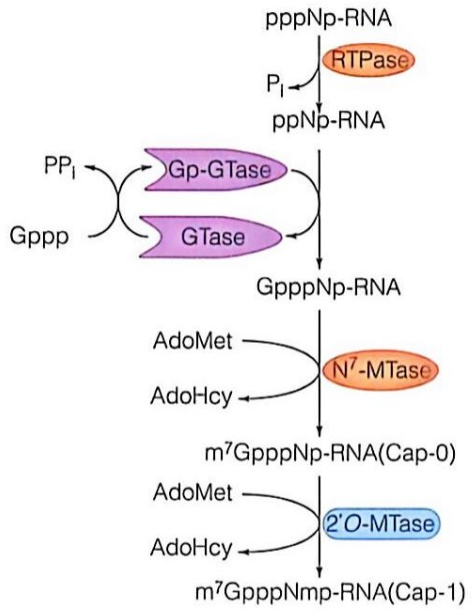

<details>
<summary>flowchart</summary>

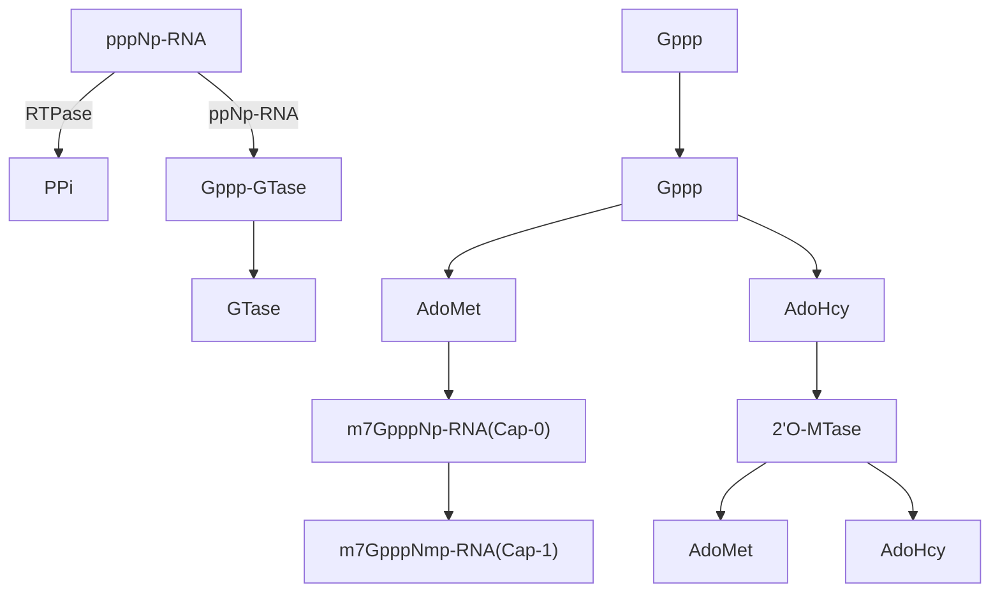
</details>

(B)

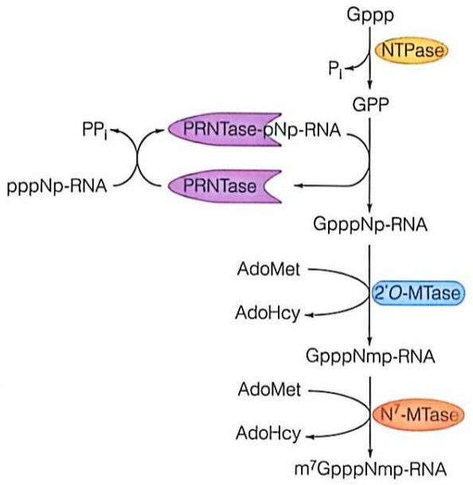

<details>
<summary>flowchart</summary>

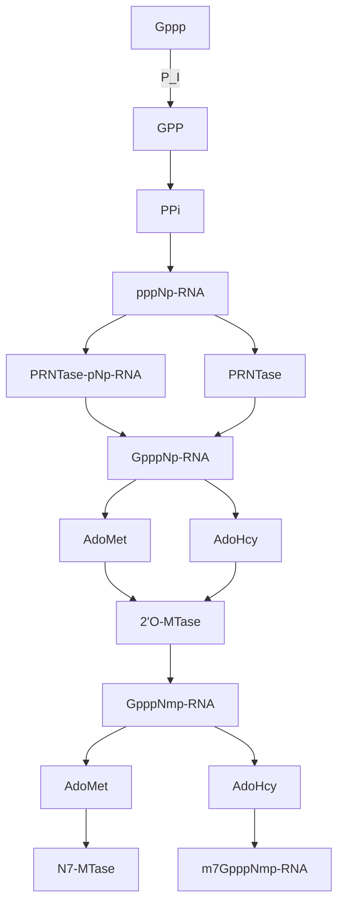
</details>

(C)

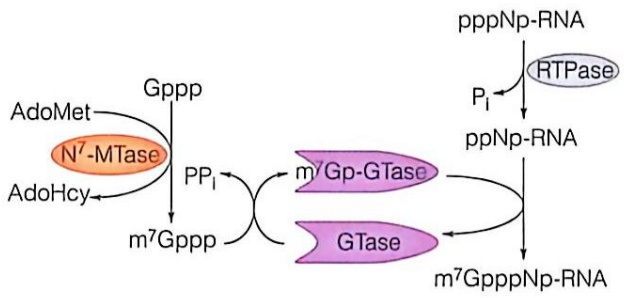

<details>
<summary>flowchart</summary>

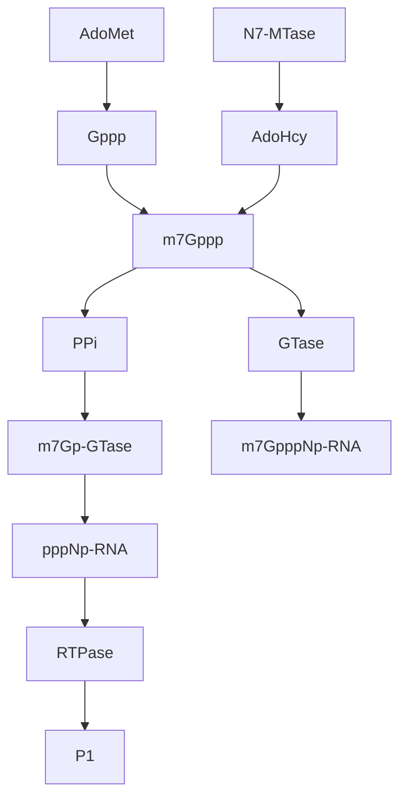
</details>

(D)

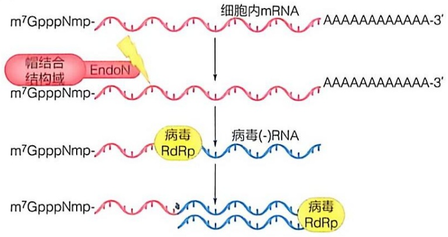

<details>
<summary>flowchart</summary>

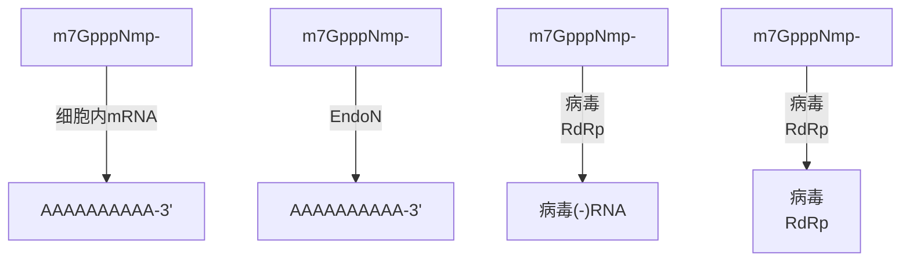
</details>

图 10-39 RNA 病毒加帽途径

Ado Met: S-腺苷甲硫氨酸;  
Ado Hcy: S-腺苷同型半胱氨酸

## 10.7.4 病毒 RNA 依赖的 DNA 合成（逆转录）

逆转录病毒的生命过程主要包括:病毒入侵、入核、逆转录、脱壳（uncoating）、整合、病毒 mRNA 转录、蛋白翻译、病毒出芽与成熟等步骤。①病毒入侵:病毒在进入宿主体内后，首先通过自身的刺突蛋白与宿主细胞的表面糖蛋白受体结合，引发一连串的构象变化，导致病毒和宿主细胞膜融合，将病毒核心（viral core）释放到细胞质中。②入核:病毒核心在进入细胞后，沿微管运动至核膜外侧聚集，导致核膜发生凹陷，病毒核心通过似核内吞途径进入细胞核。③逆转录:病毒核心中的逆转录酶（reverse transcriptase，RT）以基因组 RNA 为模板合成互补的单链 DNA，随后其发挥 RNA 酶的活性将 RNA-DNA 杂交链中的 RNA 模板水解，最后再以单链 DNA 为模板合成病毒的双链 DNA。④脱壳:进入细胞质后，病毒核心由衣壳蛋白（capsid protein）组成的锥形外壳包裹着，保护其中的遗传物质。当病毒核心完成逆转录过程后，其外部分衣壳蛋白会逐渐脱去，将逆转录形成的双链 DNA 释放出来。⑤整合:病毒整合酶切割宿主染色体的 DNA 链，并将病毒 DNA 末端与目标 DNA 链的 5' 端连接起来，然后宿主细胞内的修复系统将病毒 DNA 与相邻 DNA 间的缺口连接起来，病毒 DNA 就整合进宿主染色体中。⑥病毒 DNA 整合进染色体后，利用宿主的转录与翻译系统生成自身的 mRNA 与病毒蛋白，最终组装形成新的病毒颗粒，并释放出细胞。

逆转录病毒的病毒颗粒中包含逆转录酶（reverse transcriptase，RT）。以人类免疫缺陷病毒（human immunodeficiency virus 1，HIV-1）的逆转录酶为例，它是由 p66 和 p51 两个亚基组成的异源二聚体，p66 的 N 端具有依赖 RNA 或 DNA 的 DNA 聚合酶活性，C 端具有核糖核酸酶（RNase H）活性，可以将 RNA-DNA 杂交链中的 RNA 链消化掉。而 p51 虽然序列上和 p66 的 N 端相同，但空间构象不同，仅发挥构象调节作用。

P66 N 端的聚合酶结构也为右手结构，包括手指状域、拇指状域、掌状域和连接区 4 个亚结构域，能够在  $Mg^{2+}$  存在的情况下，通过手掌状域上的 3 个天冬氨酸催化残基将 dNTP 连接在引物的 3'-OH 上，释放出游离焦磷酸，实现 DNA 链的延伸（图 10-40）。逆转录病毒的基因组 RNA 和 mRNA 的序列，属于正链 RNA。病毒进入宿主细胞后，细胞的 tRNA 与 HIV-1 基因组的引物结合位点配对，作为引物，在聚合酶的作用下合成互补的负链 DNA。随着负链 DNA 的合成，p66 发挥 RNase H 的功能，将基因组 RNA 消化掉。但基因组 RNA 的 5' 端的多嘌呤片段（purine-rich polypurine tract，PPT）对 RNase H 的切割有抵抗力，所以基因组不会被完全降解。剩余的基因组 RNA 又作为正链 DNA 合成的引物，在聚合酶的作用下形成双链 DNA，完成从基因组单链 RNA 到双链 DNA 的形成。

病毒聚合酶在病毒转录复制过程中发挥着核心功能，对其功能进行抑制是抗病毒药物的重要研究领域。目前，针对病毒聚合酶的抑制剂可分为核苷类抗病毒药物（nucleotide analogue inhibitor）和非核苷类抗病毒药物（non-nucleotide analogue

inhibitor）两大类。其中，核苷类抗病毒药物是一类针对聚合酶的主要抗病毒药物，其通过模拟天然核苷酸的结构形式，被病毒聚合酶“掺入”病毒核酸，进而对后续生命过程产生影响。非核苷类抗病毒药物主要作用在聚合酶某些特定位点，通过影响其RNA合成能力来抑制其功能和病毒增殖，但在针对聚合酶的抗病毒药物中所占比例很小。

核苷类抗病毒药物的最简单形式包括与天然核苷酸类似碱基（base）基团、核糖（ribose）基团，以及在这些基团上引入的各类化学修饰，被称为“前药”（prodrug）。在其进入宿主细胞后，进入宿主细胞的NTP合成途径，被一系列激酶分子陆续加入三个磷酸基团，最终形成活性化合物。由于加入第一个磷酸基团的反应最为困难，是决定核苷类抗病毒药物效率的最关键限制因素之一，因此发展出了在碱基和核糖基团的基础上，增加了单磷酸，以及对单磷酸进行保护的化学基团的前药形式。该前药形式的核苷类抗病毒药物进入宿主细胞后，可跳过第一步激酶反应，迅速形成活性化合物，提高了药物发挥功能的效率。

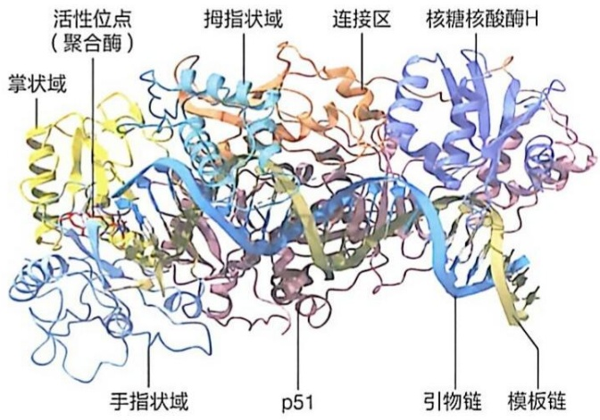

<details>
<summary>text_image</summary>

活性位点
(聚合酶)
掌状域
拇指状域
连接区
核糖核酸酶H
手指状域
p51
引物链
模板链
</details>

图 10-40 逆转录酶的结构特征 (PDB 编号: 1RTD)

当三磷酸形式的核苷类抗病毒药物活性化合物形成后，病毒聚合酶将其“误认”为天然核苷酸，从而合成掺入子代核酸链，进而抑制病毒后续的增殖过程。但其抑制机制存在很大区别，主要包括三种机制。第一种机制是当核苷类抗病毒药物掺入子代核酸链后，其上的化学修饰阻止下一步聚合酶对NTP的催化，造成链合成立刻终止，此类化合物也成为“chain terminator”。第二种机制是当核苷类抗病毒药物掺入子代核酸链后，由于某些聚合酶特定的识别和催化机制，并不能即刻终止链合成反应，继续延伸数个核苷后，由于核苷类抗病毒药物上的化学修饰与聚合酶氨基酸产生空间阻碍，从而延迟链合成延伸。此类机制以瑞德西韦（remdesivir）在新冠病毒聚合酶上的作用最为典型。第三种机制是，核苷类抗病毒药物掺入子代核酸链后完全不影响链延伸，因此会产生含有大量药物分子的子代核酸链。当病毒聚合酶进一步以含有药物分子的子代核酸链为模板合成病毒核酸时，产生大量失活突变，从而抑制病毒的增殖。此类机制以莫努匹拉韦（molnupiravir）在新冠病毒聚合酶上的作用最为典型。

## ※展望

转录作为生命科学研究的核心领域之一，未来的研究方向充满机遇和挑战。以下是几个值得关注的趋势:①高分辨率结构研究。尽管冷冻电镜等技术已经提供了转录前起始复合物和RNA聚合酶复合物的高分辨率结构，但仍有许多动态过程无法完全解读。未来结合时间分辨技术和人工智能预测工具，科学家有望更全面地解析转录过程中各步骤的瞬态结构与动力学。②转录与表观遗传的协同调控。表观遗传修饰（如组蛋白修饰、DNA甲基化）如何影响转录起始和延伸，以及转录如何影响表观遗传修饰状态是目前研究的热点。通过单细胞组学技术，揭示这些修饰在个体细胞水平上的调控模式及其对疾病的影响。③跨学科研究与新模型。随着人工智能、系统生物学和合成生物学的发展，科学家能够重建转录网络并预测其行为，促进基因治疗、药物开发等领域的应用。

## ※ 本章小结

本章围绕“转录”这一分子生物学的核心过程展开，系统阐述了转录的基本原理、机制和调控方式。转录是基因表达的第一步，是DNA模板被RNA聚合酶转录为RNA的过程。在真核生物中，这一过程尤为复杂，需经过起始、延伸、终止等步骤，并受到转录因子、增强子、核小体和表观遗传修饰的精密调控。本章详细介绍了转录前起始复合物的组装机制、中介体复合物在调控中的关键作用，以及核小体对转录复合物动态行为的影响。

近年来，利用冷冻电镜、高通量测序和单分子成像技术等研究方法，科学家们不断揭示出转录过程中的动态变化及其调控机制，加深了对基因表达机制的理解。本章学习为理解转录这一基本生命过程奠定了基础，同时为未来研究提供了启发。

## ※ 思考题

1. 请简述细菌基因转录起始和终止的序列特征。
2. 请简述真核生物基因转录起始的三个主要调控阶段。
3. 请简述 RNA聚合酶Ⅱ催化合成 RNA 的分子机制。
4. 请简述启动子、转录起始位点的概念，简述 Pol II 的核心启动子的类型及其特征。
5. 请列举Ⅱ类通用转录因子，并简述转录前起始复合物的功能及生物学意义。
6. 比较真核生物和原核生物在基因表达的转录延伸阶段的主要区别，并解释这些区别的生物学意义。
7. 请写出正链 RNA 病毒和负链 RNA 病毒加帽机制的区别。

## ※ 推荐阅读

1. CRAMER P. Organization and regulation of gene transcription [J]. Nature, 2019, 573: 45–54.
2. GIRBIG M, MISIASZEK A D, MULLER C W. Structural insights into nuclear transcription by eukaryotic DNA-dependent RNA polymerases [J]. Nature Rev Mo Cell Bio, 2022, 23: 603-622.
3. LI B, CAREY M, WORKMAN J L. The role of chromatin during transcription [J]. Cell, 2007, 128: 707-719.
4. ROEDER R G. Lasker basic medical research award. The eukaryotic transcriptional machinery: complexities and mechanisms unforeseen [J]. Nature Med, 2003, 9: 1239-1244.
5. HABERLE V, STARK A. Eukaryotic core promoters and the functional basis of transcription initiation [J]. Nature Rev Mol Cell Bio, 2018, 19: 621–637.

(撰写: 徐彦辉, 李兵, 张余, 陈曦子, 娄智勇, 麻锦彪; 审修: 陈飞, 陈玲玲)

## 11

## mRNA 前体的加工

根据 “中心法则” 的基本概念，mRNA（messenger RNA）既是基因表达过程中遗传信息的传递者，又是基因表达的调节者。在原核生物中，DNA 通过转录生成 mRNA，这些 mRNA 大多不需要进一步加工便直接作为指导蛋白质合成的翻译模板。然而，在真核生物中，DNA 先转录生成初始转录产物，即 mRNA 前体（precursor mRNA，pre-mRNA），随后通过一系列加工过程转变为成熟的 mRNA，才能成为蛋白质合成的模板。与原核细胞不同，真核细胞具有细胞核膜，将细胞划分为细胞核和细胞质。细胞核中生成的成熟 mRNA 需要经过出核转运，才能进入细胞质中指导蛋白质合成。除了前文讲述的 5' 端加帽和 3' 端加尾过程外（见第 10 章），真核生物的 mRNA 在转录后还经历了剪接、出核转运、质量控制、修饰及编辑等多个重要过程。在本章中，我们将重点探讨这些过程的机制与调控，进一步阐述它们如何协同作用确保 mRNA 的稳定性、功能性以及基因表达的精确调控。

## 11.1 mRNA 前体通过 RNA 剪接去除内含子并使外显子相连

基因的编码区包含顺序排列的一系列三联体密码子，它们决定了多肽链的一级序列。绝大多数真核基因的编码区是不连续的，被一段或多段非编码区有规律地隔开。转录得到的初始转录本需要去除其中的非编码区，才能得到具有连续编码序列、可以翻译为蛋白质的成熟 mRNA，这一过程称为 mRNA 剪接。mRNA 剪接不仅是产生真核 mRNA 的必需环节，而且由于可变剪接现象的存在而成为真核基因表达的重要调控机制并提高了蛋白质组的丰富度。

## 11.1.1 真核基因是由外显子和内含子交替出现构成的断裂基因

克里克于 1958 年提出的 “中心法则” 在很长一段时间中得到了科学界的普遍接受，即认为储存在 DNA 中的遗传信息被精确地传递到 mRNA 中。mRNA 的编码序列（coding sequence，CDS）中每三个碱基序列组成一个密码子，对应一个氨基酸，也就是说 DNA 上的编码序列是连续的，可以 “一一对应” 于蛋白质序列。事实上，这一规律仅适用于绝大多数细菌及噬菌体。在真核生物中，大多数基因的编码序列是被间隔序列隔开的。

## (1) 腺病毒基因组的 R 环定位实验发现了真核生物的 “断裂基因”

真核生物的 mRNA 剪接是在利用腺病毒（一种人 DNA 病毒）研究真核生物基因转录过程中被发现的。1970 年代，理查德·罗伯茨（Richard J. Roberts）和菲利普·夏普（Phillip A. Sharp）的实验室都在利用 “R 环定位实验” 探究真核生物的转录过程，他们将纯化的腺病毒 DNA 与其 mRNA 进行分子杂交。1977 年，他们分别报道了在电子显微镜下 DNA 与 mRNA 的杂交形态并不是预期中的一个连续的杂交双链，而是在多个不同位置延伸出了不能配对的 DNA 单链，包括 mRNA 的 5' 端、3' 端和多个中间区域，这一结构被称为 R 环（R-loop）（图 11-1）。基于这个现象，他们认为真核生

图11-1 腺病毒 Ad2 DNA 与 mRNA 的 R 环定位实验揭示真核基因不连续性（A）R 环定位实验中 R 环结构形成示意图。（B）DNA-RNA 杂交示意图

(改绘自 BERGET S M, et al. Proc Natl Acad Sci U S A, 1977,74 (8): 3171-3175)

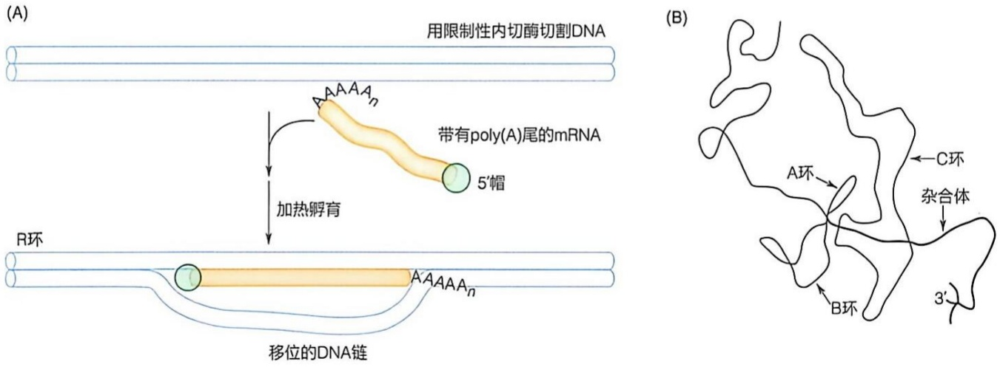