图 11-2 真核生物基因组 DNA 通过转录得到含有内含子的 pre-mRNA，通过剪接得到成熟的 mRNA

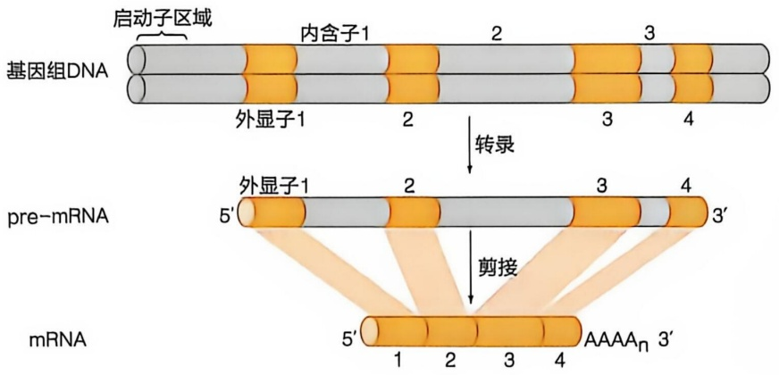

flowchart

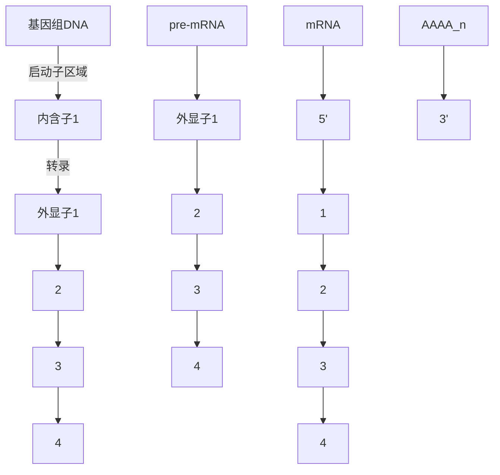

物的 mRNA 序列并不来源于 DNA 模板上的连续序列，而是通过某种方式对不同区段的序列进行拼接产生的。断裂基因（split gene）的发现掀起了巨大的轰动，打破了人们对基因连续性的认知，罗伯茨和夏普也因此于 1993 年共同获得了诺贝尔生理学或医学奖。在后来的研究中，科学家们发现，断裂基因广泛存在于真核生物细胞内，不仅存在于编码蛋白质的基因中，也存在于非编码 RNA 的基因中。

## (2) mRNA 前体同时包含外显子和内含子

发现断裂基因后，科学家们开始探索在成熟的 mRNA 中 “消失” 的间隔序列是何时被去除的。曾有人认为这个过程发生在转录阶段，RNA 聚合酶转录时只转录成熟 mRNA 上存在的序列而跳过间隔序列。不过这一观点很快就被否定了。1975 年前后，小詹姆斯·埃德温·达内尔（James E. Darnell，Jr）等人观察到具有 5' 端加帽和 3' 端多腺苷酸化的核不均一 RNA（heterogeneous nuclear RNA，hnRNA，又称核内异质 RNA）长度大于成熟的 mRNA，这些 hnRNA 在后来被确定是 mRNA 前体。

在真核基因中，出现在成熟 mRNA 的序列被称为外显子（exon），它们之间的间隔序列被称为内含子（intron），初始的转录本（pre-mRNA）中同时包含了外显子和内含子，内含子是在转录出来之后被去除的。将 pre-mRNA 中的内含子切除、外显子相连接的过程称为 mRNA 剪接（mRNA splicing），如图 11-2 所示。下文提到的外显子和内含子主要指 pre-mRNA 中的序列。广义上讲，外显子包括成熟 mRNA 中保留的任何序列片段，即可以翻译成蛋白质的编码序列以及 mRNA 5' 端和 3' 端的非翻译区（untranslated region，UTR）。pre-mRNA 剪接必须绝对准确，才能避免在外显子连接处发生核苷酸的增加或减少，从而避免蛋白质合成时移码或者引入错误的氨基酸。

## 11.1.2 mRNA 剪接的化学本质是两步连续的转酯反应

真核基因的外显子和内含子的序列长度变化不定，内含子一般比外显子要长得多，序列也更不保守。典型的外显子的序列长度约为 150 bp，而内含子却可长达 800 kb，但有些也很短。哺乳动物二氢叶酸还原酶（dihydrofolatereductase）的基因长达 31 kb，但其对应的成熟 mRNA 长度仅为 2 kb，外显子不足 pre-mRNA 全长的

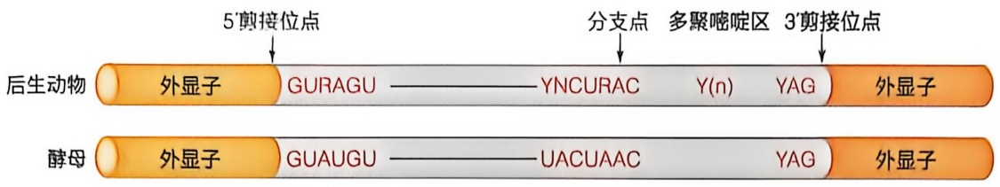

text_image

5'剪接位点
分支点
多聚嘧啶区
3'剪接位点
后生动物
外显子
GURAGU
YNCURAC
Y(n)
YAG
外显子
酵母
外显子
GUAUGU
UACUAAC
YAG
外显子

10%。上文已经提到了剪接准确的重要性，那么 RNA 剪接是怎么发生的呢？内含子和外显子是如何被区分的？内含子如何被除去？外显子如何被准确连接？理解 RNA 剪接的第一步就是确定它是在 pre-mRNA 上的什么位置发生的。

## (1) 内含子中的保守序列决定了 RNA 剪接发生的位置

在 pre-mRNA 中，内含子和外显子的边界（即内含子的两个末端）有明显的序列特征，这些特征序列就是 RNA 剪接发生的位置。如图 11-3 所示，内含子中有三段高度保守的特征序列，5' 端特征序列被命名为 5' 剪接位点（5' splice site, 5'SS），3' 端特征序列被命名为 3' 剪接位点（3' splice site, 3'SS），5' 剪接位点和 3' 剪接位点之间的一段保守序列被称为分支点序列（branch point sequence, BPS），通常更靠近 3' 剪接位点。在高等真核生物中，在分支点序列和 3' 剪接位点之间还有一段较为保守的序列——多聚嘧啶区（polypyrimidine tract, Py tract），与剪接调控相关。其中，5' 剪接位点 5' 端的两个核苷酸（G、U）、分支点序列中的分支点腺苷酸（A）和 3' 剪接位点 3' 末的两个核苷酸（A、G）在所有真核生物中极度保守，表明 RNA 剪接在进化上是普遍存在的。

## (2) 内含子通过两步连续的转酯反应被除去

1983—1985 年，夏普和约翰·阿贝尔森（John N. Abelson）等分别利用 HeLa 细胞和酿酒酵母（S. cerevisiae）建立了无细胞体外剪接（in vitro splicing）反应，通过使用  ${}^{32}$ P 标记 pre-mRNA，可以对剪接过程中的中间产物进行观测和鉴定。

pre-mRNA剪接是通过两步连续的双分子亲核取代（$\mathrm{S}_{\mathrm{N}}2$）转酯反应完成的:第一步为分支反应（branching reaction），分支点序列中高度保守的腺苷酸（A）的 $2^{\prime}$ 羟基作为亲核基团进攻 $5^{\prime}$ 剪接位点第一位鸟苷酸（G）的磷酰基团，这样一来，$5^{\prime}$ 外显子（相对内含子来说）与内含子交界处的磷酸二酯键断裂，$5^{\prime}$ 剪接位点G和分支点A之间形成一个 $2^{\prime}, 5^{\prime}-$ 磷酸二酯键，此时，分支点A同时具有三个磷酸二酯键（两个 $3^{\prime}, 5^{\prime}-$ 骨架磷酸二酯键和刚刚形成的 $2^{\prime}, 5^{\prime}-$ 磷酸二酯键），于是产生了一个三叉交汇点（three-way junction或T-junction，这也是该保守腺苷酸被称作分支点的原因），从而形成了一个套索（lariat）结构；第二步为外显子连接反应（exon ligation），$5^{\prime}$ 外显子末端暴露出的 $3^{\prime}$ 羟基作为亲核基团，向 $3^{\prime}$ 剪接位点最末端的鸟苷酸G下游的磷酰基团发起攻击，$3^{\prime}$ 剪接位点和 $3^{\prime}$ 外显子间的磷酸二酯键断裂，$5^{\prime}$ 外显子和 $3^{\prime}$ 外显子通过形成新的磷酸二酯键连接在一起，内含子以套索形式释放（图11-4）。

1993 年，夏普等通过使用包含手性磷硫醚的 pre-mRNA 底物对两步剪接反应的立体化学过程进行了研究，托马斯·施泰茨（Thomas A. Steitz）和琼·施泰茨（Joan A. Steitz）根据此前发现的催化型 RNA 的机制（包括自剪接内含子和 RNase P 等）提

图 11-3 内含子的 5' 剪接位点、分支点序列和 3' 剪接位点序列在酵母和后生动物中保守

(改绘自 Will C and Luhrmann R. Cold Spring Harb Perspect Blol, 2011, 3 (7): a003707)

图 11-4 RNA 剪接的两步转酯反应（A）和  $Mg^{2+}$  在其中发挥的催化作用（B）

(A, 改绘自 BEUSCH I, MADHANI H H. Trends Biochem Sci, 2024, 49(7): 583-595. B, 改绘自 FICA S M, et al. Nature, 2013, 503 (7475): 229-234.)

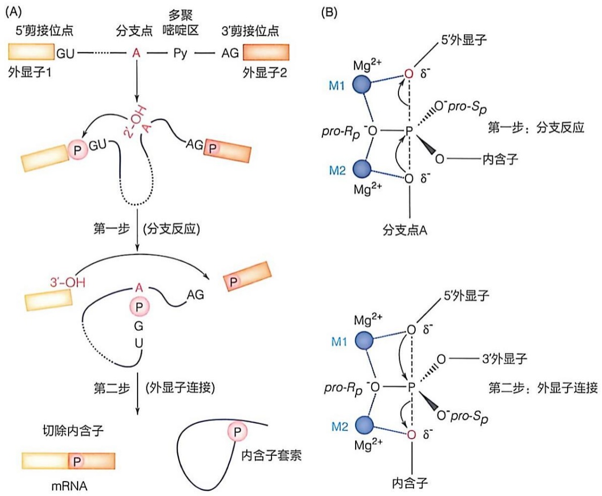

出了具有普适性的“双金属离子”催化机制，从而提出RNA剪接的两步转酯反应是由两个 $Mg^{2+}$ （分别称为M1和M2）离子催化完成的。如图11-4所示，在分支反应中，M2配位结合分支点A的2'羟基和5'剪接位点磷酰基团的pro-Rp氧原子，主要负责激活亲核基团（分支点A的2'羟基），而M1用来稳定离去基团5'外显子末端游离出来的3'羟基；而在外显子连接反应中，两个离子的作用发生交换，M1配位结合5'外显子的3'羟基和3'剪接位点磷酰基团的pro-Rp氧原子，负责激活亲核基团，M2负责稳定离去基团（3'剪接位点的3'羟基）。

在以上两步转酯反应中，断开了两个磷酸二酯键，形成了两个磷酸二酯键，因此只涉及化学键的移动，并没有增加化学键的数量，所以 RNA 剪接的化学反应本身不需要消耗能量。但在细胞中，RNA 剪接过程却需要消耗大量 ATP，这是由于细胞核内需要组装形成一个大型分子机器——剪接体（spliceosome）来控制 RNA 剪接反应。

## 11.1.3 剪接体是 mRNA 剪接的执行者

上述两步转酯反应看似简单，其实并不然，我们已经提到，内含子长度和序列都变化很大，而且RNA剪接必须准确。在真核细胞中，控制RNA剪接反应发生的是细胞核内的剪接体。剪接体是一种大型核糖核蛋白（ribonucleoprotein，RNP），由RNA和蛋白质共同组成。剪接体有两个重要特点，一是组成十分复杂，包含5条RNA和超过100种蛋白质；二是组装非常动态，它在执行RNA剪接的过程中需要多次大规模的结构重排，在逐步形成活性位点后依次催化两步剪接反应并释放内含子。那么，剪接体具体由什么组成？剪接体如何催化两步转酯反应？为何RNA剪接需要剪接体这样大的分子机器？剪接体多次发生结构重排的意义是什么？自1985年剪接体被发现，剪接体介导pre-mRNA剪接的机制研究进入了漫长的探索过程，通过细致的生物化学和遗传学研究，剪接体的组分及其大致的工作过程得到鉴定，而近年来施一公、长井洁（Kiyoshi Nagai）、莱因哈德·吕尔曼（Reinhard Lührmann）等针对剪接体主要功能状态复合物的高分辨率结构研究将这一基本过程的机制研究推至原子层面。我们接下来将进行详细讨论。

## 11.1.3.1 核内小 RNA 参与 mRNA 剪接过程

1979 年，来自耶鲁大学的琼·施泰茨发现，系统性红斑狼疮（systemic lupus erythematosus, SLE）患者体内 Sm 蛋白的抗体可以沉淀出富含尿嘧啶的核内小 RNA（small nuclear RNA, snRNA），这些 snRNA 均可以和一些蛋白质稳定结合形成复合物，被称为核小核糖核蛋白（small nuclear ribonucleoprotein, snRNP）。随后，施泰茨等通过对 snRNA 的序列进行分析，发现这些 snRNA 的部分片段可以和内含子中的保守序列互补，从而推测这些 snRNP 可以参与 RNA 剪接。后来的一系列实验证明了这一猜想，确定 U1、U2、U4、U5 和 U6 这 5 条 snRNA 在 RNA 剪接中发挥重要作用，鉴定了 5 个 snRNP 中的蛋白质组成，并初步研究了各个 snRNP 在 RNA 剪接过程中的功能。

## 11.1.3.2 剪接体是一个组分复杂的大型分子机器

1985 年，阿贝尔森等利用密度梯度离心实验对体外剪接反应体系进行分析，发现一个沉降系数接近 40S 的蛋白复合物与 mRNA 底物稳定地结合，推测该复合物与催化 RNA 剪接反应相关，并将其命名为 “spliceosome”，即剪接体。同年，夏普和沃尔特·凯勒（Walter Keller）等也得到类似结论，并且发现这个蛋白复合物的形成依赖于 pre-mRNA 的存在。随着后续生化研究越来越细致，剪接体以 pre-mRNA 为中心逐步组装的过程以及它各阶段的组成成分也依次得到鉴定。

在酵母等单细胞真核生物中，组成剪接体的蛋白有 100 多种，而在人类等更复杂的真核生物中，涉及 RNA 剪接过程的蛋白有 300 多种。剪接体的核心组分高度保守，主要是由 U1、U2、U4、U5 和 U6 这 5 个 snRNPs，十九号复合物（nineteen complex, NTC），NTC 相关蛋白亚复合物（NTC related complex, NTR），保留剪接复合物（retention and splicing complex, RES）以及其他剪接因子组成（图 11-5）。

## (1) 核小核糖核蛋白（snRNP）

剪接体包含5个snRNP，分别是U1、U2、U4、U5和U6，每个snRNP都由1条对应的核心snRNA结合十几种蛋白质组成。大多数真核细胞中的snRNA长100\~300 nt，其中U1、U2、U4和U5 snRNA由RNA聚合酶Ⅱ转录合成，其5'端具有特异的2,2,7-三甲基鸟苷帽结构（m₃G cap）；U6 snRNA由RNA聚合酶Ⅲ合成，其5'端

图 11-5 酿酒酵母剪接体的组成成分

(改绘自FABRIZIO P, et al. Mol Cell, 2009, 36 (4): 593-608)

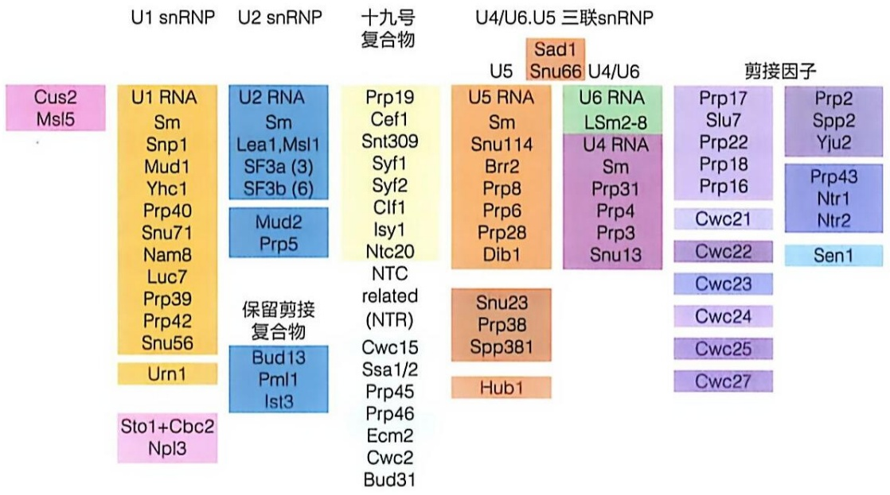

word_cloud

| Mechanism | U1 snRNP | U2 snRNP | 十九号复合物 | U4/U6/U5 三联snRNP | 剪接因子 |
| --- | --- | --- | --- | --- | --- |
| Cus2 Msl5 | Present | — | — | — | Present |
| U1 RNA Sm | Present | Present | Prp19, Cef1, Snt309, Syf1, Syf2, Clf1, Isy1, Ntc20, NTC related (NTR), Bud13, Pml1, Isl3 | Present | Present |
| Snp1 Mud1 Yhc1 Prp40 Snu71 Nam8 Luc7 Prp39 Prp42 Snu56 Urn1 | Present | Present | Present | Present | Present |
| Sto1+Cbc2 Npl3 | Present | Present | Present | Present | Present |
| Prp19 | Present | Present | Present | Present | Present |
| Prp19 | Present | Present | Present | Present | Present |
| Prp19 | Present | Present | Present | Present | Present |
| Prp19 | Present | Present | Present | Present | Present |
| Prp19 | Present | Present | Present | Present | Present |
| Prp19 | Present | Present | Present | Present | Present |
| Prp19 | Present | — | Present | Present | Present |
| Prp19 | — | — | Present | Present | Present |
| Prp19 | — | — | Present | Present | Present |
| Prp19 | — | — | Present | Present | Present |
| Prp19 | — | — | Present | Present | Present |
| Prp19 | — | — | Present | Present | Present |
| Prp19 | — | — | Present | Present | Present |
| Prp19 | — | — | — | Present | Present |
| Prp19 | — | — | — | Present | Present |
| Prp19 | — | — | — | Present | Present |
| Prp19 | — | — | — | Present | Present |
| Prp19 | — | — | — | Present | Present |
| Prp19 | — | — | — | Present | Present |
| Prp19 | — | — | — | Present | ~Present |
| Prp19 | — | — | — | Present | ~Present |
| Prp19 | — | — | — | Present | ~Present |
| Prp19 | — | — | — | Present | ~Present |
| Prp19 | — | — | — | Present | ~Present |
| Prp19 | — | — | — | Present | ~Present |

带有一个  $\gamma$  甲基帽结构。每种 snRNP 中，除了各自的 snRNA 这一核心组分外，还包含一个七元复合物（U1、U2、U4、U5 snRNA 与 SmB/D1/D2/D3/E/F/G 七元复合物结合，U6 snRNA 与 LSm2-8 结合）以及一系列特异性蛋白质。snRNPs 成熟后存在于细胞核质中，它们在 RNA 剪接过程的功能主要由 snRNA 来执行、蛋白质来协助，包括识别剪接位点，拉近剪接位点间的距离以及传递需要的反应基团为转酯反应作准备，催化转酯反应。其中，U6 snRNA 催化两步转酯反应。

## (2) 十九号复合物及其相关复合物 (NTC 和 NTR)

NTC 与 NTR 是剪接体中的两个不含 RNA 的亚复合物，NTC 以其中含量最高的蛋白组分 Prp19 命名，NTR 和 NTC 在同一时间结合到剪接体，在剪接体的激活、活性位点的形成及维持、协助剪接反应发生方面起到重要作用。

## (3) RNA 依赖的 DExD/H-box ATP 水解酶 / 解旋酶

剪接体中目前已知其详细功能的该类型蛋白质有 8 个（酵母及人源名称为 Sub2/UAP56、Prp5/DDX46、Prp28/DDX23、Brr2/BRR2、Prp2/DHX16、Prp16/DHX38、Prp22/DHX8、Prp43/DHX15），它们均具有结合 RNA 的能力，在 RNA 剪接反应的特定时段发挥功能，通过水解 ATP 提供的能量解旋 RNA 双螺旋或者在 RNA 单链上进行移动，从而协助剪接体进行结构重排、推动剪接体不同状态之间的转变，从而控制剪接反应的发生。

## (4) 剪接因子

剪接因子的功能是辅助剪接体构象的变化以促进剪接反应的发生，它们大多数没有酶活性，只在特定的时段被招募与剪接体结合、发挥功能后解离，在推动 RNA 剪接过程中起重要作用。一些剪接因子的突变或删除会导致 RNA 剪接反应无法进行。

## 11.1.3.3 剪接体介导的 RNA 剪接需要经历组装、激活、催化及解聚 4 个步骤

剪接体在执行 RNA 剪接的过程中，各蛋白质组分以 pre-mRNA 为中心依次结合，上述剪接体各个亚复合物和蛋白质组分会在剪接的不同时期与剪接体结合或分离，从而达到精准控制 RNA 剪接发生的目的。剪接体中的各个蛋白质组分之间、剪接体与 pre-mRNA 之间涉及大量的 RNA-RNA、RNA-蛋白质、蛋白质-蛋白质相互作用，这些相互作用及其变化对 RNA 剪接的发生和催化非常重要。

剪接体介导的 RNA 剪接反应从化学本质上看虽然只有两步转酯反应，但是实际上组成剪接体的蛋白质-核酸复合物及剪接因子按照高度精确的顺序进行结合和解离，剪接体需要经历至少 10 个主要功能状态来完成一次 RNA 剪接循环（图 11-6）。

首先，5'剪接位点被U1 snRNP识别，这是通过U1 snRNA与5'剪接位点间的碱基互补配对来实现的；SF1结合分支点序列；分支点下游的多聚嘧啶区和3'剪接位点分别被U2AF异源二聚体的两个亚基U2AF65和U2AF35识别，形成早期复合物（E复合物）。接着，在U2AF的协助下，U2 snRNP被募集过来，取代SF1与分支点序列结合，U2 snRNA与分支点两侧序列碱基互补配对，其中分支点A被挤出形成单碱基突出，形成预剪接体（pre-spliceosome，A复合物）。注意，发生化学反应需要反应基团（第一步剪接反应需要5'剪接位点和分支点）相互靠近，但是这一条件此时在A复合物里还没有实现。接下来，U4/U6.U5三联snRNP（tri-snRNP）被募集到剪接体A复合物上。U4/U6.U5 tri-snRNP是U4、U5和U6形成的预组装复合物，在这一复合物中，U6 snRNA和U4 snRNA之间通过碱基互补配对作用形成长RNA双螺旋，因此U6 snRNA被拉长呈延展状态。Tri-snRNP通过U6 snRNA末端和A复合物的U2 snRNA形成配对的双螺旋，通过U4和U5与U1 snRNP形成松散的蛋白质-蛋白质相互作用，从而与A复合物相结合，它的加入不仅将剪接位点间的距离拉近，更重要的是将U6 snRNA这一核心催化元件结合在剪接体上，形成预催化剪接体的前体（precursor of precatalytic spliceosome，pre-B复合物）。至此，剪接体完成了组装过程。

接下来，剪接体经历了一系列组分重组与结构重排，为催化转酯反应作准备，该过程被称为激活过程。在 ATPase Prp28 的作用下，U1 snRNP 从 5' 剪接位点上解离，在 3 个剪接因子的协助下，释放出的 5' 剪接位点被转移到 U6 snRNA 附近，形成预催化剪接体（precatalytic spliceosome，B 复合物）。在 GTPase Snu114 和 ATPase Brr2 的作用下，U4 snRNP 从剪接体上解离，NTC 与 NTR 复合物被招募到剪接体上。在这一过程中，超过 20 种蛋白质组分解离，又有超过 20 种新的蛋白质组分结合上去，U6 snRNA 的拉长构象被解除并发生剧烈的构象变化，U6 snRNA 与 U2 snRNA 进一步折叠配对，首次形成了剪接体催化转酯反应发生的活性位点，此时的剪接体被命名为激活剪接体（activated spliceosome，B$^{act}$ 复合物）。在该状态中，5' 剪接位点被 U6 snRNA 识别并带入剪接体活性位点。剪接体激活后，在 ATPase Prp2 的作用下，U2 snRNP 发生巨大的构象变化，部分蛋白质组分解离，在新结合的剪接因子的帮助下，分支点 A 的 2' 羟基进一步靠近 5' 剪接位点，形成催化激活剪接体（catalytically activated spliceosome，B$^{*}$ 复合物）。至此，剪接反应即将发生。

在 B' 复合物中，第一步转酯反应的两个基团已经非常靠近，但还不足以发生转酯反应。在剪接因子 Yju2 和 Cwc25 的进一步作用下，分支点 A 的 2' 羟基得以极度靠近 5' 剪接位点，对它上游的 3',5'-磷酸二酯键进行亲核攻击，发生第一步转酯反应，产生游离的  $5'$  外显子，内含子形成套索结构，此时的剪接体被命名为第一步反应剪接体（catalytic step I spliceosome，C 复合物）。接下来，在 ATPase Prp16 的作用下， $3'$  剪接位点被送入活性位点，靠近  $5'$  外显子的游离羟基，形成第二步催化激活剪接体（step II catalytically activated spliceosome， $C^{\circ}$  复合物）。随后， $3'$  剪接位点与  $3'$  外显子断裂，两个外显子连接起来，完成第二步转酯反应，形成催化后剪接体（post-spliceosome，P 复合物）。此时内含子被去除，外显子被连接，剪接体完成催化过程。

图 11-6 剪接体的工作过程

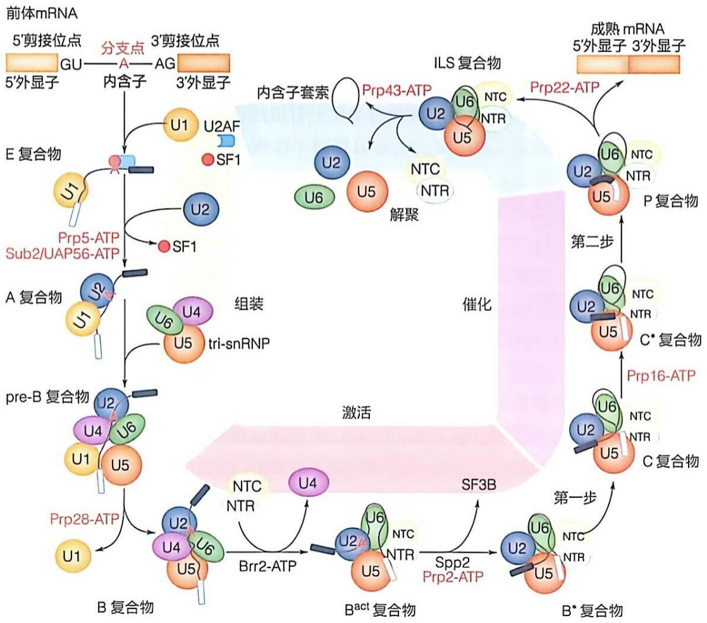

flowchart

This diagram illustrates the molecular mechanism of pre-mRNA and B* complexes, showing how various protein subunits (U1-U6) interact with downstream molecules to form complex structures like ILS, P, C*, and B*.

RNA 剪接反应完成，剪接体进入最后一个步骤——解聚。在 ATPase Prp22 的作用下，剪接后的 mRNA 被释放，NTR 解聚复合物被募集形成内含子套索剪接体（intron-lariat spliceosome，ILS 复合物）。最后，ATPase Prp43 发挥功能使得内含子套索被释放，剪接体解体为几个亚复合物，它们重新进入新一轮剪接反应中，循环往复。

## 11.1.3.4 剪接体是一个蛋白质导向的金属核酶，由RNA形成的单一活性位点催化两步转酯反应

早期的生化研究已经发现，尽管有上百种蛋白质参与剪接体的组装，但剪接体识别剪接位点和催化剪接反应发生的功能是由5条snRNA完成的，而不是众多的蛋白质。那么snRNA如何发挥识别和催化功能？活性位点是如何形成并催化转酯反应发生的？剪接体含有的众多蛋白质组分及其发生多步骤的大规模蛋白质重组和结构重排的作用和意义是什么？2015 年以来，剪接体不同工作状态下的结构生物学研究为我们揭开了谜底（图 11-7）。

剪接体在组装阶段（E→A→pre-B），首先分别通过 U1 snRNA 和 5' 剪接位点、U2 snRNA 和分支点序列之间的碱基互补配对作用对内含子中将要发生剪接反应的位置进行识别和标记。随后，U4/U6.U5 tri-snRNP 结合到 A 复合物，一方面拉近了需要发生反应的剪接位点之间的距离，在空间上为剪接反应发生作准备；另一方面，将催化两步转酯反应的执行者——U6 snRNA 带入剪接体中，为活性位点的形成作准备。上文已经提到，此时 U6 snRNA 与 U4 snRNA 互补配对呈现充分延展的构象，剪接体不具备催化活性。在组装完成时，剪接体的催化反应中心和活性位点并未形成，因此，剪接体需要被进一步激活。

剪接体在激活阶段（pre-B→B→B$^{act}$→B$^{*}$）发生了最大规模的组分重组和结构重排，参与解离和结合的蛋白质组分非常多。在这一过程中，剪接体逐步形成了催化活性中心和活性位点，并且将原本相距甚远的剪接位点——5′剪接位点和分支点的两个基团送进活性位点。首先，U1 snRNP 将 5′剪接位点传递到 U6 snRNA 上并被精确识别。随后，U4 snRNP 的离去释放了 U6 snRNA，使得其催化核心元件——分子内茎环（internal stem loop，ISL）从延展状态折叠成反复扭曲的复杂催化构象，以此来结

图 11-7 不同工作状态下剪接体的精细结构

（A）剪接体 pre-B 复合物的三维结构（PDB 编号:5ZWM, 5ZWN）。（B）剪接体 C 复合物的三维结构。（C）完全由 RNA 组成的剪接体活性位点三维结构（以 C 复合物为例）。（D）U2/U6 催化三链螺旋的三维结构（以 C 复合物为例）。（E）U6 snRNA 与两个催化 Mg$^{2+}$ 配位结合的结构。B-E，PDB 编号:5GMK

(A)

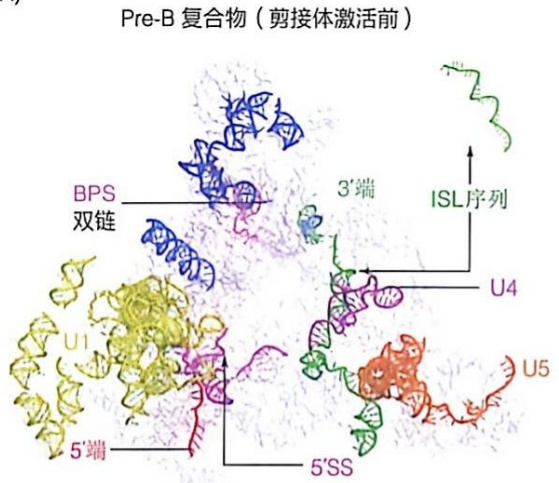

text_image

Pre-B 复合物（剪接体激活前）
BPS
双链
3'端
ISL序列
U4
U5
5'端
5'SS

(B)

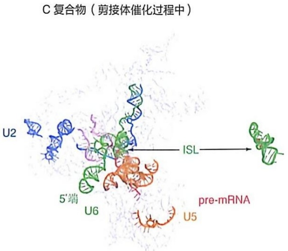

text_image

C 复合物（剪接体催化过程中）
U2
5'端
U6
pre-mRNA
ISL

(C)

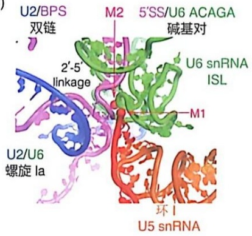

text_image

U2/BPS
双链
M2
5'SS/U6 ACAGA
碱基对
2'-5'
linkage
U6 snRNA
ISL
M1
U2/U6
螺旋 Ia
环
U5 snRNA

(D)

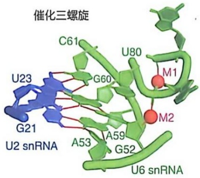

chemical

催化三螺旋结构示意图，标注U2 snRNA、C61、G60等关键链路及M1、M2、A53、A59、G52等位置

(E)

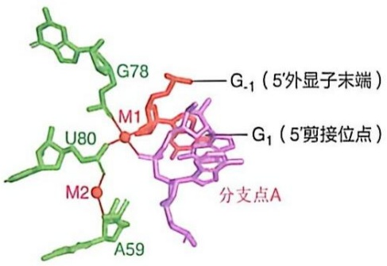

chemical

Molecular interaction diagram showing G1 (5'剪接位点) and G-1 (5'外显子末端) with labeled residues A59, M1, M2, U80, G78

合两个催化镁离子 M1 和 M2。U6 ISL 的复杂构象是由 U6 和 U2 snRNA 之间配对形成的催化三螺旋（catalytic triplex）来稳定的。5' 剪接位点被传递的同时，5' 外显子也被送进活性位点被 U5 snRNA 所结合。NTC 和 NTR 复合物被招募到剪接体上，起到稳定催化活性中心和活性位点构象的功能。值得注意的是，在 B$^{act}$ 复合物中形成的活性位点完全由 snRNA 所组成（包括 U2、U6 和 U5 snRNAs），在后续的结构研究中发现，活性位点的构象基本保持不变，直到两步转酯反应完成。活性位点被周围的蛋白质结合、包裹和稳定，形成催化活性中心。接下来，剪接体还需要被进一步激活，从 B$^{act}$ 到 B$^{*}$，分支点逐步进入活性位点并被送到 5' 剪接位点附近，至此激活完成，第一步转酯反应准备就绪。

RNA剪接的两步转酯反应是在同一个活性位点完成的。剪接体的活性位点在 $\mathrm{B}^{\mathrm{act}}$ 中形成后一直不变，U5 snRNA用来固定 $5^{\prime}$ 外显子， $5^{\prime}$ 外显子的末端在第一步转酯反应中被亲核攻击，化学键断裂后产生游离的羟基，这也是第二步转酯反应中发起亲核攻击的基团；U2 snRNA的 $5^{\prime}$ 部分结合U6 snRNA来稳定活性位点构象， $3^{\prime}$ 部分与分支点序列配对；U6 snRNA的 $5^{\prime}$ 部分识别内含子，而 $3^{\prime}$ 部分结合 $\mathrm{Mg}^{2+}$ 催化转酯反应。由此可见， $5^{\prime}$ 外显子末端（第一步反应的受体和第二步反应的供体）一直被固定在活性位点内，第一步反应的供体（BPS的腺苷酸）和第二步反应的受体（ $3^{\prime}$ 剪接位点）依次被送入活性位点，确保了两步转酯反应按顺序准确发生。两步转酯反应过程中，蛋白质组分根据功能划分为三部分:第一，活性位点及其周围的17个蛋白质结构不发生变化，主要功能是支撑RNA形成的活性位点构象；第二，NTC和U2 snRNP等部分蛋白质在两步反应过程中不解离，通过空间上的移动帮助U2 snRNA带着分支点序列进入活性位点；第三，第一步反应剪接因子（Yju2和Cwc25）和第二步反应剪接因子（Prp18和Slu7）分别在反应发生时结合和反应结束后解离，通过稳定反应基团的结构来促进反应发生。

剪接体的解聚分为两步，分别是Prp22推动的mRNA释放和Prp43推动的内含子释放，最终导致剪接体解聚。

剪接体本质上是一个金属核酶，主要催化功能靠snRNA实现，但是其蛋白组分的流动和构象变化保证了剪接反应只能单向进行。剪接体利用8个ATP水解酶/解旋酶消耗大量ATP的主要作用是推动剪接体蛋白重组和结构重排，以精准地控制剪接反应进程。

## 11.1.3.5 次要剪接体催化一组非经典内含子的剪接

以上探讨的内含子及剪接体介导的剪接过程在真核生物中高度保守。然而，在以人类为代表的复杂真核生物（一般是多细胞生物，包括大部分动物和植物）中，还存在另一条RNA剪接途径完成非经典内含子的去除（图11-8）。1990年代初，一些非经典的内含子在人类、小鼠和果蝇等物种中被发现，它们的 $5^{\prime}$ 端和 $3^{\prime}$ 端保守序列不是GU-AG。随后理查德·帕吉特（Richard A. Padgett）等鉴定了一系列很少见的、末端保守序列为AU-AG的内含子。琼·施泰茨等很快发现这些内含子的 $5^{\prime}$ 剪接位点和分支点序列分别可以与U11和U12 snRNA产生互补配对，从而进一步鉴定出这类非经典内含子的剪接是由另一种丰度很低的剪接体所完成。这类剪接体也由 U11、U12、U4atac、U6atac 和 U5 5 种 snRNPs 组成，其中 U5 snRNP 在两种剪接体中都存在。后续的研究鉴定出了更多被这类剪接体去除的内含子，其中多数也具有 GU-AG 末端（图 11-8A）。但是，这些内含子在 5' 剪接位点下游和分支点序列前后的共有序列更长，与经典的剪接位点共有序列有明显区别。

(A)

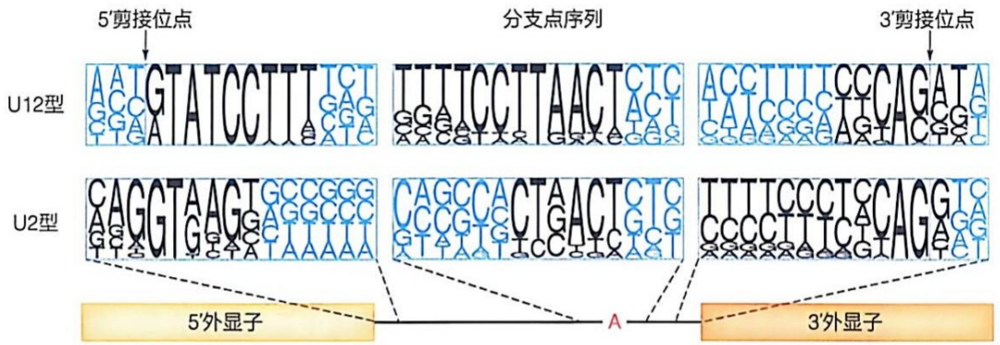

text_image

5'剪接位点
U12型
AATGTATCCTTTTCT
GGGCGTATCCTTTTCT
GGGCGTATCCTTTTCT
GGGCGTATCCTTTTCT
GGGCGTATCCTTTTCT
GGGCGTATCCTTTTCT
GGGCGTATCCTTTTCT
GGGCGTATCCTTTTCT
GGGCGTATCCTTTTCT
GGGCGTATCCTTTTCT
GGGCGTATAACTCTC
GGGCGTATAACTCTC
GGGCGTATAACTCTC
GGGCGTATAACTCTC
GGGCGTATAACTCTC
GGGCGTATAACTCTC
GGGCGTATAACTCTC
GGGCGTATAACTCTC
GGGCGTATAACTCTC
GGGCGTATAACTCTC
GGGCGTATAACTCTC
GGGCGTATAACTCTC

5'外显子
A
3'外显子

(B)

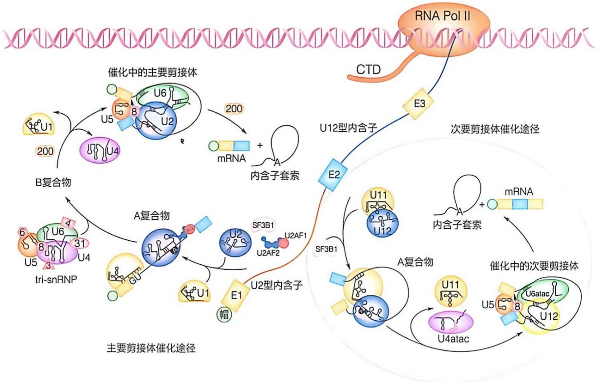

flowchart

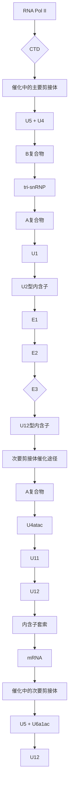

图11-8 U2型与U12型剪接体识别的剪接位点序列特征与组装过程对比（A，改绘自PATEL A A and STEITZ J A, Nat Rev Mol Cell Biol, 2003, 4(12): 960-970. B，改绘自SCOTTI MM and SWANSON M S, Nat Rev Genet, 2016, 17(1): 19-32.）

由于在细胞内丰度较低（约是前述剪接体的1/100），这类剪接体也被称作次要剪接体（minor spliceosome），由于它利用U12 snRNA，又被称作U12型剪接体（U12-type spliceosome）（图11-8B）。相应的，前述剪接体也称为主要剪接体（major spliceosome）或U2型剪接体（U2-type spliceosome）。目前认为，U12型剪接体中的

U11、U12、U4atac 和 U6atac snRNAs 在功能上分别与 U2 型剪接体中的 U1、U2、U4 和 U6 对应。例如，U11 snRNA 和 U12 snRNA 分别识别 U12 型内含子的 5' 剪接位点和分支点序列，U4atac/U6atac.U5 tri-snRNP 中 U4atac 和 U6atac 可以互补配对，U6atac 在 U12 型剪接体激活形成活性位点后与 U12 snRNA 配对，U12 型剪接体催化的化学过程也是通过两步转酯反应去除 U12 型内含子等。值得注意的是，次要剪接体特有的 U11、U12、U4atac、U6atac snRNAs 与它们在 U12 型剪接体中对应的 snRNA 之间基本没有序列相似性。

虽然U12型内含子在许多物种的基因组中是低频存在的，但却非常保守且重要。目前认为，U12型剪接体在大多数真核生物主要门类中广泛存在，在人类基因组中约800个基因包含至少一个U12型内含子，这些基因与众多细胞基本生命活动密切相关，负责遗传信息传递、电压门控离子通道和一些重要信号通路等。研究表明，U12型内含子剪接及U12型剪接体组分突变与许多人类疾病非常相关。目前关于U12型剪接体的组成和催化过程还在研究过程中。

## 11.1.4 可变剪接使一个基因编码多个蛋白质成为可能

从酵母等单细胞真核生物，到线虫和果蝇等高等真核生物再到人，内含子平均数持续增加（图11-9）。酿酒酵母只有 $5\%$ 的基因含有内含子，且绝大多数只有1个内含子，而人类超过 $95\%$ 的基因都含有内含子，每个基因含有内含子的平均数量约为8个。

绝大多数真核生物基因中都含有多个内含子，因此可以通过不同的剪接方式产生两条甚至多条不同的 mRNA（剪接异构体，isoform），从而翻译出不同的蛋白质，这种现象称为可变剪接（alternative splicing），如图 11-10。

图 11-9 不同物种的真核生物基因中内含子平均数量统计

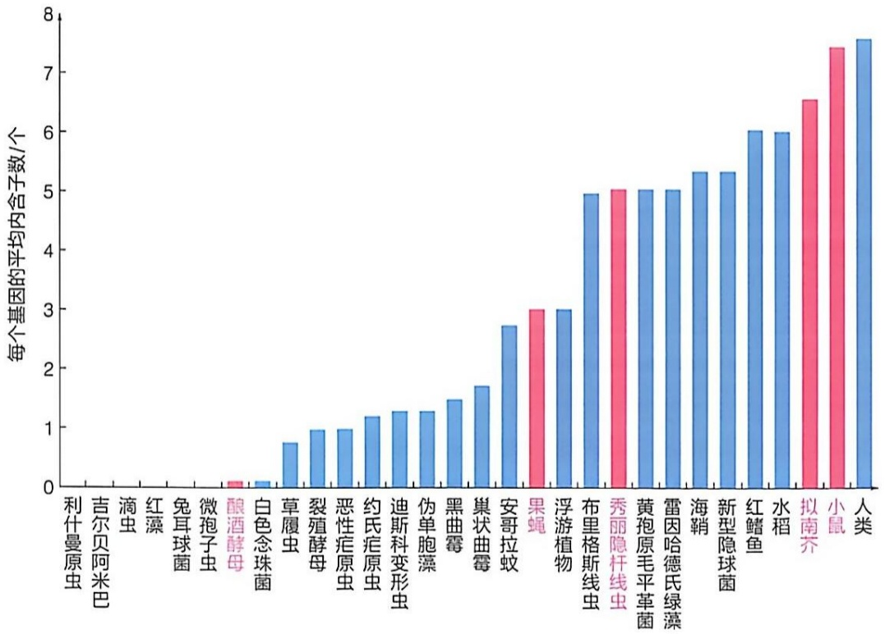

bar

| Category | Value (个) |
| :--- | :--- |
| 利什曼原虫 | 0 |
| 吉尔贝阿米巴 | 0 |
| 滴虫 | 0 |
| 红藻 | 0 |
| 兔耳球菌 | 0 |
| 微孢子虫 | 0 |
| 酿酒酵母 | ~0.1 |
| 白色念珠菌 | ~0.1 |
| 草履虫 | ~0.8 |
| 裂殖酵母 | ~1.0 |
| 恶性疟原虫 | ~1.0 |
| 约氏疟原虫 | ~1.2 |
| 迪斯科变形虫 | ~1.3 |
| 伪单胞藻 | ~1.3 |
| 黑曲霉 | ~1.5 |
| 巢状曲霉 | ~1.7 |
| 安哥拉蚊 | ~2.8 |
| 果蝇 | ~3.0 |
| 浮游植物 | ~3.0 |
| 布里格斯线虫 | ~5.0 |
| 秀丽隐杆线虫 | ~5.0 |
| 黄孢原毛平革菌 | ~5.0 |
| 雷因哈德氏绿藻 | ~5.0 |
| 海鞘 | ~5.3 |
| 新型隐球菌 | ~5.3 |
| 红鳍鱼 | ~6.0 |
| 水稻 | ~6.0 |
| 拟南芥 | ~6.5 |
| 小鼠 | ~7.4 |
| 人类 | ~7.6 |

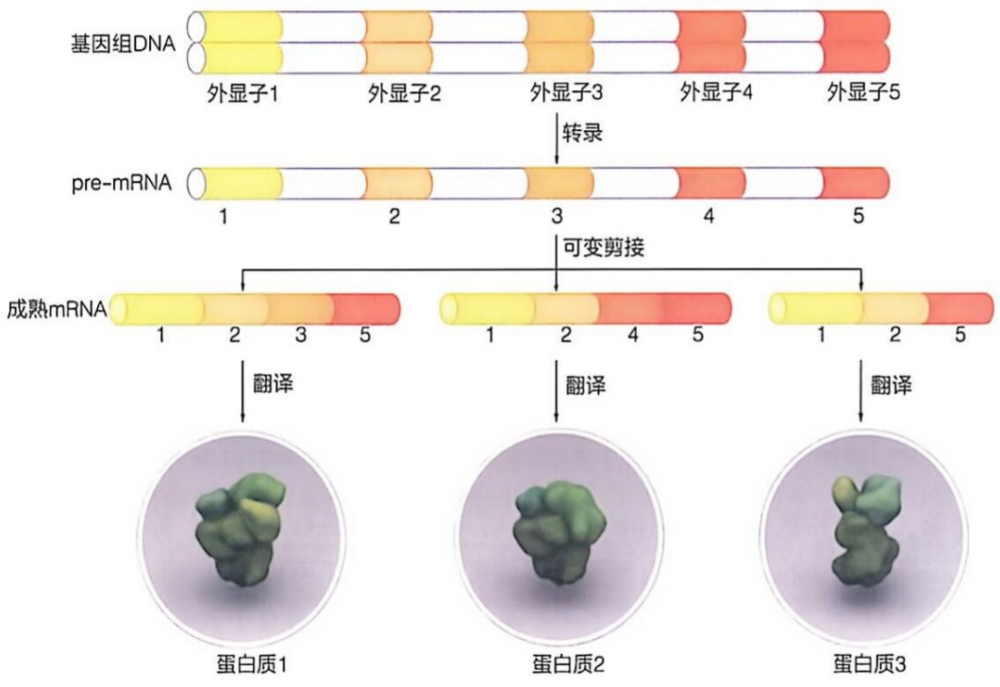

flowchart

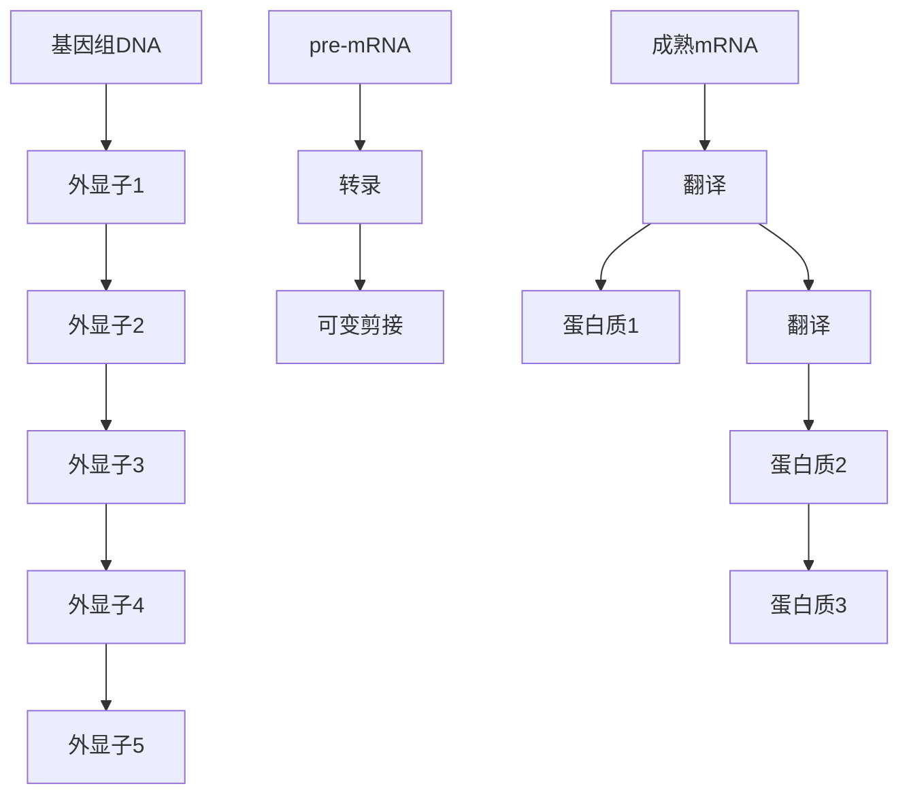

图 11-10 一个基因可以通过可变剪接编码多个蛋白质

40% 的果蝇基因和超过 90% 的人类基因会经历可变剪接。哺乳动物肌肉蛋白质肌钙蛋白 T（troponin T），该基因转录得到的 pre-mRNA 有 5 个外显子，通过可变剪接，可以产生两种不同的 mRNA 异构体，各包含 4 个外显子，分别翻译得到 α 肌钙蛋白 T 和 β 肌钙蛋白 T。虽然许多基因仅产生两个剪接异构体，但是在一些基因中，由于含有的内含子数量很多，单个基因产生的剪接异构体数目非常惊人。例如，人的 Slo 基因可产生几百个剪接异构体，果蝇的唐氏综合征细胞黏附分子（Dscam）基因的剪接异构体可达上万个。因此，可变剪接是蛋白质组丰度的重要贡献者。

在大多数情况下，可变剪接过程受到严格调控，具有时间特异性或者组织特异性，即在不同条件或者不同细胞类型中可以生成特定的蛋白质产物。人们发现，可变剪接的转换在细胞命运决定中占据核心位置。通过人工增强一些维持细胞多能性相关的关键转录因子（包括 OCT4 和 NANOG 等）的生成，体细胞可以去分化形成多能性细胞（即诱导性多能干细胞，induced pluripotent stem cell, iPS），而 OCT4 和 NANOG 等的生成可以被 Forkhead 家族的 DNA 结合蛋白质 FOXP1 基因的可变剪接所调节（图 11-11）。通过可变剪接，可以产生两种 FoxP1 蛋白亚型，一种包含外显子 18b（FOXP1-ES）编码的蛋白质，它可以激活靶基因 OCT4、NANOG 等，引起去分化促进 iPSC 形成；另一种包含外显子 18a（FOXP1）编码的蛋白质则无激活功能，从而引起细胞分化。

## (1) 常见的可变剪接有 5 种类型

细胞内存在多种形式的可变剪接，必然导致 mRNA 序列的改变，包括局部删除或者移码等，进一步导致蛋白质的改变。将转录得到的 pre-mRNA 中所有内含子去除、所有外显子按顺序连接成 mRNA，这种正常的剪接方式，称为组成型剪接（constitutive splicing）。多内含子基因的可变剪接方式可以概括为以下 5 种基本类型（图 11-12）:①外显子跳跃（exon skipping），即个别外显子被有意遗漏，与内含子一起被去除；②可变 5' 剪接位点（alternative 5' splice site）；③可变 3' 剪接位点（alternative 3' splice site）；④内含子保留（intron retention），是指内含子不被去除而被完全保留在成熟 mRNA 中；⑤互斥型外显子（mutually exclusive exon），也称为互不相容剪接，如肌钙蛋白 T。

图11-11 FOXP1基因的可变剪接调控决定干细胞的命运

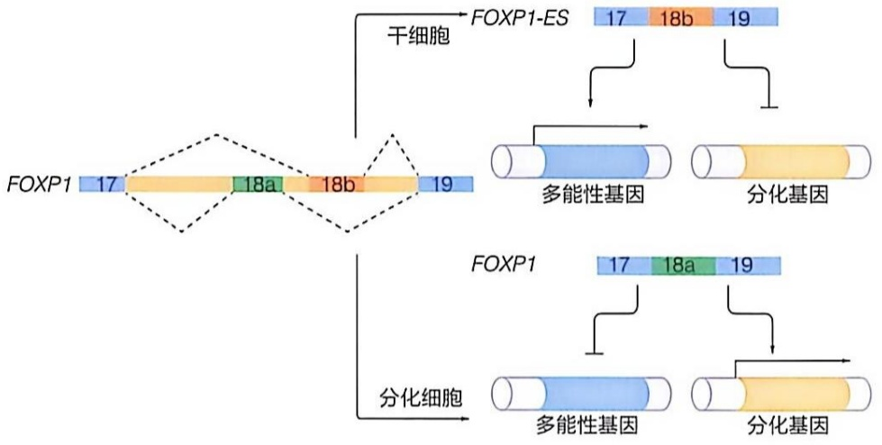

flowchart

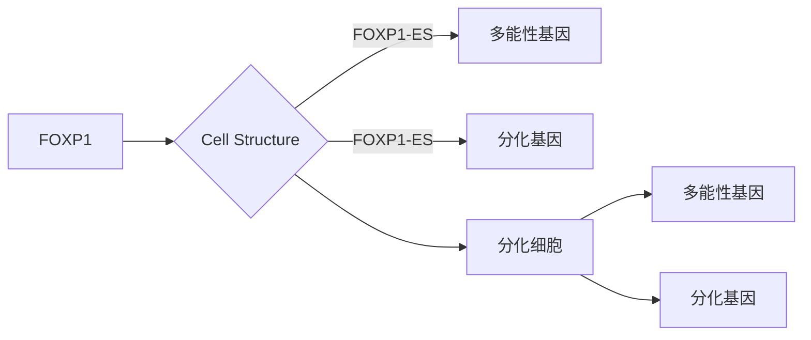

## （2）可变剪接可以被顺式作用元件和反式作用因子调控

无论是组成型剪接还是可变剪接，核心问题都是细胞中pre-mRNA上的剪接位点是如何被识别和选择的。通过前述内容我们知道，位于pre-mRNA上的剪接位点主要通过碱基互补配对作用被剪接体识别，那么任何可能对这一识别过程造成影响的因素都可能改变最终的剪接产物。简单来说，这些影响因素可以概括为顺式作用元件和反式作用因子。

图11-12 5种可变剪接类型

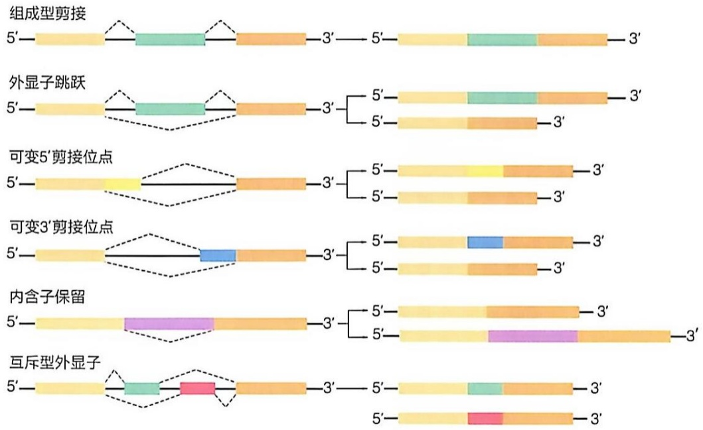

text_image

组成型剪接
5'- 3'- 5'- 3'
外显子跳跃
5'- 3'- 5'- 3'
可变5'剪接位点
5'- 3'- 5'- 3'
可变3'剪接位点
5'- 3'- 5'- 3'
内含子保留
5'- 3'- 5'- 3'
互斥型外显子
5'- 3'- 5'- 3'

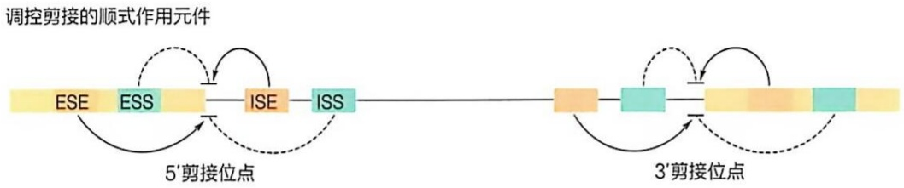

flowchart

图11-13 剪接增强子和沉默子

改绘自 FUXD, et al. Nat Rev Genet, 2014, 15 (10): 689-701.

顺式作用元件主要指位于 pre-mRNA 上的一些调控序列，包括外显子 / 内含子剪接增强子（exonic/intronic splicing enhancer，ESE 或 ISE）、外显子 / 内含子剪接沉默子（exonic/intronic splicing silencer，ESS 或 ISE）等（图 11-13）。此外，剪接位点本身就有不同的强弱，也可以调节可变剪接。pre-mRNA 上还可能形成二级结构，从而影响剪接位点的暴露而改变可变剪接位点的选择。

反式作用因子主要包括一些 RNA 结合蛋白，主要包含丝氨酸 / 精氨酸富集蛋白（SR 蛋白）和核不均一核糖核蛋白（heterogeneous nuclear ribonucleoprotein, hnRNP），它们可以被上述调控序列所招募影响剪接体对剪接位点的识别以及其在 pre-mRNA 上的组装（图 11-14）。SR 蛋白家族数量庞大且种类多样，一般含有 RNA 识别基序（RNA recognition motif, RRM）和富含精氨酸和丝氨酸的 RS 结构域。SR 蛋白一般利用其 RRM 结合剪接增强子，利用其 RS 结构域介导与剪接体蛋白的相互作用，从而招募剪接体、促进附近剪接位点被利用，所以被认为是剪接的激活因子。hnRNP 家族蛋白一般识别剪接沉默子，它们能结合 RNA 但不含与剪接体结合的结构域，从而通过空间位阻的方式抑制剪接位点被利用，所以通常被认为是剪接抑制因子。其中 hnRNPI 蛋白可以直接结合多聚嘧啶区来阻碍剪接体的结合，所以 hnRNPI 也称为多聚嘧啶区结合蛋白（Py tract binding protein, PTB）。

顺式作用元件和反式作用因子之间存在复杂的相互作用网络，其调控效果是一个综合作用。pre-mRNA上的剪接增强子和沉默子有时会同时存在（但并不重叠），抑制因子的结合可能会影响激活因子对附近增强子的结合从而抑制剪接，而强激活因子有时能够克服这样的抑制。比如，HIV tat pre-mRNA的一个外显子上同时具有ESE和ESS，它们分别被激活因子SC35和抑制因子hnRNPA1结合，后者结合到ESS后促进了其他hnRNPA1对附近区域的结合，从而阻断了SC35的结合。而另一个激活因子SF2/ASF可以以更高的亲和力结合剪接增强子，进而取代已经结合的hnRNPA1来解除抑制作用（图11-15）。

hnRNPs和SR 蛋白调控前体 mRNA剪接过程中发挥相反作用

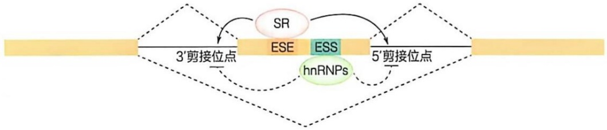

flowchart

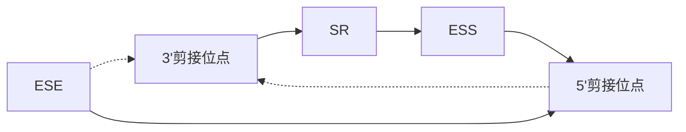

图 11-14 hnRNPs 和 SR 蛋白质调控 pre-mRNA 剪接过程中发挥相反作用改绘自 FU X D, et al. Nat Rev Genet, 2014, 15(10): 689-701.

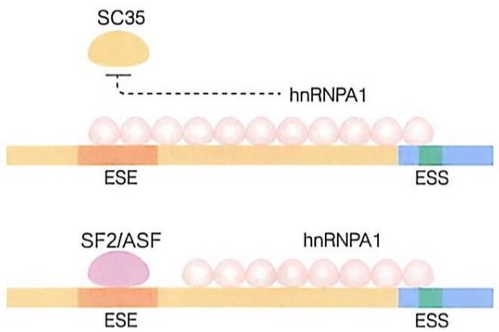

text_image

SC35
hnRNPA1
ESE
ESS
SF2/ASF
hnRNPA1
ESE
ESS

图11-15 剪接激活因子与抑制因子之间的竞争

除了顺式作用元件和反式作用因子，对剪接体本身的调控与可变剪接更是联系密切。首先，剪接位点处可能存在竞争结合导致空间位阻。如果剪接位点附近有其他因子结合，那么就可能与U1、U2 snRNPs等剪接体的早期组装组分发生竞争，导致该位点不能被识别。另外，改变剪接体组分的丰度也可以影响剪接位点的选择。比如，snRNPs需要预先经历成熟过程才能参与RNA剪接。通过调节U2 snRNP的成熟，可以影响分支点和3'剪接位点的利用。因此，剪接位点有选择地被利用是剪接位点强弱和空间距离以及顺式作用元件与反式作用因子相互作用强弱等众多调控因素的综合结果。

以上主要是在已转录的pre-mRNA水平上讨论剪接调控，研究发现，在细胞核里RNA剪接是伴随转录发生的，这是两个紧密偶联的过程。所以，影响转录的因素，例如转录延伸的速度和一些表观遗传修饰都可能调控pre-mRNA的可变剪接。例如，有研究表明，在带有RNA聚合酶Ⅱ变慢突变体的果蝇中，由于转录速度较慢，剪接体会有更充分的时间来识别较弱的剪接位点，促进剪接；而在野生型果蝇中，该剪接位点通常来不及被剪接体识别从而发生外显子跳跃。多种表观遗传因素也可调控剪接。首先，组蛋白修饰可能通过影响RNA聚合酶Ⅱ延伸速度来影响剪接。除此之外，特定组蛋白修饰的阅读器（reader）可以结合剪接因子，从而促进或者抑制剪接，而当修饰改变时这种调节作用就不存在了。

## 11.1.5 自然界还存在其他的 RNA 剪接类型

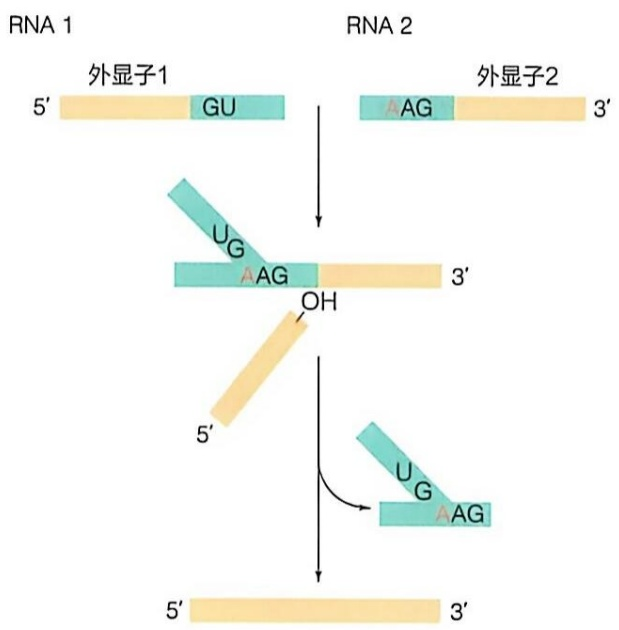

flowchart

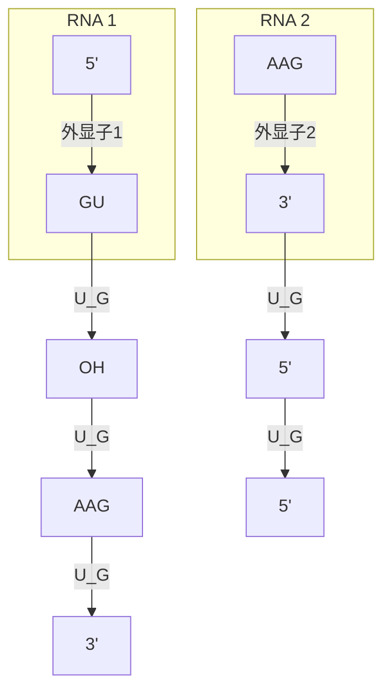

图11-16 反式剪接过程

## (1) 反式剪接可以连接来自不同 RNA 分子的外显子

上述所讲的pre-mRNA剪接过程都发生在同一条RNA分子上，故均为顺式剪接（cis-splicing）。此外，两个RNA分子间也能发生剪接反应使外显子连接在一起，被称为反式剪接（trans-splicing），如图11-16所示。反式剪接在大多数生物中发生的概率很低，但锥虫（Trypanosome）和秀丽隐杆线虫（Caenorhabditis elegans）的mRNA经常发生反式剪接。

## (2) 自剪接内含子

上述我们主要讨论的是真核生物 mRNA 的剪接，是剪接体介导的。还有一些内含子是自剪接内含子，它们存在于真核生物的细胞器及原核生物中，一些真核生物的 rRNA 也含有自剪接内含子（表 11-1）。自剪接内含子根据其结构和剪接机制的不同可以分为 I 型和 II 型。自剪接内含子通过自身的 RNA 间相互作用折叠成特殊的三维构象，催化自身的内含子释放和外显子拼接，这个过程不需要任何蛋白质和其他

表 11-1 内含子的分类

| 内含子类型 | 丰度 | 剪接机制 | 催化机器 |
| --- | --- | --- | --- |
| I型自剪接内含子 | 罕见,来自某些真核生物的细胞核 rRNA、细胞器基因,以及少量原核基因 | 两步转酯反应,分支点为 G | 内含子编码的核酶 |
| II型自剪接内含子 | 罕见,来自某些细胞器的真核基因及原核基因 | 两步转酯反应,分支点为 A | 同上 |
| 主要内含子 | 很常见,大多数真核基因均为此类内含子,剪接位点“GU-AG”非常保守 | 两步转酯反应,分支点为 A | 主要剪接体 |
| U12型内含子 | 罕见,存在于高等真核生物的基因中,剪接位点为“AU-AC” | 两步转酯反应,分支点为 A | 稀有剪接体 |

RNA 分子的存在与辅助，因此被称为自剪接（self-splicing）。

如图 11-17 所示，Ⅱ型自剪接内含子的剪接机制和上文所述的细胞核内 pre-mRNA 剪接的机制比较类似，都是由分支点的 A 攻击 5' 剪接位点的磷酸二酯键，形成套索结构，然后新游离出来的外显子末端的 3' 羟基攻击 3' 剪接位点，发生第二步转酯反应，以套索结构形式释放内含子并连接外显子。与之相比，I 型自剪接内含子剪接机制则有较大不同，在第一步反应中，作为亲核进攻基团的不是分支点 A 的 2' 羟基，而是由游离的 G 提供的游离羟基，RNA 分子与其结合，并将其 3' 羟基呈递给 5' 剪接位点从而将二者相连，发生第一步转酯反应。第二步反应与之前的类似，由游离的外显子末端 3' 羟基攻击 3' 剪接位点，导致内含子的去除和外显子的连接。值得注意的是，除了第一步转酯反应的亲核进攻基团的不同，I 型自剪接内含子所释放的

图11-17 剪接体内含子与两类自剪接内含子

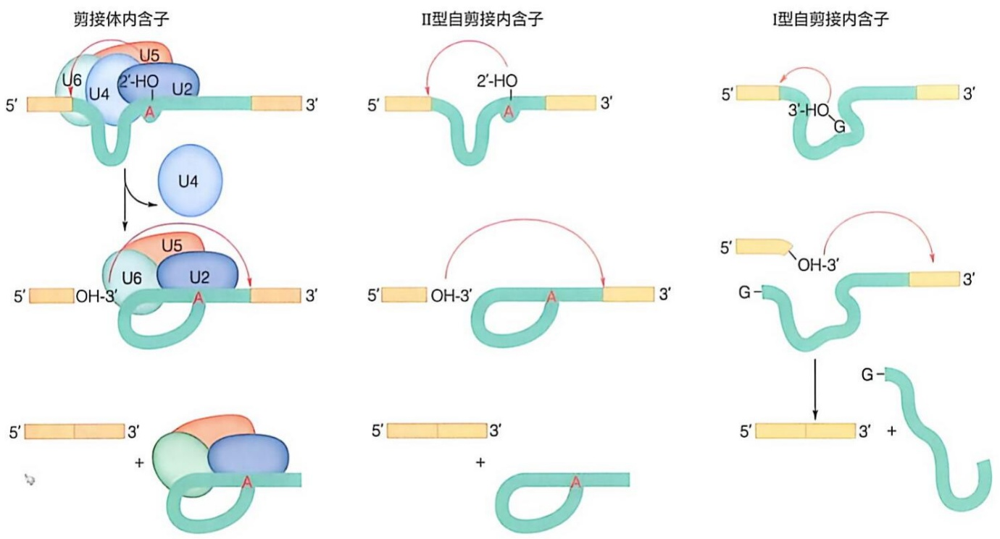