图 11-18 tRNA 剪接过程

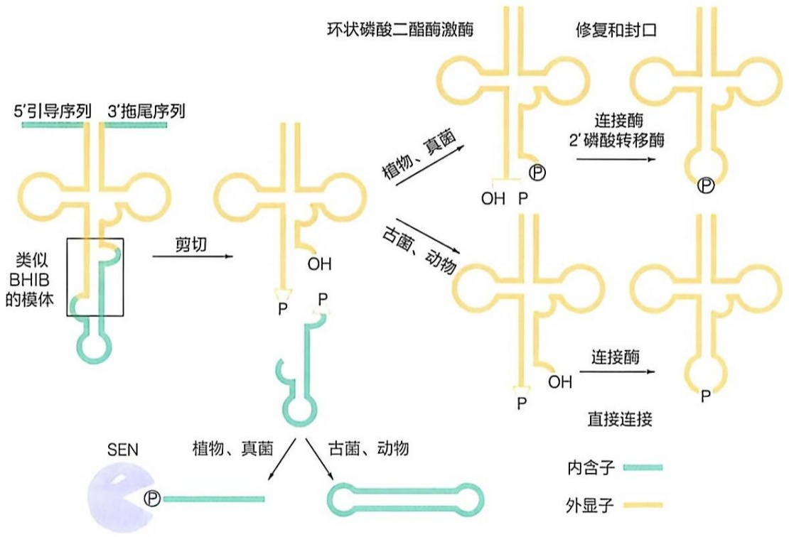

<details>
<summary>flowchart</summary>

```mermaid
graph LR
  A["5' 引导序列"] --> B["类似 BHIB 的模体"]
  C["3' 拖尾序列"] --> D["剪切"]
  E["环状磷酸二酯酶激酶"] --> F["修复和封口"]
  G["连接酶\n2' 磷酸转移酶"] --> H["连接酶"]
  I["植物、真菌"] --> J["古菌、动物"]
  K["古菌、动物"] --> L["植物、真菌"]
  M["植物、真菌"] --> N["植物、真菌"]
  O["植物、真菌"] --> P["植物、真菌"]
  Q["植物、真菌"] --> R["植物、真菌"]
  S["植物、真菌"] --> T["植物、真菌"]
  U["植物、真菌"] --> V["植物、真菌"]
  W["植物、真菌"] --> X["植物、真菌"]
  Y["植物、真菌"] --> Z["植物、真菌"]
  AA["植物、真菌"] --> AB["植物、真菌"]
  AC["植物、真菌"] --> AD["植物、真菌"]
  AE["植物、真菌"] --> AF["植物、真菌"]
  AG["植物、真菌"] --> AH["植物、真菌"]
  AI["植物、真菌"] --> AJ["植物、真菌"]
  AK["植物、真菌"] --> AL["植物、真菌"]
  AM["植物、真菌"] --> AN["植物、真菌"]
  AO["植物、真菌"] --> AP["植物、真菌"]
  AQ["植物、真菌"] --> AR["植物、真菌"]
  AS["植物、真菌"] --> AT["植物、真菌"]
  AU["植物、真菌"] --> AV["植物、真菌"]
  AW["植物、真菌"] --> AX["植物、真菌"]
  A --> D
  B --> D
  D --> E
  E --> F
  F --> G
  G --> H
  H --> I
  I --> J
  J --> K
  K --> L
  L --> M
  M --> N
  N --> O
  O --> P
  P --> Q
  Q --> R
  R --> S
  S --> T
  T --> U
  U --> V
  V --> W
  W --> X
  X --> Y
  Y --> Z
  Z --> AA
  AA --> AB
  AB --> AC
  AC --> AD
  AD --> AE
  AE --> AF
  AF --> AG
  AG --> AH
  AH --> AI
  AI --> AJ
  AJ --> AK
  AK --> AL
  AL --> AM
  AM --> AN
  AN --> AO
  AO --> AP
  AP --> AQ
  AQ --> AR
  AR --> AS
  AS --> AT
  AT --> AU
  AU --> AV
```
</details>

内含子是线性的，而不是套索结构。由于Ⅱ型自剪接内含子与剪接体内含子剪接机制高度相似，很多人认为Ⅱ型内含子代表了内含子的最原始形式，是细胞核内含子和剪接体在进化上的祖先。

## (3) tRNA 剪接

tRNA 基因经转录产生 pre-tRNA，tRNA 的剪接是其成熟的关键步骤。tRNA 的剪接不是剪接体所介导的，而是依赖于几种 RNA 加工酶。首先，tRNA 内切酶（tRNA splicing endonuclease，TSEN）在 pre-tRNA 中的内含子两端进行切割，产生特殊的末端；然后两个外显子由 tRNA 连接酶进行连接，形成成熟的 tRNA（图 11-18）。虽然 tRNA 剪接也经历“剪”和“接”两个过程，但是可以看出，其化学过程与 mRNA 剪接十分不同，而且 tRNA 剪接是完全由蛋白质所催化的剪接反应（见第 13 章）。

## 11.1.6 mRNA剪接异常导致众多人类疾病的发生

我们已经系统描述了真核生物RNA剪接的过程和机制，显然，RNA剪接及其调控的准确性对细胞的正常功能非常重要，任何参与剪接的顺式作用元件和反式作用因子失去功能都可能导致严重后果。pre-mRNA剪接异常与人类疾病息息相关，约 $60\%$ 的疾病相关突变影响RNA剪接，RNA剪接失调是几乎是所有类型肿瘤的分子特征。

## （1）剪接位点突变产生错误蛋白质从而导致疾病

RNA 正确剪接的第一步是剪接体对剪接位点的准确识别，那么剪接位点一旦发生突变，可能导致剪接位点移位，产生错误的 mRNA 指导合成错误的蛋白质，最终导致疾病发生。据估计，超过 $15\%$ 的基因突变引发疾病相关基因的异常剪接。例如，β地中海贫血症（β-thalassemia）中一类患者的血红蛋白β珠蛋白亚基（β-globin）基因的第一个内含子发生点突变，序列从TTGGT变成了TTAGT，使得AG后产生了一个3'剪接位点，因此患者的pre-mRNA剪接就主要发生在突变后新产生的3'剪接位点，导致产生错误的β-珠蛋白（图11-19）。

此外，家族性Ⅱ型孤立性生长激素缺乏症（isolated growth hormone deficiency type Ⅱ，IGHD Ⅱ）、Frasier 综合征（Frasier syndrome）和两种痴呆症都是因为一些编码关键蛋白质基因的 pre-mRNA 错误剪接引起的。

（2）剪接体组分突变影响剪接活性和蛋白质表达水平导致疾病

RNA 剪接的顺利进行依赖于剪接体的正常工作，剪接体组分突变引起的功能缺陷影响了正常剪接过程从而导致疾病发生。例如，色素性视网膜炎（rentinitis pigmentosa，RP）会导致视网膜进行性恶化直至失明。导致该疾病的突变主要发生在编码剪接体蛋白质组分的基因上，包括 PRP8、PRP31、PRP6 和 PRP3 等。患者一般同时具有正常基因拷贝和突变基因拷贝，体

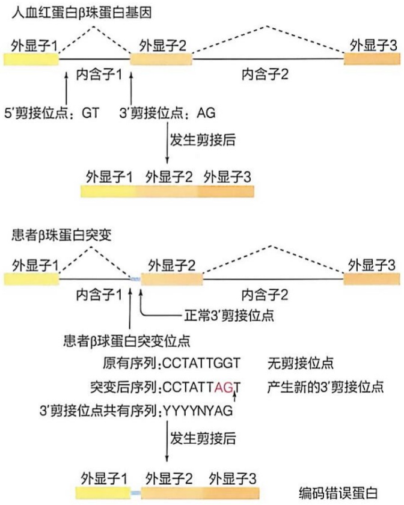

图11-19 $\beta$ 珠蛋白内含子突变导致剪接异常从而引起 $\beta$ 地中海贫血症

内存在正确剪接的蛋白质，但低于正常水平。剪接体组分低于正常水平所产生的影响表现在视网膜这一组织中，可能是因为视网膜上的感光色素视紫红质（photopigment rhodopsin）需要高水平周转，而剪接体组分突变导致剪接体效率变低，无法高效剪接，所以对视网膜中剪接水平的改变就更为敏感。

另一个例子是脊髓性肌萎缩（spinal muscular atrophy，SMA），该病是一种常染色体隐性遗传病，会导致脊髓神经元退化从而引起进行性肌无力和肌肉萎缩，是婴幼儿期的头号致死性遗传病。它是运动神经元存活（survival motor neuron，SMN）基因中的SMN1突变或缺失导致全长SMN蛋白缺失所致。人体中有SMN1和SMN2两个基因编码SMN蛋白，二者都具有8个外显子，仅在7号外显子处有一个核苷酸的差别（图11-20）。SMN1基因一般进行组成型剪接，其成熟mRNA包含全部8个外显子，可以产生全长的SMN1蛋白。但是，SMN2的7号外显子与SMN1有1个核苷酸的差异，导致大部分SMN2的pre-mRNA剪接时一般会跳过7号外显子产生截短的、易被降解的蛋白质，只有很少部分pre-mRNA被剪接后产生全长的SMN蛋白。全长的SMN蛋白对于剪接体组分中的snRNP组装非常重要。一般来讲，SMA患者的SMN1基因突变或缺失导致无法编码全长蛋白，故体内的SMN蛋白主要来源于SMN2基因，导致患者体内全长的SMN蛋白表达水平较低，影响剪接体发挥正常功能，进而导致疾病。目前，SMN基因突变或缺失引起的剪接异常为何主要影响运动神经元仍不清楚，推测可能与上述色素性视网膜炎发病的原因类似。

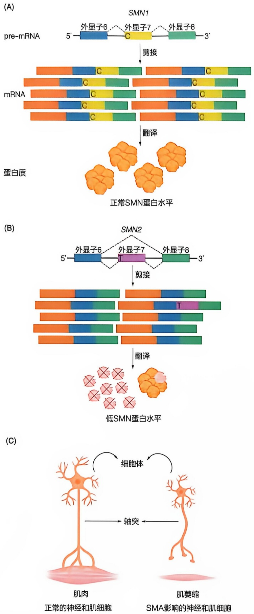

图 11-20 SMN1 和 SMN2 基因表达差异及 SMA 致病机制

(A、B 改绘自 JAFFE J, et al. J Commun Disord, 1973, 6 (4): 225-246)

许多稀有剪接体组分的突变也会导致疾病，如 U12 snRNA、U4atac snRNA 和 RNPC3，这些组分上的突变会导致早发性小脑共济失调（early-onset cerebellar ataxia, EOCA）、小头畸形骨发育不良性原始侏儒症 1 型（microcephalic osteodysplastic primordial dwarfism type 1, MOPD1）/泰-林德综合征（Taybi-Linder syndrome, TALS）、Roifman 综合征和孤立性生长激素缺乏症（IGHD）等生长发育异常疾病的发生。

## (3) 异常剪接调控与癌症息息相关

RNA 剪接失调几乎是所有类型肿瘤的分子特征。其中，细胞周期调控因子 p73 的可变剪接存在多种形式，其中的一些突变导致可变剪接发生错误，这与鳞状细胞癌（squamous cell carcinoma）相关。此外，剪接体组分的突变也与多种类型的肿瘤与癌症密切相关，包括 U2 snRNP 的核心组分 SF3B1、U2AF1 和稀有剪接体特有的 ZRSR2 等，它们的突变与急性髓系白血病（acute myeloid leukemia, AML）、慢性淋巴细胞白血病（chronic lymphocytic leukemia, CLL）、骨髓增生异常综合征（myelodysplastic syndrome, MDS）及其他多种肿瘤相关。

## (4) 矫正剪接缺陷是治疗疾病的一种途径

由于 RNA 剪接异常与众多疾病息息相关，因此 RNA 剪接一直以来是相关疾病治疗和药物研发的主要靶点之一。这里我们以 Spinraza 对 SMA 的治疗机制为例来阐述矫正剪接缺陷对于治疗疾病的贡献。阿德里安·克雷纳（Adrian R. Krainer）等发现，利用一段结合到 SMN2 的 7 号内含子区域的反义寡核苷酸（antisense oligonucleotide, ASO），可以拮抗剪接抑制因子的结合，从而促进 7 号外显子的剪接，使患者体内产生足够的 SMN 全长蛋白（图 11-21）。Spinraza 的活性成分就是经过修饰的 ASO，该药物在 2016 年 12 月获得了 FDA 批准，挽救了患者的生命。

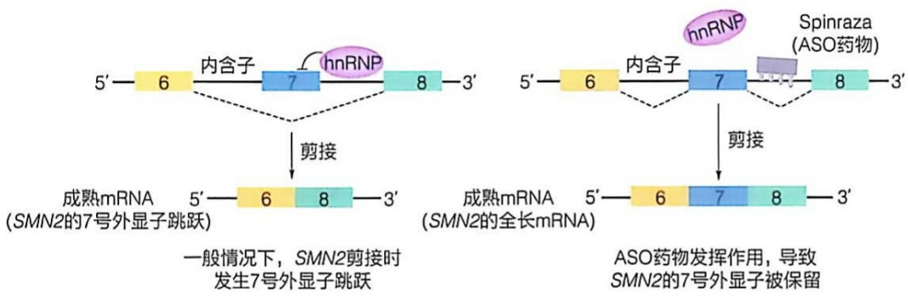

<details>
<summary>flowchart</summary>

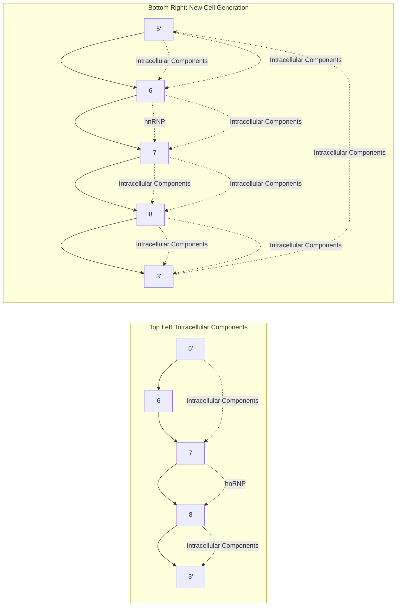
</details>

图 11-21 利用 ASO 矫正 SMN2 剪接来治疗 SMA

## 11.2 成熟 mRNA 从细胞核转运到细胞质

真核细胞中，由于核膜将细胞分隔成细胞核和细胞质两个不同区域，在细胞核中经加工成熟的 mRNA 需要输出到细胞质，才能指导蛋白质合成。mRNA 出核作为真核基因表达通路中的重要步骤和关键环节，其过程关系到生长、增殖、分化和发育等真核生物的各项基本生命活动。

## 11.2.1 mRNA 通过核孔复合体被单向转出核

## (1) 核孔复合体是 mRNA 出核转运的通道

1949 年，哈罗德·卡伦（Harold G. Callan）等人在利用透射电子显微镜观察两栖类卵母细胞的核被膜时发现膜上存在小孔状结构，并推测这些结构可能是物质进出细胞核的通道。10 年后，迈克尔·沃森（Michael L. Watson）将这种结构命名为核孔复合体（nuclear pore complex，NPC）。哺乳动物细胞核的核膜上镶嵌着 3 000～4 000 个核孔复合体，它们能够穿膜形成直径约为 40 nm 的细胞核与细胞质间的通道，负责大分子双向运输。每个核孔复合体约含 30 种不同的核孔蛋白，进而组成了核篮、核环、中央通道、细胞质环及细胞质纤丝等结构。中央通道主要由骨架核孔蛋白（scaffold

nucleoporin）和 FG 核孔蛋白（FG nucleoporin，FG Nup）组成。FG 核孔蛋白富含苯丙氨酸（F）-甘氨酸（G）重复序列，借此形成了具有筛选和限制功能的 FG 选择性屏障。在 mRNA 出核过程中，核输出受体（nuclear export receptor）通过与不同 FG 核孔蛋白之间的瞬时弱相互作用，携带 mRNA 逐步穿越选择性屏障，经过核孔复合体，从核膜内侧移动至细胞质侧，最终将 mRNA 释放到细胞质中（图 11-22）。

## (2) mRNA 出核是一个耗能的过程

RNA 出核过程中，细胞需要消耗能量来实现核内外的物质交换和维持核质之间的选择性屏障。首先，mRNA 需要与 RNA 结合蛋白及出核因子组装形成信使核糖核蛋白体（mRNP），在这个过程中 mRNA 和出核因子借助 ATP 水解提供的能量发生构象上的变化，形成稳定的 mRNP 结构。此外，核孔复合体在特定环境中结构可能发生变化，这些变化需要能量驱动，以促进 RNA 的高效出核。mRNP 在通过核孔后在核孔复合体的胞质侧释放，这个过程也需要水解 ATP 释放能量，帮助蛋白质与 RNA 解离，将 mRNA 释放到胞质中（图 11-23）。能量的消耗确保了 RNA 出核过程的精确性和高效能，这个过程受到严格而精密的调控，对于维持正常的基因表达和细胞功能至关重要（知识延展 11-1）。

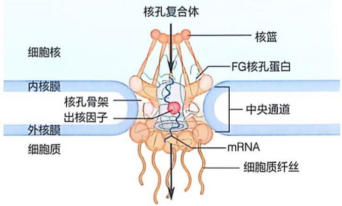

<details>
<summary>flowchart</summary>

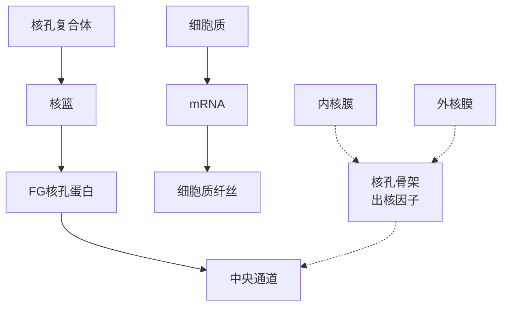
</details>

图 11-22 mRNA 通过核孔复合体转运出核

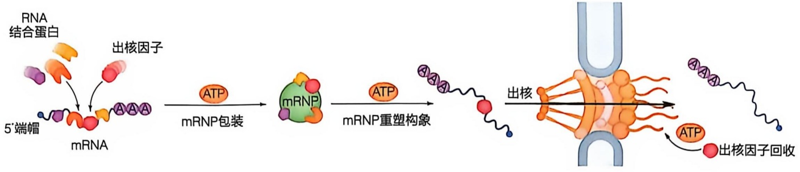

<details>
<summary>flowchart</summary>


</details>

图 11-23 mRNA 出核是一个单向的耗能过程

## (3) mRNA 从细胞核单向输出到细胞质

mRNA 从细胞核通过核孔后单向输出到细胞质，在核孔复合体胞质侧释放。在

## 知识延展 11- 1

## RanGTP-RanGDP 浓度梯度保证多种 RNA 的核质转运方向

与 mRNA 出核方式不同，其他类型的 RNA 出核需要依赖 RanGTP 酶循环提供动力。Ran 蛋白在细胞核内主要处于结合 GTP 的活跃状态（RanGTP），而在细胞质中主要处于结合 GDP 的状态（RanGDP），借此形成细胞核和细胞质之间的能量梯度。在细胞核内，RanGTP 与出核受体及底物 RNA 结合形成复合物，帮助 RNA 通过核孔复合体转运到细胞质。一旦进入细胞质，RanGTP 被 RanGTP 酶激活蛋白 RanGAP 水解成 RanGDP，导致 RNA-出核受体解离，从而释放底物 RNA。随后，RanGDP 与核转运蛋白 NTF2 结合，通过核孔复合体再次被转运至核内，并在鸟苷酸交换因子 RCC1 的作用下转化为 RanGTP，开始下一个循环。核内高、核外低的 RanGTP 分布特性确保其在核内装载底物 RNA 并在胞质中释放，从而实现 RNA 的单向运输，确保了基因表达的精准性和高效性，从而保障细胞正常的生理功能和对环境的响应能力（图 11-24）。

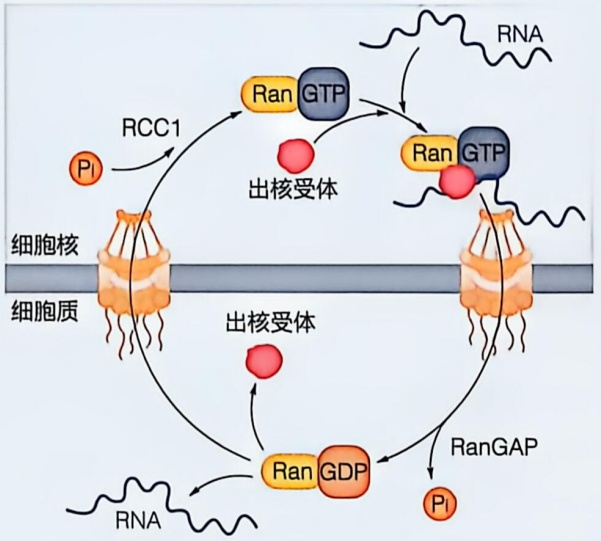

<details>
<summary>flowchart</summary>

This diagram illustrates the molecular mechanism of RNA synthesis, showing how RNA binds to a target with RAN and GTP, which in turn binds to an RNA complex containing RAN GDP.
</details>

图 11-24 RanGTP 酶循环帮助 RNA 出核转运

mRNA 的释放过程中，RNA 解旋酶利用 ATP 水解所产生的能量重塑 mRNP 构象，使出核配体解离并释放 mRNA 至胞质中，而完成使命的出核受体通过核孔被回收至核内，辅助下一轮的 mRNP 出核转运（图 11-23）（知识延展 11-2）。mRNA 单向输出有助于确保蛋白质合成的精确性和稳定性，维持细胞核和细胞质的稳态，保持核质之间的生理平衡，防止错误信号对细胞活动的负面影响。

## 知识延展 11- 2

## 不同类型的 RNA 依赖不同途径进行出核转运

在细胞中，不仅 mRNA 需要通过核孔复合体转运到细胞质，还有许多非编码 RNA（non-coding RNA, ncRNA）和小 RNA 也需要通过不同途径转运以发挥其特定的调控功能。

其中，转运 RNA（tRNA）出核由出核受体 Exportin-T 所介导:细胞核内 tRNA 通过与 Exportin-T 以及 RanGTP 结合形成复合物，通过核孔复合体转运出核。在 miRNA出核通路中，初级 miRNA（pri-miRNA）在细胞核中加工形成 miRNA 前体（pre-miRNA）后，与 Exportin-5 结合，通过 RanGTP 依赖的方式出核进入细胞质中。此外，piRNA（piwi-interacting RNA）和 snRNA 的出核依赖出核受体 Exportin-1，并同样通过 RanGTP 酶循环提供出核动力（图 11-25）。

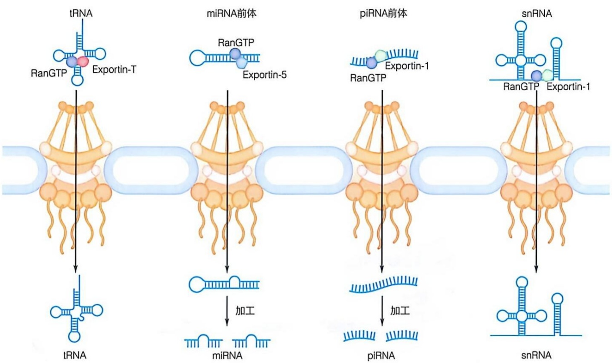

<details>
<summary>flowchart</summary>

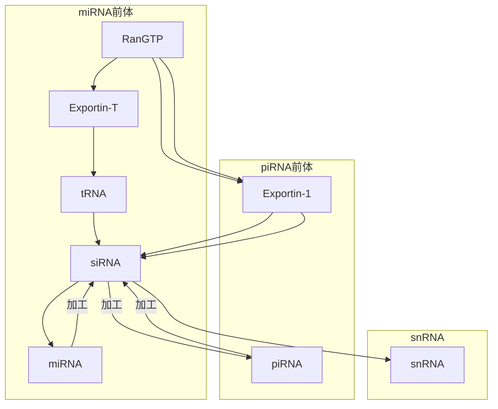
</details>

图 11-25 不同类型的 RNA 依赖不同途径进行出核转运

## 11.2.2 mRNA在出核受体和配体的帮助下被转运出核

mRNA 通过核孔转运到细胞质，然而单靠 mRNA 分子本身无法主动穿过核孔复合体。那么 mRNA 是通过什么途径与核孔复合体相互作用进而被运输出核的呢？这个过程需要多种出核因子的帮助，其中最为关键的蛋白质被称作出核受体。出核受体通过与货物分子结合，帮助其穿越核孔复合体，并在细胞质中释放。

首先，mRNA 出核受体需要特异性结合经正确加工的成熟 mRNA，而避免未加工或错误加工的 mRNA 被错误转运出核。其次，出核受体一方面通过与 mRNP 高亲和力结合，另一方面与 FG 核孔蛋白的 FG 重复序列形成短暂的弱相互作用，引导 mRNP 逐步通过核孔复合体。当 mRNP 被转运至细胞质侧后，出核受体与 mRNA 解离，并迅速返回核内，以继续新的运输任务，维持 mRNA 的稳定输出。这些特点确保了出核受体能够高效、准确地将 mRNA 从细胞核运输到细胞质，保障基因表达的精准调控（图 11-26）。

## (1) 出核受体 NXF1 帮助 mRNA 出核

1990 年代，詹姆斯·达尔伯格（James E. Dahlberg）等科学家发现逆转录病毒 mRNA 借助其组成型转运元件（constitutive transport element，CTE）竞争宿主细胞的出核因子，抑制宿主 mRNA 的出核。埃莉萨·伊扎乌拉尔德（Elisa Izaurralde）等进一步研究发现，这类病毒 mRNA 的出核依赖于一种出核受体蛋白——NXF1。几乎同时，埃德·赫特（Ed Hurt）等确认 Mex67p（酵母中 NXF1 的同源蛋白）是 mRNA 出核的关键受体，直接参与 mRNA 出核转运。此外，赫特等科学家发现 NXT1 是 NXF1 的辅助因子，与 NXF1 形成稳定的异源二聚体，促进 NXF1 与 FG 核孔蛋白质的结合，帮助 mRNA 顺利出核。

## (2) 出核配体介导 mRNA 与出核受体结合

21世纪初，连续多项研究逐步揭示了出核受体与货物mRNA相互作用还需要出核配体（nuclear export adaptor）的介导。首先，2000年，罗宾·里德（Robin Reed）团队发现出核配体蛋白ALYREF在pre-mRNA剪接过程中被招募，并参与mRNA出核。紧接着，里德等人又进一步指出ALYREF和RNA解旋酶UAP56相互作用帮助剪接后的mRNA顺利出核。随后2002年，赫特和里德等科学家首次揭示了包含UAP56和 ALYREF 在内的 TREX 复合物（transcription-export complex），并指出其在转录及 mRNA 出核过程中的保守功能（知识延展 11-3）。TREX 复合物在真核细胞中扮演出核配体的角色。在 mRNA 的加工过程中，TREX 复合物与 mRNA 结合，包装形成 mRNP。随后，TREX 蛋白质组分招募 NXF1 与 mRNP 结合，帮助其在核内动态运输。TREX 复合体在 mRNA 的加工、装配、重塑和出核过程中起桥梁作用，确保 mRNA 在 NXF1 的帮助下，顺利通过核孔复合体进入细胞质（图 11-28）。

图11-26 mRNA出核受体的功能及特点

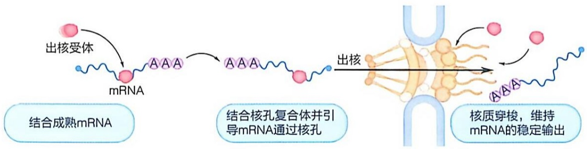

<details>
<summary>flowchart</summary>

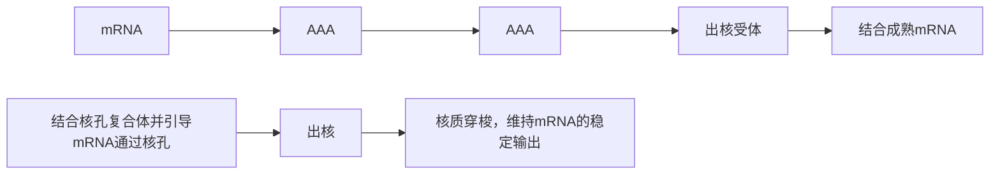
</details>

包装完成的 mRNP 逐步迁移至核膜内侧，结合核孔复合体并开始转运。当 mRNP 锚定至核孔复合体后，TREX 复合物组分——RNA 解旋酶 UAP56，利用 ATP 水解释放能量帮助 mRNP 的外壳解聚。随后，NXF1 引导 mRNA 与 FG 核孔蛋白发生相互作用以及逐步穿越核孔复合体，并最终在细胞质侧释放。此时，mRNA 进入细胞质，成为蛋白翻译的模板。由此，出核配体依赖其精细分子相互作用确保了 mRNA 的顺利出核。

## 知识延展 11- 3

## TREX 复合物识别 mRNP 并重塑其构象

TREX复合物包括ALYREF、UAP56和THO复合物。THO-UAP56四聚体由两个不对称二聚体组成。图11-27展示了一个THO-UAP56二聚体与ALYREF-mRNP结合后形成的部分TREX-mRNP结构。TREX复合物在mRNA加工过程中逐步与mRNA结合。内含子剪接完成后，外显子连接复合物招募ALYREF与mRNA结合，进而介导了TREX复合物在mRNP的特异性组装，最终形成了mRNA在内部、THO复合物在外部的球状TREX-mRNP复合物。随后，TREX复合物帮助招募出核受体NXF1，起始mRNP的转运。

另外，UAP56 是一种 ATP 依赖的 RNA 解旋酶，它可以通过水解 ATP 重塑 mRNP 构象，在 mRNP 的组装过程中发挥关键作用。当 mRNP 转移至核孔附近时，UAP56 水解 ATP 产生能量使 mRNP 外壳解聚，而后 NXF1 介导 mRNA 穿过核孔出核。

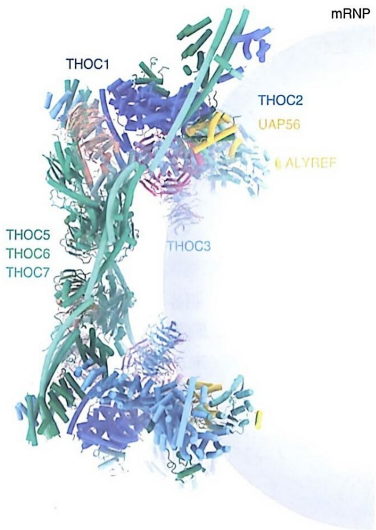

<details>
<summary>text_image</summary>

mRNP
THOC1
THOC2
UAP56
ALYREF
THOC3
THOC5
THOC6
THOC7
</details>

图 11-27 TREX-mRNP 复合物（PDB 编号:7ZNK）

图11-28 mRNA的出核过程

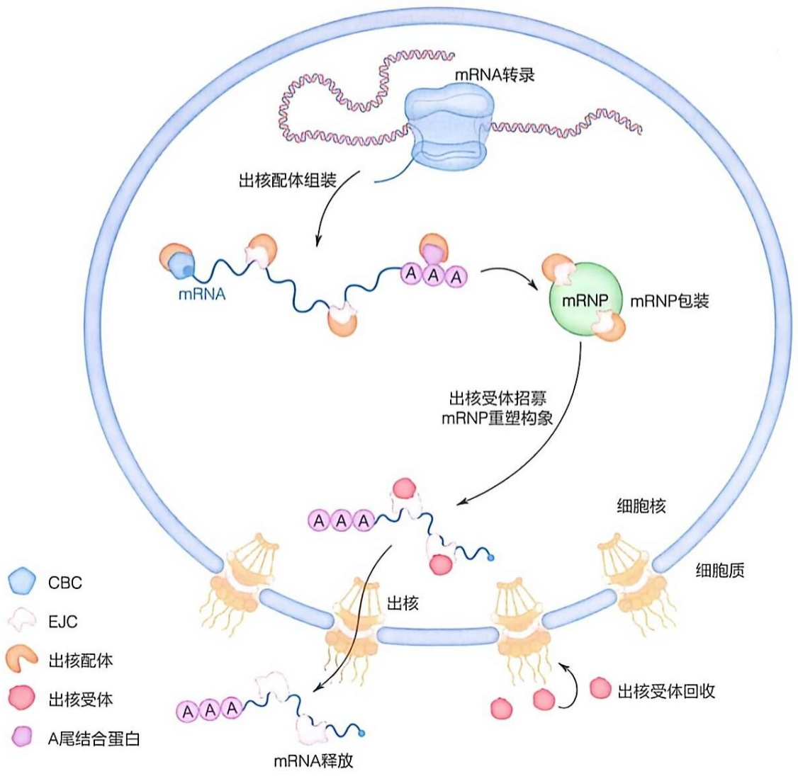

<details>
<summary>flowchart</summary>

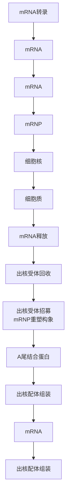
</details>

## 11.2.3 经过正确加工的成熟 mRNA 才能被高效转运出核

## (1) mRNA 加工过程招募出核因子与 mRNA 结合

mRNA的共转录加工主要包括 $5^{\prime}$ 端加帽、剪接和 $3^{\prime}$ 端加尾等过程。出核因子的招募与这些过程相偶联，确保了出核因子的高效结合，使mRNA顺利从细胞核输出至细胞质（图11-29）。

在转录起始阶段，mRNA 的 5' 端帽与帽结合复合物（cap binding complex，CBC）结合，并通过 CBC 招募 TREX 复合物。在 pre-mRNA 剪接过程中，外显子连接复合物（exon junction complex，EJC）沿 mRNA 沉积在外显子-外显子连接点上。EJC 同样能够结合 TREX 复合物组分，使其能够高效地结合到经过正确剪接的 mRNA 上，并促进 mRNP 的组装。此外，参与 mRNA 剪接的 SR 蛋白也能帮助招募出核因子，确保 mRNA 的顺利出核。在转录终止阶段，mRNA 的 3' 端会进行多聚腺苷酸化，即添加一个 poly(A) 尾。3' 端加工因子能够招募 TREX 复合物，将 mRNA 的 3' 端加工与出核过程偶联，有助于 mRNA 的出核。此外，mRNA 中的多种修饰也影响其核输出的效率。

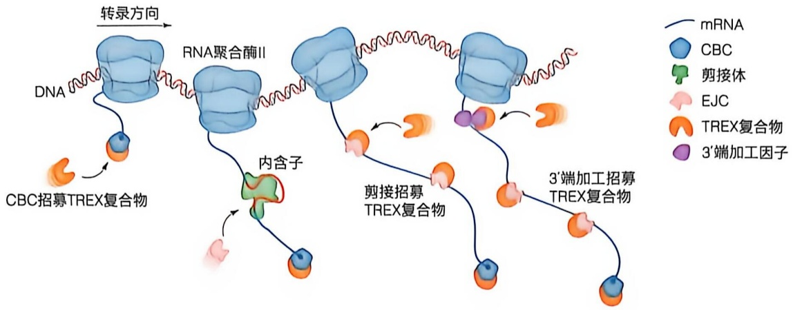

<details>
<summary>flowchart</summary>

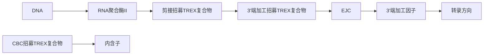
</details>

图11-29 mRNA加工过程帮助出核配体的共转录招募

总之，mRNA 的加工过程与出核因子的招募密切相关。通过这种偶联机制，细胞确保成熟的 mRNA 能够迅速、高效地被输出至细胞质，提高了基因表达效率并保证了遗传信息传递的精确性。

## (2) 核内质量监控机制调控 mRNA 出核

细胞具备精密的监控机制，在 mRNA 输出至细胞质之前，对其进行检查，确保只有经过正确加工的成熟 mRNA 才能顺利输出到细胞质中，指导蛋白质合成。例如，未完成加工的 mRNA 前体或者加工异常的 mRNA 会被识别出来，并特异性地滞留在细胞核中。另外，当出核因子缺失或包装异常时，也会发生 mRNA 的核滞留现象。发生了核滞留的 mRNA 最终可能被核酸外切酶复合物（RNA exosome complex）所降解。

此外，RNA 核滞留可能是基因表达调控网络的有机组成部分。通过在细胞核内暂时滞留某些 RNA，细胞可以对其转运进行精细调控。某些 RNA 在合成后可能被滞留在核内，在特定的时空条件下再进行转运，以调节蛋白质合成。

## 11.2.4 RNA出核功能紊乱导致生理异常或病理缺陷

mRNA 出核是基因表达过程中的一个关键步骤，它将 mRNA 从细胞核转运至细胞质，为后续的翻译过程提供模板。mRNA 出核功能的紊乱影响正常的基因表达调控，可导致细胞功能异常和发育障碍。

在小鼠模型中，缺失特定的出核因子会显著影响发育过程，并且影响正常的生理功能。例如，THO复合物的成员之一——THOC5，通过调节mRNA的输出来响应生长因子和细胞因子信号。THOC5的缺失会导致生长因子或细胞因子诱导的基因表达受阻，进而影响细胞的生长和分化。此外，THOC1蛋白的缺失不仅抑制小鼠睾丸发育所需基因的表达，还会导致小鼠小肠干细胞发生病理变化。

THO 复合物在神经系统的发育中同样至关重要。在小鼠和秀丽隐杆线虫中，THOC 蛋白的功能紊乱会严重影响神经元的正常功能。研究还表明，在人类中，THOC2 基因突变与 X 染色体连锁智力发育障碍（XLID12）相关。该突变可能导致 THOC2 蛋白功能丧失或不足，进而影响 RNA 的正常转运和基因表达，最终引发神经发育异常和智力低下。除此之外，核孔蛋白质 GLE1 的点突变也被发现与神经退行性疾病如肌萎缩侧索硬化（amyotrophic lateral sclerosis, ALS）和先天性挛缩综合征（lethal congenital contracture syndrome-1, LCCS1）有关，这些发现进一步表明 RNA 出核通路在神经系统中的重要生理功能。

在病毒感染过程中，细胞可通过调控 mRNA 出核，促进抗病毒蛋白质的表达，以应对病毒入侵。此外，许多病毒也演化出策略，通过挟持宿主的 mRNA 出核机器来促进病毒 RNA 的出核和表达，同时抑制宿主的抗病毒反应。例如，水疱性口炎病毒（vesicular stomatitis virus，VSV）的基质蛋白（M 蛋白）通过破坏出核因子与核孔蛋白的相互作用，抑制宿主 mRNA 的出核。而单纯疱疹病毒 1 型（herpes simplex virus type 1，HSV-1）的 ICP27 蛋白则劫持 TREX 复合物的蛋白组分，扰乱宿主 mRNA 的正常出核。病毒的这些策略展示了其对宿主基因表达的复杂操控，并为开发抗病毒治疗提供了潜在靶点。

## 11.3 细胞内严格的质量控制机制识别并降解异常的 mRNA

在 RNA 的转录、加工和出核等过程中，都有可能产生错误或有缺陷的 RNA，如果这些 RNA 未能被及时清除，将对细胞造成有害影响。RNA 的质量控制（RNA quality control，简称 RNA 质控）就是通过多种机制监测 RNA 的生物合成情况，识别并去除异常的 RNA 分子，防止它们进入翻译阶段产生错误的蛋白质。

需要注意的是，RNA质控和RNA降解虽然密切相关，但并非完全相同的概念。RNA质控是一个涵盖识别、监测和处理的过程，而RNA降解则是质控机制的一个重要执行环节，具体负责对不符合质量标准的RNA进行降解。RNA降解不仅包括去除异常RNA，还包括对成熟RNA的调控性降解，用于适应细胞内的动态变化和需求。因此，RNA降解既是质控的重要部分，也是调节RNA稳态和基因表达水平的关键手段。

## 11.3.1 mRNA质控的基本概念

RNA质控是指细胞通过多种机制识别并降解有缺陷的RNA分子，以维持RNA的质量和细胞内基因表达精确性的过程。RNA质控过程涉及两个关键步骤，即对异常RNA的识别和对异常RNA的降解。在真核生物中，对异常RNA的识别过程需要其他辅助复合物的帮助，对异常RNA的降解则主要由RNA降解机器完成，涉及多种降解RNA的核糖核酸酶（ribonuclease）和辅助因子，主要负责在RNA的转录、加工、核输出及翻译等各个阶段清除异常的RNA。

## 11.3.2 细胞中主要的 RNA 降解酶及 mRNA 降解的基本过程

RNA 的化学本质是核糖核苷酸通过磷酸二酯键线性连接形成的一种聚合物。磷酸二酯键连接的是一个核苷酸的  $5'$  位碳原子和另一个核苷酸的  $3'$  位碳原子，这种连接使 RNA 形成了一个由  $5' \rightarrow 3'$  方向性的多聚核苷酸链。因此，磷酸二酯键既是 RNA 的骨架，也是 RNA 水解降解的靶点。

在细胞中，RNA 的降解过程主要由三类 RNA 核酸酶参与，根据酶活特点可以分为 RNA 内切酶、 $5'\rightarrow3'$ 外切酶和 $3'\rightarrow5'$ 外切酶。这些核酸酶都是通过水解 RNA 内部的磷酸二酯键切割 RNA。不同的是，RNA 内切酶水解切割的是 RNA 内部两个核苷酸之间的磷酸二酯键，最终形成了不同长度的 RNA 片段；而 $5'\rightarrow3'$ 外切酶和 $3'\rightarrow5'$ 外切酶则是分别从 RNA 的 $5'$ 端和 $3'$ 端逐个水解磷酸二酯键，将 RNA 水解成单个的核苷酸

分子。RNA 内切酶切割 RNA 内部的磷酸二酯键后产生的 RNA 片段可以继续被  $5'\rightarrow3'$  外切酶和  $3'\rightarrow5'$  外切酶水解。因此，RNA 最终被水解成单个核苷酸（图 11-30）。

在真核生物中，外切体（exosome）是广泛分布于细胞核和细胞质中的降解复合体，具有内切活性和 $3^{\prime} \rightarrow 5^{\prime}$ 外切活性，在不同辅助因子的帮助下，识别降解细胞中多种类型的RNA。XRN1和XRN2则是主要的 $5^{\prime} \rightarrow 3^{\prime}$ 外切酶，其中XRN1主要位于细胞质中，负责从去帽后的mRNA的 $5^{\prime}$ 端开始降解，而XRN2主要存在于细胞核中，负责降解细胞核内的RNA，尤其是在转录终止后的RNA片段降解过程中发挥作用。以下以mRNA的降解为例，讨论细胞中mRNA降解的基本过程（图11-31）。

mRNA 5' 端的 7-甲基鸟苷帽和 3' 端的 poly(A) 尾都可以通过结合特定的蛋白质（或蛋白复合体），保护 mRNA 免受核酸外切酶的降解。因此，降解 mRNA 需要经过多个步骤，逐步去除其末端修饰，使其能够被细胞内的各种核酸酶识别降解。脱腺苷酸化是大部分真核生物 mRNA 降解的起始步骤，由脱腺苷酸化酶完成，负责去除 mRNA 3' 端的 poly(A) 尾。脱腺苷酸化显著削弱了 mRNA 的稳定性，使其失去与翻译因子的结合能力，最终被进一步降解。

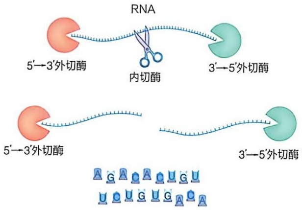

<details>
<summary>flowchart</summary>

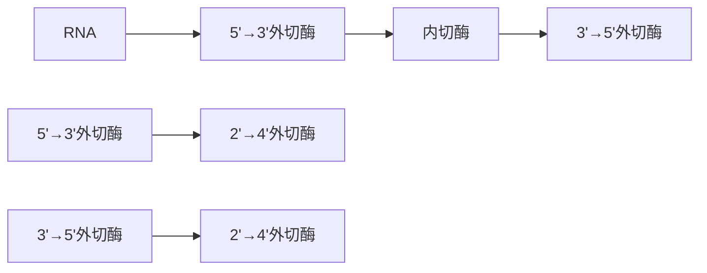
</details>

图 11-30 细胞中主要的 RNA 核酸酶类型

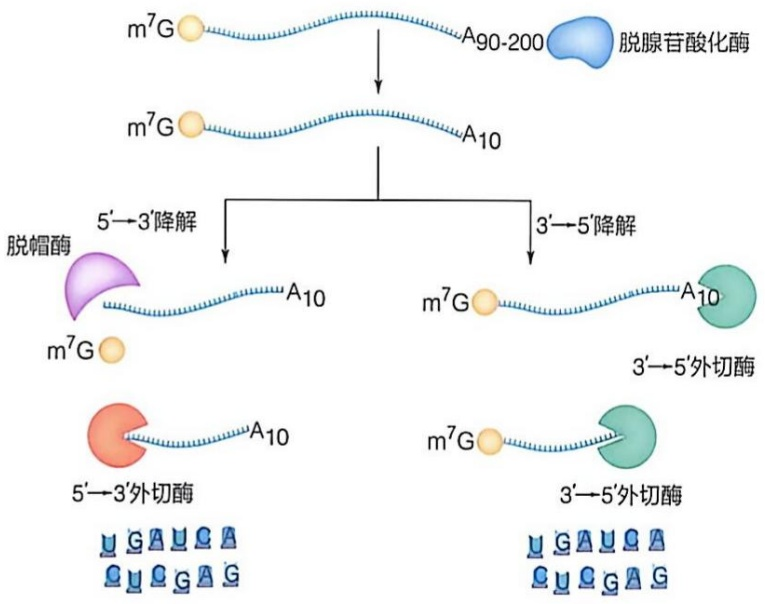

<details>
<summary>flowchart</summary>

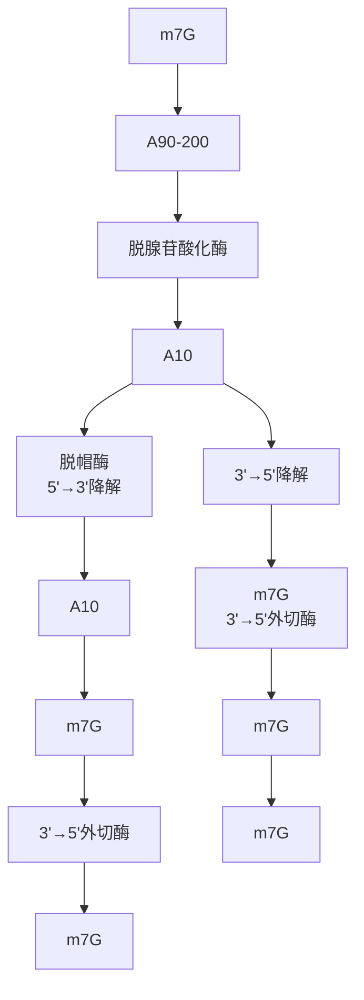
</details>

图 11-31 mRNA 降解的基本过程

mRNA脱腺苷酸化开始后，通常很快就会经历去帽过程，这是由脱帽酶（decapping enzyme）负责的。脱帽酶是参与mRNA降解的重要酶类，它们通过去除mRNA $5^{\prime}$ 端的帽结构，使mRNA的 $5^{\prime}$ 端失去保护，从而为RNA的降解提供前提条件。去帽后的mRNA变得极其脆弱，随后进入外切降解过程。细胞内也存在部分mRNA的降解途径，可以不依赖脱腺苷酸化的方式进行脱帽反应，也就是说，脱帽过程会在polyA尾存在的情况下进行。经过去帽和去poly(A)尾后的mRNA，会被$5^{\prime}\rightarrow 3^{\prime}$ 外切酶和 $3^{\prime}\rightarrow 5^{\prime}$ 外切酶分别从 $5^{\prime}$ 端或 $3^{\prime}$ 端开始降解，直到RNA分子被彻底分解为单核苷酸。

有些 mRNA 在降解过程中还会由 RNA 内切酶进行降解，通过在 RNA 内部特定位置进行切割，将 RNA 分成多个较小片段。降解过程的最终步骤通常是外切降解，由外切酶从 RNA 的 5' 端或 3' 端逐步降解 RNA。

## 11.3.3 细胞核内的质控机制对异常的 mRNA 进行降解

绝大多数 RNA 在转录后都需要经过多个加工步骤，任意一个加工步骤发生异常，都可能会导致异常 RNA 的产生，如被错误剪接的 mRNA、内含子滞留的 RNA、加工异常的 rRNA、snoRNA（small nucleolar RNA）和 snRNA（small nuclear RNA）等（知识延展 11-4）。细胞核作为 RNA 合成和初步加工的重要场所，具备多种精密的 RNA 降解质控机制，可以有效识别这些异常 RNA，进而被各种复合体靶向到外切体完成降解，避免异常 RNA 积累引发病理问题（图 11-32）。

图 11-32 细胞核中的 mRNA 质控

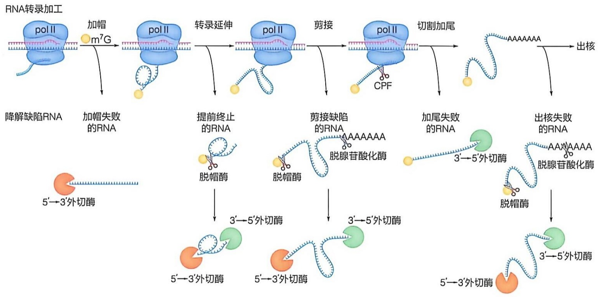

<details>
<summary>flowchart</summary>

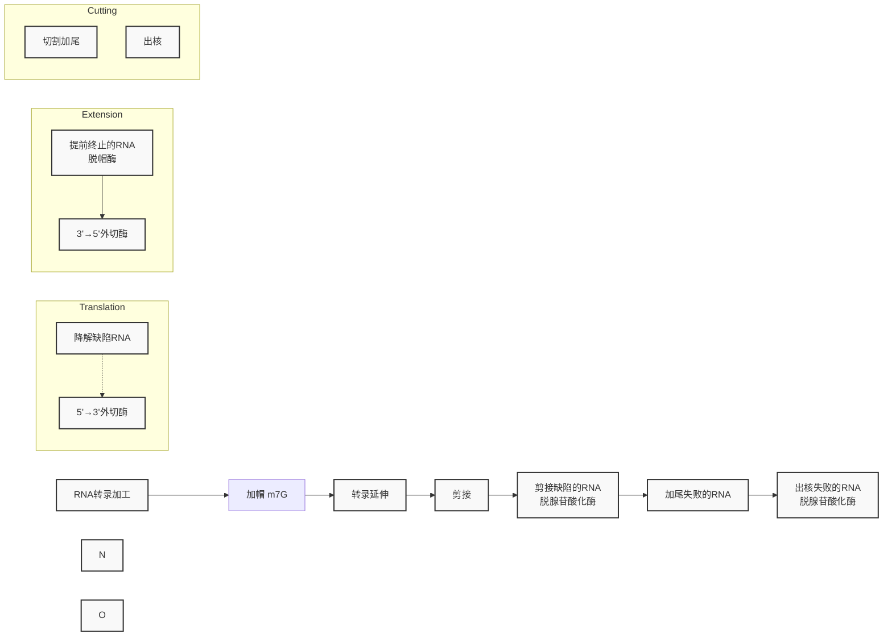
</details>

## 知识延展 11-4

## RNA “量控” 及其重要性

mRNA 本身相对不稳定，无论是细胞核中新生成的还是细胞质中已经完成功能的 mRNA，都很容易被细胞中大量存在的核糖核酸酶催化降解，但这通常不属于 RNA 质控过程，而是一种 RNA “量控” 过程，属于正常的 RNA 代谢。

近年研究提示，细胞核中的 mRNA 降解可能是一种调控基因表达的方式。通过控制细胞核中 mRNA 的选择性降解，细胞能够在不同的环境和生理需求下实现对特定蛋白质合成水平的调节。例如，某些 mRNA 在转录和加工过程中生成过剩，或者在特定的生理过程中不再被需要，这些 mRNA 在细胞核内可能就会被降解。这种调控方式可能对于细胞响应内外信号，精确地控制基因表达和维持蛋白质平衡至关重要。细胞质中的 RNA 降解则更是维持 RNA 稳态和调控基因表达的重要过程。通过降解过多的 mRNA 或已完成功能的 mRNA，可以维持 RNA 的含量和稳定性，从而避免不必要的蛋白质合成和能量浪费。例如，在细胞应激状态下（如热休克、氧化应激和缺氧等），细胞通过降解应对刺激非必需的 mRNA，将资源集中用于合成应激相关蛋白质，以帮助补充受损的蛋白质并恢复正常功能。通过这些机制，细胞质中的 RNA “量控” 不仅确保了基因表达的精确调控和对环境变化的快速响应，同时维持了细胞的稳态和正常功能。

那么细胞是如何识别这些异常 RNA 的呢？错误加工、修饰或折叠的 RNA，通常需要被其他蛋白质辅助因子识别，并招募外切体完成降解过程。在酵母中，TRAMP 复合体（Trf4/5-Air2/1-Mtr4p polyadenylation complex）主要负责识别这些异常的细胞核内 RNA，并将其标记、递送到外切体中，完成降解过程。在高等真核细胞中，这些异常 RNA 通常还缺乏或包含错误的 EJC 信号，因而很难正确组装成 RNP 或招募出核因子，这些异常 RNA 被滞留在核内，也大大增加了其被核酸酶捕获并降解的可能性。

细胞核中还存在多种特殊的非编码 RNA，如增强子 RNA（enhancer RNA，eRNA）和启动子上游转录本（promoter upstream transcript，PROMPT）等，这些 RNA 通常非常不稳定，容易被 TRAMP 复合物等外切体的辅因子（cofactor）识别，经标记后递送至外切体进行降解。

## 11.3.4 细胞质中的质控机制执行 mRNA 翻译过程的质量控制

在真核生物中，转录或加工过程中产生的一些带有缺陷的 mRNA，只有在翻译过程中才能体现出来。为了减少异常蛋白的表达，细胞通过多种途径在 mRNA 的翻译过程中进行监控，并及时降解有问题的 mRNA。细胞中主要有三种经典的 RNA 质控机制，分别负责识别和降解这些异常的 mRNA（图 11-33）。

图 11-33 细胞质中的 mRNA 降解质控

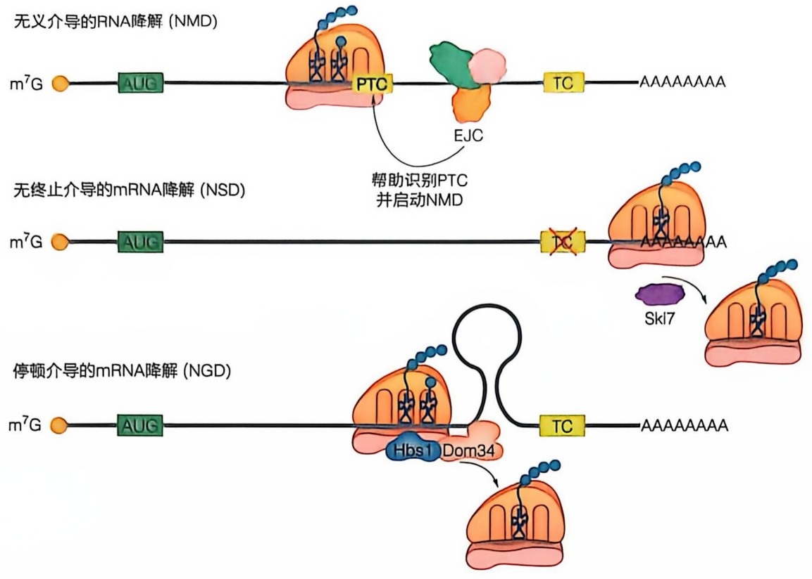

<details>
<summary>flowchart</summary>

```mermaid
graph LR
  subgraph RNA_NMD["\"无义介导的RNA降解 (NMD)\""]
  A["m⁷G"] --> B["AUG"]
  B --> C["PTC"]
  C --> D["TC"]
    E["EJC"] -.-> C
  D --> F["AAAAAAAAA"]
  end

  subgraph mRNA_NSD["\"无终止介导的mRNA降解 (NSD)\""]
  G["m⁷G"] --> H["AUG"]
  H --> I["TC"]
    J["SKI7"] -.-> I
  I --> K["AAAAAAAAA"]
  end

  subgraph mRNA_NGD["\"停顿介导的mRNA降解 (NGD)\""]
  L["m⁷G"] --> M["AUG"]
  M --> N["TC"]
    O["Hbs1, Dom34"] -.-> N
  N --> P["AAAAAAAAA"]
  end
```
</details>

## (1) 无义介导的 RNA 降解

无义介导的 RNA 降解（nonsense-mediated decay，NMD）是一种进化上保守的 RNA 质控机制，主要用于识别并降解含有提前终止密码子（prematue termination codon，PTC）的 mRNA。PTC 的产生通常是由于基因突变、RNA 剪接或其他 RNA 加工缺陷引起的，这些携带 PTC 的 mRNA 被翻译后，会产生截短的蛋白质，可能通过显性抑制等方式，干扰正常蛋白的功能，从而对细胞和生物体造成潜在的威胁。

在 NMD 途径中，PTC 的识别依赖于一系列蛋白质或蛋白质复合体。目前已研究发现的 PTC 识别方式主要包括 EJC 依赖型、3'UTR 长度依赖型和翻译终止效率依赖型，其中 EJC 依赖型是 NMD 降解途径中最为经典的 PTC 识别方式。

绝大多数 pre-mRNA 在转录后经过剪接在外显子-外显子连接处形成 EJC。在高等真核生物中，大部分基因的 3'UTR 中并没有内含子。因此，真正的终止密码子后通常不存在剪接的连接点，也就不会有 EJC 结合。在正常情况下，核糖体的首轮翻译过程会去除 EJC，但是当终止密码子位于 EJC 上游一定距离（50～55 nt）时，核糖体会在此停滞，导致下游的 EJC 无法被去除，这个 EJC 上游的终止密码子就会被识别为 PTC，为 NMD 途径启动提供识别信号（图 11-34）。

那 NMD 途径启动的具体机制是什么呢？当终止密码子进入核糖体 A 位点后，真核释放因子 eRF1 和 eRF3 被招募至核糖体，并与激酶复合体 SMG1-8-9 相互作用，这一过程也伴随着 NMD 途径的关键因子 UPF1 的招募，此时形成 SURF 复合体（SMG1-UPF1-eRF1-eRF3）。正常情况下，UPF1 被招募至核糖体并形成 SURF 复合体后，激酶复合体 SMG1-8-9 的 SMG8-9 组分会阻止 SMG1 激酶对 UPF1 进行磷酸化激活，因此不会激活 NMD 途径。当终止密码子为 PTC 时，下游结合 UPF2 和 UPF3B 的 EJC 就会与 SURF 复合体发生相互作用，形成 DECID 复合体（decay inducing complex），解离 SMG8-9，释放 SMG1 的激酶活性，使 UPF1 被磷酸化激活。激活后的 UPF1 与 eIF3 相互作用，招募 SMG5-6-7 复合体，阻止新一轮翻译的进行，同时在靠近 PTC 的位置切割 mRNA，随后进行 RNA 的降解过程，并释放核糖体。

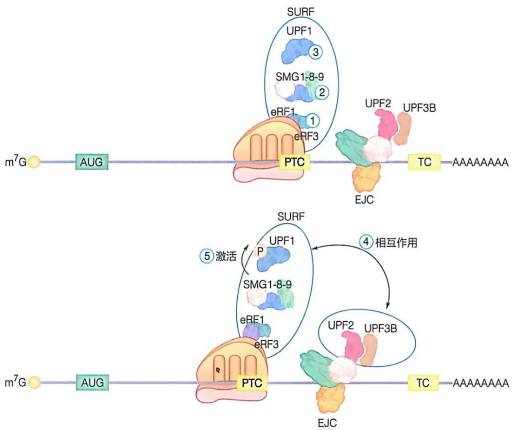

<details>
<summary>flowchart</summary>

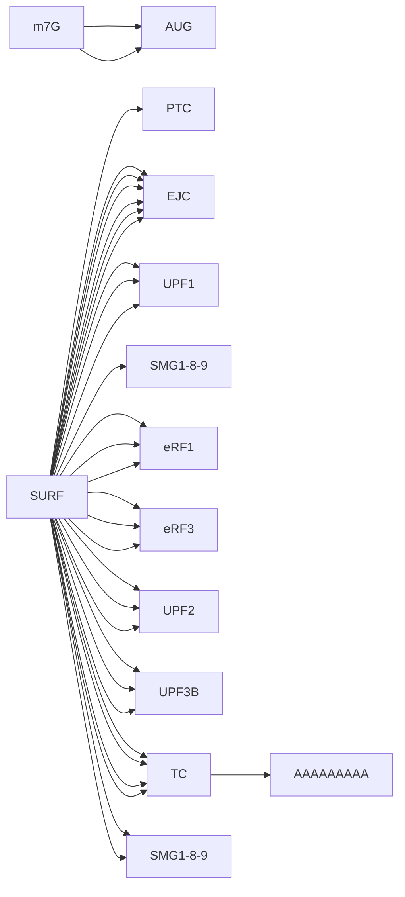
</details>

图11-34 PTC识别及NMD的激活机制

## (2) 无终止介导的 mRNA 降解

无终止介导的 mRNA 降解（nonstop decay，NSD）也是一种重要的 RNA 质控机制，专门针对那些由于缺乏终止密码子而无法正常完成翻译的 mRNA。在正常的翻译过程中，核糖体会沿着 mRNA 的编码区移动，直到遇到终止密码子，然后通过释放因子完成翻译并解离。然而，一些 mRNA 可能由于转录错误、基因突变及 RNA 剪接异常等原因，缺乏正常的终止信号，导致核糖体在翻译过程中没有明确的停止点。

当核糖体沿 mRNA 移动并到达 mRNA 的 3' 端 poly(A) 尾时，正常的翻译终止信号缺失，会导致核糖体停滞于 poly(A) 尾区域；与 poly(A) 尾结合的 PABPC1 蛋白，也无法与到达 poly(A) 尾的核糖体的终止复合体发生有效的相互作用，以上两种状态是细胞感应无终止密码子 mRNA 并启动 NSD 降解途径的关键信号。通过识别这种异常的结合状态，Ski7（翻译延伸因子 eEF1A 的旁系同源物）将核糖体从 mRNA 上释放，随后 mRNA 被核糖核酸酶降解。