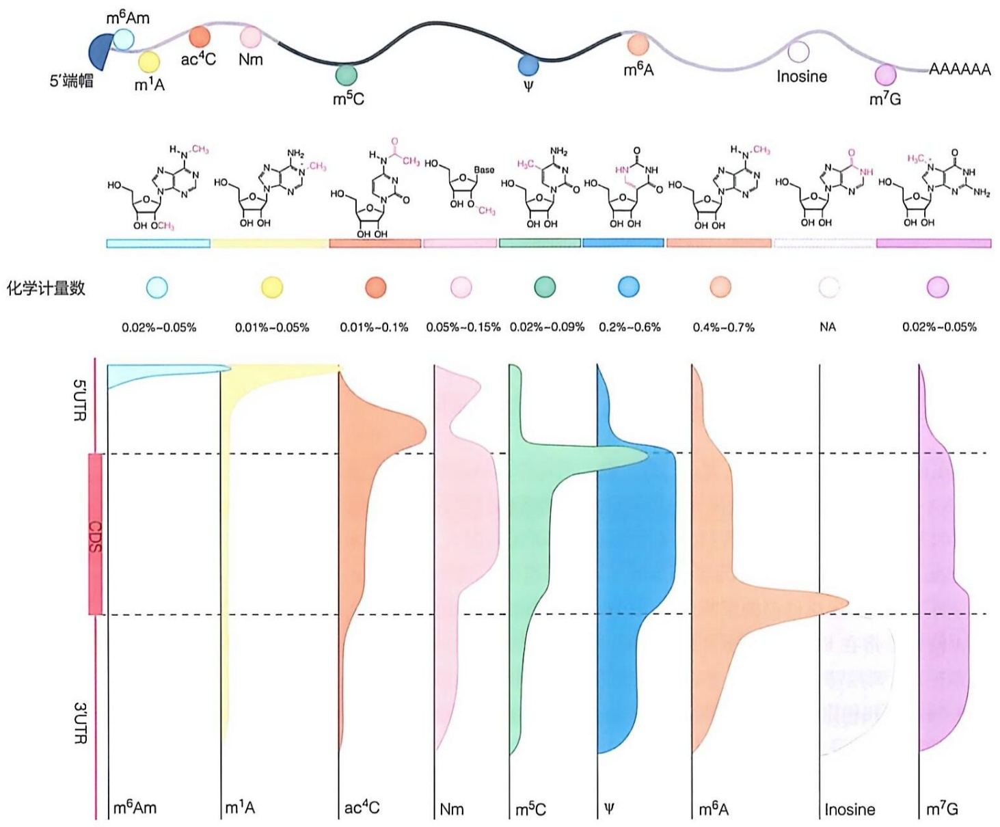
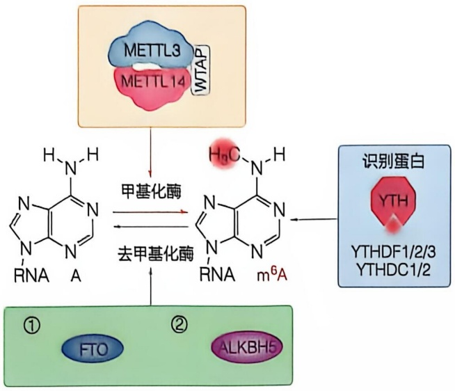
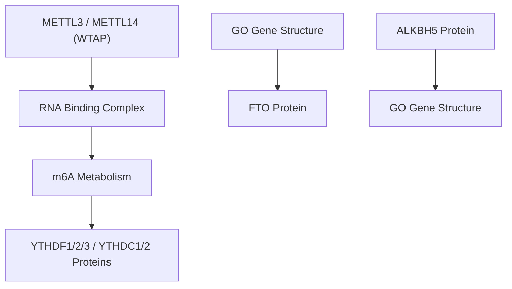
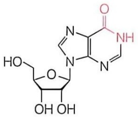
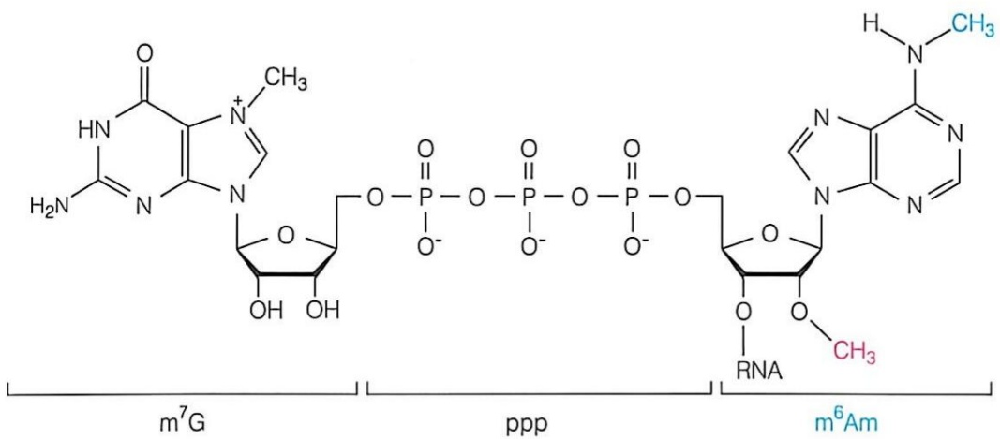
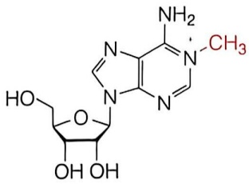
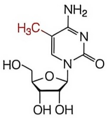

## (3) 停顿介导的 mRNA 降解

停顿介导的 mRNA 降解（no-go decay，NGD）则是一种专门处理 mRNA 在翻译过程中出现停顿的 RNA 质控机制。mRNA 翻译停顿可能是 RNA 序列中的二级结构、稀有密码子或 RNA 损伤导致的，如果核糖体无法继续沿着 mRNA 前进，就可能造成翻译停顿，这会对细胞中的正常蛋白质合成过程产生干扰。NGD 机制通过快速识别这些停顿事件，将停滞的核糖体从这些有缺陷的 mRNA 上释放，同时降解这些缺陷 mRNA，以确保细胞内的翻译活动高效、无误地进行。

例如在酿酒酵母中 NGD 途径识别停顿信号依赖于两个细胞内特定的感应因子 Dom34 和 Hbs1，这两个蛋白在结构上分别与典型释放因子 eRF1 和 eRF3 非常相似，两者形成的复合体与翻译停顿的核糖体的氨基酰基（A）位点相互作用，类似典型的翻译终止过程，使翻译停顿的核糖体释放。在 NGD 过程中，细胞中的特定内切酶会在核糖体停顿点附近对 mRNA 进行切割。随后，这些被切割的 mRNA 片段会被  $5'\rightarrow3'$  外切酶和外切体分别从  $5'$  端和  $3'$  端开始降解。

## 11.3.5 RNA 降解质控与疾病的关系

在生物体内，细胞依靠多种 RNA 降解质控途径来识别并去除错误的、有缺陷的或过量的 RNA，以确保基因表达的精确性。如果这些质控途径失调，可能会导致多种疾病，包括神经系统疾病、癌症、代谢性疾病和免疫性疾病等。

外切体作为细胞内重要的 RNA 降解机器，其功能失调与多种人类疾病密切相关。有研究表明，几种罕见的神经系统疾病，包括脑桥小脑发育不全（pontocerebellar hypoplasia，PCH）和脊髓性肌萎缩（spinal muscular atrophy，SMA），都是由外切体不同成分的基因突变引起的。编码外切体组分的 EXOSC3 基因突变会导致脑桥小脑发育不全亚型 1b（PCH1b）。据统计，约一半的 PCH1b 患者（大多数在儿童时期去世）表现出脑桥和小脑的严重萎缩以及浦肯野细胞的异常。利用酵母和小鼠等模式生物，有研究发现患者中的 EXOSC3 突变会导致其自身及其他外切体组分的丰度降低，影响细胞对异常 RNA 的降解能力，进而导致疾病的发生。

作为细胞质中的质控机制之一，NMD 途径通过降解含有 PTC 的 mRNA，避免了异常转录本被翻译成截短蛋白，对细胞内基因的正确表达起到了重要的保护作用。然而，在癌症等疾病的发生发展过程中，NMD 途径可能还具有双重作用，既可以抑制癌症进展，也可能在某些情况下促进癌症的发生。NMD 通过识别并降解带有 PTC 的突变 mRNA，阻止异常或有害蛋白的积累，从而抑制某些癌基因的表达，发挥抑癌作用。例如，TP53 基因的突变常会导致其 mRNA 含有 PTC，NMD 可以帮助降解这些异常 mRNA，避免生成缺陷的 p53 蛋白，起到抑癌的效果。然而，在某些情况下，含有 PTC 的 mRNA 产生的截短蛋白并不具有显性抑制正常蛋白的功能，反而还具有部分残余功能，例如 BRCA1 或 APC 基因的突变。因此，当 NMD 途径过度清除这些异常 mRNA 时，可能会导致这些抑癌蛋白功能进一步缺失，从而加重癌症的表型效应。因此，NMD 在癌症中的作用取决于突变的类型和位置，既可能降低癌症风险，也可能在特定条件下加重病情。

## 11.4 RNA 的化学修饰调控其功能和稳定性

RNA 分子上存在着上百种化学修饰，这些修饰赋予了 RNA 分子多样的功能，从影响基因表达到参与细胞信号转导等。随着高通量测序等技术的迅猛发展，我们得以一窥 RNA 修饰的冰山一角。本部分将带领大家探索 RNA 修饰的神秘世界，揭示其在生命活动中的关键作用，并展望其在未来生物医学研究中的广阔前景。

## 11.4.1 RNA 的化学修饰奠定其结构与功能的基础

在现代生物学中，中心法则是理解生命如何运作的核心概念。它描述了遗传信息从 DNA 传递给 RNA，再通过翻译过程转化为蛋白质的过程，为我们提供了遗传信息流动的基本框架。然而，随着科学技术的进步和研究的深入，科学家们逐渐意识到，基因表达调控远比最初设想的要复杂得多。基因组中的遗传信息不仅由碱基序列决定，而且受到多层次调控的影响。其中，RNA 修饰在基因表达调控中扮演重要角色。RNA 修饰是指在 RNA 碱基分子上进行的一系列化学改变，可以在不影响 DNA 序列的情况下，调控基因的表达。RNA 修饰不会改变 RNA 的基本序列，却能够显著影响 RNA 的功能和稳定性。RNA 修饰不仅增加了遗传信息的复杂性，还揭示了基因表达调控的多样性和灵活性，为宏大的基因画卷作上点睛之笔。

事实上，RNA 修饰并非现代科学的新发现。早在 1950 年，研究人员就在探索 RNA 的过程中偶然发现了一些特殊的化学 “标记”，这些标记就像是给 RNA 分子贴上了小标签，告诉细胞这个 RNA 分子有什么特殊的功能。类似的，科学家们也在 DNA 和组蛋白上发现了化学 “标记”。这些神奇的化学修饰指引着我们在广袤的遗传世界里探索更多未知。

到目前为止，已经发现了170余种RNA修饰，例如: $N^{6}$ -甲基腺嘌呤（ $m^{6}A$ ）、 $N^{5}$ -甲基胞嘧啶（ $m^{5}C$ ）、假尿嘧啶（ $\psi$ ）、 $N^{1}$ -甲基腺嘌呤（ $m^{1}A$ ）、 $N^{7}$ -甲基鸟嘌呤（ $m^{7}G$ ）及 $N^{6},2^{\prime}-O-$ 二甲基腺嘌呤（ $m^{6}Am$ ）等。RNA上的修饰广泛存在于不同类型的RNA分子中，如mRNA（图11-35）、tRNA、rRNA以及其他非编码RNA。每一种修饰都有其独特的生物学意义，共同构成了RNA分子功能多样性的基础。

RNA 修饰不仅是对传统中心法则的重要补充，也是揭示细胞内部运作机制的关键环节。它不仅为我们提供了新的视角去理解生命的复杂性，也为未来医学和生物技术的发展开辟了广阔的前景。

violin

| Category | Chemical Structure | Value Range |
| --- | --- | --- |
| 5' end cap | m6Am, ac4C, Nm | 0.02%-0.05% |
| 5' end cap | m1A | 0.01%-0.05% |
| 5' end cap | m5C | 0.01%-0.1% |
| 5' end cap | \(\psi\) | 0.05%-0.15% |
| 5' end cap | m6A | 0.02%-0.09% |
| 5' end cap | Inosine | 0.2%-0.6% |
| 5' end cap | m7G | 0.4%-0.7% |
| 5' end cap | AAAAAA | NA |
| 5' end cap | AAAAAA | 0.02%-0.05% |
| CDS | m6Am | N/A |
| CDS | m1A | N/A |
| CDS | ac4C | N/A |
| CDS | Nm | N/A |
| CDS | m5C | N/A |
| CDS | \(\psi\) | N/A |
| CDS | m6A | N/A |
| CDS | Inosine | N/A |
| CDS | m7G | N/A |
| 3'UTR | m6Am | N/A |
| 3'UTR | m1A | N/A |
| 3'UTR | ac4C | N/A |
| 3'UTR | Nm | N/A |
| 3'UTR | m5C | N/A |
| 3'UTR | \(\psi\) | N/A |
| 3'UTR | m6A | N/A |
| 3'UTR | Inosine | N/A |
| 3'UTR | m7G | N/A |

图 11-35 mRNA 上的 RNA 修饰种类及分布

## 11.4.2 RNA修饰协调多种生物学过程

RNA 修饰是表观遗传调控的重要组成部分，参与生命活动的多个过程。其中一个典型的例子是果蝇的性别决定机制，清晰体现了 RNA 修饰在调控基因表达和生物功能中的重要作用。与大多数哺乳动物采用的 XY 型性别决定机制不同，果蝇采用的是一种特殊的性别决定机制——经典的剂量补偿机制，即 X 染色体数目与常染色体数目的比值（X:A）决定了果蝇的性别。具体来说，X:A = 1 为正常雌性，X:A = 0.5 为正常雄性。Sxl 基因是其中一个关键的调控基因。Sxl 基因的表达受到严格调控，其表达水平直接影响果蝇的性别决定。当 X 染色体数目与常染色体数目比值为 1 时，Sxl 基因被激活，进而启动一系列的性别决定级联反应，最终导致果蝇发育为雌性。 $m^{6}A$  修饰在 Sxl 基因的调控中扮演着关键角色。 $m^{6}A$  修饰通过影响 Sxl mRNA 的稳定性、翻译效率以及与其他蛋白质的相互作用，从而调控 Sxl 蛋白的表达水平。当  $m^{6}A$  修饰水平降低时，Sxl 蛋白的表达量也会随之降低，导致果蝇向雄性方向发育。这一发现不仅揭示了  $m^{6}A$  修饰在性别决定中的重要性，也使我们对这一修饰的生物学功能有了更深入的认识。

总之，RNA 修饰是现代生物学中一个充满活力的研究领域，它不仅在生命活动的多个方面发挥着关键作用，同时也极大丰富了我们对基因表达调控的理解。通过对 RNA 修饰的研究，我们不仅能更深入地理解生命的奥秘，还能为疾病的诊断和治疗开辟新的途径。

## 11.4.3 RNA 分子具有多种化学修饰

## 11.4.3.1 最常见的 RNA 修饰

## (1) ${\mathrm{N}}^{6}$ -甲基腺嘌呤

1974 年，研究人员首次在 RNA 的腺嘌呤碱基上发现了一个甲基基团，并将其命名为  $N^{6}-$  甲基腺嘌呤（ $N^{6}-methyladenosine, m^{6}A$ ），即甲基基团连接在腺嘌呤的第 6 个氮原子上。这一发现犹如打开了一扇通往未知世界的大门，引发了科学界的广泛关注。

然而，在接下来长达30多年的时间里，由于质谱技术和测序技术的发展尚未达到足以深入解析RNA修饰的水平，关于 $\mathrm{m}^6\mathrm{A}$ 的研究进展相对缓慢。直到2011年的一项研究首次确定了脂肪量和肥胖相关蛋白（fat mass and obesity-associated protein, FTO）是 $\mathrm{m}^6\mathrm{A}$ 的去甲基化酶，揭示了 $\mathrm{m}^6\mathrm{A}$ 修饰的动态可逆性。这一发现引发了科学界的广泛关注，科学家们意识到，这种看似微小的化学修饰可能在RNA的生物学功能中扮演着重要角色。该研究重新点燃了科学家们对 $\mathrm{m}^6\mathrm{A}$ 的兴趣，并开启了RNA表观遗传学的新篇章，多个 $\mathrm{m}^6\mathrm{A}$ 的识别蛋白也相继被鉴定。随着高通量测序技术的进步以及更多针对 $\mathrm{m}^6\mathrm{A}$ 的研究工具和方法的开发，表观转录组学（epitranscriptomics）作为一个新兴领域迅速发展，并不断取得新成果。该领域的研究致力于探索包括 $\mathrm{m}^6\mathrm{A}$ 在内的多种RNA修饰如何影响RNA分子的功能、稳定性及翻译效率等关键生物学过程。如今，对于 $\mathrm{m}^6\mathrm{A}$ 及其他形式RNA修饰的研究已经成为理解生命现象复杂性不可或缺的一部分。

## ①  $N^{6}-$  甲基腺嘌呤的调控体系

尽管早在 1970 年代科学家们就发现了  $m^{6}A$  修饰，但对其调控机制的研究却进展缓慢。直到 1990 年代，研究人员才成功分离并鉴定了首个  $m^{6}A$  甲基转移酶。然而，对于  $m^{6}A$  的去除机制，学术界一直缺乏深入的了解。这一局面在 2011 年迎来了转机。研究人员发现，长期被认为与肥胖相关的 FTO 基因编码的 FTO 蛋白，其另一个重要的生物学功能是作为  $m^{6}A$  的去甲基化酶，负责移除  $m^{6}A$  上的甲基化修饰。这一发现不仅揭示了  $m^{6}A$  修饰的动态可逆性，而且为深入研究  $m^{6}A$  的生物学功能提供了新的思路。随后，在众多科学家的共同努力下，逐渐构建了较为清晰的  $m^{6}A$  修饰调控网络。该网络主要包含了三种核心调控因子:甲基转移酶、去甲基化酶和识别蛋白，分别负责加入、去除以及读取  $m^{6}A$  修饰。这些蛋白协同作用，共同调控着细胞内  $m^{6}A$  修饰的动态平衡，从而精准地调控基因表达（图 11-36）（知识延展 11-5）。

flowchart

图 11-36 ${\mathrm{m}}^{6}\mathrm{\;A}$ 的蛋白调控系统

②  $N^{6}$ -甲基腺嘌呤的甲基化酶

mRNA 上的  $m^{6}A$  修饰是由两种独立的酶活体系催化的。最常见的一种是由 METTL3、METTL14 和 WTAP 等成分组成的甲基转移酶复合物（methyltransferase complex，MTC）。其中 METTL3 和 METTL14 是最为核心的部分。METTL3 是最早被鉴定的甲基转移酶之一，它作为催化亚基，将 S-腺苷甲硫氨酸（SAM）中游离的甲基转移到腺嘌呤的 N6 位；而 METTL14 则促进了底物

RNA 与 METTL3 的结合。

③  $N^{6}$ -甲基腺嘌呤的去甲基化酶

继 FTO 之后，在 2013 年，科学家们又发现了另一种  $m^{6}A$  去甲基化酶——ALKBH5。ALKBH5 和 FTO 同属于  $Fe^{2+}/\alpha-$  酮戊二酸依赖型双加氧酶家族成员。但关于两者在生物体内对底物的选择性尚不清楚，它们或协同调控相同位点的  $m^{6}A$  去甲基化，或以互补形式各自负责不同位点的去甲基化。

④  $N^{6}-$  甲基腺嘌呤的识别蛋白

除了甲基化酶和去甲基化酶外，识别蛋白是另一类重要的修饰酶，能够特异性识别并结合  $m^{6}A$  修饰，并通过不同的机制解码这一化学标记所携带的信息，从而影响 mRNA 的命运和功能，精细调节基因表达。

目前鉴定出的  $m^{6}A$  结合蛋白中最主要的是 YTH 结构域蛋白家族，这也是最早被发现并研究最为深入的一类  $m^{6}A$  识别蛋白。YTH 结构域蛋白家族成员拥有 YTH

## 知识延展 11-5

## 不同表观遗传修饰的精彩互动: $m^{6}A$  与 H3K36me3 的完美搭档

有趣的是， $m^{6}A$  修饰并不孤单，它与另一种表观遗传修饰——组蛋白甲基化 H3K36me3 也有密切合作。研究表明，H3K36me3 就像一位 “引路人”，通过招募甲基转移酶 METTL14，促进正在转录的 mRNA 上的  $m^{0}A$  修饰。想象一下，H3K36me3 就像是一个热心的导游，带着 METTL14 在 RNA 这条 “旅游路线” 上标记重要的站点，确保这些 mRNA 能够顺利进行下一步的旅程。这种巧妙的合作机制，不仅展示了细胞内精密的调控网络，也为我们揭示了  $m^{6}A$  修饰的另一面魅力。

(YT521-B homology) 结构域，主要包括 YTHDF1\~3 以及 YTHDC1\~2 五个成员。这些蛋白直接利用 YTH 结构域与 $\mathrm{m}^{6}\mathrm{A}$ 相结合，各自具有独特的生物学功能。例如，YTHDF2 通过其 C 端区域特异性识别 $\mathrm{m}^{6}\mathrm{A}$，并通过招募 CCR4-NOT 复合物促进含有 $\mathrm{m}^{6}\mathrm{A}$ 修饰的 mRNA 降解；而 YTHDF1 则通过与翻译起始因子相互作用，提高目标 mRNA 的翻译效率。此外，YTHDC1 定位于细胞核内，参与调控 mRNA 剪接及出核过程；YTHDC2 则在 mRNA 降解中发挥重要作用。值得注意的是，当面对环境刺激如热应激或病毒感染时，某些位于细胞质的 YTHDF 家族成员还能迁移至细胞核，以响应特定条件下 $\mathrm{m}^{6}\mathrm{A}$ 水平的变化，显示出该家族蛋白对细胞状态适应的高度敏感性。

尽管我们已经取得了一些重要的认识，但关于  $m^{6}A$  识别蛋白如何特异性识别并结合某些  $m^{6}A$  位点的具体机制仍然有待进一步探索。此外， $m^{6}A$  位点本身及其周围环境的特点也会影响识别蛋白的结合效率。

## ⑤  $N^{6}$ -甲基腺嘌呤的分布规律

自 1974 年  $m^{6}A$  修饰首次在 mRNA 中被鉴定出来，科学家们对这一重要 RNA 修饰的研究从未停歇，在包括病毒、酵母和哺乳动物等多种生物的 RNA 中均检测到  $m^{6}A$  修饰的存在，并且存在于 rRNA、mRNA 和 tRNA 等多种 RNA 类型中。随着科学技术的进步，尤其是高通量测序技术的应用， $m^{6}A$  修饰在 RNA 上的精确分布图谱得到了前所未有的拓展。

2012 年，研究人员开发出了全转录组范围内的  $m^{6}A$  修饰检测技术（ $m^{6}A-seq$  和 MeRIP-seq）。这两种方法利用特异性抗体富集含有  $m^{6}A$  修饰的 RNA 片段，再通过高通量测序确定  $m^{6}A$  的具体位置。这些技术在哺乳动物的数千个基因的 mRNA 中检测到了  $m^{6}A$  修饰，表明  $m^{6}A$  是 mRNA 的常见化学修饰。研究还发现， $m^{6}A$  主要集中在 mRNA 的 3'UTR 区域，并且倾向于出现在 RRACH（其中 R 代表 A 或 G，H 代表 U、A 或 C）序列上。

上述技术极大推动了对  $m^{6}A$  修饰分布规律的理解。然而，以上测序方法都依赖于  $m^{6}A$  的抗体，而抗体对 RNA 序列和结构的选择性可能导致非特异性结合，从而产生假阳性位点。为解决这一问题，2023 年，研究者们借鉴 DNA 甲基化的亚硫酸氢盐测序原理，采用乙二醛和亚硝酸钠处理，以及腺苷脱氨酶 TadA 8.20 介导的未修饰腺嘌呤脱氨反应，创新性地开发了新一代  $m^{6}A$  修饰检测技术（GLORI 和 eTAM-seq），实现了全转录组范围内单碱基分辨率下  $m^{6}A$  修饰位点的检测，获得了  $m^{6}A$  修饰的绝对定量信息，进一步支持了  $m^{6}A$  修饰的动态、可逆调控的特性。

总之，随着检测技术的进步，对于  $m^{6}A$  修饰分布规律的理解越来越精细，对于  $m^{6}A$  修饰在不同状态中动态变化的理解也更深入，随着更多先进技术的涌现，我们有望更全面、准确地揭示  $m^{6}A$  修饰的分布规律。

## ⑥  $N^{6}$ -甲基腺嘌呤的生理功能

$m^{6}A$  作为一种动态且可逆的 RNA 修饰，在多种生物过程中发挥着关键作用，包括精子生成、学习记忆以及神经发育等重要生理过程。

精子生成是一个复杂的过程，涉及多个阶段的细胞分裂和分化。 $m^{6}A$  修饰在这一过程中发挥着重要作用、通过调节关键基因的表达，确保精子的正常生成。例如，在 $m^{6}A$ 去甲基转移酶 Alkbh5 基因缺陷的雄性小鼠中，mRNA 中的 $m^{6}A$ 水平增加，导致减数分裂中期精细胞凋亡、从而引起生育能力受损。再如，YTHDC2 作为 $m^{6}A$ 的识别蛋白，Ythdc2 基因敲除小鼠表现为不育，雄性的睾丸明显较小，雌性的卵巢明显较小。

学习记忆是神经系统的重要功能，涉及神经元之间的突触可塑性和基因表达的动态变化。 $m^{6}A$  修饰通过调节与学习记忆相关的基因表达，影响神经元的功能。YTHDF1 和 YTHDF2 是主要的  $m^{6}A$  识别蛋白，它们通过结合  $m^{6}A$  修饰的 mRNA，调节其翻译和稳定性。研究发现，这些蛋白的缺失会影响学习记忆相关基因的表达，从而影响认知功能。 $m^{6}A$  修饰还可以通过影响 mRNA 的翻译，调控神经元中的蛋白质合成。例如， $m^{6}A$  修饰可以促进某些 mRNA 在突触部位的局部翻译，增强突触功能。

神经发育是一个高度复杂的过程，涉及神经元的分化、迁移和成熟， $m^{6}A$  修饰在这一过程中发挥着关键作用。例如，METTL3 和 METTL14 的表达对神经元分化和成熟至关重要，敲除这些基因的小鼠表现出神经发育缺陷，表现为神经元数量减少和功能异常。 $m^{6}A$  修饰通过调节 mRNA 的稳定性、剪接和翻译，影响神经发育相关基因的表达。例如， $m^{6}A$  修饰可以促进某些 mRNA 的正确剪接，确保功能性蛋白质的生成，从而支持神经元的正常发育和功能。

总之， $m^{6}A$  作为一种重要的 RNA 修饰形式，在多个层面上调控着生物体的生命活动。它不仅影响基本的分子生物学过程，如 RNA 代谢，还在更复杂的生理活动中发挥着不可或缺的作用，包括干细胞命运决定、生殖健康以及神经系统功能等。

## ⑦  $N^{6}-$  甲基腺嘌呤的病理功能

$m^{6}A$  修饰不仅是生物体正常发育过程中基因表达调控的重要组成部分，其异常调节还与多种癌症的发生和发展密切相关。 $m^{6}A$  水平的变化，无论是升高还是降低，都可能触发癌变过程，这使得  $m^{6}A$  修饰成为癌症研究中的一个焦点。

以白血病为例，这是一类影响造血系统的恶性肿瘤，其主要特征是骨髓或其他造血组织中白细胞的异常增殖。根据疾病进展速度和受影响的细胞类型的差异，白血病可分为急性淋巴细胞白血病（ALL）、急性髓系白血病（AML）、慢性淋巴细胞白血病（CLL）和慢性髓系白血病（CML）等不同类型。

研究显示， $m^{6}A$  水平异常与多种癌症的恶性特征密切相关。例如，METTL3 在 AML 中高表达，其可以修饰编码致癌转录因子 MYC（myelocytomatosis oncogene）的 mRNA，这对于维持 AML 细胞的未分化表型以及形成 AML 至关重要。 $m^{6}A$  去甲基化酶 FTO 在 ALL 中的表达也有所改变。FTO 通过降低某些抑癌基因（如 TP53）的 mRNA 稳定性，促进 ALL 的发展。此外，FTO 还可能通过调节免疫检查点分子的表达，影响 ALL 的免疫逃逸机制。此外，FTO 在某些 AML 亚型中异常高表达，从而促进肿瘤恶性增殖。

总之， $m^{6}A$  修饰在白血病的发生发展中扮演重要角色。通过调控关键基因的表达， $m^{6}A$  修饰影响了白血病细胞的增殖、分化和免疫逃逸。这些发现不仅加深了我们对白血病分子机制的理解，也为开发新的治疗策略提供了新的方向。

## (2) 假尿嘧啶

假尿嘧啶（pseudouridine，$\psi$）是在1950年代从牛肝内提取的核酸水解产物中发现的修饰，是最早被识别出来的RNA修饰之一。假尿嘧啶在各类RNA分子中均有分布，在mRNA中占总尿嘧啶的 $0.2\% \sim 0.6\%$ ，位居第二，仅次于 $\mathrm{m}^6\mathrm{A}$ 。由于 $\psi$ 修饰的丰富含量，它被认为是继A、C、G、U四种碱基后的一种“第五碱基”。之所以被称为“假”尿嘧啶，是因为其化学结构与尿嘧啶类似（图11-37）。从结构上看，$\psi$ 是U的旋转异构体。首先，尿苷的N—C糖苷键发生断裂，接着尿嘧啶碱基沿着N3—C6的轴旋转 $180^{\circ}$，最后形成假尿苷的C—C糖苷键。正是由于 $\psi$ 在五碳糖的连接点上有着独特的构型，使其具备了一个额外的氢键供体，这一特征显著提高了其所在的RNA分子的稳定性。

## ① 假尿嘧啶的修饰酶

假尿嘧啶的形成受到多种修饰酶的调控。假尿苷合酶（pseudouridine synthase, PUS）是一类对 RNA 上特异位点进行假尿苷修饰的酶，普遍存在于各类生物体内。

根据催化机制的不同，假尿苷合酶可被分为两类:一类是非RNA依赖的假尿苷合酶，独立发挥催化功能，无需其他辅助因子即可直接识别并作用于目标RNA分子底物；另一类是依赖H/ACA box核仁小RNA（small nucleolarRNA，snoRNA）的假尿苷合酶DKC1。DKC1本身不能识别底物，需要依赖snoRNA与底物序列互补配对来识别底物。

在人类基因组中，已经鉴定出13种假尿苷合酶，根据氨基酸序列相似性可以分为六个家族:RluA、RsuA、TruA、TruB、TruD以及仅存在于某些古菌和真核生物中的PUS10家族。尽管这些PUS蛋白的一级序列差异较大，但它们都拥有一个共同的催化核心——由8个β折叠组成的结构域，并且依赖于空间上保守的天冬氨酸残基作为活性中心来进行催化反应。

不同的假尿苷合酶专一性地作用于不同底物。除了上述提到的DKC1作为一种特殊的RNA依赖型假尿苷合酶之外，已有证据表明至少有四种PUS酶——PUS1、PUS3、PUS7和TRUB1，能够直接修饰tRNA和mRNA。例如，TruA家族的PUS3主要催化tRNA反密码子环上第38\~40位的假尿苷修饰；TruB家族的TRUB1主要负责催化tRNA的TψC环第55位的假尿苷修饰。此外，不同假尿苷合酶识别底物的特性差异也很大，有些是识别特定的RNA序列，有些则是识别特定的RNA结构。

此外，PUS 蛋白的亚细胞定位对其潜在 RNA 底物的识别也具有重要影响。例如，PUS1 有两种异构体，分别定位于细胞核和线粒体，各自负责不同区域 RNA 分子的修饰。PUSL1、TRUB2、RPUSD3 和 RPUSD4 主要定位于线粒体，而 PUS1、PUS7、TRUB1 和 RPUSD4 至少部分存在于细胞核中。正常情况下，PUS10 主要位于细胞核内，但在接收到凋亡信号时，它可以重新定位到线粒体。

综上所述，假尿嘧啶修饰是一个复杂的过程，涉及多种 PUS 蛋白的协同作用。未来的研究将进一步揭示这些修饰酶的具体机制及其在不同生物学过程中的功能。

chemical

Chemical structure of a nucleotide sugar derivative with hydroxyl and amino groups

图11-37 假尿嘧啶的化学结构

## ② 假尿嘧啶修饰的分布规律

作为 RNA 中最常见的修饰之一，假尿嘧啶在不同类型 RNA 中的分布呈现出一定的规律性。近年来，随着高通量测序技术的发展，对 mRNA 中假尿嘧啶修饰的分布有了更深入的了解。

研究发现，$\Psi$ 几乎存在于 mRNA 的每个标志性区域，包括 5'UTR、CDS 和 3'UTR。这种广泛的分布赋予 $\psi$ 影响 mRNA 代谢多个方面的能力，包括剪接、3'端加工、翻译和 mRNA 降解。

在不同区域中，$\psi$ 分布有所不同并发挥不同的功能:

CDS: CDS 的 $\psi$ 修饰可以通过影响密码子配对改变 RNA 翻译后蛋白质的氨基酸序列，进而影响蛋白质的功能。例如，Phe 密码子编码序列中第一或第三位置的 $\psi$ 修饰会影响体外翻译保真度，导致错误编码为氨基酸 Leu 和 Val。此外，UAG 和 UGA 终止密码子中的第一位置的 $\psi$ 修饰可以引起终止密码子的通读。有研究者据此开发了靶向假尿苷化的方法，作为消除致病的提前终止密码子突变的潜在策略。

5'UTR 和 3'UTR: 5'UTR 是 mRNA 的起始端，包含翻译起始信号，该区域的假尿嘧啶修饰可以影响 mRNA 的稳定性以及与翻译起始因子的相互作用。3'UTR 是 mRNA 的末端，包含调控基因表达的多种元件，该区域的假尿嘧啶修饰可通过影响 mRNA 与 RNA 结合蛋白的结合能力影响 mRNA 的稳定性。此外，这一区域的假尿嘧啶修饰可以通过影响剪切因子结合，进而影响 mRNA 前体的 3' 端加工。

除了区域偏好性，mRNA中的假尿嘧啶修饰还呈现出一定的序列特异性。即某些特定的核苷酸序列更容易发生假尿嘧啶修饰。这些序列往往与特定的RNA结合蛋白的识别位点相重叠，暗示着假尿嘧啶修饰可能通过招募特定的RNA结合蛋白来调控基因表达。

此外，假尿嘧啶在 rRNA 中也分布丰富，是 rRNA 中含量最高的修饰，约占人 rRNA 全部碱基的 1.4%。rRNA 的假尿苷化在蛋白质合成中起重要作用。

另外，假尿嘧啶在 tRNA 中也有着保守的高含量修饰位点，假尿嘧啶常常出现在反密码子的第三个位置，这个位置也被称为摇摆位点（wobble site）。该位点的修饰对反密码子的简并性具有一定的影响，可以扩充 tRNA 靶向的氨基酸序列，进而影响蛋白质的功能。

## ③ 假尿嘧啶修饰与遗传性疾病

作为一种重要的 RNA 修饰，假尿嘧啶在多种生理和病理过程中发挥着关键作用。当假尿苷化过程出现缺陷时，可能会导致一系列遗传疾病。特别是，一些负责催化假尿苷形成的关键酶——假尿苷合酶的基因突变已被证实与特定的人类遗传疾病相关联。

以假尿苷合酶 PUS1 为例，其基因突变与一种名为肌病乳酸中毒和继发性贫血（myopathic lactic acidosis and secondary anemia，MLASA）的罕见遗传疾病紧密相关。MLASA 是一种由常染色体隐性遗传模式决定的线粒体疾病，它影响多个系统，常见症状包括生长发育迟缓和认知功能障碍等。PUS1 的致病作用可以通过两种机制解释。其一是假尿嘧啶合成障碍。遗传学研究揭示，MLASA 患者体内 PUS1 编码的假尿苷合酶携带了 R144W 和 E220X 这两种关键突变。这些突变破坏了酶的功能，阻止其有效地催化 tRNA 中假尿嘧啶的合成，进而影响线粒体蛋白质的正确翻译。其二是核受体信号调控失常。除作为假尿苷合酶外，PUS1 还参与调节核受体活性，通过作为类固醇受体 RNA 激活剂（steroid receptor RNA activator，SRA）的共激活因子发挥作用。SRA 的功能同样依赖于假尿嘧啶的修饰状态。因此，PUS1 的缺陷不仅阻碍了线粒体内的翻译过程，还可能干扰核受体信号转导，导致复杂的生物化学后果。

值得注意的是，PUS1 突变还可能导致线粒体 tRNA（mtRNA）中的精氨酸被色氨酸替代，这种氨基酸替换改变了蛋白质的物理化学特性，进一步加剧了 MLASA 综合征的症状。具体表现为肌肉和成纤维细胞中呼吸链复合物 I 和 IV 的活动受损，同时伴随着 mtRNA 翻译效率的下降。

随着科学界对 PUS1 及其相关疾病的研究不断深入，新的发现正在拓展我们对这类遗传病的理解。例如，最近有报道指出，在 MLASA 综合征患者中检测到了 PUS1 的新类型纯合子突变，这些突变带来了独特的临床表现，如斜视和骨骼异常。此类研究不仅增进了我们对疾病分子机制的认识，也为早期诊断和治疗提供了新的可能性。

## (3) 次黄嘌呤

次黄嘌呤又名肌苷（inosine，I），次黄嘌呤修饰是 RNA 中最重要的转录后修饰之一（图 11-38）。肌苷的形成是通过腺苷在 C6 位的水解脱氨作用实现的。具体来说，是由腺苷脱氨酶（adenosine deaminase acting on RNA，ADAR）催化腺苷转变为肌苷。这一修饰最初是在 tRNA 的反密码子环的第一个位置（第 34 号位）被发现的，也是在 tRNA 反密码子环中鉴定出的第一个非经典核苷酸。肌苷的引入可以改变 tRNA 的配对规则，允许 tRNA 与 mRNA 上的多个密码子匹配，从而增加翻译的灵活性。

除 tRNA 外，mRNA 中也被发现有肌苷修饰，但主要存在于非编码区，如 5'UTR、3'UTR 和内含子序列中。此外，肌苷修饰还存在于其他类型的 RNA 中，包括 rRNA、lncRNA 和 microRNA（miRNA，见第 13 章）。

## ① 次黄嘌呤的调控体系

在多数RNA中，肌苷是由ADAR催化生成的。ADAR介导的RNA的A-to-I编辑是已知发生在哺乳动物细胞中的主要表观转录组修饰类型之一，对基因表达和细胞功能有着深远的影响。

ADAR 主要识别并靶向富含 A 的双链 RNA（dsRNA）结构，如 Alu 重复序列，并通过水解脱氨反应，将 A 转变为 I。I 在 RNA 配对和翻译过程中被识别为 G。这一过程不仅改变了 RNA 的序列，还影响了其功能，如翻译效率和剪接模式。

人类 ADAR 家族由三个成员组成，即 ADAR1、ADAR2 和 ADAR3，在脊椎动物中均高度保守。ADAR1 是首个被发现的哺乳动物 ADAR 基因。科学家们通过对 ADAR1 蛋白进行生化纯化和微测序，克隆了 hADAR1 基因，并在此过程中鉴定了 ADAR2 和 ADAR3。

ADAR 蛋白家族的成员在结构和功能上存在差异。ADAR1 和 ADAR2 都具有 dsRNA 结合域和催化脱氨酶域，能够直接作用于 dsRNA 并催化腺苷脱氨为肌苷。而 ADAR3虽然也包含 dsRNA 结合域，但缺乏催化活性，其功能尚待深入研究。

chemical

Chemical structure of a nucleoside analog with hydroxyl and amine functional groups

图 11-38 次黄嘌呤的化学结构

ADAR1有两个主要的亚型:组成型表达的ADAR1p110和干扰素（interferon，IFN）诱导的ADAR1p150。这两种亚型在细胞内的定位和功能上有所不同，这使得它们在应对不同类型的病毒感染时发挥独特的作用。

ADAR1p150 的第三个 dsRNA 结合域中包含一个核定位信号（nuclear localization signal, NLS），使其能够进入细胞核。另外，它的 Zα 结构域中还含有一个核输出信号（nuclear export signal, NES），这使得它能够在细胞质和细胞核之间穿梭。因此，ADAR1p150 主要定位于细胞质中，受到干扰素刺激后，其表达量显著增加。这种定位使它能够有效地识别并编辑那些在细胞质中复制的病毒 RNA。

相比之下，ADAR1p110亚型缺少 $\mathrm{Z}\alpha$ 结构域，因此缺乏核输出信号。这使得ADAR1p110主要留在细胞核内，负责编辑那些在细胞核内复制的病毒RNA或参与其他核内的RNA修饰过程，如mRNA非内含子区域的修饰。

ADAR2则主要定位于核仁中，并且可以在核仁和核质之间移动。这种灵活性使得ADAR2能够在不同的细胞区室中执行其功能，特别是在细胞核内对特定RNA进行编辑。

ADAR 蛋白家族在不同组织中发挥着独特而重要的作用。ADAR1 在免疫系统中尤为活跃，通过编辑病毒 RNA 来抑制病毒复制。ADAR2 主要集中在神经系统，参与神经递质受体的编辑，对突触功能的精细调控至关重要。ADAR3 则主要在大脑中表达，其具体功能尚待深入研究。ADAR1 和 ADAR2 几乎遍布所有哺乳动物组织，但在大脑中的表达量最为丰富。

除 ADAR 外，另一类重要的 RNA 编辑酶家族是 ADAT（adenosine deaminases acting on tRNA）。ADAT 专门作用于 tRNA 分子，将特定的腺苷脱氨为肌苷。这种 A-to-I 编辑通常发生在 tRNA 的反密码子环上，对 tRNA 的功能至关重要。

ADAT在后生动物中高度保守，与ADAR具有一定的序列同源性。在真核生物中，ADAT通常以异二聚体的形式存在，由ADAT2和ADAT3两种亚基组成，称为hetADAT。在原核生物中，类似的酶被称为TadA。

与 ADAR 不同的是，ADAT 专门识别并修饰单链 RNA（ssRNA），尤其是位于 tRNA 的反密码子环或其他重要环结构中的腺苷。这类化学修饰对于 tRNA 的功能至关重要。

由于遗传密码的简并性，多个密码子可以编码同一个氨基酸。为了适应这种多样性，tRNA 的反密码子需要具备一定的灵活性。而肌苷的碱基配对特性比腺苷更广泛，它可以与 C、U 甚至 A 形成碱基对。ADAT 通过将 tRNA 上的特定腺苷转换为肌苷，赋予了 tRNA 更强的密码子识别能力，从而提高了蛋白质翻译的准确性和效率。

## ② 次黄嘌呤修饰的分布规律

次黄嘌呤修饰的分布在不同物种、组织乃至细胞类型之间表现出显著差异。这些差异不仅揭示了次黄嘌呤修饰在不同生理条件下的重要作用，也为进一步研究其生物学功能提供了重要线索。

目前，在人类转录组中已检测到数以万计的次黄嘌呤修饰位点，其中大部分密集分布在 mRNA 的非翻译区中，提示次黄嘌呤修饰在调控 mRNA 的稳定性、翻译效率和基因表达方面具有重要作用。首先，在非编码区中，次黄嘌呤修饰主要集中在 Alu 元件中。Alu 元件属于短散在核元件（short interspersed nuclear element, SINE），SINE 是人类基因组中丰富的重复元件，尤其在灵长类动物中特异性的大量存在。在 Alu 元件中，几乎所有的 A-to-I 编辑都会导致 dsRNA 的稳定性发生变化。大约 80% 的 A-to-I 编辑会导致 I-U 配对变得不稳定，而约 20% 的替换则会形成较为稳定的 I-C 配对。这些变化可能影响 RNA 的二级结构和功能。

次黄嘌呤修饰也存在于 miRNA 中，尤其是在种子序列（seed sequence）中。种子序列是一段短而高度保守的区域，通常位于 miRNA 5' 端，对于 miRNA 与其靶 mRNA 分子的识别和结合至关重要。种子序列中的次黄嘌呤修饰可能会改变 miRNA 靶标特异性，从而影响基因表达调控网络。

除了非编码区，次黄嘌呤修饰还存在于 mRNA 的编码区，尤其是编码区的 3' 端部分。研究表明，次黄嘌呤修饰可以在编码区引起氨基酸替换，从而影响蛋白质的功能。基于次黄嘌呤诱导的编码信息改变的特性，研究人员已经开发了几种利用内源性 ADAR 蛋白的 A-to-I RNA 碱基编辑器，用于针对人类疾病致病突变的治疗策略。此外，次黄嘌呤修饰不仅改变了蛋白质序列，还可能诱导核糖体在含有多个次黄嘌呤的密码子上停滞，这表明可能存在基于次黄嘌呤的调节 mRNA 翻译的机制。

此外，次黄嘌呤的分布呈现出一定的组织特异性。例如，神经系统中的次黄嘌呤修饰水平较高，特别是在大脑和脊髓中。癫痫患者大脑中次黄嘌呤修饰水平异常，导致神经元兴奋性增加，从而诱发癫痫发作。阿尔茨海默病患者的脑组织中，次黄嘌呤修饰的分布和水平发生变化，影响神经退行性过程。

## ③ 次黄嘌呤的病理效应

次黄嘌呤的形成过程是由 ADAR 酶催化，将 A 转化为 I。这种编辑不仅在正常生理过程中发挥关键作用，还在多种病理条件下显示出重要影响。研究表明，A-to-I 编辑的失调可能导致多种人类疾病。

以下以神经系统疾病、免疫系统疾病和癌症为例进行介绍。

以渐冻症著称的肌萎缩侧索硬化（ALS）是一个典型的与A-to-I编辑相关的例子。ALS是一种进行性神经退行性疾病，主要影响运动神经元，导致肌肉无力和萎缩。在ALS患者中，运动神经元中的ADAR2酶活性降低，这会导致一个特定基因——GRIA2的转录本发生改变。GRIA2是编码AMPA受体亚基GluA2的基因，而AMPA受体是大脑中重要的兴奋性神经递质谷氨酸的受体之一。

在正常情况下，GRIA2 转录本中的 Q/R 位点会通过 A-to-I 编辑被修饰，从而使 GluA2 亚基具有较低的  $Ca^{2+}$  通透性，防止过多的  $Ca^{2+}$  流入神经元，从而避免细胞损伤。然而，在 ALS 患者中，ADAR2 酶活性下降，GRIA2 转录本的 Q/R 位点编辑水平降低，未经编辑的 GluA2 亚基会导致  $Ca^{2+}$  过量流入，引发兴奋性毒性，最终导致运动神经元死亡。这种现象也在小鼠模型中得到了验证:缺乏 GluA2 Q/R 位点编辑的小鼠表现出癫痫症状。这说明A-to-I编辑在维持神经元健康和防止过度兴奋方面起着关键作用。

系统性红斑狼疮（systemic lupus erythematosus，SLE）是一种复杂的自身免疫性疾病，其特征是患者的免疫系统错误地攻击自身的组织和器官，导致多系统损害和一系列临床症状。研究表明，在SLE患者体内，ADAR1的表达水平升高，并且其编辑活性显著增强。过高的ADAR1活性可能导致免疫细胞中的RNA编辑失调，促使免疫细胞过度活跃，产生过多的炎症因子和免疫介质，错误识别并攻击正常组织，引发SLE的典型症状，如皮肤病变、关节炎和肾炎等。

此外，ADAR1的过度编辑可能会影响自身抗体的产生，这些自身抗体可针对自身抗原，进一步加剧疾病的进程。具体而言，ADAR1的异常活动可能通过改变RNA的剪接模式、稳定性或翻译效率，间接影响免疫相关基因的表达，从而导致免疫耐受机制的破坏。A-to-I编辑的变化还与多种类型的癌症相关联。在某些癌症类型中，可观察到A-to-I编辑水平的显著改变，这提示ADAR酶的活性变化可能在肿瘤的形成和进展中扮演重要角色。

具体来说，ADAR 酶的活性增强或减弱都可能导致基因表达的异常，促进癌细胞的生长、增殖和转移。例如，在乳腺癌、肺癌和神经胶质瘤等癌症中，ADAR 酶的活性变化已被发现与肿瘤的发展密切相关。此外，A-to-I 编辑还可能影响肿瘤微环境中的免疫反应，进一步促进或抑制肿瘤的生长。例如，ADAR1 介导的编辑可以影响免疫检查点分子的表达，从而影响 T 细胞的功能，导致免疫逃逸现象。这意味着，ADAR1 的异常活性不仅影响肿瘤细胞本身的行为，还可能通过改变免疫微环境，影响免疫系统的抗肿瘤反应。

总之，ADAR 酶及其介导的 A-to-I 编辑在多种疾病中扮演着至关重要的角色。理解 ADAR 酶的调控机制及其在病理条件下的作用，不仅有助于揭示这些疾病的发病机制，也为开发新的治疗策略提供了理论基础（知识延展 11-6）。

## 11.4.3.2 其他RNA修饰

除了上述几种常见的 RNA 修饰以外，核酸中还存在许多其他种类的修饰，这些修饰在基因表达、细胞代谢、免疫反应以及疾病发生中发挥着重要作用。下面重点介绍三种重要的 RNA 修饰: $N^{6},2^{\prime}-O-$  二甲基腺嘌呤（ $m^{6}Am$ ）、 $N^{1}-$  甲基腺嘌呤（ $m^{1}A$ ）和  $N^{5}-$  甲基胞嘧啶（ $m^{5}C$ ）。

## (1) $\mathrm{N}^6, 2'$-O-二甲基腺嘌呤

$\mathrm{m^6Am}$ 的研究最早可追溯到1970年代，科学家在HeLa细胞中首次发现了这种修饰。与 $\mathrm{m^6A}$ 不同， $\mathrm{m^6Am}$ 不仅在腺嘌呤的N6位点被甲基化，其核糖的 $2^{\prime}$ 羟基上也带有甲基（图11-39）。 $\mathrm{m^6Am}$ 修饰主要分布在真核细胞mRNA的 $5^{\prime}$ 端帽结构附近。此外， $\mathrm{m^6Am}$ 也作为U2snRNA的内部修饰存在。

2019年，全球多个科研团队几乎同时揭示了 $\mathrm{m^6Am}$ 的形成机制。这一发现为我们理解RNA修饰的复杂性提供了新的视角。在真核细胞中，新转录的mRNA5'端会形成一个特殊的帽结构。随后， $2^{\prime} - 0$ 甲基转移酶会对帽结构的第一个腺嘌呤进行 $2^{\prime} - 0$

## 知识延展 11- 6

# 次黄嘌呤: 解锁 B 细胞高效抗体生产的秘密武器

在免疫系统的复杂网络中，B 细胞以其独特的功能脱颖而出，负责生产抗体来对抗病原体。最近，哈佛医学院的研究人员揭示了一个惊人的发现:B 细胞在生产抗体时，利用了一种特殊的 tRNA 修饰——34 号位的次黄嘌呤修饰（I34），显著提高了抗体的生产效率。

研究发现，抗体基因序列中包含了一些在基因组中没有对应 tRNA 的密码子。通常情况下，这些密码子很难被翻译成蛋白质。然而，B 细胞通过 34 号位的次黄嘌呤修饰，增强了 tRNA 的灵活性，使其能够与多种不同的密码子配对，从而解决了这一难题。

为了验证这一机制，研究人员进行了基因工程实验，将依赖 I34 修饰的密码子替换成其他编码相同氨基酸的密码子。结果显示，当保留依赖 I34 修饰的密码子时，B 细胞生产抗体的效率显著提升。

这一发现不仅解释了 B 细胞高效生产抗体的奥秘，还为抗体生产和疫苗设计提供了新的视角。

chemical

Chemical structures of m7G, ppp, and m6Am ribosides showing nucleotide base pairing and RNA binding

图 11-39 ${\mathrm{m}}^{6}\mathrm{{Am}}$ 的化学结构

$CH_{3}=2'-O-$ 甲基腺嘌呤(Am)

$CH_{3}+CH_{3}=N^{6},2'-O-$ 二甲基腺嘌呤( $m^{6}Am$ )

甲基化，形成 Am。紧接着，磷酸化的 CTD 作用因子 1（PCIF1）会进一步将 Am 的 N6 位点甲基化，生成  $m^{6}Am$ 。PCIF1 通过其 WW 结构域与 RNA 聚合酶 II 的 CTD 相互作用，确保  $m^{6}Am$  在新转录的 mRNA 上形成。

除了 mRNA 外， $m^{6}Am$  还存在于 U2 小核 RNA（snRNA）中。METTL4 作为一种高度特异性的甲基转移酶，主要负责催化 U2 snRNA 上腺苷的 N6 和 2'-O 位点甲基化，形成  $m^{6}Am$  修饰。这些内部的  $m^{6}Am$  修饰与 pre-mRNA 的剪接调控有关，影响基因表达的过程。有趣的是，FTO 蛋白也可以作为去甲基化酶，去除  $m^{6}Am$  的 N6 位点甲基，从而使  $m^{6}Am$  成为一种动态可逆的修饰。

## (2) $N^{1}-$ 甲基腺嘌呤

$m^{1}A$  的研究始于 20 世纪中期，当时科学家们首次在 tRNA 中发现了多种化学修饰， $m^{1}A$  便是其中之一。 $m^{1}A$  是腺苷的一种甲基化衍生物，在腺苷的 N1 位置上带有一个甲基（图 11-40）。这种修饰使得腺苷带上了一种正电荷，使得它能够破坏沃森-克里克碱基配对，从而影响 RNA 的二级结构。

chemical

Chemical structure of a nucleoside analog with hydroxyl and amino substituents

图 11-40 m'A 的化学结构

$\mathrm{m}^1\mathrm{A}$ 修饰广泛存在于不同类型的RNA中，但在不同RNA类型中的丰度有所不同。其中，在tRNA和rRNA中的含量较高，而在mRNA中的含量相对较低。尽管如此，$\mathrm{m}^1\mathrm{A}$ 在mRNA中的存在仍然可能对其稳定性和翻译效率等产生重要影响。

在 tRNA 分子中， $m^{1}A$  修饰对于维持其正确的构象和稳定性至关重要。例如， $m^{1}A9$  和  $m^{1}A58$  是两种常见的  $m^{1}A$  修饰位点。在线粒体 tRNALys 中， $m^{1}A9$  修饰对于 tRNA 的正确折叠和功能至关重要；在线粒体 tRNAiMet 中， $m^{1}A58$  修饰有助于稳定 tRNA 的结构，确保其在翻译过程中正常工作。

甲基转移酶 TRMT6/TRMT61A 复合体主要负责在 tRNA 中添加  $m^{1}A$  修饰，其中，TRMT61A 是催化亚基，负责实际的甲基化反应；而 TRMT6 则负责识别和选择底物，确保甲基化发生在正确的位点。而 TRMT61B 和 TRMT10C 这两个酶参与线粒体中 mRNA 的  $m^{1}A$  修饰。

chemical

Chemical structure of a nucleoside analog with hydroxyl and amine functional groups

图11-41 $\mathrm{m}^{5}\mathrm{C}$ 的化学结构

## (3) ${\mathrm{N}}^{5} -$ 甲基胞嘧啶

1958 年，科学家首次在大肠杆菌中发现了  $N^{5}-$  甲基胞嘧啶（ $m^{5}C$ ），这是一种发生在胞嘧啶碱基上的甲基化修饰（图 11-41）。 $m^{5}C$  主要分布在 tRNA、rRNA 和 mRNA 中。在 tRNA 中， $m^{5}C$  常见于可变区和反密码子环，这种修饰有助于维持 tRNA 的正确折叠和稳定性，确保其在蛋白质合成中的正常功能。在 mRNA 中， $m^{5}C$  修饰位点多位于编码区，影响 mRNA 的稳定性、翻译效率以及在细胞内的定位。

$\mathrm{m}^{5}\mathrm{C}$ 的形成依赖于NSUN家族的多种甲基转移酶。其中，NSUN2和NSUN6是介导mRNA中大部分 $\mathrm{m}^{5}\mathrm{C}$ 修饰的关键酶。此外，TET家族的去甲基化酶（TET1、TET2、TET3）能够通过氧化途径将 $\mathrm{m}^{5}\mathrm{C}$ 氧化为5-羟甲基胞嘧啶（$\mathrm{hm}^{5}\mathrm{C}$），实现RNA的去甲基化。这种甲基化和去甲基化的动态平衡使得 $\mathrm{m}^{5}\mathrm{C}$ 修饰成为一种可逆的过程，对基因表达的精细调控具有重要意义。

$m^{5}C$  修饰的生物学功能与其识别蛋白密切相关。ALYREF 和 YBX1 是两种重要的  $m^{5}C$  识别蛋白。ALYREF 是一种参与 mRNA 核-质运输的蛋白质，它能够识别带有  $m^{5}C$  修饰的 mRNA，促进其从细胞核转运到细胞质，并增强其稳定性。YBX1 则是一种细胞质中的重要识别蛋白，主要在细胞质中发挥作用，它能结合  $m^{5}C$  修饰的 mRNA，增强其翻译效率。

$\mathrm{m}^{5}\mathrm{C}$ 修饰在多种生物学过程中发挥着重要作用。例如，在斑马鱼胚胎中，$\mathrm{m}^{5}\mathrm{C}$ 修饰的 mRNA 在转录组中表现出更高的稳定性。此外，RNA 中的 $\mathrm{m}^{5}\mathrm{C}$ 修饰与癌症的发生和发展密切相关。研究表明，$\mathrm{m}^{5}\mathrm{C}$ 修饰可以影响癌基因和肿瘤抑制基因的表达，调控 mRNA 的稳定性和翻译效率，从而促进肿瘤的生长、侵袭和转移。例如，在乳腺癌和肺癌中，$\mathrm{m}^{5}\mathrm{C}$ 修饰水平的升高与患者预后不良和化疗耐药性有关。此外，$\mathrm{m}^{5}\mathrm{C}$ 修饰还参与了 Wnt/β-catenin 等重要信号通路的调控，进一步推动了肿瘤的进展。这些发现为癌症的诊断和治疗提供了新的潜在靶点。

## 11.4.4 RNA 修饰在临床和生物技术中展现出广阔的应用前景

在生物医学领域，RNA 修饰技术正引领着一场革命。它不仅改变了我们对疾病机制的理解，还为疾病的治疗提供了新的思路和方法。这些技术通过改变 RNA 分子的化学性质，能够调控 RNA 的功能和稳定性，进而影响细胞内一系列重要的生命过程。以下探讨 RNA 修饰技术的三个重要的应用领域:mRNA 疫苗、小核酸药物以及 A-to-I 的 RNA 碱基编辑。

## (1) mRNA 疫苗

mRNA 疫苗是一种创新的疫苗形式，其原理是利用 mRNA 指导人体细胞生产特定抗原，从而激发免疫反应。相较于传统疫苗，mRNA 疫苗具有开发速度快、成本低及安全性高的优势。特别是对于突发公共卫生事件如新型冠状病毒感染（COVID-19）而言，mRNA 疫苗展现了其优越性，在短时间内就完成了从设计到临床试验再到大规模接种的过程，拯救了数百万人的生命，而科学家们关于“外源 mRNA 上的碱基修饰可以减少炎症反应”的发现，对于 mRNA 疫苗的开发至关重要，并一举荣获 2023 年诺贝尔生理学或医学奖。可以说，RNA 修饰的应用为 mRNA 疫苗的成功作出了巨大贡献。

早在 1970 年代末，科学家就已尝试使用脂质体将 mRNA 送入细胞内以表达目标蛋白。之后研究人员不断克服挑战，如提高 mRNA 稳定性、降低其引发的非特异性免疫反应等。1984 年，保罗·克里格（Paul A. Krieg）和道格拉斯·梅尔顿（Douglas A. Melton）等利用从病毒中提取的 RNA 合成酶首次在体外得到了具有生物活性的 mRNA，大大提高了 mRNA 的成药性。1987 年，mRNA 的应用取得突破性进展，梅尔顿采用阳离子脂质体的递送手段，成功利用体外合成 mRNA 在人类细胞中表达蛋白质。随后研究人员于 1993 年首次证明脂质体中的 mRNA 可以在小鼠体内引发特定的抗流感病毒免疫反应，为 mRNA 疫苗的诞生拉开了序幕。

然而，mRNA 疫苗的发展受制于其不稳定性、高免疫原性和递送困难等问题，在 1990 年代和 21 世纪初期的大部分时间里，几乎所有考虑开发 mRNA 疫苗的公司都选择将资源投资到别处。现如今 mRNA 疫苗领域能以惊人的速度蓬勃发展，很大程度上得益于两项重大突破——新一代脂质纳米颗粒（lipid nanoparticle，LNP）递送系统的进步和 RNA 修饰的应用。前者解决了 mRNA 疫苗的递送难题，使得外源 mRNA 能够顺利穿透细胞膜发挥自身功能，而后者则是解决其天然免疫原性问题的一项重大突破。通过引入特定的化学修饰，如假尿嘧啶或 N1-甲基假尿嘧啶，显著提升了 mRNA 的稳定性和翻译效率，同时减少了不必要的免疫刺激。这些进步共同促成了今天安全有效的 mRNA 疫苗的问世。

## (2) 小核酸药物

尽管人类基因组中有大约 $15\%$ 的蛋白质被认为具有治疗潜力，但至今只有 $2\%$ 的蛋白质成为了已获批药物的有效靶点。这意味着大量的潜在治疗机会尚未得到开发。然而，随着寡核苷酸药物的兴起，这一现状正在发生变化。这类药物以其直接干预基