明，将结合有 mRNA 的兔网织红细胞的核糖体与大肠杆菌的氨酰-tRNA 以及各种蛋白质合成因子共孵育，可以合成珠蛋白，说明原核生物大肠杆菌 tRNA 上的反密码子可以正确阅读真核生物兔珠蛋白 mRNA 的编码信息。携带大肠杆菌基因的噬菌体可以在人的细胞中指导 mRNA 和蛋白质的合成，表明原核生物的基因也能在真核细胞中正确表达。随着核酸测序技术的迅速发展和测序成本的降低，已完成了大量生物的基因组测序、各种数据库中蛋白质序列的资料也迅速积累。所有结果都充分证明生物界有一套共同的遗传密码，这也说明了地球上生物有着共同的起源。科学家曾经预测遗传密码的变异空间很小，因为即使是一个氨基酸的取代，对蛋白质的结构和功能都可能是有害的。在一些生物中，某些密码子确实发生了变异，但密码子变异的类型及其罕见性，也为所有生物的共同进化起源提供了有力的证据。

目前已知线粒体 DNA（mtDNA）的编码方式与通常的遗传密码有所不同（表 12-5）。线粒体基因组编码 10～20 种蛋白质，并有一套自己的 tRNA，所以线粒体密码子变异并不影响核基因组蛋白质编码基因的表达。线粒体中最常见的变异涉及终止密码子，但由于这些基因有多个冗余的终止密码子，所以只影响一小部分基因翻译产物的终止。脊椎动物 mtDNA 含有编码 13 种蛋白质、2 种 rRNA 和 22 种 tRNA 的基因。其特殊的变偶规则使得这 22 种 tRNA 就能识别全部氨基酸的密码子，而通常情况下至少需要 32 种 tRNA。在线粒体遗传密码中，有 4 组密码子编码氨基酸的特异性只取决于三联体密码的前两位碱基，它们都分别由同一种 tRNA 识别，该 tRNA 的反密码子第一位是 U，即一种 tRNA 可以识别 4 种密码子。其余的 tRNA 或者识别第三位为 A、G 的密码子，或者识别第三位为 U、C 的密码子，即所有 tRNA 识别 2 个或者 4 个密码子。

表 12-5 线粒体中已知的变异密码子

<table><tr><td rowspan="2"></td><td colspan="5">密码子</td></tr><tr><td>UGA</td><td>AUA</td><td>AGG, AGA</td><td>CUN</td><td>CGG</td></tr><tr><td>通用密码子</td><td>终止</td><td>Ile</td><td>Arg</td><td>Leu</td><td>Arg</td></tr><tr><td>线粒体密码子</td><td></td><td></td><td></td><td></td><td></td></tr><tr><td>动物</td><td></td><td></td><td></td><td></td><td></td></tr><tr><td>脊椎动物</td><td>Trp</td><td>Met</td><td>终止密码子</td><td>+</td><td>+</td></tr><tr><td>果蝇</td><td>Trp</td><td>Met</td><td>Ser</td><td>+</td><td>+</td></tr><tr><td>酵母</td><td></td><td></td><td></td><td></td><td></td></tr><tr><td>酿酒酵母(Saccharomyces cerevisiae)</td><td>Trp</td><td>Met</td><td>+</td><td>Thr</td><td>+</td></tr><tr><td>光滑球拟酵母(Torulopsis glabrata)</td><td>Trp</td><td>Met</td><td>+</td><td>Thr</td><td>—</td></tr><tr><td>裂殖酵母(Schizosaccharomyces pombe)</td><td>Trp</td><td>+</td><td>+</td><td>+</td><td>+</td></tr><tr><td>丝状真菌</td><td>Trp</td><td>+</td><td>+</td><td>+</td><td>+</td></tr><tr><td>锥虫</td><td>Trp</td><td>+</td><td>+</td><td>+</td><td>+</td></tr><tr><td>高等植物</td><td>+</td><td>+</td><td>+</td><td>+</td><td>Trp</td></tr></table>

N 代表任意碱基；+ 表示与正常密码子相同；—表示在该物种线粒体基因组中尚未发现该密码子。

在标准密码字典中，只有 Met 和 Trp 由单个密码子编码。如果所有线粒体 tRNA 可识别两个密码子，那么线粒体的 Met 和 Trp 可能会由额外的密码子编码。事实上，线粒体中的 Trp 除由正常密码子 UGG 编码，也由终止密码子 UGA 编码；Met 除由正常密码子 AUG 编码，也由 AUA（可编码 Ile）编码；Met 和 Trp 的两个密码子分别由各自的一个 tRNA 识别。

除线粒体外，某些生物核基因组的密码也出现了罕见的密码子变异。细菌中唯一已知的密码子变异发生在山羊支原体（Mycoplasma capricolum）中，同样是使用了 UGA 编码 Trp。在大肠杆菌中，有时 Val 的密码子 GUG 和 Leu 的密码子 UUG 在特殊的 mRNA 翻译起始位置时，可作为起始密码子，并且都被起始 tRNA$_{i}^{fMet}$ 识别。在真核生物中，原生动物纤毛虫中有少数物种的终止密码子 UAA 和 UAG 编码谷氨酰胺。在原核生物和真核生物（包括人类）中，有时终止密码子 UGA 可编码硒代半胱氨酸（selenocysteine, Sec），Sec 的结构与 Cys 相似，只是其硫原子被硒原子取代。Sec 被称为第 21 种蛋白质氨基酸。Sec 的形成需要一种对 Sec 特异性的新型 tRNA——tRNA$^{Sec}$。丝氨酰 -tRNA 合成酶首先催化形成 Ser-tRNA$^{Sec}$，在真核生物与古菌中，磷酸丝氨酰 -tRNA 激酶（O-phosphoseryl-tRNA kinase）催化 Ser-tRNA$^{Sec}$ 形成磷酸丝氨酰 -tRNA（Sep-tRNA$^{Sec}$），再由硒代半胱氨酸合酶（selenocysteine synthase, SelA）催化形成 Sec-tRNA$^{Sec}$。在细菌中，SelA 单独作用便能直接将 Ser-tRNA$^{Sec}$ 一步转变为 Sec-tRNA$^{Sec}$。Sec-tRNA$^{Sec}$ 对 UGA 密码子的翻译取决于 mRNA 中 SECIS 元件（selenocysteine insertion sequence element）的特殊茎环结构，该结构将 UGA 密码子从终止信号重新编码为 Sec。在蛋白质合成过程中，SECIS 元件被特定蛋白质因子（EFSec、SBP2 等）识别，并将 Sec-tRNA$^{Sec}$ 招募到 UGA 密码子上。大多含有 Sec 的硒蛋白参与氧化还原反应，这是由于 Sec 比 Cys 有更强的反应活性，Sec 往往存在于酶的活性中心，如大肠杆菌中的甲酸脱氢酶和哺乳动物中的谷胱甘肽过氧化物酶。此外，在有些古菌和细菌的一些蛋白质编码基因中发现终止密码子 UAG 编码吡咯赖氨酸（pyrrolysine, Pyl），如甲烷八叠球菌属（Methanosarcina）产甲烷菌的甲胺甲基转移酶。与 Sec 不同，Pyl 由一个吡咯赖氨酰 -tRNA 合成酶（pyrrolysyl-tRNA synthetase）催化连接到 tRNA$^{Pyl}$ 上，生成 Pyl-tRNA$^{Pyl}$，进而被延伸因子转运到核糖体上参与蛋白质合成，Pyl 在多肽链中的插入不需要特殊的 mRNA 二级结构。Pyl 被称为第 22 种蛋白质氨基酸，有关其形成的代谢途径还有待阐明。

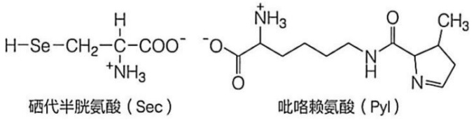

目前的技术已有可能通过操纵遗传密码、tRNA和氨酰-tRNA合成酶，将一些特殊的氨基酸引入某些蛋白质中。人们利用合成生物学技术，在细菌、酵母和哺乳动物细胞，以及无细胞系统中，经过基因改造，已成功实现将具有特殊理化或生物特性的非天然氨基酸置于多肽链的任何位置，以获得具有特殊性质的新型蛋白质。

## 12.2.6 对 mRNA 分子碱基的编辑或翻译移码等可改变多肽链产物的氨基酸序列

RNA 编辑（RNA editing）是指某些 RNA，特别是 mRNA 发生转录后加工修饰，如核苷酸的插入、删除或取代等，从而使 DNA 编码的遗传信息发生改变的现象。核苷酸插入或删除常见于线粒体和叶绿体基因。原生动物锥虫（Trypanosoma）线粒体的细胞色素氧化酶亚基Ⅱ编码基因是插入编辑的典型例子。其编码基因在转录后的编辑过程中插入了四个 U，使转录产物阅读框发生了改变。核苷酸插入过程需要以一类特殊的向导 RNA（guide RNA，gRNA）为模板，插入的 U 都集中在 mRNA 与 gRNA 配对的一小段序列内。mRNA 与 gRNA 间有几个 G=U 配对，这种配对方式在 RNA 分子中很常见（图 12-9）。

腺苷酸或胞苷酸的酶促脱氨基作用是最常见的通过改变核苷酸进行 RNA 编辑的方式。腺苷酸或胞苷酸脱氨基后，分别形成肌苷酸和尿苷酸，肌苷酸在翻译时被读作 G。腺苷酸脱氨反应在 RNA 腺苷酸脱氨酶（adenosine deaminase acting on RNA, ADAR）催化下完成，而胞苷酸的脱氨基反应由激活诱导脱氨酶（activation-induced deaminase, AID）催化。

载脂蛋白 B（apoB）是脊椎动物低密度脂蛋白的组分，其中 apoB-100 在肝中合成，apoB-48 在小肠中合成，两者均由 apoB-100 基因编码。一种胞苷酸脱氨酶仅在小肠中表达，并能结合在第 2 153 位编码 Gln 密码子的 CAA 上，将 C 脱氨后变成 U，导致产生一个终止密码子 UAA。在小肠中，由这一经过编辑的 mRNA 翻译出的 apoB-48 只含有 apoB-100 氨基端的部分肽段，这种类型的 RNA 编辑可使同一基因在不同组织中特异性地产生两种不同的蛋白质（图 12-10）。

翻译移码（translation frameshift），又称核糖体移码或程序性阅读框移位，是指当某些 mRNA 翻译到一定位点时，核糖体发生“卡顿”，从而改变后续阅读框。劳氏肉瘤病毒（Rous sarcoma virus）的两个重叠基因 gag 和 pol 在翻译时发生了移码，pol 的阅读框相对于 gag 的阅读框偏移一个碱基（-1）（图 12-11）。编码逆转录酶的 pol 基因与编码 Gag 蛋白的 mRNA 相同，但 pol 的翻译产物是一个含有 Pol 和 Gag 的聚蛋白（polyprotein），聚蛋白随后在蛋白酶的作用下切割为成熟的逆转录酶。聚蛋白的产生需要重叠区翻译移码，使核糖体绕过 gag 末端的 UAG 终止密码子。这种翻译移码只占此 mRNA 的 5%，但作为逆转录酶而言，这一表达量足够病毒复制所需。

图 12-9 锥虫线粒体细胞色素氧化酶亚基Ⅱ基因的 RNA 编辑

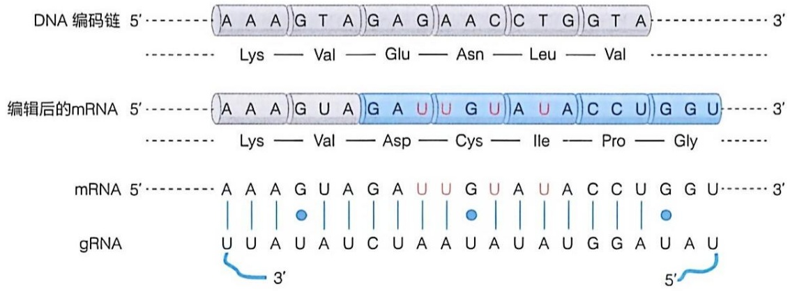

text_image

DNA 编码链 5'----[A A A G T A G A G A A C C T G G T A]----3'
---- Lys — Val — Glu — Asn — Leu — Val ----
编辑后的mRNA 5'----[A A A G U A G A U U G U A U A C C U G G U]----3'
---- Lys — Val — Asp — Cys — Ile — Pro — Gly ----
mRNA 5'----[A A A G U A G A U U G U A U A C C U G G U]----3'
gRNA U U A U A U C U A A U A U A U G G A U A U
3'----5'

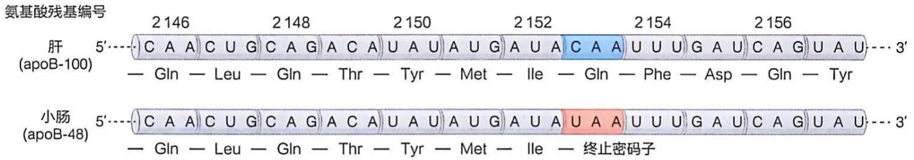

text_image

氨基酸残基编号
肝 5'---C A A C U G C A G A C A U A U A U G A U A C A A U U U G A U C A G U A U --- 3'
(apoB-100) — Gln — Leu — Gln — Thr — Tyr — Met — Ile — Gln — Phe — Asp — Gln — Tyr
小肠 5'---C A A C U G C A G A C A U A U A U G A U A U A A U U U G A U C A G U A U --- 3'
(apoB-48) — Gln — Leu — Gln — Thr — Tyr — Met — Ile — 终止密码子

图 12-10 apoB-100 基因转录产物的 RNA 编辑

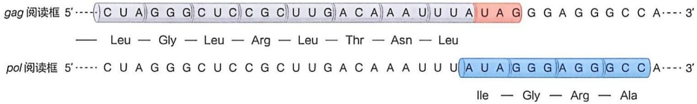

text_image

gag 阅读框 5'----( C U A ) G G G C U C C G C U U G A C A A A U U U A U A G G G A G G G C C A---- 3'
—— Leu — Gly — Leu — Arg — Leu — Thr — Asn — Leu
pol 阅读框 5'---- C U A G G G C U C C G C U U G A C A A A U U U U [ A U A G G G A G G G C C A---- 3'
Ile — Gly — Arg — Ala

图 12-11 劳氏肉瘤病毒转录产物的翻译移码

RNA 编辑和翻译移码不仅可以消除基因突变带来的危害，还可以增加基因产物的多样性；此外，RNA 编辑还与生物的发育与分化有关，是一种重要的基因调控方式。

## 12.3 氨酰 -tRNA 合成酶是将核酸语言转换成蛋白质语言的真正翻译者

为了理解 tRNA 如何在将核酸语言翻译成蛋白质语言的过程中充当“适配器”的作用，需要详细了解 tRNA 的结构。自 1964 年罗伯特·霍利（Robert W. Holley, 1922—1993）等确定了第一个 tRNA——酵母 tRNA $^{Ala}$ 的完整核苷酸序列以来，科学家已经完成了对来自 300 余种生物体的 4000 余个 tRNA 基因的测序。

## 12.3.1 tRNA 分子具有特征性的二级和三级结构

与 rRNA 和 mRNA 相比，tRNA 分子较小。细菌和真核生物细胞质中的 tRNA 含有 73～93 个核苷酸，而线粒体和叶绿体含有一套独特的、更小的 tRNA。不同生物来源的 tRNA 分子具有共同的结构特征（图 12-12）。tRNA 分子中约含有 8 个修饰的核

图12-12 tRNA的一般结构

（A）tRNA三叶草形的二级结构。（B）tRNA倒“L”形的三级结构。D:二氢尿嘧啶；ψ:假尿嘧啶；Py:嘧啶；Pu:嘌呤。阿拉伯数字为tRNA序列中的核苷酸编号

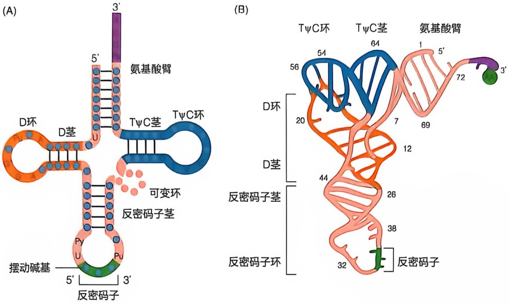

苷酸，多数 tRNA 分子 5' 端是 G，3' 端为 CCA(3') 序列，其 3' 端可接受活化的氨基酸。tRNA 分子的二级结构呈三叶草形，茎环结构的突环（loop）恰似三叶草的叶片，双螺旋的臂（arm）构成“叶柄”。二级结构有氨基酸臂、二氢尿嘧啶茎 / 环（D stem/loop, D 环）、反密码子茎 / 环（anticodon stem/loop）和胸苷-假尿苷-胞苷茎 / 环（TψC stem/loop, TψC 环）。较大的 tRNA 分子还会有一个可变茎 / 环（variable stem/loop）。二级结构通过折叠形成扭曲的倒“L”形的三级结构。螺旋的堆叠和环之间的相互作用有助于稳定这种“L”形结构，修饰碱基既有助于稳定 tRNA 的三维结构，也与 tRNA 的功能有关。关于 tRNA 的加工与修饰详见第 13 章。

## 12.3.2 每种氨酰 -tRNA 合成酶催化一种特异的氨基酸与其对应的 tRNA 形成共价连接

为了合成具有特定氨基酸序列的多肽链，必须满足两个基本要求:①每个氨基酸的羧基必须活化，因为游离氨基酸之间形成肽键的反应在热力学上是不利的，氨基酸的活化有利于后续肽键的形成；②每个氨基酸和 mRNA 中对应密码子之间必须建立联系，即氨酰 -tRNA 上 tRNA 的反密码子通过碱基配对读取 mRNA 上的密码子。一旦合成了氨酰 -tRNA，氨基酸对 mRNA 的准确翻译就不再发挥作用。也就是说，氨基酸由其相应的 tRNA 驱动，通过密码子 - 反密码子相互识别添加到延伸的多肽链中。那么每种氨基酸是如何装载到其相应的 tRNA 分子上形成氨酰 -tRNA 的？这一过程由氨酰 -tRNA 合成酶（aminoacyl-tRNA synthetase，aaRS）催化完成。组成蛋白质的基本氨基酸有 20 种，每种氨基酸都有一种对应的氨酰 -tRNA 合成酶，每种氨酰 -tRNA 合成酶都只能识别 1 种氨基酸，但同时能够识别多个关联 tRNA（cognate tRNA）。

氨酰 -tRNA 合成酶催化的反应分为两步:

第一步:氨基酸 + ATP → 氨酰 - AMP + PP

第二步:氨酰-AMP + tRNA → 氨酰-tRNA + AMP

总反应式:氨基酸 + ATP + tRNA → 氨酰 - tRNA + AMP + PP$_{1}$

第一步反应生成的中间产物氨酰-AMP仍与酶活性中心通过非共价键结合；在第二步反应中，与酶结合的氨酰-AMP中的氨酰基转移到特定的tRNA上，形成氨酰-tRNA。上述反应产生的 $\mathrm{PP_i}$ 立即会被细胞内的焦磷酸酶水解。因此，活化每个氨基酸实际消耗了两个高能键，氨基酸活化总反应基本上是不可逆的。

## 12.3.3 某些氨酰 -tRNA 合成酶的校对功能可提高蛋白质合成的保真性

氨酰-tRNA 合成酶识别氨基酸和关联 tRNA 的能力与一般的酶对底物的识别有所不同。氨酰-tRNA 合成酶能区分结构极为相似的氨基酸，如 Val 和 Ile 在结构上只相差一个—CH₂—，但 Ile-tRNA 合成酶催化形成 Ile-AMP 的活性比催化形成 Val-AMP 高 200 倍。虽然，Val 仍有可能被错误地掺入蛋白质中通常应由 Ile 残基占据的位置，但概率仅为 1/3 000。这种超过了 10 倍的准确率是如何实现的？这得益于 Ile-tRNA 合成酶的校对功能。Ile-tRNA 合成酶除具有活化位点（activation site），还有一个编辑位点（editing site）（图 12-13）。在第一步氨基酸活化过程中，异亮氨酰-tRNA 合成酶的活化位点会排斥比 Ile 结构大的非对应氨基酸，结构比 Ile 小的非对应氨基酸（如 Val）会被错误活化，由此产生的 Val-tRNA$^{Ile}$ 通过氨基酸臂的摆动，将 Val 转位到编辑位点，Val-tRNA$^{Ile}$ 被编辑位点水解成 Val 和 tRNA$^{Ile}$，而编辑位点不结合正确产物 Ile-tRNA$^{Ile}$，以此保护其不被水解。这两种机制结合起来被称为“双筛”机制（“double sieve” mechanism）。“双筛”机制对提高蛋白质合成的保真性发挥了重要作用。

对于 Cys 和 His 而言，因没有与它们结构相似的氨基酸，相应的 Cys-tRNA 合成酶和 His-tRNA 合成酶也没有或只有很低的校对活性，其活化位点识别底物的特异性足以区分正确和错误的氨基酸。

由氨酰-tRNA合成酶介导的编辑反应被称为顺式编辑（cis-editing）。此外，在三域生物中，还存在若干蛋白质因子（如AARSD1），与氨酰-tRNA合成酶的编辑位点同源，同样可以水解错误的氨酰-tRNA，这类编辑反应被称为反式编辑（trans-editing）。顺式编辑和反式编辑反应共同调控蛋白质合成的保真性。

氨酰 -tRNA 合成酶必须能区分 20 种氨基酸和几十种 tRNA，并能从 400 多种可能的氨基酸与 tRNA 组合中特异地选择出正确的底物对——一种特定的氨基酸和其关联 tRNA。关联 tRNA 的反密码子能识别 mRNA 特定的密码子，只有将正确的氨基酸装载到相应的 tRNA 上，才能确保翻译过程的保真性。正确区分 tRNA 与正确识别氨基酸同样重要，因此，科学家将氨酰 -tRNA 合成酶与tRNA $^{Thr}$ 与Thr-tRNA合成酶复合物（PDB编号:1QF6）的结构；黄色为tRNA $^{Thr}$ ，蓝色为Thr-tRNA合成酶

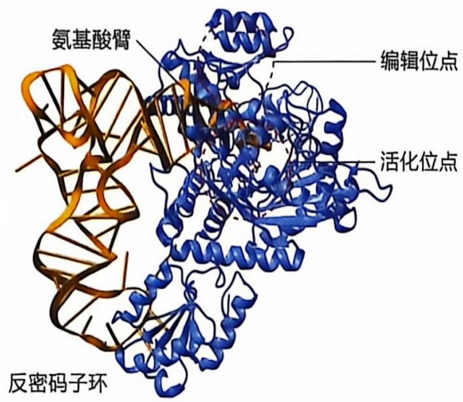

text_image

氨基酸臂
编辑位点
活化位点
反密码子环

图 12-13 氨酰 -tRNA 合成酶具有活化位点和编辑位点

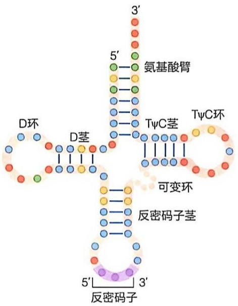

chemical

Diagram of a protein complex showing key organelles including D ring, D layer, TψC layer, and TψC ring with labeled amino acid residues

图 12-14 tRNA 分子中被氨酰 -tRNA 合成酶所识别的特异核苷酸位置

红色圆点代表保守的核苷酸，参与三级结构的形成；黄色或绿色圆点代表被氨酰-tRNA合成酶识别的特异核苷酸；某些氨酰-tRNA合成酶识别的是tRNA的三维结构

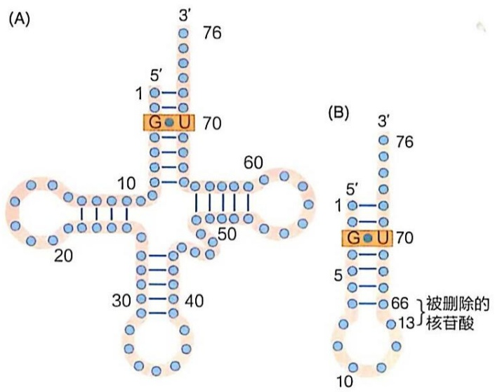

chemical

Diagram of nucleotide structure showing G-U and ribose sugar binding sites with residue numbers and mutation annotation

图12-15 tRNA$^{\mathrm{Ala}}$上被Ala-tRNA合成酶所识别的结构要素（A）Ala-tRNA合成酶识别tRNA$^{\mathrm{Ala}}$上的 $\mathrm{G} = \mathrm{U}$。（B）人工合成的含有 $\mathrm{G} = \mathrm{U}$ 的小RNA

关联 tRNA 间的相互作用称为第二套遗传密码（second genetic code），这对蛋白质合成过程的保真性十分重要。

tRNA 分子中约有 10 个特异核苷酸可被氨酰-tRNA 合成酶所识别，这些核苷酸主要集中在氨基酸臂、反密码子茎，以及反密码子本身。有些核苷酸也分布在 tRNA 分子的其他位置（图 12-14）。对 tRNA $^{Ala}$ 而言，氨基酸臂上的一个 $G^{3}=U^{70}$ 碱基对就是 Ala-tRNA 合成酶的识别要素，只要 $G^{3}=U^{70}$ 碱基对存在，一个人工合成的只有 7 个碱基对组成具有氨基酸臂和发夹结构的小 RNA 分子，便可被 Ala-tRNA 合成酶识别并催化形成 Ala-tRNA（图 12-15）。

## 12.3.4 氨酰 -tRNA 合成酶存在两种不同类型，分别与 tRNA 分子的两个不同面结合

尽管所有氨酰-tRNA合成酶都具有相同的酶促功能，但其分子大小、氨基酸序列和寡聚结构各不相同。一些氨酰-tRNA合成酶可以形成二聚体或四聚体。根据结构和催化机制的不同，可将所有生物来源的氨酰-tRNA合成酶分成两种类型，每种类型的氨酰-tRNA合成酶各有10种（表12-6）。

两类氨酰-tRNA合成酶催化形成氨酰-tRNA第一阶段的机制相同，区别在于第二阶段。类型I氨酰-tRNA合成酶首先将氨基酸连接到tRNA-3'端腺苷酸上核糖的2'-OH，然后通过转酯反应再移到3'-OH上；类型Ⅱ氨酰-tRNA合成酶直接将氨基酸连接到3'-OH上（图12-16）。推测这两类酶的催化结构域可能由两个不同的祖先分

表 12-6 两种不同类型的氨酰 -tRNA 合成酶

<table><tr><td colspan="2">类型I</td><td colspan="2">类型II</td></tr><tr><td>Arg ( $\alpha$ )</td><td>Leu ( $\alpha$ )</td><td>Ala ( $\alpha_{4}$ )</td><td>Lys ( $\alpha_{2}$ )</td></tr><tr><td>Cys ( $\alpha$ )</td><td>Met ( $\alpha_{2}$ )</td><td>Asn ( $\alpha_{2}$ )</td><td>Pro ( $\alpha_{2}$ )</td></tr><tr><td>Gln ( $\alpha$ )</td><td>Trp ( $\alpha_{2}$ )</td><td>Asp ( $\alpha_{2}$ )</td><td>Phe ( $\alpha_{2}\beta_{2}$ )</td></tr><tr><td>Glu ( $\alpha$ )</td><td>Tyr ( $\alpha_{2}$ )</td><td>Gly ( $\alpha_{2}\beta_{2}$ )</td><td>Ser ( $\alpha_{2}$ )</td></tr><tr><td>Ile ( $\alpha$ )</td><td>Val ( $\alpha_{2}$ )</td><td>His ( $\alpha_{2}$ )</td><td>Thr ( $\alpha_{2}$ )</td></tr></table>

α、β 代表氨酰 -tRNA 合成酶亚基名称。

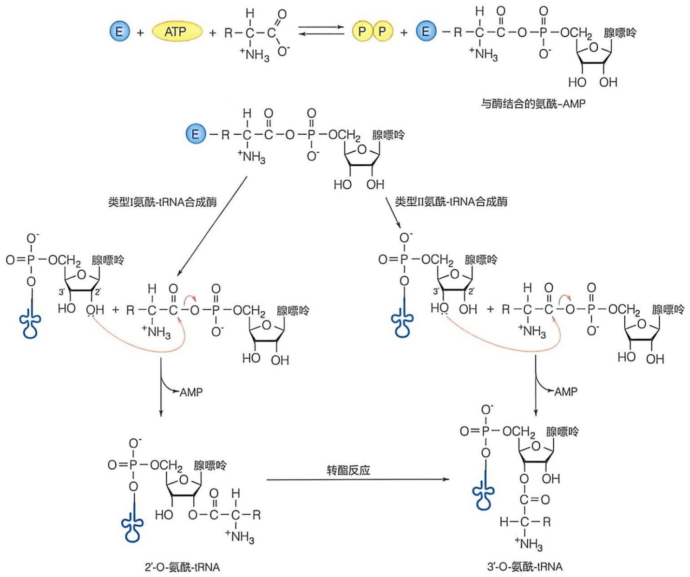

flowchart

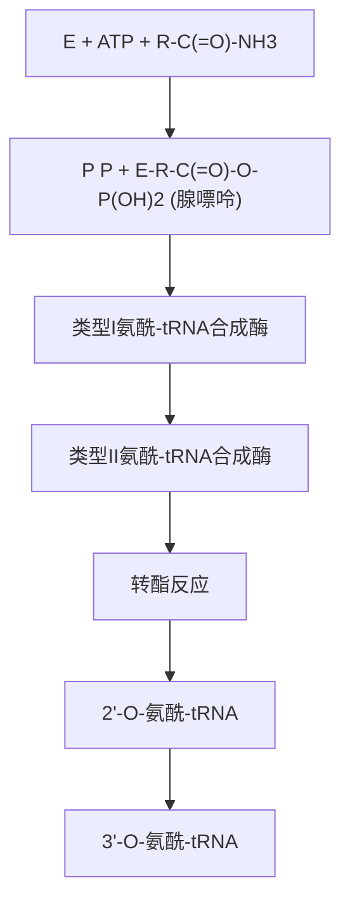

图12-16 两类氨酰-tRNA合成酶催化氨酰-tRNA合成机制的比较E:氨酰-tRNA合成酶；PP:焦磷酸

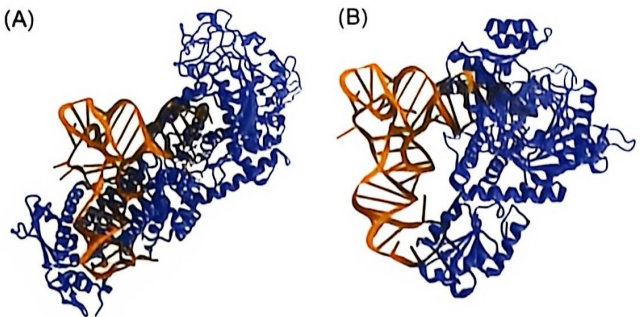

图12-17 两类氨酰-tRNA合成酶:tRNA复合物结构（A）属于类型I的大肠杆菌Ile-tRNA合成酶（PDB编号:1FFY）。(B)属于类型II的大肠杆菌Thr-tRNA合成酶（PDB编号:1QF6）

子进化而来。

氨酰-tRNA合成酶与关联tRNA借助非共价键相互作用。类型I的氨酰-tRNA合成酶结合在tRNA的D环一侧，并与氨基酸臂螺旋结构的浅沟相互作用；而类型II的氨酰-tRNA合成酶与tRNA相反的一侧结合，与氨基酸臂螺旋结构深沟相互作用。氨基酸臂末端的三对碱基中至少有一对作为识别位点，促进正确的tRNA与氨酰-tRNA合成酶结合。两类酶都与反密码子环结合，并至少识别反密码子中的一个碱基（图12-17）。

## 12.4 由 mRNA 指导的多肽链合成发生在核糖体上

赞梅尼克等 1955 年用放射性标记氨基酸的实验证明，由 mRNA 指导的多肽链合成是在核糖体上进行的。1960 年代末，木村等证明，核糖体亚基可以拆解成 rRNA 和蛋白质组分，并且在适当的 pH 和离子强度条件下，将核糖体的蛋白质亚基和 rRNA 体外混合，在没有任何其他因素或伴侣分子的参与下，能自组装成有功能的大、小亚基。这一发现推动了此后数十年对 rRNA 和核糖体蛋白质结构和功能的深入研究。

## 12.4.1 真核和原核细胞核糖体具有高度相似的组成和结构

大肠杆菌核糖体是原核生物核糖体的代表。其完整核糖体的沉降系数为 70S，由大、小两个亚基组成。30S 小亚基由 21 种不同的蛋白质（S1～S21）和一个 16S rRNA 组成；50S 大亚基由 36 个蛋白质（L1～L36）及 23S rRNA 和 5S rRNA 两个 rRNA 组成。rRNA 和蛋白质各约占核糖体质量的 2/3 和 1/3（表 12-7）。一个大肠杆菌细胞含有约 20 000 个核糖体，约占细胞质干重的 20%。核糖体蛋白富含带正电荷的 Arg 和 His 残基，可与带负电荷的 rRNA 发生强烈的相互作用。rRNA 充当各种核糖体蛋白聚集的支架，核糖体蛋白按特定顺序与之结合，组装成核糖体。

表 12-7 大肠杆菌核糖体的蛋白质和 rRNA 组分

<table><tr><td></td><td>核糖体</td><td>小亚基</td><td>大亚基</td></tr><tr><td>沉降系数</td><td>70S</td><td>30S</td><td>50S</td></tr><tr><td>分子质量/kDa</td><td>2 520</td><td>930</td><td>1 590</td></tr><tr><td rowspan="2">rRNA 类型</td><td></td><td>16S : 1542nt</td><td>23S : 2904nt</td></tr><tr><td></td><td></td><td>5S : 120nt</td></tr><tr><td>rRNA 质量 /kDa</td><td>1 664</td><td>560</td><td>1 104</td></tr><tr><td>rRNA 比例</td><td>66%</td><td>60%</td><td>70%</td></tr><tr><td>蛋白质种类</td><td></td><td>21</td><td>36*</td></tr><tr><td>蛋白质质量/kDa</td><td>857</td><td>370</td><td>487</td></tr><tr><td>蛋白质比例</td><td>34%</td><td>40%</td><td>30%</td></tr></table>

\* 原核生物核糖体大亚基的36个蛋白质（L1-L36）中，L7是L12的N端乙酰化形式，L7/L12各有两个拷贝，L26与S20为同一蛋白质，L8是L7/12和L10的复合物，大亚基实际只有33种蛋白质。

21 世纪初，拉马克里希南、施泰茨和尤纳斯等完成了对原核生物和真核生物核糖体大、小亚基和完整核糖体高分辨率三维结构的解析（图 12-18）。首先，研究发现核糖体亚基含有巨大的 RNA 分子，大亚基中 rRNA 形成结构核心，蛋白质装饰在核糖体表面。其次，也是最重要的一点，在肽键形成的活性位点处没有蛋白质的分布。高分辨率结构分析结果证实了由诺勒提出的“是 rRNA（而非核糖体蛋白）催化了肽键形成”的假说。

图 12-19 显示的是嗜热栖热菌（Thermus thermophilus）核糖体及其大、小亚基的三维结构。30S 小亚基由头部和底部组成，一侧翘起一叶扁平突起，形成平台（platform）（图 12-19A），相互间为裂缝，mRNA 穿过此裂缝。平台为 30S 小亚基的中心结构域，包含 16S rRNA 的 1/3，并且只有 rRNA，不含核糖体蛋白组分。这个中心结构域作为解码中心（decoding center），结合 mRNA 和氨酰-tRNA 反密码子环的末端，为通过密码子-反密码子相互作用介导 mRNA 上遗传信息的解码提供了框架。

50S 大亚基是一个类似棒球手套状的球形结构，有三个突起:中央突起、L1 柄和 L7/L12 柄（图 12-19B）。该大亚基结合氨酰-tRNA 的氨基酸臂末端，并负责催化多肽链中氨基酸之间肽键的形成。肽酰转移酶活性中心（peptidyl transferase center，PTC）位于一个深裂缝的底部，由此处向外穿过大亚基的背面有一个 10 nm 的通道（polypeptide exit tunnel，PET），可以容纳约 30 个氨基酸残基长的肽段，新生肽的折叠过程始于该通道内。

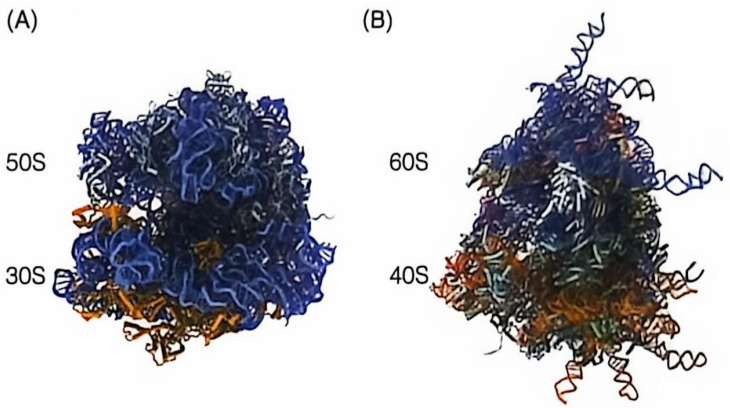

图 12-18 大肠杆菌和人类核糖体的三维结构

（A）大肠杆菌70S核糖体结构（PDB编号:4V4I）。（B）人类80S核糖体结构（PDB编号:4V6X）

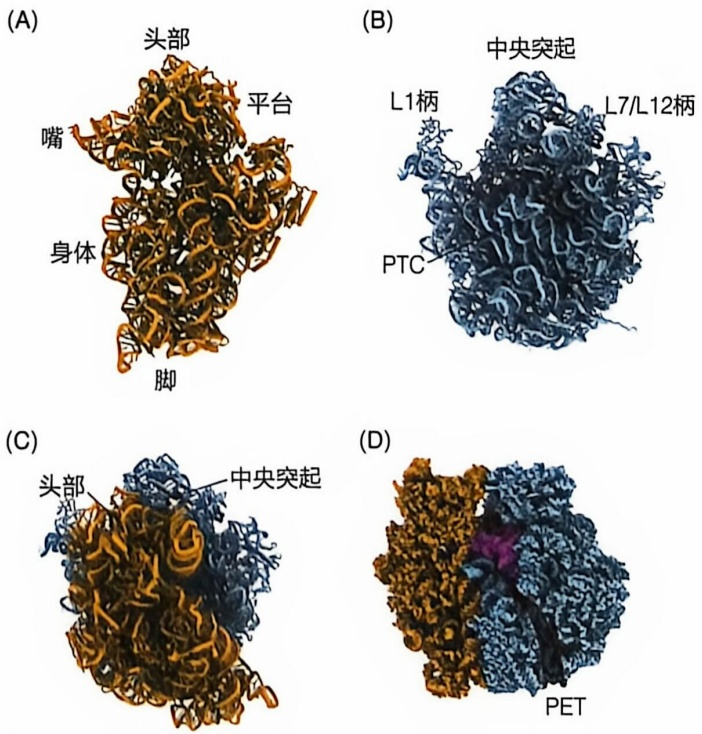

图 12-19 嗜热栖热菌核糖体及其亚基的三维结构

（A）30S（PDB 编号:4V51）小亚基结构。（B）50S（PDB 编号:4V51）大亚基结构，图中显示的是与 30S 小亚基形成 70S 核糖体时相互接触的界面。（C）70S 核糖体结构。（D）70S 核糖体侧面，显示 PET

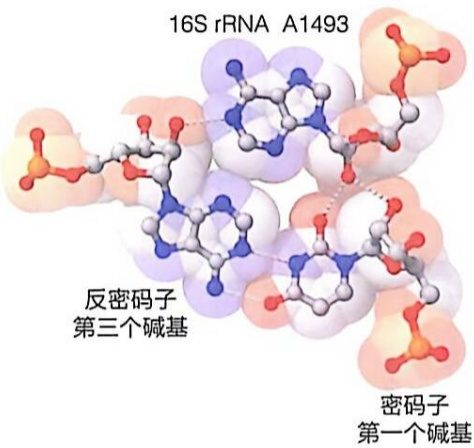

chemical

Molecular structure of 16S rRNA A1493 showing its three base-antioxidant and first-order bases

图 12-20 16S rRNA 监测密码子与反密码子的碱基配对

核糖体大、小亚基以如图（图 12-19C、D）所示的方式结合，两个亚基间的接触面有限，界面主要是 rRNA，核糖体蛋白很少。尽管核糖体蛋白主要分布在表面，但 rRNA 仍然占据了亚基表面的 30%\~40%。30S 亚基的解码中心和位于 50S 大亚基上的肽酰转移酶（peptidyl transferase）与大亚基上的通道对齐，合成的多肽链从这个通道向外延伸。

30S亚基的16S rRNA有三个保守的碱基:A1492、A1493和G530。它们在螺旋区浅沟侧能与密码子-反密码子在通过碱基配对所产生的双链间形成氢键，以交互检查密码子的前两个碱基与相应的反密码子碱基是否形成了正确的沃森-克里克碱基配对（图12-20）。密码子第三个碱基与16S rRNA G530的作用似乎不太敏感，使第三位碱基具有摆动性。如果tRNA的反密码子与密码子不匹配，则不被小亚

基所接纳，这一点对蛋白质翻译过程的忠实性十分重要。氨酰-tRNA合成酶的“双筛”机制，以及核糖体对密码子-反密码子碱基配对的监测，使多肽链合成的出错率小于 $10^{-5}$ 。

真核细胞除细胞质，线粒体和叶绿体内也有核糖体。线粒体和叶绿体核糖体的大小、结构和功能与原核生物核糖体相似，反映了这些细胞器的原核起源。

真核生物细胞质的完整核糖体沉淀系数为 80S。其 40S 小亚基由 33 种蛋白质和一个 18S rRNA 组成，60S 大亚基由 47 种蛋白质以及 25/28S rRNA、5.8S 和 5S rRNA 三个 rRNA 组成。表 12-8 列出了人类细胞质核糖体的组成特性。尽管真核生物细胞质核糖体更大、更复杂，但依然保留了原核生物核糖体的核心结构和功能特性。例如，对 rRNA 碱基序列和二级结构的比较分析表明，不同生物来源的 rRNA 的二级结构在进化上非常保守，并且特定位置碱基的保守性对二级结构的形成发挥了关键作用。

表 12-8 人类细胞质核糖体的组成特性

<table><tr><td></td><td>核糖体</td><td>小亚基</td><td>大亚基</td></tr><tr><td>沉降系数</td><td>80S</td><td>40S</td><td>60S</td></tr><tr><td>分子质量/MDa</td><td>4.3</td><td>1.4</td><td>2.9</td></tr><tr><td rowspan="3">rRNA类型</td><td></td><td>18S:1870nt</td><td>28S:5034nt</td></tr><tr><td></td><td></td><td>5.8S:156nt</td></tr><tr><td></td><td></td><td>5S:121nt</td></tr><tr><td>rRNA质量/MDa</td><td>2.5</td><td>0.7</td><td>1.8</td></tr><tr><td>rRNA比例</td><td>60%</td><td>50%</td><td>65%</td></tr><tr><td>蛋白质种类</td><td></td><td>33</td><td>47</td></tr><tr><td>蛋白质质量/MDa</td><td>1.7</td><td>0.7</td><td>1</td></tr><tr><td>蛋白质比例</td><td>40%</td><td>50%</td><td>35%</td></tr></table>

## 12.4.2 核仁是真核细胞核糖体组装的主要场所

核糖体组装是一个高度协调的过程，涉及rRNA的加工、修饰、折叠以及核糖体蛋白的有序结合，在真核和原核生物中都需要经过复杂而有序的步骤，且受到严格的调控。某些组装因子必须首先结合rRNA，以便帮助rRNA形成正确的二级和三级结构，从而为后续蛋白质的结合提供平台。此外，组装因子如GTP水解酶、RNA修饰酶和RNA螺旋酶等也在核糖体组装过程中发挥关键作用，帮助核糖体亚基折叠和组装，确保其形成功能性的结构。

在原核生物中，核糖体的组装全部在细胞质中进行，而在真核细胞中，核糖体的组装过程更加复杂且极度耗能，分为多个阶段，包括核仁阶段、核质阶段、出核阶段和细胞质阶段。核仁是真核细胞核糖体组装的核心场所，主要负责 rRNA 的转录、加工、修饰以及核糖体亚基的初步装配。人体 47S 前体 rRNA 由 RNA 聚合酶 I 在核仁中转录生成，随后与多种组装因子结合，形成 90S 核糖体前体复合物。随后，前体 rRNA 经过一系列切割和修饰，最终 18S rRNA 与 5.8S rRNA 和 28S rRNA 分开，核糖体组装随之分成小亚基和大亚基的独立组装过程。在完成核仁和核质阶段的组装后，小亚基和大亚基前体通过核孔复合体进入细胞质，成为功能性核糖体亚基，参与蛋白质的翻译（图 12-21）。

核仁中的两类小核仁 RNA（snoRNA）在 rRNA 的精确加工过程中起着至关重要的作用。Box C/D snoRNA（如 U3、U14）负责 rRNA 分子中核糖 2'-OH 的甲基化修饰，而 Box H/ACA snoRNA（如 snR10、snR30）则介导假尿嘧啶的形成。这些 snoRNA 通过与蛋白质结合形成 snoRNP 复合物，参与 rRNA 的加工修饰反应，确保 rRNA 的结构稳定性和核糖体的正确组装（图 12-22）。rRNA 的精确加工对于核糖体的正常功能至关重要，错误的修饰或组装可能导致翻译错误或核糖体功能异常。

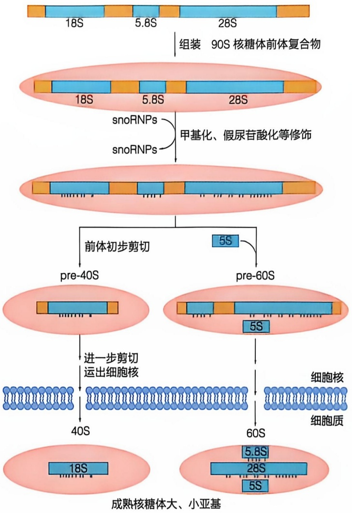

flowchart

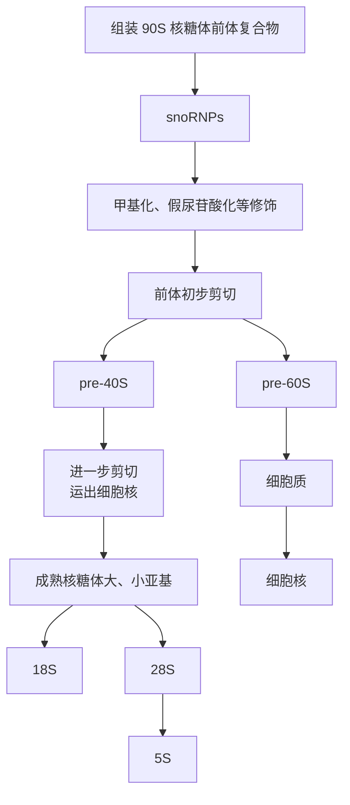

图12-21 真核细胞中核糖体的组装

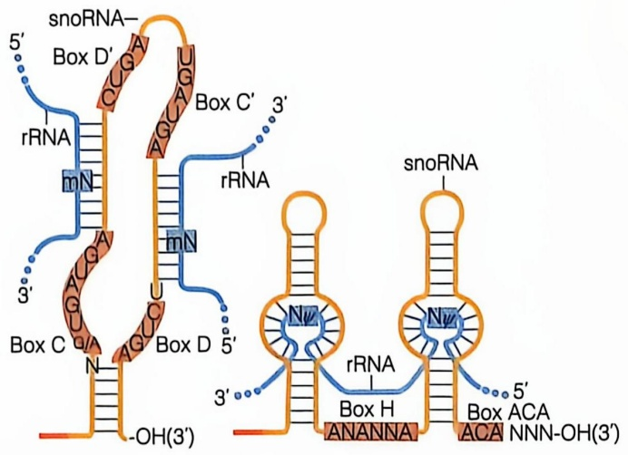

chemical

Diagram of snoRNA-based RNA binding to Box D and Box H, showing rRNA and ACA binding sites with labeled regions and distances

图 12-22 snoRNA 指导 rRNA 的修饰

snoRNA 中高度保守的 C、D、C'、D' 以及 H/ACA 序列与蛋白质结合，形成 snoRNP

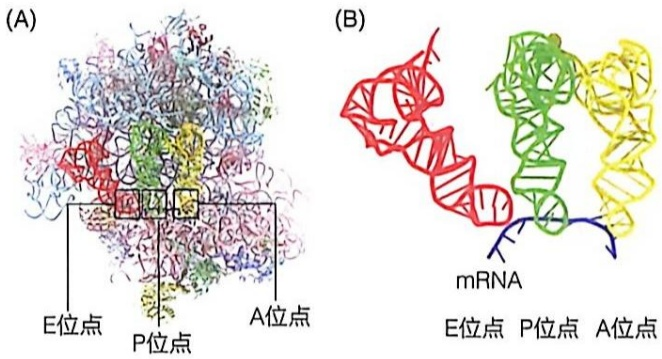

图 12-23 核糖体上 tRNA 结合位点的位置

（A）70S 核糖体上三个 tRNA 结合位点 E、P 和 A 的位置（PDB 编号:4V5D）。（B）P 和 A 位点上 tRNA 的反密码子与 mRNA 密码子形成碱基配对（PDB 编号:1JGP）

rRNA 的加工与成熟详见第 13 章。

## 12.4.3 每个核糖体利用三个邻近的 tRNA 结合位点完成肽链合成过程

核糖体的大、小亚基在翻译开始时聚集在一起。在核糖体上有三个tRNA结合位点，即氨酰基位点（aminoacyl site，也称A位点）、肽酰基位点（peptidyl site，也称P位点）和排出位点（exit site，也称E位点）（图12-23）。A位点和P位点分别结合氨酰-tRNA或肽酰-tRNA，使负载tRNA（charged tRNA）的反密码子能够与mRNA接触。30S小亚基的解码中心位于A和P位

点上 tRNA 的顶部背侧，即 tRNA 末端反密码子的位置，肽酰基转移酶活性中心位于 50S 大亚基 A、P 位点上 tRNA 的氨基酸臂末端。

## 12.4.4 核糖体大亚基中折叠成特异三维结构的 rRNA 催化肽键形成

肽键的形成或肽酰基转移（peptidyl transfer）反应是在肽酰基转移酶活性中心（PTC）进行的。肽键形成的反应无需能量输入，因为连接肽酰基和 tRNA 的酯键本身有内在的反应活性。核糖体高分辨率三维结构显示，在 PTC 处无任何核糖体蛋白存在（图 12-24A）。实际上，原核生物肽酰基转移反应是由核糖体 50S 大亚基中的 23S rRNA 所催化。在动力学上，核糖体的催化能力中等，核糖体通过 PTC 的 rRNA 形成肽键的反应速率只是无催化反应速率的 $4 \times 10^{6}$ 倍。肽酰基转移需要 A 位点和 P 位点上 tRNA 的氨酰基末端与 50S 亚基的 PTC 相互作用。PTC 位于 23S rRNA 的结构域 V，在三维结构上折叠成漏斗形，肽酰 -tRNA 和氨酰 -tRNA 的 3' 端氨基酸臂在此相遇。tRNA 3' 端的一些核苷酸与 PTC 中的核苷酸形成碱基配对。例如，PTC 中 P 环的 G2251 和 G2252 碱基分别与 P 位点 tRNA 的 C74 和 C75 配对，PTC 中 A 环的 G2553 与 A 位点 tRNA 的 C75 形成碱基配对，PTC 的 C2501 与 P 位点 tRNA 的 A76 相互作用，附近的 U2506 与 A 位点 tRNA 中的 A76 互相作用（图 12-24B）。这些相互作用使核糖体与底物紧密结合，进而使反应基团——氨酰基和肽酰基并列、定向，有利于成肽反应的发生。PTC、肽酰 -tRNA 和氨酰 -tRNA 间建立起一个由氢键和静电相互作用形成的网络，能稳定高极性的过渡态（图 12-25），促进肽键形成。因此，核糖体催化的多肽链的合成更多地是依赖于底物的临近与定向效应，而不是化学催化。

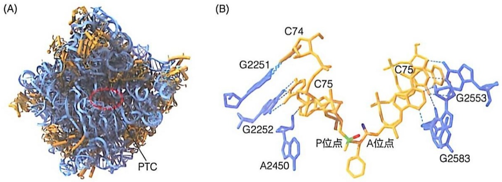

图 12-24 核糖体大亚基肽酰基转移酶活性中心

（A）嗜热栖热菌（T. thermophilus）核糖体50S大亚基（PDB编号:1VQP）结构，红色为活性中心结合的氨酰-tRNA底物过渡态类似物CC-羟基-嘌呤霉素，蓝色为23S rRNA。（B）肽酰基转移酶活性

中心 23S rRNA 与 tRNA 间的碱基配对。位于 A 位点 tRNA 和 P 位点 tRNA 的胞嘧啶核苷酸与 23S rRNA 核苷酸间形成碱基配对（PDB 编号:1VQN）

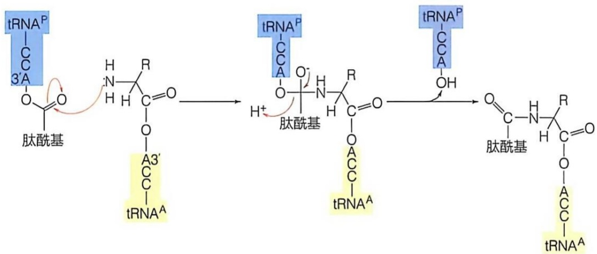

flowchart

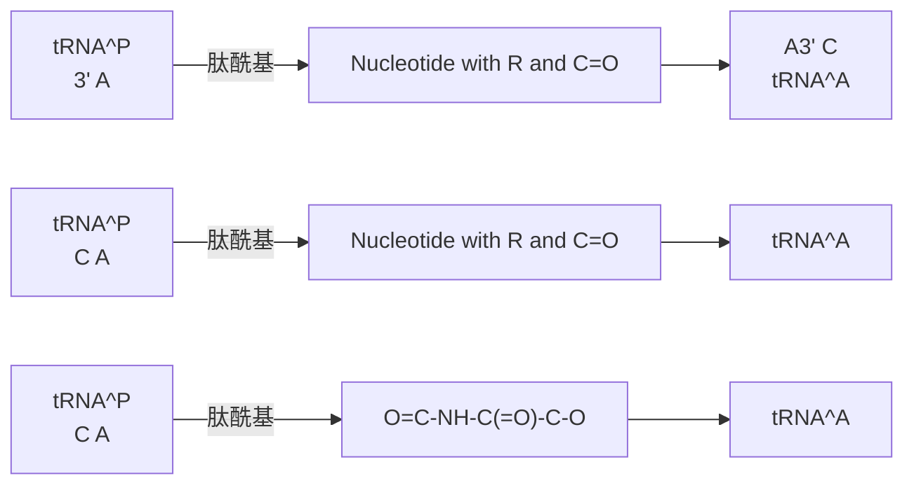

图 12-25 肽酰基转移酶催化肽键形成的反应

氨酰-tRNA 上氨基酸的 α-氨基首先去质子化，接着对肽酰-tRNA 羰基碳进行亲核攻击，形成高度极性的四面体过渡态；随后质子转移到 tRNA 的 3'-O，形成脱酰基的 tRNA 和延长了一个氨基酸的新肽酰-tRNA

## 12.5 多肽链合成开始于特异的起始密码子，结束于终止密码子

多肽链的合成由起始、延伸、终止和核糖体再生四个阶段组成（图 12-26）。多肽链的合成还包括前期氨基酸的活化和多肽链翻译后的折叠与加工修饰过程，以保证蛋白质合成产物的保真性和功能的发挥。

为了使多肽链合成能在 mRNA 模板上的正确位置起始，一个负载的起始 tRNA（Met-tRNA $_{i}^{Met}$ ）必须与位于 P 位点的起始密码子 AUG 结合，第二个氨酰-tRNA（AA $_{2}$ -tRNA）结合在 A 位点，随后每个新的氨酰-tRNA 都结合到 A 位点。23S rRNA 协助将肽链从 P 位点的肽酰-tRNA 转移到 A 位点的氨酰-tRNA 上。通过氨酰-tRNA 上的 α-氨基与肽酰-tRNA 的 α-羧基共价连接，形成新的肽键。接下来，核糖体沿 mRNA 5'→3' 方向精确地移动一个密码子，伴随这种移位，新的肽酰-tRNA 从 A 位点进入 P 位点。移位后空出的 A 位点接受下一个进入的氨酰-tRNA，E 位点上脱去肽酰基的空载 tRNA 释放。当翻译至终止密码子时，释放因子结合到核糖体上，释放多

图 12-26 原核生物多肽链合成的四个主要阶段

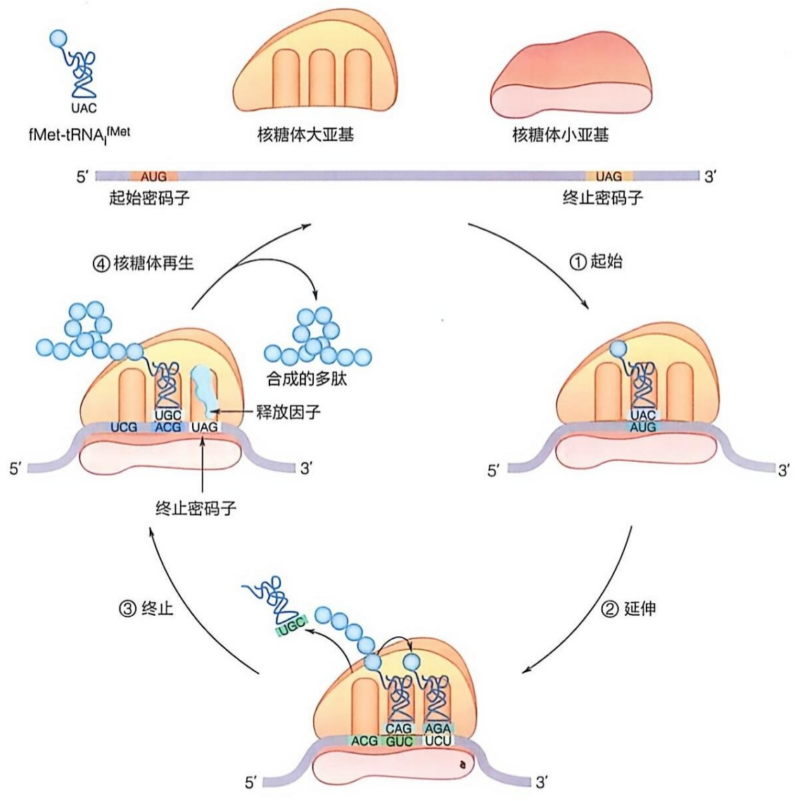

flowchart

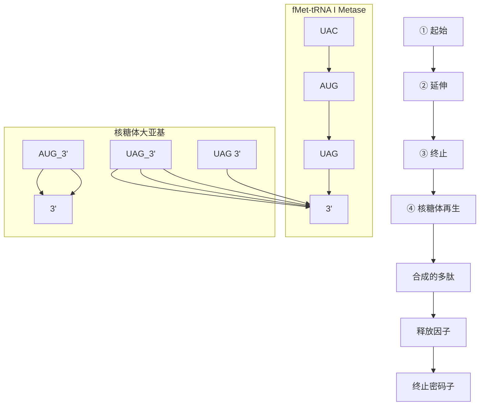

肽链，核糖体大小亚基解离、回收，用于下一轮翻译。

## 12.5.1 细菌细胞 mRNA 中的起始密码子通过其上游序列与核糖体小亚基 16S rRNA 中的碱基配对而定位于核糖体上的 P 位点

细菌细胞多肽链的合成都是以（甲酰）甲硫氨酸作为N端的起始氨基酸，并逐一将氨基酸添加到正在延伸的多肽链羧基端。mRNA的阅读框通常以AUG为起始密码子（有时是GUG或UUG）。甲硫氨酸只有AUG一个密码子，但有两个关联tRNA，其中一个用于多肽链合成的起始，另一个用于识别多肽链内部的甲硫氨酸密码子。

为了使起始密码子 AUG 能正确定向于 P 位点下方，核糖体必须能够识别 mRNA 的 5' 端。大多数原核生物 mRNA 起始密码子上游有一段由 10 个左右富含嘌呤碱基的核苷酸组成的序列，称为 Shine-Dalgarno（SD）序列或核糖体结合位点（ribosome binding site, RBS）（图 12-27）。SD 序列与 30S 小亚基的 16S rRNA 近 3' 端一段富含嘧啶碱基的核苷酸序列（anti-SD）互补。mRNA-rRNA 相互作用将 mRNA 的起始密码子 AUG 精确定位在 30S 小亚基上翻译起始的位置。SD 序列与 anti-SD 序列结合的强弱以及其与起始密码子间的距离都会影响 mRNA 的翻译效率。

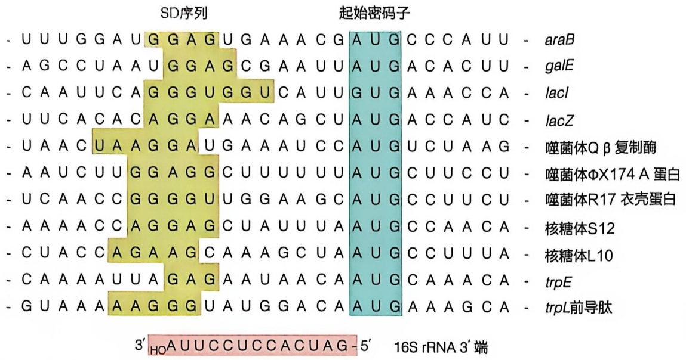

text_image

- U U U G G A U G G A G U G A A A C G A U G C C C A U U - araB
- A G C C U A A U G G A G C G A A U U A U G A C A C U U - galE
- C A A U U C A G G G U G G U C A U U G U G A A A C C A - lacI
- U U C A C A C A G G A A A C A G C U A U G A C C A U C - lacZ
- U A A C U A A G G A U G A A A U C C A U G U C U A A G - 噬菌体Q β复制酶
- A A U C U U G G A G G C U U U U U U U A U G C U U C C U - 噬菌体ΦX174A蛋白
- U C A A C C G G G G U U G G A A G C A U G C C U U C U - 噬菌体R17衣壳蛋白
- A A A A C C A G G A G C U A U U U U A A U G C C A A C A - 核糖体S12
- C U A C C A G A A G C A A A G C U A A U G C C U U U A - 核糖体L10
- C A A A AAU U A G A G A AAU AAC A A U G C AAAC A - trpE
- G U AAAAAAGGGU AUGGACA AUGAAAAGCA - trpL前导肽
3' HO AUUCCUCCACUAG-5' 16S rRNA 3'端

图 12-27 原核生物几种 mRNA 的核糖体结合位点序列

## 12.5.2 细菌多肽链合成起始于甲酰甲硫氨酸——起始 tRNA 被置放于核糖体上的 P 位点以及核糖体大小亚基结合形成 70S 起始复合物之时

原核生物和真核生物多肽链合成起始在机制上存在差异，以下分别叙述。

原核生物多肽链合成起始所需的组分包括:① mRNA；② 核糖体 30S 和 50S 亚基；③ 三个起始因子（initiation factor，IF）IF1、IF2 和 IF3；④ GTP；⑤  $Mg^{2+}$ ；⑥ 携带甲酰甲硫氨酸的起始 tRNA—— $fMet-tRNA_{i}^{\Omega Met}$ 。原核生物起始 tRNA 上所携带的甲硫氨酸的氨基通常被甲酰化，所以此 tRNA 写作  $tRNA_{i}^{Met}$  或  $tRNA_{i}^{\Omega Met}$ 。大肠杆菌中约 50% 的蛋白质的多肽链延伸至 10 个左右氨基酸残基时，fMet 残基就会被去除。因此，大肠杆菌中许多成熟蛋白质的 N 端缺少 fMet。 $fMet-tRNA_{i}^{\Omega Met}$  通过两步连续反应形成。首先，甲硫氨酰 -tRNA 合成酶催化 Met 连接到  $tRNA_{i}^{\Omega Met}$  上。大肠杆菌甲硫氨酰 -tRNA 合成酶也可将 Met 连接到  $tRNA^{Met}$  上，用于多肽链内部甲硫氨酸的掺入。

$$
\mathrm{Met} + \mathrm{tRNA} _ {\mathrm{i}} ^ {\mathrm{fMet}} + \mathrm{ATP} \rightarrow \mathrm{Met} - \mathrm{tRNA} _ {\mathrm{i}} ^ {\mathrm{fMet}} + \mathrm{AMP} + \mathrm{PPi}
$$

然后由一个特异的甲酰化酶催化，将甲酰基从 $N^{10}$ -甲酰四氢叶酸转移到甲硫氨酸的氨基上。

$$
N ^ {1 0} - \text {甲酰四氢叶酸} + \mathrm{Met-tRNA} _ {\mathrm{i}} ^ {\mathrm{fMet}} \rightarrow \mathrm{fMet-tRNA} _ {\mathrm{i}} ^ {\mathrm{fMet}} + \text {四氢叶酸}
$$