接位点识别错误或剪接效率降低，最终引起异常剪接产物的累积，并可能导致多种人类疾病的发生。

研究发现，U1 snRNA（见 11.1.3.3 节）的突变在多种肿瘤中被检测到，包括 Sonic Hedgehog 髓母细胞瘤、肝细胞癌和慢性淋巴细胞白血病。这些突变影响了 5' 剪接位点的识别，导致大量异常剪接产物的产生，进而促进肿瘤的发生发展。

U4 snRNA作为主要剪接体的重要组分，参与mRNA前体的剪接过程。近期研究表明，U4 snRNA的突变与多种神经发育障碍相关，这揭示了RNA剪接异常在神经系统疾病发生中的重要作用。

U4atac snRNA 是次要剪接体（U12 型剪接体）（见 11.1.3.5 节）的重要组成部分，参与 U12 型内含子的剪接过程。研究发现，U4atac snRNA 基因（RNU4ATAC）的突变与多种人类疾病相关，其中最具代表性的是小头畸形-骨发育不良-原基性侏儒综合征 I 型（Microcephalic Osteodysplastic Primordial Dwarfism Type I，MOPD I），也称为 Taybi-Linder 综合征（TALS）。这是一种严重的常染色体隐性遗传病，以严重的生长发育迟缓、小头畸形、面部异常和骨骼发育不良为特征。RNU4ATAC 基因的多种突变，如 n.51G > A、n.53C > G 和 n.55G > A 等，均可导致 U4atac snRNA 功能受损，影响次要剪接体的组装和功能，进而导致含有 U12 型内含子的基因剪接异常，最终引发疾病。此外，研究还发现 Roifman 综合征（Roifman syndrome）也与 U4atac snRNA 突变有关，该病以免疫缺陷、生长迟缓和认知功能障碍为特征。

## 13.1.4 核仁小 RNA（snoRNA）:通过多种途径加工成熟的非编码 RNA

snoRNA 是一类广泛存在于核仁的非编码 RNA，是进化上保守的非编码 RNA 家族，长度为 60～300 nt。snoRNA 存在着不同的基因组织形式，根据转录加工的特性可以分为独立基因编码和内含子编码两大类。从序列和结构特征来看，snoRNA 主要分为两类:box H/ACA 型 snoRNA、box C/D 型 snoRNA。近年来还发现有些 snoRNA 的表达存在组织特异性，如脑特异 snoRNA 和印记 snoRNA。此外，snoRNA 还是一类兼有组成性和调控性功能特点的非编码 RNA，是 RNA 调控网络的重要组成部分。

## （1）多种机制助力 snoRNA 的成熟

snoRNA 的加工成熟过程是一个精细调控的事件，涉及多个步骤，包括转录、剪接、修饰和复合体的形成。在酵母和植物中，大多数 snoRNA 是独立基因编码的，并且酵母中多为单顺反子（图 13-10A、B）；在植物中则常以成簇的形式存在，并以多顺反子形式表达（图 13-10C）；但在动物中，大部分 snoRNA 由基因的内含子编码产生（图 13-11）。不过，一些后生动物的部分 snoRNA 基因也可以由独立基因编码，如 U3、U8、U13 等。

在转录层面，大多数独立基因编码的 snoRNA 由 RNA聚合酶Ⅱ转录，但也有一些 snoRNA 由 RNA聚合酶Ⅲ转录。例如在酵母中，除了 SNR52 被 RNA聚合酶Ⅲ转录外，所有的 snoRNA 都被 RNA 聚合酶Ⅱ转录。而在后生动物中，更多独立转录的 snoRNA 基因由 RNA 聚合酶Ⅲ转录。例如，在秀丽隐杆线虫中，多达 59 个 snoRNA 基因被 RNA 聚合酶Ⅲ转录。值得注意的是，在演化过程中，一些同源的 snoRNA 基因转录的 RNA 聚合酶已经发生转变。例如，U3 snoRNA 是 rRNA 成熟所需的关键 snoRNA，在酵母和人体内由 RNA 聚合酶Ⅱ转录，但在植物中被 RNA 聚合酶Ⅲ转录。

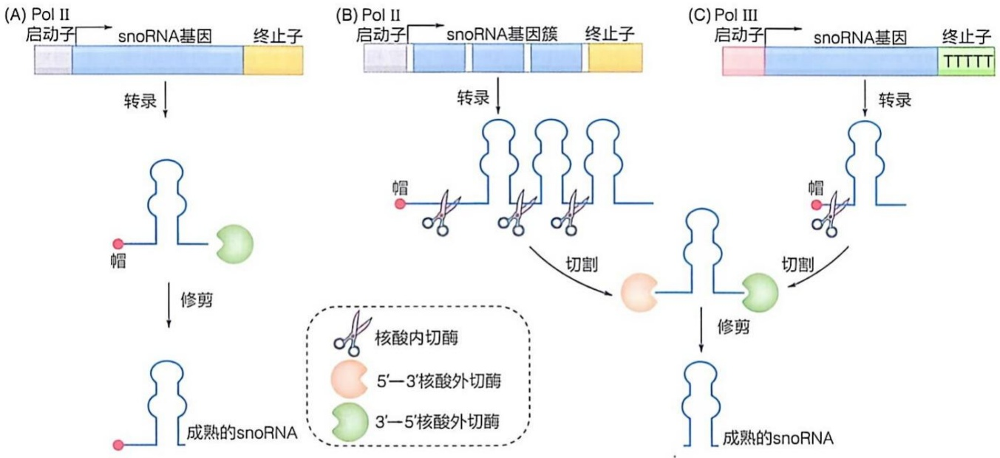

图 13-10 独立转录的 snoRNA 的转录加工过程

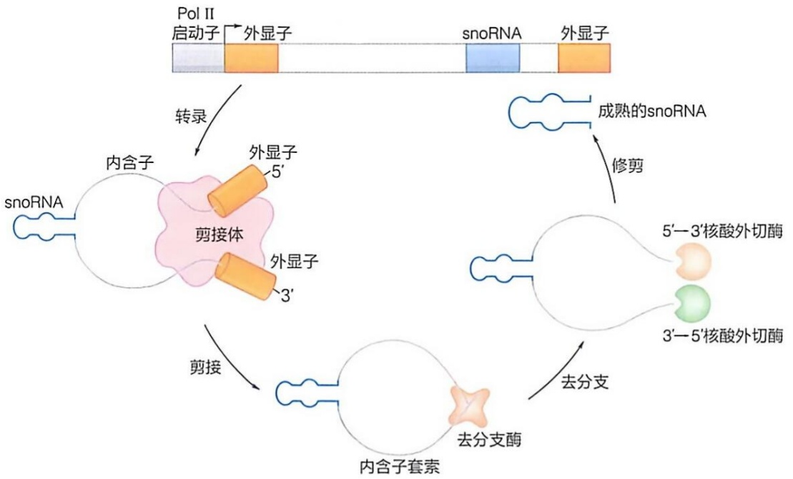

flowchart

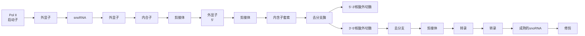

图 13-11 内含子编码的 snoRNA 的转录加工过程

在转录完成后，无论是由独立基因编码的还是内含子编码的 snoRNA 前体（precursor snoRNA，pre-snoRNA），它们都需要经过特定的加工过程，以形成成熟的snoRNA 分子。由于大多数酵母 snoRNA 为独立的转录单元，其转录终止以及 3' 端的形成是由 Nrd1-Nab3-Sen1（NNS）复合体和 Pcf11 促进的。切割结束，3' 端经过 3'→5' 核酸外切酶的修剪以产生成熟的 3' 端（图 13-10A）。而 RNA 聚合酶Ⅱ转录的 snoRNA 前体的 5' 端在转录时加上了 m$^{7}$G 帽，经由 TGS1 转化为 TMG 帽（图 13-10B）。对于以 snoRNA 基因簇形式或者 RNA 聚合酶Ⅲ转录的 snoRNA 前体，经过特定的核酸内切酶切割后，在核酸外切酶的作用下产生成熟的 snoRNA（图 13-10B、C）。核酸外切酶未能将 snoRNA 完全降解，是由于 snoRNA 成熟加工之前就已与特定的 RNA 结合蛋白相互作用，形成了 snoRNP 复合物，从而阻断了核酸外切酶的剪切。

内含子编码的 snoRNA 的加工过程与独立转录的 snoRNA 基本相似:经过 5' 端和 3' 端的加工处理后，通过核酸外切酶的修剪完成最终的成熟（图 13-11）。然而，这一过程依赖剪接途径。在这个过程中，剪接体去除内含子并产生一个包含前体 snoRNA 的内含子套索（intron lariat），随后去分支酶的作用使之变成线性内含子，再经过 5' → 3' 以及 3' → 5' 核酸外切酶的修剪形成成熟的 5' 和 3' 端的 snoRNA。

## (2) snoRNA 指导组成性非编码 RNA 的修饰

真核生物 box C/D snoRNA 的长度通常在 70～250 nt，主要负责 rRNA 上的 2'-O-甲基化修饰。在酵母 rRNA 上已经鉴定到约 55 个 2'-O-甲基化修饰，而在人类 rRNA 上鉴定到约 110 个 2'-O-甲基化修饰。这类 snoRNA 包含两个保守序列:box C 和 box D。box C 由核苷酸 RUGAUGA（R 表示嘌呤碱基）组成，它位于 snoRNA 分子的 5' 端；box D 位于 3' 端，由核苷酸 CUGA 组成。C/D 型 snoRNA 除了包含一个 box C 和一个 box D 之外，大多数还包含两个额外的元件——box C' 和 box D'，其序列不完全符合 box C/D 的序列特征。在 box D 和 box D' 上游存在一个或两个反义元件，长度为 10～21 nt。这些反义元件是 C/D 型 snoRNA 的功能区，能够与靶标 RNA（主要是 rRNA 和 snRNA）的序列互补配对，指导特定位点的修饰，并且被修饰位点精确对应于 box D 或 box D' 上游第 5 个核苷酸（图 13-12）。

C/D型snoRNA与蛋白质结合，形成C/D型snoRNP复合物，指导 $2^{\prime} - 0-$ 甲基化修饰。其中，15.5K蛋白（酵母Snu13p）能特异性地结合boxC和boxD结构元件，形成一个Kink-turn（K-turn）结构域，它是一个“螺旋-环-螺旋”结构，两个螺旋结构分别是经典配对的短茎（canonical stem，C-stem）和含两对G-A配对的非经典短茎（noncanonical stem，NC-stem）。15.5K识别snoRNA的K-turn结构后，进一步招募FBL（酵母Nop1p）、NOP58（酵母Nop58p）和NOP56（酵母Nop56p）形成功能性snoRNP复合物。其中FBL是 $2^{\prime} - 0-$ 甲基转移酶，在boxC/DsnoRNA反义元件的指导下，直接催化 $2^{\prime} - 0-$ 甲基化修饰生成。

H/ACA 型 snoRNA 的平均长度约为 130 nt，这类 snoRNA 主要负责 rRNA 和 snRNA 上的假尿嘧啶修饰。假尿嘧啶是在假尿嘧啶合成酶的作用下，将连接尿嘧啶碱基和核糖的氮-碳（N1—C1′）键打破，随后释放的尿嘧啶碱基沿着 N3-C6 轴旋转 180°，在碱基和核糖之间重新形成一个新的碳-碳（C5—C1′）键。这种修饰通过新生成的氨基与水分子形成额外氢键，增强碱基堆叠作用、提高磷酸二酯键的刚性及热力学稳定性，进而稳定 RNA 结构。在酵母 rRNA 中已经鉴定到约 45 个假尿嘧啶修饰，而在人类 rRNA 上鉴定到约 95 个假尿嘧啶修饰。

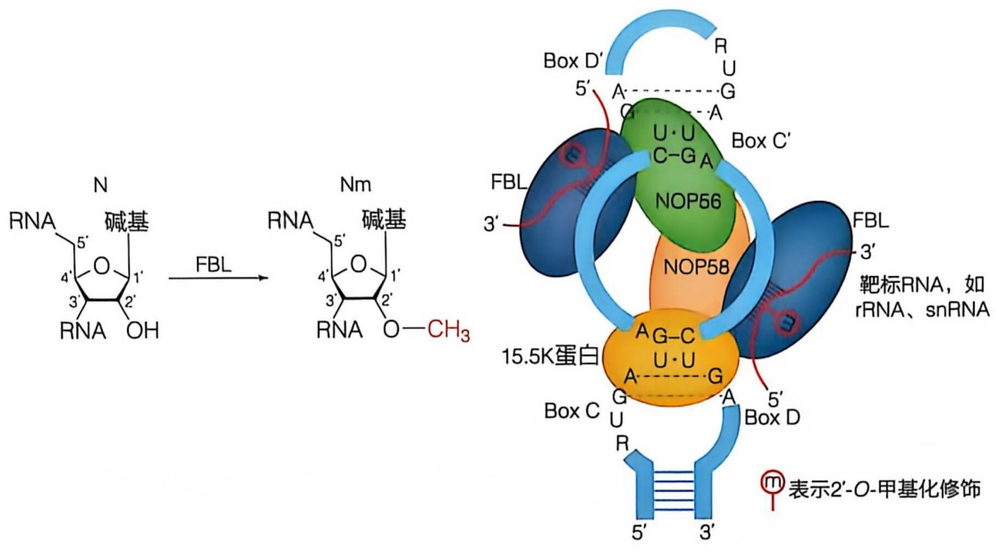

chemical

RNA合成酶结构示意图，展示碱基与FBL结合后DNA转化至NOP56和NOP58的酶链结构

图 13-12 C/D 型 snoRNA 的结构特征

N 表示 A、U、C、G 四种核糖核苷酸之一；Nm 表示 2'-O-甲基化修饰的 A、U、C、G 四种核糖核苷酸之一

H/ACA 型 snoRNA 由保守的 box H 和 box ACA 基序组成，并且其二级结构呈现“发夹-铰链-发夹”特征。其中，box H 是一个 ANANNA 序列（N 表示任意核苷酸），位于两个发夹间的铰链区；box ACA 是一个位于第二个发夹尾的核苷酸三联体（ACA），距离 box H/ACA snoRNA 3' 端 3 个核苷酸长度。H/ACA 型 snoRNA 的发夹中有一个内部环，含有与靶标 RNA（如 rRNA 和 snRNA）互补配对的反义元件（图 13-13）。

与 H/ACA 型 snoRNA 互作的四个核心蛋白是 DKC1（酵母 Cbf5）、NHP2（酵母 Nhp2）、GAR1（酵母 Gar1）和 NOP10（酵母 Nop10）。DKC1 是 H/ACA 型 snoRNP 中的假尿嘧啶合成酶，可以催化 U 到  $\psi$  异构化反应。有效的假尿嘧啶化需要三个结构基序:①两个稳定的含有假尿嘧啶口袋的发夹；②在目标假尿嘧啶和 box H 或 box ACA 之间有 14～16 个核苷酸；③在靶标 RNA 和 snoRNA 的反义元件之间有 9 个以上的碱基配对。

此外，一些 snoRNA 与已知修饰位点的 RNA 序列没有明显的配对关系，并且功能尚不明确，这些 snoRNA 被称为孤儿 snoRNA（orphan snoRNA）。这表明，除了 RNA 的 2'-O-甲基化和假尿嘧啶化之外，snoRNA 还有更多的功能。孤儿 snoRNA 也可能参与了 RNA 的加工和降解过程以及基因表达的调控。例如，一些孤儿 snoRNA 被发现与遗传印记基因的表达、胚胎的发育调控以及人类重大疾病如普拉德-威利综合征（PWS 综合征）有密切的关系。孤儿 snoRNA 还可能参与细胞对 DNA 损伤的响应，通过形成非经典的 snoRNP 复合物来调节与 DNA 损伤相关的基因表达。除此之外，这些孤儿 snoRNA 可以在特定的组织或发育阶段中发挥作用，表现出组织特异性或发育阶段特异性的表达模式。有趣的是，哺乳动物细胞中有些内含子同时含有两个 snoRNA 基因。这类内含子在加工过程中，以类似图 13-11 的机制，在解开套索后，通过形成 snoRNP 复合物，保护两个 snoRNP 中间的内含子区域不被核酸酶降解，最终产生两端是 snoRNA 的长链非编码 RNA，称为 sno-lncRNA（长链非编码 RNA 见 13.3 节）。一些 sno-lncRNA 在 PWS 综合征患者中完全缺失，可能与细胞核仁功能调控密切相关。总之，这些研究表明，经典的组成性 snoRNA 也具有调控功能，有待随着研究技术的发展持续发掘其功能和作用机制。

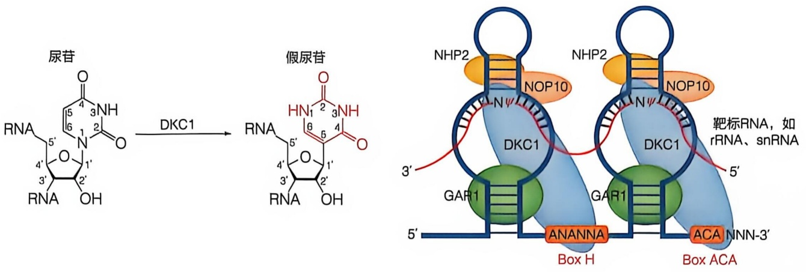

chemical

RNA合成反应示意图，展示尿苷与假尿苷的转化过程及靶标RNA结构

图 13-13 H/ACA snoRNA 的结构特征

## 13.2 小 RNA 的产生、作用机制与功能

小 RNA 通过一种称为 RNA 干扰（RNA interference，RNAi）的机制序列特异性地调控基因表达，这一机制最初于 1998 年在秀丽隐杆线虫中被发现。在真核生物中，小 RNA 及其相关的 Argonaute（AGO）蛋白在 RNA 干扰介导的基因沉默中发挥着重要作用，其中小 RNA 引导含有 Argonaute 蛋白的复合体到具有序列互补的核酸靶标，进一步通过多种机制调节基因表达，包括降解靶标 RNA、抑制翻译、诱导表观遗传修饰、调控异染色质形成以及抑制转录延伸或触发选择性剪接等。

小 RNA 主要有三大类:干扰小 RNA（siRNA）、微 RNA（miRNA）和 PIWI 互作 RNA（Piwi-interacting RNA，piRNA）。其他类别的调控性非编码 RNA，如反义核糖体干扰小 RNA（antisense ribosomal siRNA，risiRNA）、tRNA 衍生的小 RNA（tRNA-derived small RNA，tsRNA；或者 tRNA-derived fragments，tRF）和相位次级干扰小 RNA（phased secondary small interfering RNA，phasiRNA），也已被证明通过 RNAi 途径发挥作用。本节主要阐述 siRNA 和 miRNA 的产生、作用机制、生物学功能和潜在应用。

## 13.2.1 RNAi 的发现和 siRNA 的生成与功能

RNAi 是真核生物中由 siRNA 所介导的基因沉默现象。1998 年，安德鲁·菲儿（Andrew Fire）和克雷格·梅洛（Craig Mello）等人研究发现，纯化后的双链 RNA（double-stranded RNA，dsRNA）在秀丽隐杆线虫中特异性地高效阻断靶基因的表达，并将此现象命名为 RNAi。其原理主要是 siRNA 与细胞内的 Argonaute 等蛋白质形成 RNA 诱导的沉默复合物（RNA-induced silencing complex，RISC 复合物），通过识别 mRNA 中与之反向互补配对的序列，直接降解该 mRNA，在转录后水平抑制靶基因表达（post-transcriptional gene silencing，转录后基因沉默，PTGS），或者通过改变染色质结构和阻碍基因转录，在转录水平调控靶基因表达（transcriptional gene silencing，基因转录沉默，TGS）。RNAi 在生物体内具有重要的生物学意义，在防止基因组中逆转座元件扩增和异染色质的形成、发育的时空调控、参与细胞命运决定和抵御病毒入侵等方面都发挥了重要功能。

RNAi 所介导的基因沉默现象在大多数真核生物细胞中保守存在，而这一普遍存在的现象一直到 20 世纪末才被科学家发现和阐明。20 世纪八九十年代，随着植物组织培养和基因工程技术的发展成熟，使得在植物中转入某种基因进而改进植物的特定性状成为可能，各国科学家争相在各种植物中进行尝试，获得了大量成功的案例，但也遇到了不少意外情况。育种学家希望通过转入色素合成基因改变观赏花卉的色泽，例如矮牵牛花的紫色深浅由花青素的含量决定，其中查尔酮合成酶是花青素合成过程的限速酶，因此转入查尔酮合成酶基因理论上应该能够获得深紫色甚至接近黑色的矮牵牛花。但实际上，转基因得到的却是浅紫色、白紫相间甚至是白色的矮牵牛花。检测结果发现转基因植株中查尔酮合成酶的浓度远远低于未转基因的普通矮牵牛，这种在植物中由引入同源基因而导致的基因沉默现象被称为共抑制（co-suppression）。几乎同时，科学家在单细胞生物中也观察到了类似的现象，在粗糙链孢霉中导入外源基因会抑制具有同源序列的内源基因表达，这种现象被称为抑制（quelling）。在研究秀丽隐杆线虫基因功能的实验中，科学家进一步发现，无论注射正义 RNA（sense RNA）还是反义 RNA（antisense RNA），都会特异性地阻断具有同源序列的基因的表达。然而当时科学家并没有把这些在不同物种中观察到的由同源序列介导的基因沉默现象联系起来，也无法对产生这种现象的分子机制做出合理解释。直到 1998 年，菲尔和梅洛等人通过制备高纯度的 RNA 进行研究，才发现真正能高效特异性阻断靶基因表达的是双链 RNA。菲尔和梅洛将这种由双链 RNA 引发的靶标基因沉默现象命名为 RNAi。随后在果蝇细胞中的研究表明，双链 RNA 被进一步加工成 21～23 bp 的 siRNA 发挥 RNAi 效应。此后更多的研究表明，植物中的共抑制现象和真菌中 quelling 现象与动物中的 RNAi 具有很大的相似性，也是由 siRNA 介导的转录后基因沉默现象。RNAi 现象在果蝇、拟南芥、斑马鱼和哺乳动物等真核生物中普遍存在，是生物在长期进化过程中产生的一种监控机制，用来抵御病毒感染、沉默基因组中转座元件，并参与对内源基因的表达调控。更为重要的是，外源导入的 siRNA 可以被用来调控细胞内大部分基因的表达，不仅作为重要的遗传学研究工具被广泛应用于研究生物体内基因的功能，还被进一步开发成为小核酸靶向药物用于疾病的治疗。因此，2006 年的诺贝尔生理学或医学奖授予了发现 RNAi 现象的菲尔和梅洛两位教授，由此开启了调控性非编码 RNA 的研究热潮。

以下对 RNAi 的加工生成、作用机制及毒副作用进行概述，并探讨 RNAi 药物应用的现状与前景。

## 13.2.1.1 siRNA的加工生成

## (1) siRNA 的基本概念

siRNA 是介导 RNAi 现象的关键分子，由长约 21 bp、互补配对的两条小 RNA 组成。其中与靶标 RNA 完全互补配对的一条链为引导链（guide strand），另一条链为过客链（passenger strand）。引导链和过客链之间有 19 个碱基互补配对，双链 siRNA 的两端各形成 2 个碱基的 3' 端悬垂（3' end overhang）。siRNA 根据其序列来源分为内源性 siRNA（endo-siRNA）和外源性 siRNA（exo-siRNA）。前者是由细胞自身基因组编码转录生成的长双链 RNA 通过 Dicer 蛋白切割产生的；后者是由外源导入细胞的长链 dsRNA 或短发夹 RNA（short hairpin RNA，shRNA）加工生成的，又或由化学方法体外直接合成（图 13-14）。另外，RNA 聚合酶 II 启动子转录产生以 miRNA 前体（pri-miRNA）为骨架的 shRNAmir，被细胞的 Drosha/DGCR8 复合物和 Dicer 进行两步加工产生 siRNA。

## (2) siRNA 的生成与加工机制

siRNA 主要由四种方式产生（图 13-16）:① RNA聚合酶Ⅱ或 RNA聚合酶Ⅲ转录生成的正义和反义 RNA 互补配对形成的长双链 RNA 加工生成；② RNA聚合酶Ⅲ启动子驱动转录产生具有茎环结构的 RNA 前体加工生成；③ RNA聚合酶Ⅱ启动子驱动转录产生具有短茎环结构的 RNA 前体加工生成；④直接通过有机化学方法合成。其中前三种产生途径都需要经过细胞内 Dicer 蛋白的加工（知识延展 13-3）。

Dicer 是一种 RNase Ⅲ家族的核酸酶。Dicer 基因在不同物种间表现出高度保守性，不仅双链 RNA 加工生成 siRNA 需要 Dicer，细胞内源的 miRNA 的加工生成也离

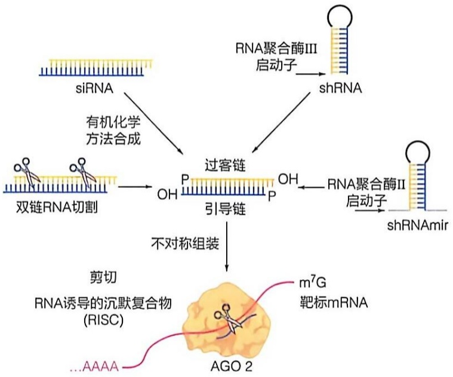

flowchart

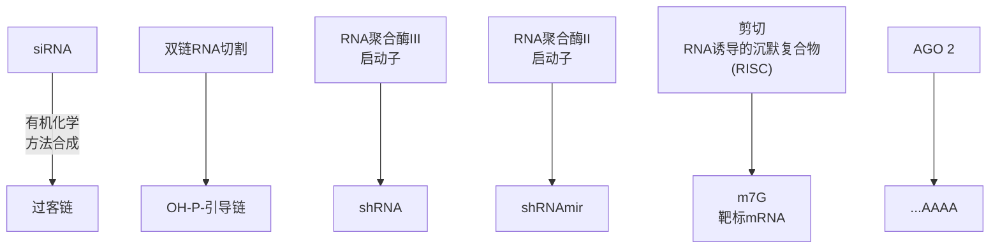

图 13-14 RNAi 原理示意图

不开 Dicer。Dicer 由 DExH-Box 解旋酶结构域、PAZ（Piwi/Argonaute/Zwille）结构域、RNase III 结构域和 dsRNA 结合结构域组成（图 13-15）。在小鼠卵子细胞和早期胚胎中，长双链 RNA 被细胞质中的 Dicer 识别并切割产生 siRNA，后者随后与 AGO 蛋白结合形成 RISC（图 13-14）。RISC 中 siRNA 的一条链被丢弃或降解，另一条链与靶标 RNA 完全互补配对，通过 AGO2 的核酸内切酶活性切割靶标 RNA 分子，从而导致靶标 RNA 被快速降解（图 13-14）。对于有茎环结构的 siRNA 前体，需要先由 Drosha/DGCR8（见 13.2.2 节及图 13-18）加工生成较短的茎环结构 siRNA 前体，然后再经过 Dicer 蛋白的切割成为 siRNA。

在哺乳动物中，内源性 siRNA 仅在小鼠卵细胞中存在，长度与 miRNA 相似，序列高度异

## 知识延展 13- 3

## siRNA 的前体

## (1) 长双链 RNA 的 siRNA 前体

在线虫和植物中导入双链 RNA，双链 RNA 在细胞质内被 Dicer 切割，产生 siRNA 来介导相应靶标基因沉默。然而，双链 RNA 在哺乳动物中的应用有限，只能用于在胚胎干细胞中诱导 RNAi。这是由于在其他类型细胞中导入大于 30 个碱基对的双链 RNA 会激活细胞的抗病毒及干扰素反应，如双链 RNA 激活的蛋白激酶 R（dsRNA-activated protein kinase R，PKR）和 2-5 腺苷酸系统的核糖核酸酶 L（RNase L）等相关途径，导致细胞快速凋亡。在胚胎干细胞中，该抗病毒天然免疫激活途径被关闭。因而，双链 RNA 介导的 RNAi 的应用范围受到很大限制。

## (2) 化学合成的 siRNA

为了解决哺乳动物细胞中转入长双链 RNA 极易引发干扰素反应的问题，研究人员通过化学方法合成长度为 21 个碱基的双链 siRNA，通过直接转染导入哺乳动物体细胞，成功实现了对靶基因的沉默作用。该方法较为方便快捷，很快获得了广泛应用。但 siRNA 易被细胞内核酸酶降解且会随细胞分裂而被不断稀释，故其发挥功能的持续时间较短。近年来，科研人员使用化学修饰的方法来提高 siRNA 在体内的稳定性。

(3) 具有茎环结构的 siRNA 前体——短发夹 RNA (shRNA)

为了在细胞内长期稳定地表达 siRNA，研究人员开发出了由细胞内 RNA聚合酶Ⅲ启动子（如 H1、U6 等）驱动转录产生的 siRNA 前体，短发夹 RNA（shRNA）。目前广泛使用的 shRNA 包含一段长于 4 个核苷酸的顶端单链环结构，以及长度为 21～25 个碱基对的双链配对区。转录产生的 shRNA 在 Ran-GTP 的协助下由核输出蛋白 Exportin-5 识别并运出细胞核，在细胞质中被 Dicer 及其协助蛋白 TRBP（TAR RNA-binding protein）等识别并切割，产生约 21 个碱基的成熟双链 siRNA 分子并发挥调控功能。值得一提的是，shRNA 产生和加工的机制与 miRNA 生成机制类似，利用了内源 miRNA 的生成途径（见 13.2.2.1 节）。shRNA 表达框架可构建在慢病毒、腺病毒和腺相关病毒等多种病毒载体上，能够在包括原代细胞在内的绝大多数组织和细胞类型中沉默靶基因。

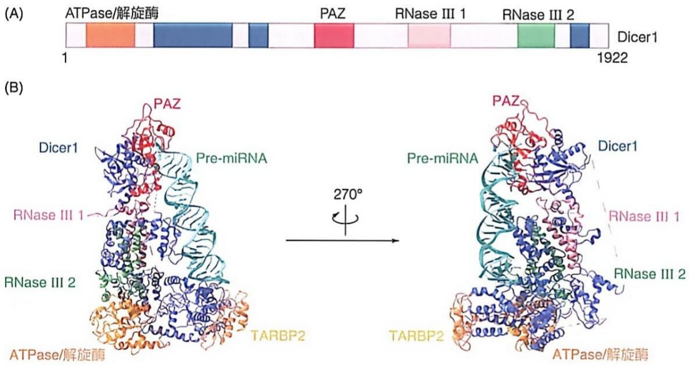

图 13-15 Dicer 结构域 (A) 及人类 DICER1 与底物 miRNA 前体复合物的冷冻电镜结构 (B)

PDB 编号:5ZAL. 数据自 LIU Z M, et al. Cell, 2018, 173 (5): 1191-1203.

质化。超过 80% 的内源性 siRNA 来源于重复序列区域，尤其在长散在核元件（long interspersed nuclear element, LINE）和长末端重复序列（long terminal repeat, LTR）家族中富集。这些内源性 siRNA 在配子发生和早期胚胎发育中抑制反转座子，对维持基因组的稳定性具有重要作用，同时也可能参与了配子生成相关基因的表达调控。内源性 siRNA 在除小鼠外其他哺乳动物卵子和组织中的报道很少，可能是缺少类似小鼠卵子中特异性高表达的截短 Dicer 蛋白，导致双链 RNA 被加工生成内源性 siRNA 的效率很低。

## (3) RNA 依赖的 RNA 聚合酶介导的 siRNA 扩增效应

在动物中 siRNA 通常由 Dicer 剪切长双链 RNA 而产生，但在植物和线虫中 siRNA 的生成还存在级联放大效应。首先由 Dicer 对双链 RNA 进行剪切产生初级 siRNA（primary siRNA），然后以初级 siRNA 中的一条链为引物，以与之互补配对的靶标 RNA 为模板，通过依赖于 RNA 的 RNA 聚合酶（RNA-dependent RNA polymerase，RdRP），如 SGS2 和 QDE21，催化合成新的双链 RNA，随后 Dicer 再次剪切新合成的双链 RNA，生成大量次级 siRNA（secondary siRNA），进一步作用于靶标 RNA，周而复始产生级联放大效应，少量起始双链 RNA 即能产生大量 siRNA，持久、高效地沉默靶基因的表达。在秀丽隐杆线虫中，小剂量的双链 RNA 分子不仅能引起整个机体对靶基因及其同源基因表达的抑制，而且这种基因沉默的信息还能够通过 siRNA 经由配子传递给下一代。值得注意的是，很多种类的昆虫中 RNAi 效率并不高，可能是它们体内缺乏能够产生次级 siRNA 效应的 RdRP 所导致的。

## 13.2.1.2 siRNA 介导的转录后基因表达调控

RNAi 介导的基因沉默现象在细胞核和细胞质内都可以发生。在细胞质中其沉默基因表达的手段主要是通过 siRNA-RISC 介导的核酸内切酶作用降解 mRNA。其中 AGO 蛋白是 RISC 复合物中的核心蛋白质，结合 siRNA 并切割靶基因的 RNA（图 13-14）。在不同物种中，AGO 家族成员的数目有显著差异。裂殖酵母中仅有一种，而线虫中多达 27 种，果蝇中有两种（AGO1 和 AGO2），而在包括人类在内的哺乳动物表达四种 AGO 蛋白（AGO1 \~ AGO4），它们均可以结合 siRNA，但其中只有 AGO2 具有核酸内切酶活性。AGO1 与 AGO3 即使结合了 siRNA，也只能通过类似 miRNA（见 13.2.2 节）的机制发挥对靶基因的抑制作用，其效率要远远低于由 AGO2 介导的 RNAi，因而在 RNAi 中发挥次要作用。AGO4 在哺乳动物免疫细胞中扮演着重要的抗病毒角色，它能够通过促进干扰素（IFN）反应以及独立于 IFN 的机制维持抗病毒能力。

AGO2 蛋白的分子量约为 100 kDa，结构在进化中高度保守，主要由 PAZ、MID 和 PIWI 三个结构域组成（图 13-19，13-20）。其中，PAZ 结构域识别 Dicer 切割形成的 RNA 3' 端悬垂碱基，MID 结构域可以特异性结合 siRNA 5' 端的磷酸基团，且偏好 U 和 A 碱基，可以将 siRNA 锚定在 AGO 蛋白上，PIWI 结构域包含类似核酸酶 RNase H 的催化核心结构。另外，siRNA 进入 RISC 复合物还需要细胞内的 TRBP 等蛋白质的协助，并且通常只有一条 siRNA 链被保留，另一条链在形成 RISC 复合物的过程中被丢弃并降解。siRNA 的这种链选择性主要取决于双链 siRNA 5' 端碱基配对的热力学稳定性，5' 端碱基配对相对不稳定的那条链更倾向于被 RISC 保留。RISC 携带的单链 siRNA 通过碱基互补配对识别靶标 RNA，在镁离子和 ATP 的参与下，AGO2 蛋白利用其 PIWI 结构域的核酸内切酶活性，催化切割靶标 RNA，切割位点为与 siRNA 第 10 位和第 11 位核苷酸配对的靶标 RNA 上所对应的两个核苷酸之间的磷酸二酯键，切割产生的 5' RNA 片段的 3' 端带有羟基，3' RNA 片段的 5' 端带有磷酸基团。AGO2 切割后产生的 RNA 片段极易受到细胞内 5' 或 3'-核酸外切酶的攻击而被快速降解，从而在转录后水平沉默靶基因的表达。

## 13.2.1.3 细胞核内 siRNA 介导的基因表达调控机制

RNAi 不仅能在细胞质中通过抑制翻译和降解 RNA 来调控靶基因的表达，在一些低等动物和植物中，研究发现 siRNA 还能进入细胞核内，通过调控转录和组蛋白修饰等方式发挥其功能。

## (1) RNAi 介导的表观遗传修饰

染色质修饰是调节基因表达和染色体稳定性的基本方式之一。RNAi通路在细胞核内可以通过介导组蛋白或DNA的甲基化来表观修饰染色体，从而在转录水平抑制靶标基因表达（图13-16）。在拟南芥中，主要来源于重复序列和转座子区域的hc-siRNA被招募到基因组上其转录位点或具有同源序列的染色质区域，发生RNA指导的DNA甲基化（RNA—directed DNA methylation，RdDM）和组蛋白修饰（见第9章），并最终导致转录抑制。在裂殖酵母中，着丝粒周边区域的重复序列通过双向转录形成双链RNA，然后由Dcr1加工成为siRNA，从而募集染色质修饰因子，通过组蛋白去乙酰化、组蛋白甲基化等途径沉默区域内的基因表达。果蝇的染色体引入多拷贝串联重复的转基因时，会通过建立表观修饰导致具有相同序列的内源基因沉默。在秀丽隐杆线虫中导入外源的双链RNA可以诱导对应靶基因的组蛋白3第9位赖氨酸（H3K9）和

组蛋白 3 第 27 位赖氨酸（H3K27）的三甲基化修饰，这一过程依赖于细胞核内 RNAi 通路和 RdRP。NRDE-3 是一种 AGO 蛋白，可以转运由 RdRP 生成的 siRNA 从细胞质进入细胞核。在细胞核内，siRNA/NRDE 复合物招募组蛋白甲基转移酶在靶基因位点上建立 H3K9 和 H3K27 的三甲基化修饰。值得一提的是，哺乳动物细胞核内是否存在 RNAi 现象有待进一步研究。

## (2) RNAi 与转录调控

siRNA 除了在靶标基因附近建立或移除表观修饰来沉默转录，还可以抑制 Pol II 在 DNA 上的延伸。在哺乳动物细胞中，RNAi 通路在细胞核内调控转录过程的机制还不明确，仍存在很大争议。在秀丽隐杆线虫中，siRNA 由细胞核 AGO 蛋白 NRDE-3 转运到细胞核内，指导 NRDE-3 靶向到 pre-mRNA 上，并进一步募集 NRDE-2 和 NRDE-1，从而阻止 Pol II 的转录延伸，造成转录的提前终止。

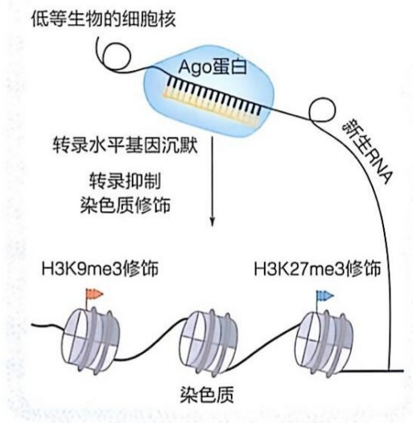

flowchart

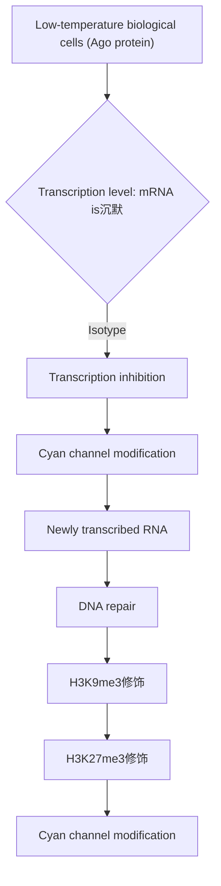

图 13-16 低等生物 RNAI 介导的转录水平基因沉默与表观遗传修饰

## (3) RNAi 与染色体分离

染色体上着丝粒（centromere）是一个特殊区域，它对染色体在动粒（kinetochore）上的组装和染色体与纺锤体的结合都非常关键。着丝粒区域往往富集 H3K9me3 修饰，引导 HP1 以及其他含克罗莫结构域（chromodomain）的蛋白质结合在这一区域。真核生物的着丝粒区域往往有很长的物种特异性 DNA 重复序列，并且这些重复序列可以被转录。siRNA 及其蛋白质复合物通过调控这些转录本，在染色体配对分离中起重要作用。在裂殖酵母中，RNAi 导致的动粒周边区域的异染色质化，并促进 CENP-A（Cnp1）和动粒的组装。

## 13.2.1.4 RNAi 引起的毒副作用

## (1) siRNA 的脱靶效应

RNAi 技术作为一种功能强大的基因调控工具得到广泛应用，但其固有的缺点也逐渐显现，其中最早引起关注的是脱靶效应（off-target effect）。siRNA 通过与靶基因 RNA 完全互补配对实现对靶基因的特异性沉默。若 siRNA 与其他 RNA 上的碱基发生部分互补配对，则会以类似 miRNA 的作用方式抑制 mRNA 的翻译并加速其降解。这种非特异性抑制靶基因以外其他基因的现象被称作 RNAi 的脱靶效应。研究表明，一条 siRNA 可能会对细胞内几十甚至几百个基因的表达产生影响，导致对靶基因功能的错误解读。

## (2) siRNA 对内源 miRNA 的竞争抑制

RNAi 载体表达 siRNA 时，对细胞内源 miRNA 加工和功能的竞争抑制也可造成毒副作用。无论是 Pol Ⅲ 启动子转录产生的 shRNA，还是 Pol Ⅱ 启动子转录产生的 shRNAmir（图 13-14），它们在加工成熟时都需要利用细胞内源的 Drosha、Dicer 和 Exportin-5 等蛋白质因子。这些蛋白质也是细胞内源 miRNA 加工成熟所必需的因子（见 13.2.2 节），因此，在细胞内大量表达 shRNA 时必然对 miRNA 的加工造成竞争作用。即使是化学合成的双链 siRNA，其转到细胞内也会与内源 miRNA 竞争结合 AGO 蛋白，从而影响 miRNA 的功能。在小鼠肝中长期高表达 shRNA 会造成肝损伤并致死，其主要原因就是过量的 shRNA 竞争结合 Exportin-5 和 AGO2 等蛋白质，影响了小鼠肝内源 miRNA 的表达和调控功能，导致 miRNA 靶基因的表达上调。如何既实现对靶基因的高效抑制，又将对细胞内源 miRNA 的影响降到最低，已成为 RNAi 药物设计的挑战之一。

## 13.2.1.5 RNAi 药物的现状与前景

## (1) RNAi 药物的特点

RNAi 作为疾病治疗的新型工具具有独特的优势。RNAi 通过 siRNA 与基因转录生成的 RNA 之间的碱基序列互补配对降解靶标 RNA，从而选择性沉默靶基因。RNAi 几乎可以特异性靶向细胞内表达的任何 RNA，克服了小分子药物的局限，拓展了靶向治疗的基因选择范围，并且设计多个 siRNA 分子在理论上可以实现同时抑制多个基因，为治疗由多基因改变和多因素引起的疾病提供了可能（表 13-1）。

表 13-1 已上市的 siRNA 疗法

| 通用名 | 商品名 | 适应证 | 靶点 | 获批年份 |
| --- | --- | --- | --- | --- |
| Patisiran | Onpattro | 家族性淀粉样多神经病变 | TTR | 2018 |
| Givosiran | Givlaari | 急性肝卟啉症 | ALAS1 | 2019 |
| Lumasiran | Oxlumo | I型原发性高草酸尿症 | HAO1 | 2020 |
| Inclisiran | Leqvio | 高胆固醇血症 | PCSK9 | 2020 |
| Vutrisiran | Amvuttra | 淀粉样变性的多发性神经病 | TTR | 2022 |
| Nedosiran |  | I型原发性高草酸尿症 | PH1 | 2023 |

RNAi 技术还存在一系列技术难点需要在未来的研究中克服和改进。①特异性和安全性。RNAi 作为小核酸药物应用于疾病治疗首先要考量的因素是使用的 siRNA 具有高度的靶向选择性和较低的毒副作用，因此必须进行严格的筛选和测试。除了利用生物信息分析进行预测外，还必须进行充分的试验，包括对细胞生长的影响和动物毒性测试，尽可能选择脱靶效应低和毒副作用小的 siRNA 用于人体实验。②高效性。使用少量的 siRNA 就能高效抑制靶基因的表达，不仅能节省治疗的费用，也有利于减轻毒副作用。RNAi 的效率取决于众多因素，如 siRNA 在细胞中的半衰期、进入 RISC 复合物和进行链选择性分离的效率、介导切割靶 RNA 的效率等，需要全面考虑各个步骤。③ siRNA 的定向投递。实现组织特异性高效投递 siRNA 是实现疾病治疗的关键和难点。除了第一个 siRNA 药物使用脂质纳米颗粒（lipid nanoparticle，LNP）递送，其他 5 个 siRNA 药物（表 13-1）都通过受体介导的内吞作用进入肝细胞，递送效率很高。GalNAc（N-乙酰半乳糖胺）是去唾液酸糖蛋白受体（ASGPR）的高亲和力靶向配体，ASGPR 是一种内吞性受体，在肝细胞的膜表面高度特异性表达。ASGPR 和网格蛋白介导的内吞作用可以有效地将 GalNAc 从细胞表面转运至细胞内。GalNAc 修饰的 siRNA 的肝细胞递送已经很成熟，目前主要的挑战在于其他组织和器官的靶向递送。

## (2) RNAi 在农业生产和疾病治疗中应用的展望

RNAi 能特异性抑制基因表达，具有高效和应用灵活的特点，在动植物中都得到了广泛的应用。在植物中转入针对特定种类有害昆虫的生长必需基因的 RNAi 载体，当害虫摄取植物茎叶的同时摄入了 siRNA，从而特异地抑制害虫生长相关基因的表达，达到利用 RNAi 防治植物病虫害的目的。Ledprona 是一种喷洒用双链 RNA 产品，已被批准用于防治科罗拉多马铃薯甲虫。另外，在植物中表达 siRNA 也可以用于调控作物本身抗逆和产量等农艺性状相关基因的表达，提高农作物的产量和品质。在人类疾病治疗方面，越来越多的生物技术和制药公司加入了对 RNAi 药物的研发，包括针对呼吸道合胞病毒感染（respiratory syncytial virus infection）、湿性年龄相关性黄斑变性病症（wet age-related macular degeneration）和乙型肝炎（viral hepatitis B）等在内的几十种疾病的 siRNA 治疗药物已经分别进入临床试验，并取得了较好的预期治疗结果。总之，通过提高 RNAi 载体效率、降低毒副作用、改进递送方法等，RNAi 技术将在

科研和疾病治疗中继续发挥巨大价值。

## 13.2.2 miRNA 的生物生成与功能

miRNA 是一类长度约 22 个碱基的内源性非编码 RNA，在单细胞藻类到高等动植物中广泛存在。自 1993 年维克托·安布罗斯（Victor Ambros）在线虫中发现第一个 miRNA 以来（知识延展 13-4），已在多个物种中发现超过 4 万个 miRNA。2002 年美国 “Nature” 杂志评出的年度重大科技突破中，miRNA 的发现名列榜首，被称为 RNA 的第二次革命。2024 年的诺贝尔生理学或医学奖授予了最先发现 miRNA 的安布罗斯和加里·鲁夫昆因（Gary Ruvkun）两位教授（图 13-17）。miRNA 主要通过与靶基因 mRNA 的 3' 非翻译区（3' untranslated region，3'UTR）结合，在转录后水平促进 mRNA 降解或抑制翻译，从而发挥负调控的作用。miRNA 参与调控细胞分化、增殖、迁移和凋亡等生物学进程，在个体生长发育过程中发挥了重要的作用。此外，miRNA 与心血管疾病、神经系统疾病和肿瘤等病理进程关系密切，不仅可以作为疾病诊断和预后的标志物，还有望成为疾病治疗的靶点。

## 13.2.2.1 miRNA 的生物生成

## (1) miRNA 的表达与进化特性

在人类基因组中，miRNA 基因存在于所有染色体中，以单拷贝、多拷贝或基因

## 知识延展 13-4

## miRNA 的发现

1993 年，安布罗斯等在研究秀丽隐杆线虫的发育过程研究中发现了 lin-4，这一控制线虫发育时相的基因并不编码蛋白质，而是产生一种小 RNA 分子。这种小 RNA 能以不完全互补的方式与其靶基因 lin-14 的 mRNA 3'UTR 的多个位点反向互补。同时，鲁夫昆因实验室也发现了 lin-4 对 lin-14 mRNA 的调控作用，并指出这一互补序列能够显著减少 LIN-14 蛋白质的合成，但并不减少 lin-14 mRNA 的量。然而，该发现当时并未引起人们的重视，因为在 lin-4 发现后的 7 年中，在其他生物中都没有发现与其相似的小 RNA 分子。

直到 2000 年，鲁夫昆因等才在线虫中发现了第二个具有发育时序调控作用的 miRNA let-7。这个只有 21 nt 的小 RNA 以类似于 lin-4 的调控方式调控 lin-41 基因的表达，从而调控线虫由L4期到成虫期的发育转变。随后，鲁夫昆因等人证明let-7在各物种之间高度保守。这两个miRNA的发现为整个miRNA研究领域打开了突破口，人们开始意识到miRNA对基因的表达调控是具有普遍意义的。2001年，Science杂志同时报道来自德国、美国和英国的3个研究小组在线虫、果蝇和人细胞中鉴定出的近百个与lin-4和let-7相似的小RNA，于是国际上统一将这类小RNA命名为microRNA，简写为miRNA。此后，miRNA的研究逐渐成为一个新的研究热点。miRNA的发现是非编码RNA研究的里程碑，它揭示了细胞中存在一种新的由非编码RNA介导的基因表达调控机制。

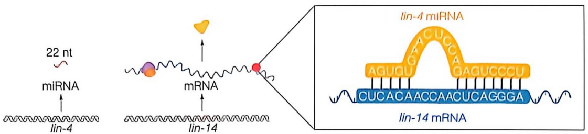

text_image

22 nt
miRNA
lin-4
mRNA
lin-14
lin-4 miRNA
AGUCCU
CUCACAACCAACUCAGGGA
lin-14 mRNA

图 13-17 miRNA 及其在转录后基因调控中的作用

簇等多种形式存在，并且簇生排列的基因常常协同表达。例如，miR-35～miR-41簇位于线虫2号染色体的1 kb区域上，通过同一个RNA前体分子加工形成7个成熟的miRNA。miRNA在基因组中的分布并不是随机的，大多数位于蛋白质编码基因的间隔区，其转录独立于其他基因。其余大部分分布于内含子，它们与其宿主基因共表达，且具有高度的进化保守性。还有个别miRNA存在于mRNA编码区的互补链上，提示它们的转录是独立于互补链的基因，本身的转录具有调控机制。

miRNA 具有以下几个特征: ① miRNA 广泛存在于从单细胞藻类到高等动植物之中, 在病毒中也有发现, 是一组不编码蛋白质的短序列 RNA, 本身不具有开放阅读框; ②成熟的 miRNA, 长度约为 22 个核苷酸, 其在 $3'$ 端可以有 $1 \sim 2$ 个核苷酸的长度变化, $5'$ 端有一个磷酸基团, $3'$ 端为羟基, 这一特点使它与大多数寡核苷酸和功能 RNA 的降解片段区别开; ③ miRNA 具有能形成分子内茎环结构的前体, 在动物中, 前体 miRNA 的长度一般在 $70 \sim 90$ 个核苷酸, 而植物中前体的长度可变性很大; ④ miRNA 在基因组上不是随机排列的, 其中一些形成基因簇。通常同一基因簇的 miRNA 具有较高的同源性, 而不同基因簇的 miRNA 同源性较低。

miRNA 不仅在结构上保守，而且在物种之间也具有高度的进化保守性。在结构上，miRNA 在茎部的保守性较强，而环部则可以容纳较多的突变位点存在。在种系上，有些 miRNA 在物种之间高度保守。例如，miR-1、miR-34、miR-87 在非脊椎动物和脊椎动物中高度保守；拟南芥中的多个 miRNA 可以在水稻基因组中找到完全相同的序列；miR-156 是植物中第一个被鉴定的 miRNA，它在几乎所有植物中广泛存在且高度保守；let-7 也广泛存在于脊椎与非脊椎动物中，各种生物之间 let-7 成熟序列的同源性可高达 85% \~ 100%。

## (2) miRNA 的产生

miRNA 的产生方式包括依赖于 Drosha 和 Dicer 的经典 miRNA 合成途径，以及其他各种可以产生 miRNA 或类似 miRNA 的小 RNA 的非经典合成途径。

① 细胞核中 miRNA 的转录调控（pri-miRNA 生成）

绝大多数的 miRNA 是由 RNA 聚合酶Ⅱ转录生成的几百至几千核苷酸的初级前体 miRNA（primary miRNA，pri-miRNA）进一步加工生成的。pri-miRNA 全长几百至几千核苷酸，其 5' 端具有 m$^{7}$G 帽结构，3' 端具有 poly(A) 尾，同时还含有至少一个稳定的发夹结构，成熟的 miRNA 序列通常位于构成发夹结构的其中一条链上。pri-miRNA 在 RNase Ⅲ酶 Drosha 与其辅助因子 DGCR8（DiGeorge syndrome critical region 8，在果蝇中为 Pasha，在线虫中为 PASH-1）的作用下被切割成长度为 70～90 个核苷酸的发夹结构的次级前体 miRNA（precursor miRNA，pre-miRNA），其 3' 端有两个碱基的突出，5' 端为单磷酸基团（图 13-18）。

图 13-18 miRNA 在不同物种中的加工和作用途径改绘自 LOU S L, et al.
Biotechnol Biofuels, 2018,
11 (244): 1-12.

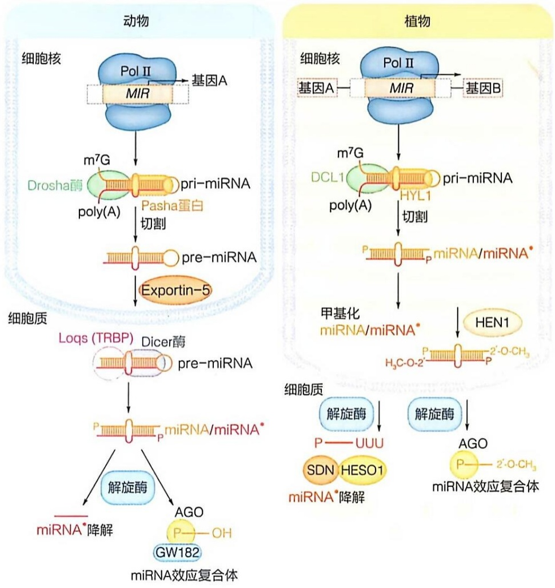

flowchart

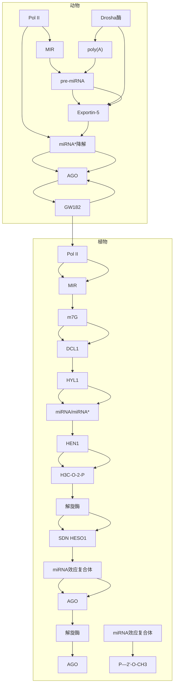

一个典型的发夹结构包含一个33\~35碱基对长的茎环结构（约11个碱基对位于茎环下段，约22个碱基对位于茎环上段）、一个顶端环状结构及3'和5'端各一个的单链RNA（single stranded RNA，ssRNA）侧翼片段。侧翼片段和茎环结构对于pri-miRNA与DGCR8的结合非常重要（图13-18）。与参与siRNA成熟的Dicer类似，Drosha是作用于双链RNA的核酸内切酶，属于RNase III核酶家族。与Dicer不同的是，Drosha主要在细胞核内分布，在pre-miRNA生物合成过程中发挥关键作用。其包含两个RNase III结构域（RIIDa和RIIDb）（图13-19），可分别在pri-miRNA的发夹结构茎部末端约11个碱基对处剪切，从而形成70\~90个核苷酸的pre-miRNA。

DGCR8 作为 Drosha 的主要结合蛋白（图 13-19），可通过 C 端的两个双链 RNA 结合结构域（double-stranded RNA binding domain，dsRBD）与 pri-miRNA 的发夹结构结合，招募并指导 Drosha 在 pri-miRNA 的正确位置剪切，生成 pre-miRNA。DGCR8 的缺失或异常表达会影响 Drosha 的剪切活性，进而影响 miRNA 的表达。

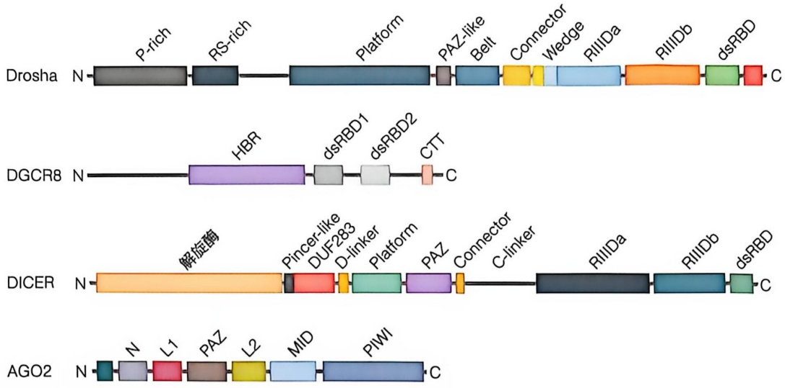

flowchart

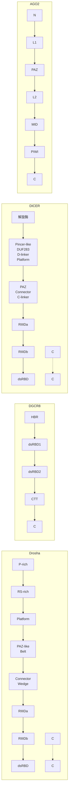

图 13-19 参与 mRNA 生成加工的关键酶

② pre-miRNA 的核内加工与出核转运

经过在核内的第一步剪切加工之后，输出蛋白 XPO5（exportin 5）在 GTP 结合蛋白 Ran-GTP 的帮助下将 pre-miRNA 通过核孔从细胞核输出到细胞质，然后 Ran-GTP 转变为 Ran-GDP，释放 pre-miRNA。有研究发现，在干扰 XPO5 表达的情况下，成熟 miRNA 的表达水平下降，且细胞核内无 pre-miRNA 的积累，提示 XPO5 在 miRNA 生物合成的过程中不仅负责 pre-miRNA 的出核转运，还可以保护其不被核酸酶降解。

③ pre-miRNA 的细胞质中加工

在细胞质中，pre-miRNA 被另一个 RNase Ⅲ家族的核酸酶 Dicer 识别并剪切产生约 22 个核苷酸长度的 miRNA-miRNA\* 二聚体（miRNA 代表引导链，miRNA\* 代表过客链）。

Dicer 是 RNase Ⅲ家族成员之一，是 miRNA 产生和发挥功能所必需的，广泛存在于真菌、植物和动物之中。不同的生物拥有 Dicer 的数量也不同，在哺乳动物中只存在一种 Dicer 蛋白，它同时负责 miRNA 和 siRNA 的产生；在果蝇中则存在两种 Dicer 蛋白，且分别在 miRNA 和 siRNA 的加工合成中起作用（见 13.2.1 节）。Dicer 在进化上高度保守，各物种的 Dicer 都具有相似的结构域:在 N 端是一个 RNA 解旋酶结构域，随后是一个 PAZ 结构域；其 C 端是与 Drosha 类似的两个 RNase Ⅲ结构域（RⅢDa 和 RⅢDb）和一个双链 RNA 结合结构域（图 13-19）。

④ miRISC 复合物的形成

AGO 蛋白是 miRNA 诱导沉默复合物（miRNA-induced silencing complex, miRISC）的核心组分，能为 miRNA 提供锚定位点，使其实现靶基因 mRNA 的降解或翻译抑制，在基因沉默中具有重要作用。AGO 蛋白在生物体中广泛分布且序列和结构在进化上高度保守。人体内有 4 种 AGO 蛋白，但只有 AGO2 具有剪切活性。AGO2 由 4 个结构域组成:N 端结构域、PAZ 结构域、MID 结构域和 PIWI 结构域（图 13-20）。N 端结构域是 miRNA-miRNA\* 二聚体装载和解旋所必需的。PAZ 结构域具有 RNA 结合作用，