# 14 糖类

原始 PDF 第 20–60 页。

## 糖类

糖类（sugar/carbohydrate/saccharide）是地球上最丰富的一类生命分子。在植物中，糖类占其干重的90%；在细菌中，这一比例约为15%\~30%。人类对糖类的结构认识较早，已知它们主要由碳（C）、氢（H）和氧（O）三种元素构成。然而，关于糖类功能的深入研究则较为滞后。人们长期认为糖类主要以结构成分和能量储存者身份存在于生物体内。但近年来的研究表明，糖类还具有其他的重要生物学功能。例如，细胞表面的糖类分子作为独特的信息形式，参与细胞间的通信。

糖类的甜味使其在远古时期便为人类所知。蔗糖是最早被发现的糖类之一，以其显著的甜味闻名，广泛存在于甘蔗茎等植物组织中。尽管人们早在1740年代便从葡萄干中分离出葡萄糖，但直到19世纪早期，糖类才作为一类化学物质被广泛认识。德国学者安德烈亚斯·西吉斯蒙德·马格拉夫（Andreas Sigismund Marggraf，1709—1782）首次分离出葡萄糖，而葡萄糖的化学式（$\mathrm{C_6H_{12}O_6}$）直到1850年代才得以确定。随后，蔗糖的化学式被确定为 $\mathrm{C_{12}H_{22}O_{11}}$。当时，这类化合物的化学式通常可以写作 $\mathrm{C_m(H_2O)_n}$，因此它们被称为碳水化合物（carbohydrate），这一名称至今仍被广泛使用。

根据现代定义，糖类是多羟基醛或多羟基酮及其衍生物与聚合物的总称。本章将重点介绍糖类分子的结构特点、物理化学性质及其生物学功能。

# 14

---

004

14 糖类

## 14.1 糖类分子可被分为单糖、寡糖、多糖和糖缀合物等不同类型

根据糖类分子的复杂程度，可将糖类分子分为单糖、寡糖、多糖和糖缀合物四种类型。前三类可以类比成氨基酸、寡肽和多肽（或蛋白质），最后一类是由前三类与蛋白质分子或脂质分子共价结合后形成的分子。

单糖（monosaccharide）代表糖类分子的最小结构单元。自然界中最丰富的单糖是葡萄糖（glucose）这种六碳糖。几个单糖单位共价连接在一起即形成寡糖（oligosaccharide），寡糖通常含两个到十个单糖单位，分别被称作二糖（disaccharide）、三糖（trisaccharide）、四糖（tetrasaccharide）等。其中的二糖是自然界中最常见的寡糖，大多以游离形式存在于生物体内。含两个以上单糖单位的寡糖一般都共价连接于蛋白质或脂质分子，形成糖蛋白和糖脂等生物分子。多糖（polysaccharide）则是由多个单糖或单糖衍生物单位共价连接而成的聚合物。但与氨基酸连接成寡肽或多肽方式不同的是，寡糖或多糖分子中的单糖单位可以线性连接，也可以形成分支。多糖可能含有数百甚至数千个单糖单位，分子量可高达100万甚至更高。

糖类分子所发挥的生物学功能主要包括以下方面:作为生物体内贮存能量的物质；作为细胞外的结构和保护组分（如纤维素、肽聚糖、壳多糖、蛋白聚糖）；为合成其他类型生物分子（如氨基酸、核苷酸、脂肪酸）提供碳骨架前体；作为信息分子参与细胞间的特异相互识别和黏附等。

糖的主要化学特征主要反映在以下方面:存在一个或多个手性碳；单糖单位能够以线性或环状结构存在；单糖单位通过简单的糖苷键连接成聚合结构或连接于其他类型生物分子。

## 14.2 生物体内的单糖分子一般具有特定的开链结构与环状结构

满足基本定义的单糖分子很多，但作为生物体内寡糖和多糖组成单位的单糖种类是有限的。单糖分子作为糖类分子的基本单位，对其基本特征的认识是人们认识糖类分子的基础。这里先介绍单糖的结构、分类和物理化学特性等。

## 14.2.1 单糖因含手性碳而产生数量不等的立体异构体

单糖可以自由存在，也可通过共价连接形成其他糖类分子。尽管根据定义，只要含有两个或以上羟基的醛或酮类分子皆可被称作糖，但生物体内存在的单糖一般含有3～7个碳原子。

按照糖类定义，含有两个羟基的甘油醛（glyceraldehyde）和二羟丙酮（dihydroxy-

---

14.2 生物体内的单糖分子一般具有特定的开链结构与环状结构

005

acetone）为最简单的糖分子；它们都含有三个碳原子，故被统称为三碳糖（triose）。

类似地，含有四、五、六、七个碳原子的单糖被分别称为四碳糖（tetrose）、五碳糖（pentose）、六碳糖（hexose）、七碳糖（heptose）。就像酶的英文名称以“-ase”结尾一样，糖分子的英文名称多以“-ose”结尾。按照中文习惯，我们一般将含3\~7个碳原子的单糖分别称作为丙糖、丁糖、戊糖、己糖、庚糖。但需要注意的是，正如氨基酸一样，每种单糖（以及二糖）最常被使用的名称还是其俗名，这往往反映其最初被发现时的材料来源。对于被修饰的单糖而言，则一般使用系统命名和俗名相结合的方式命名（具体见后）。

生物体内最为常见的单糖是含有六个碳原子的己糖，如葡萄糖、果糖（fructose）和半乳糖（galactose）等。其中的葡萄糖是生物体内最为重要也最为广泛存在的单糖；它既以游离形式存在，也以结合形式存在。作为一种重要的能源提供者和合成其他分子的碳骨架提供者，葡萄糖分子的代谢转换广泛发生于几乎所有生物体内，在后面的学习中将被反复提及。果糖是这些单糖中甜度最高的一种，故常被用作甜味剂。

作为生物体内的一类含五个碳原子的戊糖，核糖（ribose）和脱氧核糖（deoxyribose）分别是 RNA 和 DNA 分子的重要组成成分。

此外丙糖、丁糖和庚糖都主要以参与分解和合成代谢过程的代谢物形式存在，后面会在讨论相关代谢过程时提及。

## (1) 单糖一般被分为醛糖和酮糖两大类

这一般根据单糖分子以开链形式存在时羰基所在位置而定。如果羰基位于碳链的末端，则称为醛糖，如甘油醛和葡萄糖等；如果羰基位于其他位置（一般为紧邻末端碳的位置），则称为酮糖，如二羟丙酮和果糖等（图14-1）。

## (2) 单糖大多含手性碳, 故以两种或多种立体异构体形式存在

单糖分子中除了二羟丙酮缺乏手性碳以外，其他单糖都含有至少1个手性碳。这使得每种单糖都以两种或更多的立体异构体形式存在。如果一个单糖分子（或任何其他分子）中含有 $n$ 个不对称碳，则它可形成 $2^{n}$ 种化学式完全相同但空间结构不同的

chemical

四种糖类化合物结构式：甘油醛、葡萄糖、二羟丙酮和果糖，各含水键与基团结构

图14-1 常见醛糖和酮糖的结构式及所含手性碳的数目和位置

---

006

14 糖类

立体异构体。比如，己醛糖和己酮糖分别含4个和3个不对称碳原子，因此可分别产生16（即 $2^{4}$ ）种和8（即 $2^{3}$ ）种立体异构体。

含有4个手性碳的葡萄糖分子的结构究竟是16种可能的立体异构体中的哪一种呢？这是由德国学者埃米尔·费歇尔（Emil Fischer，1852—1919）于1890年代通过复杂的化学分析而确定的（更准确地说，是根据其线性结构确定的）。他因此设计了费歇尔投影式（Fischer projection），即在纸面上以线性结构方式简单显示这种立体结构:以两条水平线代表指向读者的两个原子，而以两条垂直线代表背离读者的两个原子。

需要注意的是，一种单糖的构型描述的仅仅是分子中离羰基最远的那个手性碳的构型，而非其他手性碳的构型。而且参照的是费歇尔为甘油醛所规定的D和L两种构型:以费歇尔投影式表示甘油醛时，将手性碳置于中间，醛基置于上方，当羟基位于右方时为D构型，而羟基位于左方时，则为L构型。

据此，自然界中的单糖大多数为 D 构型（即其离羰基最远的手性碳中的羟基位于右方）。但也存在少量的 L 构型分子，如 L-阿拉伯糖。同一单糖分子的 D 构型和 L 构型互为镜像，即互为对映异构体（enantiomer）（图 14-2）。需要说明的是，这里的镜像是指整个分子中的所有手性碳，不只是离羰基最远的那个手性碳。也就是说，在 D-葡萄糖和 L-葡萄糖分子之间，不仅第 5 号碳之间处于镜像对映结构，第 2、3、4 号碳之间也处于镜像结构。

图 14-2 对映异构体

chemical

Structural formula of a branched alkane with multiple hydroxyl and methoxy groups

D-葡萄糖

chemical

Structural formula of a branched hydrocarbon molecule with carboxylic acid and hydroxyl groups

L-葡萄糖

chemical

Structural formula of a branched alkane with multiple hydroxyl and methoxy groups

D-半乳糖

chemical

Structural formula of a branched hydrocarbon with carboxylic acid and hydroxyl groups

L-半乳糖

chemical

Structural formula of a branched hydrocarbon with multiple carboxylic acid groups and hydroxyl substituents

D-半乳糖

chemical

Structural formula of a branched hydrocarbon with carboxylic acid and hydroxyl groups

D-甘露糖

图 14-3 非对映异构体

对于具有两个或两个以上手性中心，且分子间为非镜像关系的两种立体异构体，则可互称为非对映异构体（diastereoisomer）；如D-半乳糖与D-甘露糖（图14-3）。在这样的非对映异构体中，如果两个单糖分子之间仅有一个手性碳的构型不同（而其他的都相同），则它们之间互为差向异构体（epimer，也称表异构体）；如D-葡萄糖与D-甘露糖、D-葡萄糖与D-半乳糖（图14-4）。

综上所述，除二羟丙酮之外，单糖均具有多种立体异构体，以葡萄糖为代表的己醛糖由于含4个不对称碳原子，可具有 $16(2^{4})$ 种立体异构体，其中一半具有D构型，一半具有L构型，D-葡萄糖只是其中的一种。戊醛糖、丁醛糖、丙醛糖则分别具有8、4、2种立体异

---

14.2 生物体内的单糖分子一般具有特定的开链结构与环状结构

007

chemical

Structural formula of a branched hydrocarbon with carboxylic acid and hydroxyl groups

D-葡萄糖

chemical

Chemical structure of a fatty acid with carboxylic acid and hydroxyl groups

D-甘露糖

chemical

Structural formula of a branched hydrocarbon with carboxylic acid and hydroxyl groups

D-葡萄糖

chemical

Structural formula of a branched hydrocarbon molecule with carboxylic acid and hydroxyl groups

D-半乳糖

图 14-4 差向异构体

构体，酮糖的立体异构体数目为具有相同碳原子数的醛糖的一半。具有 D 构型的三碳糖、四碳糖、五碳糖、六碳糖的结构如图 14-5 所示。

这里需要强调的是，一种含不对称碳的单糖的旋光活性（方向和程度）是整个分子不对称性的反映，并非由任何一个不对称碳原子所决定。目前尚无法将一种单糖的旋光活性与其分子的构型进行关联。

另外，我们知道两个镜像对映体之间的旋光活性方向相反，但程度相同。两个非

chemical

Structural formulas of D-alkanes with carbon chain, showing hydrocarbon chains and their derivatives

chemical

Structural formulas of various sugar derivatives including D-alkaldehyde, D-arabinose, and D-alanine

六碳

醛糖

---

008

14 糖类

chemical

六碳酮糖结构示意图，展示二羟丙酮、D-赤藓酮糖、D-核酮糖、D-木酮糖及五碳五碳的化学组成与结构关系

图 14-5 具有 D 构型的单糖结构

对映异构体之间的物理和化学特性皆不同，即它们在旋光活性、分子形状、反应活化能、反应速率、沸点、熔点等方面的特性皆不同，因此它们之间可通过层析等技术有效分离开。

## 14.2.2 很多单糖在水溶液中主要以环状结构形式存在

1840年代法国学者奥古斯丁-皮埃尔·迪布兰福（Augustin-Pierre Dubrunfaut，1797—1881）意外观察到糖的变旋现象（mutarotation）:新鲜配制的结晶葡萄糖溶液的旋光率，从最初的 $110^{\circ}$ 逐渐降低，最后稳定在大约 $52^{\circ}$ 。后来另外一种结晶葡萄糖溶液的旋光率被观察到从最初的大约 $19^{\circ}$ 逐渐上升，最后也稳定在大约 $52^{\circ}$ 。类似现象在多种其他单糖或二糖中观察到。经过多年的探究，人们理解到这是葡萄糖等糖类分子两种环状结构异构体相互转变，并最终达到平衡的结果。

（1）糖分子中的羰基通过与同一分子中的羟基形成半缩醛或半缩酮而形成环状结构

就化学本质而言，上述变旋现象跟羰基与醇羟基之间可有效地进行可逆加成反

---

14.2 生物体内的单糖分子一般具有特定的开链结构与环状结构

009

应，形成两种异构体形式的半缩醛（hemiacetal）或半缩酮（hemiketal）这一现象有关。这样的加成反应一般发生于分子之间，而且所形成的半缩醛或半缩酮可以与另一分子醇的羟基继续加成，最终形成缩醛或缩酮（图 14-6）。

chemical

Chemical reaction equations showing the formation of acyl halides from aldehyde and water using ROH under different conditions

图 14-6 缩醛和缩酮的形成

含6个碳原子的葡萄糖（有时简称为葡糖）分子的成环现象是在1900年代至1930年代由两位英国学者弗兰克兰·阿姆斯特朗（Frankland Armstrong，1878—1945）和沃尔特·诺曼·霍沃斯（Walter Norman Haworth，1883—1950）确定的。他们利用酶促反应和有机化学反应对葡萄糖甲苷的两种立体异构体的结构进行分析之后，得出葡萄糖以两种六元环结构存在的结论。霍沃斯还因此而提出了一种展示环状糖分子立体结构的霍沃斯投影式。其主要操作是将费歇尔投影式中位于右侧的羟基置于环的下方，左侧置于环的上方；将C4—C5单键旋转约 $109^{\circ}$ ；如果是D构型糖，则糖分子C6位的一 $\mathrm{CH}_2\mathrm{OH}$ 基团置于环的上方，如果是L构型，则位下方；接近读者的线条画为粗线，而远离读者的画为细线（图14-7）。

chemical

Chemical structure of a cyclic carbohydrate with numbered carbon atoms and hydroxyl groups

α-D-吡喃葡萄糖

chemical

Chemical structure of a cyclic carbohydrate with numbered carbon atoms and hydroxyl groups

α-L-吡喃葡萄糖

图 14-7 葡萄糖的霍沃斯投影式

后续研究表明，含 4 个碳的丁醛糖及含 5 个或更多碳的其他单糖皆可通过分子内的加成反应而形成五元或六元环状半缩醛或半缩酮。在水溶液中的单糖，主要以这种环状结构存在，也就是说它们具有相当的稳定性（图 14-8）。

实际上，水溶液中的葡萄糖几乎（99%）都以环状形式存在。大多数单糖分子中含有多个羟基，理论上可以形成不止一种大小的环。但这些不同的环状结构因稳定性不同而以不同比例存在。天然的游离单糖或寡糖和多糖中的单糖单位（残基）主要以两种环状结构形式存在:以五元环形式存在的呋喃糖（furanose）和以六元环形式存在的吡喃糖（pyranose）（图 14-9），这是因为五元环和六元环代表了较为稳定的结构。

---

010

14 糖类

图 14-8 D-葡萄糖的半缩醛形式和 D-果糖的半缩酮形式

含 5 个或更多碳原子的单糖都可形成这两种环状结构，但往往是其中的一种更为稳定，从而更占优势。有趣的是，当以游离形式存在时，葡萄糖和果糖皆以吡喃糖为优势结构，而核糖则是吡喃糖和呋喃糖共存（比例接近 1:1）。但当果糖和核糖处于衍生物中（如处于 RNA 分子中的核糖单位）时则主要以呋喃糖结构形式存在。

（2）单糖成环过程所产生的异头碳为不对称碳并具有 $\alpha$ 或 $\beta$ 构型

在单糖分子从开链结构形成环状结构的过程中，羟基可从上方或下方对羰基进行亲核进攻，产生 $\alpha$ 或$\beta$ 两种异构体。原来的羰基碳原子因此而被转变成不对称碳，称为异头碳（anomeric carbon）。传统上，如果异头碳所连接羟基与C6位碳原子分别处于六元环的异侧，所形成的异构体被称为 $\alpha$ 异头物，如处同侧，则被称为 $\beta$ 异头物（图14-10）。对于D-吡喃果糖而言，如果其C2异头碳上羟基位于环的下方（即与C5羟基同侧），则为 $\alpha$ 构型（图14-9），否则为 $\beta$ 构型。这样的 $\alpha$ 和 $\beta$ 异头物在水溶液中可通过开链形式进行相互转变，最终达到一种平衡状态，根据两种异头物稳定性的差异而各自以特定比例存在（比如 $\alpha -\mathrm{D}-$ 吡喃葡萄糖和 $\beta -\mathrm{D}-$ 吡喃葡萄糖的占比分别为$36\%$ 和 $64\%$），这就是19世纪中期所观察到的变旋现象的本质。

（3）单糖形成的五元环和六元环结构一般分别以信封式和椅式构象形式存在

由于成键碳原子的四面体结构特征以及 C—C 单键的自由旋转特性，使得单糖所形成的五元环或六元环可形成不同的构象。

热力学研究表明，呋喃糖的五元环以形成的信封式构象（envelope form）最为稳定。其中的3个碳原子与氧原子接近共平面，而环中的另一碳原子则折起。哪个碳原子处于折起位置，则需看具体情况，比如游离核糖的呋喃糖环可以是C3折起，也可以是C2折起，分别被称作C3内向型或C2内向型信封式构象。值得注意的是，在五元环处于C3内向型或C2内向型信封式构象状态时，单糖分子的C5分别与C3或C2在同一侧突出于平面。在游离状态下，这两种信封式构象之间可快速转换（图14-11A），但在B型DNA中的脱氧核糖则以C2内向型构象形式存在。

吡喃糖的六元环则以椅式构象（chair form）最为稳定。理论上，这种六元环也能以船式构象（boat form）存在。但因为只有当处椅式构象状态时，C—C 单键的扭张强

---

14.2 生物体内的单糖分子一般具有特定的开链结构与环状结构

011

呋喃

chemical

Chemical structure of a cyclic carbohydrate with hydroxyl and carboxylic acid groups

α-D-呋喃葡萄糖

chemical

Chemical structure of a cyclic carbohydrate with hydroxyl and carboxylic acid groups

α-D-呋喃果糖

图 14-9 呋喃糖和吡喃糖

吡喃

chemical

Chemical structure of a cyclic carbohydrate with numbered carbon atoms and hydroxyl groups

α-D-吡喃葡萄糖

chemical

Chemical structure of a cyclic carbohydrate with labeled carbon, hydrogen, and oxygen atoms

α-D-吡喃果糖

度才可降到最小，基团之间的空间位阻也最小，因此椅式构象远比船式构象稳定。处于椅式构象时，环上所连接的基团可处于两种可能的方位:一种是与环平面处于基本垂直位置的直立键（axial bond），另一种则是与环平面基本平行的平伏键（equatorial bond）。一般而言，与环中碳原子连接的比氢原子大的基团会尽可能处于平伏键位置，从而使其空间位阻降到最小，形成最稳定构象；如果处于直立键位置，则空间位阻更大，更不稳定（图 14-11B）。

chemical

Chemical structure of a cyclic carbohydrate with hydroxyl and methyl groups

α-D-吡喃葡萄糖

chemical

Chemical structure of a cyclic carbohydrate with labeled carbon, hydrogen, and hydroxyl groups

β-D-吡喃葡萄糖

图 14-10 葡萄糖的 $\alpha$ 异头物和 $\beta$ 异头物

## 14.2.3 单糖具有特征性物理化学性质

单糖作为糖类化合物的基本单位，具有一系列特定的物理化学性质。就物理性质而言，单糖一般为无色晶体，但也有以黏稠性液体状态存在的，如纯净的果糖由于易吸湿，通常为黏稠性液体，不易结晶。单糖普遍有甜味，但甜度各异。果糖的甜度是蔗糖的1.8倍，是所有天然糖中甜度最高的糖之一。而葡萄糖的甜度相对较低，不如蔗糖甜。特别的是，单糖极易溶于水，但难溶于乙醇，不溶于乙醚。除二羟丙酮外，大多数单糖含有手性碳原子，具有旋光性。就单糖的化学性质而言，单糖含有醛基，具有还原性。例如葡萄糖能与银氨溶液（含 $\left[\mathrm{Ag}\left(\mathrm{NH}_{3}\right)_{2}\right]^{+}$ ）发生银镜反应（生成肉眼可见的单质银），被氧化成葡萄糖酸。此外，单糖分子中的半缩醛羟基可以与其他含羟基的化合物失水缩合形成糖苷键，从而生成糖苷（即缩醛）。单糖的半缩醛羟基和其他羟基可与酸发生酯化反应，生成相应的酯类化合物。

---

012

14 糖类

图 14-11 呋喃糖环的信封式构象（A）和吡喃糖环的船式和椅式构象（B）

(A)

chemical

Chemical structures of C3 and C2 internal isomers showing stereochemistry with numbered carbon atoms

(B)

chemical

Chemical structures of chondrolysis and bifurcation forming a cyclic compound with labeled axes (a, e) and symmetry types (直立键, 平伏键)

## 14.2.4 生物体内存在多种己糖衍生物

除了上面介绍的这些简单单糖之外，生物体内还存在一系列重要的单糖衍生物。它们通过各种酶促修饰反应形成，衍生方式涉及羟基被氨基、氢、磷酸等取代或末端碳原子（如己糖的 C1 或 C6）被氧化等。这些衍生物存在于寡糖和多糖分子中，也存在于糖蛋白和糖脂分子中。

当单糖分子中的一个羟基被氨基取代时，则生成氨基糖衍生物。最常见的氨基糖衍生物是己醛糖分子 C2 上的羟基被氨基取代所形成，如葡萄糖胺（glucosamine）、半乳糖胺（galactosamine）和甘露糖胺（mannosamine）。在此基础上，氨基上的氢原子可以被乙酰基取代，形成 N-乙酰葡萄糖胺（N-acetylglucosamine）和 N-乙酰半乳糖胺（N-acetylgalactosamine）等。如果葡萄糖胺和 N-乙酰葡萄糖胺分子的 C3 位置分别与乳酸的 C2 位置以醚键连接，则分别形成胞壁酸（muramic acid）和 N-乙酰胞壁酸（N-acetylmuramic acid），后者被用于合成细菌细胞壁中的肽聚糖分子。

当葡萄糖分子的 C1 或 C6 被氧化成羧基时，则会产生糖酸衍生物。如果葡萄糖等糖分子中的 C1 醛基处于开链形式（即未形成半缩醛）时，具有较高的还原性，易被氧化成羧基，形成葡萄糖酸（gluconic acid），为一种醛糖酸（aldonic acid）。这样的羧基可与分子中羟基 [如 C5（也称 δ 碳）位置上的] 缩合形成稳定的分子内酯，即葡萄糖酸内酯（gluconolactone；如葡萄糖酸 -δ- 内酯）。此外，葡萄糖的 C6 位也可被氧化成羧基，形成带负电荷的葡萄糖醛酸（glucuronic acid）；类似地，半乳糖的 C6 也可氧化成半乳糖醛酸（galaturonic acid）（图 14-12）。还有一类带负电荷的酸性糖是唾液酸

---

14.2 生物体内的单糖分子一般具有特定的开链结构与环状结构

013

chemical

Chemical structure of D-glucose (chain type) with labeled carbon and hydrogen atoms

chemical

Chemical structure of β-D-葡萄糖醛酸, showing carboxylate group and multiple hydroxyl groups

chemical

Chemical structure of β-D-半乳糖醛酸, showing its carbon chain with carboxylate group

图 14-12 糖酸衍生物

chemical

Chemical structure of D-glucose-δ-amino acid with labeled carbon and hydrogen atoms

chemical

Chemical structure of D-glucose-γ-nitric acid with labeled carbon and hydrogen atoms

(sialic acid, Sia)，也被称作 N-乙酰神经氨酸（N-acetylneuraminic acid, Neu5Ac）。它可以被看作是一种含有九个碳的单糖衍生物:它的 C1 位为羧基，C2 上的羰基与 C6 羟基缩合形成半缩酮，形成一个六元吡喃环；C3 发生了脱氧；C5 结合一个乙酰氨基（图 14-13）。人的脑组织存在高浓度的唾液酸，它是神经节苷脂的一种组分，参与突触生成和神经传递过程。

如果单糖中的某个羟基被氢原子取代，则生成一种脱氧糖。它也广泛分布于植物、动物和细菌中。比如2-脱氧核糖是DNA的组成成分，L-岩藻糖（L-fucose，6-脱氧-L-半乳糖）是海藻细胞壁和某些重要寡糖的成分，L-鼠李糖（L-rhamnose，6-脱氧-L-甘露糖）是细菌胞外多糖的重要组分（图14-14）。

chemical

Molecular structure of a nucleoside derivative with carboxylic acid and hydroxyl groups

图 14-13 唾液酸

chemical

Chemical structure of 2-deoxybutyric acid (脱氧核糖)

chemical

Chemical structure of L-alkane and its derivatives with labeled carbon positions and functional groups

chemical

Chemical structure of L-rabbit sugar with labeled carbon atoms and functional groups

图14-14 脱氧糖

---

014

14 糖类

## 知识延展 14- 1

## 为什么很多糖可以产生甜觉？

人类具有甜、酸、苦、咸、鲜五种味觉。甜味是糖等物质刺激人体舌头表面味蕾细胞膜上的蛋白质受体而产生的一种神经响应。研究表明，人体的甜味由特异的G蛋白质偶联受体（GPCR）所感应。当具有特异结构的分子结合到甜味受体的细胞外结构域时，将触发味蕾细胞中一系列分子事件的发生（包括GTP结合蛋白的激活），进而向大脑传递电信号，产生甜觉响应。

人类在演化过程中，其舌头产生了用于选择具有营养价值食物而避免有害物质的能力，这就是味觉。大多数单糖或二糖分子，包括葡萄糖、果糖和蔗糖等，都可产生甜觉。通常蔗糖的甜度被定为100，作为舌头感受甜味的参照；据此，葡萄糖的甜度为70，而果糖为175（为甜度最强的单糖）。

但自然界还有糖类之外的其他物质也可以产生甜觉。一些氨基酸，如甘氨酸、丙氨酸、丝氨酸可以产生微甜感觉；甜菊苷（stevioside）是从甜叶菊的叶子中分离出来的一种糖衍生物，其甜度是蔗糖的数百倍。人们还从植物中鉴定到多种具有很高甜度的小分子蛋白质，如从非洲植物中分离出的布拉泽甜蛋白（brazzein；由54个氨基酸组成）和莫内甜蛋白（monelin；由两条肽链共95个氨基酸组成），其甜度分别是蔗糖的大约1000和3000倍。另外一种人工合成的二肽阿斯巴甜（aspartame；天冬氨酸-苯丙氨酸-甲酯）的甜味大约是蔗糖的150倍。当然也有一些物质，如硝基苯和乙二醇，尽管具有强烈的甜味，但却有毒。

在肥胖已成为一个主要健康问题的当今社会，赋予食物甜味但不会提供能量的甜味剂是常见的食品添加剂。比如，阿斯巴甜就被用作食品和饮料中的甜味剂。有趣的是，阿斯巴甜分子中含有一个不对称碳原子，它所产生的两种对映异构体中，只有一种具有甜味，另外一种是苦味。这表明，味蕾细胞表面的 GPCR 感应甜觉物质是具有立体特异性的精确分子事件！

## 14.3 单糖分子通过糖苷键共价连接成寡糖和多糖

正如确定氨基酸或核苷酸之间的连接方式对于认识蛋白质或核酸分子的结构和功能至关重要一样，确定单糖之间连接形成寡糖和多糖的方式对于认识糖类分子的结构和功能的重要性亦是如此。尽管单糖之间的连接方式被归纳为简单的缩醛形成反应，但其具体形式却远比此复杂。在单糖的环状结构特征被揭示之后的1930年代，科学家首先对糖原中的游离羟基进行化学修饰（比如利用二甲基硫酸进行甲基化修饰），再将多糖水解，分析出未被修饰的羟基。这些羟基很可能因为参与了糖苷键的形成而处于被保护状态，这样就可以判断出糖苷键形成的位置。

## 14.3.1 单糖通过糖苷键形成寡糖

单糖形成环状结构后所产生的半缩醛或半缩酮的  $\alpha$  或  $\beta$  异头碳连接的羟基可继续与另一羟基发生缩合，脱去一分子水后形成糖苷键（glycosidic bond），产生缩醛或缩酮类化合物（图 14-15）。

---

14.3 单糖分子通过糖苷键共价连接成寡糖和多糖

015

chemical

Chemical reaction diagram showing the conversion of α-D-吡喃葡萄糖 to β-D-吡喃葡萄糖 and finally to 麦芽糖 with water addition

图 14-15 糖苷键形成反应

单糖分子之间所形成的糖苷键通过氧原子连接，故被称作 O- 糖苷键。但在生物体内，半缩醛或半缩酮形式的糖分子也可与其他含有羟基或氨基的化合物缩合形成糖苷键。如果糖苷键是通过氮原子连接，则被称作 N- 糖苷键。在后面学习糖蛋白和核苷酸时，我们会进一步介绍 N- 糖苷键，这里不做详细描述。

显然，每一种半缩醛或半缩酮形式的单糖分子既可通过其  $\alpha$  异头碳构型，也可通过其  $\beta$  异头碳构型参与糖苷键的形成。我们将它们分别称作  $\alpha-$  糖苷键和  $\beta-$  糖苷键。后面我们将看到，通过这两种糖苷键连接的多糖分子会具有完全不同的结构特征。在酸性条件下，糖苷键中的 O 或 N 原子都容易在发生质子化后断键进而发生水解反应。但在碱性条件下，糖苷键中的 O 或 N 原子无法发生质子化，故相对稳定。

## (1) 生物体内某些成环单糖之间可通过 O-糖苷键形成自由形式的二糖

我们一般将由 2～10 个单糖分子通过糖苷键形成的糖分子称为寡糖。其中由两个单糖形成的二糖比较独特，因为它们可以在生物体内稳定存在。我们知道肽类分子具有由氨基端和羧基端定义的方向性。与此类似，大部分情况下，寡糖或多糖分子中的单糖也按照一定的规律连接形成具有方向性的糖链分子:其一端为非还原端（non-reducing end），另一端为还原端（reducing end）。还原端的单糖残基仍保留具有还原性的羰基（以半缩醛或半缩酮形式存在，开链时即以羰基形式存在），而非还原端的单糖残基则不具备这样的还原性羰基。在书写寡糖结构时，一般将非还原端置于左边，还原端置于右边（图 14-16）；有的二糖没有还原端（如蔗糖和海藻糖），也就无须按照这样的惯例书写了。

作为简单的寡糖，二糖的两个单糖单位可以相同（如麦芽糖和海藻糖），也可以不同（如乳糖和蔗糖）（图14-16）。如果其中的一个单糖保留了其还原端，则为还原性二糖，如乳糖（lactose）和麦芽糖（maltose）（图14-16）。具体而言，麦芽糖是由1分子α-D-葡萄糖的异头碳C1与另1分子D-葡萄糖（异头碳为α或β构型）的C4羟基通过（α1→4）（或α-1,4-）糖苷键连接而成；海藻糖是由1分子α-D-葡萄糖的异头碳C1与另1分子α-D-葡萄糖异头碳C1通过（α1→1）糖苷键连接而成；乳糖是由1分子β-D-吡喃半乳糖的异头碳C1与1分子β-D-葡萄糖的C4羟基通过（β1→4）糖苷键连接而成；蔗糖是由1分子α-D-葡萄糖的异头碳C1与1分子β-D-果糖的异头碳C2的羟基通过（α1→2）糖苷键连接而成。需要注意的是糖苷键一般是先写异头碳通过逗号或一个箭头与提供非异头碳羟基的碳原子连接，异头

---

016

14 糖类

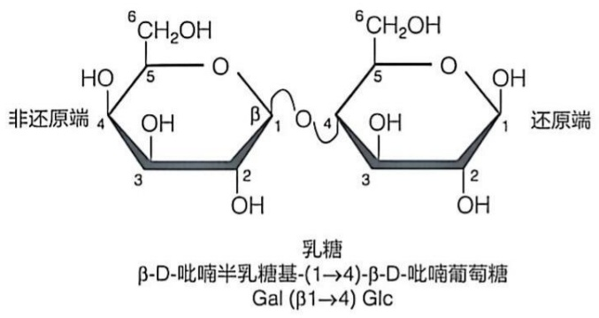

chemical

Chemical structure of a glycoside derivative with β-D-吡喃半乳糖基-(1→4)-β-D-吡喃葡萄糖 (Gal β1→4 Glc)

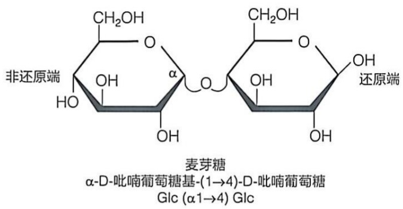

chemical

Chemical structure of glucose (α1→4) showing alpha-D-glucosidase-4-dicarboxylic acid and glucose (α1→4) glycoside with hydroxyl groups

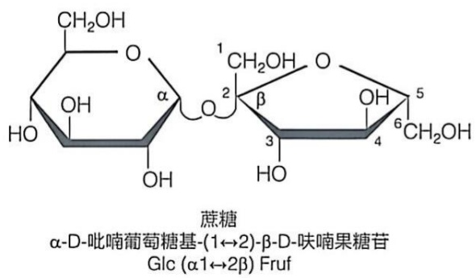

chemical

Glycoside structure of α-D-glucosamine-β-D-fluorouracil, showing glucose chain with alpha and beta sugar moieties

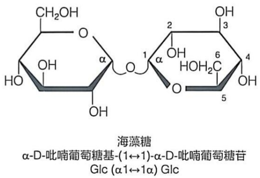

chemical

Chemical structure of hexose sugar showing alpha-D-glucosidase and glucose chain with labeled carbon positions

图 14-16 还原性和非还原性寡糖

碳的构型是  $\alpha$  还是  $\beta$  须写出。但是蔗糖中的糖苷键是由两个不同的单糖的异头碳连接而成，所以除了上面的写法之外，也可以描写成由 1 分子  $\beta-D-$  果糖的异头碳 C2 与 1 分子  $\alpha-D-$  葡萄糖的异头碳 C1 通过  $(\beta2 \rightarrow 1\alpha)$  糖苷键连接。

为了书写方便，与组成蛋白质的20种氨基酸类似，每种单糖都有一个缩写（表14-1），如葡萄糖、半乳糖和果糖的三字母缩写分别为Glc、Gal和Fru。因此，麦芽糖的结构可以简单地表示为Glc（$\alpha 1 \rightarrow 4$）Glc，海藻糖为Glc（$\alpha 1 \rightarrow 1\alpha$）Glc，乳糖为Gal（$\beta 1 \rightarrow 4$）Glc，蔗糖为Glc（$\alpha 1 \rightarrow 2\beta$）Fru或Fru（$\beta 2 \rightarrow 1\alpha$）Glc。此外，为了更为有效地反映寡糖和多糖中的单糖组成情况，每种单糖还被分配了一种独特的颜色和形状符号（其中一些如表14-1所示）。

值得指出的是，还原性二糖（如麦芽糖和乳糖）仍具变旋现象。它们的还原端单

表 14-1 部分单糖及单糖衍生物的缩写及图形符号

<table><tr><td>单糖</td><td>缩写</td><td>图形符号</td><td>单糖衍生物</td><td>缩写</td><td>图形符号</td></tr><tr><td>半乳糖</td><td>Gal</td><td></td><td>葡萄糖胺</td><td>GlcN</td><td></td></tr><tr><td>葡萄糖</td><td>Glc</td><td></td><td>N-乙酰葡萄糖胺</td><td>GlcNAc</td><td></td></tr><tr><td>甘露糖</td><td>Man</td><td></td><td>N-乙酰半乳糖胺</td><td>GalNAc</td><td></td></tr><tr><td>木糖</td><td>Xyl</td><td></td><td>N-乙酰神经氨酸(唾液酸)</td><td>Neu5Ac(Sia)</td><td>[4AWB]</td></tr><tr><td>岩藻糖</td><td>Fuc</td><td>[BHCT]</td><td>葡萄糖醛酸</td><td>GlcA</td><td>[GTBK]</td></tr></table>

---

14.3 单糖分子通过糖苷键共价连接成寡糖和多糖

017

糖仍可以通过开链方式改变异头碳的构型。因此，我们在书写这样的二糖结构式时，非还原端单糖的异头碳构型无须清楚写出是 $\alpha$ 还是 $\beta$ ，而是可以中性化处理（既可以是 $\alpha$ 也可以是 $\beta$ )。当然如果两个单糖分子各自通过其半缩醛（或半缩酮）羟基缩合形成二糖，该二糖不具还原性末端，为非还原性二糖，如蔗糖（sucrose）和海藻糖（trehalose）（图14-16）。由于不存在游离的半缩醛（半缩酮）羟基，因此非还原性二糖不存在变旋现象。

## 知识延展 14- 2

## 母乳中所含的寡糖可能具有抗感染等功能

母乳中存在多种生物活性物质，如寡糖、活性蛋白质、共生微生物、生长因子和细胞因子等。大量研究表明，母乳中的生物活性成分在婴儿的生长发育过程中发挥着抗菌、抗病毒、促进婴儿生长发育和机体免疫成熟等重要功能。

母乳寡糖（human milk oligosaccharide，HMO）是母乳中除了乳糖和脂质之外，含量最高的一类成分，在成熟乳液中平均含量为 12.9 g/L。自 1930 年代被最初鉴定以来，母乳中已知有 200 多种不同类型的寡糖，由三到十种单糖组成。构成这些寡糖的单糖包括 L- 岩藻糖、 D- 葡萄糖、 D- 半乳糖、 N- 乙酰葡萄糖胺和 N- 乙酰神经氨酸等。其中含量最丰富的寡糖是 2'- 岩藻糖基乳糖（2'-fucosyllactose）（图 14-17）。所有母乳寡糖的还原末端都含有乳糖。

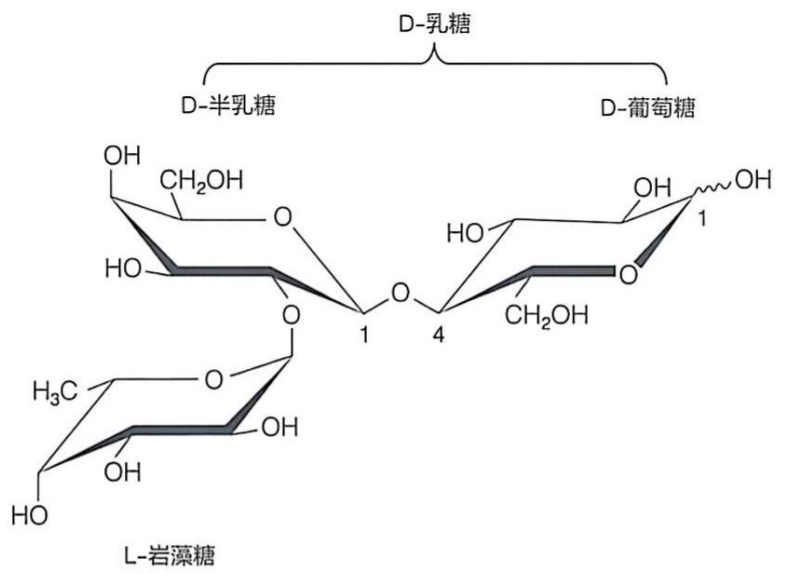

chemical

Chemical structure diagram of L-alkane starch showing D-glucose chain with labeled components and stereochemistry

图 14-17 2'-岩藻糖基乳糖

母乳寡糖可能为婴儿提供了一种抗病毒和抗细菌的机制。母乳寡糖作为细胞表面的糖链结构类似物，可以模拟宿主细胞表面的糖链受体，抑制病毒黏附于婴儿肠道表面，阻断病毒进入肠道细胞，从而达到直接抗感染的效果。此外，研究发现母乳寡糖还可以作为免疫调节剂，通过调节细胞生长、促进肠上皮细胞增殖来改善婴儿的肠道环境。

---

018

14 糖类

## (2) 三糖或更大的寡糖皆通过共价键与蛋白质或脂质以糖缀合物形式存在

与二糖不同的是，细胞中的三糖或更大的寡糖很少以游离形式存在，大多通过糖苷键与蛋白质分子或脂质分子等共价连接，形成糖蛋白或糖脂。这样的寡糖基大多暴露于细胞的表面，成为重要的信号基团，能被特异蛋白质分子（统称为凝集素）所识别，是细胞间相互识别等生物过程的基础。具体我们将在介绍糖蛋白和糖脂时讲述。

## 14.3.2 单糖通过糖苷键聚合形成多糖

当大量单糖单位通过糖苷键连接时，则形成多糖。与寡糖的结构特征相比，多糖的结构特征不仅存在单糖数量的变化，而且发生了质的改变。

## (1) 多糖可分为同多糖和杂多糖两大类

多个单糖分子（>10个）通过糖苷键连接形成多糖。尽管单糖和寡糖在特定生理过程中不可或缺，但是自然界的糖类主要以多糖形式存在。由同一种单糖单位连接而成的多糖为同多糖（homopolysaccharide），如直链淀粉、支链淀粉和糖原；而由两种或多种单糖分子连接而成的多糖为杂多糖（heteropolysaccharide），如透明质酸（图14-18）。

图 14- 18 同多糖和杂多糖

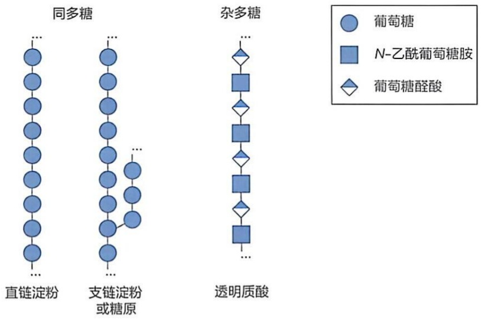

flowchart

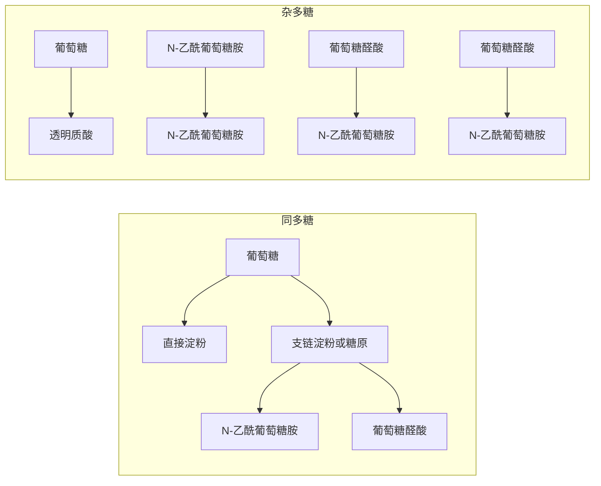

同多糖具有贮存能量或提供结构支持等生物学功能。如植物细胞中的淀粉（starch）和动物细胞中的糖原（glycogen），都是仅由葡萄糖聚合而成的同多糖，作为葡萄糖的储存形式，二者主要发挥贮存能量的功能。

多糖也可作为生物体细胞外的结构成分发挥作用。植物中的纤维素（cellulose）和动物中的几丁质（chitin）分别只含葡萄糖和N-乙酰葡萄糖胺，它们分别是组成植物细胞壁和甲壳类动物外骨骼的重要结构多糖，均为同多糖（图14-19）。

细菌细胞壁的主要成分是肽聚糖（peptidoglycan），其中的多糖分子是由 N-乙酰葡萄糖胺和 N-乙酰胞壁酸通过（ $\beta1\rightarrow4$ ）糖苷键交替连接而成的杂多糖（图 14-20）；而在动物组织的细胞外间隙则存在糖胺聚糖等多种类型的杂多糖（图 14-18），参与

---

14.3 单糖分子通过糖苷键共价连接成寡糖和多糖

019

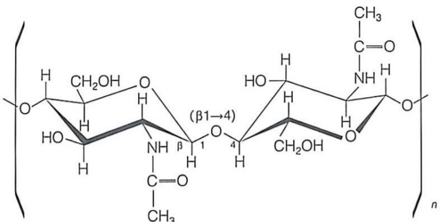

chemical

Chemical structure of a polymeric molecule with labeled functional groups and reaction condition (β1→4)

几丁质

图 14-19 几丁质和纤维素

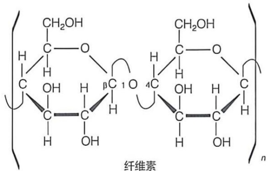

chemical

Chemical structure of polyester polymer chain showing repeating units with hydroxyl and carboxyl groups

N-乙酰葡萄糖胺

N-乙酰胞壁酸

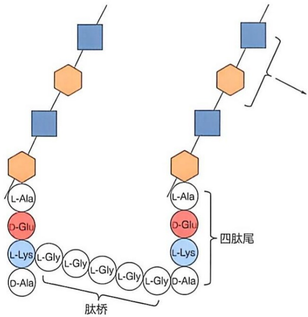

chemical

肽链结构示意图，展示肽桥、四肽尾及L-Ala、D-Glu等分子连接

N-乙酰葡萄糖胺

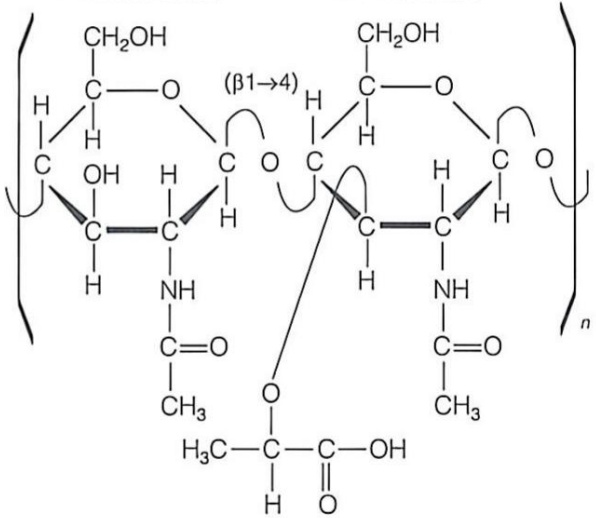

chemical

Chemical structure of a polymeric polymer with repeating units and functional groups labeled

肽聚糖杂多糖链的重复二糖单位

图 14-20 肽聚糖结构

---

020

14 糖类

形成细胞外基质（extracellular matrix），发挥结构支持和调节作用。

（2）葡萄糖单位通过（ $\alpha1\rightarrow4$ ）和（ $\alpha1\rightarrow6$ ）糖苷键形成卷曲形糖原和淀粉分子

糖原是动物体内葡萄糖的主要储存形式，主要分布于肝脏、骨骼肌和肾脏等器官中。其中，以肝脏中的糖原丰度最高，占肝脏湿重的 $7\%$ 左右，负责为整个动物机体贮存葡萄糖，用于维持血液中的葡萄糖稳态。从分子结构而言，糖原是在 $\alpha -\mathrm{D}-$ 葡萄糖分子通过（ $\alpha 1\rightarrow 4$ ）糖苷键连接形成线性聚合体的基础上，依靠（ $\alpha 1\to 6$ ）糖苷键连接来产生分支链（图14-21）。食物中的糖原可以在动物消化道中被 $\alpha-$ 淀粉酶水解，产生葡萄糖单糖和麦芽糖二糖等；而储存于动物肝脏和肌肉细胞中的糖原则是在其中的糖原磷酸化酶的催化下降解，产生葡萄糖供机体利用。

糖原分子的分支程度非常高，平均每8～12个葡萄糖单位就出现一个分支。每条分支糖链的末端都是一个非还原端，这就使得一个糖原分子仅含一个还原端，但含有大量的非还原端。而非还原端是葡萄糖单位可以被快速移除或加入的位置。这使得糖原分子的降解和合成可以有效地响应机体的需求，以维持血糖水平的基本稳定:水平高时储存葡萄糖，水平低时释放葡萄糖。糖原一般以大颗粒（直径10～40 nm）形式存在，这种大颗粒其实是很多小颗粒的聚簇，而每个小颗粒都代表一个具有高度分支的糖原分子。糖原的合成和降解过程将在后续有关糖代谢的章节中进一步介绍。

植物中的淀粉可细分为直链淀粉（α-amylose）和支链淀粉（amylopectin）两种（图14-22）。在大多数形式的淀粉颗粒中，直链淀粉仅占 $10\% \sim 30\%$ ，而支链淀粉则占 $70\% \sim 90\%$ 。

直链淀粉基本只含（$\alpha 1 \rightarrow 4$）糖苷键，很少分支，分子相对较小。其糖链一般具有一个还原端和一个非还原端。虽然直链淀粉在水中的溶解度不高，但它可形成微胶团，其中多糖链呈螺旋构象。碘与直链淀粉反应会产生特征性的蓝色，这是由于碘分

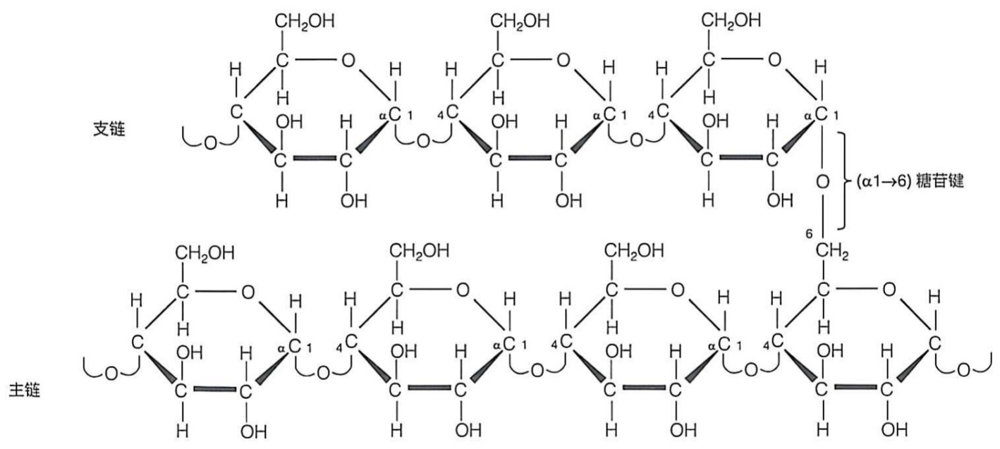

chemical

糖苷键的支链与主链结构示意图，展示多链糖苷酸分子的转化过程

图 14-21 糖原分子结构

糖原

---

14.3 单糖分子通过糖苷键共价连接成寡糖和多糖

021

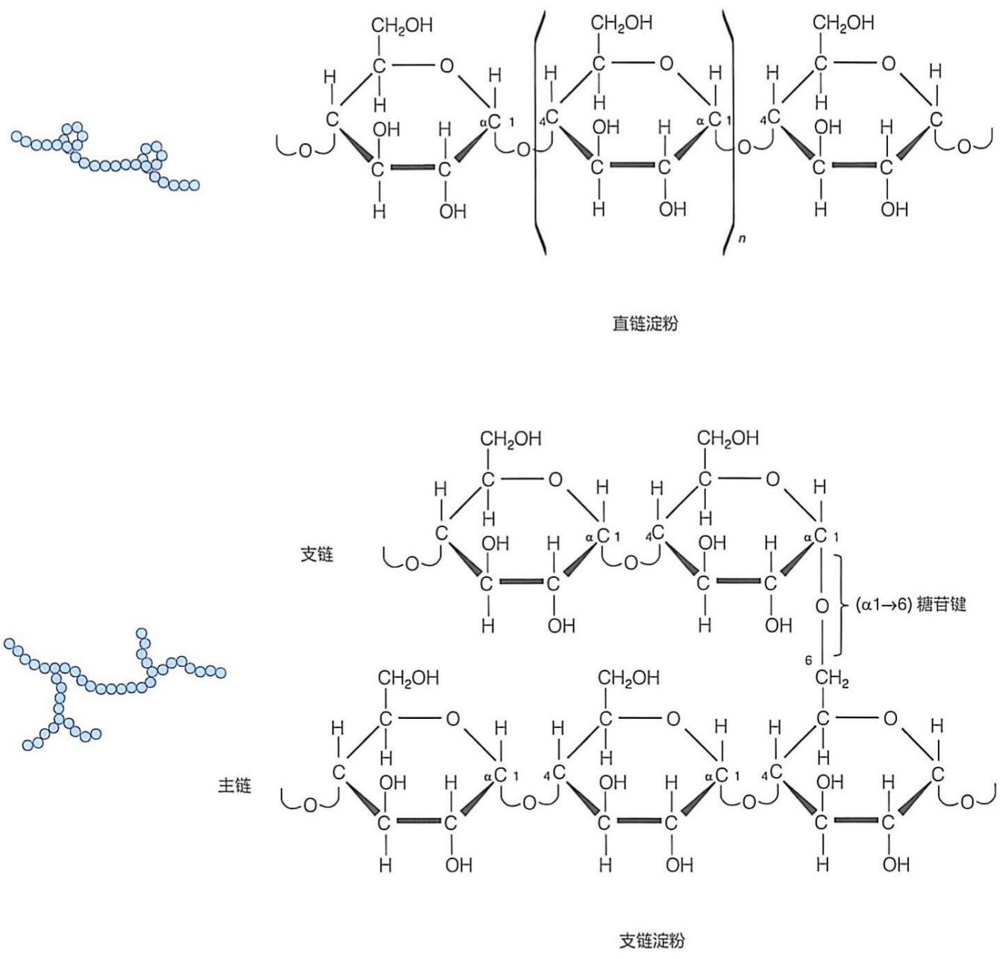

图 14-22 直链淀粉和支链淀粉

子插入淀粉螺旋的疏水中心所致。

支链淀粉既含（ $\alpha1\rightarrow4$ ）糖苷键也含（ $\alpha1\rightarrow6$ ）糖苷键，分子相对较大。支链淀粉的分支程度低于糖原，平均每20～30个葡萄糖单元才会出现一个分支。支链淀粉分子在水溶液中也形成螺旋结构，并能进一步形成更致密的聚簇结构，与碘作用会呈紫红色等。淀粉在淀粉酶的作用下可逐步降解，生成大小不一的中间物，被统称为糊精（dextrin）。

淀粉在植物细胞的质体（plastid；一种植物特有的细胞器，叶绿体是质体中专司光合作用的一类）中合成后往往以颗粒的形式储存于其中，淀粉颗粒中既有直链淀粉也有支链淀粉。当植物需要动用储存的淀粉时，淀粉会在淀粉磷酸化酶催化下分解成单糖单位（葡萄糖-1-磷酸）。当淀粉颗粒悬浮液被加热时，会吸收水分，引起颗粒

---

022

14 糖类

膨胀，这样的葡萄糖聚合物更容易被酶催化降解。因此，煮熟的淀粉更易消化。尽管淀粉的消化开始于口腔中的唾液淀粉酶的作用，但主要发生在小肠中，在其中的胰淀粉酶的催化下进行。唾液淀粉酶和胰淀粉酶均属于  $\alpha-$  淀粉酶，水解（ $\alpha1\rightarrow4$ ）糖苷键。在动物消化道中，由异麦芽糖酶（isomaltase）特异水解（ $\alpha1\rightarrow6$ ）糖苷键。

## (3) 葡萄糖分子通过 ( $\beta_{1} \rightarrow 4$ ) 糖苷键连接形成线性的纤维素分子

纤维素是自然界含量最丰富的天然高聚物，它是植物细胞壁的重要结构成分，在维持植物细胞的正常形态方面发挥着重要作用。与直链淀粉类似，纤维素也是由葡萄糖单位形成的不分支的线性同多糖；每个纤维素分子含有 $10000 \sim 15000$ 个葡萄糖单位。但与直链淀粉不同的是，葡萄糖单体之间并非通过（$\alpha 1 \rightarrow 4$）糖苷键连接，而是通过（$\beta 1 \rightarrow 4$）糖苷键连接形成的（图14-23）。也就是说，直链淀粉和纤维素的差异仅仅在于使用了葡萄糖的 $\alpha$ 或 $\beta$ 异头物；而糖苷键的微小差异最终导致了纤维素和淀粉整体分子结构的巨大差异，这是生物分子的结构决定功能的一个极佳例子。

具体而言，淀粉中的葡萄糖因为通过（$\alpha 1 \rightarrow 4$）糖苷键连接，而呈螺旋形构象，而纤维素中的葡萄糖则因为通过（$\beta 1 \rightarrow 4$）糖苷键连接而呈完全伸展的构象，这是因为纤维素中相邻的葡萄糖环各自相对旋转 $180^{\circ}$ 所致。因为形成的是平行的葡萄糖链，使得链上的羟基之间除了可以形成分子内氢键之外，还可形成分子间氢键，进而形成纤维素特有的微纤丝（microfibril）结构。微纤丝内部分子因（$\beta 1 \rightarrow 4$）糖苷键的键角约束而呈锯齿状构象，并可通过疏水相互作用和范德瓦耳斯相互作用来进一步维系（图14-23），因此而形成高强度的植物纤维素结构，为植物细胞提供了坚实的结构支持。

值得注意的是，大多数动物都缺乏水解（$\beta 1 \rightarrow 4$）糖苷键的糖苷酶，所以不能直接分解纤维素。但是白蚁和某些反刍动物（如牛、羊和长颈鹿）却能利用纤维素作为食物，这是因为它们的消化道内所栖息的微生物能分泌水解（$\beta 1 \rightarrow 4$）糖苷键的纤维

图 14-23 植物纤维素

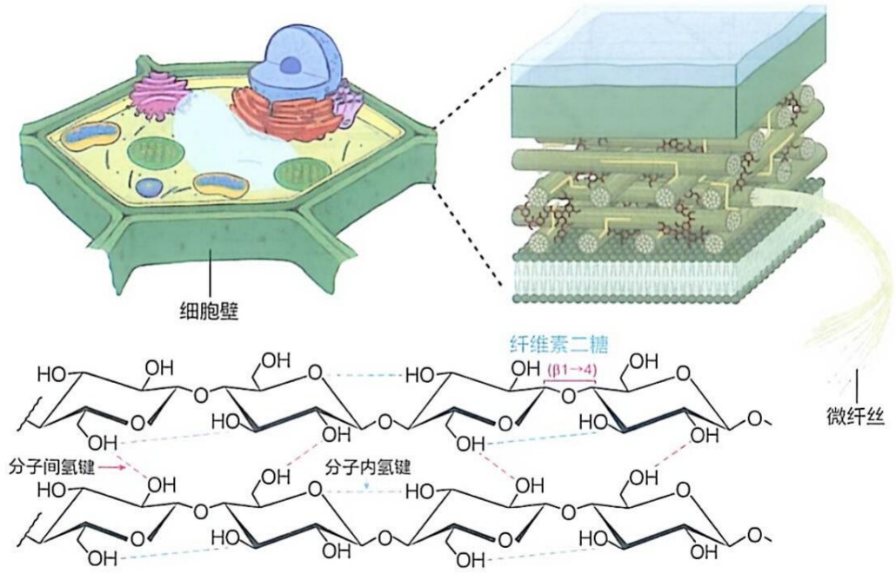

chemical

Diagram illustrating the molecular structure of microfibers and its internal components including ribose sugar and glycerol chains

---

14.3 单糖分子通过糖苷键共价连接成寡糖和多糖

023

素酶（cellulase），将所食用的纤维素降解为可被动物吸收的葡萄糖。

（4）结构极其多样的由荷负电的重复二糖单位连接而成的线性糖胺聚糖存在于动物细胞外基质中

糖胺聚糖（glycosaminoglycans）是一大类由含有氨基单糖的重复二糖单位组成的、通常带负电荷的直链杂多糖，主要存在于动物组织的细胞外基质中，形成一种胶状结构。早期研究认为它们仅仅是存在于细胞外基质中的惰性黏胶，但后来发现它们在细胞的生长发育、相互识别及信号分子响应等过程中都发挥重要作用。

糖胺聚糖的二糖基本结构单位的通式可表示为:己糖醛酸→己糖胺。其所带的负电荷除了来自所存在的己糖醛酸中的羧基外，也来自修饰特定羟基和氨基的硫酸基团（图 14-24）。某些糖胺聚糖中发生硫酸化的位置及数目似乎为特定蛋白质提供了专一

图 14-24 常见的糖胺聚糖的二糖单位

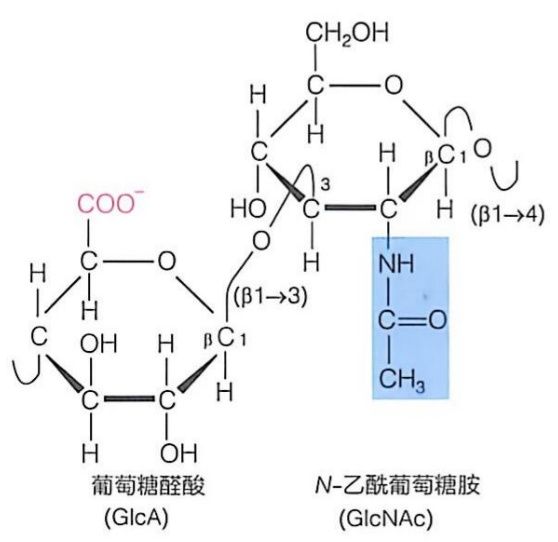

chemical

Chemical structures of glucose A and glucose NAc, showing glycosidic linkages and functional groups

透明质酸 $(n = 1000\sim 15000)$

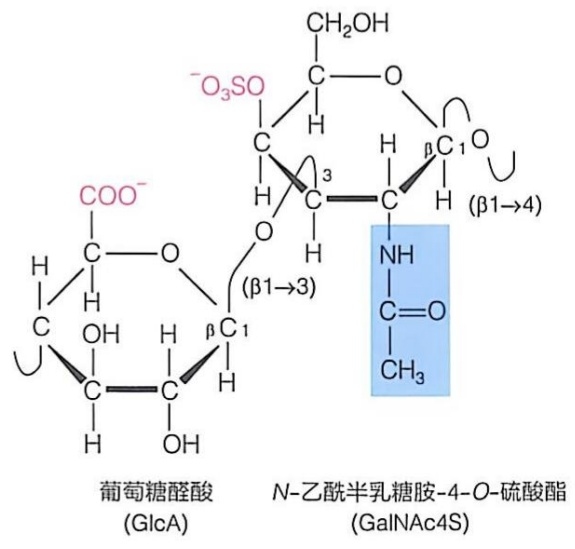

chemical

Chemical structures of glucose and N-ethylamine glycerol (GlcA) and galNAc4S (GalNAc4S), showing sugar backbone with labeled functional groups and reaction steps.

4-硫酸软骨素 (n = 100 \~ 600)

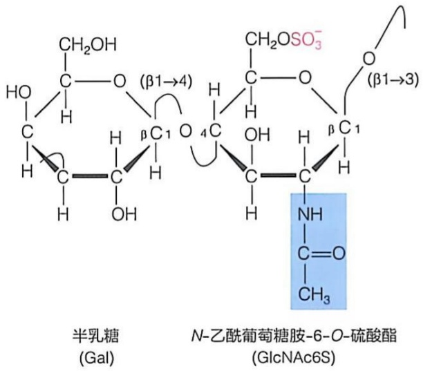

chemical

Chemical structure comparison of galactose and glycosylated glucose-6-O-sulfate (GlcNAc6S) showing sugar chain with beta-1 and beta-3 oxidation states

硫酸角质素 $\left( {n = {20} \sim  {60}}\right)$

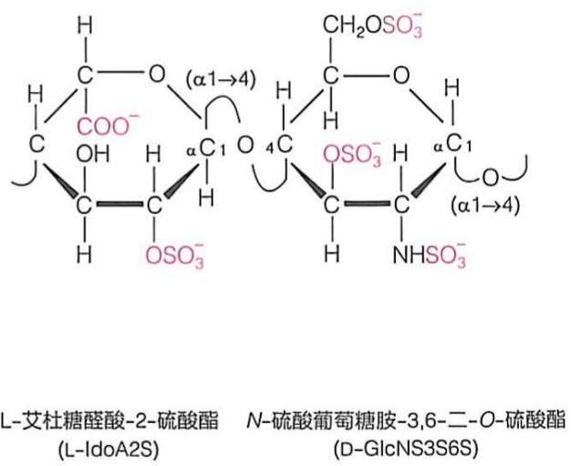

chemical

Chemical structures of L-IdoA2S and D-GlcNS3S6S enzymes showing sugar phosphate chains with labeled amino acid residues and alpha helices

肝素 $(n = 25\sim 50)$

---

024

14 糖类

性的识别和结合信息，与其发挥生物学功能密切相关，有时甚至被称作硫酸化密码（sulfation code）。由于高密度负电荷之间的相互排斥作用，糖胺聚糖在细胞外基质中呈现高度伸展的构象。

现已被鉴定的糖胺聚糖有多种。代表性的如透明质酸（hyaluronic acid）、硫酸软骨素（chondroitin sulfate）、肝素（heparin）和硫酸角质素（keratan sulfate）。透明质酸是这些糖胺聚糖中分子量最高的，由1000～15000个二糖单位组成，它也是这四种糖胺聚糖中唯一不含硫酸基团的。透明质酸能结合大量的水分子，形成透明的高黏稠溶液，被广泛用于多种保湿护肤品中，并在整容手术中用作皮肤填充剂。在动物体内，透明质酸主要存在于软骨、肌腱和眼球玻璃体等结缔组织中。肝素是临床上广泛应用的一种抗凝血剂，它能使凝血酶（thrombin）失活，从而防止血液凝固。

## （5）糖胺聚糖可进一步与蛋白质共价连接形成蛋白聚糖

这些不同的糖胺聚糖分子除了透明质酸外都可以与细胞表面的特异性核心蛋白共价结合形成巨大的蛋白聚糖（proteoglycan）复合体。它们以附着于细胞表面或分泌的形式存在于细胞外基质中:一般由一个核心蛋白质分子与多个硫酸化糖胺聚糖共价结合而成，其中的糖组分可占总质量的 $50\% \sim 95\%$ 。糖胺聚糖一般通过一个四糖接头-GlcA-Gal-Gal-Xyl中木糖（Xyl）的异头碳与核心蛋白质中的Ser-Gly-X-Gly模体中的丝氨酸残基的侧链羟基形成O-糖苷键（图14-25A）。

蛋白聚糖是胞外基质的重要成分。蛋白聚糖中的糖胺聚糖组分是其发挥生物活性的主要部位。一个核心蛋白上可以共价结合多种糖胺聚糖；这样的蛋白聚糖被称为多配体蛋白聚糖（图 14-25B）。蛋白聚糖中的核心蛋白可通过多种方式锚定在细胞质膜上。典型的包括通过单次跨膜  $\alpha$  螺旋或通过共价结合于其 C 端的糖基磷脂酰肌醇（glycosylphosphatidylinositol，GPI）锚定（图 14-25B）。这两种形式的蛋白聚糖的膜外部分可分别通过蛋白质水解酶和磷脂酶切割而成为分泌形式。

糖胺聚糖 [如硫酸乙酰肝素（heparan sulfate）] 可通过其所含糖基模体与胞外的多种蛋白质配体结合进而产生不同的生理效应。硫酸乙酰肝素中的一种五糖模体与抗凝血酶（antithrombin）蛋白质因子结合，使后者通过结合而抑制凝血因子  $X_{a}$  和凝血酶的活性，从而防止血液凝固形成血栓；蛋白聚糖中的某种糖基模体可以与细胞生长因子及其在细胞表面的受体同时发生相互作用，进而促进生长因子的生理效应；蛋白聚糖中另外的糖基模体与脂蛋白脂酶结合，使后者在特定细胞的表面有效定位和集中。很多蛋白聚糖与蛋白质的相互作用都是通过静电相互作用实现的，即在带正电的蛋白质分子表面与带负电的糖基之间发生静电相互作用。

## (6) 某些蛋白聚糖在细胞外基质中可进一步组装成巨大的超分子聚集体

在细胞外基质中，某些蛋白聚糖可通过非共价相互作用进一步组装成巨大的超分子聚集体。一个典型的例子是:一个透明质酸分子可通过特异性连接蛋白的介导，与上百个多配体蛋白聚糖（每个由1个核心蛋白共价连接一百多个糖胺聚糖分子所形成）实现分子间的非共价结合；这样的超分子聚集体可以在电子显微镜下清晰观察到。

---

14.3 单糖分子通过糖苷键共价连接成寡糖和多糖

025

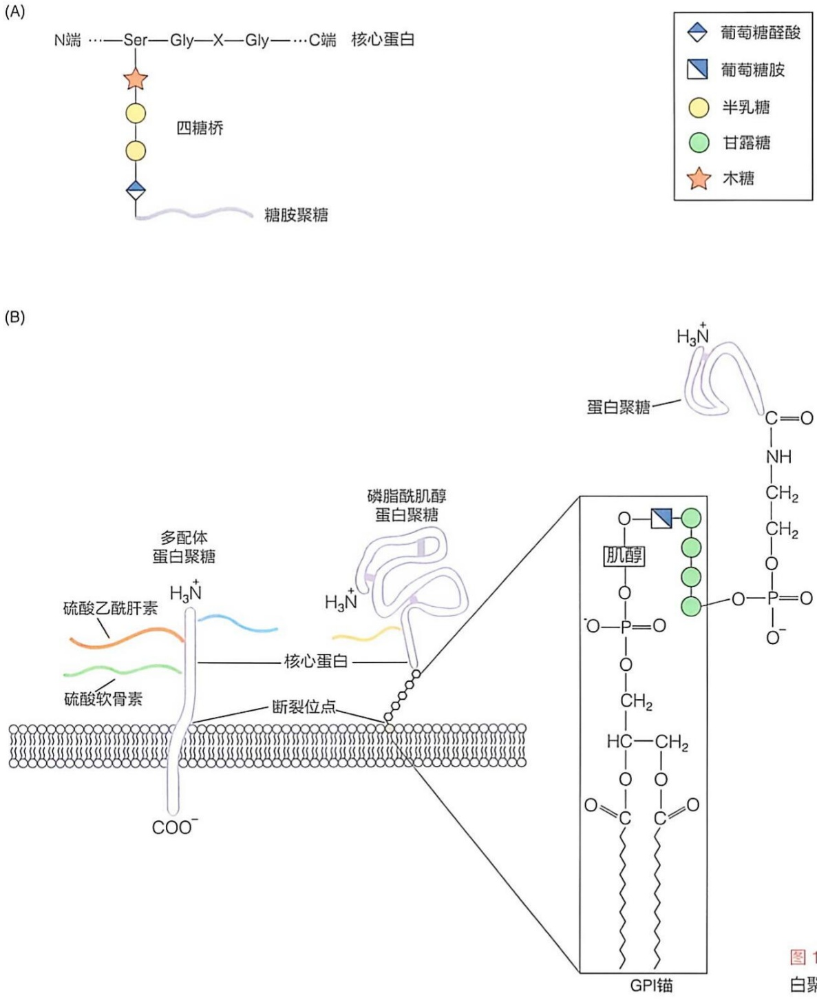

图 14-25 糖胺聚糖和蛋白聚糖

在细胞外基质中，这样的超分子聚集体通过与存在于细胞表面的整连蛋白（integrin）受体、纤连蛋白（fibronectin）以及胶原蛋白等分子间的相互作用来发挥润滑、支撑及组织细胞等多种功能。

---

026

14 糖类

## 14.4 与蛋白质共价连接的特异寡糖基是重要的信息分子

含有两个以上糖基的寡糖基很少游离存在，一般都是通过共价键与位于细胞表面的特异性蛋白质分子（或脂质分子）连接。一个或多个不同复杂程度的寡糖基可与特定蛋白质共价结合形成为糖蛋白（glycoprotein）。这类寡糖基大多以非线性结构存在，具有分支；这类具有分支的寡糖基是重要的信号分子，参与质膜表面发生的细胞-细胞识别。这里将对这类寡糖基与蛋白质的共价连接方式进行介绍。

## 14.4.1 寡糖基可与蛋白质共价结合成 $N-$ 糖蛋白和 $O-$ 糖蛋白

与蛋白聚糖相比，糖链在糖蛋白中一般所占比例较低，仅仅是“修饰”或“点缀”而已，而蛋白质才是维持结构和发挥功能的主体。但是，寡糖基的含量占糖蛋白总质量的比例差异较大，从1%到60%不等，且呈现高度的异质性（heterogeneity），即在同一种糖蛋白的不同个体分子上的寡糖基组成并非完全相同。糖蛋白大多为膜蛋白或分泌蛋白，寡糖基一般存在于细胞质膜外表面、细胞外基质和血液中。

糖蛋白一般分为两大类。凡是寡糖基通过其还原端（即含异头碳的一端）与蛋白质中的天冬酰胺（Asn）残基侧链酰胺基以糖苷键连接的均被称为 $N-$ 糖蛋白，而以糖苷键与丝氨酸或苏氨酸残基侧链羟基连接的则被称为 $O-$ 糖蛋白（图14-26）。

(1) 所有 $N$-糖蛋白中的寡糖基皆通过一个相同的核心五糖与蛋白质共价连接

真核细胞中的所有 N-糖蛋白均通过一个由 2 个 N-乙酰葡萄糖胺（GlcNAc）和 3 个甘露糖（Man）残基组成的核心五糖分子与肽链相连。这种核心五糖在肽链翻译过程中通过相同方式被加上。N-糖蛋白在核心五糖分子的基础上再进一步连接不同的额外单糖残基，如甘露糖、半乳糖（Gal）、N-乙酰半乳糖胺（GalNAc）、N-乙酰葡萄糖胺和唾液酸（Sia）等，进而形成最后的不同寡糖基分子。这类外围糖基是 N-糖蛋白被凝集素等蛋白质识别的主要结构特征。

(2) O-糖蛋白中的寡糖基不存在相同的核心糖基且更加多样

尽管 O-寡糖基的链长和分支通常比 N-寡糖基更短、更简单，但其连接方式、核心结构及修饰类型远比 N-寡糖基更加多样，且不受保守序列限制。目前已知的直接与丝氨酸或苏氨酸残基形成糖苷键连接的糖基包括 N-乙酰半乳糖胺、N-乙酰葡萄糖胺、甘露糖和岩藻糖等。

糖蛋白上的寡糖基均在内质网和高尔基体中被添加和加工。糖蛋白中的寡糖基不仅对蛋白质的折叠、稳定性、水溶解度具有重要影响，而且还参与多种生物学过程，如分子识别（糖基被凝集素类蛋白质特异性识别）、蛋白质的分选、折叠、定位以及蛋白质的降解、信号转导等。

此外，存在于胞质溶胶中的某些信号转导蛋白和存在于细胞核中的某些转录因子的活性可通过 N-乙酰葡萄糖胺的单糖基可逆修饰来调节。

---

14.4 与蛋白质共价连接的特异寡糖基是重要的信息分子

027

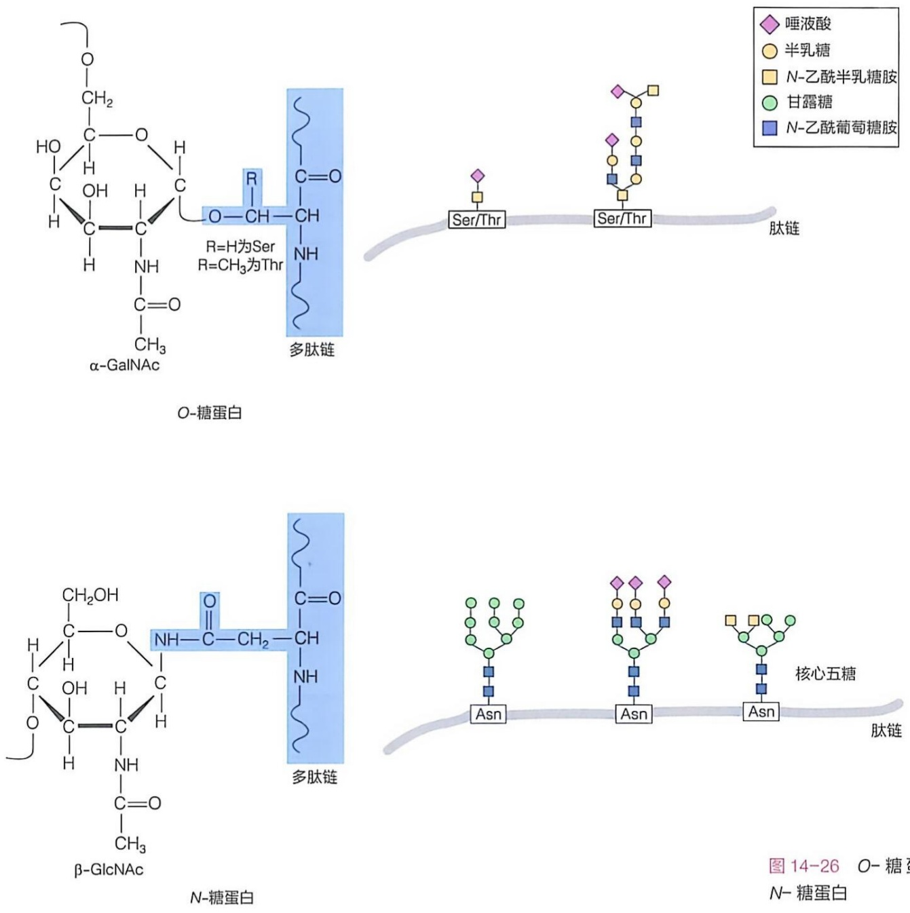

图14-26 $O-$ 糖蛋白和$N-$ 糖蛋白

## 14.4.2 位于细胞表面的寡糖基大多携带重要信息

通过与蛋白质分子或脂质分子相连接、位于细胞表面的分支寡糖基可形成极其多样的结构。如果单糖、氨基酸和核苷酸的残基数相同，可形成的寡糖种类将远多于寡肽和寡核苷酸。也就是说，相较于寡肽和寡核苷酸，寡糖具有更强大的信息编码能力。

寡糖基结构多样性的成因主要包括以下几点:

（1）单体（残基）的种类多:包括各种五碳糖、六碳糖及其衍生物（如氨基糖、糖醛酸和唾液酸）。

---

028

14 糖类

（2）单体之间连接的方式多样:异头碳的  $\alpha/\beta$  构型及多样的连接位点（如  $\alpha1 \rightarrow 2$ ， $\alpha1 \rightarrow 3$ ， $\alpha1 \rightarrow 6$ ），形成线性或分支结构。

## 知识延展 14- 3

## N-乙酰葡萄糖胺单糖基化修饰参与细胞代谢等多种重要生物学过程

N-乙酰葡萄糖胺（O-GlcNAc）修饰是近年来发现的一种发生在细胞内蛋白质丝氨酸或苏氨酸羟基上的高度动态单糖修饰。细胞内约有2%\~5%流量的葡萄糖进入己糖胺合成途径（hexosamine-biosynthesis pathway）进行代谢，经一系列的酶催化产生O-GlcNAc糖基化的供体UDP-N-乙酰氨基葡萄糖（UDP-GlcNAc）。细胞内的O-GlcNAc转移酶（O-linked N-acetylglucosamine transferase, OGT）负责将GlcNAc添加到目标蛋白质的相应位点上，O-GlcNAc水解酶（O-GlcNAcase, OGA）则负责移除该糖基。鉴于己糖胺合成途径与细胞内多种代谢途径紧密相关，如葡萄糖、谷氨酰胺、核酸和脂肪酸代谢，O-GlcNAc糖基化修饰被视为一种独特的“营养感应器”。据报道，约有上万种蛋白质上均存在O-GlcNAc糖基化修饰；这些蛋白质的糖基化参与调控细胞内重要的生物学过程，包括基因转录、蛋白质翻译、信号转导、细胞周期调控以及代谢重编程等。因此O-GlcNAc糖基化的失调与肿瘤，糖尿病以及神经退行性疾病的发生发展密切相关，深入研究O-GlcNAc糖基化的调控机制可为开发针对上述疾病的新型治疗策略提供潜在的思路。

## 知识延展 14- 4

## 免疫球蛋白 G（IgG）的糖基化修饰特征和功能

IgG 的糖基化修饰主要发生在 Fc 区保守的 Asn $^{297}$  位点（N-糖基化），形成高度异质的 N-寡糖结构。其中，核心岩藻糖（在核心五糖结构的首个 GlcNAc 残基的 C6 位置上，通过（α1→6）糖苷键连接的岩藻糖）、平分型 GlcNAc [在核心五糖结构的（β1→4）甘露糖残基上额外连接一个（β1→4）-N-乙酰葡萄糖胺] 和唾液酸等修饰是调控功能的关键。此外，约 15%\~25% 的 IgG 在 Fab 区也存在糖基化，进一步增加了结构多样性。这些糖链通过直接参与相互作用或间接影响抗体构象，精确调控免疫应答。

IgG糖基化对其效应功能具有决定性影响。Fc区核心岩藻糖的缺失可显著增强抗体依赖性细胞介导的细胞毒性活性（antibody-dependent cell-mediated cytotoxicity, ADCC），而平分型 GlcNAc 则通过空间位阻抑制岩藻糖化，同时延长抗体半衰期。唾液酸化修饰能诱导抗炎信号，而半乳糖缺失与自身免疫疾病有关。此外，Fab 区糖基化可能直接参与抗原结合或调节抗体稳定性，这凸显糖链在免疫识别中的多功能性。

IgG 糖基化模式与感染、肿瘤和自身免疫病等多种疾病密切相关，已成为疾病诊断的新兴标志物。在治疗领域，糖工程技术（如去岩藻糖化、平分型 GlcNAc 引入）可优化抗体药物的效应功能、半衰期和安全性，已成功应用于奥妥珠单抗等药物。深入研究 IgG 糖基化为开发新一代免疫疗法提供了重要方向。

---

14.4 与蛋白质共价连接的特异寡糖基是重要的信息分子

029

## 知识延展 14-5

## ABO 血型取决于红细胞表面寡糖基抗原的简单结构差异

ABO 血型系统是人类最早认识也是最为重要的血型系统，由美国学者卡尔·兰德施泰纳（Karl Landsteiner，1868—1943）等人于 1900 年代揭示。兰德施泰纳观察到，人体血液中存在几种不同类型的抗原和抗体:如果一种类型人体的红细胞被加入到另外一种类型人体的血液中，就可能会诱发红细胞的聚集。基于这种红细胞凝集现象，他识别出了 A、B 和 O 三种血型；后来其他人鉴定出了第四种血型，即 AB 型。

如图 14-27 所示，A、B、AB 和 O 四种血型个体的红细胞（及其他细胞）表面分别携带有 A（血清中存在抗 B 抗原的抗体）、B（血清中存在抗 A 抗原的抗体）、A+B（血清中不存在任何抗体）和 H $^{①}$ （血清中既存在抗

A 也存在抗 B 的抗体）型的寡糖抗原。根据免疫学基本知识可知:抗原将通过特异的抗原-抗体相互作用而被特异抗体识别，进而产生抗原的凝集（agglutination）现象。因此，当含有一种特异寡糖抗原的红细胞与含有针对该抗原的抗体的血清混合时，红细胞将因为抗原-抗体相互作用而发生凝集。例如将 B 型和 O 型血个体的血液输入到 A 型血个体会引起 A 型血个体血液的凝集，其他情况可依此类推。因此，在进行输血前，必须进行正确的血型配对，这一操作攸关生死，具有重要的临床意义。

通过众多科学家半个多世纪的努力，决定 ABO 血型的寡糖基的化学结构才被最终阐明。相关研究涉及从非血细胞组织（如良性卵巢囊肿、胃分泌液；细胞表面的

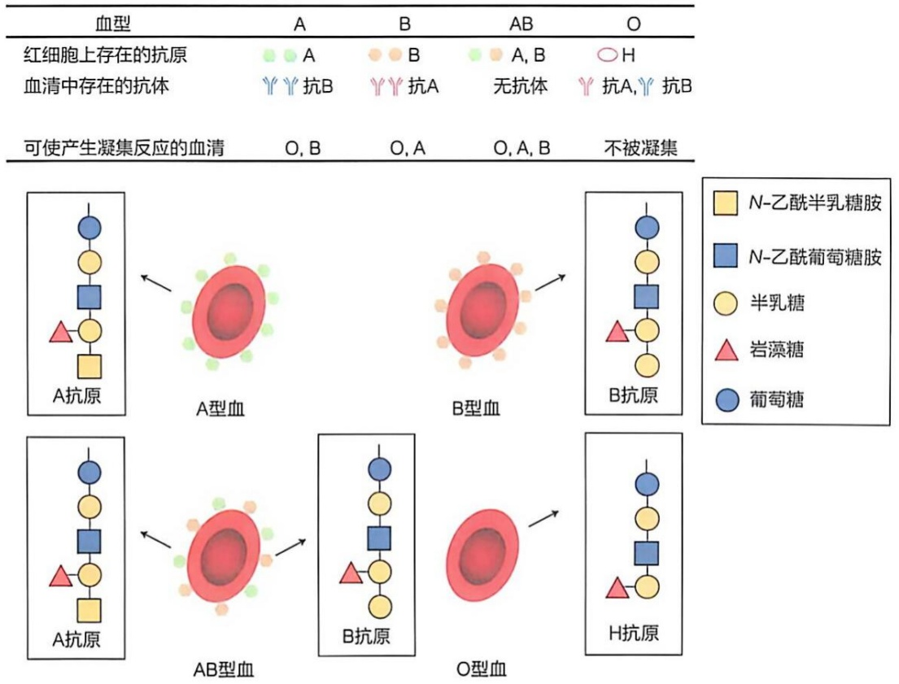

flowchart

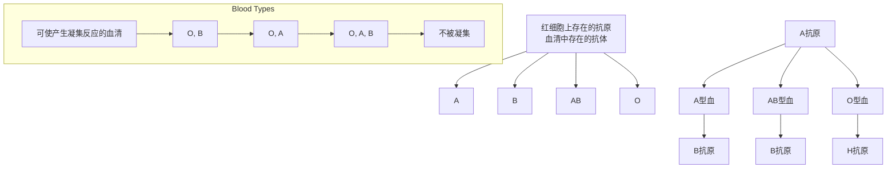

图 14-27 ABO 血型

<small>① 因历史原因，O型血中的抗原被称作H抗原，而非O抗原。</small>

---

030

14 糖类

这种血型决定成分其实广泛存在于个体的不同类型的组织细胞中）中纯化有关的特异性抗原，测试不同单糖对红细胞聚集的抑制效果，观察糖苷酶处理后的效果，到最后对寡糖基的直接纯化、结构测定及化学合成等实验。最终结果表明，四种血型所对应的寡糖基组成差异很小，即导致四种血型出现的寡糖基抗原的结构基本相同，仅仅是末端的单糖基有所不同而已（图14-27）。具体而言，所有寡糖基抗原皆含有一个Fuc→Gal→GlcNAc→Gal→Glc五糖单位（通过Glc单糖残基）与红细胞表面的蛋白质或鞘脂（详见第15章）共价连接。O血型中的H抗原就是这个五糖。在此基础上，A抗原在五糖单位的末端再增加1个N-乙酰半乳糖胺单位（与Gal残基形成糖苷键），而 B 抗原则增加 1 个 Gal 单位（同样与 Gal 残基形成糖苷键）（图 14-27，下）。

合成这些寡糖基时，需由不同的糖基转移酶（glycosyltransferase）催化每一种糖苷键的形成。如前所述，形成三种血型的抗原（即A、B和H）高度类似，其中O型血个体只含产生H抗原的几种糖基转移酶，而A型血个体还可产生一种N-乙酰半乳糖基转移酶，将1分子N-乙酰半乳糖胺转移至H抗原的半乳糖残基上，形成A抗原；而B型血个体则另产生一种半乳糖基转移酶，将1分子半乳糖转移至H抗原的相同半乳糖残基上，形成B抗原。

（3）分支结构的可塑性:每个单体具有多个羟基，支持多位点连接，使得寡糖基可以有多种分支结构。

结构的多样性赋予寡糖极高的信息编码容量，使糖缀合物作为关键的信息分子参与多种重要的生命过程。

寡糖基中的信息由其独特的三维立体结构承载，这种立体结构可被与其相互作用的蛋白质精确识别，从而实现传递信息的功能。

研究表明，生物体内存在一大类能特异性识别和结合寡糖基的蛋白质。1950年代，人们将这类能识别糖结构、但既非免疫球蛋白又非酶的蛋白质统一命名为凝集素（lectin），其名称最初主要指植物来源的凝集素——agglutinin。19世纪末以来，凝集素作为一类可使红细胞凝集的植物蛋白质，典型的如蓖麻毒素（ricin）和相思豆毒素（abrin），被陆续发现。因为这种性质，早期发现的凝集素都是以毒素身份被鉴定的（并被试图用作生物武器）。后续研究表明，这些植物凝集素在诱发不同个体的红细胞凝集方面表现出高度的特异性；这与同一时期对ABO不同血型的发现相一致，因而这些凝集素所表现出的特异性也被认为与抗体的特异性相类似。到了1950年代，人们观察到特异性凝集素诱发的不同血型红细胞凝集过程可以被加入的糖成分所抑制。这不仅暗示血型的差异与糖组分有关，同时也暗示了凝集素可能通过与糖组分的相互作用而实现特异性识别。从此，凝集素被广泛应用于针对糖蛋白等含糖生物分子的亲和层析分离、纯化和表征等过程。

后续研究表明，凝集素不仅存在于植物中，也存在于动物和微生物中。蛋白质结构解析结果表明，不同凝集素的结构中都含有特异的糖识别结构域；其中的氨基酸残基与特异的寡糖基结构之间存在着高度的分子互补性，只与处于特定立体构型的糖基发生相互作用，因此凝集素对糖基的识别具有高度的专一性。

值得注意的是，凝集素的单糖识别结构域与单个寡糖基结合的解离常数（ $K_{d}$ ）一

---

14.4 与蛋白质共价连接的特异寡糖基是重要的信息分子

031

般处于微摩尔每升（μmol/L）至毫摩尔每升（mmol/L）范围，表明其固有亲和力较低。为了解释凝集素与糖缀合物之间的高亲和力，人们提出了多价（multivalent）结合的概念，即一个凝集素蛋白分子可以通过其多个结构域或多个亚基同时与多个寡糖基的结合来提高其整体亲和力。比如存在于巨噬细胞等抗原呈递细胞表面的甘露糖受体（mannose receptor）属于C型（即钙依赖型）凝集素受体家族，其所含8个C型凝集素样结构域中的第4和第5两个结构域可识别甘露糖、N-乙酰葡萄糖胺等糖基（图14-28）。该受体可介导细菌等病原体的内吞和清除。

寡糖链与凝集素之间的特异性结合参与细胞间识别和黏附的另一个经典例子是免疫应答中白细胞穿过毛细血管壁从血液进入组织，并在炎症部位聚集的过程。该过程依赖于炎症部位毛细血管内皮细胞膜表面的P-选择素（P-selectin）与白细胞表面P-选择素糖蛋白配体-1（PSGL-1）所携带的唾液酸路易斯X（sialyl-Lewis X）四糖基之间的特异性结合，其中sialyl-Lewis X作为末端非还原性糖基与P-选择素的凝集素结构域相互作用。该寡糖基能被毛细血管内皮细胞表面的P-选择素识别和结合（图14-29），进而减慢白细胞沿毛细血管壁内皮衬膜滚动

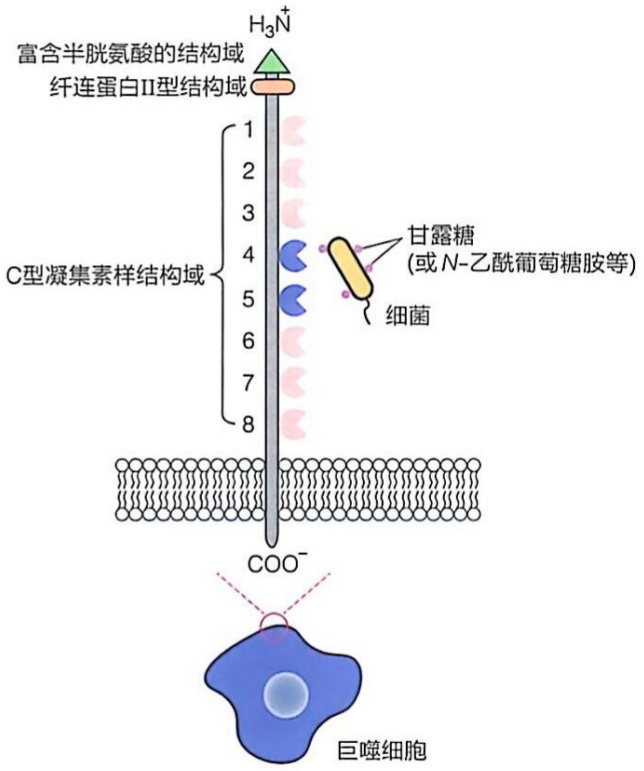

text_image

富含半胱氨酸的结构域
纤连蛋白II型结构域
C型凝集素样结构域
1
2
3
4
5
6
7
8
H₃N⁺
甘露糖
(或N-乙酰葡萄糖胺等)
细菌
COO⁻
巨噬细胞

图 14-28 甘露糖受体

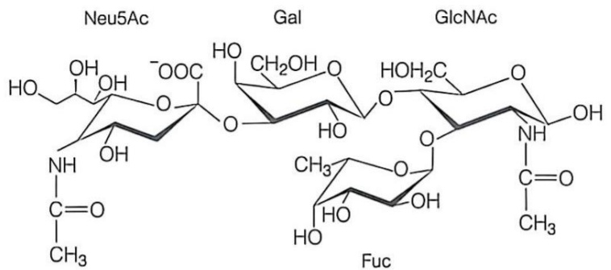

chemical

Chemical structures of three glycoside compounds: Neu5Ac, Gal, and GlcNAc, showing sugar backbone with multiple hydroxyl groups and ester linkages.

唾液酸路易斯X(四糖基)

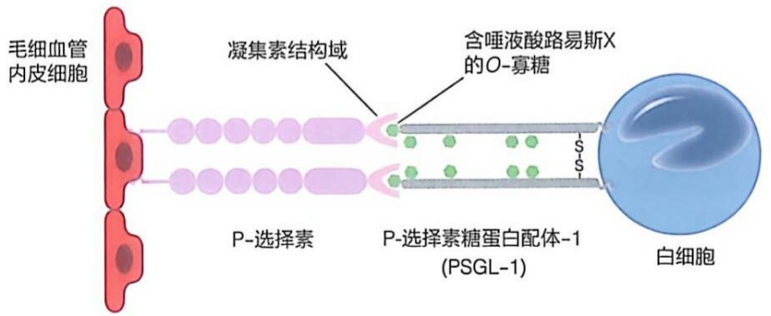

text_image

毛细血管
内皮细胞
凝集素结构域
含唾液酸路易斯X
的O-寡糖
P-选择素
P-选择素糖蛋白配体-1
(PSGL-1)
白细胞

图 14-29 免疫应答过程中白细胞识别并结合 P-选择素

---

032

14 糖类

的速度；最终导致白细胞完全停止滚动，并穿过毛细血管壁，进入被细菌感染的组织，对病菌发动免疫攻击。

某些动物病毒对宿主细胞的入侵也通过凝集素介导。比如流感病毒（influenza virus）结合宿主细胞膜启动侵染的过程，就是通过病毒表面的凝集素［也称为血凝素（hemagglutinin）］与宿主细胞表面含有唾液酸的寡糖基（共价连接于蛋白质或鞘脂）结合而进行的。当病毒在宿主细胞内复制后，组装成的新病毒颗粒需通过出芽方式排出细胞外（继续感染其他细胞）。存在于病毒表面的唾液酸酶（neuraminidase，也称神经氨酸酶）需催化切除宿主细胞表面寡糖基末端的唾液酸单糖，使病毒颗粒与宿主细胞脱离而释放，开始入侵新的宿主细胞（图14-30A）。目前市面上常用的抗病毒药物达菲（Tamiflu®）即为唾液酸类似物，它通过竞争性抑制病毒唾液酸酶的催化活性来阻止病毒脱离原来的宿主细胞，从而无法侵染新的宿主细胞（图14-30B）。

部分细菌或细菌毒素进入宿主细胞也采用类似策略。寡糖链末端的唾液酸能延长血液中的多肽、蛋白质的半衰期和血细胞等寿命的原因之一是唾液酸屏蔽了内部糖基（如半乳糖残基），阻止其被肝细胞表面的去唾液酸糖蛋白受体识别，从而避免被肝细

图 14-30 流感病毒入侵与释放机制及抗流感药物奥司他韦的作用原理  
(A) 流感病毒通过表面血凝素识别宿主细胞表面的唾液酸，介导病毒入侵；并通过表面唾液酸酶切割宿主细胞膜上的唾液酸使子代病毒释放。(B) 唾液酸与抗流感药物奥司他韦（唾液酸类似物）的化学结构比较。

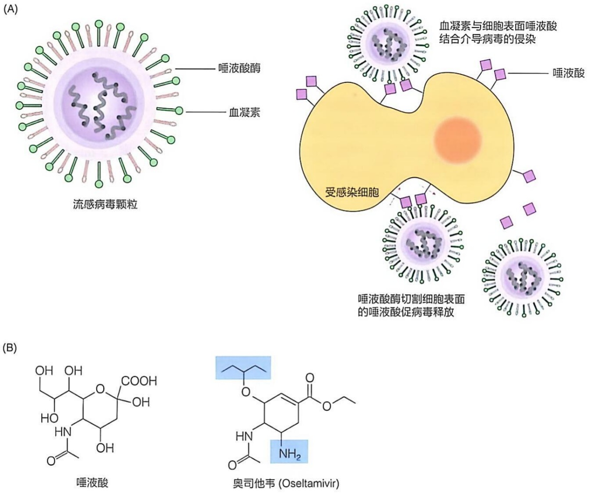

---

14.5 寡糖基的化学结构可通过多种物理化学方法在体外进行表征

033

胞内吞降解。此外，新生溶酶体酶的胞内定位也是通过甘露糖-6-磷酸修饰后结合特异性凝集素来实现的。因此，蛋白质的特异性糖基化修饰使得它们能被特定的凝集素识别，进而参与和完成多种不同的生命过程。

## 14.5 寡糖基的化学结构可通过多种物理化学方法在体外进行表征

寡糖和多糖的结构多样性源于多重因素，具体涉及:单糖单位的种类丰富，每种环状单糖都有两种不同的异头碳构型，糖苷键的连接方式高度多样，每种单糖都能以多种衍生物形式参与寡糖和多糖的形成，等等。

目前，层析技术、核磁共振波谱学、质谱分析以及特异性糖苷酶的应用使我们对糖类分子的研究更为有效。寡糖和多糖分子共价连接的多样性使得解析它们的共价结构仍是一项繁重而艰巨的任务；相对而言，这远比解析蛋白质或核酸的共价结构复杂，且缺乏类似肽类和核酸的通用解析方法。这里将介绍糖类分子共价结构解析的一般流程。

## 14.5.1 寡糖从缀合物中释放后可通过层析等方法进行分离纯化

寡糖通常不以游离形式存在，而是通过糖苷键与蛋白质或脂质共价结合，形成糖蛋白或糖脂等糖缀合物。因此，通过化学或酶促水解方法将寡糖从糖蛋白或糖脂中释放，是对寡糖进行结构解析的第一步（图 14-31）。在早期研究中，一般都使用化学方法使寡糖基释放；而目前普遍采用温和条件，即利用特异性糖苷内切酶选择性切割寡糖基与肽链之间的糖苷键。

## （1）寡糖基可通过特异酶的催化从糖蛋白或糖脂中释放

对于 N-糖蛋白而言，酶解方式释放相对简单有效。因为所有 N-糖蛋白的寡糖基均通过一个核心五糖单位与肽链上的 Asn 相连。因此一般可利用专一性对核心五糖中的某种糖苷键进行切割的糖苷内切酶（endoglycosidase）或肽 -N-糖苷酶（peptide-N-glycosidase）释放寡糖基；这些酶一般从不同的细菌或植物中分离得到。比如糖苷内切酶 H、D 或 F2 皆可将核心五糖中连接两个 GlcNAc 单糖的（ $\beta1\rightarrow4$ ）糖苷键切割，但各自对具体的寡糖基组成和结构具一定特异性（图 14-31A）。

对于 $O-$ 糖蛋白而言，因为缺乏与 $N-$ 糖苷键类似的保守连接方式，所以难以通过同一种酶的切割将它们释放，而是需要寻找合适的特异糖苷内切酶。由于 $O-$ 糖蛋白不仅更为多样，而且异质性更高，这就为研究它们带来了更多的挑战。目前已知的 $O-$ 糖苷酶（$O$-glycosidase）（如粪肠球菌或肺炎链球菌来源）通常仅能水解特定核心结构中的GalNAc-Ser/Thr糖苷键，且对修饰（如唾液酸化、岩藻糖化）或分支的 $O-$ 糖链无效。比如来自粪肠球菌（Enterococcus faecalis）的 $O-$ 糖苷酶只水

---

034

14 糖类

(A) $N$-糖蛋白

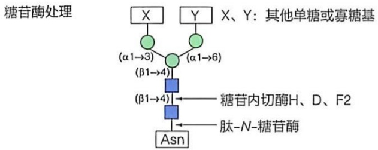

flowchart

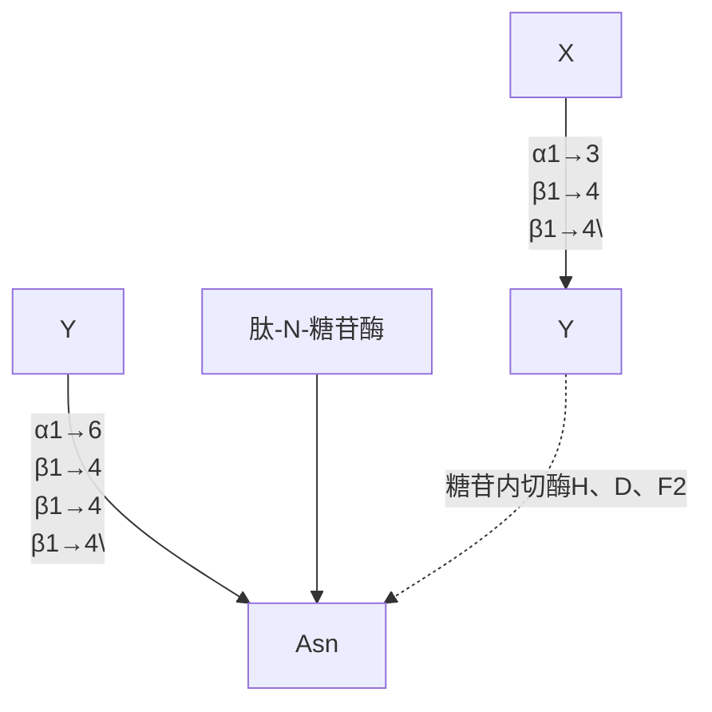

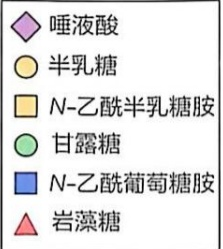

text_image

唾液酸
半乳糖
N-乙酰半乳糖胺
甘露糖
N-乙酰葡萄糖胺
岩藻糖

无水肼处理

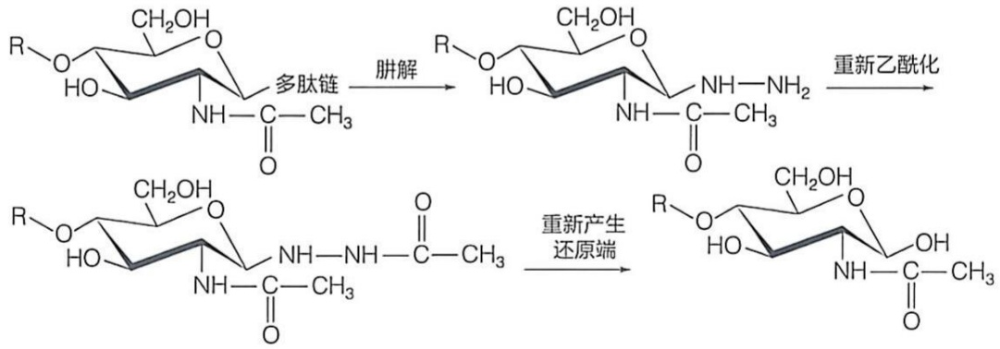

chemical

Chemical reaction pathway showing deprotection and reprocessing steps of a peptide chain with acetyl group

(B) $O$-糖蛋白

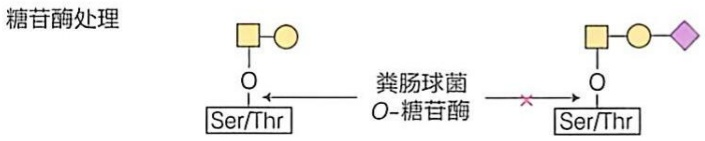

flowchart

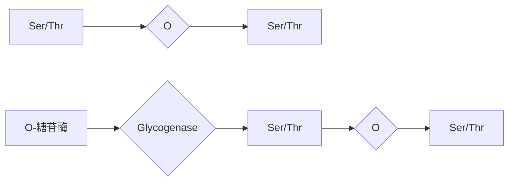

高碘酸氧化-β消除法

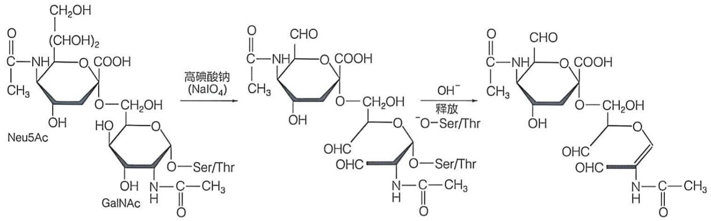

chemical

Chemical reaction pathway showing the conversion of Neu5Ac to GalNAc via high-acid sodium hydroxide and acidification steps

(C)

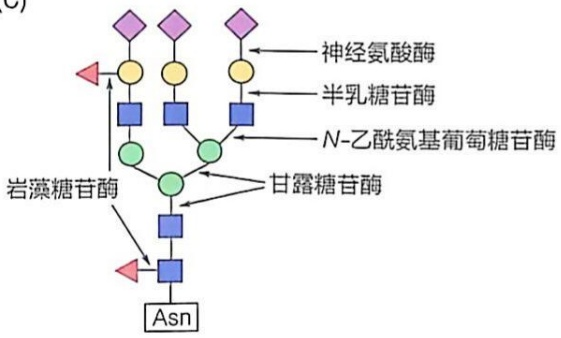

flowchart

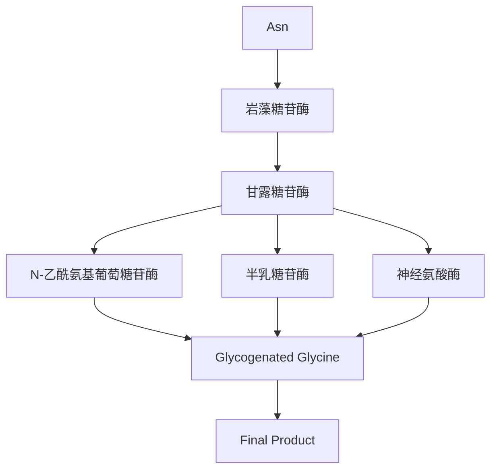

图 14-31 寡糖基释放方式

---

14.5 寡糖基的化学结构可通过多种物理化学方法在体外进行表征

035

解 Galβ1 → 3GalNAc-Ser/Thr 中的 GalNAc-Ser/Thr 糖苷键，但不水解唾液酸化（Sia-Galβ1 → 3GalNAc-Ser/Thr）结构中的这个键（图 14-31B）。

糖脂上的寡糖链一般也是通过糖苷水解酶切割的方式来释放的。比如，利用糖苷内切神经酰胺酶（endoglycoceramidase）切割糖脂中寡糖基与神经酰胺残基之间连接的糖苷键。

此外，特异的糖苷外切酶（exoglycosidase）可从寡糖基的非还原末端切除某种单糖，如神经氨酸酶切下唾液酸，半乳糖苷酶切下半乳糖等（图14-31C）。它们也可用于对寡糖基结构的分析，并且研究人员经常将这些内切酶和外切酶混合利用。

如果找不到合适的酶使糖基释放，人们也会通过化学法使糖基从蛋白质（或脂质）上释放。比如肼解法可将 N-糖基释放（图 14-31A），而高碘酸氧化 -β 消除法可将 O-糖基释放（图 14-31B）。这里不对化学法进行详细介绍。

## (2) 释放的寡糖组分通常可采用层析技术分离纯化

从糖蛋白或糖脂释放出来的寡糖组分通常为混合物，需进一步分离纯化。这是因为:一方面，单种糖蛋白分子中可能共价连接了多种糖链；另一方面，一种糖蛋白同一个修饰位置上的糖链常存在细微的不均一性，这是蛋白质糖基化修饰的典型特征（其原因和意义还在探索之中）。

所得到的寡糖混合物需分离成单一的寡糖组分。通常采用与蛋白质等生物分子纯化类似的层析方法，如离子交换层析、分子筛层析等。基于寡糖基与凝集素之间的特异结合，人们也常将凝集素共价连接到树脂上，进行凝集素亲和层析。这是分离纯化特定寡糖的最有效方法，当然前提是有对应凝集素的存在，而且可制作成亲和树脂。

## 14.5.2 寡糖与多糖的结构解析通常需要综合运用多种分析技术

对一种寡糖或多糖分子的单糖组成及糖苷键连接方式进行鉴定，是阐明其生物学功能的基础。这类结构解析工作颇具挑战性，常需综合利用多种方法才可完成。

## （1）寡糖和多糖的单糖组成需经系统分析

分离纯化的某种寡糖或多糖在强酸条件下进行完全水解后，可获得其单糖组分的混合物。之后可对所有单糖组分进行鉴定。具体而言，可以直接将单糖化合物通过高效液相色谱（high performance liquid chromatography，HPLC）、离子交换层析（ion-exchange chromatography，IEC）、凝胶电泳（gel electrophoresis）、高性能毛细管电泳（high performance capillary electrophoresis，HPCE）等方法进行分析，以测定水解混合物中单糖的类型和各自的含量等。

## （2）寡糖和多糖分子中糖苷键的连接方式需通过全甲基化修饰结合质谱或核磁共振等技术进行系统解析

在 1970 年代初，科学家们建立了基于甲基化修饰的糖苷键连接位点分析方法。

该方法的具体过程大致如下:首先在强碱性条件下，糖分子中的所有游离羟基将

---

036

14 糖类

失去质子，形成带负电的氧负离子（—O⁻，即醇盐中间体）；后者仅短暂存在，立即与甲基化试剂（如 CH₃I）反应，被完全甲基化；然后使分子中的糖苷键发生酸水解断裂后，利用硼氘化钠（NaBD₄）还原，使还原端获得氘（²H）标记以区分糖环取向；最后对经酸水解后新产生的羟基进行乙酰化修饰。通过气液色谱-质谱联用（GC-MS）分析所得（部分甲基化、部分乙酰化）的单糖分子的详细特征，即可准确推断原始糖分子中糖苷键的连接位点。

然而，该经典方法存在两种重要局限。其一，无法确定相邻单糖残基的精确连接顺序（即不能判别哪个单糖基与哪个单糖基之间形成糖苷键）；其二，不能解析糖苷键的异头构型（$\alpha/\beta$）。这些结构信息需借助核磁共振（NMR）或酶解质谱联用等技术补充获得。

## （3）糖苷键的  $\alpha/\beta$  异头构型可通过核磁共振波谱分析鉴定

在当前技术手段下，确定参与糖苷键形成的异头碳的构型仍旧颇具挑战性。目前比较可行的是通过核磁共振波谱的方法来进行解析:由于寡糖或多糖分子中不同单糖残基的非异头质子的亚甲基的化学位移非常靠近，会导致核磁共振波谱峰重叠严重，因此对异头质子的化学位移解析是分析谱图的主要突破口。根据异头质子的化学位移（反映原子核所处的电子环境，单位是ppm）和耦合常数（反映邻近原子核之间通过化学键的相互作用，即自旋-自旋耦合的强度，单位是Hz）的数值大小可以确定多糖结构中糖苷键的构型。例如，在吡喃糖的优势构象中，当 $C_{2}-OH$ 位于平伏键（e键）时、 $C_{1}-OR$ 亦位于平伏键时（即β构型），异头质子的耦合常数通常为6\~8 Hz。当 $C_{1}-OR$ 位于直立键（a键）（即α构型）时，异头质子的耦合常数通常为2\~4 Hz。因此，通过核磁共振波谱谱图可以获取糖基和每种异头物的数目和结构信息。

寡糖分子中单糖残基的连接顺序解析是对其结构进行表征的难点，目前主要依赖核磁共振波谱异头质子分析和质谱（NMR/MS）裂解规律相结合的技术策略。

## （4）测定寡糖序列的主要流程通常采用多技术联用策略

首先通过质谱技术（如 MALDI-TOF MS 或 ESI-MS）确定寡糖的分子量和单糖组成，并利用串联质谱（MS/MS）分析获得糖链的初步序列信息。在串联质谱分析中，寡糖序列的测定过程可分为三个关键步骤:首先，第一个质量分析器筛选出特定的寡糖母离子；随后，这些母离子在碰撞池中与惰性气体碰撞发生碎裂；最后，第二个质量分析器精确测定产生的碎片离子质量。通过分析相邻碎片间的质量差异，可以推断出寡糖的序列结构，这与利用质谱技术测定肽段的氨基酸序列的策略类似。值得注意的是，由于寡糖分子普遍存在分支结构（不同于线性的肽段），其序列解析过程会更为复杂，往往需要结合多种碎裂模式和数据库比对才能获得准确结果。

随后运用核磁共振波谱进行精细结构解析，通过异头质子化学位移和耦合常数判断糖苷键构型（$\alpha/\beta$），并借助二维 NMR 技术确定糖残基间的连接位点和顺序。对于复杂结构，还需结合酶解实验和计算模拟进行验证，最终整合所有数据确定寡糖的完整序列结构。

这一流程充分发挥了质谱的高灵敏度和 NMR 的高分辨率优势，其中质谱提供快

---

14.5 寡糖基的化学结构可通过多种物理化学方法在体外进行表征

037

速筛查和序列推断，而 NMR 则给出确凿的结构证据。现代研究还常引入离子迁移谱（ion mobility spectrometry，IMS；一种基于离子在电场和缓冲气体中迁移速度差异的分离分析技术）分离异构体，或利用糖苷酶特异性切割辅助解析，使寡糖序列测定更加准确高效。

## 14.5.3 糖微阵列技术可被有效应用于糖-凝集素相互作用分析

微阵列（microarray）技术最初是基于核酸分子杂交现象发展起来的高通量检测方法，自1970年代建立以来，已成为研究生物分子间特异相互作用的重要工具。该技术能够实现大规模、快速且定量的分析，广泛应用于各类生物分子相互作用的检测。其核心原理是通过将大量已知分子固定在固体材料表面的特定位置，从而实现对目标分子的高效筛查和检测。

自 2000 年代以来，微阵列技术被拓展应用于糖与凝集素相互作用的研究，形成了糖微阵列（glycan microarray）技术。这种技术通过将几千种结构不同的糖分子（如寡糖或聚糖）固定在固体材料表面的特定位点，每个位点结合一种特定的糖分子。这种高通量设计使得研究人员能够同时分析多种糖分子与凝集素等的结合特性，大大提高了研究效率（图 14-32A）。

值得一提的是，糖微阵列的每个位点固定了大量同种糖分子，这使得凝集素与糖的结合呈现多价特性。由于凝集素通常以寡聚体形式存在，它可以同时与多个糖分子结合，从而显著增强两者之间的结合力。这一机制有效解决了溶液环境中单个糖分子与单个凝集素蛋白结合时亲和力过低、难以检测的问题。糖微阵列技术是一种高效解析糖-凝集素特异性识别与结合的有力工具，可同步检测病毒、细菌等病原体生物样品中与特定寡糖基结合的蛋白质（图 14-32B）。

糖微阵列技术分析凝集素识别寡糖结构的完整流程可分为三个关键步骤（图14-32A）:

第一，糖探针制备。研究人员通过两种主要途径获取糖分子探针:一是从细菌、植物和动物等来源的糖蛋白、糖脂、蛋白聚糖和多糖等天然物质中分离纯化；二是采用化学合成或酶促合成方法直接制备目标糖分子。为确保糖探针质量，通常需要通过质谱或核磁共振等技术进行结构验证。

第二，微阵列制备。这一步骤采用高精度机器人将修饰后的寡糖探针定点固定在固相载体表面。常用的载体材料包括:经官能团修饰的显微镜载玻片、硝化纤维素膜以及金包被载玻片等。固定技术主要分为两类:非共价固定依靠疏水或静电相互作用，通常需要先将糖分子与脂质分子（如氨基脂）或含氟标签连接；共价固定则更为常用，通过在糖分子上引入氨基、酰肼等活性基团，使其能与N-羟基琥珀酰亚胺酯、环氧化物等修饰的固体载体表面发生特异性共价结合。近年来发展的点击化学技术（如叠氮-炔基环加成反应）进一步提高了固定效率和特异性。

第三，相互作用检测与分析。研究人员采用多种标记策略标记凝集素，比如直接

---

038

14 糖类

图 14-32 糖微阵列

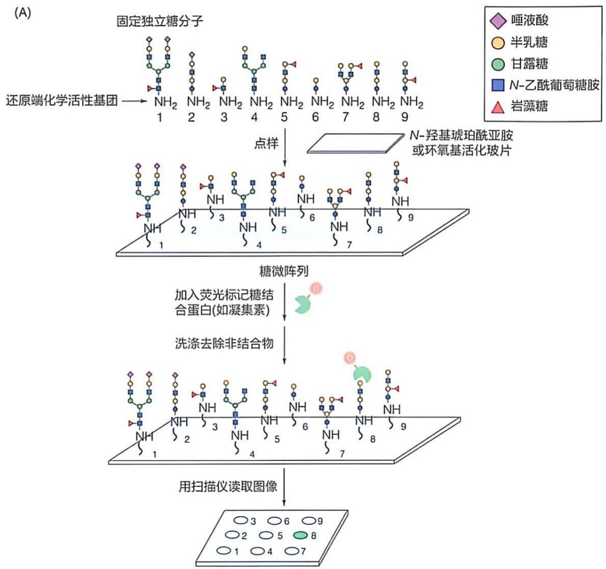

flowchart

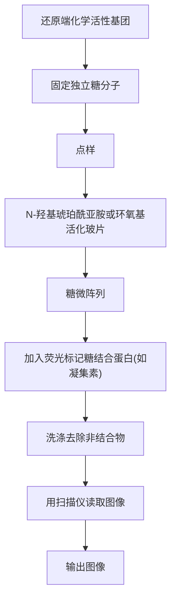

结果:糖结合蛋白与8号糖分子结合

(B)

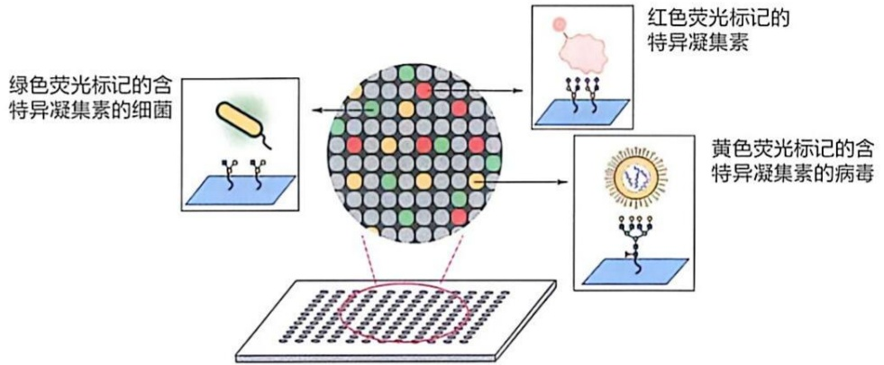

flowchart

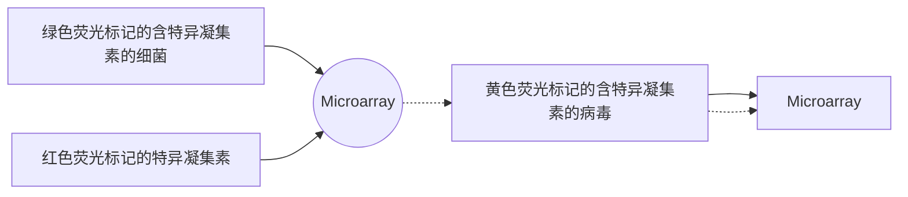

糖微阵列上结合的不同糖结合蛋白样品可通过不同荧光信号检测

荧光标记或利用  $His_{6}$  标签标记（配合荧光标记抗  $His_{6}$  标签抗体检测）等方法。将标记后的凝集素与微阵列孵育后，使用高灵敏度荧光扫描仪检测结合信号，通过定量分析确定特异性识别关系。

---

14.6 活细胞中寡糖与多糖的动态标记及高分辨率成像技术正处于快速发展阶段

039

此外，该技术还可拓展应用于糖苷酶底物特异性研究，例如采用糖基化近红外荧光探针，通过监测酶切导致的荧光信号变化来鉴定酶的特异作用位点。整个检测过程需设置阳性和阴性对照，并进行信号标准化处理以确保数据可靠性。

## 14.5.4 具有特定结构的寡糖可通过固相方法人工合成

固相合成法是一种高效的寡糖人工合成策略，其核心原理与寡肽或寡核苷酸的人工固相合成类似（见图5-21和图7-19），也需采取基团保护、活化等措施。具体而言，先将糖基受体固定在固相载体（如树脂、玻璃微珠）上，通过逐步的糖基化反应延长糖链。与传统的液相合成相比，固相合成可通过简单的洗涤步骤去除未反应的试剂和副产物，显著提高反应效率。例如，首先将起始单糖的羟基（一般是异头碳羟基）通过连接臂（如苄醚或酯键）锚定在固相载体上，随后依次加入所有羟基被保护的第二个单糖基供体，在去除特异羟基上的保护基团并激活有关羟基后完成糖苷键的偶联。每步反应后，过量试剂可通过过滤等方法有效去除，从而实现寡糖链的定向延伸。

固相合成法尤其适用于具有特定序列或分支结构的寡糖制备。通过预先设计保护基团（如乙酰基、苄基）的选择性脱除，可精确控制糖基化位点与立体构型（ $\alpha/\beta$ ）。例如，在合成肿瘤相关抗原路易斯X（Lewis X）三糖（见图14-29，不含唾液酸的形式）时，在将N-乙酰葡萄糖胺共价连接于固相载体后，再与某些羟基被保护的半乳糖和岩藻糖通过特异的糖苷键连接，最终去除保护基团后获得特异的三糖产物。此外，自动化固相合成仪的引入进一步提升了重现性，使得复杂寡糖（如由三个二糖单位重复连接形成的肝素六糖，见图14-24）的合成成为可能。这种方法在糖类药物开发（如抗凝剂、疫苗）中展现出巨大潜力，因其结构明确且可规模化生产。

## 14.6 活细胞中寡糖与多糖的动态标记及高分辨率成像技术正处于快速发展阶段

生命分子在活体环境中的功能研究至关重要，但相较于核酸和蛋白质，寡糖和多糖的原位标记与成像面临更大挑战。例如，绿色荧光蛋白（GFP）融合表达可高效标记目标蛋白质，实现活细胞内的动态追踪，但类似策略无法直接应用于多糖。这是因为多糖不像蛋白质那样由模板指导合成，且缺乏特异的识别与标记工具。因此，开发适用于糖链的活细胞标记技术成为糖生物学的重要研究方向。

目前较为成熟的方法是使用含叠氮基团的非天然单糖 [如叠氮-半乳糖（azido-Gal）]，这些分子可被细胞摄取并整合到糖链中。随后，通过生物正交反应（如点击化

---

040

14 糖类

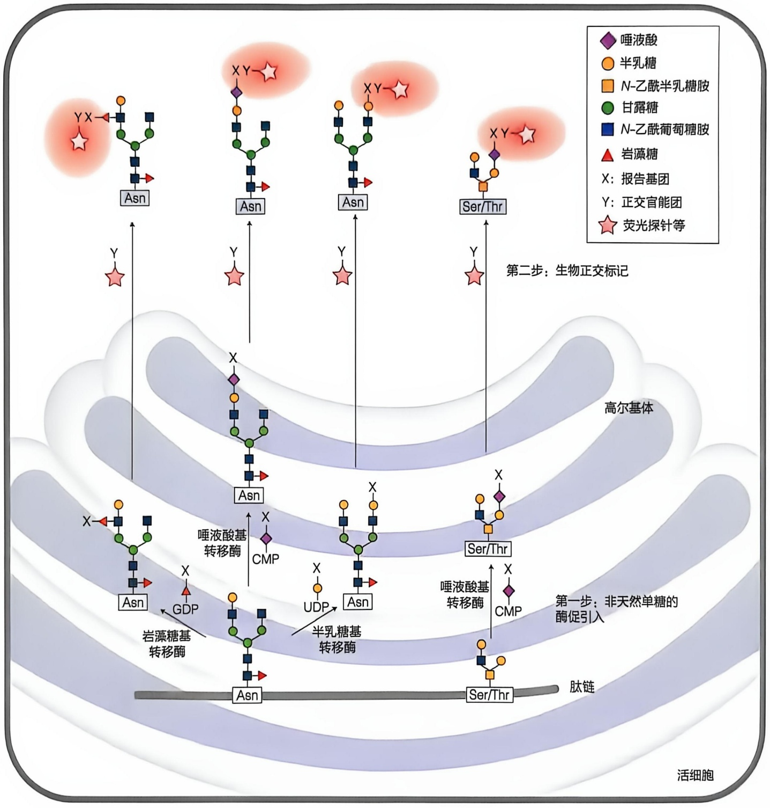

flowchart

This diagram illustrates the biochemical pathway of a biological process involving Asn and Ser/Thr enzymes, showing how various sugar substrates (Asn, Ser/Thr) are converted into compounds like Asn or Ser/Thr, leading to downstream signaling pathways such as glutamate metabolism and nucleic acid activation.

图 14-33 活细胞内的寡糖代谢标记策略

学）使叠氮基团与带有荧光基团的探针［如二苯并环辛炔-花青素5（DBCO-Cy5）] $^{①}$ 共价结合，从而实现多糖的可视化（图14-33）。这种策略的关键优势在于生物正交反应不会干扰细胞正常代谢，适用于活细胞成像。近年来，该技术不断优化，例如开发更低毒性的代谢前体、提高标记效率，并结合超分辨显微技术实现更高精度的糖链

<small>① 二苯并环辛炔是一种高反应性的环炔基团，可与叠氮基团发生有效的加成反应，花青素5为一种红色荧光染料。</small>

---

本章小结

041

动态追踪。未来，结合多组学分析和人工智能辅助成像的技术有望在糖基化调控机制和疾病相关糖链研究中发挥更大作用。

## ※展望

随着高灵敏度质谱、冷冻电镜和人工智能辅助结构预测等技术的快速发展，糖链的精细结构解析将迎来突破性进展。糖组学与单细胞测序技术的结合，有望实现复杂生物样本中糖链的时空动态追踪，揭示糖基化修饰在细胞通信、免疫调控和疾病发生中的精确作用机制。此外，化学酶法合成与生物正交标记技术的优化，将为糖链功能研究提供更精准的工具，推动糖生物学从定性描述向定量分析转变。

糖链作为重要的生物信息分子，其研究正与疾病诊断、药物开发及合成生物学紧密结合。例如，肿瘤特异性糖链标志物的发现将助力早期癌症检测，而基于糖结构的疫苗设计（如细菌多糖结合疫苗）和糖基化工程抗体（如去岩藻糖基化抗体）的开发，将为疾病治疗提供新策略。人工设计的功能性糖链未来可能应用于组织工程、药物递送系统甚至生物材料领域，推动糖科学向产业化方向拓展。

尽管糖生物学发展迅速，但是糖链的结构复杂性和合成难度仍是重大挑战。通过整合自动化合成平台、机器学习驱动的糖链设计，以及基因编辑技术（如CRISPR调控糖基转移酶表达），研究者有望突破这些瓶颈。同时，探索糖-微生物组互作、糖链在神经退行性疾病中的作用等新兴领域，可能为生命科学和医学带来全新认知。多学科协作将成为糖生物学突破的关键，最终实现从基础研究到临床转化的全链条创新。

## ※ 本章小结

糖类分子是由多羟基醛、多羟基酮及其衍生物构成的重要生物分子，根据聚合程度可分为单糖（如葡萄糖）、寡糖（如蔗糖）、多糖（如淀粉）和糖缀合物（如糖蛋白）四大类。

糖类分子因其独特的结构特征（如羟基数量、异头碳构型和糖苷键类型）而表现出各异的理化性质，包括溶解度、甜度、旋光性等特性。

糖类不仅是生物体重要的能源物质（如葡萄糖供能）和结构基础（如纤维素构成细胞壁），更在细胞代谢调控、分子识别（如血型抗原）和细胞间通信（如糖蛋白信号转导）等生命过程中发挥关键作用。

单糖分子通过糖苷键共价连接形成寡糖和多糖，而三糖及以上的寡糖则进一步与蛋白质或脂质通过共价键结合，形成糖缀合物（如糖蛋白和糖脂）。

蛋白质糖基化主要包括 O- 糖基化和 N- 糖基化两种类型，其中 O- 糖基化发生在丝氨酸或苏氨酸残基，而 N- 糖基化则特异性作用于天冬酰胺残基。

凝集素是一类广泛存在于动物、植物和微生物中，能够特异性识别并结合糖链且具有多价结合能力的蛋白质分子。

---

042

14 糖类

多种物理化学技术（如核磁共振波谱和质谱）可实现对寡糖序列和结构的体外精确解析。

代谢标记（如非天然糖类似物）为活细胞内寡糖和多糖的动态标记与高分辨成像提供了有效手段，极大地促进了糖基化修饰的生物学功能研究。

## ※ 思考题

1. 试比较革兰氏阴性菌（如大肠杆菌）与革兰氏阳性菌（如金黄色葡萄球菌）细胞壁在化学组成、空间结构和功能特性方面的差异。
2. 从作用位点、水解产物和酶学特性三个维度，分析 $\alpha-$ 淀粉酶与 $\beta-$ 淀粉酶的生物学差异。
3. 阐述 $O-$ 糖苷键与 $N-$ 糖苷键在形成位点、核心结构和生物合成途径上的区别，举例说明这两类糖苷键在重要糖缀合物中的存在形式。
4. 对比分析淀粉、糖原和纤维素在以下方面的异同:

○ 单糖组成与糖苷键类型
- 分子空间结构特征
- 生物学功能定位

5. 定义旋光性和变旋现象，从结构角度解释其产生机制，并通过具体实例说明:

- 为何具有旋光性的物质不一定表现变旋性（如蔗糖）
- 具有变旋性的物质必然具有旋光性（如葡萄糖）

6. 从组成比例、结构特点和生物合成途径三个方面，阐述糖蛋白与蛋白聚糖的本质区别。各举两类代表性分子，说明它们在细胞识别、信号传导等过程中的生物学功能。

## ※ 推荐阅读

1. YANG X Y, QIAN K. Protein O-GlcNAcylation: emerging mechanisms and functions [J]. Nat Rev Mol Cell Biol, 2017, 18 (7): 452-465.
这篇综述系统阐述蛋白质 O-GlcNAc 修饰的分子机制及其生物学功能。
2. LU H J, ZHANG Y, YANG P Y. Advancements in mass spectrometry-based glycoproteomics and glycomics [J]. Nat Sci Rev, 2016, 3 (3): 345-364.
综述质谱技术在糖蛋白组学和糖组学领域的研究进展，全面梳理该技术在糖基化研究中的应用，涵盖从糖链释放、糖肽富集到质谱分析的全流程技术发展。
3. CHENG B, TANG Q, ZHANG C, et al. Glycan labeling and analysis in cells and in vivo [J]. Annu Rev Anal Chem, 2021, 14 (1): 363–387.

综述糖质标记与分析技术在细胞和活体研究中的研究进展，聚焦代谢标记、生物正交化学及基因编码等创新方法。

---

推荐阅读

043

4. HEIMBURG-MOLINARO J, MEHTA A Y, TILTON C A, et al. Insights into glycobiology and the protein-glycan interactome using glycan microarray technologies [J]. Mol Cell Proteomics, 2024, 23 (11): 100844.

这篇文章介绍糖生物学和蛋白质-聚糖互作组的研究进展，聚焦于糖微阵列技术的应用。

(撰写: 李珍, 秦咏梅, 王鹏, 易文; 审修: 刘逸松, 曹玉婷)
