# 15 脂质

原始 PDF 第 61–95 页。

## 15

## 脂质

脂质是一类疏水性生物分子，具有难溶于水但易溶于有机溶剂的特性。作为生命体的基本组成成分，脂质不仅参与细胞结构的构建，还直接调控能量代谢、信号转导等关键生命活动。其分子结构的高度多样性与其广泛的生物学功能密切相关，使得脂质研究成为现代生物化学的核心领域之一。

从化学组成来看，脂质主要由碳、氢元素构成，部分含有氧、磷、氮等元素。这种简单的元素组成却衍生出复杂多样的分子结构:既有长链脂肪酸这样的线性分子，也有胆固醇这样的环状分子，还有磷脂这样的两亲性分子。正是这种结构多样性赋予了脂质多种重要生理功能。

脂质在生物体内发挥着三大核心功能:首先作为高效的储能物质（如甘油三酯），其次构成生物膜的基本骨架（如磷脂双分子层），最后参与细胞信号转导（如类固醇激素）。此外，特殊结构的脂质还具有独特功能，如皮肤角质层中的神经酰胺形成防水屏障，皮下脂肪组织兼具储能和保温作用。这些功能都与脂质分子的特定结构密不可分。

鉴于脂质在生命活动中的重要作用，本章将系统介绍其分类体系、特征结构、理化性质，以及现代脂质分析技术，为深入理解脂质在生理和病理过程中的作用奠定基础。

---

15.2 脂肪酸是多种脂质分子的关键结构单元

045

## 15.1 脂质分子的结构高度多样

人类对脂质的认识最早源于生活实践。远古时期，人们通过烤肉时油脂燃烧产生的火焰和香味，直观感受到肉类中含有独特的油脂成分。这种感性认知为后续科学研究奠定了基础。

19 世纪初，脂质研究进入系统化阶段。1815 年，法国学者亨利·布拉科诺（Henri Braconnot，1780—1855）首次对固态和液态脂质进行了区分。随后，法国学者米歇尔-欧仁·谢弗勒尔（Michel-Eugène Chevreul，1786—1889）通过研究动物脂肪的皂化反应，揭示了脂肪由脂肪酸和甘油组成的化学本质。到 1840 年代，法国学者西奥多·戈布利（Théodore Gobley，1816—1878）在蛋黄和动物脑组织中发现了含磷的卵磷脂（lecithin）这种脂质，这一发现标志着对脂质复杂性的认识迈上一个新台阶。

现代研究表明，脂质是一类结构复杂多样的生物分子。其分子中不仅含有饱和及不饱和碳链，还可能存在苯环等特殊结构。这种结构多样性使脂质呈现出丰富的理化性质，从而在生命活动中发挥多种重要功能。

从最初的感性认知到现代分子层面的研究，人类对脂质的认识不断深化，最终揭开了脂质的奥秘。

根据分子结构特征，脂质可系统性地划分为以下八大类别。①脂肪酸类（fatty acid, FA）:脂质的基本结构单元。②甘油脂类（glycerolipid, GL）:甘油骨架的酯化产物。③甘油磷脂类（glycerophospholipid, GP）:含磷酸基的膜结构脂质。④鞘脂类（sphingolipid, SP）:鞘氨醇衍生的复杂脂质。⑤糖脂类（saccharolipid, SL）:糖基化修饰的功能性脂质。⑥固醇类（sterol lipid, ST）:含四环甾核结构的特征性脂质。⑦类异戊二烯脂类（prenol lipid, PR）:异戊二烯单元聚合产物。⑧聚酮类（polyketide, PK）:次级代谢产生的多样性分子。

脂质分子还可根据其生物合成途径分为两大类:一类以酮脂酰基（ketoacyl；如乙酰基或丙酰基）为基本单元，包括脂肪酸及其衍生物（如甘油三酯、磷脂）；另一类以异戊二烯为构建模块，涵盖固醇类（如胆固醇）和萜类化合物。

此外，根据极性差异，脂质也可分为极性脂质（如磷脂、游离脂肪酸等具有亲水和疏水两亲性的分子）和中性脂质（如甘油三酯、胆固醇酯等非极性储存脂质）。这种分类方式既反映了脂质的代谢来源，又体现了其结构和功能的多样性。

这些类型脂质分子的具体结构和功能将在后续章节中详细介绍。

## 15.2 脂肪酸是多种脂质分子的关键结构单元

脂肪酸（fatty acid）是由疏水的脂肪烃链和亲水的羧基（—COOH）组成的两亲性分子。作为最简单且分布最广的脂质类别，它们不仅是构成复杂脂质（如甘油三酯、磷脂）的核心结构单元，更是以甘油三酯形式作为生物体高效的能量储存形式。此

---

046

15 脂质

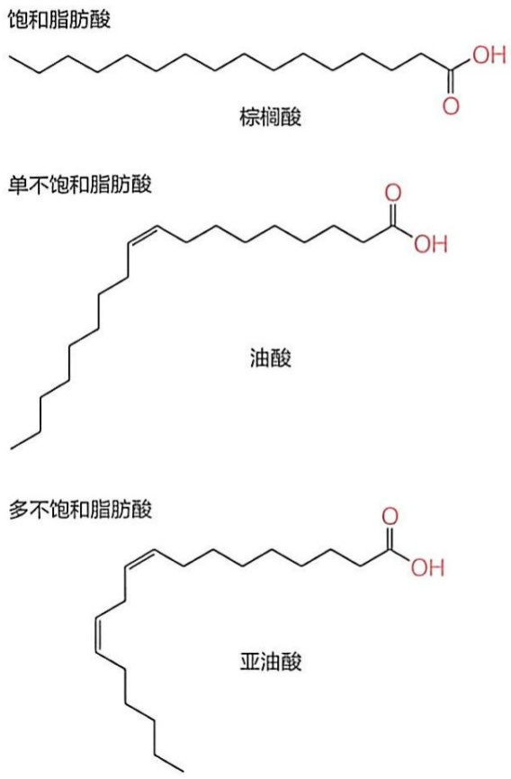

图 15-1 典型脂肪酸结构比较

外，游离脂肪酸及其代谢衍生物（如类二十烷酸）还作为重要的信号分子参与多种生理过程的调控，展现出多样的生物活性。

## 15.2.1 脂肪酸烃链的结构多样性

脂肪酸根据碳链长度可分为四类:短链（<6个C）、中链（6\~12个C）、长链（13\~21个C）和超长链（≥22个C）。自然界中脂肪酸的碳链主要以直链形式存在，但也存在少量具有甲基侧链的支链脂肪酸。生物体内绝大多数脂肪酸的碳原子数在4\~36个范围内，其中长链脂肪酸最为常见。

从饱和度来看，脂肪酸可分为饱和脂肪酸（仅含C—C单键）和不饱和脂肪酸（含C=C双键）。不饱和脂肪酸进一步分为单不饱和（1个双键）和多不饱和（≥2个双键）两类（图15-1）。值得注意的是，生物体内存在的不饱和脂肪酸中的双键多为顺式构型，这种结构赋予脂肪酸特定的空间构象，显著影响其熔点和流动性等理化性质。多不饱和脂肪酸因其特殊的结构性质，在细胞膜功能和信号转导中发挥重要作用。

## 15.2.2 脂肪酸的命名体系与表示方法

脂肪酸的命名主要采用三种方法:俗名、系统名和缩写符号。由于脂肪酸种类繁多且发现历史久远，不同命名方式各有特点，共同构成不同的分类体系。

俗名是基于其来源的传统命名。常见的脂肪酸通常以最初分离它们的生物材料命名，如棕榈酸（palmitic acid）源自棕榈油，油酸（oleic acid）源自橄榄油，亚油酸（linoleic acid）和亚麻酸（linolenic acid）均源自亚麻籽油。然而，这种命名方式可能导致混淆，例如同一脂肪酸有多个名称，或不同脂肪酸共享一个名称。

系统名是规定的标准化学命名，由国际纯粹与应用化学联合会（IUPAC）制定。具体而言，饱和脂肪酸以碳原子数命名，如棕榈酸的系统名为“正构-十六酸”（n-hexadecanoic acid） $^{①}$ 。不饱和脂肪酸需标明双键位置和构型，如油酸的系统名为“顺-9-十八碳烯酸”（(9Z)-octadecenoic acid） $^{②}$ ，亚油酸的系统名为“全顺-9,12-十八碳二烯酸”（(9Z,12Z)-octadecadienoic acid）。

缩写符号为简化的结构表示法。它平衡了俗名的模糊性和系统名的复杂性，被广泛使用。具体格式为:碳数:双键数  $\Delta^{双键位置}$  （如棕榈酸为 16:0，油酸为  $18:1\Delta^{9}$ ）。在

<small>① 这里的 n 代表 normal，表示分子中的碳链无分支，为直链。</small>

<small>② 这里的 Z 来源于德文，表示顺式，相当于英文的 cis；反式则表示为 E，相当于英文的 trans。</small>

---

15.2 脂肪酸是多种脂质分子的关键结构单元

047

这样的缩写符号表示法中，默认的规则是:未标明双键构型时，默认均为顺式（生物体内存在的不饱和脂肪酸中所含双键一般都为顺式）。这种表示法简洁且信息完整，便于学术交流。

代表性脂肪酸的俗名、系统名和缩写符号如表 15-1 所示。

表 15-1 代表性脂肪酸的俗名、系统名和缩写符号

| 俗名 | 系统名 | 缩写符号 |
| --- | --- | --- |
| 棕榈酸(软脂酸) | n-十六酸 | 16:0 |
| palmitic acid | n-hexadecanoic acid |  |
| 硬脂酸 | n-十八酸 | 18:0 |
| stearic acid | n-octadecanoic acid |  |
| 棕榈油酸 | 十六碳-9-烯酸(顺) | $16:1\Delta^9$ |
| palmitoleic acid | (9Z)-hexadecenoic acid |  |
| 油酸 | 十八碳-9-烯酸(顺) | $18:1\Delta^9$ |
| oleic acid | (9Z)-octadecenoic acid |  |
| 亚油酸 | 十八碳-9,12-二烯酸(顺,顺) | $18:2\Delta^{9,12}$ |
| linoleic acid | (9Z,12Z)-octadecadienoic acid |  |
| α-亚麻酸 | 十八碳-9,12,15-三烯酸(全顺) | $18:3\Delta^{9,12,15}$ |
| α-linolenic acid | (9Z,12Z,15Z)-octadecatrienoic acid |  |
| 花生四烯酸 | 二十碳-5,8,11,14-四烯酸(全顺) | $20:4\Delta^{5,8,11,14}$ |
| arachidonic acid | (5Z,8Z,11Z,14Z)-icosatetraenoic acid |  |

## 15.2.3 脂肪酸理化特性的关键影响因素是其碳链长度与不饱和度

脂肪酸的多样性和复杂性主要取决于其碳链长度和碳碳键的不饱和度，这些结构特征赋予不同脂肪酸独特的化学性质、物理性质及空间结构。作为脂质的主要构成单元，脂肪酸的结构特性直接影响多种脂质的理化性质和生物学功能。因此，脂肪酸的结构差异决定了多种关键生物过程的发生与发展。

## （1）脂肪酸的化学性质主要由羧基的酸性特征及双键的反应活性体现

脂肪酸的酸性主要取决于其碳链长度，其中甲酸（俗名蚁酸，HCOOH； $pK_{a}=3.75$ ）酸性最强，而乙酸（俗名醋酸， $CH_{3}COOH$ ； $pK_{a}=4.76$ ）酸性减弱到约十分之一。随着碳链增长（如丙酸， $pK_{a}=4.87$ ），酸性进一步降低，表明短链脂肪酸更易解离质子。

脂肪酸的化学反应活性主要由羧基和 C=C 双键决定。羧基可以与其他生物有机分子的羟基通过脱水缩合形成羧酸酯键（carboxylic ester bond；它有别于磷酸酯键）。甘油三酯、甘油磷脂、胆固醇酯等脂质分子中均含有这样的羧酸酯键（图 15-2）。此

---

048

15 脂质

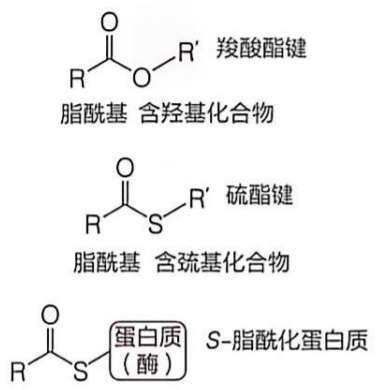

chemical

Chemical structures of acetic acid, sulfuric acid, and S-acyl-CoA functional groups with Chinese labels

图15-2 酯键与硫酯键的化学结构比较

外，脂肪酸羧基的质子也可以被金属离子替换，使脂肪酸转变为脂肪酸盐；传统肥皂即是通过甘油三酯与氢氧化钠发生皂化反应形成的脂肪酸盐。脂肪酸的羧基还能够与巯基（来自蛋白质中半胱氨酸侧链或其他分子）脱水缩合，形成硫酯键（thioester bond）；通过这样的缩合，可生成S-脂酰化蛋白质（S-acylated protein）（图15-2）。值得注意的是，蛋白质的S-脂酰化反应一般都是可逆的，可调节该蛋白以锚定于生物膜上的形式存在，或者以非锚定形式存在。

脂肪酸的 C=C 双键具有重要化学反应活性，既可以加氢还原为单键，也可以加水形成羟基脂肪酸。在生物体特异酶的催化下，脂肪酸分子中可以形成或消除 C=C 双键。

特别需要注意的是，多不饱和脂肪酸中的 C=C 双键在高温条件下与空气中的氧气发生自发氧化反应。这一过程始于双键邻位亚甲基碳氢键的均裂，随后与氧分子反应形成过氧化物自由基，引发链式反应，最终降解产生醛类（如丙二醛）、酮类等有害物质。这些氧化产物不仅降低食品营养价值、产生不良风味，还可能对人体健康造成危害。因此，富含多不饱和脂肪酸的植物油（以甘油三酯形式存在，如亚麻籽油、葵花籽油）应避免高温烹调，煎炸等烹饪宜选择热稳定性更好的油脂（如棕榈油、高油酸葵花籽油）。

## (2) 脂肪酸的物理性质主要由碳链长度、不饱和度及双键构型决定

脂肪酸的物理性质主要受碳链长度和顺式 C=C 双键数量的影响。作为典型的两亲性分子，脂肪酸的溶解行为表现出明显的碳数依赖性:短链脂肪酸因羧基占比高而具有强极性和完全水溶性；随着碳链增长（≥12 个 C），分子非极性增强，水溶性显

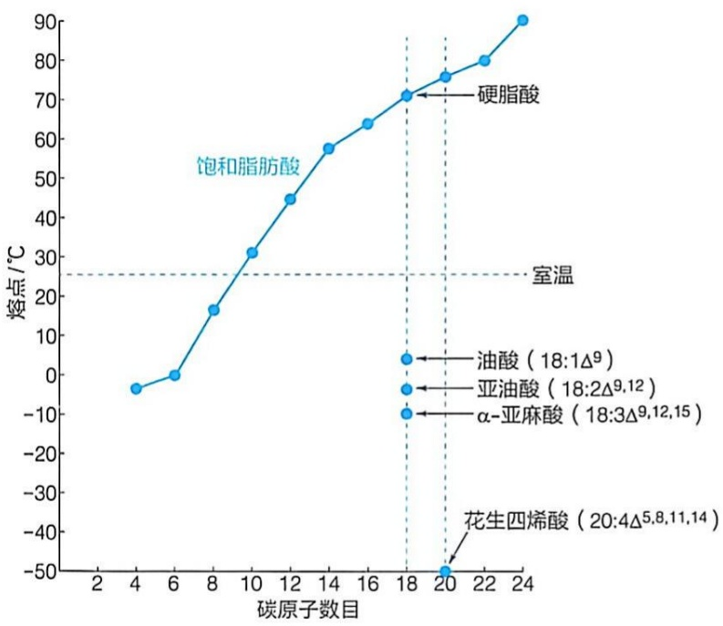

line

| 碳原子数目 | 熔点 \(({}^{\circ}C)\) |
| --- | --- |
| 4 | ~-3 |
| 6 | 0 |
| 8 | ~17 |
| 10 | ~32 |
| 12 | ~45 |
| 14 | ~58 |
| 16 | ~64 |
| 18 | ~71 |
| 20 | ~76 |
| 22 | ~80 |
| 24 | ~90 |

图 15-3 脂肪酸的熔点与碳链长度和不饱和度的相关性

著降低，但在有机溶剂中的溶解性相应提高。这种溶解特性转变的临界点通常出现在五碳或六碳脂肪酸。

脂肪酸的相变行为同样遵循明确的结构依赖性:熔点随碳链延长而升高（每增加一个 $CH_{2}$ 基团提高约5\~7℃），但顺式双键的引入会通过破坏分子规整堆积，使熔点骤降（图15-3）。例如，18碳脂肪酸系列中，饱和的硬脂酸（18:0）熔点为70℃，而含1个双键的油酸（18:1 $\Delta^{9}$ ）降至4℃，含3个双键的α-亚麻酸（18:3 $\Delta^{9,12,15}$ ）更降至-11℃。值得注意的是，当碳链超过18个原子时，不饱和度对熔点的调控作用会超越链长效应，这为通过油脂凝固温度快速评估其不饱和度提供了理论依据。

---

15.2 脂肪酸是多种脂质分子的关键结构单元

049

## (3) 脂肪酸分子的空间结构具有多样性

脂肪酸的空间结构具有显著的三维特性。成键碳原子的四面体结构特征（见图1-8A）使得烃链呈现三维结构，而非简单的平面锯齿形（图15-1）。C—C单键的自由旋转（能垒约12 kJ/mol）赋予分子构象灵活性，而C=C双键则形成刚性平面结构——顺式双键使碳链产生约30°的弯折，显著影响分子堆积（图15-1）。这种结构差异直接导致不饱和脂肪酸的分子间作用力减弱，较饱和脂肪酸增加15%\~20%的分子间隙。

在生物膜系统中，顺式不饱和脂肪酸的弯折结构对膜性质具有关键调控作用。含油酸（18:1 $\Delta^{9}$ ）的磷脂双分子层相变温度较硬脂酸（18:0）降低约50℃（图15-3），膜流动性提升3\~5倍。这种效应使细胞能通过调节脂肪酸去饱和酶活性，动态改变膜脂组成以应对温度变化。例如，低温条件下大肠杆菌可将其膜脂不饱和度从20%提升至50%，以维持膜的正常功能状态。这种适应性调节机制在真核生物（如酵母耐冷突变体）中同样保守存在。

## (4) 脂肪酸的高还原态碳链使其可通过氧化分解释放大量自由能

甘油三酯作为生物体最高效的能量储存形式，其能量密度（37 kJ/g）约为糖原的2.5倍，这主要源于脂肪酸碳链的高度还原特性。在真核细胞中，脂肪酸主要通过线粒体β氧化逐步裂解为乙酰辅酶A，经柠檬酸循环和氧化磷酸化彻底氧化。以1分子棕榈酸（16:0）为例，完全氧化可净生成大约106分子ATP，显著高于1分子葡萄糖彻底氧化产生的ATP产量（约30～32分子）。值得注意的是，甘油三酯的能量产出效率受脂肪酸结构影响:碳链越长、饱和度越高，其理论ATP产量越大，如硬脂酸（18:0）比油酸（18:1Δ⁹）多产生1.5个ATP分子，这种差异使生物体能通过调节脂肪组成来优化能量储备策略。

## 15.2.4 哺乳动物必须从饮食中获取某些不饱和脂肪酸

所有哺乳动物均需亚油酸（18:2 $\Delta^{9,12}$ ）和α-亚麻酸（18:3 $\Delta^{9,12,15}$ ）这两种多不饱和脂肪酸以维持生理功能。由于哺乳动物缺乏 $\Delta^{12}$ 和 $\Delta^{15}$ 去饱和酶，无法在脂肪酸的 $\Delta^{12}$ 或 $\Delta^{15}$ 位引入双键，因此无法从头合成这两种脂肪酸，必须依赖膳食摄入，故被称作必需脂肪酸（essential fatty acid）。

根据传统，亚油酸和  $\alpha-$  亚麻酸被分别称作  $\omega-6$  和  $\omega-3$  脂肪酸。与前面的系统命名法从羧基端对碳原子编号不同，这种  $\omega$ （希腊字母中的最后一个字母）命名法是从脂肪酸的另一端，即甲基碳（ $\omega$  端）开始对碳原子编号。在多不饱和脂肪酸分子中，距羧基最远端的双键在倒数第 3 个碳原子上（即位于倒数第 3 和第 4 个碳原子之间）的脂肪酸称为  $\omega-3$  脂肪酸；在第 6 个碳原子上（即第 6 和第 7 个碳原子之间）的脂肪酸则称为  $\omega-6$  脂肪酸。据此，亚油酸是一种  $\omega-6$  家族脂肪酸，而  $\alpha-$  亚麻酸则为一种  $\omega-3$  家族脂肪酸（图 15-4）。

ω 命名法的优势在于以下方面:①反映代谢独立性:ω-3 和 ω-6 家族在哺乳动

---

050

15 脂质

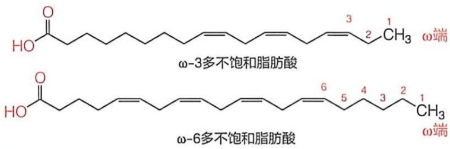

chemical

Chemical structures of two dihydroxybutyric acid derivatives with labeled carbon positions and terminal groups

图 15-4 代表性  $\omega-3$  和  $\omega-6$  多不饱和脂肪酸的结构分别以  $\alpha-$  亚麻酸（上）和花生四烯酸（下）为例。

物体内无法相互转化（因缺乏  $\Delta^{15}$  和  $\Delta^{12}$  去饱和酶），ω 命名法直接体现这种代谢隔离。②功能关联性:ω-3 和 ω-6 的衍生物在炎症、免疫等功能上作用相反，ω 命名法更易关联其生理意义。③结构稳定性:无论碳链延长或缩短（如 18 碳→20 碳），ω 编号不变；比如花生四烯酸从亚油酸（一种 ω-6 脂肪酸）衍生而来，仍为一种 ω-6 脂肪酸。

## 15.2.5 花生四烯酸通过氧化环化等转化过程生成生物活性信号分子

花生四烯酸（arachidonic acid）是一种具有20个碳原子骨架和4个C=C双键的ω-6多不饱和脂肪酸（20:4Δ$^{5,8,11,14}$）。作为类二十烷酸（eicosanoid）的前体物质，花生四烯酸通过环氧合酶和脂氧合酶代谢途径可生成多种生物活性介质，包括前列腺素（prostaglandin，PG）、血栓素（thromboxane，TX）、白三烯（leukotriene，LT）和脂氧素（lipoxin，LX）等。这些代谢产物均保留20碳骨架结构和末端羧基特征，其中前列腺素是最早被鉴定的类二十烷酸成员。

## 知识延展 15- 1

## 必需脂肪酸的发现过程

必需脂肪酸的发现归功于美国学者乔治·伯尔（George Burr，1896—1990）和他的妻子米尔德丽德·伯尔（Mildred Burr，1893—1962）。他们从1929年至1930年通过一系列开创性的实验，首次证实了某些脂肪酸对生命至关重要，并提出了“必需脂肪酸”的概念。

1920 年代，科学界普遍认为脂肪仅是能量来源，可与碳水化合物互换。伯尔夫妇最初的研究目标是维生素 E。他们在实验中试图通过无脂饮食培养不育雌性大鼠，但发现大鼠仍能繁殖，推测食物中可能混入了微量脂溶性维生素 E。

为了排除干扰，伯尔夫妇设计了一种高度纯化的饮食，仅含蔗糖、酪蛋白、矿物质和已知维生素，完全不含脂肪。喂食这种饮食的大鼠在几周后出现严重症状:皮肤出现鳞状脱屑、尾部坏死、脱毛和溃疡；生长停滞，体重下降，最终死亡；解剖显示肾脏和泌尿道严重受损。

当伯尔夫妇在饮食中添加少量猪油（仅3滴）后，大鼠的症状迅速缓解。进一步分析发现，亚油酸（一种ω-6脂肪酸）是起治疗作用的关键成分。1930年，他们正式将亚油酸和α-亚麻酸（一种ω-3脂肪酸）定义为“必需脂肪酸”，即人体无法合成、必须从食物中获取的脂肪酸。

1958 年，人类婴儿必需脂肪酸缺乏症被确认，补充亚油酸可改善皮肤症状。2012 年，高纯度二十碳五烯酸乙酯（一种  $\omega-3$  脂肪酸衍生物）获美国食品药品监督管理局（FDA）批准，用于心血管疾病治疗，验证了伯尔夫妇发现的临床价值。伯尔夫妇的工作颠覆了脂肪仅是能量来源的传统认知，奠定了现代脂类营养学的基础。他们的发现至今仍影响着膳食指南和功能性食品的开发。

---

15.2 脂肪酸是多种脂质分子的关键结构单元

051

## (1) 前列腺素

前列腺素是瑞典学者乌尔夫·冯·奥伊勒（Ulf von Euler，1905—1983）和英国学者莫里斯·戈德布拉特（Maurice Goldblatt，1895—1967）在1930年代从人类精液和动物组织中分离出来的一种生物活性物质，被命名为“前列腺素”（误认为其源自前列腺）。瑞典学者苏内·贝里斯特伦（Sune Bergström，1916—2004）证实前列腺素是一类具有多种生理功能的脂质化合物。

前列腺素的合成主要是通过花生四烯酸在3个碳原子（9位、11位和15位）上发生加氧反应，并在8位和12位碳原子之间形成一个五元环。前列腺素的生物合成主要通过花生四烯酸在环氧合酶催化下完成。其核心步骤包括:①在9、11和15位碳原子发生特异性加氧反应，形成羟基和羰基；②随后8位和12位碳原子通过分子内缩合形成特征性五元环结构，即环戊烷骨架（图15-5）。前列腺素均以环戊烷骨架为核心结构，根据环上取代基类型、双键位置及侧链修饰可分为9大类（PGA—PGI；$\mathrm{PGD}_2$ 和 $\mathrm{PGE}_2$ 的结构如图15-5所示，下标数字表示双键的数目）。其结构差异直接决定生物学功能的特异性。

## (2) 血栓素

血栓素是一类具有独特结构和重要生理功能的前列腺素类物质，其结构与功能特征如下。从花生四烯酸衍生出血栓素的过程中，由花生四烯酸中的8位和12位碳原子之间形成含醚键的六元环（代替前列腺素中的环戊烷环）。其中的血栓素 $A_{2}(TXA_{2})$ 是一种重要的生物活性物质，在人体生理和病理过程中发挥着关键作用。血栓素 $A_{2}$ 含一种双环结构:一个高反应性的含醚键四元环和一个含醚键的六元环。独特的四元

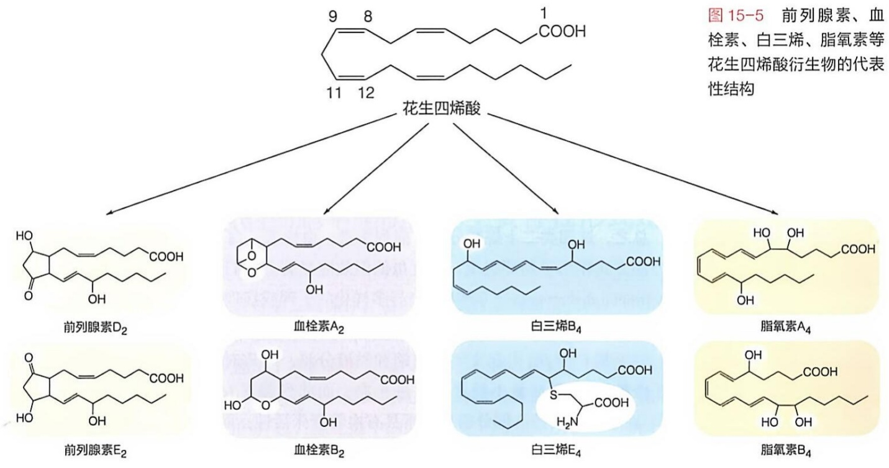

flowchart

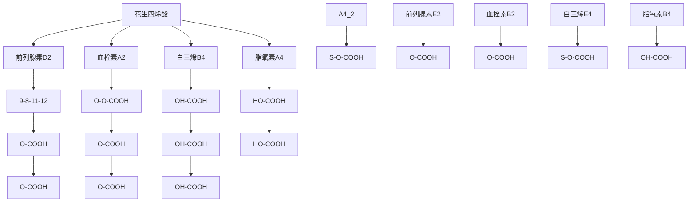

---

052

15 脂质

环结构使 $\mathrm{TXA}_2$ 具有极强的生物活性但极不稳定（半衰期仅约 $30\mathrm{s}$），会迅速水解开环转化为稳定的六元环结构，形成血栓素 $\mathrm{B}_2$（$\mathrm{TXB}_2$）；同时伴随C9和C11位两个羟基的形成（图15-5），导致生物活性显著降低。这一特性使得 $\mathrm{TXA}_2$ 成为体内快速响应的局部信号分子，主要在血小板活化初期发挥促聚集作用。失去生物活性的血栓素 $\mathrm{B}_2$ 可作为血栓素 $\mathrm{A}_2$ 生成的标志物用于临床检测。

## (3) 白三烯

白三烯是另一类重要的花生四烯酸衍生物。与花生四烯酸相比，白三烯分子保留了四个 $\mathrm{C} = \mathrm{C}$ 双键，且其中的三个双键形成稳定的共轭体系，这一结构特征显著增强了分子的化学反应性。

白三烯具有两种不同的结构类型（图15-5）:一种在C5和C12位含羟基，典型的如白三烯 $\mathrm{B_4}$ （$\Delta^{6,8,10,14}$），是强效的炎症介质和趋化因子；另一种则含有半胱氨酰修饰，称为半胱氨酰白三烯，如白三烯 $\mathrm{E_4}$ （$\Delta^{7,9,11,14}$）。半胱氨酰白三烯是在谷胱甘肽硫转移酶催化下形成的，在C6位形成半胱氨酰硫醚键，具有显著的支气管收缩和血管通透性调节作用。

共轭双键系统赋予分子平面性，有利于与受体结合；而末端修饰（羟基或半胱氨酰基团）则决定其特定的生物学活性和受体选择性。这种结构多样性使得白三烯能够参与多种病理生理过程，包括炎症反应、过敏反应和呼吸道疾病的发生发展。

白三烯是哮喘类过敏反应的关键介质，这使得阻止白三烯活性成为抗哮喘的重要途径。比如，抗哮喘药物孟鲁司特（Montelukast）是一种选择性半胱氨酰白三烯受体1的拮抗剂，其抗哮喘机制主要通过阻断白三烯介导的炎症和支气管收缩反应实现；药物分子中的共轭系统和特征性修饰是其发挥生物学活性的分子基础。

## (4) 脂氧素

脂氧素由花生四烯酸通过脂氧合酶途径合成。脂氧素也被称为三羟二十碳四烯酸，其分子中存在四个共轭双键和三个羟基。依据双键位置和羟基位置的差异，脂氧素一般被分为脂氧素 $\mathrm{A}_4$ 和脂氧素 $\mathrm{B}_4$ 两种亚型（图15-5）。脂氧素 $\mathrm{A}_4$ 中的三个羟基分别位于C5、C6和C15位，四个共轭键为 $\Delta^{7,9,11,13}$；而脂氧素 $\mathrm{B}_4$ 中的三个羟基分别位于C5、C14和C15位，四个共轭键为 $\Delta^{6,8,10,12}$。此外，在两类脂氧素分子中，羟基的空间取向不同，这也会导致受体结合特异性差异。脂氧素是内源性炎症消退介质的核心成员，功能上表现为“促消退”而非单纯抗炎。

总之，这四类二十烷酸分子（前列腺素、血栓素、白三烯、脂氧素）以自分泌或旁分泌方式作用于局部组织，浓度虽低但效应显著。它们均通过 G 蛋白偶联受体（G protein-coupled receptor，GPCR）介导多样化的生理或病理效应。

它们的生理功能涉及促炎作用（如前列腺素 $\mathrm{E}_2$ 诱发发热、疼痛和血管通透性增加；白三烯 $\mathrm{C_4 / D_4 / E_4}$ 引起支气管收缩和黏液分泌，严重时可导致炎症风暴）、凝血调节（血栓素 $\mathrm{A}_2$ 激活血小板聚集促进止血，而前列腺素 $\mathrm{I}_2$ 则抑制该过程维持血管通畅）、血管张力调控（部分前列腺素具有血管舒张活性，而血栓素 $\mathrm{A}_2$ 则表现为强烈收缩效应）。

---

15.3 在储存能量的细胞中脂肪酸的主要存在形式是甘油三酯

053

## 知识延展 15- 2

# 阿司匹林的开发历史与药物认识

阿司匹林是全球家喻户晓的常用药物，自19世纪末成药以来，已逐渐成为医药领域的经典代表。它属于非甾体类抗炎药，核心成分为乙酰水杨酸，是全球范围内应用最广泛的解热、镇痛及抗炎药物，也是衡量和对比其他同类药物的基准制剂。

阿司匹林的起源可追溯至古代文明。早在公元前1500年，古埃及和古希腊人就使用柳树皮缓解疼痛和发热。19世纪，科学家从柳树皮中分离出水杨苷，并进一步合成了水杨酸，但其强刺激性限制了应用。1897年，德国化学家费利克斯·霍夫曼（Felix Hoffmann，1868—1946）为让患关节炎的父亲能服用安全、顺口的药物，决心攻克水杨酸难关。他的团队成功在水杨酸分子上添加乙酰基，生成乙酰水杨酸，显著中和了水杨酸的刺激性，保护了人体胃黏膜。1899年3月6日，该药物申请专利注册，“阿司匹林（Aspirin）”正式诞生，其名称源自乙酰基（acetyl）与水杨酸来源的灌木绣线菊(Spireae)。阿司匹林一经上市便获广泛好评，为德国拜耳公司带来巨大收益。

20 世纪，阿司匹林的作用机制逐渐明晰。1971 年，英国学者约翰·文（John Vane，1927—2004）通过体外研究观察到，阿司匹林能直接抑制环氧合酶（COX）的活性，阻断花生四烯酸转化为前列腺素  $H_{2}$ ；后来通过人类志愿者，他证实口服阿司匹林同样抑制前列腺素合成，且抗炎效果与 COX 抑制强度正相关，从而确认了阿司匹林发挥抗炎、镇痛及抗血小板凝聚作用的分子机制。这一突破使阿司匹林的应用从单纯的解热镇痛扩展到心血管疾病预防，如抑制血小板聚集以降低心梗和卒中风险。

从柳树皮到现代医学基石，阿司匹林的开发历史展现了传统医学与现代科学的融合。它不仅是药物化学的重要里程碑，更持续影响着临床治疗策略，成为药物研发史上最具影响力的经典案例之一。

基于其病理作用，相关抑制剂已成为重要临床药物，比如:环氧合酶抑制剂阿司匹林通过不可逆抑制环氧合酶-1（cyclooxygenase-1，COX-1）而减少促炎性前列腺素和血栓素 $\mathrm{A}_2$ 生成，实现抗炎、镇痛及抗血栓效果；白三烯受体拮抗剂孟鲁司特可用于哮喘和过敏性疾病治疗；等等。

## 15.3 在储存能量的细胞中脂肪酸的主要存在形式是甘油三酯

脂肪酸在细胞内可转化为甘油三酯储存，也可用于膜合成或能量代谢。对甘油三酯的认识历史与甘油、油脂化学及工业应用的发展密切相关。

人类对甘油三酯的认识经历了漫长而逐步深入的过程。在古代，人们虽然没有甘油三酯这一科学概念，但在日常生活中已经对与之相关的物质有了初步感知。比如人们早就知道动物油和植物油的存在，像肥肉中的脂肪，它的主要成分就是甘油三酯。人们在饮食中能感受到脂肪的独特口感和饱腹感，并且也观察到长期大量食用富含

---

054

15 脂质

脂肪的食物会让人身体发胖等现象，但当时并不能从科学层面去解释这些现象背后的本质。

随着研究的推进，脂肪根据结构被命名为甘油三酯，也叫做三酰甘油，它是人体的“能量银行”。当人们摄入过多食物，其中的淀粉和油在未通过运动消耗掉其产生的热量时，就会变成甘油三酯（脂肪）储存在身体里面；而当人体无法从食物获取能量时，又会分解体内储存的甘油三酯，释放出脂肪酸为身体提供能量。这一时期，人们开始对甘油三酯在人体中的生理功能有了较为清晰的认识。

后来，科学家们发现人体内甘油三酯总量过多会带来一系列健康问题。脸会变胖、肚子会变大，还可能发生代谢性脂肪肝和高甘油三酯血症等症状。大量研究表明，甘油三酯高的人更容易发生心脑血管病。如果甘油三酯严重升高，还会诱发急性胰腺炎。这促使人们更加重视甘油三酯与健康之间的关系，也推动了对高甘油三酯血症等疾病的治疗研究。

如今，人们已经清楚地知道甘油三酯增高后的应对方法。最重要且有效的方式是控制饮食，如少吃肥肉、炒菜少用油、少吃面食、多吃蔬菜，以此减少甘油三酯的来源；同时要多运动，尽量多消耗甘油三酯，让身体内甘油三酯的总量处于负平衡状态。不同甘油三酯升高程度有不同的治疗方案，对于轻度升高可通过控制饮食和增加运动解决，严重升高则需要服用贝特类和 GLP-1（glucagon-like peptide-1）受体激动剂等降脂药。这已经形成了较为完善的防治理念。

## 15.3.1 甘油三酯分子中的脂肪酰基具高度异质性

甘油脂（glycerolipid）是由甘油分子与脂肪酸通过酯化反应形成的酯类化合物。根据酯化程度可分为甘油单酯（monoacylglycerol）、甘油二酯（diacylglycerol）和甘油三酯（triacylglycerol），其脂肪酸连接位置存在 sn-1、sn-2 和 sn-3 三种立体特异性 $^{①}$ 。在磷脂合成中，sn-1,2-甘油二酯（1,2-diacylglycerol，DAG）是合成两亲性磷脂的关键前体。其游离的 sn-3 位羟基可与极性基团（如磷酸胆碱、磷酸乙醇胺）通过酯

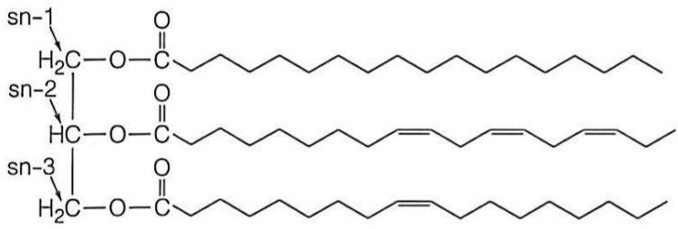

chemical

Chemical structures of three sn-alkane units with labeled chain lengths and functional groups

图 15-6 甘油三酯的异质性结构示意图

其中 sn-1 位羟基连接的是硬脂酸（18:0），sn-2 位羟基连接的是  $\alpha-$  亚麻酸（ $18:3\Delta^{9,12,15}$ ），sn-3 位羟基连接的是油酸（ $18:1\Delta^{9}$ ）。

键结合，形成如磷脂酰胆碱或磷脂酰乙醇胺等磷脂分子。而通常所说的“甘油脂”特指中性甘油三酯，这是生物体最主要的能量储存形式。

值得注意的是，生物体内的甘油三酯具有高度异质性（图 15-6）。也就是说，单个甘油三酯分子常包含2\~3种不同的脂酰基，这种多样性既满足了能量储存的高效性（完全氧化可产生约38 kJ/g能量），又通过脂肪酸组成的动态调节适应

<small>① 这里的 sn 是英文 stereospecific numbering 的缩写，意为 “立体专一编号”，由 IUPAC 制定，用于明确甘油衍生物的空间构型。</small>

---

15.3 在储存能量的细胞中脂肪酸的主要存在形式是甘油三酯

055

不同组织的代谢需求。这种精巧的分子设计使其成为进化上保守的能量存储方案。

甘油三酯的物理性质取决于其脂肪酸组成。植物来源的甘油三酯多含不饱和脂肪酸（如油酸），在常温下呈液态（油）；动物来源的甘油三酯则以饱和脂肪酸（如棕榈酸）为主，呈固态（脂肪）。这种差异源于不饱和脂肪酸双键导致的分子堆积松散，熔点降低。尽管存在状态差异，两者的化学本质相同，密度均为约 $0.9\mathrm{g/cm}^3$ ，低于水的密度（$1.0\mathrm{g/cm}^3$），因此能浮于水面。

## 15.3.2 甘油三酯在细胞内主要以脂滴形式存在

甘油三酯呈中性且高度疏水，主要存储于单层磷脂膜包被的脂滴中。脂滴（lipid droplet）的发现历史可追溯至19世纪末。1880年代，德国学者里夏德·阿尔特曼（Richard Altmann，1852—1900）等首次在光学显微镜下观察到细胞内存在强折光性的球形颗粒，但当时误认为是独立的生命单位“生物芽体”（bioblast）。1890年代，奥地利学者弗朗茨·齐格蒙迪（Franz Zsigmondy，1860—1929）等通过改进显微技术确认这些结构是中性脂质的储存体，由此奠定了脂滴作为细胞器的早期认知。1950年代，罗马尼亚裔美国学者乔治·帕拉德（George Palade，1912—2008）等通过电子显微镜观察，揭示了脂滴独特的“单层磷脂膜包裹中性脂”的超微结构，彻底将其与线粒体等其他细胞器区分开来。

一直以来，脂滴在学术界仅被视为细胞内简单的“油滴”（fat body），其研究长期处于边缘地位。这一认知局限主要源于以下因素:其一，传统观点认为脂滴仅存在于动物脂肪细胞和植物种子中，分布范围有限；其二，脂滴的中性脂质核心易破裂，导致分离纯化困难，样本易受其他细胞组分污染。20世纪后期以来，随着超速离心、免疫亲和纯化等分离技术的突破，结合蛋白质组学和脂质组学的系统研究，人们不仅鉴定了大量脂滴相关蛋白质［如脂滴包被蛋白（perilipin）］和脂质分子，更从根本上重新定义了脂滴的本质——它是一种跨越生物三域（真核生物、细菌、古菌）的膜性亚细胞结构（图15-7）。脂滴表面的蛋白质主要参与脂质的代谢和运输、脂滴的分解与融合，以及脂滴与其他细胞器之间的相互作用。

(A)

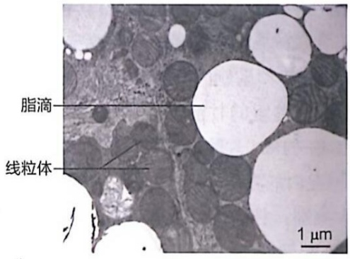

text_image

脂滴
线粒体
1 µm

(B)

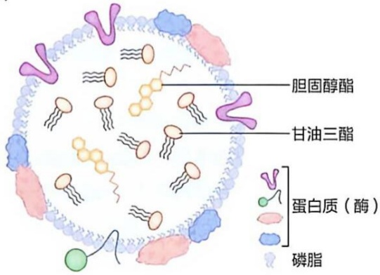

text_image

胆固醇酯
甘油三酯
蛋白质（酶）
磷脂

图 15-7 脂滴的电子显微镜照片和结构示意图（A）小鼠褐色脂肪组织细胞的电镜照片（由中国科学院生物物理研究所刘平生实验室提供）。（B）脂滴的结构示意图。

---

056

15 脂质

甘油三酯在动物血液中以脂蛋白（lipoprotein）复合物形式运输（详见第23章）。血液中脂蛋白的结构组成与细胞内的脂滴具有某种相似性，其中载脂蛋白（apolipoprotein）对脂质的组装、存储和运输起着重要作用。

## 15.3.3 甘油三酯的主要功能是储存能量

甘油三酯以脂滴形式广泛储存于各类细胞中，其中动物脂肪细胞的储存最为丰富。在能量供给充足时，甘油三酯以惰性状态长期稳定储存；而当细胞需要能量时，脂滴中的甘油三酯会被分解为甘油和脂肪酸，脂肪酸随后通过β氧化生成ATP供能（详见第22章）。例如，成人心肌细胞依赖甘油三酯分解提供超过85%的能量，以满足持续收缩的需求；骨骼肌则在运动时大量分解甘油三酯，以维持ATP供应。

尽管甘油三酯是重要的能量储备，但其含量、分布及代谢效率直接影响健康。白色脂肪中甘油三酯过度积累可导致肥胖，肝脏中过量储存则可引发脂肪肝，在其他组织中异常蓄积也与代谢综合征相关。值得注意的是，2型糖尿病患者的骨骼肌细胞与耐力运动员的骨骼肌细胞均富含甘油三酯，但两者对胰岛素的敏感性却截然相反:糖尿病患者的肌肉细胞虽储存大量甘油三酯，却因脂毒性微环境（如游离脂肪酸堆积，脂质代谢中间产物异常）引发胰岛素抵抗，导致葡萄糖摄取障碍；耐力运动员的肌肉细胞通过高效线粒体氧化和脂滴动态周转，将甘油三酯转化为能量，反而增强胰岛素信号通路敏感性。这一矛盾现象被称为“运动员悖论”，解析该机制或为2型糖尿病的治疗提供新方向。

## 15.4 甘油磷脂是一类两亲性膜脂

甘油磷脂（glycerophospholipid）是一类以甘油-3-磷酸为基本骨架的磷脂分子。其结构特征包括一个疏水尾部和亲水头部。其中的两分子脂肪酸分别通过酯键连接在甘油的sn-1和sn-2位，形成疏水尾部；甘油的sn-3位羟基被磷酸基团取代，形成磷脂酸（phosphatidic acid，PA），其磷酸基可进一步与不同亲水性醇类（如胆碱、乙醇胺）缩合，形成甘油磷脂的亲水头部（图15-8）。

19 世纪中叶，科学家在研究脑组织和卵黄等生物材料时，首次分离出具有脂质特性的物质。1847 年，谢弗勒尔从脑组织中提取出含磷的脂类，为磷脂研究奠定了基础。1840 年代，戈布利从卵黄中分离出卵磷脂（lecithin，即磷脂酰胆碱），并发现其由甘油、脂肪酸、磷酸和胆碱组成。这是人类首次明确鉴定的甘油磷脂。1870 年代，德国学者约翰·图迪休姆（Johann Thudichum，1829—1901）系统研究了脑组织中的磷脂，并命名了包括鞘磷脂（sphingomyelin，SM）在内的多种磷脂，推动了脂质化学的发展。20 世纪初，人们进一步区分了磷脂的两大类别:甘油磷脂（以甘油为核心骨架，如卵磷脂、脑磷脂）和鞘磷脂（以鞘氨醇为核心骨架，如神经鞘磷脂），从而明确了

---

15.4 甘油磷脂是一类两亲性膜脂

057

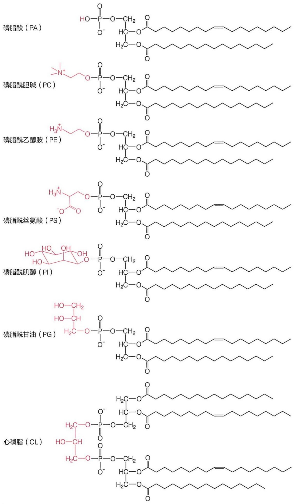

chemical

Structural formulas of various phospholipid compounds including phosphate, ribose, amine, glycol, and chloroplasts

图 15-8 常见甘油磷脂的化学结构

---

058

15 脂质

甘油磷脂的结构特征。同时，随着色谱技术和 X 射线衍射技术的进步，科学家阐明了甘油磷脂的分子结构，并发现其在细胞膜中的关键作用。

## 15.4.1 不同亲水性头部基团与磷脂酸的磷酸基结合形成结构多样的甘油磷脂

甘油磷脂和鞘磷脂作为细胞膜的主要磷脂组分，在结构上存在显著差异（鞘磷脂结构详见15.5.1节）。细胞膜中常见的甘油磷脂包括:磷脂酸（PA）、磷脂酰胆碱（PC）、磷脂酰乙醇胺（PE）、磷脂酰丝氨酸（PS）、磷脂酰肌醇（PI）、磷脂酰甘油（PG）（图15-8），其中磷脂酰胆碱和磷脂酰乙醇胺占比超过膜磷脂总量的 $50\%$ 。这些磷脂均由磷脂酸与不同亲水性头部基团（简称头基，如胆碱、乙醇胺等）缩合形成，其结构差异主要取决于极性头基的特性。

值得注意的是，磷脂酰甘油可进一步与磷脂酸结合形成心磷脂（cardiolipin, CL），这是线粒体内膜的特征性磷脂。在中性 pH 条件下，甘油磷脂的不同头基使其呈现不同的净电荷状态:磷脂酰胆碱和磷脂酰乙醇胺呈电中性，磷脂酰丝氨酸带负电，而磷脂酰肌醇和磷脂酸则具有更强的电负性。

甘油磷脂的 sn-1 位通常连接饱和脂肪酸，而 sn-2 位更倾向结合不饱和脂肪酸（如花生四烯酸）。磷脂酶  $A_{1}$  和  $A_{2}$  分别特异性催化水解 sn-1 和 sn-2 位的酯键，释放脂肪酸和溶血磷脂，参与细胞信号转导（如炎症反应）和膜动态重构。

## 15.4.2 甘油磷脂是构成生物膜脂双层结构的基本组分

甘油磷脂分子具有典型的两亲性（amphipathic）结构:两条疏水的脂酰基链构成疏水端，而极性的磷酸基团等形成亲水端。这种两亲性结构特性使其能够在水环境中自发组装，形成多种有序聚集体。

在油-水界面，甘油磷脂分子会定向排列——疏水尾部伸向油相，亲水头部朝向水相，从而形成单分子层。当完全处于水相环境中时，甘油磷脂分子会通过疏水相

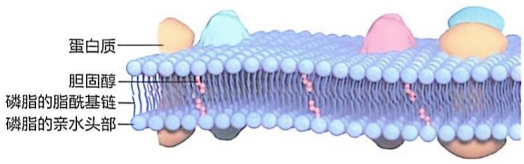

text_image

蛋白质
胆固醇
磷脂的脂酰基链
磷脂的亲水头部

图 15-9 双层磷脂膜结构示意图

磷脂分子以双分子层形式排列，疏水的脂酰基链（尾部）聚集并向内，以避免与水接触，通过范德瓦耳斯相互作用维持紧密排列，驱动双层结构的形成，形成疏水核心区；亲水的磷酸基团等头部向外，与水分子相互作用，构成亲水界面；在磷脂双层膜中镶嵌着发挥不同功能的蛋白质分子。

互作用使脂酰基链相互聚集，同时亲水头部与水分子发生相互作用，最终自发形成双层（bilayer）膜结构（图 15-9）。这种双层排列不仅最大限度地减少了疏水区域与水的接触，还通过分子间的范德瓦耳斯相互作用和极性基团间的相互作用维持了结构的稳定性。

双层磷脂膜作为细胞膜的基本结构，通过其独特的“亲水-疏水-亲水”三明治式排列，构成了细胞与外界环境之间的选择性疏水屏障。膜两侧亲水的极性基团与水相环境相互作用，而中

---

15.4 甘油磷脂是一类两亲性膜脂

059

间致密的疏水脂肪酸链层则有效阻挡了极性分子的自由通透，使得细胞能够维持独特的胞内化学环境。这种结构不仅赋予膜系统自我封闭和动态可塑的特性，支持细胞的形态变化和分裂过程，更为多种功能膜蛋白（如转运蛋白、受体蛋白和酶）提供了锚定位点，从而实现了物质运输、信号转导和代谢转化等复杂功能，最终保障了细胞的正常生命活动。

## 15.4.3 缩醛磷脂是一类通过醚键连接脂酰基链的甘油磷脂

甘油醚磷脂（ether glycerophospholipid）是甘油磷脂的一个特殊亚类（图 15-10），其结构特征在于 sn-1 位通过醚键（而非常见的酯键）与烷基相连，典型的如烷基醚磷脂酰乙醇胺（plasmanylethanolamine）。这种醚键连接方式赋予其更高的化学稳定性，使其不易发生水解反应。其中最具代表性的缩醛磷脂（plasmalogen）具有独特的结构特征:紧邻醚键的碳碳键为顺式双键。这一结构显著区别于普通甘油醚磷脂的饱和连接（图 15-10）。

从组成来看，缩醛磷脂表现出丰富的分子多样性，其极性头基可包含胆碱、乙醇胺等多种类型，其中以缩醛磷脂酰胆碱（plasmenylcholine）和缩醛磷脂酰乙醇胺（plasmenylethalomine）最为常见（图15-10）。这类磷脂在生物膜中广泛分布，尤其在需氧组织（如心肌和神经组织）的细胞膜中含量显著。尽管其确切的生理功能尚未完全阐明，但现有研究表明其可能参与膜动力学调节、抗氧化防御等重要生理过程。

图 15-10 代表性甘油醚磷脂与缩醛磷脂

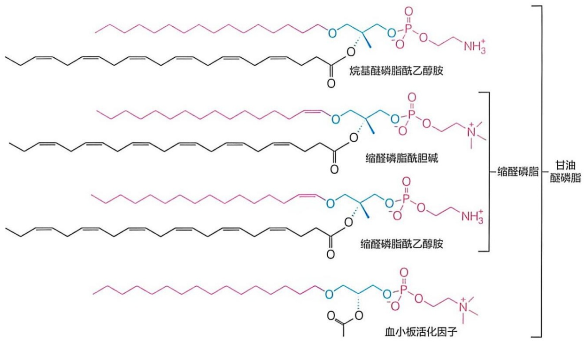

chemical

化学结构式图，展示烷基醚磷脂酰乙醇胺、缩醛磷脂酰胆碱、缩醛磷脂酰乙醇胺及其血小板活化因子的分子结构

---

060

15 脂质

## 15.4.4 磷脂酰肌醇磷酸和血小板活化因子均为重要的脂质信号分子

磷脂酰肌醇的肌醇环可通过多位点磷酸化形成多种磷脂酰肌醇磷酸，后者是重要的细胞内信号分子。以磷脂酰肌醇-4,5-二磷酸（phosphatidylinositol 4,5-bisphosphate, PI(4,5)P₂）为例，当磷脂酶C（phospholipase C，PLC）将分子中的磷酸基与甘油之间的磷酯键水解时，产生两种关键的第二信使:三磷酸肌醇（inositol triphosphate，IP₃）和甘油二酯（图15-11）。三磷酸肌醇通过激活内质网上的钙离子通道而释放钙离子，而甘油二酯则能与钙离子共同激活蛋白激酶C（protein kinase C，PKC），调控多种细胞活动。

血小板活化因子（platelet-activating factor，PAF）是一种结构独特的甘油醚磷脂酰胆碱，其sn-2位连接的是乙酰基而非长链脂肪酸。这种特殊结构使血小板活化因子能够作为强效信号分子，通过结合特定受体来触发血小板聚集和血管扩张等生理反应。

图 15-11 磷脂酰肌醇-4,5-二磷酸（PI(4,5)P₂）在磷脂酶 C（PLC）的催化作用下水解生成三磷酸肌醇（IP₃）和甘油二酯（DAG）的过程

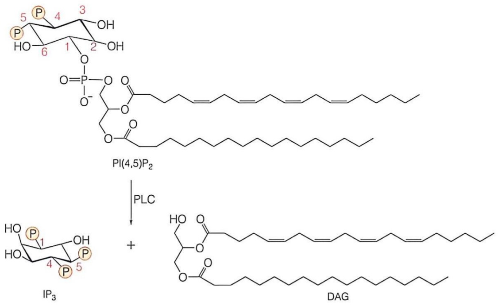

chemical

Chemical reaction scheme showing PI(4,5)P2 and DAG enzymes forming a complex organic molecule with phosphorus-containing units

## 15.5 鞘脂类是以鞘氨醇为基本骨架构成的脂质分子

鞘脂（sphingolipid）是一类以鞘氨醇（sphingosine）为核心骨架的脂质，其结构特征为鞘氨醇的氨基通过酰胺键与脂肪酸链相连。值得注意的是，鞘氨醇本身由丝氨酸衍生而来，因此这类脂质也可视为以丝氨酸为前体的衍生物。其中，神经酰胺（ceramide）作为最基本的鞘脂结构，可进一步衍生出两类重要分子:与单糖或寡糖基结合形成鞘糖脂（glycosphingolipid）；与磷酸胆碱结合形成鞘磷脂

---

15.5 鞘脂类是以鞘氨醇为基本骨架构成的脂质分子

061

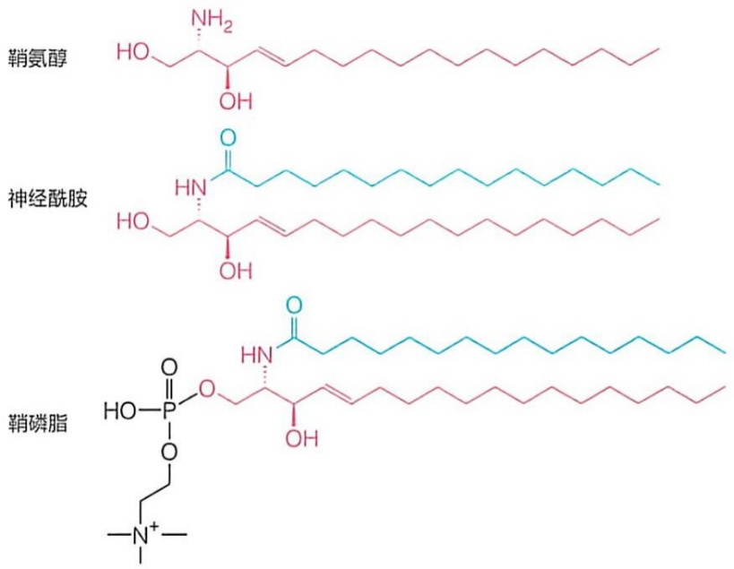

chemical

三种有机化合物结构式：鞘氨醇、神经酰胺、鞘磷脂，各分子有碱基与羧基的链上结构

图 15-12 鞘氨醇、神经酰胺和鞘磷脂的结构示意图

(sphingomyelin)。这类脂质在神经系统含量尤为丰富，不仅为细胞膜的结构组分，也能通过其代谢产物参与细胞间通信，调控包括细胞生长、分化及凋亡在内的多种重要生理过程（图 15-12）。

## 15.5.1 神经酰胺的 1-羟基与磷酸胆碱通过磷酸二酯键结合形成鞘磷脂

神经酰胺是鞘脂类分子的核心结构单元，由鞘氨醇（一种长链氨基醇）的氨基通过酰胺键与脂肪酸缩合形成，是最简单的鞘脂形式。在鞘磷脂合酶（sphingomyelin synthase）的催化下，神经酰胺的1-羟基与磷酸胆碱通过磷酸二酯键缩合，形成两亲性鞘磷脂。

鞘磷脂是一类重要的磷脂分子，与甘油磷脂共同构成细胞膜的磷脂双分子层。其结构特征是以鞘氨醇（而非甘油）为骨架，通过酰胺键连接脂肪酸，并含有与磷脂酰胆碱相同的磷酸胆碱极性头基。鞘磷脂约占多数哺乳动物细胞膜总磷脂的15%，在髓鞘等特化膜中比例显著提高。鞘磷脂不仅通过参与形成脂筏（lipid raft；细胞膜上富含胆固醇、鞘磷脂和特定蛋白质的动态微结构域，具有低流动性和高熔点等特征）而维持膜结构，其代谢产物（如神经酰胺）还在细胞信号传递中发挥关键作用，体现了鞘脂类分子在细胞生理活动中的多功能性。

## 15.5.2 神经酰胺的 1-羟基与单糖或寡糖通过糖苷键共价连接形成鞘糖脂

神经酰胺可通过糖苷键与单糖或寡糖结合形成鞘糖脂。根据所含糖基的性质，鞘

---

062

15 脂质

糖脂可分为中性鞘糖脂和酸性鞘糖脂两类，其中酸性鞘糖脂因含有带负电荷的基团（如唾液酸）而显酸性。鞘糖脂结构复杂多样，IUPAC对其寡糖链提出了专门的缩写命名体系，主要分为神经节苷脂（ganglioside，GM）和红细胞糖苷脂（globoside，Gb）两大类。两者的关键区别在于神经节苷脂的寡糖链上连有1\~4个唾液酸[如5-N-乙酰神经氨酸（5-N-acetylneuraminic acid，Neu5Ac)]分子，而红细胞糖苷脂则仅含中性寡糖。

常见的神经节苷脂包括单唾液酸四己糖神经节苷脂（monosialotetrahexosylganglioside，GM1）、单唾液酸三己糖神经节苷脂（GM2）和单唾液酸二己糖神经节苷脂（GM3）（图 15-13）。值得注意的是，这三种神经节苷脂均只含一个唾液酸单位，其结构差异主要体现在寡糖链的长度等方面；这里的数字仅仅反映被鉴定的顺序，并非反映结构特征。这类酸性鞘糖脂因其特殊的糖链结构和唾液酸修饰，在细胞识别、信号转导等生理过程中发挥重要作用。

图 15-13 三种常见神经节苷脂（GM1、GM2 和 GM3）的结构

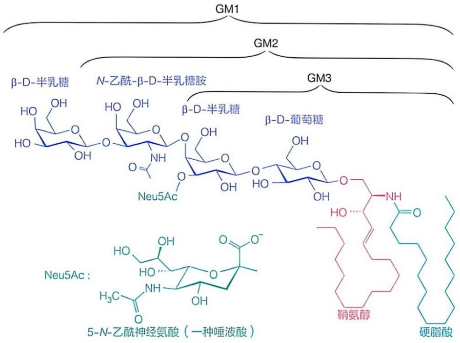

chemical

Chemical structures of GM1, GM2, GM3 and their derivatives including β-D-半乳糖, N-乙酰-β-D-半乳糖胺, β-D-半乳糖, β-D-葡萄糖, Neu5Ac, 5-N-乙酰神经氨酸, and 硬脂酸

## 15.5.3 鞘糖脂的糖基在生物识别过程中发挥关键作用

鞘糖脂的糖基部分具有高度复杂的结构和多样的生物学性质，使其不仅作为细胞膜的结构组分维持膜稳定性，更在细胞识别、信号转导和病原体相互作用中发挥关键作用。以神经节苷脂 GM1 为例，其特有的寡糖链结构可作为霍乱毒素（cholera toxin）的特异性受体，介导毒素内化后通过持续激活 G 蛋白-腺苷酸环化酶 -cAMP 信号通路引发疾病。类似地，某些肿瘤特异性高表达的鞘糖脂（如 GM2）已成为重要的肿瘤标志物和治疗靶点。这些功能充分体现了鞘糖脂糖基的结构多样性与其生物学功能的紧密关联。

---

15.7 固醇脂是一类以固醇为核心结构的脂类化合物

063

## 15.6 脂肪酸可直接与糖骨架相连形成一类特殊的糖苷脂

根据分子结构，人们将生物体内的脂质分为八类，其中的一类为糖脂（saccharolipid）。这是特指一类脂肪酸直接通过酯键或酰胺键与糖骨架（如六碳糖或糖胺）共价结合的脂质分子。这类化合物的典型特征是以糖替代甘油作为核心骨架，可包含多条脂肪酸链，典型的如革兰氏阴性菌细胞壁成分脂质A（lipid A），即由二糖胺骨架连接多个脂肪酸链构成（图15-14）。其结构显著区别于传统以甘油或鞘氨醇为骨架的脂类。

传统意义上的糖脂（glycolipid）则泛指所有携带糖基化修饰的脂质。根据骨架类型分为两大类:甘油糖脂（glyceroglycolipid），由甘油二酯的sn-3位羟基与单糖（或寡露糖）通过糖苷键连接形成（图15-14），常见于植物和微生物膜系统；鞘糖脂（sphingoglycolipid），以鞘氨醇为骨架，通过糖苷键连接单糖或寡糖链（如神经节苷脂GM1）（图15-13），在真核细胞膜中发挥信号识别功能。

## 15.7 固醇脂是一类以固醇为核心结构的脂类化合物

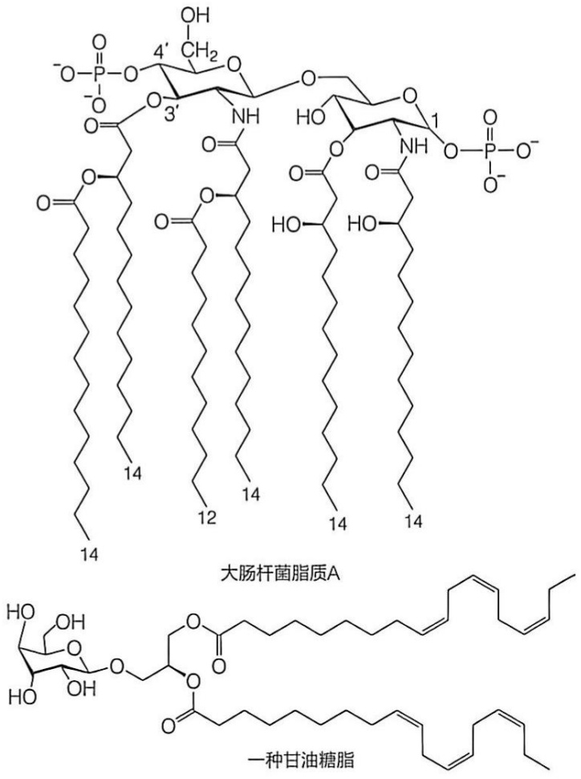

chemical

Structural formulas of two glycosylated lipids: A large肠杆菌脂质A and a type of 1-oxo-glycosylated lipids

图 15-14 一类特殊糖脂与传统糖脂的结构差异

上，一类特殊糖脂——大肠杆菌脂质 A，其骨架由两个葡萄糖胺（GlcN）组成。下，传统糖脂——一种甘油糖脂，其骨架由甘油组成。

除了上述甘油脂和鞘脂等脂质分子之外，真核生物体内存在的另一大类脂质分子是固醇脂（sterol lipid）。具体而言，固醇脂是一类其核心结构由四个环烷基组成的分子。这类脂质主要包括游离固醇（如胆固醇、植物固醇）及其衍生物（如固醇酯、氧固醇）。固醇脂在生物体内发挥多种重要功能:作为细胞膜的关键结构组分调节膜流动性；作为维生素D、胆汁酸和类固醇激素的前体物质参与代谢调控；还以酯化形式（固醇酯）存储在脂滴中或通过脂蛋白运输。固醇脂的结构特征和生物学功能与其他脂质（如甘油脂、鞘脂）存在显著区别。

在动物体内，胆固醇是最主要的游离固醇，也是固醇脂（如胆固醇酯）及其他固醇衍生物（如胆汁酸、类固醇激素）的核心前体。下面首先介绍胆固醇的结构和特性。

---

064

15 脂质

## 15.7.1 胆固醇也具两亲性分子特征

胆固醇的研究历史可以追溯到1760年代末，法国学者弗朗索瓦·普莱蒂埃·德拉萨尔（François Poulletier de la Salle，1720—1778）首次从胆结石（gallstone）中分离出一种白色结晶物质（但并未给它命名）。直到1810年代，米歇尔-欧仁将其命名为“胆汁中的固体物质”（cholesterine）。1900年代至1930年代，通过德国学者阿道夫·温道斯（Adolf Windaus，1876—1959）和海因里希·威兰（Heinrich Wieland，1877—1957）等的努力，这种物质的化学式和化学结构被阐明，通过系统的化学分析，首次确证分子结构中存在羟基，并正式将其归类为醇类化合物，其名称也就被修改为胆固醇（cholesterol）。1950年代，美国学者罗伯特·伍德沃德（Robert Woodward，1917—1979）等完成了胆固醇的全合成（他们后来还化学合成了叶绿素）。胆固醇分子的空间结构则是由英国女学者多萝西·霍奇金（Dorothy Hodgkin，1910—1994）在1940年代使用X射线晶体衍射技术测定的。

具体而言，胆固醇（分子式  $C_{27}H_{46}O$ ，分子量为 386）的结构特征可以总结如下（图 15-15）:它是一种具有特征性四环骨架的甾醇类分子，其核心结构为由 3 个六元环（A、B、C 环）和 1 个五元环（D 环）组成的刚性甾核（环戊烷多氢菲）。分子 C3 位带有  $\beta$  取向的羟基（—OH），赋予其两亲性；C5、C6 位含有一个双键；C17 位连接八碳支链。甾核上还含有两个特征性角甲基（C18、C19 位），其中的四个环基本以椅式构象存在（图 15-15）。

胆固醇独特的空间结构使其兼具疏水性和亲水性，能够嵌入细胞膜疏水区并通过羟基参与极性相互作用，这种独特的分子特性使胆固醇成为维持膜结构和功能的关键分子。不同生物膜中胆固醇含量差异显著，如在红细胞质膜中占比高达23%，而在线粒体膜中仅3%，这反映了胆固醇对膜特性的精细调控作用。如前所述，胆固醇

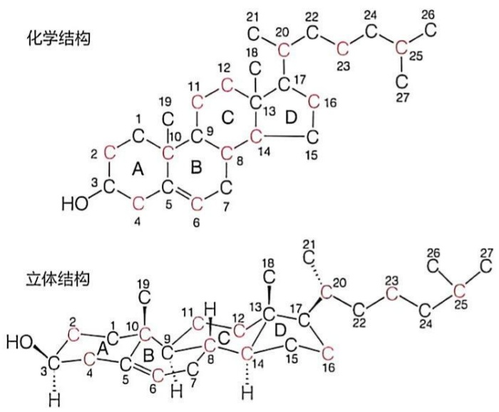

chemical

化学结构与立体结构对比图，展示分子结构及碳数分布

图 15-15 胆固醇的化学结构、原子编号及立体结构示意图

在细胞膜中倾向于与鞘脂聚在一起，形成脂筏微区结构。此外，胆固醇、鞘脂还可与特异的小窝蛋白（caveolin）共同形成细胞膜中的小窝（caveolae）等。这些膜微区共同构成了细胞膜的复杂结构和功能分区。

胆固醇对脑组织的结构和功能至关重要，约占大脑总重量的2%。此外，它还是多种重要激素（尤其是性激素）的前体分子。

值得注意的是，最新研究发现，原核生物（如细菌）缺乏固醇类物质，而真核生物的细胞膜则含有多种固醇分子。澳大利亚学者在一块距今约16.4亿年的古老化石中，首次鉴定出原生类固醇（protosteroid）——这是真核生物的关键分子标志。通过高精度年代测定分析，该化石被确认为迄今最古老

---

15.7 固醇脂是一类以固醇为核心结构的脂类化合物

065

的真核生物证据之一。这表明，具有复杂细胞结构的真核生物可能早在 16.4 亿年前的地球早期就已演化形成，这一发现将真核生物的起源时间推向更古老的地质年代。

## 15.7.2 胆固醇是类固醇激素合成的前体分子

胆固醇是动物体内重要的甾醇类物质，它能够以乙酰辅酶A为原料从头合成（详见第23章），但无法逆向分解为乙酰辅酶A。作为关键前体分子，胆固醇可在不破坏其四环骨架结构的前提下，通过侧链修饰和氧化反应，在内分泌腺中被转化为多种具有重要生理功能的类固醇激素（steroid hormone）。这些类固醇激素根据其结构和功能可分为两大类:由肾上腺皮质合成的糖皮质激素（glucocorticoid）和盐皮质激素（mineralocorticoid），以及由性腺合成的性激素。糖皮质激素是炎症反应的关键调节因子，通过抑制磷脂酶 $\mathrm{A}_2$ 及其下游花生四烯酸代谢通路来调控炎症

反应；盐皮质激素则主要负责维持体内电解质平衡。性激素包括孕激素（progestin）、雄激素（androgen）和雌激素（estrogen），它们不仅决定个体的性别特征和生殖功能，还参与代谢调控和生理活动维持。

从胆固醇（27碳）衍生出这些类固醇激素涉及侧链的裂解、C=C双键的移位，以及特定碳原子被氧化成羟基或羰基等。孕酮（progesterone；一种孕激素）、皮质醇（cortisol；一种糖皮质激素）、醛固酮（aldosterone；21碳，一种盐皮质激素）、睾酮（testosteone；一种雄激素）、雌二醇（estradiol；一种雌激素）等代表性固醇激素的结构如图15-16所示。

类固醇激素作为脂溶性信号分子，主要通过核受体途径发挥作用。它们能够自由穿过细胞膜，与胞内受体结合形成复合物，随后转位至细胞核内，调控靶基因表达。根据亚细胞定位，这些受体可分为胞浆型和核型，其中雌激素受体的少数成员还可定位于细胞膜。这种多层次的调控机制使得类固醇激素能够精细调控机体的生长发育、代谢平衡和生殖功能等重要生理过程。

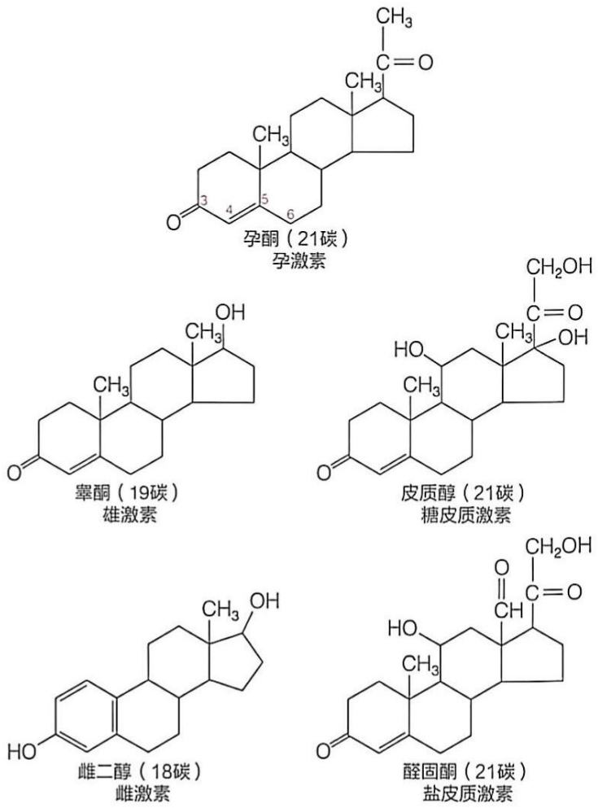

图 15-16 代表性类固醇激素的化学结构

---

066

15 脂质

## 15.7.3 胆固醇的衍生物胆汁酸是肠道内促进脂质消化吸收的关键乳化剂

胆固醇在动物体内除作为类固醇激素前体外，还可在肝实质细胞中转化为胆汁酸（bile acid）。这一转化过程涉及胆固醇分子第25～27位碳的去除以及第24位碳氧化成羧基（图15-15，图15-17）。生成的胆汁酸可分为初级和次级两类:初级胆汁酸如胆酸（cholic acid）和鹅脱氧胆酸（chenodeoxycholic acid），由肝细胞直接合成并分泌入小肠。在小肠中，初级胆汁酸经肠道菌群修饰后形成次级胆汁酸，如脱氧胆酸（deoxycholic acid）和石胆酸（lithocholic acid）。

在肝细胞内，胆汁酸常与甘氨酸或牛磺酸结合形成结合型胆汁酸。典型的结合型胆汁酸如甘氨胆酸（glycocholic acid）和牛黄胆酸（taurocholic acid）（图15-17），这类物质主要以胆汁盐的形式存在。作为典型的两亲性分子，胆汁酸/盐具有显著的表面活性剂特性。进食后，胆囊收缩将胆汁酸/盐排入小肠，通过乳化食物中的脂质形成胶束（micelle），从而大幅增加脂肪酶的作用面积，促进脂类消化产物的肠上皮吸收。这一过程对脂溶性维生素（A、D、E、K）的吸收尤为重要。

## 15.7.4 维生素 D 衍生自胆固醇并可转化为具有激素活性的脂质分子

维生素 D（vitamin D）是一类脂溶性固醇衍生物，最具代表性的为维生素  $D_{3}$ （图 15-18）。维生素  $D_{3}$  由皮肤中的 7-脱氢胆固醇在紫外线照射下转化而来，经过 B 环断裂和异构化形成。维生素 D 本身无生理活性，需经肝脏和肾脏的羟基化修饰生成活性形式，如 1,25-二羟维生素  $D_{3}$ ，也被称作骨化三醇（calcitriol）（图 15-18）。骨

图 15-17 代表性胆汁酸和结合型胆汁酸的结构

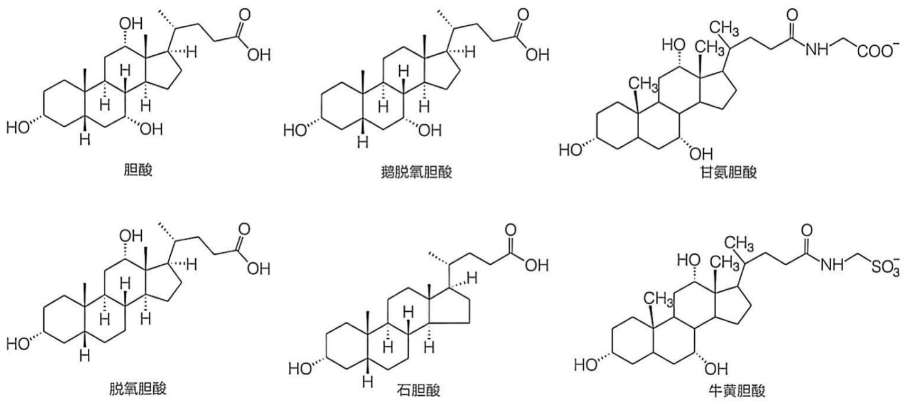

---

15.7 固醇脂是一类以固醇为核心结构的脂类化合物

067

化三醇是维生素 D 主要的活性分子，其生理活性比 25-羟维生素  $D_{3}$  高 500～1 000 倍，通过与核受体结合调控基因表达，促进小肠钙磷吸收、骨骼矿化和肾脏钙磷重吸收。

虽然人体可通过阳光照射合成维生素  $D_{3}$ ，但现代生活方式常导致机体日照不足。维生素 D 缺乏可能引发儿童佝偻病或成人软骨化症，因此膳食补充（如鱼类、蛋黄、强化食品）或其他补充仍十分必要。维生素 D 的代谢与功能体现了其作为“条件性必需营养素”的特性——既可通过内源性合成，又依赖环境与饮食因素维持充足水平。

## 15.7.5 胆固醇酯是一种强疏水性的中性脂类分子

胆固醇通过其 C3 位的羟基可与长链脂肪酸缩合形成胆固醇酯（cholesteryl ester）（图 15-19）。胆固醇酯是胆固醇的主要储存形式。细胞内游离胆固醇（如肝、肾上腺皮质、巨噬细胞）在脂酰辅酶 A: 胆固醇酰基转移酶（acyl-CoA: cholesterol acyltransferase, ACAT）的催化下与脂肪酸结合形成胆固醇酯，疏水性更强，能以脂滴形式储存在细胞中。

在血液中，胆固醇酯是低密度脂蛋白（low-density lipoprotein，LDL）和高密度脂蛋白（high-density lipoprotein，HDL）的核心成分。低密度脂蛋白携带的胆固醇酯被外周组织摄取，供细胞膜合成或激素生产。低密度脂蛋白受体途径异常会导致胆固醇酯在血管沉积，促

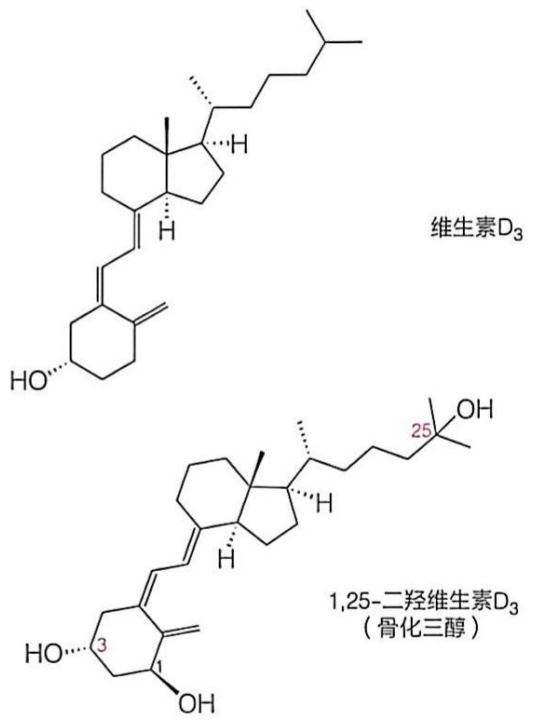

chemical

Chemical structures of维生素D3 and its 1,25-dimethyl-2-羟维生素D3 (骨化三醇)

图 15-18 维生素  $D_{3}$  和 1,25-二羟维生素  $D_{3}$ （骨化三醇）的结构

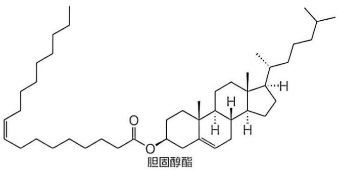

chemical

Molecular structure of a steroid derivative with labeled functional groups including ketone, ester, and aldehyde

图 15-19 胆固醇酯的结构  
其中与羟基形成酯键的是油酸（$18:1\Delta^{0}$）。

进动脉粥样硬化。高密度脂蛋白逆向转运胆固醇，将外周组织的胆固醇酯化后运回肝脏排泄（胆汁酸途径），这是抗动脉粥样硬化的关键机制。

肾上腺、性腺等利用胆固醇酯水解产生的游离胆固醇，合成皮质醇、醛固酮、雌激素、睾酮等激素。胆固醇酯水解后释放的胆固醇可嵌入细胞膜，调节其流动性和稳定性。皮肤中的胆固醇衍生物（7-脱氢胆固醇）在紫外线作用下转化为维生素 $D_{3}$ ，胆固醇酯是其间接来源。

总之，胆固醇酯作为胆固醇的稳定形式，解决了它的储存、运输与代谢需求，是正常生理功能（如激素合成、膜结构）和病理过程（如动脉粥样硬化）的关键分子。对其代谢途径的深入研究，为心血管疾病与代谢性疾病的治疗铺设新的路径。

---

068

15 脂质

## 15.8 类异戊二烯由异戊二烯基单元构成

1880 年代，德国学者奥托·瓦拉赫（Otto Wallach，1847—1931）等观察到，许多萜类化合物（terpenoid）可分解为异戊二烯（ $C_{5}H_{8}$ ）单元，因而提出了“异戊二烯规则”（isoprene rule）。从那以后，人们观察到，生物体内的大量脂质分子的碳骨架由2个或更多个异戊二烯单位组成或衍生而成，它们被统称为类异戊二烯（isoprenoid）。

其实，大多数天然色、香、味分子均属于类异戊二烯脂质分子，例如类胡萝卜素、柠檬烯等。

生物体内存在的典型类异戊二烯化合物除了上述固醇类化合物之外，还包括维生素 A、E、K 以及泛醌和多萜醇等。这里简单介绍几类类异戊二烯分子。

维生素（vitamin）是人体必需但无法自身合成的有机小分子，主要来源于植物或微生物。根据溶解性可分为水溶性和脂溶性两大类:水溶性维生素（B族维生素和维生素C）主要作为酶的辅因子；脂溶性维生素（维生素A、D、E、K）则属于脂质分子，其中维生素D由胆固醇代谢产生，而维生素A、E、K属于类异戊二烯。

## 15.8.1 维生素A: 视觉辅助因子与生长调节激素

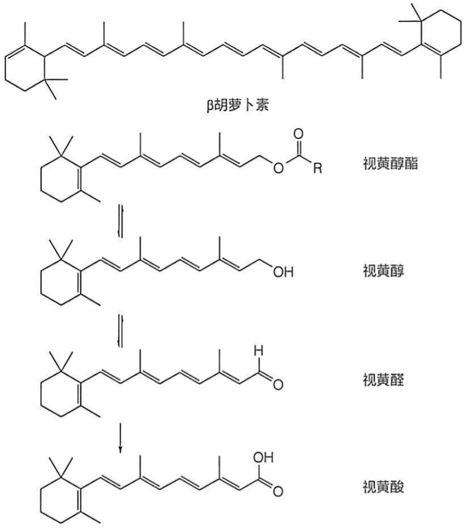

chemical

Chemical reaction pathway showing β-hydroxylation of β-tert-butanol to form hydroxyalkenes and alcohols, with visual examples for hydroxylamine, hydroxymethylamine, and hydroxyacid.

图15-20 $\beta$ 胡萝卜素、视黄酯、视黄醇、视黄醛和视黄酸的化学结构

维生素 A 的发现历程可追溯至古代文明对夜盲症的观察。早在公元前 1500 年，古埃及人就用动物肝脏治疗夜盲症，中国唐代孙思邈也记载了羊肝治 “雀目”（夜盲症）的方法。现代科学证实始于 1910 年代，美国学者通过动物喂食实验观察到，喂食黄油或鱼肝油的小鼠正常生长，而仅用猪油喂养的小鼠出现眼疾和死亡。他们将这种脂溶性因子命名为 “脂溶性 A”（后称维生素 A）。1930 年代，瑞士学者保罗·卡勒（Paul Karrer，1889—1971）解析了其化学结构，为后续研究维生素 A 在视觉循环（视紫红质合成）和细胞分化中的作用奠定了基础。

维生素 A 的典型代表是视黄醇（retinol），也包括视黄醛（retinal）、视黄酸（retinoic acid）等衍生物（图 15-20）。维生素 A 一般衍生自植物成分 β 胡萝卜素，后者在肠黏膜细胞或肝脏中通过酶促反应在分子的中间裂开，转化为 2 分子视黄醛；视黄醛在依赖 NADH/NADPH 的视黄醛还原酶作用下，被还原为视黄醇。

在肠黏膜细胞中，由酰基辅酶A:视黄醇

---

15.8 类异戊二烯由异戊二烯基单元构成

069

酰基转移酶催化，视黄醇可与长链脂肪酸（如棕榈酸）结合形成视黄醇酯（retinyl ester）。亲脂性的视黄醇酯储存在肝脏星状细胞的脂滴中，可在转化为视黄醇后再转化为视黄醛参与视觉传导（与视蛋白结合形成视紫红质），或进一步转化为视黄酸（图 15-20）。值得注意的是，视黄醇和视黄酸还能作为激素分子，通过结合核受体调控基因转录，参与生长发育等重要生理过程。

## 15.8.2 维生素 E 和 K 分别具脂溶性抗氧化剂和促进凝血因子活化等功能

维生素E是一类脂溶性抗氧化剂，主要作用于细胞膜和脂蛋白中的多不饱和脂肪酸，防止脂质过氧化。维生素E的核心成分 $\alpha-$ 生育酚（$\alpha$-tocopherol）于1920年代由美国科学家赫伯特·埃文斯（Herbert Evans，1882—1971）等在研究大鼠生殖功能时首次发现。他们观察到，食用精制饲料（缺乏脂溶性成分）的雌鼠会出现胚胎死亡，雄鼠则睾丸退化，而小麦胚芽油的补充可治愈该症状。他们将这种物质命名为“维生素E”（按发现顺序排在维生素A、B、C、D之后）。1930年代，埃文斯等从小麦胚芽油中分离出 $\alpha-$ 生育酚结晶，为解析其结构奠定了基础。1930年代，瑞士学者卡勒通过化学降解和光谱分析，确定了 $\alpha-$ 生育酚的分子结构（$\mathrm{C}_{29}\mathrm{H}_{50}\mathrm{O}_2$），并在此基础上人工合成了该分子。

维生素 E 的抗氧化特性在 1940 年代被阐明，现已知其包含四种生育酚和四种生育三烯酚（tocotrienol）。其中  $\alpha-$  生育酚生物活性最高。这些不同形式维生素 E 的主要区别在于苯甲醇环上甲基的数量和位置（图 15-21）。

维生素 K 是一类具有 2-甲基 -1,4-萘醌核心结构的脂溶性维生素。自然界中存在两种主要形式的维生素 K（图 15-22）:维生素  $K_{1}$ （叶绿醌），含植烷醇侧链，主要存在于绿色植物中；维生素  $K_{2}$ （甲萘醌类），含异戊二烯侧链，主要由微生物合成或动物组织转化而来。维生素 K 作为 γ-谷氨酰羧化酶的必需辅因子，通过催化凝血因子（包括凝血因子Ⅱ、Ⅶ、Ⅸ和 X 等）和骨钙素（osteocalcin）等蛋白质中特定谷氨酸残基的 γ-羧基化，使其获得钙离子结合能力，从而分别介导凝血级联反应的有效启动和骨骼的正常矿化。

该维生素于 1920 年由丹麦学者亨里克·达姆（Henrik Dam，1895—1976）等在研究胆固醇代谢时意外发现:饲喂无脂饮食的小鸡出现皮下出血症状，且该症状无法被已知维生素（A/D/E）缓解。1930 年代，达姆等将这种抗出血因子命名为

图 15-21 α-生育酚与α-生育三烯酚两种代表性维生素E的化学结构

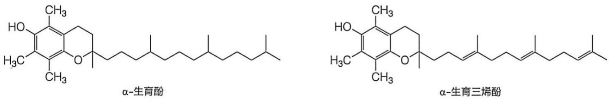

---

070

15 脂质

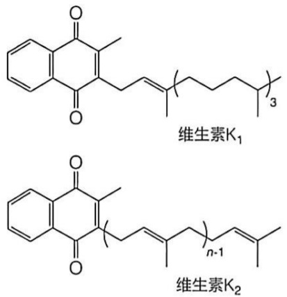

图 15-22 两种维生素 K 的化学结构

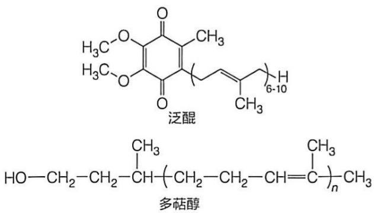

chemical

Chemical structures of dilute and polypropylene monomers with labeled functional groups

图 15-23 泛醌和多萜醇的化学结构

“维生素 K”（koagulations vitamin，凝血维生素）。1930 年末，美国学者爱德华·多伊西（Edward Doisy，1893—1986）等首次从苜蓿中分离出维生素  $K_{1}$ ，并确定其化学结构为 2-甲基 -1,4-萘醌衍生物。他们还在 1940 年代实现了维生素 K 的人工合成。

## 15.8.3 泛醌和多萜醇分别具有电子载体和糖基载体等功能

泛醌（ubiquinone）也被称作辅酶 Q（coenzyme Q，CoQ 或 Q），是一类含有苯醌核心和异戊二烯侧链的脂质分子（图 15-23）。它能够在细胞膜中可逆地携带质子和电子。其异戊二烯侧链长度可变，哺乳动物中最常见的泛醌形式为辅酶  $Q_{10}$ （ $CoQ_{10}$ ，含 10 个异戊二烯单位），其长侧链增强了膜锚定能力。泛醌广泛分布于生物体中，可由人体（或其他动物）细胞自身合成，因此不属于维生素。

辅酶  $Q_{10}$  通过醌基的氧化还原反应，形成三种状态:氧化态泛醌（Q）、半醌（QH·）和还原态泛醌（ $QH_{2}$ ）。在线粒体电子传递链中， $CoQ_{10}$  从复合体Ⅱ的铁硫簇接收电子，并将其传递至复合体Ⅲ中的细胞色素 c，驱动质子跨

膜转运，促进ATP合成。这一过程对细胞的能量代谢至关重要，使 $\mathrm{CoQ_{10}}$ 成为动物细胞不可或缺的关键分子。

泛醌于 1950 年代由美国学者弗雷德里克·克兰（Frederick Crane，1925—2016）等从牛心肌线粒体中首次分离出来。英国学者理查德·莫顿（Richard Morton，1899—1977）等从微生物和动物组织中分离出这种物质，将其命名为泛醌（意为“普遍存在的醌”），同时阐明了泛醌的化学结构特征（苯醌核心 + 异戊二烯侧链）。

多萜醇（dolichol）是一类由14～24个异戊二烯单位（即碳原子数可超过100个）构成的长链聚异戊二烯醇，其结构末端含有一个羟基（图15-23）。作为真核细胞中关键的糖基载体，多萜醇主要分布于内质网膜和高尔基体膜，其疏水链锚定于膜中，而羟基端在发生磷酸化后负载单糖或寡糖前体（如 $Glc_{3}Man_{9}GlcNAc_{2}$ ），参与蛋白质N-糖基化修饰等过程（详见图21-28）。

该分子于 1960 年代由瑞典学者伦纳特·罗登（Lennart Rodén，1928—2000）等在肝脏组织中首次分离和命名，其名称源自希腊语 “dolichos”（意为 “长”），反映了其长链结构特征。他们同时还鉴定出多萜醇具有糖基载体的功能。

---

15.9 聚酮化合物是一类结构丰富多样、在生物体中广泛分布的天然代谢产物

071

## 15.8.4 生物体内多种色素分子为类异戊二烯脂质

在生物世界中，许多呈现颜色的分子属于类异戊二烯脂质家族。其中具代表性的是类胡萝卜素（carotenoid），包括植物中的β胡萝卜素（ $C_{40}H_{56}$ ）、动物中的角黄素（canthaxanthin， $C_{40}H_{52}O_{2}$ ）、玉米黄质（zeaxanthin， $C_{40}H_{56}O_{2}$ ）和虾青素（astaxanthin， $C_{40}H_{52}O_{4}$ ）等。这些分子结构中包含大量共轭双键系统，能够吸收特定波长的可见光，因而呈现不同颜色。

角黄素、玉米黄质与β胡萝卜素均为四萜类胡萝卜素，其共轭双键系统和修饰基团（如羟基、酮基）决定显色差异:β胡萝卜素（无羟基或酮基）呈橙黄色，角黄素（4,4'-二酮）呈鲜红色，玉米黄质（3,3'-二羟基）呈鲜黄色，虾青素（3,3'-二羟基-4,4'-二酮基）呈红色（图15-24）。这些色素通过食物链积累，使火烈鸟羽毛显红色（主要依赖虾青素，角黄素为辅），金丝雀羽毛显黄色（玉米黄质与叶黄素协同）。

值得注意的是，虽然花青素（anthocyanin）也能呈现红、蓝、紫等丰富色彩，但它属于黄酮类化合物，其合成途径与类异戊二烯无关。此外，叶绿素的颜色产生自其卟啉环中的共轭双键，这部分结构并非由异戊二烯单元组成。

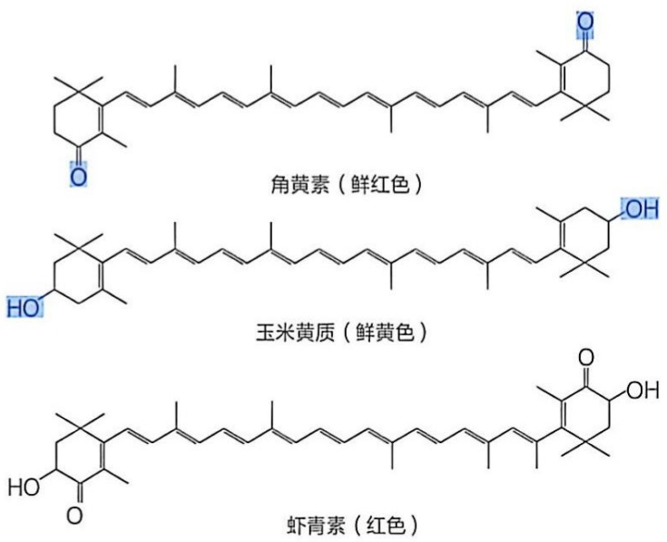

chemical

Three organic molecular structures labeled with Chinese names: 角黄素 (鲜红色), 玉米黄质 (鲜黄色), and 虾青素 (红色)

图 15-24 角黄素、玉米黄质和虾青素分子的化学结构

## 15.9 聚酮化合物是一类结构丰富多样、在生物体中广泛分布的天然代谢产物

聚酮（polyketide）是一类广泛存在于细菌、真菌、植物和动物中的天然次级代谢产物，由乙酰基和丙酰基通过聚合反应形成。这类化合物的分子结构中含有丰富的羰基、羟基和醚键等官能团，展现出极高的结构多样性，包括芳烃类、大环内酯类、环己烷脂质、聚醚和多烯类等多种类型。

聚酮类化合物具有重要的生物活性和医用价值，在抗细菌、抗真菌、抗寄生虫、调节细胞稳态，以及促进动物生长等方面表现出显著功效。代表性的聚酮化合物如红霉素（erythromycin；一种抗生素）、两性霉素 B（amphotericin B；一种抗真菌药物）和洛伐他汀（lovastatin；一种抑制胆固醇合成的化合物）等，它们的结构如图 15-25 所示。

聚酮类化合物的研究历史可追溯至19世纪末，早期学者在微生物代谢产物中观

---

072

15 脂质

图 15-25 代表性聚酮类物质的化学结构

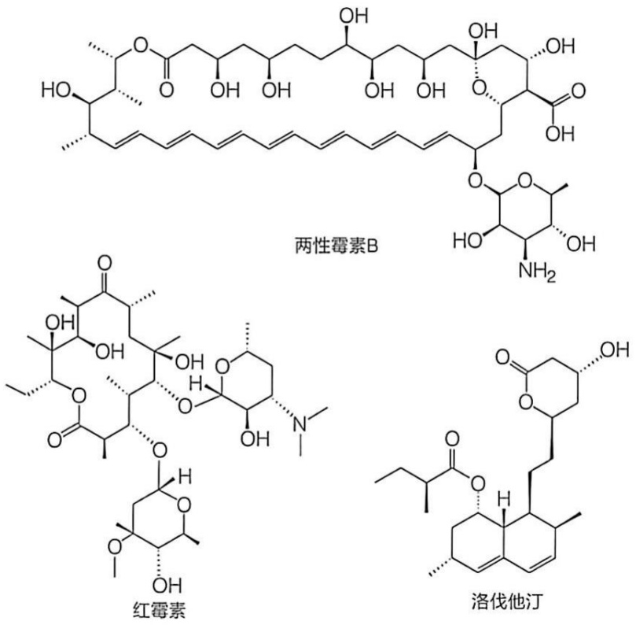

chemical

Structural formulas of three compounds: 两性霉素B, 红霉素, and 洛伐他汀

察到具有抗菌活性的物质。20世纪中叶，随着青霉素的发现，科学家开始系统研究微生物的次级代谢产物，并于1950年代相继分离出四环素、红霉素等典型聚酮类抗生素。1950年代，澳大利亚学者亚瑟·伯奇（Arthur Birch，1915—1995）提出著名的聚酮生物合成假说，为理解这类化合物的形成机制奠定理论基础。1980年代至1990年代，分子生物学技术的突破使研究者成功解析聚酮合酶（polyketide synthase）的基因结构和模块化特征，特别是红霉素聚酮合酶基因簇的阐明，是该领域的里程碑。进入21世纪后，合成生物学技术的发展使得通过改造聚酮合酶基因簇定向合成新型聚酮成为可能。同时，基因组挖掘技术也在不断拓展聚酮结构的多样性。当前，聚酮研究正朝着开发新型生物活性分子和优化工业生产工艺的方向深入发展，展现出广阔的应用前景。

## 15.10 脂质可通过多种技术进行研究

脂质分子由于疏水性较强，通常难溶于水但易溶于有机溶剂，因此在对脂质进行分析前，需先通过有机溶剂（如氯仿-甲醇或氯仿-乙醇混合物等）对其进行萃取。后续的脂质分析技术包括层析、质谱或层析-质谱联用技术等。针对不同脂质类别（如单纯脂质、复合脂质、衍生脂质），层析技术可通过极性差异实现分离，而质谱分析则能提供更精确的分子质量信息，层析-质谱联用则可显著提高脂质分析的灵敏度和准确性。这些方法广泛应用于脂质组学研究，为揭示脂质的生物学功能提供了重要技术支持。

---

15.10 脂质可通过多种技术进行研究

073

## 15.10.1 脂质的高效萃取依赖于有机溶剂

脂质分子因其强疏水性，通常依赖有机溶剂进行高效萃取。例如，我国学者屠呦呦等通过乙醚浸提法，成功地从黄花蒿中提取出倍半萜内酯类脂质分子青蒿素，这凸显了有机溶剂在脂质萃取中的关键作用。

为从生物样品中萃取全部脂质，一种经典的方法于1950年代末由加拿大学者爱德华·布莱（Edward Bligh）和威廉·戴尔（William Dyer）等建立（常被称为布莱-戴尔法）。具体而言，他们利用氯仿:甲醇:水（2:1:0.8，体积比）混合溶剂体系，利用液-液相分层原理使疏水性脂质富集于含氯仿-甲醇的有机相，而亲水的极性分子富集于水相。该方法适用于磷脂、鞘脂、甘油脂、胆固醇酯等多种脂类，但对不同极性的脂质提取效率存在差异。例如，酸性溶剂可优化磷脂萃取，但可能降低对中性脂质（如甘油三酯）的回收率。

此外，脂质稳定性也是萃取过程中需重点考虑的因素。含多不饱和脂肪酸的脂质易受高温影响，因此需在温和条件下操作，避免降解。高效萃取不同脂质类别，需优化溶剂极性、pH及温度等参数。

## 15.10.2 层析技术是分析脂质的重要手段之一

生物体的脂质组成十分复杂，通过有机溶剂萃取得到的脂质混合物一般需先进行有效的分离，然后才可对特异的脂质分子进行定性和定量分析。薄层层析（thin-layer chromatography，TLC）和柱层析（column chromatography）常被用于对脂质的分离分析。

其中的薄层层析是一种基于吸附或分配原理的分离分析技术（图 15-26）。其固定相为均匀涂布在玻璃、塑料或金属板上的薄层吸附剂（如硅胶、氧化铝）；流动相一般使用氯仿-甲醇体系，通过毛细作用在固定相中移动，调整极性溶剂（甲醇、水）或添加酸/碱（乙酸、氨水）来优化分离效果。待测样品点在薄层板一端，溶剂展开后，不同脂质分子因极性、分子大小或亲和力等差异而迁移不同距离，形成分离

(A)

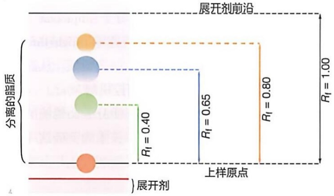

bubble

| Stage | Rl |
| --- | --- |
| 展开剂前沿 | 1.00 |
| 上样原点 | 0.80 |
| 中间层 (Blue) | 0.65 |
| 中间层 (Green) | 0.40 |

(B)

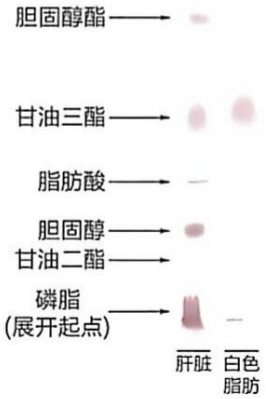

flowchart

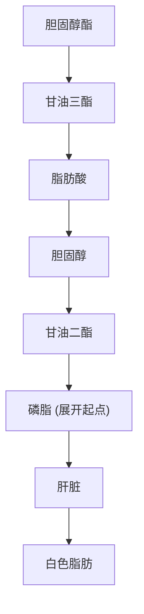

图15-26 薄层层析分离$R_{\mathrm{f}}$ 值不同脂质的示意图（A）及显色结果图（B）B图由清华大学李蓬实验室提供。

---

074

15 脂质

的脂质斑点。在对脂质斑点进行显色（如利用碘蒸气法）后，则可计算不同斑点处的脂质的 $R_{\mathrm{f}}$ 值（retardation factor/retention factor），即斑点处脂质迁移距离（斑点中心与点样原点中心的距离）与溶剂前沿距离（溶剂前沿与点样原点中心的距离）之比。

通过与已知标准品比较 $R_{\mathrm{f}}$ 值（在相同薄层层析条件下），初步判断被测脂质的种类（如磷脂、中性脂、糖脂）（图15-26）。根据 $R_{\mathrm{f}}$ 值的差异可评估不同脂质之间的分离效果，在相同 $R_{\mathrm{f}}$ 值下可粗略比较不同样品中同一脂质的相对含量（需结合光密度扫描等仪器分析）；通过记录 $R_{\mathrm{f}}$ 值和薄层层析条件（溶剂比例、温度、板类型等），确保其他实验室能重复结果；等等。例如，卵磷脂与磷脂酰乙醇胺在薄层层析板上的迁移速率不同（即 $R_{\mathrm{f}}$ 值不同），可被有效分离鉴定。然而，薄层层析的灵敏度较低，通常需要微克级样品，且无法实现精细分离。

柱层析是一种基于吸附、分配或分子大小差异的分离技术，通过将混合物加载到填充有固定相（如硅胶、氧化铝、凝胶或键合相填料）的层析柱中，利用流动相（液体或气体）的洗脱作用，使不同组分以不同速率迁移，从而实现分离。柱层析技术，特别是高效液相色谱（high performance liquid chromatography，HPLC）是脂质分离与分析的重要技术之一，尤其适用于复杂脂质混合物的高分辨率分离。

## 15.10.3 基于质谱的脂质组学分析可实现高覆盖度的分子解析

质谱技术（mass spectrometry，MS）能够对生物样品中的脂质分子进行精确的质量测定。根据脂质的物理化学特性，现代分析主要采用两种联用技术:对于挥发性或半挥发性脂质（如脂肪酸、固醇类），通常采用气相色谱-质谱联用技术（GC-MS），该技术先通过气相色谱（gas chromatography，GC）实现高效分离，再利用质谱进行精确分子质量测定；对于非挥发性脂质（如甘油磷脂、鞘脂等），则可通过液相色谱-质谱联用技术（LC-MS）直接分析，或通过化学衍生化处理使其适用于GC-MS分析。

在结构解析方面，二级质谱（MS/MS）发挥着关键作用。该技术首先在一级质谱中选择特定前体离子，随后在碰撞室中诱导其碎裂，产生特征性的二级质谱图谱。例如，同为甘油磷脂的磷脂酰胆碱（PC）和磷脂酰乙醇胺（PE）所产生特征碎片的质谱图存在明显差异（图 15-27），因而实现脂质分子的高置信度鉴定。

色谱-质谱联用技术的发展直接推动了脂质组学（lipidomics）的诞生。作为代谢组学的重要分支，脂质组学致力于系统研究生物体内所有脂质分子（lipidome）及其生物学功能。该学科通过整合高分辨率质谱、多维色谱分离等高通量（high-throughput）分析技术，不仅能够实现脂质的全面鉴定和定量，还能解析其结构特征，从而揭示脂质在细胞膜构建、信号转导和能量代谢等生命过程中的动态调控机制。

尽管现有技术已取得显著进展，但对于结构全新的未知脂质分子，传统的质谱鉴定仍面临挑战。近年来，人工智能（artificial intelligence，AI）技术为突破这一瓶颈提供了新思路:机器学习算法能够预测潜在脂质结构，深度学习模型可优化海量质谱数据的解析流程，这些创新方法正推动脂质组学进入更深入的发展阶段。

---

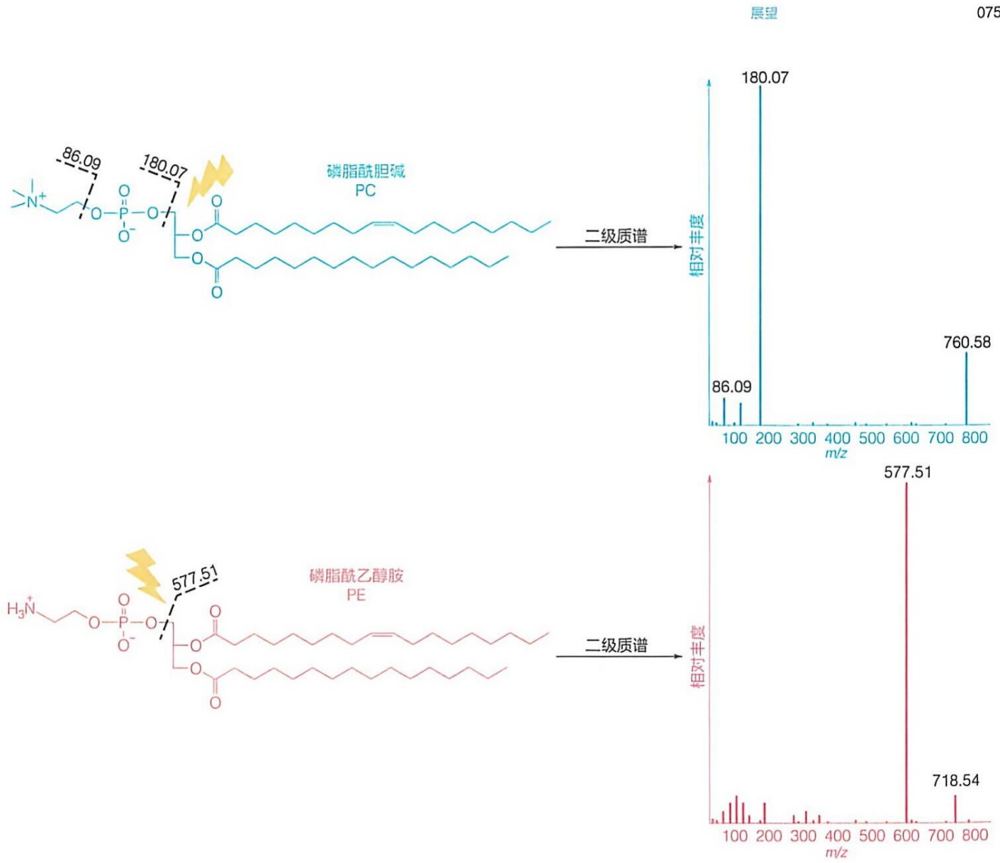

spectrogram

| Compound | m/z | Relative Abundance |
| :--- | :--- | :--- |
| PC | 86.09 | — |
| PC | 180.07 | — |
| PC | 760.58 | — |
| PE | 577.51 | — |
| PE | 718.54 | — |

图 15-27 磷脂酰胆碱（PC）和磷脂酰乙醇胺（PE）的二级质谱图存在明显差异

## ※展望

近年来，“结构脂质组学”的兴起正逐步突破这些瓶颈。离子淌度质谱（ion mobility mass spectrometry，IM-MS）可将异构体分离分辨率提升至碰撞截面（collision cross section，CCS）值差异0.5%的水平，而臭氧诱导解离（ozone-induced dissociation, OzID）等技术能精确定位脂酰基中双键的位置。更值得关注的是，AI驱动的质谱解析平台，如脂质组学人工智能建模与分析（lipidomics artificial intelligence modeling and analysis, LipidAIMA）已能预测未知脂质的碎裂模式，其准确率在脂质代谢物与通路策略（LIPID metabolites and pathways strategy, LIPID MAPS）数据库测试中达89%。这些技术的协同应用，有望在未来将脂质注释覆盖率进一步提高。

尽管已有重要发现（如氧化磷脂在肿瘤铁死亡与动脉粥样硬化中的双刃剑作用），但脂质标志物的临床转化仍面临如下障碍。比如，①组织特异性（如脑神经节苷脂与血浆水

---

076

15 脂质

平的非同步变化); ②代谢网络复杂性 (鞘脂代谢酶突变可同时影响多种疾病通路); ③检测标准化缺失 (不同中心间液相层析 - 质谱数据差异达 $15\% \sim 30\%$)。解决这些问题的关键路径包括: 发展原位脂质成像技术, 如基质辅助激光解吸电离质谱成像 (matrix-assited laser desorption ionization mass spectrometry imaging, MALDI-MSI) 的空间分辨率已达 $1 \mu \mathrm{m}$, 以及建立 “人类脂质组计划” 的多组学数据库。

随着第四代质谱和微流控单细胞脂质组学技术的发展，脂质研究将呈现如下趋势。①从“组成分析”转向“动态代谢通量”测量；②实现亚细胞器水平的脂质时空动态可视化；③通过类器官脂质组模型预测药物响应。这些突破或将揭示脂质网络作为“代谢暗物质”的核心作用，为精准医学提供新的干预靶点（如通过调节特定磷脂酶治疗神经退行性疾病）。

## ※ 本章小结

脂质虽然主要由碳、氢、氧等少数元素组成，但其分子结构呈现出惊人的多样性，由此衍生出复杂多样的生物学功能。

基于脂质代谢物与通路策略（LIPID MAPS）分类标准，脂质按其核心结构特征可分为八大类:脂肪酸类（FA）、甘油脂类（GL）、甘油磷脂类（GP）、鞘脂类（SP）、糖脂类（SL）、固醇脂类（ST）、类异戊二烯脂类（PR）和聚酮类（PK），这一系统分类体系为脂质组学研究提供了标准化框架。

脂质的系统命名遵循其核心骨架结构的特征:以甘油为骨架的脂类中，甘油脂仅含甘油和脂肪酸酯，而甘油磷脂则额外具有磷酸基团修饰；鞘脂类以鞘氨醇为基本骨架，可进一步分为含磷酸基团的鞘磷脂（SM）和含糖基的鞘糖脂（SG，如脑苷脂）；固醇脂类则基于环戊烷多氢菲骨架，主要包括胆固醇及其酯化衍生物。这种基于特征骨架的分类命名体系，为脂质的结构解析和功能研究提供了系统化的理论基础。

脂质的分子结构与其理化性质存在构效关系，并直接调控其生物学功能。以甘油磷脂为例，其sn-2位通常酯化不饱和脂肪酸，该结构特征导致脂肪酸链产生约 $30^{\circ}$ 的顺式弯曲，进而影响脂质分子的空间排列。研究表明，增加sn-2位脂肪酸的不饱和度，可使膜流动性提高，相变温度降低。这种动态特性将通过影响膜蛋白的功能、信号传递以及物质运输过程等影响细胞功能；这种精确的结构-功能关系使脂质成为生命活动的关键调控分子。

脂质分子在生物体系中展现的结构多样性和功能复杂性，使其在生命活动中扮演着不可替代的角色。对脂质结构的深入解析不仅揭示了许多生理过程的分子机制，更为疾病标志物发现和靶向治疗提供了新思路；随着质谱成像、AI预测等新技术的发展，脂质研究正从静态组成分析迈向动态功能探索的新阶段。

## ※ 思考题

1. 椰子油富含中短链饱和脂肪酸（8\~14个C），总饱和脂肪酸含量约为 $87\%$ ，其

---

推荐阅读

077

熔点约为  $24^{\circ}$ C。棕榈油主要成分是长链脂肪酸（16 和 18 个 C），总饱和脂肪酸含量约为 50%，其熔点约为  $35^{\circ}$ C。请解释为何棕榈油的熔点高于椰子油的熔点。

2. 哪种脂质成分需要消耗更多的能量才能被有效地富集在微绒毛的基部区域？
3. 脂质通常被定义为 “不溶于水但可溶于非极性溶剂的生物分子”。然而，脂质分子结构差异较大。请比较甘油磷脂（如磷脂酰胆碱）和鞘脂（如鞘磷脂）在构成其两亲性的核心结构上的区别。
4. 请比较前列腺素、血栓素、白三烯、脂氧素等花生四烯酸衍生物的代表性结构的共同点和核心差异点。
5. 从胆固醇独特的结构和两亲性质出发，分析高胆固醇与极性脂质（如磷脂）的比例对细胞膜物理性质（如流动性，相态与相分离）产生哪些具体影响。

## ※ 推荐阅读

- 1. LIEBISCH G, FAHY E, AOKI J, et al. Update on LIPID MAPS classification, nomenclature, and shorthand notation for MS-derived lipid structures [J]. J Lipid Res, 2020, 61 (12): 1539–555.
- 该文对 LIPID MAPS 脂质分类体系及其结构简写符号系统进行了更新，主要涵盖脂肪酸、甘油脂、甘油磷脂、鞘脂以及甾醇这几大类脂质。
- 2. WANG B, TONTONOZ P. Phospholipid remodeling in physiology and disease [J]. Annu Rev Physiol, 2019, 81: 165-88.
- 该文综述了溶血磷脂酰胆碱酰基转移酶 LPCAT1 与 LPCAT3 的生理功能。
- 3. AERTS JM, HOLLAK C, BOOT R, et al. Biochemistry of glycosphingolipid storage disorders: implications for therapeutic intervention [J]. Philos Trans R Soc Lond B Biol Sci, 2003, 358 (1433): 905–14.
- 该文探讨了 1 型戈谢病，即一种由溶酶体葡萄糖脑苷脂酶缺陷引发的典型糖鞘脂沉积症。
- 4. DOWHAN W, VITRAC H, BOGDANOV M. Lipid-assisted membrane protein folding and topogenesis [J]. Protein J, 2019, 38 (3): 274-88.
- 该文综述了脂质可作为分子伴侣和拓扑决定因子，协助膜蛋白折叠与拓扑发生。
- 5. WENK M R. The emerging field of lipidomics [J]. Nat Rev Drug Discov, 2005, 4(7): 594-610.
- 该文综述了液相色谱-质谱联用等技术推动脂质组学发展，不仅深化了人们对脂质功能的理解，也为药物靶点与疾病生物标志物的研发开辟了新途径。

(撰写: 秦咏梅, 李珍, 刘平生, 刘晓蕙; 审修: 马潇潇, 陈晓伟)

---

