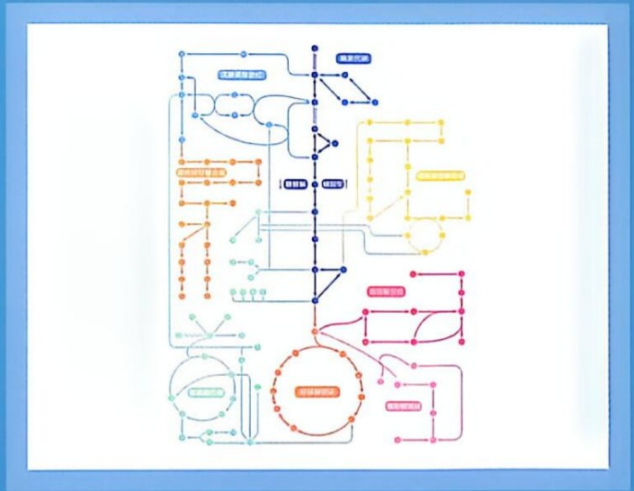

# 第IV篇 生物体内的物质与能量代谢·分篇页

原始 PDF 第 96–97 页。

flowchart

This flowchart illustrates a system architecture or process workflow involving multiple nodes and processes, including processing steps (e.g., '连接到目标', '连接到目标'), decision points, and feedback loops.

## 第Ⅳ篇

## 生物体内的物质与能量代谢

人类对生命本质的认知曾长期被“活力论”主导，认为一种超自然力量（如中国哲学的“气”或西方的“生命力”）支配着生命现象，使其独立于物理化学规律。这一思想从古希腊延续至近代，强调生命与非生命之间存在不可逾越的鸿沟。然而，19世纪末至20世纪初的关键科学发现动摇了活力论的根基。例如，破碎的酵母细胞仍能发酵葡萄糖（1890年代）以及从无机物合成尿素等实验证明，生命活动——包括复杂的有机分子转化——可以在无“生命力”干预的情况下，通过生物体内的物质实现。这模糊了生命与非生命的界限。

现代生物学揭示，生命的存在与延续依赖于庞大而精密的酶促化学反应网络——物质与能量代谢。所有生物，从细菌到人类，都必须通过此过程获取能量（ATP）、分解营养物质（分解代谢）并构建自身复杂结构（合成代谢）。正是代谢支撑着从受精卵发育到复杂个体的全过程。对代谢的研究贯

---

穿生命科学史，从拉瓦锡认识到呼吸类似燃烧，到阐明 ATP 作为能量货币，这些不断深化的认识不仅揭示了生命本质，更深刻推动了医学（如对糖尿病和癌症的代谢异常的理解）、农业（如光合作用的研究）及能源领域（如发酵的应用）的革新。

本篇将系统地学习生物体普遍存在的物质与能量代谢，内容涵盖糖、脂质、氨基酸和核苷酸的分解与合成代谢，以及核心产能过程（柠檬酸循环、氧化磷酸化、光合磷酸化）。贯穿始终的主线是“结构决定功能”，强调酶通过其活性中心的精确结构（空间、电荷、构象）实现高效且特异的催化。理解这些过程是认识生命和人类健康的关键。
