# 18 柠檬酸循环

原始 PDF 第 181–213 页。

## 18

## 柠檬酸循环

在第 17 章中我们学习到，葡萄糖经糖酵解十步反应，最后生成了丙酮酸。然而，糖酵解过程既未消耗  $O_{2}$ ，也未产生  $CO_{2}$ 。这尚无法与拉瓦锡在 18 世纪所认识到的动物呼吸是“缓慢燃烧（即消耗  $O_{2}$ ，并产生  $CO_{2}$  和  $H_{2}O$ ）过程”这一结论相印证。

后续研究表明，像葡萄糖这样的燃料分子“缓慢燃烧”的过程，是分步进行的，这一过程被称作细胞呼吸（cellular respiration）。而糖酵解仅是细胞呼吸的初始阶段。

所有燃料分子经细胞呼吸氧化分解的过程可被大致划分为三个阶段（图 18-1）。在第一个阶段，不同的燃料分子（如葡萄糖、脂肪酸或氨基酸）通过不同的氧化分解途径（如葡萄糖的糖酵解和脂肪酸的β氧化）均被转化为乙酰辅酶A（coenzyme A, CoA），即一种由辅酶A携带和活化的二碳单位。所释放的电子均由NAD$^{+}$或FAD等通用电子载体暂时携带（分别形成NADH和FADH$_{2}$）。

从第二个阶段开始，所有燃料分子进入一条共同的途径进行分解。这就是将乙酰辅酶 A 所携带的二碳单位通过柠檬酸循环（citric acid cycle）途径，彻底氧化为  $CO_{2}$ 。与上面一样，该阶段所释放的电子也存在于还原型电子载体 NADH 和  $FADH_{2}$  分子中。

到第三阶段时，NADH 和  $FADH_{2}$  所携带的电子将通过一种位于真核生物线粒体内膜或原核生物细胞质膜上的电子传递链（即呼吸链）传递至  $O_{2}$ ，形成  $H_{2}O$ 。这些氧化过程释放的能量先被用于形成一种跨膜质子梯度，再被用于驱动能量货币 ATP 分子的合成。第三阶段所发生的电子传递与 ADP 磷酸化偶联的过程，即被称作氧化磷酸化（oxidative phosphorylation）过程（图 18-1）。

细胞呼吸是一个依赖氧气的过程。它是生物在地球表面出现氧气

---

18.1 糖类、脂肪酸和氨基酸等均通过柠檬酸循环被彻底氧化

165

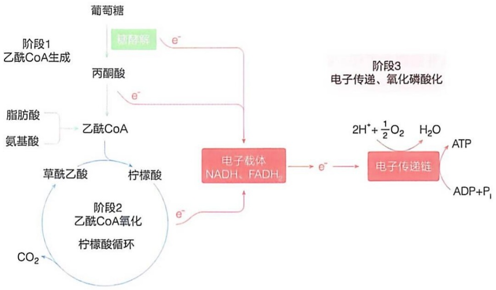

<details>
<summary>flowchart</summary>

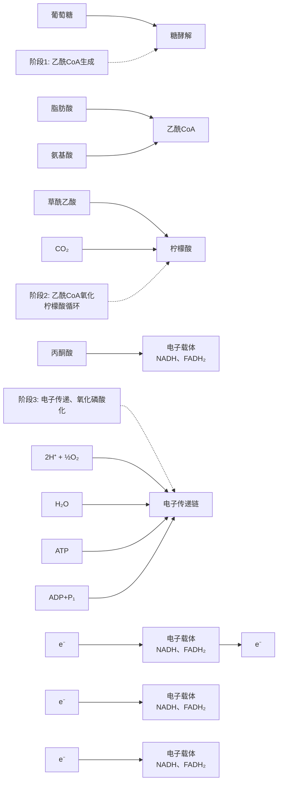
</details>

图 18-1 细胞呼吸可分为三个阶段

（可能由蓝细菌等光合生物产生）之后，适应氧气存在而演化出的一种代谢方式。氧气的出现最初对生物是一种挑战，但生物逐渐适应这种环境，并演化出利用氧气的呼吸过程，使获取能量的方式更加有效，推动了地球生物的繁盛。

本章将详细描述燃料分子在生物体内氧化的第二阶段，即柠檬酸循环。在细胞的中间代谢过程中，柠檬酸循环处于核心地位:它不仅负责将来自糖类、脂肪酸和氨基酸的碳原子彻底氧化成  $CO_{2}$ ，并释放丰富的能量（最终通过合成 ATP 来驱动几乎所有生命过程的进行），还为生物体合成各种重要生命分子提供前体（见合成代谢部分）。因此，柠檬酸循环被看作是一种兼具分解和合成代谢功能的两用（amphibolic）代谢途径，成为细胞中间代谢的核心和枢纽。

我们先介绍糖酵解最终产物丙酮酸转化为乙酰辅酶 A 的过程，然后介绍柠檬酸循环的详细过程，包括催化柠檬酸循环的所有酶、化学反应以及调节机制等。最后我们将介绍存在于植物和微生物细胞中、与柠檬酸循环共享多步反应的、可将脂肪酸净转化为葡萄糖的乙醛酸循环途径。

## 18.1 糖类、脂肪酸和氨基酸等均通过柠檬酸循环被彻底氧化

柠檬酸循环是糖类、脂肪酸和氨基酸等彻底氧化的共同途径，因其第一个中间产物是柠檬酸而得名。它以一种循环方式运行，极其高效。此外，因为循环中的几种主要中间代谢物是含有三个羧基的有机酸，也被称作三羧酸循环（tricarboxylic acid cycle, TCA cycle）。柠檬酸循环由德裔英国学者汉斯·克雷布斯（Hans Krebs，1900—1981）等于1930年代提出，故亦被称作克雷布斯循环（Krebs cycle），他也因此获得

---

166

18 柠檬酸循环

了 1953 年诺贝尔生理学或医学奖。

在阐明柠檬酸循环这种代谢机制的大约 5 年前，克雷布斯等还揭示了动物将剩余的氨排出体外的尿素循环（即鸟氨酸循环）途径。在大约 20 年后，克雷布斯等还发现了将脂肪酸分解产物转化为葡萄糖合成前体的乙醛酸循环的存在。一位学者揭示了三种循环代谢途径，这在生物学领域堪称一段佳话，令人惊叹，也值得称赞。

柠檬酸循环是一种几乎存在于所有生物中的枢纽性代谢途径。它不仅存在于需氧生物中，甚至也存在于厌氧生物中（逆向运行以“固定” $\mathrm{CO}_{2}$，具体见后）。在真核生物中，柠檬酸循环发生于线粒体基质中，在原核生物中则直接发生于胞质溶胶中。柠檬酸循环的总体结果是使乙酰辅酶A所携带的二碳单位彻底氧化为 $\mathrm{CO}_{2}$，同时产生NADH、$\mathrm{FADH}_{2}$ 和ATP或GTP等携带能量的分子。

## 18.1.1 柠檬酸循环因其多种中间代谢物具有“催化”性特征而被揭示

柠檬酸循环的发现是代谢研究领域的一个里程碑。值得注意的是，它是在同位素示踪技术出现之前，通过对大量化合物在动物组织中的氧化分解过程进行烦琐细致的分析而逐渐被揭示的。

当糖酵解途径被逐渐描述清楚之后，1930年代，人们开始探究细胞将丙酮酸氧化成 $CO_{2}$ 和 $H_{2}O$ 的过程，重点在于描述其中间含碳代谢物的本质，以及糖酵解与利用氧气的呼吸作用之间如何关联等。柠檬酸循环的揭示经历了20余年的“接力”探索，其间大量错误的模型被提出又被推翻，当克雷布斯获得了正确的答案时，学界并未给予足够的重视，有关柠檬酸循环的最重要论文于1937年发表在Enzymologica这个很不起眼的学术刊物上（这份刊物允许用多种欧洲语言发表论文）。相反，提出完全错误理论的匈牙利学者圣捷尔吉却因为“揭示生物燃烧过程中反丁烯二酸（即延胡索酸）的催化效应以及维生素C的作用”而获得1937年的诺贝尔生理学或医学奖。这段历史真实地反映了人类认识自然现象的曲折过程。

在对细胞呼吸的早期研究过程中，通常使用绞碎的动物组织作为实验材料。值得注意的是，人们试图建立类似研究糖酵解过程的无细胞体系，但一直未获成功（作为后见之明，这与催化柠檬酸循环以及氧化磷酸化的多种酶均位于线粒体内膜上有关），因此，人们只能利用这样的切碎组织（其中的细胞保持完整）开展实验。

利用切碎的动物组织样品，人们分析了大量化合物的生物可氧化性（通过是否引起氧气的消耗）特征，观察到以下现象。1910年代至1920年代，瑞典学者托尔斯滕·通贝里（Torsten Thunberg，1873—1952）等观察到，琥珀酸、苹果酸、草酰乙酸和延胡索酸等四碳二羧酸化合物可在切碎的肌肉组织中被快速氧化，但他们并未将这些观察结果与糖的氧化过程进行任何关联。1930年代，圣捷尔吉等观察到，鸽子胸肌悬浮液（可进行快速呼吸作用）在加入少量延胡索酸后，对氧气的摄取量可被稳定在高速率状态。也就是说，延胡索酸并未大量消耗，而是作为催化剂发挥作用。从产生的 $CO_{2}$ 与所消耗 $O_{2}$ 之间的比例（即呼吸商）推断，碳水化合物或其产物（如丙糖）

---

18.1 糖类、脂肪酸和氨基酸等均通过柠檬酸循环被彻底氧化

167

正在被氧化 $^{①}$ 。基于这些观察，圣捷尔吉提出了氢从食物传递到  $O_{2}$  的线性路径，其中有维生素 C 和延胡索酸等的参与（他因此而获得了诺贝尔奖）。

1930 年代，克雷布斯在这样的氧化系统中观察到，加入草酰乙酸后生成了六碳三羧酸，即柠檬酸，并且柠檬酸也发挥类似的催化作用。同时，他还观察到，异柠檬酸和顺乌头酸的氧化效率与柠檬酸类似；如果在加入丙二酸（琥珀酸脱氢酶抑制剂）后再加入柠檬酸，则会导致  $\alpha-$  酮戊二酸和琥珀酸的积累；同时也阻止丙酮酸的氧化；等等。克雷布斯在分析了前人提出的线性代谢途径中存在的问题之后，提出了一种全新的解释碳水化合物经分解成丙酮酸后彻底氧化的循环途径，他称之为柠檬酸循环。

1940 年代，同位素示踪分析成为代谢研究的重要手段。在利用  $CH_{3}-^{14}COO^{-}$  作为前体开展的示踪实验中，人们观察到在  $\alpha-$  酮戊二酸分子中，只有  $\gamma-$  羧基被  ${}^{14}C$  标记，而  $\alpha-$  羧基却未被  ${}^{14}C$  标记。这与柠檬酸是一种代谢中间体的结论不符:因为柠檬酸是一种对称分子，所以，从它产生的  $\alpha-$  酮戊二酸分子中的  $\alpha-$  羧基和  $\gamma-$  羧基在原来的柠檬酸分子中地位是完全相同的，应该都被标记。既然  $\alpha-$  酮戊二酸分子中只有一个羧基被标记，就无法证实柠檬酸是产生  $\alpha-$  酮戊二酸分子的前体。因此，柠檬酸循环被更名为三羧酸循环。

然而，人们后来认识到，尽管柠檬酸为对称性分子，但在与酶的活性中心结合时，其结合方式并非完全对称。也就是说，在酶的活性中心，柠檬酸分子中两个看似相同的羧基的特异结合的位点是不同的且不可替换的，也就是说结合并非是对称的（参考酶学章节中关于“三点契合”理论的介绍）。这样，其产物 $\alpha-$ 酮戊二酸分子中的 $\alpha-$ 羧基和 $\gamma-$ 羧基显示出的差异也就可以解释了。柠檬酸的确是该途经的中间体，柠檬酸循环的名称因此被恢复。

## 18.1.2 柠檬酸循环的发生不直接消耗氧气但依赖于氧气的作用

与糖酵解类似，氧气分子并不直接参与柠檬酸循环。然而，与糖酵解不同的是，柠檬酸循环在无氧气存在的条件下不会发生。也就是说，柠檬酸循环中所产生的还原型电子载体（即 NADH 和  $FADH_{2}$ ）只有将电子传递给  $O_{2}$  后，才可重新恢复其氧化型结构（即  $NAD^{+}$  和 FAD），使得柠檬酸循环中的氧化反应得以持续发生。细胞内的电子载体的总含量较低且比较恒定，因此电子载体必须在其还原态和氧化态之间循环。

每一轮柠檬酸循环发生时，一个乙酰基（含2个碳原子）以乙酰辅酶A的形式进入循环，产生2分子 $\mathrm{CO}_{2}$ 。循环开始时消耗的1分子草酰乙酸，在循环的最后一步反应中又重新生成（图18-1）。因此，这样的分解过程可以不断循环往复，每一轮循环都会产生 $\mathrm{CO}_{2}$ 、NADH、$\mathrm{FADH}_{2}$ （及ATP或GTP）等。柠檬酸循环的持续运行依赖氧气对氧化型电子载体的再生。

<small><span class="docvortex-page-footnote" data-block-type="page_footnote" style="color:#6b7280">① 不同类型的燃料分子的呼吸商不同，葡萄糖的呼吸商为1。</span></small>

---

168

18 柠檬酸循环

## 18.1.3 不同燃料分子分解生成的乙酰辅酶 A 均可进入柠檬酸循环

葡萄糖、脂肪酸和氨基酸的碳骨架等燃料分子在第一阶段的分解代谢中，最终均汇聚于乙酰辅酶 A。因此，乙酰辅酶 A 经柠檬酸循环的分解是体内燃料分子彻底氧化的共同路径。但是，细胞并非平均利用所有燃料分子，而是根据不同燃料分子存在的丰度及环境条件的差异，动态选择使用其中的一种为主进行分解供能。例如，在饱食状态下，糖类被优先用于分解供能；而在饥饿状态下，则主要由脂肪酸分解提供能量来源；但在有氧条件下，无论何种情况、何种燃料分子分解供能，柠檬酸循环均需活跃运转。

## 18.2 糖酵解终产物丙酮酸需先被转运至线粒体基质并转化成乙酰辅酶 A

糖酵解发生于胞质溶胶，终产物为丙酮酸。在有氧条件下，丙酮酸将被线粒体内膜上的特异转运蛋白转运至线粒体基质。值得注意的是，像丙酮酸这样的小分子，可以利用线粒体外膜上非特异的膜孔蛋白（porin）等自由通过。如果内膜上的丙酮酸转运蛋白表达量下降或功能缺失，细胞将高度依赖糖酵解供能，并产生大量乳酸。因此，丙酮酸转运蛋白对于确保细胞内丙酮酸的有效氧化分解至关重要。进入线粒体基质的丙酮酸，需先被转化为乙酰辅酶A，然后进入柠檬酸循环，彻底氧化成 $CO_{2}$ 。

## 18.2.1 线粒体基质中的丙酮酸脱氢酶复合物催化丙酮酸转化为乙酰辅酶 A

进入线粒体基质中的丙酮酸将由丙酮酸脱氢酶复合物（pyruvate dehydrogenase complex，PDH）催化，发生氧化脱羧，生成乙酰辅酶A。原核生物中丙酮酸脱氢酶复合物存在于胞质溶胶中，可以直接作用于糖酵解产生的丙酮酸。

## (1) 丙酮酸脱氢酶复合物由三种酶组装成巨大的复合物

无论在原核细胞还是真核细胞中，丙酮酸脱氢酶复合物均为一种在电子显微镜下明显可见的巨大复合物（图18-2）。它含三种酶，分别为丙酮酸脱氢酶（pyruvate dehydrogenase， $E_{1}$ ）、二氢硫辛酰胺转乙酰基酶（dihydrolipoamide acetyltransferase， $E_{2}$ ）和二氢硫辛酰胺脱氢酶（dihydrolipoamide dehydrogenase， $E_{3}$ ）。大肠杆菌的丙酮酸脱氢酶复合物一般由60个亚基组成:含24个 $E_{2}$ 亚基形成核心，周边围绕24个 $E_{1}$ 和12个 $E_{3}$ 亚基，组装形成一个大致呈球形的复合物。哺乳动物丙酮酸脱氢酶复合物则由48个 $E_{2}$ 和12个原核生物中不存在的 $E_{3}$ 亚基结合蛋白（ $E_{3}$ binding protein， $E_{3}BP$ ）共同组成核心，周围结合20～30个 $E_{1}$ 四聚体和6～12个 $E_{3}$ 二聚体。每个亚基的拷贝

---

18.2 糖酵解终产物丙酮酸需先被转运至线粒体基质并转化成乙酰辅酶A

169

(A)

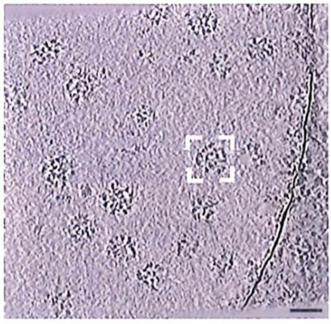

<details>
<summary>natural_image</summary>

Microscopic view of cellular or particulate structures with scattered dark spots on a light purple background, no visible text or symbols.
</details>

(B)

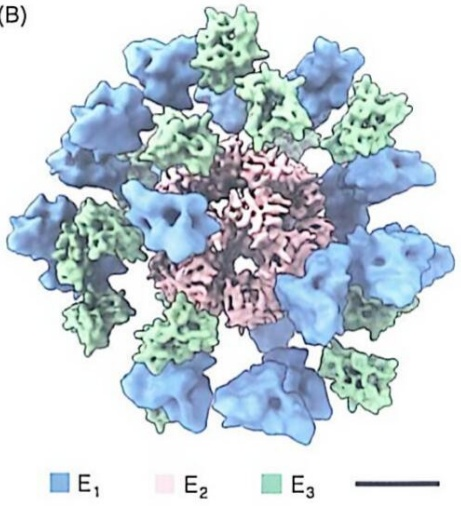

<details>
<summary>chemical</summary>

Molecular structure diagram showing three labeled components E1, E2, and E3 in a 3D arrangement
</details>

(C)

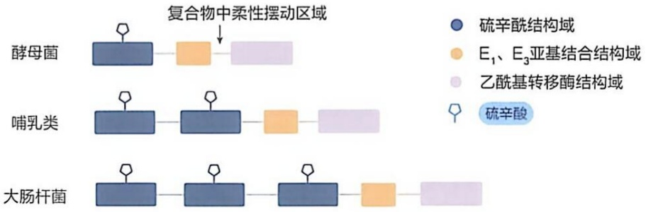

<details>
<summary>flowchart</summary>

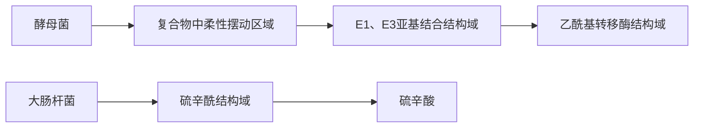
</details>

图 18-2 丙酮酸脱氢酶复合物的电镜照片、重构图及  $E_{2}$  亚基结构示意图

（A）猪心肌细胞丙酮酸脱氢酶复合物的冷冻电镜照片（由清华大学杨茂君实验室陈懋斐博士提供）。值得注意的是，复合物的整体结构并非完全均一，即不同颗粒之间形态存在一定差异。白色方框内为一个具

有代表性的复合物，比例尺为 50 nm。（B）丙酮酸脱氢酶复合物三维重构模型。 $E_{1}$ 、 $E_{2}$  和  $E_{3}$  亚基分别用蓝色、粉色和绿色标示，比例尺长度为 10 nm。 $E_{2}$  形成复合物的核心， $E_{1}$  和  $E_{3}$  位于外周。（C）不同种属复合物中  $E_{2}$  包含的三种不同的结构域的数目比例。

数，一方面依物种不同而存在差异，另外也很难通过实验准确测定，所以这里所列的亚基数目只作为参考值。

## (2) 丙酮酸脱氢酶复合物含五种辅因子

丙酮酸脱氢酶复合物含有五种辅因子。其中的三种——NAD$^{+}$、FAD 和硫胺素焦磷酸（TPP）在前面已经介绍过（第 16 和 17 章）；另外两种分别是硫辛酸（lipoate）和辅酶 A。其中的 TPP 为丙酮酸脱氢酶亚基 E$_{1}$ 的辅因子，硫辛酸和辅酶 A 是二氢硫辛酰胺转乙酰基酶 E$_{2}$ 的辅因子，剩下的 NAD$^{+}$ 和 FAD 均为二氢硫辛酰胺脱氢酶 E$_{3}$ 的辅因子。这三种酶利用五种辅因子催化丙酮酸氧化脱羧，生成乙酰辅酶 A 的反应如下:

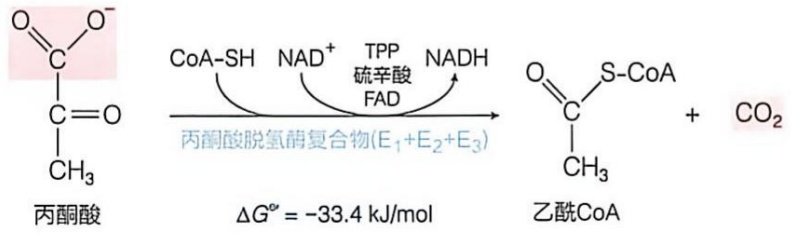

<details>
<summary>chemical</summary>

Reaction mechanism of acetic anhydride showing conversion to acetic acid and CO2 under catalytic conditions
</details>

---

170

18 柠檬酸循环

图 18-3 硫辛酸是  $E_{2}$  活性中心的电子载体和乙酰基载体

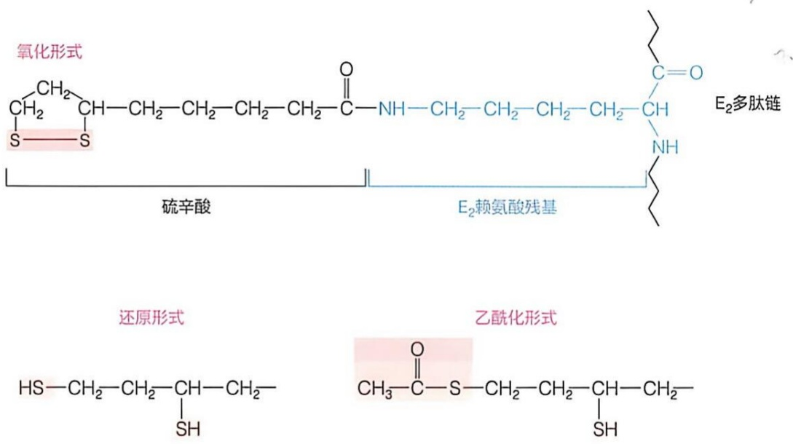

硫辛酸是共价结合于  $E_{2}$  亚基上的一种辅因子，通过其羧基与酶活性中心一个赖氨酸侧链末端  $\varepsilon-$  氨基缩合，以酰胺键连接（图 18-3）。

硫辛酸辅因子发挥催化功能的基团是位于其6号和8号碳原子上的两个巯基。当这两个巯基处于二硫键状态，硫辛酸可作为电子受体发挥作用；当它接受2个电子而处于还原状态时，所形成的巯基可作为酰基载体发挥作用（图18-3）。

根据物种的不同，每个  $E_{2}$  亚基可共价结合 1\~3 分子的硫辛酸辅因子。硫辛酰结构域位于蛋白质肽链的 N 端。酵母、哺乳动物和大肠杆菌来源的每个  $E_{2}$  亚基可分别共价结合 1 个、2 个和 3 个硫辛酸辅因子。也就是说，对于细菌复合物而言，因含 24 个  $E_{2}$  亚基，故可结合 72 个硫辛酸辅因子。在硫辛酰结构域之后是负责  $E_{2}$  与  $E_{1}$  和  $E_{3}$  相互作用的结构域。在  $E_{2}$  亚基的 C 端是具有乙酰基转移酶活性的催化结构域（图 18-2C）。人体细胞的线粒体可合成硫辛酸（见第 23 章）。

作为存在于  $E_{2}$  亚基活性中心的另一种辅因子，辅酶 A 是丙酮酸氧化脱羧后所产生乙酰基的最终受体。辅酶 A 由德裔美国学者李普曼等在探究肝脏抽提物使对氨基苯磺酰胺（也称磺胺，为早年开发的一种抗生素）的氨基发生乙酰化修饰的过程中，于 1940 年代鉴定到（他一直以为乙酰磷酸为乙酰基供体，后来鉴定到乙酰辅酶 A 为乙酰基供体）。辅酶 A 的化学结构在 1950 年代被测定并人工合成。其结构较为复杂，由 3'-磷酸腺苷二磷酸与泛酸以酯键连接后再与 β-巯基乙胺通过酰胺键连接（图 18-4），其中的泛酸由维生素  $B_{5}$  衍生而来。作为酶的共底物辅因子，辅酶 A 是一种被广泛使用的酰基载体。

辅酶A分子中的末端巯基为其功能基团，通过形成硫酯键携带包括乙酰基在内的酰基。由于这样的硫酯键水解时的 $\Delta G^{\ominus}$ 为-31.4kJ/mol，与ATP的高能磷酸键水解近似，因此被称为高能硫酯键，而辅酶A和（乙）酰基形成的硫酯键，也是对后者的活化。

---

18.2 糖酵解终产物丙酮酸需先被转运至线粒体基质并转化成乙酰辅酶 A

171

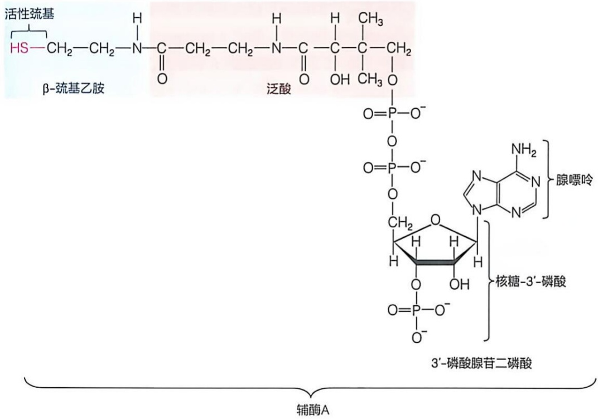

<details>
<summary>chemical</summary>

化学结构式图，展示β-巯基乙胺与3'-磷酸腺苷二磷酸的反应方程式及关键组分
</details>

图 18-4 辅酶 A 的结构

## 18.2.2 丙酮酸脱氢酶复合物催化丙酮酸氧化脱羧的五步连续反应

作为一种含有几十个亚基的蛋白质复合物，丙酮酸脱氢酶复合物可同时催化大量丙酮酸分子进行氧化脱羧，形成乙酰辅酶 A。从丙酮酸转化为乙酰辅酶 A 的过程涉及五步化学反应，依赖三种亚基之间的紧密协同（图 18-5）。

我们以一个  $E_{1}-E_{2}-E_{3}$  催化单位为例，说明五步连续催化反应发生的过程（图 18-5A）。

第一步，由  $E_{1}$  亚基催化丙酮酸脱羧。由丙酮酸脱氢酶亚基  $E_{1}$  催化的这步反应，与丙酮酸脱羧酶（催化酵母酒精发酵的酶之一）催化的反应基本相同，也利用 TPP 作为辅因子（参见图 17-16A）。由 TPP 噻唑环中的 C2 先与丙酮酸分子中的 C2 缩合，然后，丙酮酸的 C1 以  $CO_{2}$  的形式释放，形成羟乙基 TPP 中间体。

第二步，由  $E_{1}$  亚基催化羟乙基氧化和乙酰基转移。中间体羟乙基 TPP 上的羟乙基在共价连接于  $E_{2}$  上的硫辛酰胺参与下发生氧化。电子被转移至氧化型硫辛酰胺上，使其还原成 2 个巯基；羟乙基氧化生成的乙酰基被立刻转移至还原型硫辛酰胺的一个巯基上，形成乙酰硫辛酰胺中间体。

第三步，由  $E_{2}$  亚基催化将乙酰基转移至辅酶 A 分子。上面形成的乙酰硫辛酰胺中间体再由二氢硫辛酰胺转乙酰基酶  $E_{2}$  催化，将乙酰基转移至辅酶 A，生成产物乙酰辅酶 A，同时形成还原型的二氢硫辛酰胺。

第四步和第五步，由  $E_{3}$  亚基催化氧化型硫辛酰胺再生。为使一个  $E_{1}-E_{2}-E_{3}$  催化单位恢复其结构，还原型二氢硫辛酰胺需发生氧化。这由二氢硫辛酰胺脱氢酶  $E_{3}$  催

---

172

18 柠檬酸循环

图 18-5 丙酮酸脱氢酶复合物催化丙酮酸氧化脱羧

（A）丙酮酸脱氢酶复合物催化的五步反应。（B）丙酮酸脱氢酶复合物的底物通道效应，图中LD为硫辛酰结构域。

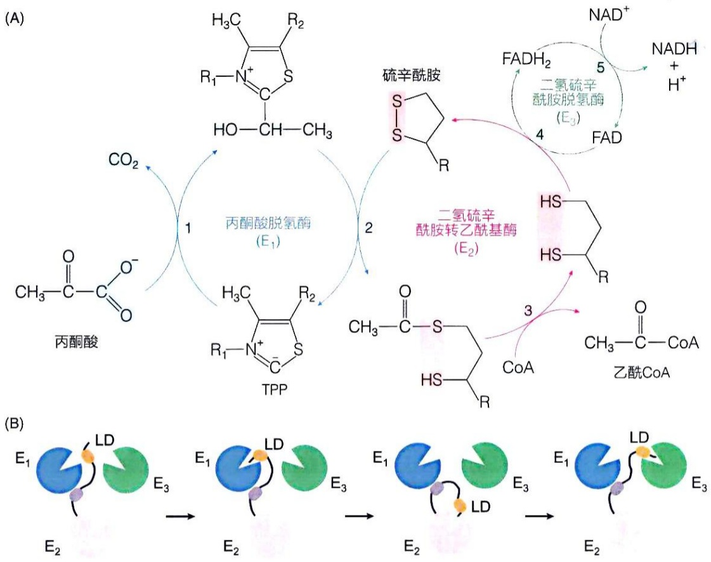

化。二氢硫辛酰胺上的电子先被传递至  $E_{3}$  中的 FAD，生成  $FADH_{2}$ ； $FADH_{2}$  再将电子转移至  $NAD^{+}$ ，生成 NADH 并释放；NADH 将电子传递至呼吸链。

值得注意的是，这里的 TPP、硫辛酸和 FAD 为催化性辅因子。它们固定存在于酶的活性中心，每轮催化反应之后结构完全恢复。而辅酶 A 和 NAD $^{+}$ 则为共底物（cosubstrate，也称辅底物），它们每轮催化反应之后都将作为产物的一部分离开酶的活性中心，通过参与其他酶促反应来恢复其结构，然后进入原来酶的活性中心参与新一轮酶促反应。

## 18.2.3 与 $\mathrm{E}_2$ 共价结合的硫辛酰胺携带反应中间体在三种酶的活性中心之间穿梭

丙酮酸脱氢酶复合物的 $\mathrm{E}_1 - \mathrm{E}_2 - \mathrm{E}_3$ 组合形式，代表了生物中一种典型的多酶体系结构。在上述催化过程中，与 $\mathrm{E}_2$ 共价连接的硫辛酰胺依次在 $\mathrm{E}_1$ 、 $\mathrm{E}_2$ 和 $\mathrm{E}_3$ 的活性中心移动（图18-5B）。硫辛酰胺在其他催化类似反应的复合物中发挥类似作用，这包括$\alpha-$ 酮戊二酸脱氢酶复合物（催化柠檬酸循环第四步反应的酶）和支链 $\alpha-$ 酮酸脱氢酶复合物（催化支链氨基酸碳骨架氧化脱羧的酶，见第24章）。后面这两种复合物的结构与丙酮酸脱氢酶复合物高度类似，它们的 $\mathrm{E}_1$ 和 $\mathrm{E}_2$ 亚基之间存在高度的结构相似性，而 $\mathrm{E}_3$ 亚基的结构则完全相同。

---

18.2 糖酵解终产物丙酮酸需先被转运至线粒体基质并转化成乙酰辅酶A

173

硫辛酰胺在丙酮酸脱氢酶复合物不同活性中心之间传递中间物的功能，属于一种底物通道（substrate channeling）功能。类似传递机制也体现于丙酮酸羧化酶（见本章后文和第21章）和乙酰辅酶A羧化酶（见第23章）中共价连接于酶活性中心的生物素上，以及酰基载体蛋白中共价连接的泛酰巯基乙胺上（见第23章）。底物通道机制在许多多酶复合物中存在，极大提高了酶的催化效率。对于很多代谢途径而言，所产生的中间产物高度不稳定，如果从酶的活性中心扩散到溶液环境中，则无法被下一酶活性中心捕获。对于这样的反应而言，底物通道的存在不仅仅是提高效率的问题，更是“有”与“无”、能否发生的问题。

## 18.2.4 丙酮酸脱氢酶复合物的活性受到严格调控

丙酮酸脱氢酶复合物位于糖酵解、柠檬酸循环、脂肪酸合成和糖异生等代谢途径的一个交汇点上，其产物乙酰辅酶A也可由脂肪酸和氨基酸的分解代谢产生。因此，对该酶活性的有效调控，对细胞在饱食和饥饿等状态下，维持葡萄糖、乙酰辅酶A等代谢物的动态平衡至关重要。

哺乳动物丙酮酸脱氢酶复合物的活性调节主要通过两种方式进行:别构调节和可逆磷酸化修饰调节。其中可逆磷酸化修饰调节占主导地位。

丙酮酸脱氢酶复合物的别构抑制剂包括 ATP、乙酰辅酶 A、NADH 以及长链脂肪酸等。这些别构抑制剂主要来自脂肪酸氧化产物，且须处于较高浓度时才可直接产生别构抑制效应。例如，当处于饥饿状态而引起脂肪分解代谢活跃时，将产生大量的长链脂肪酸，抑制丙酮酸氧化分解，以减少对葡萄糖的消耗。丙酮酸脱氢酶复合物的别构激活剂是 AMP、CoA、 $NAD^{+}$ 和 $Ca^{2+}$ 等。它们的激活效应可以在个体饥饿后进食时，使丙酮酸脱氢酶复合物及时活化，恢复基于葡萄糖分解的能量供应。因此，与其他代谢途径的调节策略类似，这种别构调控反映细胞内的能量状态，也是细胞对其代谢模式进行自我调节的重要方式。

磷酸化主要发生于复合物的 $\mathrm{E}_{1}$ 亚基上。其中多个特定丝氨酸残基发生磷酸化修饰后，将抑制丙酮酸脱氢酶复合物的活性，而去磷酸化的形式则具有高活性（图18-6）。催化发生磷酸化修饰的是丙酮酸脱氢酶激酶（pyruvate dehydrogenase kinase，PDH kinase），而催化其去磷酸化的是丙酮酸脱氢酶磷酸酶（PDH phosphatase）。丙酮酸脱氢酶激酶在乙酰辅酶A/辅酶A、$\mathrm{NADH / NAD^{+}}$ 或ATP/ADP比值高时被激活（即复合物酶活性被抑制），而高浓度的丙酮酸可以抑制丙酮酸脱氢酶激酶的活性（使复合物的活性增强）。丙酮酸脱氢酶磷酸酶活性可被钙离子激活（使复合物被激活）。

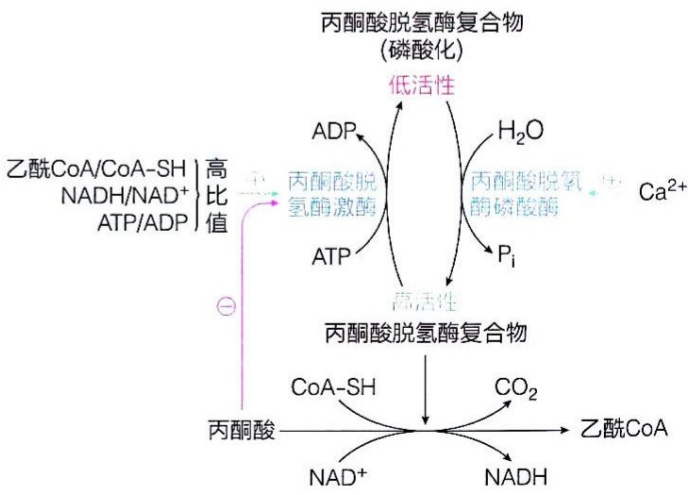

<details>
<summary>flowchart</summary>

This diagram illustrates the metabolic pathway of acetic acid (丙酮酸) in the presence of calcium ions, showing how ATP and H2O are oxidized to form a dehydrogenated acetic acid complex.
</details>

图 18-6 丙酮酸脱氢酶复合物中  $E_{1}$  亚基的酶活性通过可逆磷酸化修饰而有效调控

---

174

18 柠檬酸循环

实际上，丙酮酸脱氢酶激酶和丙酮酸脱氢酶磷酸酶均紧密结合于丙酮酸脱氢酶复合物上，根据营养状态和激素信号有效平衡复合物的磷酸化和去磷酸化过程，是酶复合物活性的“开关”。丙酮酸脱氢酶的可逆磷酸化修饰是一个复杂的过程，响应多种信号，严格调控丙酮酸转变为乙酰辅酶A的过程。

葡萄糖通过丙酮酸进行氧化分解。在有氧条件下，丙酮酸生成乙酰辅酶A的代谢流量大小，取决于丙酮酸脱氢酶复合物的活性强弱。此时，乙酰辅酶A的生成量需要与后续柠檬酸循环中乙酰辅酶A的消耗量相匹配。

值得注意的是，细菌丙酮酸脱氢酶复合物仅由NADH和乙酰辅酶A别构抑制，不发生可逆磷酸化修饰。

## 18.2.5 人体丙酮酸脱氢酶复合物功能受阻时将出现严重后果

丙酮酸经丙酮酸脱氢酶复合物的氧化脱羧，对机体维持代谢平衡至关重要。一旦受阻，将导致葡萄糖利用障碍相关的疾病。当丙酮酸脱氢酶复合物存在先天缺陷或后天功能抑制时，可能出现血液乳酸含量升高、神经系统紊乱等异常表型。血液中乳酸升高是丙酮酸积累后被还原生成乳酸所致。

导致丙酮酸脱氢酶复合物功能受阻的可能原因包括以下方面:①酶复合物的催化活性先天缺失。如丙酮酸脱氢酶功能存在遗传缺陷，则无法进行第一步和第二步催化反应。②酶复合物活性被调节的能力先天缺失。如丙酮酸脱氢酶磷酸酶存在遗传缺陷等情况，$\mathrm{E}_{1}$ 将一直处于磷酸化修饰的失活状态。③酶复合物正常但缺少辅因子。如脚气病患者就是因为缺乏维生素 $\mathrm{B}_{1}$ 而导致辅因子TPP无法正常合成，故 $\mathrm{E}_{1}$ 无法有效进行催化。④酶复合物正常但存在抑制剂。如砷中毒等，由于三价砷可与还原型硫辛酰胺发生共价结合，阻碍了 $\mathrm{E}_{3}$ 催化硫辛酰胺恢复其结构，即氧化型硫辛酰胺的再生过程被阻断。

## 18.3 乙酰辅酶 A 可通过柠檬酸循环彻底氧化成 $\mathrm{CO}_{2}$

在有氧条件下，线粒体内丙酮酸氧化脱羧的产物乙酰辅酶A，可进入柠檬酸循环彻底氧化，生成 $\mathrm{CO}_{2}$ 。所释放的能量，先通过底物水平磷酸化产生少量ATP（可先产生GTP），但主要储存于NADH和 $\mathrm{FADH}_2$ 等分子中，后续通过氧化磷酸化释放，并用于产生大量ATP分子。需要强调的是，柠檬酸循环将氧化所有不同来源的乙酰辅酶A。因此，脂肪酸或氨基酸氧化分解产生的乙酰辅酶A，也同样可以进入柠檬酸循环彻底氧化。

总体来看，柠檬酸循环是一种由八步连续反应形成的代谢环路。其主要的化学反应逻辑可做如下分析:前四步为氧化或氧化脱羧反应，而后四步则是为了再生乙酰基载体，即草酰乙酸分子。

---

18.3 乙酰辅酶 A 可通过柠檬酸循环彻底氧化成 CO₂

175

## 18.3.1 乙酰辅酶 A 携带的二碳单位通过与草酰乙酸缩合进入柠檬酸循环

经丙酮酸脱氢酶复合物催化生成的，或是其他来源的乙酰辅酶A均通过将其所携带的两碳单位与草酰乙酸（oxaloacetate）缩合成柠檬酸而进入柠檬酸循环。该反应由不含任何辅因子的柠檬酸合酶（citrate synthase；最初的名称是“缩合酶”，后改为“柠檬酸合酶”）催化一种形成C—C单键的独特反应:由乙酰辅酶A分子中邻近羰基的甲基碳进攻草酰乙酸的羰基碳而缩合。尽管细胞内草酰乙酸的浓度通常很低（处于微摩尔每升级水平），但反应产生柠檬酰辅酶A中间体，其含有的硫酯键在酶的活性中心可迅速水解成柠檬酸和游离辅酶A，并释放大量能量，从而驱动反应往正向进行，成为不可逆的限速反应。

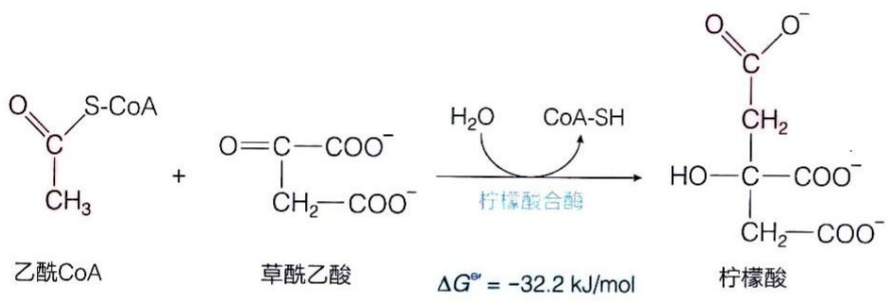

<details>
<summary>chemical</summary>

Reaction equation showing the formation of citric acid from acrylate CoA and acrylate Acetate under catalytic conditions
</details>

## （1）柠檬酸合酶是一种典型的诱导契合酶

柠檬酸合酶的结构和催化过程具有几个比较独特的方面。哺乳动物柠檬酸合酶以同源二聚体形式存在（细菌中以更大的寡聚体形式存在）。每个亚基均具有一个酶活性中心，位于一个较为刚性的大结构域和一个较为灵活的、相对较小的结构域之间。催化过程中，酶分子先处于一种“开放”构象状态，使得第一种底物草酰乙酸可与酶结合，并诱导酶的构象发生显著改变，形成一种“关闭”构象状态，暴露出乙酰辅酶A的结合位点，此后第二种底物乙酰辅酶A才可结合（图18-7A）。两种底物缩合生成柠檬酰辅酶A，再次诱发柠檬酸合酶的构象变化，使得该酶的第三种底物——水分子得以进入，柠檬酰辅酶A（它是一种可以稳定存在的化合物）被水解生成柠檬酸，并释放辅酶A。草酰乙酸以及柠檬酰辅酶A所诱导的酶构象改变，使得后续底物得以结合，进而推动后续反应的发生，这种底物与酶分子之间相互作用所发生的构象调整的过程被称作诱导契合（induced fit）。

## (2) 在柠檬酸合酶催化过程中乙酰基可能形成烯醇中间体

根据测定的晶体结构，哺乳动物柠檬酸合酶活性中心的 His $^{274}$ 、Asp $^{375}$  和 His $^{320}$  等残基在催化过程中被认为扮演了关键角色（图 18-7B）。在催化过程中，Asp $^{375}$  作为广义碱，His $^{274}$  作为广义酸，使得乙酰基转变成了烯醇基（enol）；由后者对草酰乙酸的羰基碳进行亲核进攻，导致缩合反应的发生以及 C—C 单键的形成。

---

176

18 柠檬酸循环


图 18-7 柠檬酸合酶与草酰乙酸结合后发生契合诱导构象变化及酶的可能催化机制

(A) 猪源柠檬酸合酶三种构象的结构图 (PDB: 5UQS, 4CTS,

2CTS）。两个亚基分别以蓝灰色和灰色卡通模型显示。结合的草酰乙酸、辅酶A和柠檬酸分别以青色、粉色和绿色棍状模型显示。（B）柠檬酸合酶的可能催化机制。

---

18.3 乙酰辅酶 A 可通过柠檬酸循环彻底氧化成 CO₂

177

## 18.3.2 柠檬酸通过异构化转变成异柠檬酸后进行连续两步氧化脱羧反应

柠檬酸循环的第二步反应是柠檬酸发生异构化，即调整优化柠檬酸分子中羟基的位置，生成异柠檬酸，为后续的氧化脱羧反应做好准备。异构反应发生的过程是脱水后再加水。两步反应均由顺乌头酸酶（cis-aconitase，也称顺乌头酸水合酶）催化，因为生成中间产物顺乌头酸而得名 $^{①}$ 。


<details>
<summary>chemical</summary>

Chemical structure of a carboxylic acid with multiple hydroxyl and methyl substituents
</details>

柠檬酸


<details>
<summary>chemical</summary>

Chemical structure of a carboxylic acid with methyl and hydrogen substituents
</details>

顺乌头酸


<details>
<summary>chemical</summary>

Chemical structure of a dicarboxylic acid with multiple carboxyl groups and hydroxyl side chains
</details>

异柠檬酸

$$
\Delta G ^ {\ominus \prime} = 1 3. 3 \mathrm{kJ/mol}
$$

顺乌头酸酶利用 4Fe-4S 这种铁硫中心作为辅因子 $^{②}$ 。该酶催化的反应是高度可逆的，也就是说，中间物顺乌头酸既能转变成异柠檬酸，也能转变成柠檬酸。

需要强调的是，在酶的活性中心，表观对称的柠檬酸分子与酶的结合并非对称（即与底物分子中相同组分结合的酶分子基团是不同的）。另外，在催化过程中，中间产物顺乌头酸需在活性中心绕  $C_{\alpha}=C_{\beta}$  双键进行  $180^{\circ}$  的翻转（图 18-8）。

此外，一种存在于胞质溶胶中的铁调节蛋白（iron regulatory protein）可以通过与mRNA分子中的特定调节序列结合而调节铁储存和铁转运蛋白质的翻译过程。蛋白质序列测定结果表明，它与线粒体基质中的顺乌头酸酶序列完全相同。后续研究表明:当细胞内的铁离子浓度很低时，该蛋白质从线粒体转位到胞质溶胶中，脱去辅因子，发挥调节翻译的功能；而当铁离子浓度处于高位时，则在线粒体中发挥顺乌头酸酶的活性。也就是说，脱去辅因子的顺乌头酸酶在胞质溶胶中具有其他完全不同的生物学功能。这种蛋白质被称作兼职（moonlighting）蛋白质。

柠檬酸循环的第三步反应是异柠檬酸的氧化脱羧，生成  $\alpha-$  酮戊二酸、 $CO_{2}$  和 NADH。该反应由异柠檬酸脱氢酶（isocitrate dehydrogenase）催化，为不可逆反应。在真核细胞中，异柠檬酸脱氢酶有三种同工酶，根据辅因子差异分为两大类:①以  $NADP^{+}$ 作为辅因子的异柠檬酸脱氢酶1和异柠檬酸脱氢酶2，分别存在于胞质溶胶和

<small><span class="docvortex-page-footnote" data-block-type="page_footnote" style="color:#6b7280">① 顺乌头酸酶是裂合酶，而非异构酶。早期认为从柠檬酸到异柠檬酸的转变由两种不同的酶催化，但后来只鉴定到一种酶。</span></small>

<small><span class="docvortex-page-footnote" data-block-type="page_footnote" style="color:#6b7280">② 4Fe-4S 是一种含四个Ⅱ价铁离子和四个无机硫原子、铁原子还同时与酶分子中三个半胱氨酸侧链的一SH形成配位键的辅因子（详见第19章），但同样的铁硫中心在这里和在呼吸链等处的功能完全不同。</span></small>

---

178

18 柠檬酸循环

图 18-8 顺乌头酸酶催化过程中产生的中间体在酶的活性中心发生翻转


<details>
<summary>chemical</summary>

化学反应示意图，展示铁硫中心、柠檬酸和顺乌头酸的水-异柠檬酸转化过程
</details>

线粒体基质中，主要参与NADPH的生成反应；②以 $\mathrm{NAD^{+}}$ 作为辅因子的异柠檬酸脱氢酶3，存在于线粒体基质中，参与柠檬酸循环。


<details>
<summary>chemical</summary>

Reaction pathway of异柠檬酸, phthalic acid, and α-dimethylmalonate showing oxidation and reduction steps
</details>

异柠檬酸脱氢酶利用的辅因子是锰离子，它帮助稳定脱氢后的中间体，包括草酰琥珀酸和  $\alpha-$  酮戊二酸的烯醇形式。

柠檬酸循环的第四步反应，$\alpha-$ 酮戊二酸氧化脱羧生成琥珀酰辅酶A、$\mathrm{CO}_{2}$ 和NADH。该反应与丙酮酸的氧化脱羧反应高度相似，也依赖五种辅因子，且不可逆。


<details>
<summary>chemical</summary>

Reaction mechanism of α-ketoxybutyric acid showing NAD+ catalysis to form a carboxylic acid and CO2, with activation energy ΔG* = -33.5 kJ/mol
</details>

催化此反应的酶是 $\alpha-$ 酮戊二酸脱氢酶复合物（$\alpha$-ketoglutarate dehydrogenase

---

18.3 乙酰辅酶A可通过柠檬酸循环彻底氧化成 $\mathrm{CO}_{2}$

179


<details>
<summary>chemical</summary>

Chemical reaction pathway showing conversion of R-methylcarboxylic acid to S-methylcarboxylic acid via intermediates and products, with associated chemical formulas below.
</details>

图 18-9 α-酮戊二酸脱氢酶复合物与丙酮酸脱氢酶复合物及支链α-酮酸脱氢酶复合物具保守的结构和催化机制

complex），它与丙酮酸脱氢酶复合物以及支链  $\alpha-$  酮酸脱氢酶复合物（负责 Ile、Leu 和 Val 脱氨后产物氧化分解）具有相似的结构和催化机制（图 18-9）。 $\alpha-$  酮戊二酸脱氢酶复合物也由三种酶组装而成，分别为  $\alpha-$  酮戊二酸脱氢酶（ $E_{1}$ ）、二氢硫辛酰胺转琥珀酰基酶（ $E_{2}$ ）、二氢硫辛酰胺脱氢酶（ $E_{3}$ ）。

这三种脱氢酶复合物中的  $E_{1}$  亚基之间和  $E_{2}$  亚基之间具有相似的一级和高级结构，而  $E_{3}$  亚基之间则完全相同。这似乎是一种趋异演化（divergent evolution）的结果。

## 18.3.3 琥珀酰辅酶 A 裂解所释放能量通过底物水平磷酸化生成 GTP 或 ATP

柠檬酸循环的第五步反应是，琥珀酰辅酶 A 所携带的硫酯键发生断裂，生成琥珀酸，释放能量用于合成 GTP 或 ATP。这是柠檬酸循环中唯一的底物水平磷酸化反应。该反应由琥珀酰辅酶 A 合成酶（succinyl-CoA synthetase）催化。值得注意的是，它以其所催化的逆反应命名。


<details>
<summary>chemical</summary>

Reaction mechanism of琥珀酰CoA with GDP, Pi, GTP, and CoA-SH enzymes forming a coaldehyde intermediate
</details>

琥珀酰辅酶 A 合成酶可以催化 GDP 或 ADP 发生磷酸化，分别生成 GTP 或 ATP。一般认为，细菌中的该酶是非特异性的；动物中的该酶主要利用 GDP，但也存在对 ADP 特异的酶（即存在同工酶）；植物中则主要利用 ADP。

---

180

18 柠檬酸循环


图 18-10 琥珀酰辅酶 A 合成酶的结构和催化机制示意图

（A）琥珀酰辅酶A合成酶处于一种催化状态的结构（PDB:6XRU），$\alpha$ 亚基显示为蓝灰色，$\beta$ 亚基显示为灰色。酶结合的琥珀酸和辅酶A以及参与催化的组氨酸用棍状模型展示。（B）琥珀酰辅酶A合成酶的催化机制示意图。

哺乳动物中的琥珀酰辅酶A合成酶由 $\alpha$ 和 $\beta$ 两种不同亚基组成，酶的活性位点可能位于这两个亚基之间的界面上（图18-10A）。一种可能的反应机制如图18-10B所示，简单描述如下:反应开始时，第一种底物琥珀酰辅酶A和第二种底物无机磷酸结合于酶的活性中心。然后无机磷酸取代琥珀酰辅酶A分子中的辅酶A组分，形成琥珀酰磷酸中间体，将一个硫酯键转换成一个磷酸键。接着，磷酸基被转移至酶活性位点的组氨酸上，形成磷酸-组氨酸中间体，释放出游离的琥珀酸。最后，第三种底物GDP或ADP进入酶的活性中心，并从磷酸-组氨酸处获得磷酸基，产生并释放GTP或ATP，完成底物水平磷酸化过程。

但是，值得注意的是，类似的磷酸化酶中间体并未在糖酵解过程中催化底物水平磷酸化的酶——磷酸甘油酸激酶或丙酮酸激酶中鉴定到。早年曾认为类似的磷酸化酶中间体存在于氧化磷酸化过程中（即化学偶联学说，见第19章），当然也未鉴定到。

## 18.3.4 琥珀酸经三步反应再生草酰乙酸

琥珀酸依次在琥珀酸脱氢酶、延胡索酸酶和苹果酸脱氢酶的催化下，经三步反应重新生成草酰乙酸，完成一轮柠檬酸循环。

柠檬酸循环的第六步反应由琥珀酸脱氢酶（succinate dehydrogenase）催化，琥珀酸被氧化生成延胡索酸（fumarate，也称富马酸，系统名为反丁烯二酸），同时产生$\mathrm{FADH}_2$。

---

18.3 乙酰辅酶 A 可通过柠檬酸循环彻底氧化成 CO₂

181


<details>
<summary>chemical</summary>

Reaction mechanism showing fluorobenzene dehydrogenation to form ester and its subsequent hydrolysis
</details>


<details>
<summary>chemical</summary>

Structural formulas of acetic acid and uracilic acid with labeled atoms
</details>

作为琥珀酸脱氢酶的竞争性抑制剂，丙二酸（malonate）可有效阻断柠檬酸循环的运行。这会导致原本浓度极低的中间体的积累，使得它们得以被分离和鉴定。丙二酸在早期对柠檬酸循环的探究过程中发挥了重要作用。

柠檬酸循环的第七步反应由延胡索酸酶 [fumarase, 也称延胡索酸水合酶（fumarate hydratase）] 催化，延胡索酸发生可逆水合，生成 L-苹果酸（malate）。该酶具有高度的立体专一性，只催化具有反式双键的延胡索酸而非具有顺式双键的马来酸（maleate，即顺丁烯二酸），同时也只生成 L-苹果酸，而非 D-苹果酸。也就是说，当延胡索酸酶催化逆向反应时，只会使得 L-苹果酸转化为延胡索酸。


<details>
<summary>chemical</summary>

Chemical reaction diagram showing hydrogenation of esteric acid to L-aminocarboxylic acid under water, yielding ΔG* = -3.8 kJ/mol
</details>


<details>
<summary>chemical</summary>

Chemical structure of 延胡索酸 (tert-butanol sulfate)
</details>


<details>
<summary>chemical</summary>

Chemical structure of D-苹果酸, showing carboxyl and hydroxyl groups
</details>

柠檬酸循环的第八步反应由苹果酸脱氢酶（malate dehydrogenase）催化，使 L-苹果酸氧化生成草酰乙酸，同时生成 NADH。此反应的标准自由能变化为正值，表明在标准条件下，热力学上有利于生成苹果酸的逆向反应。但在细胞内的实际条件下，反应将正向发生，生成草酰乙酸。这是因为正向反应的两种产物草酰乙酸和 NADH 被及

---

182

18 柠檬酸循环

时消耗转化、浓度极底所致（草酰乙酸在细胞内的浓度一般都低于  $10^{-6}$  mol/L）。草酰乙酸在柠檬酸合酶催化下及时与乙酰辅酶 A 缩合而被消耗，同时 NADH 也将其所携带电子迅速传递至呼吸链并再生  $NAD^{+}$ 。


<details>
<summary>chemical</summary>

Reaction mechanism showing L-苹果酸脱氢酶催化反应，导致草酰乙酸生成草酰乙酸的电离常数 ΔG'' = 29.7 kJ/mol
</details>

草酰乙酸的再生，标志着一轮柠檬酸循环的完成，可以进入下一轮循环。

柠檬酸循环中将琥珀酸转化为草酰乙酸的最后三步反应将一个亚甲基通过氧化、水合和再氧化，最终转化为羰基（图18-11）。这与脂肪酸β氧化和支链氨基酸碳骨架的分解过程中所发生的三步反应高度可比（见第22章和第24章，图22-11）。在这三步反应中，第一次和第二次氧化反应分别由FAD和NAD $^{+}$ 作为电子受体，且均发生于线粒体基质中；FADH $_{2}$ 和NADH所携带的电子直接进入线粒体内膜上的呼吸链（详见第19章）。

图 18-11 亚甲基转化为羰基的三个步骤


<details>
<summary>flowchart</summary>

```mermaid
graph LR
  A["琥珀酸"] -->|"FAD\nFADH2"| B["延胡索酸"]
  B -->|"H2O"| C["L-苹果酸"]
  C -->|"NAD+ NADH + H+""| D["草酰乙酸"]
```
</details>

## 18.3.5 一个活化的二碳单位经柠檬酸循环彻底氧化可产生大约 10 分子 ATP

柠檬酸循环的八步反应中，有三步反应不可逆，分别由柠檬酸合酶、异柠檬酸脱氢酶和  $\alpha-$  酮戊二酸脱氢酶复合物催化。其他反应均为可逆反应。其中的前四步反应可以被看作是使 1 个二碳单位氧化成 2 个  $CO_{2}$  的氧化阶段，而后四步反应则为草酰乙酸的再生阶段（图 18-12）。

总反应式为

$$
\mathrm{乙酰} \mathrm{CoA} + 3 \mathrm{NAD} ^ {+} + \mathrm{FAD} + \mathrm{GDP(ADP)} + \mathrm{P} _ {\mathrm{i}} + 2 \mathrm{H} _ {2} \mathrm{O}
$$

$$
\longrightarrow 2 \mathrm{CO} _ {2} + 3 \mathrm{NADH} + \mathrm{FADH} _ {2} + \mathrm{GTP(ATP)} + 2 \mathrm{H} ^ {+} + \mathrm{CoA}
$$

尽管每轮柠檬酸循环后，一个二碳单位被氧化产生2分子 $\mathrm{CO}_{2}$，但是利用 ${}^{14}\mathrm{C}-$ 乙酸开展的同位素标记实验表明，以乙酰基形式进入循环的2个碳原子，在第一轮的柠檬酸循环中并未被氧化成 $\mathrm{CO}_{2}$。也就是说，它们被保留在最后再生的草酰乙酸的四碳

---

18.3 乙酰辅酶 A 可通过柠檬酸循环彻底氧化成 ${\mathrm{{CO}}}_{2}$

183


<details>
<summary>flowchart</summary>

This image illustrates the biochemical cycle of citric acid (柠檬酸), showing the conversion pathways from acetic acid to ester, water, and various organic compounds through intermediates like hydroxylation, glycerol formation, and oxidation.
</details>

图 18-12 一轮柠檬酸循环的全部八步反应

酸分子中（图 18-12），而第一轮氧化形成的  $CO_{2}$  实际上来自草酰乙酸。

一个乙酰辅酶 A 的二碳单位经过一轮柠檬酸循环后，共产生 3 分子 NADH、1 分子 FADH₂ 和 1 分子 ATP（图 18-12）。经过线粒体内的氧化磷酸化过程（见第 19 章），每分子 NADH 可产生大约 2.5 分子 ATP，而每分子 FADH₂ 则产生大约 1.5 分子 ATP。因此，1 分子乙酰辅酶 A 经柠檬酸循环彻底氧化后，总共可产生大约 10 分子 ATP。

---

184

18 柠檬酸循环

## 18.3.6 一个葡萄糖分子彻底氧化后可产生大约 $30 \sim 32$ 分子 ATP

现在我们可以计算出 1 分子葡萄糖在有氧条件下，经糖酵解和柠檬酸循环彻底氧化所能产生的 ATP 分子的大约数目，如表 18-1 所示。

经发生于胞质溶胶中的糖酵解，1 分子葡萄糖通过底物水平磷酸化净产生 2 分子 ATP，同时还产生 2 分子 NADH。在有氧条件下，胞质溶胶中 1 分子 NADH 的电子可经两条不同途径穿梭至呼吸链，分别可产生 2.5 分子或 1.5 分子 ATP（详见第 19 章），因此胞质溶胶中的 2 分子 NADH 就可以产生 3～5 分子 ATP。

1 分子葡萄糖经糖酵解产生 2 分子丙酮酸。2 分子丙酮酸在丙酮酸脱氢酶复合物作用下氧化脱羧生成 2 分子乙酰辅酶 A，且在线粒体基质中产生 2 分子 NADH。这些 NADH 通过呼吸链产生大约 5 分子 ATP。每分子乙酰辅酶 A 产生大约 10 分子 ATP。因此 1 分子葡萄糖经糖酵解和柠檬酸循环彻底氧化，以及氧化磷酸化的能量转换，最终可产生大约 30～32 分子 ATP（具体见表 18-1）。

我们前面介绍过，1 分子葡萄糖经无氧发酵可净产生 2 分子 ATP。显然，1 分子葡萄糖经过有氧氧化所产生的能量，以所产生的 ATP 分子算，是无氧发酵时的大约 15～16 倍。然而，我们也需认识到，这是经过更为复杂的步骤，经过更多的物质投入后的结果。所以，我们不能这么简单计算其产生能量的效率。毕竟，根据德

表 18-1 一分子葡萄糖彻底氧化所释放能量可产生 ATP 分子数量的大约计算

| 反应步骤 | 生成还原型电子载体的数量 | 最终产生ATP的数量* |
| --- | --- | --- |
| 葡萄糖→葡萄糖-6-磷酸 |  | -1 |
| 果糖-6-磷酸→果糖-1,6-二磷酸 |  | -1 |
| 2×甘油醛-3-磷酸→2×甘油酸-1,3-二磷酸 | 2NADH(胞质溶胶) | 3~5** |
| 2×甘油酸-1,3-二磷酸→2×甘油酸-3-磷酸 |  | 2 |
| 2×磷酸烯醇式丙酮酸→2×丙酮酸 |  | 2 |
| 2×丙酮酸→2×乙酰CoA | 2NADH(线粒体) | 5 |
| 2×异柠檬酸→2×α-酮戊二酸 | 2NADH(线粒体) | 5 |
| 2×α-酮戊二酸→2×琥珀酰CoA | 2NADH(线粒体) | 5 |
| 2×琥珀酰CoA→2×琥珀酸 |  | 2 |
| 2×琥珀酸→2×延胡索酸 | 2FADH2(线粒体) | 3 |
| 2×苹果酸→2×草酰乙酸 | 2NADH(线粒体) | 5 |
| 总和 |  | 30~32 |

\* 按线粒体内每分子 NADH 生成大约 2.5 分子 ATP 和每分子 FADH$_{2}$ 生成大约 1.5 分子 ATP 计算；负值表示消耗 ATP。

\*\* 该数字由 NADH 中的电子从胞质溶胶转运入线粒体基质的具体穿梭系统决定。

---

18.4 柠檬酸循环是兼具分解与合成功能的两用代谢途径

185

国学者瓦尔堡等的观察，许多肿瘤细胞即使在氧气供应充足时，还是倾向于利用糖酵解获得能量（见图17-17）。因此，这样的简单计算是否反映生物体的真实情况，值得继续探究。

## 18.4 柠檬酸循环是兼具分解与合成功能的两用代谢途径

其实将生物体内的代谢途径划分为分解和合成两类是人为的。毕竟，生物体内的代谢反应之间相互交织，构成了一个复杂的多维动态网络。

柠檬酸循环就是一个很好的例子。它既是一条分解代谢途径（使燃料分子彻底氧化成  $CO_{2}$ ），同时也是一条不可或缺的合成途径。它被定义为一种两用代谢途径（amphibolic pathway）。具体而言，它是葡萄糖、脂肪酸和大部分氨基酸碳骨架彻底氧化的最终共同途径，也为许多生物合成反应提供前体物质，因此，它是细胞代谢途径的一个核心枢纽。

## 18.4.1 糖类、脂肪酸和氨基酸等燃料分子的分解产物殊途同归汇入柠檬酸循环

柠檬酸循环是一条典型的分解代谢通路。燃料分子大多先转化为乙酰辅酶A或柠檬酸循环的其他中间体:①葡萄糖经丙酮酸的氧化脱羧转化成乙酰辅酶A；②脂肪酸通过β氧化途径直接生成乙酰辅酶A（见第22章）；③很多氨基酸的碳骨架也被转化为乙酰辅酶A或柠檬酸循环的中间体被彻底氧化（或通过糖异生途径转化为葡萄糖；见第24章）。因此，柠檬酸循环是糖类、脂肪酸和氨基酸等燃料分子分解代谢的最终共同通路。它反映了分解代谢通路的高度收敛性，也充分体现了生物过程的高效性。

## 18.4.2 柠檬酸循环的中间体是合成各类生物分子的重要碳骨架来源

柠檬酸循环不仅是不同燃料分子最终的共同分解通路，同时也是合成代谢的重要前体来源。其中间产物为许多重要的生物合成过程提供前体（图18-13）。例如，琥珀酰辅酶A是合成血红素、叶绿素和辅酶 $B_{12}$ 的重要前体之一（见第25章）；草酰乙酸是通过糖异生途径生成葡萄糖的前体（见第21章）；草酰乙酸和 $\alpha-$ 酮戊二酸不仅为合成某些氨基酸，也为合成嘌呤或嘧啶碱基提供重要前体（见第25章和第26章）；柠檬酸循环还为合成脂肪酸和胆固醇及其他重要生物分子提供前体（见第23章）。

---

186

18 柠檬酸循环


<details>
<summary>flowchart</summary>

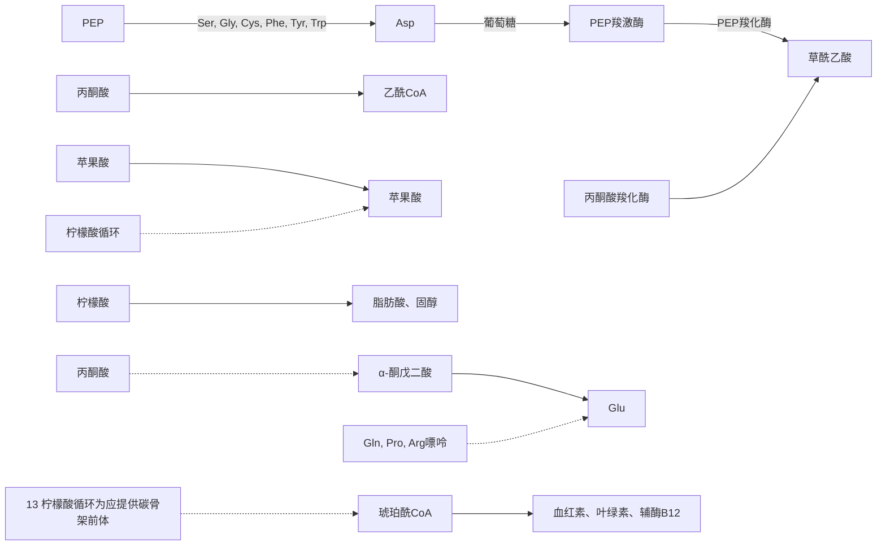
</details>

图 18-13 柠檬酸循环为合成反应提供碳骨架前体

## 18.4.3 柠檬酸循环中的大部分反应在厌氧生物祖先中也为合成代谢提供前体

尽管柠檬酸循环必须在有氧条件下才可发生，但是柠檬酸循环中的大部分反应也存在于厌氧微生物中，只是没有演化出完整的循环机制。这意味着，这些反应在需氧生物出现之前的演化早期就已出现。

研究表明，厌氧微生物利用柠檬酸循环中的部分反应获得生物合成的前体，而非

能量。例如，厌氧生物可利用该循环的前三步反应生成 $\alpha-$ 酮戊二酸，但由于缺乏 $\alpha-$ 酮戊二酸脱氢酶，所以不会进行随后的脱羧等柠檬酸循环反应。这类生物也含有催化草酰乙酸逆向转化为琥珀酰辅酶A的四种酶，可将草酰乙酸转化为苹果酸、延胡索酸、琥珀酸和琥珀酰辅酶A，用于其他生物合成反应（图18-14）。

与正常的柠檬酸循环不同的是，这些反应的发生并不依赖氧气的存在。这是因为异柠檬酸脱氢酶催化生成 $\alpha-$ 酮戊二酸的氧化反应所生成的NADH，可以被苹果酸脱氢酶催化生成苹果酸的还原反应重新转化为 $\mathrm{NAD^{+}}$ ，所以并无通过电子传递链使NADH重新转化为 $\mathrm{NAD^{+}}$ 的需求。

总之，这些早期演化产生的柠檬酸循环反应，主要功能是为生物合成提供前体。只是当地球表面出现氧气之后，这些反应被筛选、组合后应用于分解代谢过程，逐渐形成了精巧而高效的循环式代谢途径，并满足多方面需求。其实，生物体内代


<details>
<summary>flowchart</summary>

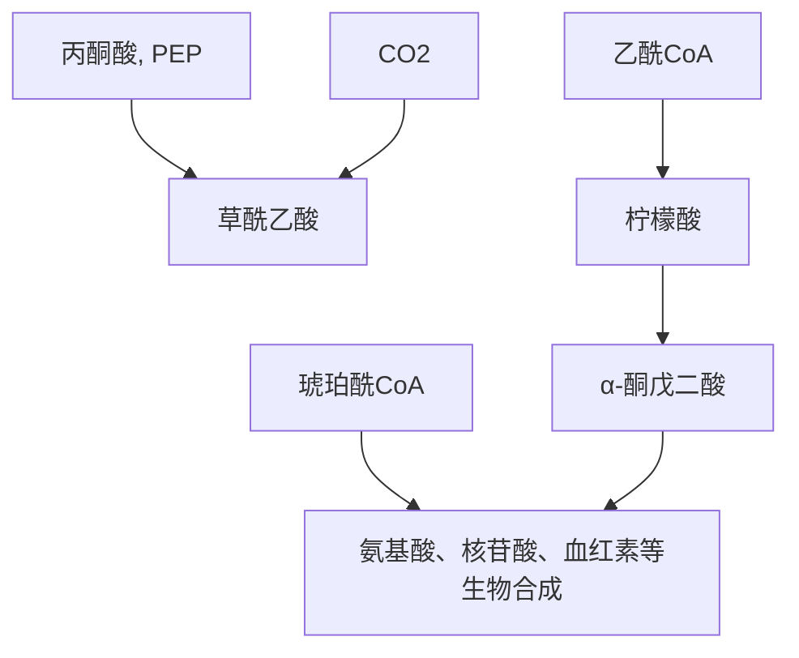
</details>

图18-14 厌氧微生物利用柠檬酸循环中的部分反应获得生物合成的前体

---

18.4 柠檬酸循环是兼具分解与合成功能的两用代谢途径

187

谢途径的分子演化过程也是生物演化的一个极其重要的方面，和宏观的演化过程一样精彩绝伦，引人入胜，值得深入探究。

## 18.4.4 柠檬酸循环的中间体可通过几种添补反应得到补充

柠檬酸循环的中间体可能被导入发生氧化分解，或导出用于生物合成，但该循环的中间体需维持一种相对恒定的稳态水平。如果中间体作为合成反应的前体被导出，则将导致中间体整体浓度下降，这时生物体必须恢复这些中间体的原有水平，才能维持柠檬酸循环的正常运转。

这些补充柠檬酸循环中间体的生物化学反应，我们称之为添补反应（anaplerotic reaction，又称回补反应）。原则上，能够净生成任何柠檬酸循环中间体的生化反应均可称为柠檬酸循环的添补反应（图18-15）。反应的底物可以是丙酮酸、磷酸烯醇式丙酮酸、多种氨基酸等前体物质。许多添补反应是通过羧化反应增加一个碳单位而发生的。


<details>
<summary>flowchart</summary>

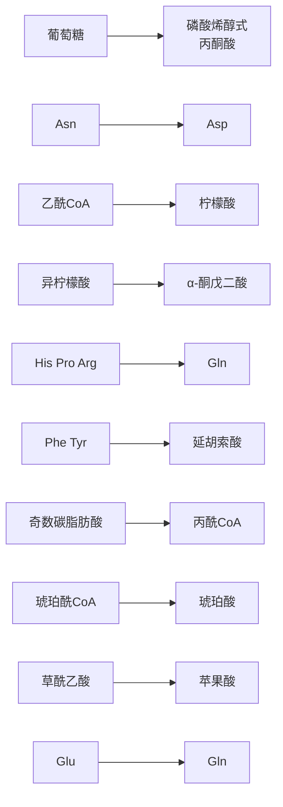
</details>

图18-15 柠檬酸循环的代表性添补反应

在这些添补反应中，以丙酮酸和磷酸烯醇式丙酮酸为前体的反应可能最广泛，故最为重要。丙酮酸在丙酮酸羧化酶（pyruvate carboxylase）催化下，可以发生羧化反应生成草酰乙酸:


<details>
<summary>chemical</summary>

Chemical reaction equation showing conversion of acetic acid to aracilic acid using ATP and ADP with Pi
</details>

---

188

18 柠檬酸循环

此反应普遍发生于动物肝脏和肾脏细胞内。丙酮酸羧化酶以生物素为辅因子，我们将在第21章详细讨论其催化机制（见图21-6）。理论上，丙酮酸还可通过苹果酸酶催化的可逆反应转变成苹果酸:


<details>
<summary>chemical</summary>

Chemical reaction equation showing conversion of acetic acid to cyanoic acid and dihydroxybenzene under NADP+ and NADPH+ conditions
</details>

尽管该反应在真核生物和细菌中普遍存在，但目前的证据表明，该酶在体内主要催化的是脱羧反应，而非羧化反应。因此，它是否为一种柠檬酸循环添补反应尚需证实。

磷酸烯醇式丙酮酸（PEP）可在磷酸烯醇式丙酮酸羧激酶（PEP carboxykinase）催化下生成草酰乙酸:

$$
\mathrm{磷酸烯醇式丙酮酸} + \mathrm{CO} _ {2} + \mathrm{GDP} \rightleftharpoons \mathrm{草酰乙酸} + \mathrm{GTP}
$$

此反应发生于动物的心脏和骨骼肌中。磷酸烯醇式丙酮酸也可在磷酸烯醇式丙酮酸羧化酶（PEP carboxylase）催化下生成草酰乙酸:

$$
\mathrm{磷酸烯醇式丙酮酸} + \mathrm{HCO} _ {3} ^ {-} \rightleftharpoons \mathrm{草酰乙酸} + \mathrm{P} _ {\mathrm{i}}
$$

此反应普遍发生于高等植物、酵母和细菌等生物体内。从这两种反应对能量利用效率的对比中，可以看出高等植物和动物在不同生态位受到的不同筛选压力。

添补反应也受到严格的调控。比如丙酮酸羧化酶只在乙酰辅酶A存在条件下才具有活性；柠檬酸循环的任何中间体的缺乏，都会导致草酰乙酸再生不足，引起乙酰辅酶A累积，从而激活丙酮酸羧化酶。在正常情况下，循环中间体被其他途径所消耗的数量与被添补反应所补充的数量保持动态平衡，浓度几乎保持不变。

当然，从某种意义上说，上面的羧化反应也可以被看作是发生于动物、微生物等生物体内的 $\mathrm{CO}_{2}$ 的固定反应。

## 18.4.5 柠檬酸循环的流速通过反馈抑制等方式被有效调控

由葡萄糖、脂肪酸和氨基酸等分解产生的乙酰辅酶A，均通过柠檬酸循环彻底氧化。柠檬酸循环的总速率很大程度上取决于底物的可用性和产物等对部分调节酶的反馈抑制等。速率调节的最终目的是维持中间产物的浓度稳态，在为细胞提供足量的NADH、$\mathrm{FADH}_2$ 和ATP的同时，也避免代谢途径的速率过高而造成资源浪费。

## （1）催化柠檬酸循环不可逆反应的酶的活性通过别构效应调节

柠檬酸循环中有三步反应是不可逆的，分别由柠檬酸合酶、异柠檬酸脱氢酶和$\alpha-$ 酮戊二酸脱氢酶复合物催化。这些酶的活性高低决定了乙酰辅酶A的氧化速率，

---

18.4 柠檬酸循环是兼具分解与合成功能的两用代谢途径

189

而这些酶的活性主要通过底物的可利用性以及各种中间代谢物的正负别构效应进行瞬时性调节。

例如，柠檬酸合酶的底物是乙酰辅酶A和草酰乙酸，而这两种底物的浓度随着细胞代谢状态的变化而变化。它们的可利用性将影响柠檬酸的形成速率。别构效应则涉及激活和抑制两个方面，如ADP别构激活柠檬酸合酶和异柠檬酸脱氢酶，而ATP则别构抑制柠檬酸合酶和异柠檬酸脱氢酶，琥珀酰辅酶A和NADH可别构抑制柠檬酸合酶和 $\alpha-$ 酮戊二酸脱氢酶复合物（表18-2）。

此外，在脊椎动物肌肉中，作为和肌肉收缩伴随的 ATP 需求增加的信号， $Ca^{2+}$  通过激活异柠檬酸脱氢酶和  $\alpha-$  酮戊二酸脱氢酶而促进柠檬酸循环的运行，增加能量的供应。

表 18-2 柠檬酸循环中三种调节酶的别构调节情况

| 酶 | 激活剂 | 抑制剂 |
| --- | --- | --- |
| 柠檬酸合酶 | ADP | NADH、琥珀酰辅酶A、柠檬酸、ATP |
| 异柠檬酸脱氢酶 | $Ca^{2+}$、ADP | ATP、NADH |
| α-酮戊二酸脱氢酶复合物 | $Ca^{2+}$ | 琥珀酰辅酶A、NADH |

需要指出的是，在正常情况下，糖酵解与柠檬酸循环的速率相互匹配，主要取决于以下两种协同调节机制:一是ATP和NADH发挥的普遍性别构抑制效应。ATP作为共同产物，可同时抑制糖酵解、丙酮酸氧化脱羧及柠檬酸循环等途径中的多种酶；类似地，NADH也可同时抑制丙酮酸氧化脱羧和柠檬酸循环途径中的多种酶。二是柠檬酸的别构抑制效应。柠檬酸可同时抑制柠檬酸循环和糖酵解:一方面，线粒体内产生的柠檬酸可别构抑制柠檬酸合酶的活性；另一方面，柠檬酸可以从线粒体基质被转运至胞质溶胶中，而高浓度的柠檬酸可有效抑制磷酸果糖激酶-1的活性。总之，通过共用上述别构抑制剂，使得胞质溶胶内发生的糖酵解与线粒体内发生的柠檬酸循环可以彼此协调一致，维持能量的供需平衡。

## (2) 柠檬酸循环可被某些毒物所抑制

柠檬酸循环是营养物质彻底分解的必经之路，为生命活动提供合成前体和所需能量，维持它的正常运行对生命过程至关重要，一旦受阻，后果很严重。

如果柠檬酸循环中某些酶的活性被有毒物质抑制，将出现中毒症状。例如砷化物中的三氧化二砷（$\mathrm{As_2O_3}$，arsenic trioxide，又名砒霜）的毒性就很强。它主要的一种作用机制就是三价砷可以占据丙酮酸脱氢酶复合物和 $\alpha-$ 酮戊二酸脱氢酶复合物中的还原型硫辛酰胺辅因子中的两个自由巯基，阻止 $\mathrm{E}_3$ 亚基使其重新生成氧化型硫辛酰胺；从而抑制这些重要酶复合物的功能，产生毒性。又如，氟代乙酸（fluoroacetic acid）常被用作灭鼠药（对包括人在内的哺乳动物也具毒性），它在细胞内被活化成氟代乙酰辅酶A后，可替代乙酰基进入柠檬酸循环，由柠檬酸合酶催化生成氟代柠檬酸，后者被顺乌头酸酶转化后与酶紧密结合，是顺乌头酸酶的自杀性抑制剂。

---

190

18 柠檬酸循环

## 18.5 乙醛酸循环可将乙酰辅酶 A 净转化为琥珀酸而用于生物合成

为探究细菌如何利用乙酸作为唯一碳源进行生长繁殖，以及植物发芽的种子如何从脂肪酸合成葡萄糖等现象，克雷布斯等于1950年代发现了乙醛酸循环（glyoxylate cycle）。这是克雷布斯等在揭示尿素循环（鸟氨酸循环）和柠檬酸循环之后，再次揭示的一种循环式代谢途径。

长期的研究表明，脊椎动物不具备将脂肪酸（通过其 $\beta$ 氧化分解产物乙酰辅酶A）转化为葡萄糖的能力。但是，植物、某些无脊椎动物和一些微生物（大肠杆菌和酵母等）却可以通过乙醛酸循环，将乙酸盐转化为葡萄糖。

乙醛酸循环可被视作为从柠檬酸循环衍生出来的一条途径，它部分利用柠檬酸循环中的酶促反应。它的起始两步反应和最后一步反应与柠檬酸循环中的完全相同，但其中间阶段却通过两种特有的酶促反应生成独特的中间产物乙醛酸。乙醛酸循环的生理意义在于，它使得某些生物能够以乙酸盐或脂肪酸作为唯一的碳源生存，并为糖类的合成提供必要的前体分子。

## 18.5.1 乙醛酸循环涉及异柠檬酸裂合酶和苹果酸合酶催化的反应

乙醛酸循环的起始阶段与柠檬酸循环完全相同，共用柠檬酸循环的第一步和第二步反应，即乙酰辅酶A与草酰乙酸缩合形成柠檬酸，以及柠檬酸转化为异柠檬酸的酶促反应。接下来，乙醛酸循环特有的两步反应分别由异柠檬酸裂合酶（isocitrate lyase）和苹果酸合酶（malate synthase）催化:前者催化异柠檬酸裂解形成琥珀酸和乙醛酸，后者催化乙醛酸与另一分子乙酰辅酶A缩合生成苹果酸（图18-16）。乙醛酸循环的最后一步反应也与柠檬酸循环中的完全相同:在苹果酸脱氢酶催化下，苹果酸氧化再生为草酰乙酸。

乙醛酸循环的总反应式为

$$
2 \mathrm{乙酰} \mathrm{CoA} + \mathrm{NAD} ^ {+} + 2 \mathrm{H} _ {2} \mathrm{O} \longrightarrow \mathrm{琥珀酸} + 2 \mathrm{CoA} + \mathrm{NADH} + \mathrm{H} ^ {+}
$$

## 18.5.2 乙醛酸循环所生成的琥珀酸可用于合成葡萄糖

乙醛酸循环绕过柠檬酸循环中自异柠檬酸开始的两步氧化脱羧反应，每轮循环缩合2分子乙酰辅酶A，净生成1分子琥珀酸。琥珀酸可经过糖异生途经（即利用非糖分子合成葡萄糖的途径）净转化为葡萄糖（见第21章）。脊椎动物由于缺乏乙醛酸循环所特有的异柠檬酸裂合酶和苹果酸合酶，无法利用乙酰辅酶A净合成葡萄糖。

细胞的能量状态决定着异柠檬酸随后是进入乙醛酸循环还是进入柠檬酸循环，其中所涉及的调控机制较为复杂。简而言之，当能量过剩时，异柠檬酸脱氢酶发生磷酸化修饰而失活，异柠檬酸进入乙醛酸循环，促进葡萄糖的生成；而当能量匮乏时，异

---

18.5 乙醛酸循环可将乙酰辅酶 A 净转化为琥珀酸而用于生物合成

191


<details>
<summary>flowchart</summary>


</details>

图 18-16 乙醛酸循环的主要酶促反应

柠檬酸脱氢酶处于去磷酸化状态而活化。另外，异柠檬酸裂合酶还可被 AMP、ADP 等别构抑制，推动异柠檬酸进入柠檬酸循环，促进能量供应。

## 18.5.3 发芽种子通过乙醛酸循环可将脂肪酸转化为葡萄糖

在植物中，乙醛酸循环发生在乙醛酸循环体（glyoxysome）中。只有当富含脂肪的种子萌发时，才会形成这种特殊的细胞器。种子中的甘油三酯存在于油脂体（lipid body）中，其分解产生的脂肪酸进入乙醛酸循环体内，乙醛酸循环体中含有将脂肪酸分解成乙酰辅酶A的酶类，并通过乙醛酸循环生成琥珀酸。琥珀酸再被转运至线粒体基质，借助其中的柠檬酸循环的部分酶促反应转化为苹果酸。苹果酸在进入胞质溶胶后，由其中的苹果酸脱氢酶同工酶催化，再将苹果酸氧化为草酰乙酸。后者进入糖异生途径用于合成葡萄糖和蔗糖等（图18-17），为种子萌发提供不可或缺的能量和葡萄糖前体等。

因此，在植物获得通过光合作用产生葡萄糖的能力之前，萌发中的种子通过乙醛酸循环产生葡萄糖，这样的演化结果对于植物的繁衍具有重要的生物学意义。

---

192

18 柠檬酸循环

图 18-17 植物种子中柠檬酸循环与乙醛酸循环之间的关系

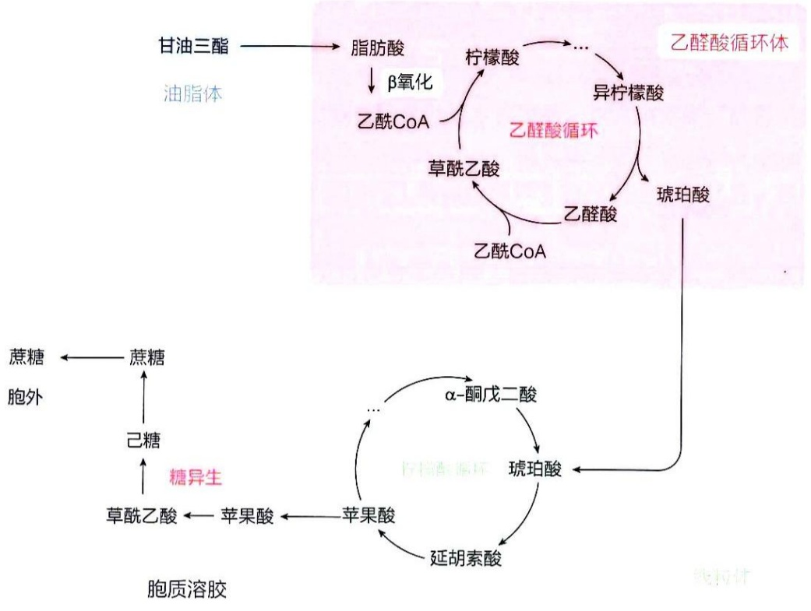

<details>
<summary>flowchart</summary>

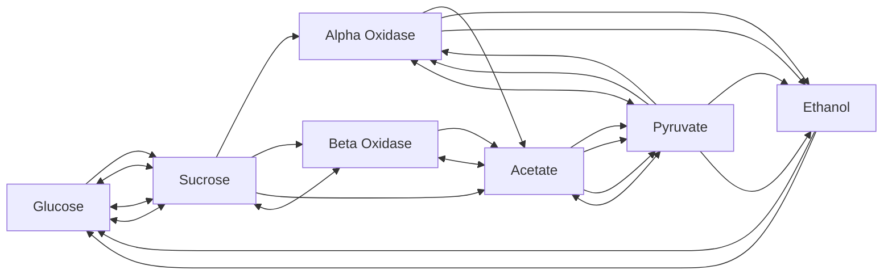
</details>

## 知识延展 18- 1

## 还原型柠檬酸循环将二氧化碳还原成糖类和其他有机分子

柠檬酸循环作为所有好氧生物的代谢枢纽，既是不同燃料分子彻底氧化的共同产能途径，同时也提供大量的生物合成前体，服务于更加复杂的生命活动和生命形式。但是，人们对这一循环代谢途径的认知边界仍在不断拓展。例如，新的研究表明，在一些光合细菌和极端环境下生存的古菌中，还存在反向运行的还原型柠檬酸循环（reductive citric acid cycle）。

还原型柠檬酸循环亦称作反向柠檬酸循环，于1966年首次在绿硫菌（Chlorobium thiosulfatophilum）中被描述。绿硫菌以硫化物或硫代硫酸盐作为电子供体，利用太阳能，将 $\mathrm{H}_2\mathrm{O}$ 和 $\mathrm{CO}_{2}$ 还原成糖类和其他有机分子，所以本质上属于合成代谢。还原型柠檬酸循环运行的关键是利用外来的能量，将经典的柠檬酸循环即氧化型柠檬酸循环中三步不可逆反应逆转进行（图 18-18），其中第一步反转最为关键，而后两步反转相对容易。

第一步逆转反应由 $\alpha-$ 酮戊二酸合酶（$\alpha-$ketoglutarate synthase）替换 $\alpha-$ 酮戊二酸脱氢酶复合物，逆向催化琥珀酰辅酶A还原成 $\alpha-$ 酮戊二酸。反应以还原型铁氧还蛋白（reduced ferredoxin）作为电子供体和能量来源，由光能驱动还原型铁氧还蛋白的再生。值得注意的是，这一步合成 $\alpha-$ 酮戊二酸的反应，是推动整个循环得以逆向运行的关键步骤。

第二步逆转反应由 $\alpha-$ 酮戊二酸羧化酶（$\alpha-$ketoglutarate carboxylase）和草酰琥珀酸脱氢酶（oxalosuccinate dehydrogenase）替换异柠檬酸脱氢酶，逆向催化 $\alpha-$ 酮戊二酸还原成异柠檬酸。此反应由NADPH提供电子。

---

展望

193

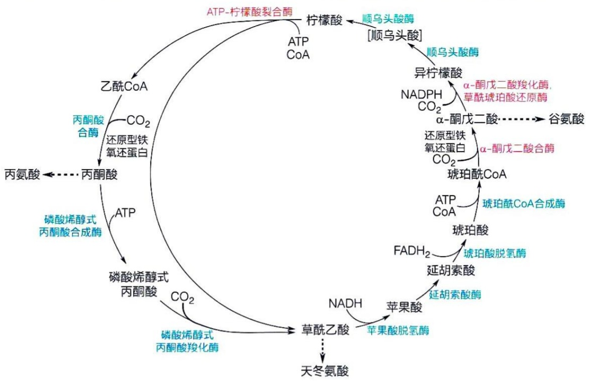

<details>
<summary>flowchart</summary>

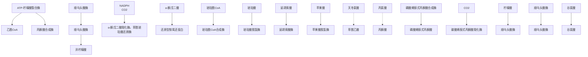
</details>

图 18-18 还原型柠檬酸循环

第三步逆转反应是由依赖 ATP 的柠檬酸裂合酶（ATP-citrate lyase）替换柠檬酸合酶，逆向催化柠檬酸转化为乙酰辅酶 A 和草酰乙酸。

有趣的是，在氧化型柠檬酸循环中， $\alpha-$ 酮戊二酸脱氢酶复合物与丙酮酸脱氢酶复合物高度相似；而在还原型柠檬酸循环中， $\alpha-$ 酮戊二酸合酶与丙酮酸合酶也高度类似，它们所催化的反应均需还原型铁氧还蛋白的参与。

还原型柠檬酸循环所产生的乙酰辅酶 A、丙酮酸和草酰乙酸（图 18-18），可用于合成糖类、脂肪和氨基酸等。尽管其发现时间较晚，但这并不代表它在演化过程中出现的时间晚于氧化型柠檬酸循环。值得注意的是，这两个互逆的循环代谢途径所提供的信息，结合 18.4.3 中提到的柠檬酸循环中的部分酶促反应在厌氧生物中的演化，对于研究生命起源具有重要价值。这表明柠檬酸循环的中间产物，大多处于热力学上的相邻稳定节点，它们之间的互相转变，大部分比较容易，有些还可以被矿物质催化，因此可能是早期地球上有机分子的主要来源之一。而循环的形成和转动的方向，取决于能量流动方向对其中关键步骤的推动。

绿硫菌的厌氧特性、固碳能力、铁氧还蛋白与顺乌头酸酶对铁硫中心的利用和异柠檬酸脱氢酶对锰离子的利用等，都与“深海热泉口”生命起源假说相呼应，吸引更多的研究者深入探究。

## ※展望

作为糖类、脂肪酸和氨基酸等在体内被彻底氧化的共同代谢途径，柠檬酸循环是所有好氧生物中的一条核心代谢途径。该循环作为生物体内的动态、灵活且受高度调控的代谢网络中的一部分，人们对它的认识仍在不断深入。

参与柠檬酸循环的八种酶在活细胞内是否以代谢复合物（metabolon）的形式存在仍

---

194

18 柠檬酸循环

有争议。因为其中有的酶（如琥珀酸脱氢酶）附着于线粒体膜上，有的本身就形成巨大的蛋白质复合物（如 $\alpha-$ 酮戊二酸脱氢酶复合物）。如果代谢复合物存在，那么它可能附着于线粒体膜上，从而使参与柠檬酸循环的酶与电子传递链复合物相互邻近，这对于电子传递过程可能是有效的。然而，在活细胞内开展相关探究并提供确凿的实验证据的确存在挑战。

此外，在丙酮酸被柠檬酸循环彻底氧化之前，必须由线粒体基质中的丙酮酸脱氢酶复合物催化，转化成乙酰辅酶A。丙酮酸脱氢酶复合物是与 $\alpha-$ 酮戊二酸脱氢酶复合物高度类似的巨大复合物，这种复合物与前面假设的柠檬酸循环代谢复合物之间是否存在空间上的关联？

最新研究表明，柠檬酸循环在不同细胞类型和环境条件下展现出精妙的代谢灵活性和异质性。细胞能够根据营养可得性、氧气水平和能量需求调整柠檬酸循环的流量。柠檬酸循环在不同生理和病理状态下的多样性和复杂性如何通过动态调控和协调机制实现，这个问题仍有待深入探究。此外，作为一条核心代谢途径，柠檬酸循环在其本身被体内各种因子或条件调控的同时，其中间产物如何对细胞的其他过程产生影响，也是目前快速拓展的研究热点。

## ※ 本章小结

生物体内的燃料分子彻底氧化并利用所释放能量合成ATP的过程可分为三个阶段，第一个阶段因燃料分子的不同而不同，而第二阶段的柠檬酸循环和第三阶段的氧化磷酸化则完全相同，充分体现了分解代谢的收敛性特征。

在含有三种酶和五种辅因子的多亚基丙酮酸脱氢酶复合物的催化下，糖酵解的终产物丙酮酸经脱羧后被转化为二碳单位并以乙酰辅酶A的形式存在。

乙酰辅酶A将所携带的二碳单位通过由八步酶促反应组成的柠檬酸循环彻底氧化为2分子 $\mathrm{CO}_{2}$，所释放电子以3个NADH和1个 $\mathrm{FADH}_2$ 形式暂时保存，同时还经底物水平磷酸化产生1个ATP（或GTP）分子。

作为一种分解和合成两用代谢途径，柠檬酸循环的中间体可被用作合成脂肪酸、固醇类、氨基酸、血红素和葡萄糖等分子的前体，在这种情况下，柠檬酸循环中的草酰乙酸等中间体可通过丙酮酸的羧化等方式得到添补。

丙酮酸脱氢酶复合物，以及柠檬酸循环中催化三步不可逆反应的柠檬酸合酶、异柠檬酸脱氢酶和 $\alpha-$ 酮戊二酸脱氢酶复合物的催化活性均可通过别构调节，维持该两用代谢途径的稳态。

作为柠檬酸循环的一个支路，乙醛酸循环将2分子乙酰辅酶A所携带的二碳单位缩合成琥珀酸，这使得植物种子萌发时可利用脂肪酸合成葡萄糖。

---

推荐阅读

195

## ※ 思考题

1. 连接糖酵解和柠檬酸循环的反应涉及五种作为载体的辅因子。其中，哪些是乙酰基载体，哪些是电子载体？
2. 将 $^{14}\mathrm{C}-$ 丙酮酸加入线粒体悬液后会立即产生 $^{14}\mathrm{C}-\mathrm{CO}_{2}$ 。反之，向该悬液中加入 $^{14}\mathrm{CO}_{2}$ 并不会导致 $^{14}\mathrm{C}-$ 丙酮酸的生成。为什么不会？
3. 一位生物化学家建立了一个体外系统，测量葡萄糖完全代谢所需耗氧量。她发现:向该系统中加入丙酮酸对单位时间内氧气消耗量几乎没有影响，而加入延胡索酸会导致单位时间内氧气消耗量大幅增加。请解释这一观察结果。
4. 饮食中缺乏硫胺素的人血液中丙酮酸水平较高。请从生化角度解释原因。
5. 向线粒体悬液中短暂加入 $\left[3 - ^{14}\mathrm{C}\right]$ 丙酮酸（标记甲基碳）。经过一轮柠檬酸循环后，$^{14}\mathrm{C}$ 在草酰乙酸的什么位置？需要经过多少次循环才能将 $\left[3 - ^{14}\mathrm{C}\right]$ 丙酮酸中的所有碳原子以 $\mathrm{CO}_{2}$ 的形式释放？
6. 丙酮酸脱氢酶缺乏症患者血液中乳酸水平较高，使用二氯乙酸（dichloroacetate, DCA）治疗能抑制丙酮酸脱氢酶激酶活性，从而降低乳酸水平。DCA 是如何激活丙酮酸脱氢酶活性的？

## ※ 推荐阅读

1. KAY J, WEITZMAN P D. Krebs' citric acid cycle: half a century and still turning [M]. London: Biochemical Society, 1987.
综述柠檬酸循环作为代谢理论里程碑的科学影响和持久重要性。
2. MILNE J L S, SHI D, ROSENTHAL P B, et al. Molecular architecture and mechanism of an icosahedral pyruvate dehydrogenase complex: a multifunctional catalytic machine [J]. EMBO J, 2002, 21: 5587–5598.
通过冷冻电镜技术研究丙酮酸脱氢酶复合物的动态构象变化，为揭示多功能酶复合体的高效催化机制提供结构基础。
3. HARRIS R A, BOWKER-KINLEY M M, HUANG B, et al. Regulation of the activity of the pyruvate dehydrogenase complex [J]. Adv Enzyme Regul, 2002, 42: 249–259.
丙酮酸脱氢酶复合物作为代谢网络的核心枢纽，其调控机制涉及代谢物信号、激素调控及动态结构变化的协同作用，形成多层次调控网络。
4. HANSFORD R G. Control of mitochondrial substrate oxidation [J]. Curr Top Bioenerget, 1980, 10: 217-278.
线粒体氧化代谢的调控机制涉及多层次动态平衡，其中 ADP 的可用性通过能量状态反馈对关键酶（如丙酮酸脱氢酶复合物）发挥核心调控作用。
5. BRIERE J J, FAVIER J, GIMENEZ-ROQUEPLO P, et al. Tricarboxylic acid cycle dysfunction as a cause of human diseases and tumor formation [J]. Am J Physiol Cell

---

196

18 柠檬酸循环

Physiol, 2006, 291 (6): 1114–1120.

综述柠檬酸循环功能障碍与人类疾病及肿瘤形成的关系。

6. BUCHANAN B B, SIREVÅG R, FUCHS G, et al. The Arnon-Buchanan cycle: a retrospective, 1966–2016 [J]. Photosynth Res, 2017, 134 (2): 117–131.

综述还原型柠檬酸循环的发展历程与科学意义。

（撰写:李珍，秦咏梅，赵晶；审修:杨荣武，李森，杨广笑，丁智）
