# 19 氧化磷酸化

原始 PDF 第 214–256 页。

# 氧化磷酸化

燃料分子氧化的最后一个阶段（即第三阶段）主要涉及以 NADH 和  $FADH_{2}$  形式携带的电子被最终传递至  $O_{2}$ ，形成  $H_{2}O$  的过程。携带的电子来自燃料分子氧化第一阶段如糖酵解（第 17 章）、脂肪酸 β 氧化（第 22 章），和第二阶段即柠檬酸循环（第 18 章）等分解氧化过程。

重要的是，像 NADH 和  $FADH_{2}$  这样的通用电子载体在将所携带电子经由位于生物膜（细菌细胞的细胞质膜和真核细胞的线粒体内膜）上的电子传递链（也称呼吸链）传递至  $O_{2}$  并产生水分子的过程中，将释放自由能。自由能可以驱动质子进行跨膜逆电化学梯度转运而形成跨膜质子梯度，后者所储存的能量被用于驱动 ATP 的合成。上述电子传递与 ADP 磷酸化形成 ATP 的全过程被称作氧化磷酸化（oxidative phosphorylation）。就细胞代谢而言，氧化磷酸化使得 NADH 和  $FADH_{2}$  被重新氧化成  $NAD^{+}$  和 FAD，这是前两个阶段的燃料分子氧化分解过程得以持续进行的前提；其功能与发酵过程中最后使  $NAD^{+}$  再生的步骤（如将丙酮酸转化为乳酸或乙醇等步骤）高度可比。在多数情况下，氧化磷酸化是非光合作用生物合成 ATP 的主要方式。

本章将介绍氧化磷酸化发生的场所、电子在生物膜中通过一系列电子载体（大多存在于蛋白质复合物中）传递的分子过程及所伴随的质子跨膜转运过程、跨膜质子梯度被用于驱动ATP合成（利用ATP合酶这种跨膜蛋白质复合物）或其他细胞过程的机制，以及这样的ATP生成过程在细胞内的调节机制等。需要强调的是，氧化磷酸化与下一章（第20章）将要介绍的光合磷酸化过程（光合作用的第一个阶段）从总体策略和分子机制而言都高度可比，值得大家在学习过程中比较、印证、分析这种关联性。

## 19

---

198

19 氧化磷酸化

## 19.1 氧化磷酸化概念的形成经历了一个复杂的过程

到 1940 年代，柠檬酸循环作为丙酮酸需氧氧化生成  $CO_{2}$  和  $H_{2}O$  的普遍机理已被广泛接受，这为人们提供了长期寻找的厌氧性糖酵解（或发酵作用）与氧的呼吸利用之间的联系。然而，依据已有实验结果，人们仍然无法构建出一个能够自圆其说的流程图，来说明柠檬酸循环中进行脱氢的四种代谢物中的任何一种究竟如何将其电子对传递给氧。但这时人们已经认识到，当燃料分子进行有氧氧化时，其能量并非像人们过去所想象的那样被一次性地大量释放，而是以一种分步的方式逐渐释放。

但是氧化磷酸化（早期被称作有氧磷酸化）概念的形成，正如 ATP 作为能量货币概念的形成过程一样，是一个缓慢的过程，并非源自某一项重大科学发现。

顾名思义，氧化磷酸化包含两大方面，即氧化和磷酸化。氧化是指燃料分子在氧气作用下生成 $\mathrm{CO}_{2}$ 和 $\mathrm{H}_2\mathrm{O}$ 的过程，这是一个很早就被观察到的生物过程。但磷酸化则是20世纪初才逐渐产生的概念。氧化和磷酸化这两个概念的融合则发生于1950年代。

## 19.1.1 生物氧化:从氧气消耗到电子传递

尽管早在 1780 年代，拉瓦锡等人就认识到，动物呼吸不过是碳和氢的缓慢燃烧而已。但大约 200 年之后，我们才明白，这一 “缓慢燃烧” 究竟是如何在大约含 70% 水分的常温生物体内发生的。

就动物呼吸而言，人们最早思考的问题是，动物体内这样的氧化过程发生在哪里。起初认为发生于肺部，后来认为发生于毛细血管中。大约在1850年代，人们才认识到这样消耗 $O_{2}$ 、生成 $CO_{2}$ 和 $H_{2}O$ 的过程发生于几乎所有组织和细胞内。

就生物氧化的化学过程而言，早期人们争论的问题是，氧气需要被活化还是氢需要被活化？1910年代，瑞典学者通贝里和德国学者威兰等根据大量有机化合物（如琥珀酸）在特异脱氢酶催化下发生氧化（在人工氢受体存在时）的现象提出，氢原子的激活是生物氧化过程中的关键。但是1920年代，德国学者瓦尔堡等却根据生物氧化过程中含铁呼吸酶，即氧化酶的重要性，认为氧气的激活才是关键。

1920 年代，英国学者戴维·基林（David Keilin，1887—1963）使用分光光度计，在动物、酵母、高等植物中观察到几种催化细胞呼吸的细胞色素，并提出这种由细胞色素组成的“呼吸链”是介于脱氢酶和氧化酶之间的氢载体。这就将上述的氢激活学派与氧激活学派的观点进行了结合和统一。

1930 年代，在糖酵解和柠檬酸循环中发挥通用电子受体功能的  $NAD^{+}$  和 FAD 的结构和功能被鉴定。它们作为脱氢酶的辅因子参与生物氧化过程的功能也被认识。

1940 年代，单一的电子传递顺序概念被学术界广泛接受。1950 年代，人们在这条呼吸链或电子传递链上又添加了泛醌，1960 年代再添加了铁硫中心这类电子载体，从而形成了我们今天所熟悉的完成生物氧化、将电子从燃料分子传递至  $O_{2}$  的呼吸链。

---

19.1 氧化磷酸化概念的形成经历了一个复杂的过程

199

## 19.1.2 磷酸化:从广义的磷酸化到 ADP 的磷酸化

磷酸化的概念最早源自英国学者哈登等人于1900年代对酵母发酵过程的研究。他们发现无机磷酸是酵母发酵过程中不可或缺的因子，并且这种无机磷酸与糖分子形成磷酸酯键。但氧化磷酸化概念并非源自对酵母发酵过程的认识，而主要产生于对肌肉收缩过程能量供给机制的认识过程。具体涉及乳酸代谢过程、肌酸磷酸化过程以及（最早从肌肉中分离鉴定的）ATP分子的角色等的探究过程。1920年代，美国学者赛勒斯·菲斯克（Cyrus Fiske，1890—1978）和叶拉普拉贾达·苏巴罗（Yellapragada SubbaRow，1896—1948）先后从肌肉中鉴定到肌酸磷酸和ATP。ATP同时也被德国学者洛曼从肌肉中作为使糖原转变为乳酸所需的辅因子而被鉴定。

最初人们曾经错误地认为乳酸是肌肉收缩的直接能量提供者（因为肌肉激烈收缩期间，肌肉中乳酸水平通常都会提高）。然而，在1930年代，瑞典学者埃纳尔·伦斯高（Einar Lundsgaard，1899—1968）等人发现，即使利用碘乙酸等阻止肌肉中乳酸的形成，肌肉收缩仍可发生，不过这时肌酸磷酸却被消耗殆尽。正是通过伦斯高等对肌酸磷酸与肌肉收缩之间对应关系的研究，人们认识到在生物能量转化过程中磷酸化的普遍重要性。这不仅是对肌肉能量供给认识的一次革命性进步，更代表了生物能量学研究领域的一次重大进步。所以，早期人们描述磷酸化时，一般指的是肌酸或ADP的磷酸化。1930年代末，苏联学者弗拉基米尔·恩格尔哈特（Vladimir Engelhardt，1894—1984）发现，肌肉中的肌球蛋白具有特异催化ATP水解的酶活性，而且肌肉的收缩过程与这种释放能量的化学反应直接相关。在1940年代美国学者李普曼等在综述文章里提出ATP可以作为能量供给分子的概念，并由他人观察到ATP是肌肉收缩的直接能量提供者之后，磷酸化才被定义为ADP的磷酸化。

早期人们并不清楚这样的磷酸化究竟发生于细胞的什么部位。随着离心技术被应用于对细胞不同组分进行分离，1940年代，美国学者尤金·肯尼迪（Eugene Kennedy，1928—2015）和阿尔伯特·莱宁格（Albert Lehninger，1917—1986）观察到，在真核生物中，氧化磷酸化全部发生在被分离的线粒体中，他们同时还观察到脂肪酸氧化和柠檬酸循环也发生于线粒体中（但糖酵解发生于胞质溶胶中）。在这之后，人们观察到，氧化磷酸化发生在线粒体内膜上或原核细胞的细胞质膜上，开启了对细胞中能量转换过程探究的新时代。

1960 年代，奥地利裔美国学者埃弗拉姆·拉克（Efraim Racker，1913—1991）从线粒体内膜上鉴定到一种在体外可以催化 ATP 水解的酶。后来它被鉴定为细胞内催化 ATP 生成的 ATP 合酶（ATP synthase），这开启了认识 ATP 生成分子机制的过程。英国学者彼得·米切尔（Peter Mitchell，1920—1992）于 1960 年代提出化学渗透假说（chemiosmotic hypothesis），为上述电子传递过程所释放的能量如何与 ADP 的磷酸化（即 ATP 的生成）实现偶联提供了一种全新的解释。

下面系统介绍目前所认识的氧化磷酸化过程。

---

200

19 氧化磷酸化

## 19.2 氧化磷酸化将电子传递过程释放的自由能用于生成 ATP

氧化磷酸化是生物氧化或细胞呼吸的第三阶段，即最后阶段。涉及生物氧化第一阶段（包括糖酵解、丙酮酸氧化、脂肪酸氧化和氨基酸氧化等）和第二阶段（柠檬酸循环）所释放的由NADH和 $\mathrm{FADH}_2$ 携带的电子，经由电子传递链（即呼吸链）被最终传递至 $\mathrm{O}_2$ ，生成 $\mathrm{H}_2\mathrm{O}$ 的过程。

氧化磷酸化过程依赖于封闭的生物膜结构。具体而言，发生于膜上的逐步电子传递所释放的自由能先被用于驱动一种跨膜电化学势的形成，后者再驱动整合于膜上的ATP合酶使ADP发生磷酸化生成ATP分子。因此，电子传递与ATP生成之间并非直接而是间接偶联。

从电子传递到ATP生成的能量转换过程，代表生物体内一种普遍发生的重要能量转换模式:电势能 $\rightarrow$ 质子电化学势能 $\rightarrow$ ATP化学能。类似转化模式也发生于光合磷酸化过程中（第20章）。所形成的跨膜电化学势不仅可用于生成ATP，也可用于做其他功（具体见后）。

通过氧化磷酸化，有机物燃料（糖类、脂质、蛋白质）氧化释放的能量被储存于ATP这种通用能量货币中。ATP再为细胞的各种耗能过程提供能量。

## 19.2.1 氧化磷酸化发生于真核细胞线粒体内膜或原核细胞质膜

大约在1910年代，瓦尔堡利用海胆受精卵等代谢旺盛的细胞进行了一系列关键实验。他观察到，当完整的细胞被机械破碎后，其耗氧量（呼吸作用）会急剧下降至一个极低的水平。此外，他发现能溶于脂质的乙基尿烷作为一种麻醉剂，可以显著抑制完整细胞的呼吸作用。

基于这些发现，瓦尔堡得出了一个划时代的推论:细胞的氧化过程并非由分散的可溶性酶主导，而是依赖于一个结构完整的、不溶性的酶系统。他认为，这个酶系统的功能与其所处的物理状态密切相关，而脂溶性物质可能通过干扰其脂质环境来破坏其功能。

这一先驱性工作为后续研究指明了方向。至1940年代，生物化学与细胞生物学研究最终确认，真核细胞的氧化磷酸化过程特异性地发生在线粒体内膜上，而原核细胞则在其质膜上进行该过程。

这一定位并非偶然。米切尔于1961年提出的化学渗透理论，从原理上深刻揭示了生物膜的核心作用:能够自发形成封闭结构的磷脂双分子层，是实现能量转换的理想场所。该膜结构的疏水内部具有极低的离子通透性，能有效阻止质子（$\mathrm{H^{+}}$）等带电粒子的自由扩散。这一特性使得细胞利用电子传递链的能量将质子泵出膜外后，得以建立并维持一个跨膜的电化学梯度（质子动力势）。这个梯度所蕴含的势能，正是驱动ATP合成的直接动力。

---

19.2 氧化磷酸化将电子传递过程释放的自由能用于生成 ATP

201

真核生物的线粒体是一种具有外膜和内膜双层膜结构的细胞器（图 19-1）。就演化起源和结构特征而言，其内膜与原核细胞的质膜高度类似，均为高度不通透的生物膜结构。内膜向基质中内凹形成大量的嵴（cristae），这种结构大大增加了内膜的表面积。线粒体内膜或原核细胞质膜上均含电子传递链复合物、ATP 合酶以及可转运特定亲水和带电分子的蛋白质等。

与革兰氏阴性细菌（如大肠杆菌）类似，线粒体也含外膜结构。外膜上均含有膜孔蛋白（porin），允许离子和小分子有机物等自由通过。因此，内、外膜包围形成了一个相对独立的空间，被称作膜间隙（intermembrane space）。因为外膜具有高度通透性，所以膜间隙的小分子组成基本上与胞质溶胶相同。但膜间隙中还含有大量不同功能的蛋白质成分（如细胞色素c和负责将新生肽链转运进入线粒体基质的蛋白质等）。

由内膜包围形成的线粒体基质（matrix）中含有多种多样的生物分子。这包括负责将丙酮酸、脂肪酸和氨基酸碳骨架氧化形成乙酰辅酶A的酶组分，负责将乙酰辅酶A中的二碳单位彻底氧化的柠檬酸循环的几乎所有酶，以及负责脂肪酸β氧化、氨基酸氧化、血红素合成和酮体生成等代谢过程相关的酶。另外，线粒体基质中还含有环形双链DNA分子，负责DNA复制、转录和翻译的蛋白质复合物，以及各种金属离子等。

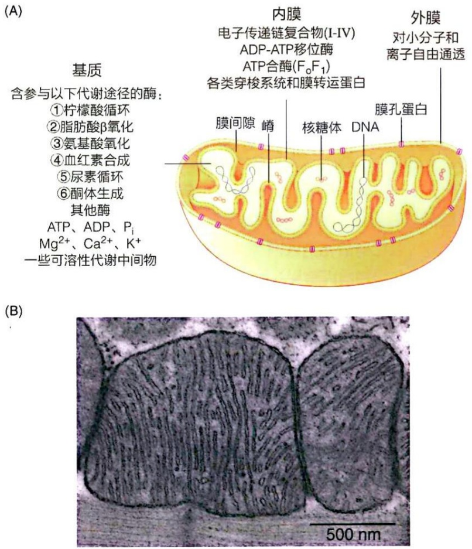

图 19-1 线粒体的结构示意图

（A）线粒体由外膜、内膜、膜间隙和基质组成。（B）小鼠心肌组织的线粒体电镜照片（清华大学杨茂君实验室肖淳博士提供）。

---

202

19 氧化磷酸化

依据内共生假说，线粒体（和叶绿体）均衍生自演化早期的细菌细胞，这也体现在线粒体和叶绿体均通过二分裂（binary fission）方式增殖。线粒体的形态及在细胞中的数量高度多样。在高耗能细胞（如心肌细胞）中，对应的线粒体数目也更多。

发生于原核生物质膜上和真核生物线粒体内膜上的氧化磷酸化过程高度可比。这里将主要介绍发生于真核生物线粒体内膜上的氧化磷酸化过程。

## 19.2.2 氧化磷酸化通过一种化学渗透机制发生

1950年代，通过利用放射性同位素 $^{32}\mathrm{P}$ 等，莱宁格等观察到线粒体中ADP的磷酸化与NADH到氧气的电子传递两者之间存在偶联关系。但是具体发生的机制却不清楚。当时最为广泛被接受的假说是化学偶联假说（chemical coupling hypothesis）:在氧化磷酸化过程中，可能形成一种类似甘油酸-1,3-二磷酸或磷酸烯醇式丙酮酸这样的“高能”磷酸中间体；磷酸基团再从这样的化学分子转移至ADP，形成ATP。但其后对这类中间体的搜寻并未获得成功。

1960年代，米切尔在开展细菌中溶质跨膜转运机制探究时提出一种不涉及任何化学中间体的全新化学渗透偶联机制（chemiosmotic coupling mechanism）。他认为，呼吸链中电子传递所释放能量与ATP合成所消耗能量之间的转换，是通过一种由膜电势和跨膜 $\mathrm{pH}$ 梯度所共同组成的跨膜电化学质子梯度——质子动力势（proton-motive force）而实现的。

这是一种范式的改变，米切尔的理论在最初提出时遭到强烈反对并引发了一场热烈的辩论，它极大地促进了该领域的实验研究。研究者利用分离的线粒体（以及叶绿体），甚至人工生物膜体系，通过人工施加电化学梯度，观察到了ATP的生成。这些实验为该假说提供了直接的实验证据。

迄今，化学渗透学说已经成为我们理解氧化磷酸化和光合磷酸化（第20章）过程的共同知识框架。下面分两方面介绍目前对氧化磷酸化过程的认识:膜上电子传递形成跨膜质子梯度的过程，以及ATP合酶利用跨膜质子梯度生成ATP的过程。需要注意的是，尽管我们对氧化磷酸化的这两个方面已获得总体认识，但很多细节有待澄清（具体见后），特别是在活细胞内这样的过程究竟是如何发生的，我们仍然知之甚少。

## 19.3 NADH 或 FADH$_2$ 将电子传递至 O$_2$ 生成跨膜质子梯度

1920年代，基林基于观察到的几种细胞色素（辅基为血红素）提出呼吸链的概念。生物氧化过程中的电子传递链概念是在呼吸链的基础上进一步发展而来的，更强调电子的传递过程。尽管在1930年代，单一电子传递顺序的概念已经被大家接受，但是对具体参与这样的电子传递过程的化学分子的鉴定直到大约1960年代才基本完

---

19.3 NADH 或  $FADH_{2}$  将电子传递至  $O_{2}$  生成跨膜质子梯度

203

成。而对于它们在膜上的物理存在形式则直到几种蛋白质复合物被分离后才基本清晰。近年对这些含有不同电子载体的蛋白质复合物结构的测定更是为我们理解具体的电子传递路径提供了更为直接可靠的数据。

我们先介绍参与呼吸链的三大类电子载体，包括它们的化学结构，携带电子的方式以及对它们在呼吸链中排列顺序的早期探究。然后介绍这些以自由形式或以蛋白质复合物形式存在于膜上的电子载体发挥功能的方式。

## 19.3.1 氧化磷酸化相关的电子传递主要由存在于生物膜中的三类电子载体完成

线粒体呼吸链中的电子载体主要包括血红素、泛醌和铁硫中心三大类。从 1920 年代到 1960 年代，人们利用不同的物理和化学手段陆续对它们进行了鉴定。后续研究

表明，其中的血红素和铁硫中心均与蛋白质紧密结合，但泛醌则可以在膜中自由流动，将电子从一种蛋白质复合物传递至另外一种蛋白质复合物。作为一个整体，这些电子载体有效地完成生物膜中的电子传递过程。下面分别介绍这三类作为电子载体的蛋白质辅因子。

## 19.3.2 泛醌分子是一种可在生物膜中自由扩散的双电子载体

泛醌（ubiquinone）也称辅酶Q（coenzyme Q，简称Q），是一种含有由若干个异戊二烯单位连接而成的疏水性侧链的苯醌衍生物（图19-2A）。这是1950年代克兰等人从牛心线粒体中鉴定到的一种化合物。不同物种中的泛醌的侧链长度存在差异。哺乳动物中的泛醌侧链由10个异戊二烯单位组成，被称为辅酶 $Q_{10}$ 。

氧化型泛醌（Q）可以接受1个氢原子成为半醌自由基（·QH），也可接受2个氢原子形成还原型泛醇 $\left(\mathrm{QH}_{2}\right)$ 。因此，泛醌存在三种氧化还原状态，分别是完全氧化型的泛醌、完全还原型的泛醌，以及中间状态的半醌自由基（图19-2B）。

作为一类电子载体，泛醌具有以下特点:①它可以从一个双电子供体接受2个电子后分别传递至2个单电子受体；②它既携带电子也携带质子；③它并不与蛋白质永久结合，可成为不同酶的辅酶，并通过自由扩散进入或离开酶的活性中心（这一点类似于

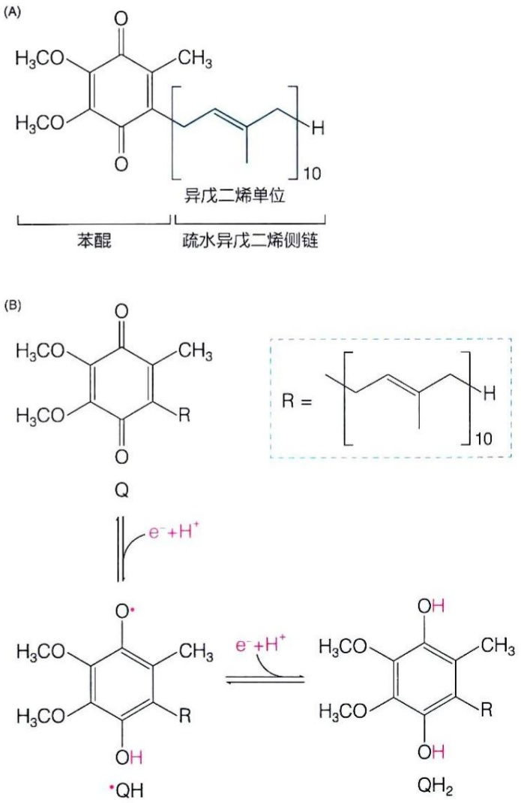

图 19-2 泛醌的化学结构及其不同的氧化还原状态  
(A) 氧化型泛醌由一个苯醌头部和一个类异戊二烯侧链组成。  
(B) 泛醌的三种形式。

---

204

19 氧化磷酸化

$NAD^{+}$ )。泛醌的这些结构特征使得它在呼吸链电子传递过程中扮演独特的角色:在不同的膜蛋白复合物之间传递电子和质子。一种与泛醌结构高度类似的醌类化合物——质体醌在光合磷酸化过程中发挥类似作用（第20章）。

## 19.3.3 血红素辅基利用其铁离子在呼吸链中进行单电子传递

早在 1880 年代，爱尔兰学者查尔斯·麦克蒙（Charles MacMunn，1852—1911）利用分光光度计检测到有别于血红蛋白的“组织血红素”。这种“组织血红素”在 1920 年代被基林重新发现为一种呼吸色素，并将含有这些血红素的蛋白质称作细胞色素（cytochrome）。

作为呼吸色素的血红素，其结构与血红蛋白和肌红蛋白中的血红素高度类似，均为含铁的卟啉环（即由4个吡咯单位连接而成的环状结构）（图19-3A）。但是，基林等借助显微分光仪还鉴定到吸收光谱稍有差异的另外两种血红素:除了血红蛋白和肌红蛋白中的血红素 $b$ 以外，还鉴定到血红素 $a$ 和 $c$ 。由于血红素卟啉环上存在共轭双键，使得血红素在可见光区具有特征光吸收谱，还原态的细胞色素都显示3个吸收峰:$\alpha$、$\beta$、$\gamma$（波长依次变短）。血红素 $a$、$b$ 和 $c$ 的长波段区吸收峰（即 $\alpha$ 峰）分别大约为 $600 \mathrm{~nm}$、$560 \mathrm{~nm}$ 和 $550 \mathrm{~nm}$（图19-3B），而且它们广泛存在于不同生物的不同细胞中。因为所结合的蛋白质不同，这些血红素与血红蛋白和肌红蛋白中的血红素的功能完全不同。这些血红素通过其铁原子在还原态（$\mathrm{Fe}^{2+}$）和氧化态（$\mathrm{Fe}^{3+}$）之间的可逆变化，而发挥单电子载体的作用；而血红蛋白和肌红蛋白中的血红素必须保持其$\mathrm{Fe}^{2+}$状态才能可逆结合 $\mathrm{O}_2$。

其实，血红素 $a$ 、 $b$ 和 $c$ 的结构差异并不大。血红素 $a$ 和 $c$ 可被视作由血红素 $b$ 衍生而成。血红素 $b$ （在血红蛋白和肌红蛋白中完全相同的辅因子被称作铁原卟啉IX）分子的卟啉环上连有4个甲基、2个丙酸基和2个乙烯基。如果血红素 $b$ 分子中的1个乙烯基侧链被转化为羟乙基类异戊二烯（一般含3个异戊二烯单位）侧链，1个甲基被转化为甲酰基，则形成血红素 $a$ ；如果2个乙烯基侧链分别与蛋白质的2个半胱氨酸侧链的巯基形成硫醚键共价连接，则形成血红素 $c$ （图19-3A）。

含血红素 $a$ 、 $b$ 和 $c$ 的细胞色素被分别称作细胞色素 $a$ 、 $b$ 和 $c$ 。需要注意的是，同一种血红素辅基，当结合的蛋白质不同时，其电子亲和力可能存在差异，因此对应的还原势（标准还原势和实际还原势）也不同。呼吸链中存在不同亚类的细胞色素，如细胞色素 $c$ 和 $c_{1}$ 、细胞色素 $a$ 和 $a_{3}$ 、细胞色素 $b_{\mathrm{L}}$ 和 $b_{\mathrm{H}}$ 等，这些微小差异均因为所结合的蛋白质不同所致。这种差异有时会反映在最大波长吸收峰上，这种情况下，一般将最大吸收峰的具体波长作为下标写出，如细胞色素 $b_{566}$ （即细胞色素 $b_{\mathrm{L}}$ ）和 $b_{562}$ （即细胞色素 $b_{\mathrm{H}}$ ）等。

呼吸链中的细胞色素大多与其他蛋白质形成复合物，具体将与不同复合物一同介绍。只有细胞色素 $c$ 是自由存在于膜周边的一种小分子量蛋白质，行使在不同复合物之间传递电子的功能。

---

19.3 NADH 或  $FADH_{2}$  将电子传递至  $O_{2}$  生成跨膜质子梯度

205

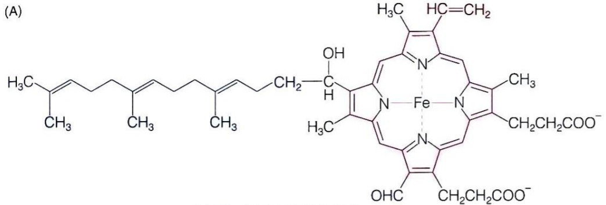

<details>
<summary>chemical</summary>

Chemical structure of a ferrocene-based coordination complex with multiple alkyl chains and carboxylic acid groups
</details>

血红素a（存在于细胞色素a）

图 19-3 三种血红素的化学结构及细胞色素 c 的吸收光谱特征

（A）血红素a、b和c的化学结构。红色区域表示共轭双键。（B）细胞色素c处于氧化态（蓝色）和还原态（红色）时的吸收光谱图，还原态吸收光谱的特征峰用 $\alpha$ 、 $\beta$ 和 $\gamma$ 标出。

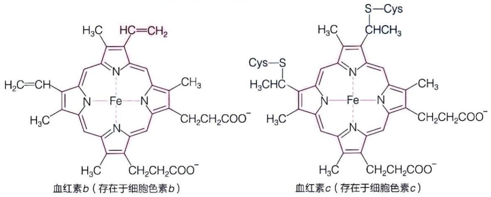

(B)

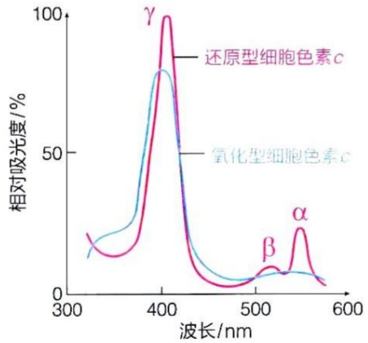

<details>
<summary>line</summary>

| 波长 (nm) | 还原型细胞色素c (相对吸光度/%) | 氧化型细胞色素c (相对吸光度/%) |
| --- | --- | --- |
| ~320 | ~20 | ~15 |
| ~380 | ~20 | ~30 |
| ~400 | ~95 | ~75 |
| ~410 | 100 | ~75 |
| ~420 | ~60 | ~50 |
| ~480 | ~5 | ~10 |
| ~510 | ~10 | ~10 |
| ~530 | ~10 | ~10 |
| ~550 | ~25 | ~10 |
| ~580 | ~5 | ~5 |
</details>

哺乳动物细胞色素 $c$ 是由104个氨基酸残基组成的单一亚基球蛋白，它在不同物种中高度保守（肽链长度一般为 $104 \pm 10$ 个氨基酸残基）。它与线粒体内膜（或原核细胞质膜）以及膜中的其他电子传递链复合物结合并不紧密。完整细胞色素 $c$ 的生成依赖细胞色素 $c$ 合成酶的催化:使得血红素 $c$ 与蛋白质分子中的两个半胱氨酸残基的巯基形成硫醚键共价连接。值得注意的是，与血红素 $c$ 共价结合的完整细胞色素 $c$ 的分子构象发生了变化，使其无法自由穿过线粒体外膜进入到胞质溶胶，从而被锁定在线粒体膜间隙。而未结合血红素 $c$ 的不完整细胞色素 $c$ 蛋白却可以自由通过线粒体外膜进入到胞质溶胶。完整细胞色素 $c$ 在线粒体内膜的外表面交替地与复合物Ⅲ和复合物IV发生作用，完成复合物Ⅲ和复合物IV之间的电子传递（具体见后）。

---

206

19 氧化磷酸化

## 19.3.4 铁硫中心辅因子也利用其铁离子在呼吸链中进行单电子传递

铁硫中心（iron-sulfur center）是一类直到1960年代才被鉴定的呼吸链中的一类电子载体。它是由美国学者赫尔穆特·拜纳特（Helmut Beinert，1913—2007）等利用电子顺磁共振波谱（electron paramagnetic resonance spectroscopy，EPR）技术从琥珀酸脱氢酶（即复合物Ⅱ）和NADH脱氢酶（即复合物Ⅰ）中鉴定到的一种成分。

总体而言，它们均含铁离子，并且与无机硫原子或半胱氨酸残基的巯基（有时是来自组氨酸残基侧链的氮原子）之间成键。它们的名称一般反映铁原子和无机硫原子的数目（即不计来自半胱氨酸巯基硫或组氨酸咪唑基氮的数目），如[2Fe-2S]铁硫中心含2个铁原子和2个无机硫原子，而[4Fe-4S]则含4个铁原子和4个无机硫原子。

尽管与血红素中的铁不同，铁硫中心也借助铁的价态变化进行电子传递。这类化合物广泛存在于不同生物体内，而且结构多样，除了在呼吸链中发挥作用外，也在大量其他生物过程中发挥重要作用，比如[8Fe-7S]在固氮酶中发挥电子传递作用（第25章）。

在呼吸链中存在的铁硫中心包括 [2Fe-2S]、[3Fe-4S] 和 [4Fe-4S] 等类型。其中的 [2Fe-2S] 具菱形结构，[4Fe-4S] 具正立方体结构（4 个铁原子和 4 个无机硫原

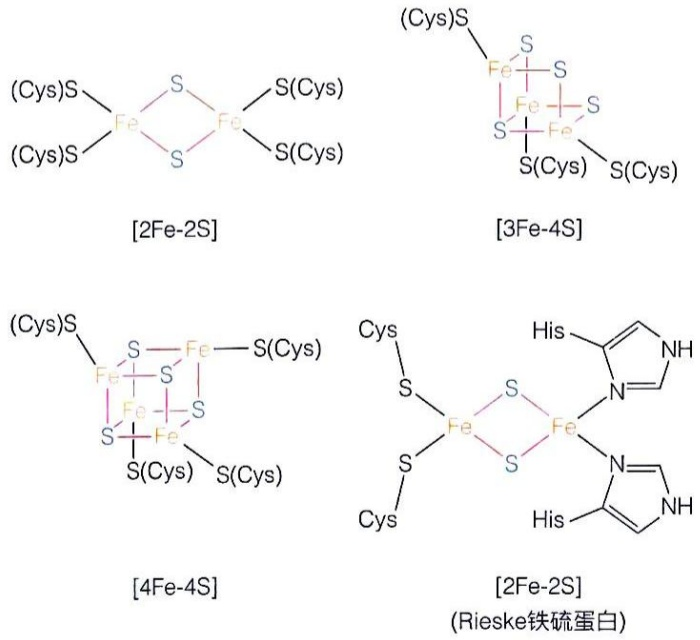

图 19-4 呼吸链中存在的几种铁硫中心结构示意图

子分别位于其8个角上），[3Fe-4S]为缺少一个顶点的正立方体结构（图19-4）。

在呼吸链中还存在一种 [2Fe-2S]，其中有两个组氨酸残基侧链代替两个半胱氨酸残基侧链，含这种辅基的蛋白质被称作 Rieske 铁硫蛋白 [存在于呼吸链复合物Ⅲ中，以其发现者约翰·里斯克（John Rieske）的名字命名]（图 19-4）。

所有铁硫中心均为蛋白质的辅因子，这样的含铁硫中心的蛋白质均被称作铁硫蛋白（iron-sulfur protein）。电子传递链中的铁硫蛋白并不是单独存在的，往往与其他组分（即血红素、泛醌等）共同组成电子传递链，进行电子的有效传递。每个铁硫蛋白每次只参与一个电子的转移。线粒体中至少有12种铁硫蛋白参与电子传递过程，其中复合物Ⅰ中有8种，复合物Ⅱ有3种，复合物Ⅲ中有1种（具体见后）。

---

19.4 呼吸链电子传递过程由膜上的几种蛋白质复合物共同完成

207

## 19.3.5 呼吸链电子载体排列的顺序可通过不同方法探究

1930 年代的研究揭示，像  $FADH_{2}$  和 NADH 这样的电子载体在呼吸链中扮演从乳酸这样的代谢物到呼吸链细胞色素和细胞色素氧化酶之间连接者的角色。但是，针对肌肉组织这样的生理系统而言，人们尚难以将这种知识整理成一种有关呼吸链的概念模型。人们主要从三个角度试图推断出这些电子载体之间的前后排列顺序。

第一个方面是从热力学角度进行探究。一种合理的猜测是:这条呼吸链应该代表了按有关成分的还原势（其值越高，对电子的亲和力也越高）从低到高排列的顺序。1950年代，人们建立了测定呼吸链中不同电子载体组分（如不同的细胞色素、黄素蛋白等）还原势的方法。这包括利用像亚甲基蓝（被还原后从蓝色变成无色）这样的染料作为测定代谢物系统（如琥珀酸-延胡索酸）还原势的“指示剂”。

第二个方面是通过测定不同条件下某些电子载体的氧化还原状态。通过建立快捷灵敏的分光光度法等，来测定细胞内电子载体的氧化还原状态。先使全部电子载体处于完全还原状态，然后突然给系统提供  $O_{2}$ 。这种情况下，越靠近电子传递链末端电子受体（即  $O_{2}$ ）的电子载体将越早被氧化。通过分光光度法可以快速有效测定不同细胞色素电子载体的氧化还原状态，测定的结果与上述还原势数据之间进行对比，可帮助推断出线粒体内膜上这些电子载体之间可能的排列顺序。

第三个方面是通过利用不同的电子传递抑制剂将呼吸链的不同步骤阻断，然后观察特定电子载体处于还原态还是氧化态。处于还原态的载体（因为它们所携带的电子无法被继续传递）位于阻断步骤的上游，而处于氧化态的载体（它们携带的电子被传递至 $\mathrm{O}_2$ ，但无法再次从上游电子载体获得电子）则处于被阻断步骤的下游。为开展此研究，人们利用多种与不同蛋白质结合从而阻断不同步骤电子传递的抑制剂，如鱼藤酮（retenone；阻断NADH $\rightarrow$ Q的电子传递）、抗霉素A（antimycin A；阻断细胞色素 $b\to$ 细胞色素 $c_{1}$ 的电子传递）、氰化物或CO（阻断细胞色素 $a + a_{3}\rightarrow \mathrm{O}_{2}$ 的电子传递）。这些结果也可帮助揭示可能的电子载体的排列顺序。

如此推断出的电子载体顺序是 $\mathrm{NADH} \rightarrow \mathrm{Q} \rightarrow$ 细胞色素 $b \rightarrow$ 细胞色素 $c_{1} \rightarrow$ 细胞色素 $c \rightarrow$ 细胞色素 $a + a_{3} \rightarrow \mathrm{O}_{2}$ 。这与后续基于对复合物结构解析所揭示的电子载体排列顺序基本一致。

## 19.4 呼吸链电子传递过程由膜上的几种蛋白质复合物共同完成

1960 年代，伊朗裔美国学者优素福·哈特菲（Youssef Hatefi）等通过利用温和去污剂去除线粒体外膜，再利用渗透压裂解法将线粒体内膜破碎后，通过离子交换层析等将呼吸链分离成了四种蛋白质复合物（另加一种 ATP 合酶复合物），并对每种复合

---

208

19 氧化磷酸化

物所含电子载体和蛋白质亚基的种类以及可以将什么电子供体的电子传递给什么电子受体等进行了表征。这些复合物被简单地命名为复合物Ⅰ、Ⅱ、Ⅲ和Ⅳ。随后，这四种膜蛋白复合物被分别定义为:NADH脱氢酶（复合物Ⅰ）、琥珀酸脱氢酶（复合物Ⅱ）、细胞色素c还原酶（复合物Ⅲ）和细胞色素c氧化酶（复合物Ⅳ）。值得注意的是，这里的复合物Ⅱ与柠檬酸循环中的琥珀酸脱氢酶完全相同。

每种复合物的天然电子供体和受体均得到明确鉴定。具体而言，复合物I的电子供体是NADH，复合物Ⅱ的电子供体是琥珀酸（通过 $\mathrm{FADH}_2$），而复合物I和Ⅱ的最终电子受体均为泛醌（Q）；复合物Ⅲ的电子供体是泛醌（$\mathrm{QH}_2$），其最终电子受体为细胞色素 $c$；复合物IV的电子供体是细胞色素 $c$，其最终电子受体是 $\mathrm{O}_2$。这些鉴定不仅清晰地表征了每种复合物自身的电子传递特征，还完整地描绘了呼吸链中四种复合物参与的电子传递全过程。

自 1990 年代开始，人们对每种复合物单独的结构或共同形成的超级复合物的结构通过 X 射线晶体衍射技术或冷冻电镜单颗粒技术进行了解析。这使得人们对呼吸链中存在的具体电子传递路径获得了接近原子水平的精准认识，当然对这一电子传递过程在细胞内发生的动态细节还远不清楚。下面介绍通过上述各种研究过程所认识的可能发生于每种复合物中的电子传递过程。

## 19.4.1 呼吸链复合物 | 催化电子从 NADH 转移至泛醌

很多脱氢酶的活性中心以 $\mathrm{NAD^{+}}$ 作为电子受体，所形成的NADH将电子通过复合物I继续往前传递至Q，形成 $\mathrm{QH_2}$ 。复合物I因此也被称作NADH脱氢酶或NADH:泛醌氧化还原酶。

哺乳动物的呼吸链复合物I是四种复合物中最大、可能也是认识最不深入的一种复合物。它由45种亚基组成（但细菌中的复合物I仅含14种亚基），分子量约为 $850\mathrm{kDa}^{\text{①}}$ 。结构测定结果表明，该复合物中一般含1个FMN和8个铁硫中心（为[2Fe-2S]或[4Fe-4S])，同时也可结合NADH和辅酶Q等辅因子。复合物I整体呈L型，一部分镶嵌在线粒体内膜（或原核细胞的质膜）中，被称为膜臂，另一部分则伸展于线粒体基质（或原核细胞的胞质溶胶）中，被称为亲水臂（图19-5）。

通过比较细菌和其他生物的复合物Ⅰ的组成，人们揭示膜臂的7种亚基和亲水臂的7种亚基高度保守，可能是功能重要的14种亚基，这些亚基被认为是复合物的核心亚基，其他亚基被称为外周亚基。外周亚基尽管不直接行使催化功能，但对复合物的结构稳定和功能发挥不可或缺。

复合物I催化两个同时发生的偶联过程:

<small><span class="docvortex-page-footnote" data-block-type="page_footnote" style="color:#6b7280">① 严格地说，此处应使用“分子质量”而非“分子量”。分子质量是指分子的实际质量，有单位，涉及蛋白质等生物大分子时，常用道尔顿（Da）作为单位；分子量是相对分子质量的简称，无单位（或者单位为1）。当分子质量以Da为单位时，其数值与分子量数值相同。为照顾使用习惯和行文需要，本书类似表达处均使用“分子量”。</span></small>

---

19.4 呼吸链电子传递过程由膜上的几种蛋白质复合物共同完成

209

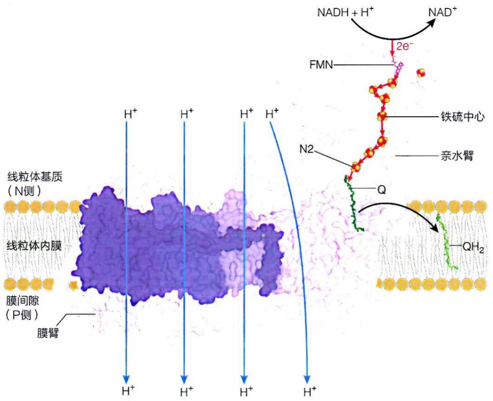

<details>
<summary>flowchart</summary>

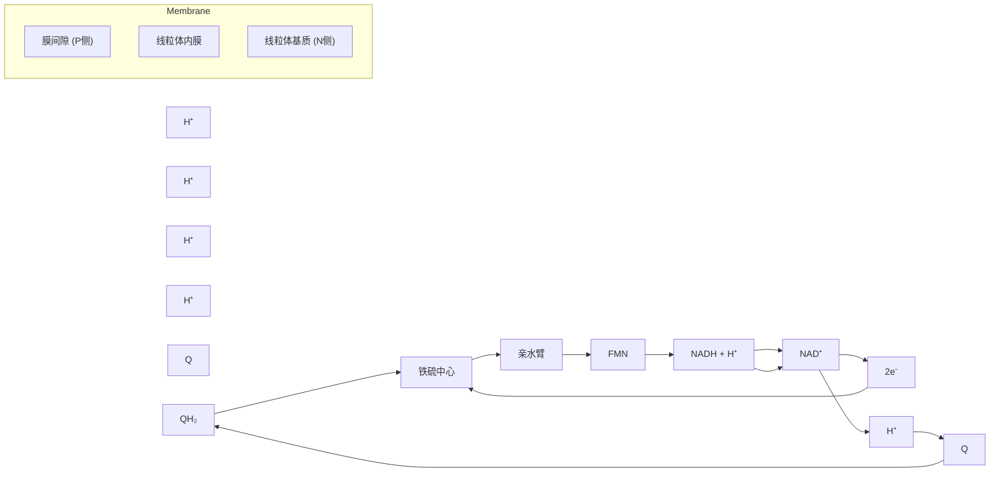
</details>

图 19-5 呼吸链复合物 I 结构和功能示意图

复合物Ⅰ（PDB:7V2C）接受来自NADH的电子，电子流经一系列铁硫中心并最终还原辅酶Q，同时通过复合物Ⅰ的膜臂将质子泵送至线粒体膜间隙。电子传递路径用红色箭头标出；质子泵送方向用蓝色箭头标出；膜臂处被认为存在四种不同质子泵。

一个是将 NADH 中的电子转移至泛醌的放能过程: $NADH + H^{+} + Q \rightarrow NAD^{+} + QH_{2}$ 。具体过程为:1 分子 NADH 首先将其 2 个电子转移至复合物 I 中的 FMN 辅因子，形成 1 分子  $FMNH_{2}$ ，随后  $FMNH_{2}$  中的电子通过一系列铁硫中心被传递至复合物 I 的亲水臂近膜端的铁硫中心 N2 上，最后电子被转移至结合在膜臂上的氧化型辅酶 Q 上（结合于一种特异的 Q 隧道中），生成  $QH_{2}$ ；后者离开复合物 I，扩散至磷脂双分子层中。发生于复合物 I 中的全部电子传递过程可以总结为: $NADH \rightarrow FMN \rightarrow [4Fe-4S] \rightarrow [2Fe-2S] \rightarrow [4Fe-4S] \rightarrow [4Fe-4S] \rightarrow [4Fe-4S] \rightarrow [4Fe-4S] \rightarrow QH_{2}$ 。

另一个过程是将 4 个质子从线粒体基质泵送至膜间隙的逆梯度耗能过程。这应该与复合物 I 介导电子传递的过程同时发生。但目前证据表明，这样的质子泵送发生于膜臂部分。结构测定结果表明，在膜臂的中间部分似乎存在一条由谷氨酸残基组成的隧道，但它在质子泵送过程中的具体作用仍不清楚。

值得注意的是，复合物Ⅰ是一种转位酶（即属于第七大类酶），催化质子从一个亚细胞部位（线粒体基质）转运至另一亚细胞部位（线粒体膜间隙）。

在未来的研究过程中，我们需阐明复合物Ⅰ中发生的多步电子传递过程与质子跨膜泵送之间究竟如何偶联。因为质子无法通过现有的结构测定方法探测，开展有关研究的方法尚未建立。

## 19.4.2 呼吸链复合物Ⅱ催化电子从琥珀酸转移至泛醌

体外分析结果表明，呼吸链复合物Ⅱ可将电子从琥珀酸转移至泛醌。后续研究表明，

---

210

19 氧化磷酸化

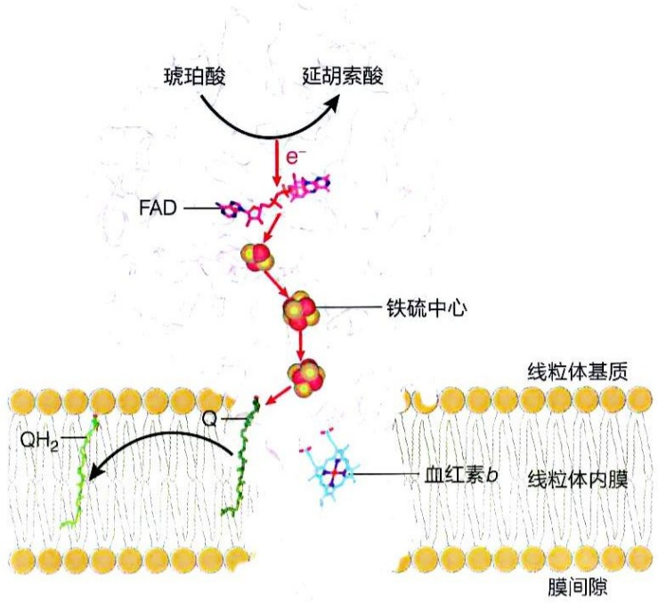

<details>
<summary>flowchart</summary>

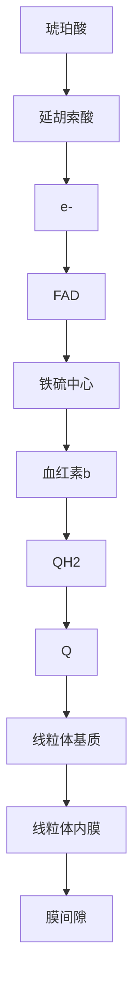
</details>

图 19-6 呼吸链复合物Ⅱ结构和功能示意图

呼吸链复合物Ⅱ（PDB:1ZOY）催化琥珀酸中的电子流经一系列电子载体，最终还原辅酶Q。

复合物Ⅱ就是柠檬酸循环中的琥珀酸脱氢酶。因为它催化的电子传递反应为  $FADH_{2} + Q \rightarrow FAD + QH_{2}$ ，所以它的系统是琥珀酸:泛醌氧化还原酶。这反映了柠檬酸循环与呼吸链电子传递之间形成了一种叠合，其意义值得深入探究。

复合物Ⅱ催化琥珀酸脱氢生成延胡索酸（即反丁烯二酸）和 $\mathrm{FADH_2}$ 。真核生物复合物Ⅱ部分整合于线粒体内膜上，部分伸出到线粒体基质中（图19-6）；在原核生物中，则部分整合于细胞质膜中。与复合物I相比，复合物Ⅱ结构更为简单，仅由4种亚基组成。它所含电子载体除了1个与特异组氨酸残基（原核生物中可能为半胱氨酸残基）侧链共价相连的辅基FAD之外，还包括3个铁硫中心。这里共价连接的FAD所发挥的作用与复合物I中非共价结合的FMN类似:将从琥珀酸接受的电子传递至[2Fe-2S]铁硫中心；再经过一个[4Fe-4S]和一个[3Fe-4S]后，将电子最终传递至氧化型泛醌Q，形成还原型泛醌$\mathrm{QH_2}$ 。泛醌是一个电子传递汇合点，它将来自复

合物Ⅰ、Ⅱ和其他氧化反应的电子全部传递至复合物Ⅲ。

因此，复合物Ⅱ催化的全部电子传递过程可以总结为:琥珀酸→FAD→[2Fe-2S]→[4Fe-4S]→[3Fe-4S]→QH₂。

结构测定结果表明，在复合物Ⅱ中还紧密结合了1个血红素b和2个磷脂酰乙醇胺分子。血红素b并非位于电子传递路径上，但位于泛醌结合位点附近（图19-6），推测的功能是阻止复合物Ⅱ中“泄漏”的电子直接与 $O_{2}$ 结合而产生活性氧（reactive oxygen species，ROS）。而2个磷脂酰乙醇胺分子与复合物Ⅱ的结合也高度特异（并非像与其他膜磷脂结合那样），但其功能不清楚。

复合物Ⅱ催化的电子传递过程所释放的自由能不足以驱使质子逆梯度跨膜转运。但当电子后续在复合物Ⅲ和Ⅳ中传递时，会驱动质子跨膜转运。

值得注意的是，有学者认为复合物Ⅱ不能算作呼吸链的一部分，因为它仅仅负责将琥珀酸脱下的电子传递至呼吸链，而不参与任何其他来源电子的传递。换句话说，复合物Ⅱ中的FAD并不接受任何其他来源的电子。这与复合物I、Ⅲ和Ⅳ参与大量不同来源电子的传递现象存在本质的区别。

## 19.4.3 其他含 FAD 辅因子的脱氢酶也将电子传递至泛醌

泛醌是分解代谢的一种收敛点，它不仅接受来自复合物Ⅰ和Ⅱ的电子，还接受其

---

19.4 呼吸链电子传递过程由膜上的几种蛋白质复合物共同完成

211

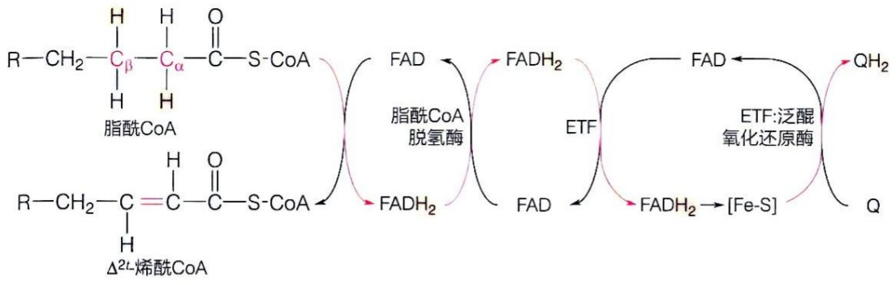

<details>
<summary>chemical</summary>

Reaction mechanism diagram showing the conversion of R-CH2-C(β)-C(α)-C=S-CoA to form R-CH2-C(=C)-C(S-CoA) and then to Q via FAD and ETF enzymes
</details>

图 19-7 脂肪酸β氧化途径中的脂酰CoA脱氢酶将电子传递至Q

他以 FAD 为辅因子的脱氢酶催化所释放的电子，比如由脂酰 CoA 脱氢酶催化脂肪酸 β 氧化第一步脱氢反应所释放的电子（图 19-7；第 22 章）。

具体而言，脂酰 CoA 脱氢酶使用 FAD 为电子受体。所生成  $FADH_{2}$  将电子传递至电子传递黄素蛋白（electron-transfer flavoprotein，ETF）中的 FAD，最后在含有 FAD 和铁硫中心的 ETF:泛醌氧化还原酶催化下传递至 Q，生成  $QH_{2}$ 。这里的脂酰 CoA 脱氢酶和 ETF 均位于线粒体基质中，而 ETF:泛醌氧化还原酶整合于线粒体内膜上。这三种蛋白质组成的总体电子传递过程是: $FAD \rightarrow FAD \rightarrow FAD \rightarrow [Fe-S] \rightarrow QH_{2}$ 。因此，复合物 I、复合物 II 和脂酰辅酶 A 脱氢酶复合物中发生的电子传递具有高度的可比性:最前面的电子载体均为 FAD 或 FMN，而最后将电子传递至 Q 的电子载体均为铁硫中心（图 19-5 至图 19-7）。

需要强调的是，ETF可以将来自十几种线粒体基质黄素蛋白的电子传递至Q，最终进入呼吸链。

此外，结合于线粒体内膜外侧的甘油-3-磷酸脱氢酶（将胞质溶胶中NADH携带的电子穿梭传递至呼吸链）也催化将电子经由FAD传递至Q的过程，但该酶并不使用铁硫中心（具体见后）。

## 19.4.4 呼吸链复合物Ⅲ将电子从还原型泛醌传递至细胞色素 $c$

泛醌（$\mathrm{QH}_2$）从上游众多不同的电子供体处获得电子后，继续通过呼吸链复合物Ⅲ将其所携带电子传递至细胞色素 $c$。因此，根据其总体的酶活性，复合物Ⅲ也被称作辅酶 Q: 细胞色素 $c$ 氧化还原酶（或简称细胞色素 $c$ 还原酶）。此外，由于其所含的细胞色素 $b$ 和细胞色素 $c_1$ 发挥关键作用，它还被称作细胞色素 $bc_1$ 复合物。

复合物Ⅲ由11个亚基组成，分子量约 $250\mathrm{kDa}$，体内复合物Ⅲ常以同源二聚体形式存在，二聚体分子量约 $500\mathrm{kDa}$。其结构由两个相同部分组成。就电子传递而言，每部分中的关键亚基包括1个细胞色素 $b$、1个铁硫蛋白和1个细胞色素 $c_{1}$。其中的细胞色素 $b$ 以9次跨膜的形式镶嵌在线粒体内膜中，而细胞色素 $c_{1}$ 和铁硫蛋白位于线粒体内膜的膜间隙侧；铁硫蛋白的一端锚定在内膜上，另一端可以摆动。

复合物Ⅲ所含电子载体如下（图19-8）:细胞色素 $b$ 含有2个血红素 $b$ 辅基，分别被称作 $b_{\mathrm{L}}$ 和 $b_{\mathrm{H}}$ [这里的L和H分别表示低（low）和高（high）电子亲和力]。铁

---

212

19 氧化磷酸化

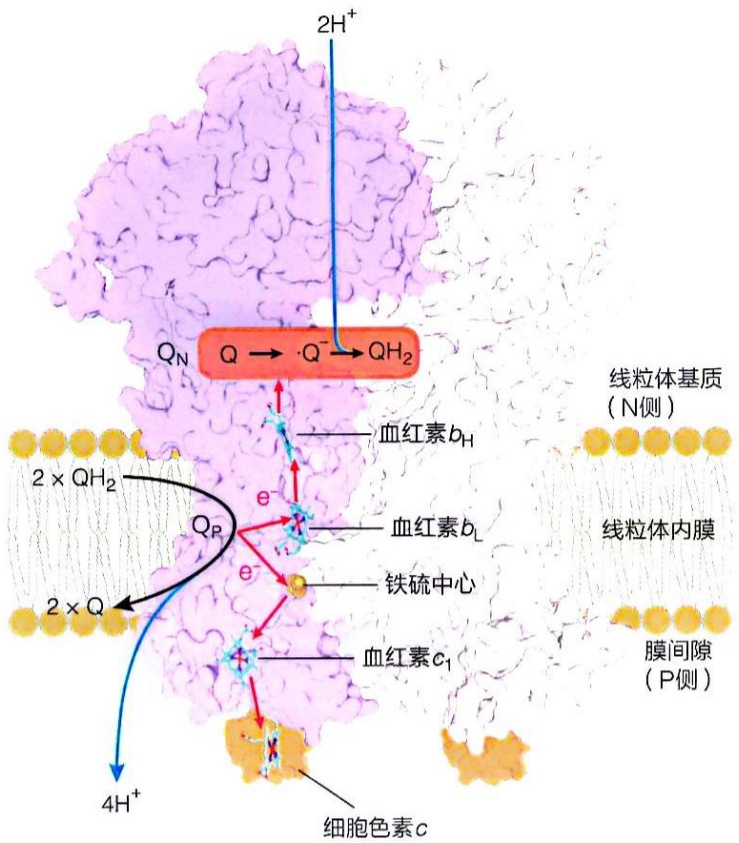

<details>
<summary>flowchart</summary>

This diagram illustrates the biochemical pathway of blood cells (Q) and their intercellular structure, showing how various components like blood red素 b_H, b_L, c1, and c_c interact with a central iron-sulfur center.
</details>

图 19-8 呼吸链复合物Ⅲ的结构和功能示意图

呼吸链复合物Ⅲ（PDB:1BGY）由两个相同部分组成，分别以灰色和淡蓝色显示，每个部分均含11种亚基。

硫蛋白为Rieske铁硫蛋白:它含一个[2Fe-2S]铁硫中心，但其中的1个铁原子与2个组氨酸残基的咪唑基侧链（而非半胱氨酸残基的巯基）配位，这使得该铁硫中心的还原势远高于常规的铁硫中心，即具有更高的电子亲和力（详见图19-4）。细胞色素 $c_{1}$ 含一个共价连接的血红素$c$ 辅因子。另外，在细胞色素 $b$ 分子上还存在2个辅酶Q结合位点，分别靠近膜间隙和线粒体基质，被称作 $\mathrm{Q_P}$ （P表示positive，因为膜间隙一侧带正电荷）和 $\mathrm{Q_N}$ （N表示negative，因为基质侧带负电荷）。

复合物Ⅲ中的电子传递和质子泵送通过Q循环方式进行。辅酶Q还原形成的 $QH_{2}$ 为复合物Ⅲ的电子供体。然而其下游的电子载体，无论是血红素b、血红素c还是铁硫中心，每次仅能传递1个电子。为解释在复合物Ⅲ中， $QH_{2}$ 如何可以同时参与电子传递和质子从线粒体基质到膜间隙的跨膜泵送（从而支持他所提出的化学渗透假说），米切尔于1970年代提出Q循环（Q cycle；这里的Q代表泛醌）假说，后续1990年代结构测定结果强有力

地支持了 Q 循环假说（图 19-9）。

Q 循环不仅解释了质子跨膜泵送的一种可能机制，同时也解释了双电子供体（$\mathrm{QH}_2$）中的 2 个电子如何通过下游的单电子载体（血红素和铁硫中心）继续传递。根据 Q 循环假说，在复合物Ⅲ中，$\mathrm{QH}_2$ 将电子传递给细胞色素 $c$ 的过程并非一次性完成，而是分两个阶段进行（图 19-9）。

在 Q 循环的第一阶段，1 个  $QH_{2}$  分子结合于细胞色素 b 的  $Q_{P}$  位点上，其所携带的 2 个高势能电子中的 1 个被转移至复合物Ⅲ中的铁硫中心，同时释放 1 个  $H^{+}$ 至膜间隙中，形成半醌自由基（·QH）。铁硫中心的电子再经细胞色素  $c_{1}$  被传递至细胞色素 c。半醌自由基所携带的另 1 个电子通过血红素  $b_{L}$  转移至对电子具有较高亲和力的靠近线粒体基质侧的血红素  $b_{H}$，同时将 1 个  $H^{+}$ 释放至膜间隙中，形成氧化型泛醌 Q，并离开活性中心而自由扩散至线粒体内膜中。血红素  $b_{H}$ 上的 1 个电子接着被传递至结合于线粒体基质侧  $Q_{N}$  位点上的 Q 分子中，形成 1 个半醌自由基（·Q⁻）。

在 Q 循环的第二阶段，另一分子的  $QH_{2}$  结合于细胞色素 b 的  $Q_{P}$  位点上。以与第一阶段相同的方式将 1 个电子依次传递至铁硫中心、细胞色素  $c_{1}$  和细胞色素 c。这个  $QH_{2}$  分子上剩余的 1 个电子也通过血红素  $b_{L}$  和血红素  $b_{H}$，最终传递至第一阶段在  $Q_{N}$  位点上形成的那个半醌自由基（·Q⁻），后者从基质获得 2 个质子后形成  $QH_{2}$。

结构分析表明，这里的铁硫蛋白可能在两种构象之间振荡:一种构象使铁硫中心

---

19.4 呼吸链电子传递过程由膜上的几种蛋白质复合物共同完成

213

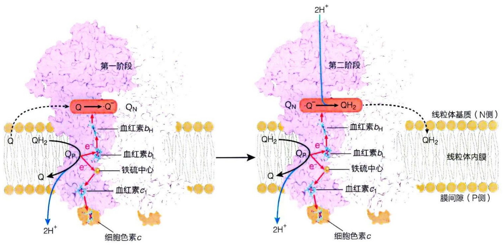

<details>
<summary>flowchart</summary>

```mermaid
graph LR
  subgraph Stage_1 [第一阶段]
  A["Q"] --> B["Q⁻"]
  B --> C["Q_N"]
  C --> D["QH₂"]
  D --> E["Q"]
  E --> F["2H⁺"]
  F --> G["细胞色素c"]
  G --> H["铁硫中心"]
  H --> I["e⁻"]
  I --> J["血红素bL"]
  J --> K["e⁻"]
  K --> L["血红素bH"]
  L --> M["Q_H₂"]
  M --> N["Q"]
  N --> O["QN"]
  end

  subgraph Stage_2 [第二阶段]
  P["Q⁻"] --> Q["QH₂"]
  Q --> R["Q_N"]
  R --> S["QH₂"]
  S --> T["QH₂"]
  T --> U["Q"]
  U --> V["e⁻"]
  V --> W["e⁻"]
  W --> X["QH₂"]
  X --> Y["Q"]
  Y --> Z["细胞色素c"]
  Z --> AA["e⁻"]
  AA --> AB["e⁻"]
  AB --> AC["血红素bL"]
  AC --> AD["Q_H₂"]
  AD --> AE["Q"]
  AE --> AF["Q"]
  AF --> AG["2H⁺"]
  end
```
</details>

图 19-9 复合物Ⅲ中可能发生的 Q 循环示意图

更靠近细胞色素 b 上的  $Q_{P}$  位点，另一种构象则使铁硫中心更靠近细胞色素  $c_{1}$  中的血红素 c 基团。

总体来看，在 Q 循环的两个阶段中发生如下氧化还原反应和质子泵送过程。在  $Q_{P}$  结合位点上，2 个  $QH_{2}$  发生氧化反应，释放 4 个电子，其中:2 个电子通过 Rieske 铁硫蛋白和细胞色素  $c_{1}$  被传递至 2 分子细胞色素 c，使后者还原；另外 2 个电子经血红素  $b_{L}$  和  $b_{H}$  传递至  $Q_{N}$  结合位点的 1 分子 Q，生成 1 分子  $QH_{2}$ 。其间将 4 个  $H^{+}$  释放至膜间隙，线粒体基质中的 2 个  $H^{+}$  被用于形成 1 个  $QH_{2}$ 。

因此，Q 循环氧化还原反应的总方程如下:

$$
\mathrm{QH} _ {2} + 2 \mathrm{Cyt} c (\text {氧化态}) + 2 \mathrm{H} _ {\mathrm{N}} ^ {+} \longrightarrow \mathrm{Q} + 2 \mathrm{Cyt} c (\text {还原态}) + 4 \mathrm{H} _ {\mathrm{P}} ^ {+}
$$

值得注意的是，通过复合物Ⅲ每传递一对电子到2个细胞色素c（Cyt c），尽管膜间隙获得4个 $H^{+}$ ，但是线粒体基质只失去2个 $H^{+}$ 。严格意义上说，这一步中仅仅有2个 $H^{+}$ 被跨膜泵送，即从线粒体基质泵送至膜间隙（从N侧泵送至P侧）；另外2个 $H^{+}$ 并非直接从线粒体基质中获得，它们对跨膜电化学势形成的贡献应该比泵送的质子更低。因此，“一对电子经过复合物Ⅲ时泵送4个质子”的说法并不严谨。

## 19.4.5 呼吸链复合物Ⅳ将电子从细胞色素 $c$ 传递至 $\mathrm{O}_2$

从复合物Ⅲ获得电子的细胞色素 c，通过位于呼吸链最末端的呼吸链复合物Ⅳ将电子最终传递至  $O_{2}$ ，生成  $H_{2}O$ 。因此复合物Ⅳ也被称为细胞色素 c 氧化酶（cytochrome c oxidase）。哺乳动物的复合物Ⅳ由 14 种亚基组成，而细菌的复合物Ⅳ则仅由 3～4 种亚基组成。与复合物Ⅰ和Ⅲ类似，复合物Ⅳ在催化电子传递的同时也催化质子的跨膜转运。

---

214

19 氧化磷酸化

对原核和真核生物呼吸链复合物的结构比较分析表明，在复合物IV的14种亚基中，3种亚基高度保守，可能为发挥功能的核心亚基（分别被称作亚基Ⅰ、Ⅱ和Ⅲ）。值得注意的是，真核细胞中这三种核心亚基均由线粒体基因组编码。其余亚基则由核基因组编码，可能主要负责复合物IV的组装和稳定等。

结构测定结果表明，亚基Ⅰ和Ⅲ高度疏水，缺乏明显的膜外亲水结构域，而亚基Ⅱ包含一个膜外β桶结构域以及两个跨膜螺旋。

复合物IV的电子载体主要存在于亚基I（一种细胞色素a）和Ⅱ中。亚基Ⅲ中并不含任何电子载体，但其存在是复合物IV发挥功能所不可或缺的。亚基Ⅱ中含有由两个铜离子组成的 $Cu_{A}-Cu_{A}$ 双核中心（铜离子与亚基中的2个Cys残基的巯基结合；其结构与[2Fe-2S]类铁硫中心具某种可比性）。亚基I中含血红素a、 $a_{3}$ 和 $Cu_{B}$ 铜离子；其中的血红素 $a_{3}$ 中的铁离子与 $Cu_{B}$ 形成另一个双核中心。血红素a和 $a_{3}$ 均为a类血红素，结构完全一样，但因为在蛋白质中的结合环境不同，使得它们的还原势不同，血红素 $a_{3}$ 具更高的电子亲和力。

结构测定结果表明，电子在复合物IV中的传递路径如下:来自还原态细胞色素c的电子被依次转移至 $Cu_{A}-Cu_{A}$ 双核中心、血红素a、血红素 $a_{3}-Cu_{B}$ 双核中心（图19-10）。

目前，对于 $\mathrm{O}_2$ 最后接受电子而被还原成 $\mathrm{H}_2\mathrm{O}$ 的细节并非十分清楚。一种可能的机制如下（图19-11）:当血红素 $a_3$ 中的铁离子和 $\mathrm{Cu_B}$ 组成的双核中心从2个还原型细胞色素 $c$ 接受2个电子，使其中的两个金属离子均处于还原态后，$\mathrm{O}_2$ 进入并结合于两个金属离子之间，形成一种过氧化桥。随后，从另外2分子还原型细胞色素 $c$ 接受另外2个电子后，2个质子进入，导致过氧化桥裂解，形成两个各自与金属离子结合的羟基。最终，再结合2个质子后，生成2分子 $\mathrm{H}_2\mathrm{O}$ 。简而言之，要将1个 $\mathrm{O}_2$ 分子还原成为2个 $\mathrm{H}_2\mathrm{O}$ 分子，需转移4个电子，并同时从线粒体基质中获取4个质子。

复合物IV催化的总反应式可表示如下:

$$
4 \mathrm{Cyt} c (\mathrm{还原型}) + 8 \mathrm {H_ {N} ^ {+}} + \mathrm {O_ {2}} \longrightarrow 4 \mathrm{Cyt} c (\mathrm{氧化型}) + 4 \mathrm {H_ {P} ^ {+}} + 2 \mathrm {H_ {2} O}
$$

图 19-10 呼吸链复合物Ⅳ的结构与功能示意图 (PDB: 5Z62)

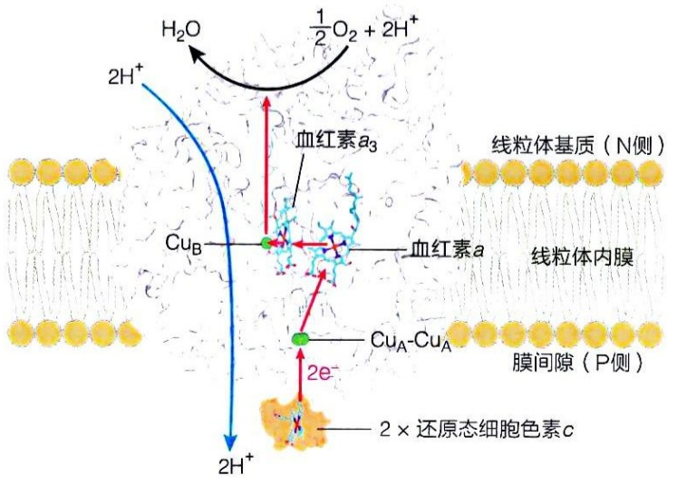

<details>
<summary>flowchart</summary>

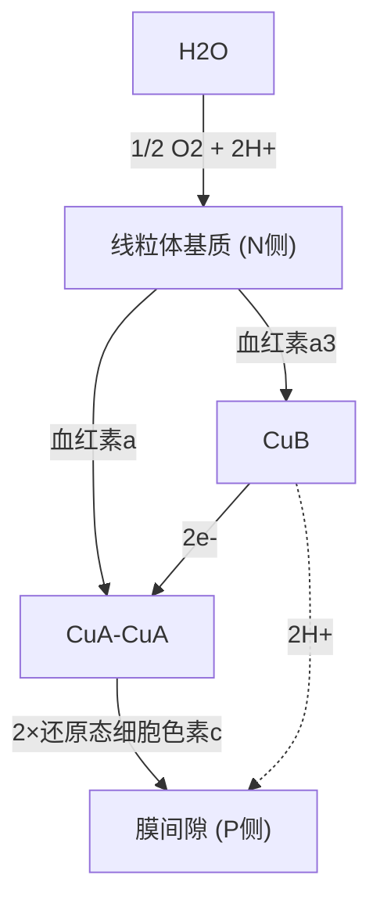
</details>

---

19.4 呼吸链电子传递过程由膜上的几种蛋白质复合物共同完成

215

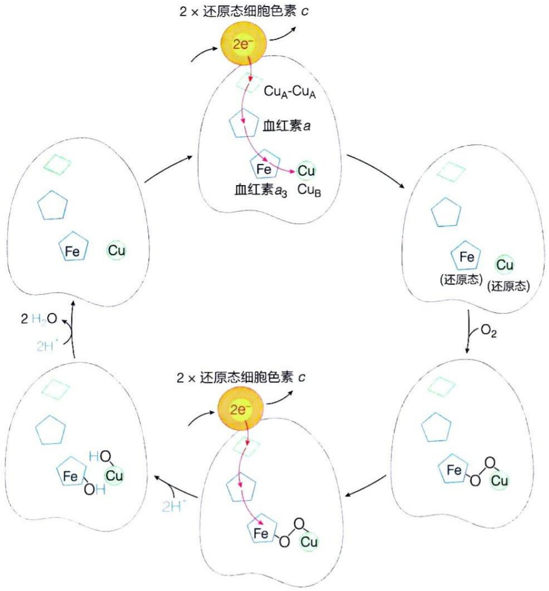

<details>
<summary>flowchart</summary>

This diagram illustrates the metabolic pathways of two different cell culture conditions (labeled as '2 × 还原态细胞色素 c' and '2 × 还原态细胞色素 c'), showing how iron (Fe) and copper (Cu) are converted into various metal complexes such as CuA-CuA, Fe, and O2.
</details>

图 19-11 复合物Ⅳ中  $O_{2}$  被还原形成  $H_{2}O$  的一种可能机制

复合物Ⅳ是呼吸链中的第三个质子泵。在这一过程中，复合物Ⅳ每传递2个电子可驱动2个质子从线粒体基质转运到线粒体膜间隙，但详细的机制并不清楚。

在复合物IV中，当结合于第二个双核中心的  $O_{2}$  处于未完全还原的中间体状态时，中间体是否会脱离复合物而产生 ROS，需进一步探究。

## 19.4.6 呼吸链电子传递驱动跨膜电化学势的形成

发生于呼吸链复合物中的电子传递，将在不同阶段以机制尚不明确的不同方式驱动质子的逆梯度跨膜泵送。这使得来自 NADH 和其他可氧化底物的每对电子在通过这些存在于膜蛋白复合物之中和之间的电子载体传递过程中可驱使一定量的质子跨膜转运（图 19-12）。

根据化学渗透学说，呼吸链电子传递将产生由化学梯度（ $\Delta pH$ ；反映膜两侧的质子浓度差）和电势梯度（ $\Delta\psi$ ；反映膜两侧电荷差）共同构成的跨膜电化学势能，即质子动力势。这样的质子动力势可为 ATP 的生成提供能量。

我们可以根据将 $1\mathrm{mol}$ 质子进行跨线粒体内膜转运所需消耗的自由能的量以及

---

216

19 氧化磷酸化

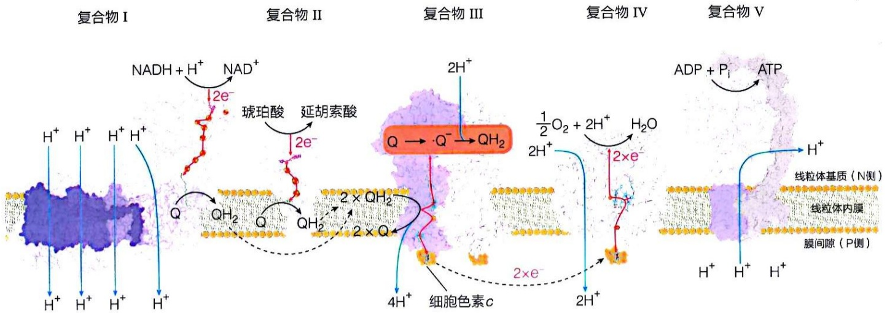

<details>
<summary>flowchart</summary>

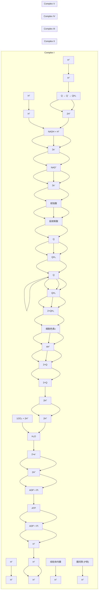
</details>

图 19-12 电子传递驱动的质子跨膜转运与 ATP 合成
由呼吸链复合物Ⅰ、Ⅲ和Ⅳ组成的电子传递链将来自 NADH 等电子供体的电子最终传递至  $O_{2}$ ，形成  $H_{2}O$ 。电子传递路径用红色箭头标出，

质子泵送方向用蓝色箭头标出，$\mathrm{QH}_2$ 和细胞色素 $c$ 的扩散方向用虚线箭头标注。

图 19-13 逆浓度梯度质子跨膜泵送示意图  
N侧表示带负电侧（为线粒体基质侧），质子浓度低；P侧为带正电侧（膜间隙侧），质子浓度高。

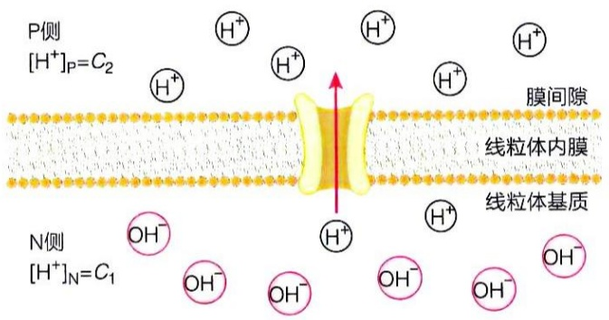

<details>
<summary>chemical</summary>

Diagram illustrating ion transport in a membrane with labeled components including P and N electrodes, H+ ions, and membrane interface.
</details>

1 mol NADH 和琥珀酸将 2 mol 电子传递至  $O_{2}$  所释放自由能的量，估算各自可以跨膜泵送多少质子。

质子逆浓度梯度跨膜泵送是一个耗能的过程（图 19-13）。

我们先计算将 1 mol 质子逆电化学梯度进行跨线粒体内膜转运所需消耗的自由能。这可通过以下公式计算:

$$
\Delta G = R T \ln (C _ {2} / C _ {1}) + Z F \Delta \psi \tag {19-1}
$$

这里的 $R$ 、 $T$ 和 $F$ 分别为摩尔气体常数、热力学温度和法拉第常数（见公式16-5）； $C_2$ 和 $C_1$ 分别为膜间隙中和线粒体基质中的质子浓度，即 $[\mathrm{H}^{+}]_{\mathrm{P}}$ 和 $[\mathrm{H}^{+}]_{\mathrm{N}}$ ，且 $C_2 > C_1$ 即 $[\mathrm{H}^{+}]_{\mathrm{P}} > [\mathrm{H}^{+}]_{\mathrm{N}}$ ； $Z$ 为1个质子所带电荷的绝对值，即1； $\Delta \psi$ 为跨线粒体内膜的电势差（单位为V）。

就质子而言:

$$
\ln \left(C _ {2} / C _ {1}\right) = 2. 3 \left(\lg [ \mathrm{H} ^ {+} ] _ {\mathrm{p}} - \lg [ \mathrm{H} ^ {+} ] _ {\mathrm{N}}\right) = 2. 3 \left(\mathrm{pH} _ {\mathrm{N}} - \mathrm{pH} _ {\mathrm{p}}\right) = 2. 3 \Delta \mathrm{pH}
$$

$\Delta pH$  为线粒体基质与膜间隙的 pH 的差值。

因此，式19-1可以被转换为

$$
\Delta G = 2. 3 R T \Delta \mathrm{pH} + F \Delta \psi \tag {19-2}
$$

---

19.4 呼吸链电子传递过程由膜上的几种蛋白质复合物共同完成

217

将三种常数代入，则得

$$
\Delta G = 5.7 \Delta \mathrm{pH} + 96.5 \Delta \psi \tag {19-3}
$$

一般而言，线粒体基质与膜间隙的 $\mathrm{pH}$ 差，即 $\Delta \mathrm{pH} = 0.75$；而线粒体内膜内外侧的电势差，即 $\Delta \psi = 0.15\mathrm{V}$。代入式19-3，得出泵送 $1\mathrm{mol}$ 质子逆梯度跨越线粒体内膜所需能量大约为 $20\mathrm{kJ / mol}$。

下面计算 $1\mathrm{mol}$ 的NADH或琥珀酸（通过 $\mathrm{FADH}_2$ ）将1对电子传递给 $\mathrm{O}_2$ 所释放的自由能。

从表16-4可查得有关氧化还原共轭对的标准还原势 $E^{\ominus \prime}$ : $\mathrm{NAD^{+} / NADH}$ 、延胡索酸/琥珀酸和 $\frac{1}{2}\mathrm{O}_2 / \mathrm{H}_2\mathrm{O}$ 分别为-0.320V、0.031V和0.816V。因此，电子从NADH或琥珀酸传递至 $\mathrm{O}_2$ 的 $\Delta E^{\ominus \prime}$ 分别为 $1.14\mathrm{V}[0.816 - (-0.320) = 1.14]$ 和 $0.785\mathrm{V}(0.816 - 0.031 = 0.785)$ 。

代入公式 16-7:

$$
\Delta G ^ {\ominus \prime} = - n F \Delta E ^ {\ominus \prime}
$$

计算结果表明，2个电子从NADH或琥珀酸传递至 $\mathrm{O}_2$ 所释放的标准自由能分别约为$220\mathrm{kJ / mol}$ 和 $150~\mathrm{kJ / mol}$ 。据此估算，每对电子从NADH或琥珀酸传递至 $\mathrm{O}_2$ 时，可分别泵送的质子数约为11个（ $220 / 20 = 11$ ）和7.5个（ $150 / 20 = 7.5$ )。这些数值与我们常用的10个和6个大致相符（图19-12）。

线粒体内膜两侧的质子浓度差和电势差所产生的电化学势，代表电子转移所产生的大部分能量的暂时性贮存，可用于驱动 ATP 的合成（具体见后）。

## 知识延展 19- 1

## 呼吸链复合物可能在细胞内以超级复合物形式存在

尽管线粒体内膜上的呼吸链电子载体可以被人为分离成复合物Ⅰ、Ⅱ、Ⅲ和Ⅳ等，但在完整的线粒体中，复合物Ⅰ、Ⅲ和Ⅳ似乎可以组装成超级复合物。

值得注意的是，复合物Ⅱ似乎并不参与超级复合物的形成，而是以独立形式存在于线粒体内膜上。因此，复合物Ⅱ可以被视作与脂酰辅酶A脱氢酶等催化特异底物分子氧化的酶类似，而并非通用呼吸链的一部分。

呼吸链超级复合物广泛存在于从酵母到高等动植物的众多生物中，但是在不同物种的超级复合物中，每种复合物存在的比例似乎稍有差异。比如，在1个从酵母细胞中分离到的超级复合物中，存在2个复合物Ⅲ和2个复合物Ⅳ；而在哺乳动物中则分离到了由1个复合物Ⅰ、2个复合物Ⅲ和1个复合物Ⅳ形成的超级复合物，这也是目前体外分离到的最常见组合比例（图19-14）。

在上述最常被分离到的呼吸链超级复合物中，复合物Ⅰ的膜臂与2个复合物Ⅲ中的一个接触。而复合物Ⅳ则同时与复合物Ⅰ的膜臂最远端和一个复合物Ⅲ接触。此外，线粒体内膜上的磷脂似乎也参与了超级复合物的组装。

除了超级复合物外，人们还观察到一种呼吸链巨大复合物（megacomplex）:它由2个复合物Ⅰ、2个复合物Ⅲ及2个复合物Ⅳ组装成一种类似圆盘状的结构（图19-15）。

---

218

19 氧化磷酸化

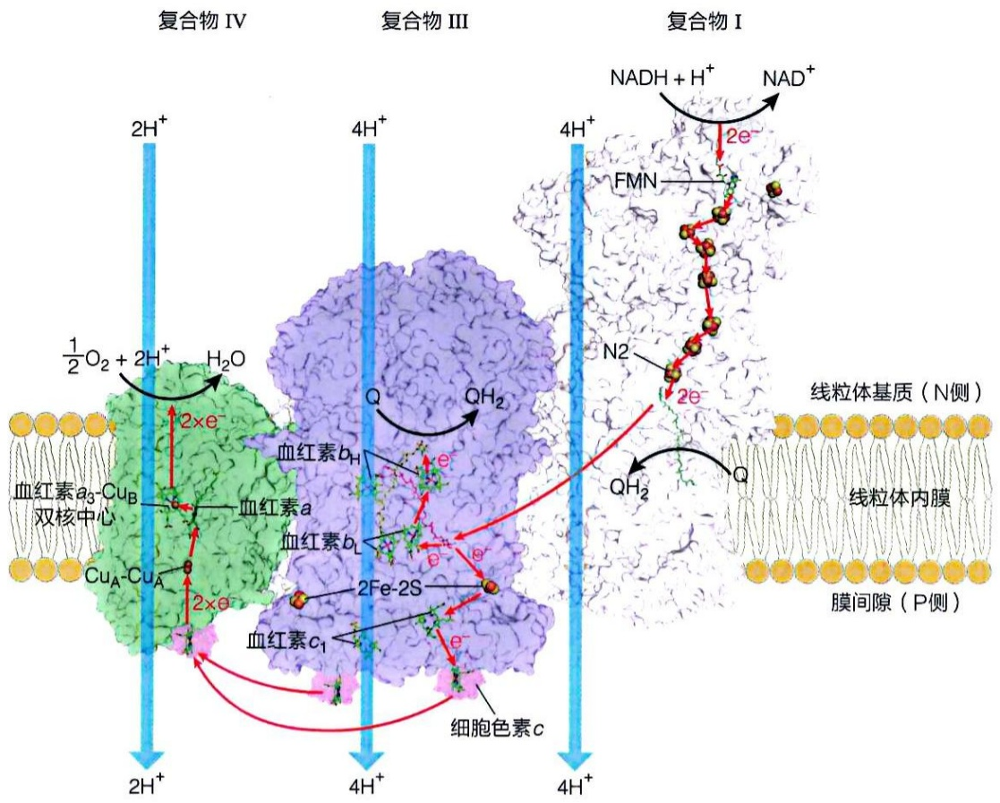

<details>
<summary>flowchart</summary>

```mermaid
graph LR
  subgraph Complex IV
  A["2H⁺"] --> B["1/2O₂ + 2H⁺ - H₂O"]
  C["血红素a₃-CuB 双核中心"] --> D["血红素a"]
  E["CuA-CuA"] --> F["2xe"]
  G["血红素b_H"] --> H["血红素bL"]
  I["2Fe-2S"] --> J["血红素c₁"]
  K["细胞色素c"] --> L["细胞色素c"]
  M["血红素a_CuB 双核中心"] --> N["血红素a"]
  O["血红素b_L"] --> P["血红素b_H"]
  Q["QH₂"] --> R["4H⁺"]
  S["4H⁺"] --> T["4H⁺"]
  end

  subgraph Complex III
  U["NADH + H⁺"] --> V["FMN"]
  W["NAD⁺"] --> X["NAD"]
  Y["NADH + H⁺"] --> Z["FMN"]
  AA["NAD⁺"] --> AB["FMN"]
  AC["NAD⁺"] --> AD["FMN"]
  AE["NAD⁺"] --> AF["FMN"]
  AG["NAD⁺"] --> AH["FMN"]
  AI["NAD⁺"] --> AJ["FMN"]
  AK["NAD⁺"] --> AL["FMN"]
  AM["NAD⁺"] --> AN["FMN"]
  AO["NAD⁺"] --> AP["FMN"]
  AQ["NAD⁺"] --> AR["FMN"]
  AS["NAD⁺"] --> AT["FMN"]
  AU["NAD⁺"] --> AV["FMN"]
  AW["NAD⁺"] --> AX["FMN"]
  A --> AC
  B --> AD
  C --> AE
  D --> AF
  E --> AG
  F --> AH
  G --> AI
  H --> AJ
  I --> AK
  J --> AL
  K --> AM
  L --> AN
  M --> AO
  N --> AU
  O --> AV
  P --> AW
  Q --> AX
  R --> AZ
  S --> AB
  T --> AC
  U --> AD
  V --> AE
  W --> AF
  X --> AG
  Y --> AH
  Z --> AI
  AA --> AJ
  AB --> AK
  AC --> AL
  AD --> AM
  AE --> AN
  AF --> AO
  AG --> AU
  AH --> AV
  AI --> AW
  AJ --> AX
  AK --> AZ
  end

  subgraph Complex I
    AC_II["NADH + H⁺"] -.->|"2e⁻"| AF_NA
    AF_NA -.->|"2e⁻"| AF_NB
    AF_NB -.->|"2e⁻"| AF_NC
    AF_NC -.->|"2e⁻"| AF_ND
  end

  subgraph Complex III
    AD_III["4H⁺"] -.->|"Q"| AD_NI
    AD_NI -.->|"QH₂"| AD_NII
  end

  subgraph Complex IV
    AD_IV["4H⁺"] -.->|"4H⁺"| AD_NIII
  end

  subgraph Complex I
    AD_III -.->|"4H⁺"| AD_NIV
  end

  subgraph Complex III & Complex IV
  AD_III -.->|"4H⁺"| AD_NV
  AD_NV -.->|"4H⁺"| AD_NVI
  AD_NVI -.->|"4H⁺"| AD_NVII
  AD_NVII -.->|"4H⁺"| AD_NVIIII
  AD_NVIIII -.->|"4H⁺"| AD_NVIIIII
  AD_NVIIIII -.->|"4H⁺"| AD_NVIIIIIIIIIIIIIIIIIIIIIIIIIIIIIIIIIIIIIIIIIIIIIIIIIIIIIIIIIIIIIIIIIIIIIIIIIIIIIIIIIIIIIIIIIIIIIIIIIIIIIIIIIIIIIIIIIIIIIIIIIIIIIIIIIIIIIIIIIIIIIIIIIIIIIIIIIIIIIIIIIIIIIIIIIIIIIIIIIIIIIIIIIIIIIIIIIIIIIIIIIIII II II II II II II II II II II II II II II II II II II II II II II II II II II II II II II II II II II II II II II II II II II II II II II II II II II II II II II II II II II II II II II II II II II II II II II II II II II II II II II II II II II II II II II II II II II II II II II II II II II II IIIIIIIIIIIIIIIIIIIIIIIIIIIIIIIIIIIIIIIIIIIIIIIIIIIIIIIIIIIIIIIIIIIIIIIIIIIIIIIIIIIIIIIIIIIIIIIIIIIIIIIIIIIIIIIIIIIIIIIIIIIIIIIIIIIIIIIIIIIIIIIIIIIIIIIII
  end
```
</details>

图19-14 一种含1个复合物I、2个复合物Ⅲ和1个复合物IV的呼吸链超级复合物示意图(PDB:5GUP)

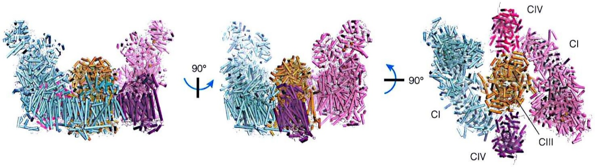

<details>
<summary>chemical</summary>

Molecular structure transformation diagram showing 90° rotation of a protein complex with labeled domains (CIV, CI, CIII)
</details>

图19-15 线粒体呼吸链复合物也可能形成巨大复合物结构

呼吸链复合物Ⅰ、Ⅲ和Ⅳ可以组装成巨大复合物（PDB:5XTI）。其中复合物Ⅲ以二聚体形式存在（橙色），2个复合物Ⅰ呈现为灰蓝色和粉色，2个复合物Ⅳ呈现为玫红色和紫色。

在巨大复合物中，呼吸链复合物Ⅰ、Ⅲ和Ⅳ之间存在1:1:1的比例关系，可能是真实情况下呼吸链复合物所形成的某种功能复合物。提高电子传递效率、减少活性氧的产生可能是超级复合物或巨大复合物存在的分子逻辑基础，但目前尚无明确定论。

---

19.4 呼吸链电子传递过程由膜上的几种蛋白质复合物共同完成

219

## 19.4.7 胞质溶胶中产生的 NADH 所携带电子可通过穿梭系统传递至呼吸链

糖酵解发生于胞质溶胶中，大部分情况下，其过程中产生的NADH需将电子传递至 $\mathrm{O}_2$ 以完成氧化过程。在使NADH重新氧化成 $\mathrm{NAD^{+}}$ 的同时，也使得糖酵解途径中的氧化反应所释放的能量能被用于生成ATP。在原核生物中，胞质溶胶中产生的NADH能直接将电子传递至质膜上的呼吸链复合物I，不存在障碍。但在真核细胞中，由于复合物I接受电子的部位存在于线粒体基质中，而胞质溶胶中产生的NADH尽管能自由通过线粒体外膜，却无法自由穿过线粒体内膜。为此，真核细胞演化产生可不断往返的独特穿梭（shuttle）机制，将胞质溶胶中NADH携带的电子传递至呼吸链。真核细胞中存在两种这样的穿梭系统，即苹果酸-天冬氨酸穿梭系统（图19-16A）和甘油-3-磷酸穿梭系统（图19-16B）。前者将电子先穿梭至线粒体基质中，然后通过线粒体基质中的NADH进入呼吸链；而后者却是将电子通过线粒体内膜外侧的蛋白质系统将电子传递至辅酶Q后进入呼吸链。下面分别简单介绍。

## (1) 苹果酸 - 天冬氨酸穿梭系统将电子通过苹果酸带入线粒体基质

这种机制最初于1960年代由荷兰学者皮特·博斯特（Piet Borst）等在一种肿瘤细胞中鉴定。后来发现普遍存在于哺乳动物大脑、心脏和肝脏等正常组织中，并且是最普遍发生的一种将胞质溶胶中NADH的电子传递至呼吸链的穿梭机制。

苹果酸-天冬氨酸穿梭主要依赖存在于胞质溶胶和线粒体基质中的谷草转氨酶（aspartate aminotransferase，即天冬氨酸转氨酶）和苹果酸脱氢酶这两种酶的同工酶，以及存在于线粒体内膜上的苹果酸/α-酮戊二酸转运蛋白和谷氨酸/天冬氨酸转运蛋白。具体过程简单描述如下（图19-16A）。

胞质溶胶中的 NADH 在胞质苹果酸脱氢酶的催化下，将其电子用于使草酰乙酸还原成苹果酸的过程。苹果酸通过苹果酸 /α-酮戊二酸转运蛋白穿过线粒体内膜进入线粒体基质，并在线粒体苹果酸脱氢酶催化下，重新生成草酰乙酸和 NADH。这样的 NADH 可进入呼吸链（图 19-16A）。

这样产生的草酰乙酸在线粒体谷草转氨酶催化下获得谷氨酸的氨基形成天冬氨酸，脱去氨基后的谷氨酸被转化为 $\alpha-$ 酮戊二酸。天冬氨酸可通过天冬氨酸/谷氨酸转运蛋白重新返回胞质，并由胞质谷草转氨酶催化重新生成草酰乙酸，参与下一轮穿梭运输。与此同时，通过利用这两种跨膜转运蛋白，胞质中由 $\alpha-$ 酮戊二酸生成的谷氨酸返回至线粒体基质；而线粒体基质中生成的 $\alpha-$ 酮戊二酸则重新返回至胞质溶胶，使得穿梭过程可以不断重复发生。

苹果酸-天冬氨酸穿梭系统尽管理论上是可逆的，但实际上是单方向的，即只将胞质溶胶中的NADH电子穿梭带入线粒体基质，而非相反。因为天冬氨酸/谷氨酸转运蛋白的作用依赖跨膜质子梯度:一个谷氨酸进入线粒体基质必须伴随一个质子的进入。这与观察到的事实也是吻合的，线粒体基质中的 $\mathrm{NADH / NAD^{+}}$ 比例远高于胞质溶胶。

---

220

19 氧化磷酸化

图 19-16 将胞质溶胶中的 NADH 所携带电子引入线粒体内膜呼吸链的穿梭系统

(A) 苹果酸 - 天冬氨酸穿梭系统。(B) 甘油 -3- 磷酸穿梭系统。

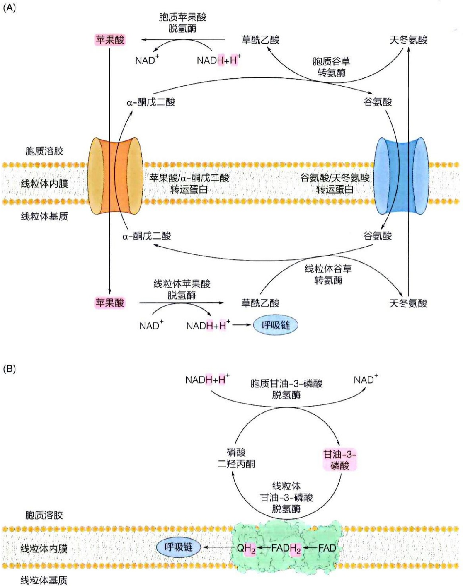

（2）甘油-3-磷酸穿梭系统直接将胞质溶胶中NADH的电子从线粒体内膜的外侧引入呼吸链

线粒体甘油-3-磷酸脱氢酶早在1930年代就被鉴定。后续研究表明，这是一种单亚基酶，整合于线粒体内膜的外侧，是另外一种将胞质溶胶NADH中的电子传递至线粒体内膜呼吸链的穿梭系统（图19-16B）。甘油-3-磷酸穿梭系统将胞质溶胶（膜间隙）中的NADH所携带电子通过其中的FAD辅因子传递至辅酶Q。

线粒体甘油-3-磷酸脱氢酶在哺乳动物不同组织中的表达差异很大，在大部分组织中的表达量都很低，只有在大脑和骨骼肌等组织中有一定的表达。所以甘油-3-磷

---

19.4 呼吸链电子传递过程由膜上的几种蛋白质复合物共同完成

221

酸穿梭在哺乳动物组织中并非一种普遍发生的过程。该系统常见于昆虫飞行肌中，可能对维持昆虫飞行肌高速率的氧化磷酸化反应很重要。

甘油 -3- 磷酸穿梭系统主要借助分别位于胞质溶胶和线粒体内膜上的甘油 -3- 磷酸脱氢酶的两种同工酶，将胞质溶胶中 NADH 携带的电子穿梭至呼吸链。具体而言，首先，在胞质溶胶甘油 -3- 磷酸脱氢酶催化下，NADH 将其电子传递至磷酸二羟丙酮（一种糖酵解中间物），使后者还原生成甘油 -3- 磷酸。然后，在线粒体甘油 -3- 磷酸脱氢酶催化下，甘油 -3- 磷酸上的电子被转移至该酶的 FAD 辅因子，生成  $FADH_{2}$  的同时重新生成磷酸二羟丙酮。 $FADH_{2}$  所携带的 2 个电子再被传递至辅酶 Q，生成  $QH_{2}$ ， $QH_{2}$  通过复合物Ⅲ进入呼吸链。

通过苹果酸-天冬氨酸穿梭机制，胞质溶胶中的NADH所携带的电子能够以与线粒体基质中的NADH相同的方式进入呼吸链，使得每个NADH产生大约2.5个ATP分子。然而，当电子通过甘油-3-磷酸穿梭途径传递时，情况则有所不同，这种情况下，电子绕过复合物I，直接传递至复合物Ⅲ。因此，每对电子仅能产生大约1.5个ATP分子（具体见后）。值得注意的是，线粒体内膜上的甘油-3-磷酸脱氢酶与复合物Ⅱ及电子转移黄素蛋白:泛醌氧化还原酶等具有一定的可比性。它们均使电子以$\mathrm{QH_2}$ 形式从复合物Ⅲ进入呼吸链。

## 知识延展 19- 2

## 呼吸链电子传递过程中可产生活性氧

对于耗氧生物而言，90%以上的氧分子都在线粒体中被消耗。氧气作为一种生命的必需物质，具有双面性。一方面，氧气分子是氧化磷酸化过程的末端电子受体，另一方面，氧气分子的不充分还原可能会生成有害的氧自由基，包括超氧化物、过氧化氢和羟基自由基等，被统称为活性氧（ROS）。

呼吸链中的多个步骤都是产生活性氧的潜在位点。具体而言，复合物Ⅰ中的FMN和复合物Ⅲ中所产生半醌自由基（·QH）可能将单个电子传递至 $O_{2}$ 形成超氧自由基（ $O_{2}^{-}$ ），继而导致羟基自由基（·OH）和过氧化氢（ $H_{2}O_{2}$ ）等活性氧的产生。

$$
\mathrm{O} _ {2} \xrightarrow {\mathrm{e} ^ {-}} \mathrm{O} _ {2} ^ {-} \cdot \xrightarrow {\mathrm{e} ^ {-}} \mathrm{H} _ {2} \mathrm{O} _ {2} + \cdot \mathrm{OH}
$$

其中的羟基自由基活性最强，破坏性也最强。

氧自由基由于存在未成对电子，因此极易从其他分子掠夺电子以形成自身的稳定电子对，这一过程会损害其他生物分子。例如，活性氧可以与细胞内的蛋白质、膜脂和核酸等生物分子发生反应，造成生物大分子的破坏和损伤。不能被迅速处理的活性氧将产生严重生理危害，诱发衰老等现象。

对呼吸链中不同位点产生活性氧的情况，目前的认识还不深入。一般而言，存在 FMN、FAD 和 Q 参与的位点都存在产生活性氧的潜在可能性，因为它们都能以半醌自由基形式存在，复合物Ⅰ、Ⅱ和Ⅲ中均存在这样的位点。具体而言，复合物Ⅰ中的 FMN 结合位点（被称作  $I_{F}$  位点）和 Q 结合位点（ $I_{Q}$  位点）、复合物Ⅱ中的 FAD 结合位点（ $II_{F}$  位点）以及复合物Ⅲ中的 Q 结合位点  $III_{QP}$ （即电子供体  $QH_{2}$  结合位点，见图 19-8）可能是 ROS 产生较多的地方。已有实验分析结果表明，其中的  $I_{F}$  和  $III_{QP}$  位点可能产生的活性氧最多（图 19-17）。

此外，存在于某些免疫细胞质膜中的 NADPH 氧化

---

222

19 氧化磷酸化

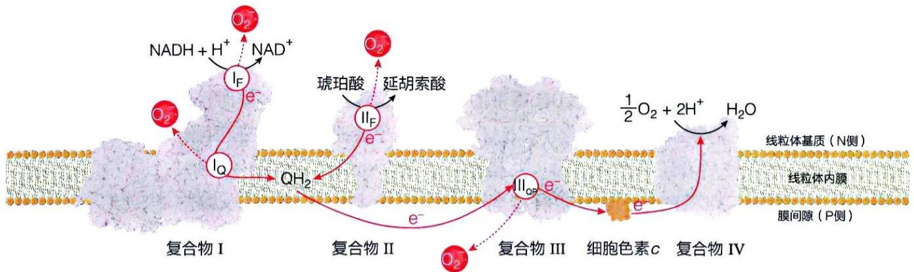

<details>
<summary>flowchart</summary>

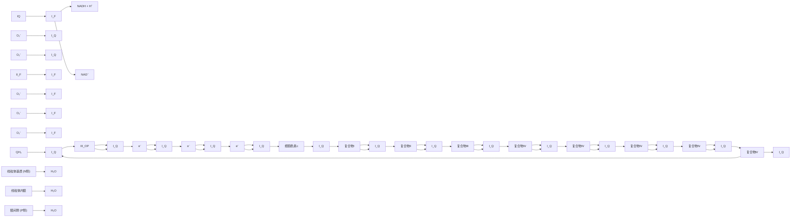
</details>

图 19-17 呼吸链中产生活性氧的可能位点

酶（NADPH oxidase）则通过催化单电子跨膜转移至分子氧而产生超氧阴离子，并利用它杀死病原体。

为防止活性氧对正常细胞的破坏效应，细胞演化出多种清除活性氧的保护机制。其中最主要的方式是通过产生一系列酶，如超氧化物歧化酶（superoxide dismutase）和谷胱甘肽过氧化物酶（glutathione peroxidase）等，它们将活性氧转化为水分子等。例如，红细胞中产生的过氧化氢会被谷胱甘肽过氧化物酶分解成水。同时，提供电子的2分子还原型谷胱甘肽（glutathione，GSH）被氧化，成为氧化型谷胱甘肽（GSSG）。后者通过谷胱甘肽还原酶催化，利用NADPH作为电子供体，可重新转化为GSH。因此GSH对于细胞有效清除活性氧至关重要。

## 19.5 储存于跨膜电化学梯度中的能量可用于驱动 ATP 合成

根据化学渗透学说，氧化磷酸化分为两个阶段，第一阶段是呼吸链电子传递及所偶联的跨膜质子梯度的形成，第二阶段则是利用储存于跨膜电化学梯度中的能量驱动ATP的合成。因此，电子传递和ATP合成可以是两种分离事件，二者通过跨膜质子梯度这个第三方进行偶联，这依赖一种拓扑学上封闭的绝缘生物膜的存在。下面介绍氧化磷酸化的第二阶段，即ATP的合成过程。

## 19.5.1 跨膜质子梯度储存的能量包括化学势能和电势能两部分

根据化学渗透学说，跨膜质子梯度所储存的能量可驱动质子顺浓度梯度移动，故被称作质子动力势。其本质为电化学势，由化学势能（chemical potential）和电势能（electrical potential）两部分组成（见图19-13）。化学势能是由于质子不能自由通过线粒体内膜，从而在膜两侧形成质子浓度差（内膜外面浓度高，内膜里面浓度低），即pH梯度（$\Delta \mathrm{pH}$）所致，电势能是由于膜两侧存在电荷差（膜外侧带正电，膜内侧带

---

19.5 储存于跨膜电化学梯度中的能量可用于驱动 ATP 合成

223

负电）所致，这种跨膜电势梯度（ $\Delta\psi$ ），大约为0.15\~0.20 V。

虽然质子无法自由穿过线粒体内膜，但可依赖膜蛋白进行跨膜转运。而顺浓度梯度的跨膜质子转运，将伴随能量的释放和做功，实现 ATP 的合成等。

上面我们利用公式 19-1 计算将 1 mol 质子逆电化学梯度进行跨线粒体内膜所需消耗的自由能大约为  $\Delta G = 20 \, kJ/mol$ ，这意味着 1 mol 质子顺梯度转运所能释放的自由能为  $\Delta G = -20 \, kJ/mol$ 。

后面我们将回答的重要问题之一是，每合成1个ATP分子需要几个（即下面反应式中 $n$ 的具体值）质子顺梯度跨膜转运，从带正电的P侧（也是质子浓度高的一侧）转移至带负电的N侧（也是质子浓度更低的一侧）？这个问题可用简单的化学式表示为

$$
\mathrm{ADP} + \mathrm {P_ {i}} + n \mathrm {H_ {P} ^ {+}} \rightarrow \mathrm{ATP} + \mathrm {H_ {2} O} + n \mathrm {H_ {N} ^ {+}}
$$

根据目前的认识，一般认为这里的 $n = 3 \sim 5$ 。但具体数目并不清楚，因为这与ATP合酶的催化机制密切相关（具体见后）。

## 19.5.2 电子传递过程与 ATP 合成过程之间存在强制性偶联

从大约 1940 年代开始，人们先利用完整细胞、后利用分离的线粒体等，对氧化磷酸化过程开展了广泛研究。电子传递过程一般通过测定样品氧气的消耗量反映，而 ATP 合成则可直接检测。利用这样的实验系统，人们对细胞中或分离的线粒体（以及后来的内外翻转线粒体内膜颗粒等）中在不同条件下发生电子传递和 ATP 合成的情况进行了深入探究。

人们首先观察到，只有当线粒体［或内外翻转颗粒（具体见后）］处于完全封闭状态时，ATP合成才可发生。尽管当时尚无法解释，但这一现象被反复验证，也是米切尔提出化学渗透假说的重要实验依据之一。

另外，人们也观察到，呼吸链电子传递与 ATP 合成这两个过程之间存在强制性偶联关系。一方面，只有当电子传递发生时（比如通过提供像琥珀酸这样的电子供体时），ATP 合成才可发生，这与电子传递驱动 ATP 合成的预期是一致的。但是，另一方面，只有当 ATP 合成发生时（即必须提供 ADP 和  $P_{i}$  底物时），电子传递才可发生。换言之，一旦电子传递被氰化物等抑制剂阻断，ATP 合成也就停止；同样，一旦 ATP 合成被寡霉素（oligomycin）或杀黑星菌素（venturicidin）等阻断时，电子传递也停止。后一种情况是未曾预料的。

## 19.5.3 某些化合物可解除电子传递与 ATP 合成之间的强制性偶联

在利用完整细胞或分离线粒体开展研究的过程中，人们也观察到某些化合物的加入可以使 ATP 合成被抑制，但电子传递却可以更加有效地发生，即两者的强制性偶联关系被解除。比如，加入像 2,4-二硝基苯酚（2,4-dinitrophenol，DNP）和羰基氰酯 -3-

---

224

19 氧化磷酸化


图19-18 2,4-二硝基苯酚解偶联示意图（A）及羰基氰酯-3-氯苯基腙的结构（B）

氯苯基腙（carbonyl cyanide-3-chlorophenylhydrazone, CCCP）等化合物后，尽管ATP合成被抑制，但电子传递却以更高速度进行。这些化学物质被称为解偶联剂（uncoupler）。

这些化合物所产生的解偶联效应，也成为米切尔提出化学渗透假说的重要实验依据。根据化学渗透假说，解偶联剂可能通过破坏跨膜质子梯度而产生效应。这些解偶联剂尽管化学结构各异，但均为有机弱酸（其 $\mathrm{pK_a}$ 接近7）且极性很低。这些分子在非解离状态下具有良好的脂溶性，可以有效地跨膜扩散。

比如，1940年代，李普曼等就观察到，2,4-二硝基苯酚能可逆性地解除磷酸化与氧化之间的偶联关系。其解偶联机制通过二十年后提出的化学渗透假说可以有效解释。尽管这样的化合物在 $\mathrm{pH}7$ 以解离形式存在时，由于极性较强，不易溶于脂质，难以直接透过生物膜；但在酸性环境中，2,4-二硝基苯酚将发生质子化，转变为非解离形式，获得良好的脂溶性，能够自由穿过细胞膜（图19-18A）。这种性质使得解偶联剂可以将质子顺浓度梯度跨膜（被动）转运，破坏跨膜质子梯度，最终抑制ATP合成。羰基氰酯-3-氯苯基腙（CCCP）等也属于疏水弱酸性分子（图19-18B），可通过类似方式破坏跨膜质子梯度，从而产生解偶联效应。

其实，在发现2,4-二硝基苯酚可以作为氧化磷酸化过程的解偶联剂之前，人们对这种物质的生物效应就已经有所认识。它在1880年代被用作食物增色剂，但后来认识到它具毒性。在第一次世界大战期间（即1910年代），人们注意到法国制造军火的工人在生产炸药（三硝基甲苯）的过程中接触2,4-二硝基苯酚，体重会显著减轻。1930年代，2,4-二硝基苯酚被观察到具有刺激代谢（并产热）的效应，并因此而被用作减肥药。然而，后来发现此药会产生严重的副作用，如导致白内障、失明、肾脏和肝脏损伤甚至死亡，因此被美国明令禁止应用于医疗领域。作为解偶联剂，2,4-二硝基苯酚会导致细胞消耗更多的碳水化合物和脂肪，达到减肥效果。但它也会抑制ATP的合成并产生大量的热量，导致严重的生物毒性。研究表明，服药过量导致的疾病和死亡大多是由于体温过高而非ATP合成抑制所致。

## 19.5.4 人工施加的跨膜电化学梯度可驱动 ATP 合成

1960年代，人们使用超声波处理分离到的线粒体、叶绿体或细菌后，发现线粒体

---

19.6 ATP 合酶利用储存于跨膜质子梯度中的电化学势能合成 ATP

225

的内膜、叶绿体的类囊体膜或细菌的细胞质膜等碎片会自发封闭形成囊泡颗粒。与原来的线粒体内膜相比，这种囊泡颗粒最大的变化是形成了内外翻转（inside-out）的线粒体内膜、类囊体膜或细菌质膜的囊泡颗粒，比如原来朝向基质侧的线粒体内膜翻转朝向外侧等。对分离的线粒体和叶绿体、内外翻转线粒体内膜和细菌质膜亚颗粒以及人工重构生物囊泡等所开展的人工施加跨膜电化学梯度的研究，为米切尔提出的化学渗透假说提供了强有力的实验证据。在这些实验里，在未加入任何可氧化底物作为电子供体的情况下，检测到了ATP的生成。

比如，人们对分离的线粒体开展了如下实验:先将线粒体孵育于含 $0.1\mathrm{mol} / \mathrm{L}$ KCl、$\mathrm{pH} = 9$ 的缓冲液中较长一段时间，使线粒体基质平衡于相同条件（即含 $0.1\mathrm{mol} / \mathrm{L}$ KCl, $\mathrm{pH} = 9$）。然后再将线粒体孵育于含钾离子载体缬氨霉素（valinomycin；为疏水性分子）但不含KCl的 $\mathrm{pH} = 7$ 缓冲液中一段时间。这将使得线粒体基质中的 $\mathrm{K}^+$ 被顺梯度转运出来，结果是线粒体基质中因为 $\mathrm{K}^+$ 浓度下降、$\mathrm{Cl^-}$ 浓度不变而带更多负电荷；而线粒体外膜则因为 $\mathrm{K}^+$ 浓度的增加而带更多正电荷，形成一种电势梯度（$\Delta \psi$）。同时线粒体内外的 $\mathrm{pH}$ 分别为9和7，形成一种化学梯度（$\Delta \mathrm{pH}$）。这样的化学梯度和电势梯度导致了ATP的生成。

另外利用重构的含细菌视紫红质蛋白（一种光驱动质子泵）和 ATP 合酶的人工囊泡，在光照条件下也检测到了 ATP 合成。

后来人们通过对内外翻转的线粒体内膜颗粒或细菌质膜颗粒等施加类似的电化学梯度（但与上述的梯度是相反的），也成功实现了 ATP 的合成（这时的 ATP 合成发生于颗粒的外面，更易于检测）。

同时人们发现分离的叶绿体，通过类似方法提供跨膜质子梯度后，在黑暗中也可以合成 ATP。

这些体外实验再次表明，完整封闭的膜结构是实现氧化和磷酸化偶联、产生 ATP 的必要条件。对于不完整的膜片段（未形成封闭结构）而言，只会氧化 NADH 消耗氧气，但不合成 ATP。

在上述观察基础上，米切尔在 1960 年代早期提出的化学渗透假说，到 1970 年代末被学术界逐渐接受:使氧化和磷酸化之间发生偶联的是质子梯度的电化学势能，它通过氧化而产生，通过 ATP 合成而消耗。

## 19.6 ATP 合酶利用储存于跨膜质子梯度中的电化学势能合成 ATP

1960 年代，美国学者拉克等从牛的心肌线粒体内膜上分离得到一种可溶性的偶联因子（ $F_{1}$ ），它被鉴定为一种 ATP 水解酶。他们后续提供的证据表明，这种酶尽管在体外催化 ATP 水解，但在细胞内却催化 ATP 的合成。我们下面聚焦于对 ATP 合酶的认识。

---

226

19 氧化磷酸化

## 19.6.1 存在于线粒体内膜、细菌质膜和类囊体膜上的 ATP 合酶负责 ATP 合成

通过电子显微技术，在内外翻转的线粒体内膜、类囊体膜或细菌质膜的囊泡颗粒的外表面（相当于线粒体内膜的基质侧），人们明显观察到直径大约为  $10 \, nm$  的球形（或旋钮状）未知结构，它们通过一个长约  $5 \, nm$  的细柄连接到膜上，而且这些囊泡仍然具有氧化磷酸化活性。

拉克等用尿素或胰蛋白酶处理这些囊泡后，外周的球形颗粒就会脱落，处理后的囊泡仍然具有电子传递活性，但是无法合成ATP。脱落下来的被他们称作 $\mathrm{F}_{1}$ 结构的球形颗粒却可以催化ATP的水解。当把球形颗粒重新加到囊泡颗粒上后，ATP合成也重新恢复。这强有力地表明，这些位于膜表面的旋钮状结构就是细胞内催化ATP生成的ATP合酶。

与电子传递类似，ATP 的合成也发生于生物膜结构上，这与化学渗透假说内容高度吻合。ATP 合酶可以利用跨膜质子梯度中所储存的能量合成 ATP。1970 年代以来，人们对 ATP 合酶如何利用这样的跨膜质子梯度合成 ATP 进行了卓有成效的探究。

## 19.6.2 ATP 合酶为由 $F_{0}$ 和 $F_{1}$ 两部分组成的多亚基复合物

后续研究表明，无论是来自原核还是真核生物（包括来自叶绿类囊体膜上）的ATP合酶均为多亚基复合物。ATP合酶由两部分组成:嵌合在膜内的部分被称为 $\mathrm{F_o}$，因为这是ATP合酶对抑制剂寡霉素的响应部位；伸展至膜外的球形颗粒部分被称为 $\mathrm{F_1}$，这部分含有催化ATP合成的活性中心，在体外可催化ATP合成的逆反应，即ATP的水解反应。因此，ATP合酶早期也被称为 $\mathrm{F_1F_o - ATP}$ 酶（归为F型ATP酶）或$\mathrm{F_1F_o - ATP}$ 合酶，但通常被简称为ATP合酶。

一种结构和作用机制高度可比的  $V_{0}V_{1}-ATP$  酶（为 V 型 ATP 酶）存在于溶酶体和植物液泡的膜上。它们的生物功能就是通过水解 ATP 而将质子泵入细胞器的内部，形成酸性内环境。存在于溶酶体内的各种水解酶均为适应这种酸性环境而演化产生，即它们催化活性的最适 pH 均为酸性。一般认为，存在于细菌质膜上的 ATP 合酶，除了可以利用跨膜质子梯度合成 ATP 之外，在某些条件下，也能通过催化 ATP 水解而发挥质子泵的作用。ATP 合酶具有的这种双向催化作用，表明酶催化时其实是同时加速可逆反应的正向和反向的速率，使反应快速达到其平衡状态。线粒体和叶绿体 ATP 合酶在体内是否能在一定条件下发挥水解 ATP 的功能尚不明确。

作为一种高度保守的蛋白质复合物，原核细胞、真核细胞线粒体和叶绿体的ATP合酶的基本亚基组成模式类似，均为 $\alpha_{3}\beta_{3}\gamma \delta \varepsilon \mathrm{ab}_{2}\mathrm{c}_{8 - 15}$ （图19-19）。其总分子量大约为$500\mathrm{kDa}$，大肠杆菌ATP合酶各亚基的分子量依次为:55（α）、50（β）、32（γ）、19（δ）、15（ε）、30（a）、17（b）、8（c）kDa（按照两种字母顺序依次降低）。

---

19.6 ATP 合酶利用储存于跨膜质子梯度中的电化学势能合成 ATP

227


图 19-19 细菌、叶绿体和线粒体 ATP 合酶结构示意图（A）和冷冻电镜重构图（B）

这里的  $\alpha$ 、 $\beta$ 、 $\gamma$ 、 $\delta$ 、 $\varepsilon$  五种亚基组成  $F_{1}$  部分的直径约 10 nm 的球形颗粒。其中的 3 个  $\alpha$  和 3 个  $\beta$  亚基间隔排列（即由 3 个  $\alpha\beta$  单位组成），形成一种类似橘瓣的结构，其中的三个  $\beta$  亚基含合成 ATP 的活性中心。 $\gamma$  亚基处于  $F_{1}$  的内部中心位置，下面与膜上的 c 环接触，上面与  $\alpha$  和  $\beta$  亚基接触，并被认为可以旋转。部分物种中， $\varepsilon$  亚基 C 端可处于两种构象:插入状态（与  $\alpha$  和  $\beta$  接触）或非插入状态（只与 c 亚基接触，不与  $\alpha$  或  $\beta$  接触）；处于插入状态时抑制 ATP 合酶的 ATP 水解活性。

由 a、b 和 c 亚基组成 ATP 合酶的  $F_{o}$  部分。这三种亚基均为膜蛋白，其中的 a 和 c 亚基完全整合于膜内，共同形成质子通道。而 b 亚基则是整合于膜内，但伸出至膜外，并与  $F_{1}$  部分的 δ 亚基相互作用。每个 ATP 合酶分子中由不同数目的 c 亚基形成一种存在于膜内的 c 环结构。在不同的物种中，c 亚基的数目为 8～17 个不等。一般而言，细菌和叶绿体中的 ATP 合酶高度类似，但在线粒体 ATP 合酶的  $F_{o}$  部分，还观察到其他亚基的存在，它们的功能有待阐述。

此外，线粒体 ATP 合酶被观察到以二聚体甚至四聚体形式分布于线粒体的嵴上，其生物学意义有待揭示。

---

228

19 氧化磷酸化

## 19.6.3 纯化的 $F_{1}$ 部分在体外可有效催化 ATP 分子的可逆分解和合成

对 ATP 合酶催化机制的研究其实早在 ATP 合酶被鉴定之前就已经开始。1950 年代人们就观察到，肝脏线粒体样品可以在缺乏氧化底物、也没有氧气摄取的条件下，使得放射性同位素  ${}^{32}P$  标记的无机磷酸（ $P_{i}$ ）快速进入 ATP 分子中。同时通过在  $H_{2}{}^{18}O$  中进行反应，也观察到无机磷酸中的氧原子进行了多次的交换。具体而言，在  $P_{i}$  中检测到了 3～4 个  ${}^{18}O$  原子（图 19-20）。

图 19-20 由 ATP 合酶的  $F_{1}$  部分在体外单独催化的  ${}^{18}O$  交换实验


后来当 ATP 合酶被分离纯化，以及其  $F_{1}$  可以被有效分离后，这些结果在体外得到有效重复。该令人意外的结果在当时无法被解释。因为理论上，分离的  $F_{1}$  作为一种 ATP 水解酶，它在催化 ATP 分子发生水解时， $H_{2}^{18}O$  中只会有 1 个  ${}^{18}O$  进入到所产生的  $P_{i}$  中，即每个  $P_{i}$  应该只带 1 个  ${}^{18}O$  原子。

从化学角度看，水解产生的 $\mathrm{P_i}$ 含有3\~4个而非1个 ${}^{18}\mathrm{O}$ 的事实，意味着ATP在ATP合酶或 $\mathrm{F_1}$ 中的合成和水解过程可在酶活性中心反复多次发生:ADP与 $\mathrm{P_i}$ 之间可以反复地结合，而ATP分子中的最后一个酸酐键可以反复断开，其 $\Delta G^{\prime}$ 接近0。因此，在ATP合酶的活性中心的ATP合成几乎无须消耗自由能，也就无须存在跨膜质子梯度。

根据化学渗透假说，在细胞内发生的 ATP 生成过程的能量来自于跨膜质子梯度，那么这样的跨膜质子梯度通过何种方式驱动 ATP 合酶合成 ATP 呢？

## 19.6.4 跨膜质子梯度中储存的能量驱动 ATP 从酶活性中心的释放

如果 ATP 的合成不需要能量，那么能量用于 ATP 合成的哪个步骤呢？

为了解释上述同位素交换实验结果，1970年代，美国学者保罗·博耶（Paul Boyer，

---

19.6 ATP 合酶利用储存于跨膜质子梯度中的电化学势能合成 ATP

229

1918—2012）等提出的假想是:氧化反应所提供的能量被用于 ATP 分子从 ATP 合酶活性中心的释放，而非用于形成 ATP 分子中的共价键（图 19-21）。

这意味着氧化反应提供的能量是驱使 ATP 合酶发生某种构象改变，从而导致 ATP 分子的释放。类似的解释从未在其他酶催化反应中被提出过，因此开始时难以得到大家的认可。如果 ATP 被合成后紧密结合于活性中心，那么它与 ATP 合酶的亲和力应该远高于与 ADP 的亲和力。实际测定结果表明，ATP 与 ATP 合酶结合的亲和力比 ADP 高大约 2～50 倍，即 ADP 的  $K_{d}$ （解离常数）值比 ATP 的  $K_{d}$  值高 2～50 倍。这支持了博耶的假说。


<details>
<summary>line</summary>

| 反应坐标 | G (kJ/mol) |
| --- | --- |
| E+ADP + Pi | ~0.2 |
| \(E(ADP \cdot Pi)\) | ~0.4 |
| E(ATP) | ~0.1 |
| E+ATP | ~0.8 |
</details>

图19-21 ATP合酶释放产物ATP时需消耗自由能

换句话说，尽管在经典的酶促反应中，到达过渡态

是需要克服的主要能量势垒。但在ATP合酶催化的反应中，ATP的紧密结合提供了高的结合能，这使酶结合ATP的自由能水平与结合 $\mathrm{ADP + P_i}$ 的自由能水平接近，因此，平衡常数接近1， $\mathrm{ADP + P_i\rightarrow ATP}$ 的反应无须克服高的能量势垒即可有效发生且可逆。但是合成的ATP必须释放才可驱动反应向ATP合成方向进行，而ATP释放所需的自由能才是由质子梯度所储存的电化学势能提供的。

## 19.6.5 ATP 合酶通过三个催化亚基各自与底物和产物亲和力发生轮流改变的机制催化 ATP 的生成

除了同位素交换实验表明能量可能被用于 ATP 分子释放而非合成过程之外，体外动力学分析也表明，每个 ATP 合酶复合物中的三个催化亚基的行为是相同的（即并不存在两种不同的催化中心）。动力学分析还表明，三个催化亚基之间存在协同效应:对合成过程而言，ATP 分子无法从一个催化中心释放，除非另外一个催化中心结合了 ADP 和  $P_{i}$ ；类似地，对水解过程而言， $P_{i}$  分子无法从一个催化中心释放，除非另外一个催化中心结合了 ATP 分子。

ATP合酶分子中参与催化的 $\alpha$ 和 $\beta$ 亚基各有3个拷贝，而 $\gamma$ 、$\delta$ 和 $\varepsilon$ 却各自只有1个拷贝。3个催化亚基 $\beta$ （更为准确地说，活性中心其实是由 $\alpha$ 和 $\beta$ 亚基共同形成的，但主要位于 $\beta$ 亚基中）与任何单拷贝亚基之间发生完全相同的相互作用是很难实现的，这也就使得三个催化亚基无法完全相同。为了解决这一矛盾，博耶等提出了三个大的催化亚基围绕一个更小的不对称的核心旋转运动的假说。

基于上述观察，1970年代博耶等提出了一种独特的“结合变构机制”（binding change mechanism）假说，以解释ATP合酶催化ATP生成的机制。其主要内容是，一个位于 $\alpha_{3}\beta_{3}$ 六聚体中央的不对称核心（在尚缺乏详细结构信息条件下，他们假想的中央核心包括 $\gamma$ 、$\delta$ 和 $\varepsilon$ 三个亚基）发生旋转，使得三个 $\beta$ 亚基轮流发生构象改变，但每一瞬间各自的构象不同。

---

230

19 氧化磷酸化

大约20年后，结合变构假说得到了英国学者约翰·沃克（John Walker）等对ATP合酶 $\mathrm{F}_{1}$ 部分晶体结构测定结果的强有力支持。他们巧妙地利用一种不可水解的ATP类似物App(NH)p代替ATP，使得其中的一个β亚基停留在结合ATP的状态，从而观察到以下现象:$\mathrm{F}_{1}$ 部分的3个 $\alpha$ 和3个β亚基的确以橘瓣式交替排列（具假六重对称性）；其中央结合1个不对称的 $\gamma$ 亚基，这使得每个ATP合酶分子中的3个β亚基所处构象和所结合的核苷酸形式都不同；其中一个亚基结合App(NH)p、一个结合ADP，一个是空的（即不结合任何核苷酸）。晶体结构表明，其中的每一个 $\alpha$ 亚基也结合1分子ATP（其意义尚不清楚）；每一个 $\alpha$ 亚基为其相邻的β亚基可能提供一个高度保守的精氨酸残基［有时被称作精氨酸指（Arg-finger）结构］参与催化中心的形成。

基于上述信息，ATP 合酶催化的结合变构机制（或称作旋转结合变构机制）如图 19-22 所示。

ATP 合酶催化的结合变构机制主要涉及以下两个方面（图 19-22）。

每一个  $\beta$  亚基在每一轮的催化过程中需经历三种构象状态。具体而言，第一种状态是不具备催化活性 L（loose）态，但能松弛地结合 ADP 和  $P_{i}$ 。随着  $\gamma$  亚基的旋转，该  $\beta$  亚基构象发生变化，转变为可与底物紧密结合的 T（tight）态，这时的活性中心可以催化 ADP 和  $P_{i}$  结合形成 ATP。随着  $\gamma$  亚基的继续转动，该  $\beta$  亚基被转变为第三种对 ATP 结合松弛的 O（open）态，此时合成的 ATP 分子可从活性中心释放，完成

图 19-22 ATP 合酶催化的结合变构机制示意图


<details>
<summary>flowchart</summary>

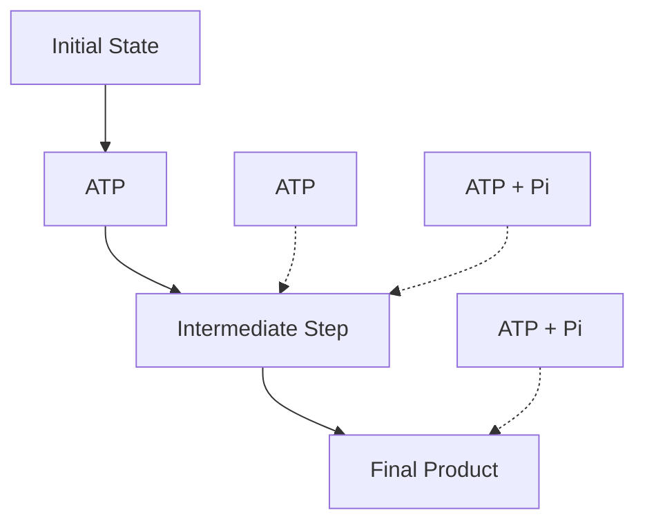
</details>

---

19.6 ATP 合酶利用储存于跨膜质子梯度中的电化学势能合成 ATP

231

一轮催化过程。这样，当 $\gamma$ 亚基旋转一周（$360^{\circ}$）后，ATP合酶经历一个完整的催化循环。每个 $\beta$ 亚基合成1个ATP分子，而每个ATP合酶则生成3个ATP分子。

另外，在任何一个给定时刻，一个ATP合酶分子中的非对称性的 $\gamma$ 亚基与3个β亚基的相互作用不同，这使得三个主要位于β亚基上的催化中心所处构象不同，其中一个催化中心处于结合ADP和 $\mathrm{P_i}$ 的L态、一个处于形成ATP的T态，而第三个则处于释放ATP的O态。

ATP合酶发挥ATP水解酶活性时，每个ATP酶分子中的三个 $\beta$ 亚基将通过协同机制水解ATP分子，这将驱动 $\gamma$ 亚基朝与体内ATP合成时相反的方向旋转。如果将ATP合酶的 $\mathrm{F}_{1}$ 部分固定在载玻片上，而在其 $\gamma$ 亚基或 $\mathrm{F}_{\circ}$ 部分的某个c亚基上连接一个带有荧光标记的肌动蛋白微丝，喷淋ATP溶液后用荧光显微镜观察，则 $\mathrm{F}_{1}$ 水解ATP产生的驱动力可带动肌动蛋白微丝进行运动。这样的体外直接观察也为结合变构机制提供了一定的支持性证据。

## 19.6.6 质子顺电化学梯度流经 $F_{\circ}$ 可驱动c环和 $\gamma$ 亚基的转动

将化学渗透假说和 ATP 合酶催化的结合变构机制假说进行综合，目前人们对 ATP 合酶在细胞内催化 ATP 生成的机制的总体认识如下:质子顺梯度流经 ATP 合酶的  $F_{0}$  部分时，将驱动存在于生物膜中的 c 环进行旋转，后者再带动  $\gamma$  亚基旋转，使得三个  $\beta$  亚基通过上述结合变构机制合成 ATP。

质子通道可能由a和c亚基共同形成，它由两个“半通道”组成，各自都可使质子特异和自由通过。在此基础上，寻找 $\mathrm{F_o}$ 亚基中的可能参与形成这样的质子半通道的残基（酸性和碱性残基），并通过残基替换等方式进行验证。人们假想的一种由a和c亚基共同组成的两个分别位于P侧（即膜间隙侧）和N侧（即线粒体基质侧）的半通道组成的质子通道如图19-23A所示。

每个 ATP 合酶分子中的 c 亚基拷贝数在不同物种中不同，一般由 8～15 个拷贝组成。比如，大肠杆菌和酵母中 10 个，钝顶螺旋藻（Spirulina platensis）中 15 个，而在牛和人中只由 8 个拷贝组成。这些不同拷贝数的 c 亚基在膜中组装成 c 环（c-ring），呈旋转对称分布。每个 c 亚基含内外两个跨膜螺旋结构，其 N 端和 C 端均位于膜间隙，而连接两个螺旋的环位于线粒体基质，并与  $F_{1}$  部分的  $\gamma$  和  $\varepsilon$  亚基接触。所有 c 亚基的内部螺旋形成一个内圈，而外部螺旋形成另一个外圈。位于外圈螺旋中部（埋于膜内）的一个谷氨酸（Glu）或天冬氨酸（Asp）残基，被认为参与了质子的跨膜移动并驱动 c 环旋转（图 19-23B）。

与 c 环形成跨膜螺旋不同的是，存在于膜内、位置相对固定的 a 亚基所含  $\alpha$  螺旋以几乎垂直于 c 环的横向角度镶嵌于膜中（图 19-23），正是存在于 a 和 c 亚基的  $\alpha$  螺旋中的氨基酸残基被认为共同形成了跨膜质子通道。

因此，a亚基与c环组成两个亲水的半通道（只穿越一半细胞膜厚度）:一个从高电势的膜间隙一侧通往膜的中间位置，另一个从膜的中间位置通往低电势的线粒体

---

232

19 氧化磷酸化


图 19-23 跨膜质子梯度驱动 ATP 合酶 c 环旋转的一种可能机制示意图

基质一侧。质子的跨膜转运路径如下:从高电势一侧进入半通道的质子与a亚基中一个保守的组氨酸残基结合使其质子化，之后质子被转移到c环上正对半通道入口的带负电的谷氨酸（或天冬氨酸，大肠杆菌中的Asp $^{61}$ ）残基上，使后者发生质子化，形成—COOH。电中性的谷氨酸残基可进入疏水的生物膜中，驱使c环往一个方向旋转；旋转一圈后，谷氨酸残基所携带的质子在线粒体基质侧的半通道中发生去质子化（因为基质侧呈碱性），重新恢复为去质子化状态。这样质子就被释放至线粒体基质，完成顺梯度跨膜转运过程。c亚基上的去质子化谷氨酸残基则进入新一轮的质子化和c环旋转过程。

这两个半通道之间被认为以a亚基中的一个保守精氨酸残基（大肠杆菌中的$\mathrm{Arg}^{210}$）为界，这个精氨酸残基所带正电侧链作为一种静电屏障发挥作用。一方面阻止质子从一个半通道直接进入另外一个半通道（必须随c亚基旋转一圈后才能进入），另一方面可以阻止c环发生反向旋转。简而言之，当c亚基上的Asp（或Glu）处于带负电（去质子化）状态时，a亚基上带正电的Arg可与之结合，阻止c亚基移动；当Asp与进入的质子结合时，Asp与Arg不再互作，c亚基移动。

## 19.6.7 每对电子流经呼吸链所释放能量可合成 ATP 分子的数目依物种的不同而不同

根据上面的认识，每个 ATP 合酶中的 c 环旋转一圈所需要消耗的质子数等于其所含 c 亚基的拷贝数。因此，在不同物种中，ATP 合酶旋转一圈将消耗 8～15 个跨膜质子，产生 3 个 ATP 分子。因为在牛（或其他哺乳动物）或钝顶螺旋藻线粒体中每个 ATP 合酶分别含 8 个和 15 个 c 亚基，合成 1 个 ATP 所需消耗的质子数分别为 2.7（8/3）个和 5（15/3）个。由于线粒体内膜上发生 ADP/ATP 转运时（ATP 运出，ADP 运入）还需消耗 1 个质子，上面的质子消耗分别为 3.7 个和 6 个。

我们也可以按照这样的方式估算每对电子通过呼吸链后所产生ATP分子的数量。

---

196 ATP 合酶利用储存于跨膜质子梯度中的电化学势能合成 ATP

233

比如，一对电子从 NADH 传递至  $O_{2}$  所释放能量可以合成 ATP 的数目可通过以下方程式进行描述:

$$
x \mathrm{ADP} + x \mathrm{P} _ {\mathrm{i}} + 1 / 2 \mathrm{O} _ {2} + \mathrm{H} ^ {+} + \mathrm{NADH} \rightarrow x \mathrm{ATP} + \mathrm{H} _ {2} \mathrm{O} + \mathrm{NAD} ^ {+}
$$

式中的 $x$ 即为磷氧比（P/O ratio），即还原1个氧原子可合成ATP分子的数量。依据化学渗透假说，电子传递释放的自由能通过跨膜质子梯度的电化学势与ATP合成相偶联。要测定磷氧比，则需测算还原1个氧原子所泵送的跨膜质子数与合成1个ATP分子所消耗的质子数目之间的比例关系。

下面以一个电子供体NADH和 $\mathrm{FADH}_2$ 经呼吸链传递、分别泵出10个和6个质子进行估算，如果合成1分子ATP消耗4个质子，则1个NADH携带的1对电子则传递所产生的磷氧比为2.5（10/4），而 $\mathrm{FADH}_2$ 所携带的一对电子传递产生的磷氧比则为1.5（6/4）。

根据上面描述的 ATP 合酶催化机制，当我们说“合成 1 分子 ATP 消耗 4 个质子”时，意味着其 ATP 合酶的 c 环由 9 个亚基组成。但不同生物 ATP 合酶的 c 亚基数不同，因此在不同物种中合成 1 分子 ATP 所需消耗的质子数并非相同。例如，牛线粒体 ATP 合酶上的 c 环亚基数为 8，因此合成 1 个 ATP 需消耗的质子数为  $(8 + 3)/3$ ，即 3.7 $^{①}$ 。如果以 NADH 为电子供体，则 P/O = 10/3.7 = 2.7。而对于酵母线粒体来说，合成 1 个 ATP 分子需消耗的质子数为  $(10 + 3)/3$ ，即 4.3，对应的 NADH 磷氧比为 2.3。而前面提到的钝顶螺旋藻则为  $(15 + 3)/3 = 6$ ，其 NADH 的磷氧比为 1.7。由此可见，不同物种的 NADH 的磷氧比一般介于 1.7 \~ 2.7 之间。

## 19.6.8 储存于跨膜质子梯度中的能量可用于驱动其他生物学过程

跨膜质子梯度作为一种电化学势能，除用于合成 ATP 外，也可用于驱动其他生物学过程，例如细菌鞭毛旋转、褐色脂肪产热和物质跨膜转运等。

## (1) 跨膜质子梯度可用于驱动细菌鞭毛的旋转

在漫长的生物演化过程中，为了摄食和避害，细菌进化出“快速”游动的能力。这种能力依赖细菌中存在的一种特殊的运动器官——鞭毛。它存在于大约70%的细菌种类中，是一种相当复杂的蛋白质机器。鞭毛马达的旋转产生动力，通过扭矩传递给接头装置，最终传递给鞭毛丝，带动其转动。

沙门菌鞭毛的结构如图19-24所示。长期的研究结果表明，鞭毛马达中含有质子通道，利用跨膜质子梯度的电化学势驱动鞭毛的转动，将化学能转变为机械能，进而将扭矩传递给鞭毛的内膜环，驱动内膜环的转动。


<details>
<summary>text_image</summary>

鞭毛
接头装置
外膜环
周质环
联动杆
内膜环
分泌装置
H⁺
H⁺
</details>

图 19-24 沙门菌鞭毛的结构示意图

<small><span class="docvortex-page-footnote" data-block-type="page_footnote" style="color:#6b7280">① 每将一分子 ATP 运出线粒体消耗一个质子。</span></small>

---

234

19 氧化磷酸化

## （2）跨膜质子梯度可用于驱动物质跨膜转运

跨膜质子梯度在细胞的物质跨膜转运过程中同样发挥关键作用。某些位于膜上的物质转运蛋白利用质子梯度驱动跨膜主动运输，如溶质载体（solute carrier）超家族蛋白，就是利用跨膜质子电化学梯度作为驱动力，实现对二价金属离子，包括  $Mn^{2+}$ 、 $Fe^{2+}$ 、 $Cd^{2+}$ 、 $Co^{2+}$ 、 $Zn^{2+}$ 、 $Ni^{2+}$  和  $Pb^{2+}$  等的主动运输。酵母中的溶质载体对  $Fe^{2+}$  的转运受溶液 pH 影响，表明转运过程可能依赖质子浓度。在一定范围内，质子浓度的增加可提高其转运效率。

## (3) 跨膜质子梯度可用于产生热量

位于某些类型细胞线粒体内膜的解偶联蛋白（uncoupling protein，UCP），又称产热蛋白（thermogenin），可利用跨膜质子梯度产生热量。解偶联蛋白在线粒体内膜上形成质子通道，使质子的顺梯度流动发生“短路”，即质子通过ATP合酶的 $F_{0}$ 部分以外的路径返回线粒体基质。因此，质子回流所释放的能量并未储存于ATP分子中，而是被用于产生热量。

在人体中已鉴定出五种解偶联蛋白（UCP1—5）。其中第一个被鉴定的 UCP1 在褐色脂肪组织（brown adipose tissue）等特定组织中表达尤为显著，占其线粒体膜蛋白总量的约 10%。在人类等哺乳动物的新生个体以及冬眠哺乳动物的颈部和背部存在的褐色脂肪组织细胞中，储存相对较小的脂肪滴（与白色脂肪细胞相比）。褐色脂肪细胞含有丰富的线粒体，正是线粒体中的细胞色素使得这些脂肪组织整体呈褐色。褐色脂肪的产热方式为非战栗性产热（non-shivering thermogenesis），又称代谢产热，它与肌肉组织等通过 ATP 水解实现的战栗性产热的机制不同。

褐色脂肪的产热依赖于线粒体内膜上的解偶联蛋白UCP1对跨膜质子梯度的利用（图19-25）。解偶联蛋白转运质子的活性可以被嘌呤核苷酸（如ATP、ADP、GTP、GDP）抑制，这种抑制效用可以被脂肪酸解除，但详细的机制有待阐述。褐色


<details>
<summary>flowchart</summary>

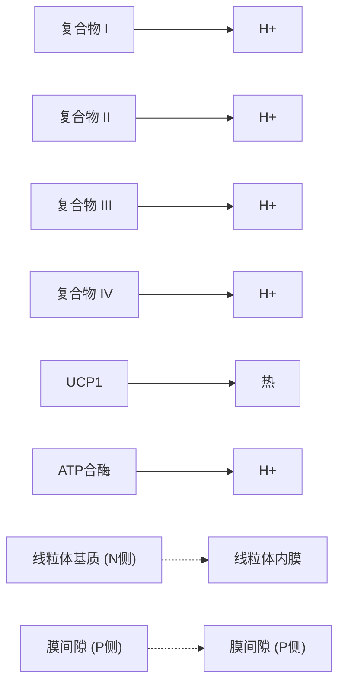
</details>

图19-25 线粒体内膜上的解偶联蛋白利用呼吸链所产生的跨膜质子梯度产热

---

19.5 ATP 合酶利用储存于跨膜质子梯度中的电化学势能合成 ATP

235

脂肪细胞中的解偶联蛋白所产生热量，对于帮助新生儿以及冬眠动物维持体温至关重要。

## 19.6.9 呼吸链复合物及 ATP 合酶的部分亚基由线粒体基因组编码

线粒体和叶绿体都属于真核细胞特有的细胞器，含有自己的DNA。人类细胞中的线粒体DNA全长为16569bp，所含基因编码13种蛋白质、22种tRNA和2种rRNA（12S和16S）。线粒体呼吸链复合物及ATP合酶中少数亚基由线粒体基因编码，它们在线粒体基质中被转录和翻译；其他则由细胞核基因组编码，在胞质溶胶中合成后被转运至线粒体。

具体而言，复合物Ⅰ、Ⅲ、Ⅳ以及ATP合酶均含有由线粒体基因组编码的蛋白质亚基，这包括呼吸链复合物Ⅰ中的7种亚基、复合物Ⅲ中含两个血红素（ $b_{L}$  和 $b_{H}$ ）的细胞色素b亚基、复合物Ⅳ中的3种亚基以及ATP合酶中包括α亚基在内的两种亚基。

因此，线粒体基质中生成的蛋白质亚基需与来自胞质溶胶中的亚基在线粒体内膜上进行有效组装，才可形成复合物Ⅰ、Ⅲ、Ⅳ以及ATP合酶。这样的新生肽链的转运和组装过程是一个复杂而重要的生命过程，它们在细胞内发生的详细机制有待阐明。

## 19.6.10 氧化磷酸化过程被严格调控以适应细胞的能量需求

需氧细胞中的 ATP 分子大多通过氧化磷酸化途径——利用电子传递至氧气过程所释放能量——产生。在生物演化过程中，氧化磷酸化过程的出现极大地提高了分解代谢的产能效率。但是，细胞对能量的需求随着不同生命过程的发生而不同。与其他生命过程类似，细胞演化出有效的调节机制，使得细胞的能量供给和需求之间达到良好的平衡状态，这也充分反映了生命过程的高效性。

(1) 产生 ATP 的不同途径之间的协同调节维持体内 ATP 水平的相对恒定

不同分解途径产生 ATP 的效率可能不同。比如，1 分子葡萄糖在有氧条件下完全氧化成  $CO_{2}$  和水可产生大约 30（或 32）个 ATP 分子。而通过缺氧条件下的乳酸发酵或酒精发酵等过程，每分子葡萄糖只能产生 2 个 ATP 分子。正如巴斯德效应所反映的事实，无论通过什么途径产生 ATP，细胞都维持相对恒定的 ATP 水平。因此，酵母细胞在缺氧条件下需消耗更多的葡萄糖来实现有氧条件下少量葡萄糖氧化即可实现的 ATP 产量。

（2）细胞内 ATP 水平相对恒定的维持通过对分解代谢各个途径的联动和协同调控而实现

维持细胞内 ATP 水平的相对恒定是通过对所有相关代谢途径进行自我调节而实现的。具体而言，ATP 和 ADP 的相对浓度不仅调控着电子传递和氧化磷酸化的速率，

---

236

19 氧化磷酸化

也调控糖酵解、丙酮酸氧化、柠檬酸循环等途径的速率。

当 ATP 的消耗增加时，不仅呼吸链电子传递和 ATP 合成的速率提高，而且糖酵解、丙酮酸氧化和柠檬酸循环等代谢途径的速率也随之提高，这使得电子流入呼吸链的速率相应提高。这通过高浓度 ADP 和 AMP 对多种酶——磷酸果糖激酶 -1、丙酮酸激酶、丙酮酸脱氢酶复合物、柠檬酸合酶、异柠檬酸脱氢酶等的别构激活而实现。当 ATP 的消耗速率降低时，高水平的 ATP 则可以别构抑制这些酶的活性。

此外，磷酸果糖激酶-1也会被柠檬酸循环的第一种中间产物柠檬酸别构抑制。当ATP的消耗速率降低时，高水平ATP将导致柠檬酸循环的某些酶被抑制，使其速率降低，这将导致柠檬酸在线粒体内的积累；另外，当乙酰辅酶A的产量高时，柠檬酸也会积累。柠檬酸将通过内膜上的特异转运蛋白转运至胞质溶胶中，抑制糖酵解途径的速率。当细胞中的ATP和柠檬酸浓度均升高时，它们会对磷酸果糖激酶-1同时产生别构抑制作用，其效果大于它们单独作用的效果之和，这可大大降低糖酵解途径的速率。

值得注意的是，这些别构激活和别构抑制效应的产生都是瞬时性、快速进行的过程，可以有效调节代谢途径的速率，达到维持 ATP 水平基本恒定的效果。

## （3）氧化磷酸化的速率决定于细胞内ADP的可利用性

研究表明，细胞内的ADP水平是反映细胞能量状态的一个重要指标。线粒体中呼吸速率（以 $\mathrm{O}_2$ 消耗率反映）通常受限于底物ADP的可获得性，即 $\mathrm{O}_2$ 的消耗速率显著依赖 $\mathrm{P_i}$ 的受体——ADP的可利用浓度。这种ADP对氧化磷酸化的调节方式被称为受体控制（acceptor control）机制（图19-26）。


<details>
<summary>flowchart</summary>

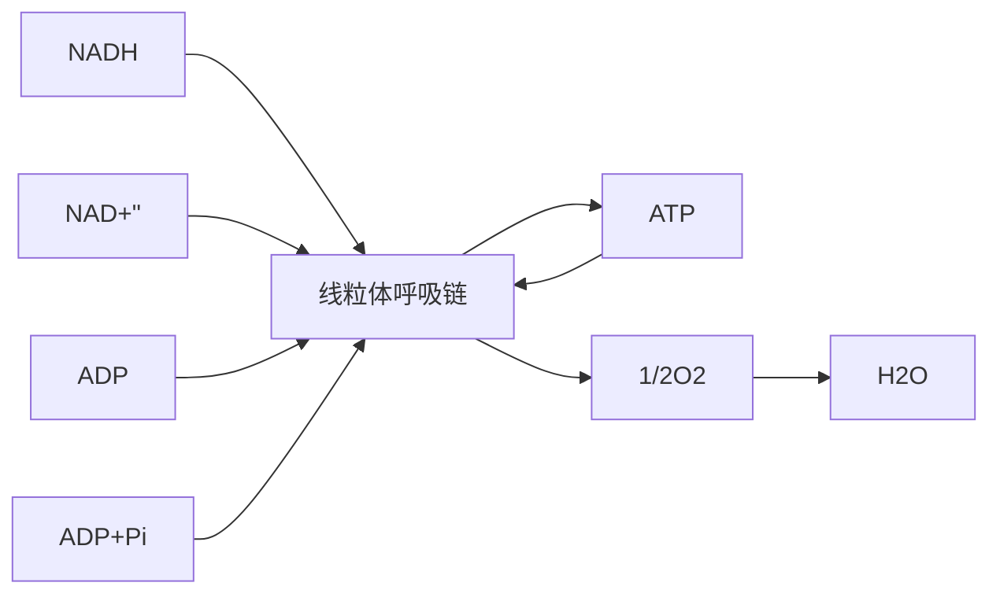
</details>

图19-26 氧化磷酸化速率受到ADP可利用性的调节

在某些动物组织中，受体控制比（acceptor control ratio），即高ADP水平诱导的氧消耗速率与缺乏ADP状态下的耗氧速率的比值，至少为10。这意味着:ADP水平高时（表明ATP的消耗速率高），氧化磷酸化的速率也高；而当ADP水平低时（表明ATP的消耗速率低），氧化磷酸化的速率也低。因此，氧化磷酸化的速率最终受到能荷（ATP/ADP）调节。

率受到 具体而言，当线粒体内ADP浓度上升时，ATP合酶活性上升，跨膜质子梯度下降，电子传递速率上升，耗氧率上升，细胞呼吸增加；反之，当线粒体内ADP浓度下降时，ATP合酶活性降低，质子梯度上升，电子传递速率下降，耗氧率下降，细胞呼吸减少。

细胞中燃料分子的氧化速率被精细调控，以致于在大多数组织中 ATP 浓度只发生轻微的上下波动，甚至在能量需求发生极端性变化时也是如此。

此外，在真核生物中还存在一种具有内在无序结构的抑制因子1（inhibitory factor 1, IF1），用于调节ATP合酶的ATP水解活性。当细胞处于低氧状态时，它将阻止ATP合酶因跨膜质子梯度过低而可能出现的ATP酶活性，即c环的倒转，以避免水解通过底物磷酸化产生的ATP分子。抑制因子1在pH低于6.5时被激活成二聚体，然后再与ATP合酶结合并抑制其水解活性。当pH恢复到中性时，抑制因子1的抑制效用也相应地被解除。

---

本章小结

237

## ※展望

氧化磷酸化过程主要发生于生物膜上，长期以来人们难以在体外对其开展有效研究。美国学者拉克在1970年代对氧化磷酸化过程的复杂性发出感叹:“任何人如果不被氧化磷酸化搞晕，那么仅仅是因为他或她并不知晓有关情况。”对这一复杂过程和机制的探究仍在进行之中，还存在多个关键问题尚未回答。

比如，电子传递过程如何导致跨膜质子梯度的形成是一个尚未回答的重要问题。尽管参与电子传递的电子传递链复合物Ⅰ、Ⅲ和Ⅳ的结构都或多或少通过X射线晶体衍射技术或冷冻电镜技术得到了解析，但是这些结构信息并未提供太多关于电子传递如何与质子跨膜转运相偶联的信息。毕竟质子太小，其传递路径也就难以从测定的蛋白质复合物的结构信息中得到任何暗示。但是这样的一个关键过程，该如何被揭示呢？我们似乎尚无任何思路。

再比如，尽管体外研究结果暗示 ATP 合酶通过一种独特的旋转机制实施催化，但对于存在于细胞中的 ATP 合酶究竟如何实施催化，我们毫无所知。根据体外数据，人们提出了存在于线粒体内膜中、由多个 c 亚基组成的 c 环需进行旋转，然后带动 γ 亚基旋转才能使得含有催化 ATP 合成的活性中心发生构象转变的机制。但是一个显而易见的缺陷是，存在于细胞膜中的 c 环如果快速旋转，膜的磷脂双层结构又如何被维持呢？这些都是需要通过活细胞探究才可回答的问题，但目前我们在活细胞中对蛋白复合物行为开展研究的手段极其有限。

其他问题包括，含有大量亚基的呼吸链复合物和 ATP 合酶在生物膜上究竟是如何组装成这么复杂而精巧结构的呢？当细胞处于不同条件时（如正常温度下和热休克胁迫条件下），呼吸链电子传递和 ATP 合成是如何被精细调控的呢？这些距离精确认知都还有很长的路要走。

## ※ 本章小结

氧化磷酸化是将NADH和 $\mathrm{FADH}_2$ 中的电子通过位于生物膜中由蛋白质复合物组成的呼吸链传递至 $\mathrm{O}_2$ 产生 $\mathrm{H}_2\mathrm{O}$ 、形成跨膜质子梯度、最后利用电化学势驱动ATP合成的过程。

呼吸链主要由四种多亚基呼吸链复合物（Ⅰ、Ⅱ、Ⅲ和Ⅳ）以及两种可移动电子载体（泛醌和细胞色素c）组成；ATP合成则由跨膜蛋白质复合物ATP合酶催化。

根据化学渗透假说，呼吸链电子传递与 ATP 合成之间以一种间接偶联方式进行。

由伸出膜外的  $F_{1}$  部分（ATP 合成中心）和整合于膜中的  $F_{0}$  部分（质子通道）组成的 ATP 合酶被认为通过结合变构的旋转机制催化 ATP 分子的合成。储存于跨膜质子梯度中的能量也可用于做其他功（如驱动细菌鞭毛的旋转或动物细胞的产热）。

发生于胞质溶胶中的糖酵解途径所产生的NADH携带的电子通过苹果酸-天冬氨酸等穿梭系统被传递至呼吸链。

---

238

19 氧化磷酸化

导向 ATP 合成的不同氧化分解途径受到严格的协同调节，以维持细胞内 ATP 水平的动态稳定。

## ※ 思考题

1. 线粒体呼吸链由哪些成员组成？
2. 在线粒体中，呼吸链复合物Ⅰ的亲水臂朝向哪一侧？ATP合酶的 $F_{1}$ 部分朝向哪一侧？在人工制备的亚线粒体颗粒中，上述朝向又是什么情况？
3. 已知泛醌的苯醌头部可以接受电子，那其异戊二烯链又有什么功能？
4. 常见的呼吸链抑制剂有鱼藤酮、抗霉素 A 和氰化物，它们分别阻断了哪两个电子载体间的电子传递？
5. 在牛的心肌细胞中，以 NADH 作为电子供体时，细胞呼吸的磷氧比是多少？当加入 2,4-二硝基苯酚后，磷氧比会怎么变化？
6. 缬氨霉素是一种电中性钾离子载体，可以在线粒体内膜两侧转移钾离子。当加入缬氨霉素后，研究者发现线粒体ATP合成减少，氧气消耗增加，热释放增加，线粒体内膜两侧的pH梯度增加。请解释这些现象出现的原因。
7. 已知革兰氏阴性菌类鼻疽伯克霍尔德菌（Burkholderia pseudomallei）的 ATP 合酶的 c 环有 17 个 c 亚基，则当用 NADH 作为电子供体时，该菌的磷氧比大约是多少？

## ※ 推荐阅读

1. MITCHELL P. Coupling of phosphorylation to electron and hydrogen transfer by a chemi-osmotic type of mechanism [J]. Nature, 1961, 191 (4784): 144–148.
阐述磷酸化与电子传递通过化学渗透机制的偶联作用。
2. ZHU J P, VINOTHKUMAR K R, Hirst J. Structure of mammalian respiratory complex I [J]. Nature, 2016, 536 (7616): 354–358.
利用冷冻电镜技术，首次以近原子分辨率（约 3.5 Å）揭示哺乳动物呼吸链复合体 I 的 L 形构象，包括 45 个亚基的精确排列及跨膜臂与亲水臂的协同作用。
3. WU M, GU J K, GUO R Y, et al. Structure of mammalian respiratory supercomplex $\mathbf{I}_1\mathbf{III}_2\mathbf{IV}_1$ [J]. Cell, 2016, 167 (6): 1598-1609.
利用冷冻电镜技术解析呼吸链超级复合物 $\mathrm{I}_1\mathrm{III}_2\mathrm{IV}_1$ 的结构，揭示其偶联电子传递与质子转运的分子机制。
4. KÜHLBRANDT W. Structure and mechanisms of F-type ATP synthases [J]. Annu Rev Biochem, 2019, 88: 515–549.
综述 F 型 ATP 合酶的结构与作用机制。
5. VERCELLINO I, SAZANOV L A. The assembly, regulation and function of the mitochondrial respiratory chain [J]. Nat Rev Mol Cell Biol, 2022, 23 (2): 141–161.

---

推荐阅读

239

综述线粒体呼吸链的组装、调控及功能多样性，重点探讨其与人类疾病的关联性。

6. LAI Y Z, ZHANG Y Y, ZHOU S, et al. Structure of the human ATP synthase [J]. Mol Cell, 2023, 83 (12): 2137-2147.

利用冷冻电镜技术解析人源 ATP 合酶的四种不同构象（包括开放、半开放、结合和催化状态）的高分辨率结构，深化对 ATP 合酶在合成 / 水解 ATP 过程中旋转催化机制的理解。

(撰写: 周丛照, 李珍, 秦咏梅, 杨茂君, 肖淳;

审修:杨广笑，张哲，李森，丁智）
